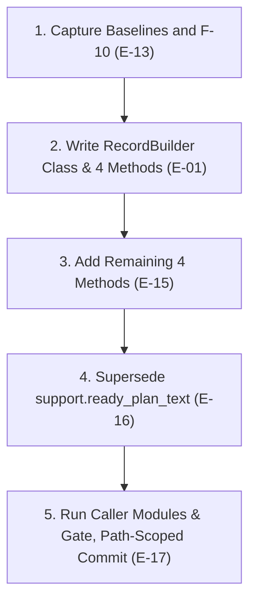

# IPD: Capture the test baselines and build the shared test record builder

- Date: 2026-11-09
- Kind: child
- Concern: Spec `4sd62s` section 6 requires that test data be written by ONE shared record builder in phase B, so that the cutover (Order 13) changes the builder and not hundreds of test files. Research `nj8zdp` and the maintainer's ruling ("plans that obtuse and not-too-smart agents won't mess up") set the guidance of at most 5 E-items and 8 work Scope-Paths per plan and about 8 named units per item; `9rgn2w` held the baselines, the builder, its tests and the fixture conversion in one plan with a builder item of eight methods. This part, split from `9rgn2w`, captures every baseline and writes the builder.
- Scope: Part 1 of the round-3 split of `9rgn2w` (2026-11-09, research `nj8zdp` guidance): `9rgn2w` E-13 (baselines, with F-10) and E-01 (the builder), E-01 split into E-01 (class, rules, four methods), E-15 (the other four methods) and E-16 (the `support.ready_plan_text` supersession), plus the finishing item E-17. EXCLUDES: the builder's test module (`ijpay0`); the tracked-fixture conversion (`7fpc8v`, `z4x192`, `9zcuyh`, `9rgn2w`); every test-module batch; production code; the log format (Order 13).
- Scope-Paths: tests/record_builder.py, tests/support.py, tests/fixtures/record_builder/ready_plan_text_golden.json, .aw/records/plans/pending/20261109-metastore-170-j6o96i-capture-the-test-baselines-and-build-the-shared-test-record.ipd.md
- Item-Dependencies: executed:g5hpbb, executed:tve77h, executed:7yr827, executed:xexn45
- Status: reviewed
- Readiness: go-pending-approval
- Review-Depth: complex
- From-Spec: 4sd62s
- Work-Kind: feature
- Priority: high
- Blocks-Release: next
- Set: metastore
- Order: 170
- Highest E allocated: 17
- Author: opencode its_direct/pt3-claude-opus-5.5-1m-us
- Id: j6o96i

> Write and proofread this plan per the technical writing standard, `.aw/system/workflows/technical-writing/technical-writing.md` (`.agents/workflows/technical-writing/technical-writing.md` in a legacy-layout install), including requirement 12 (diagrams).

## Workflow history
- 2026-11-14 reviewed (aw set): APPROVE WITH REVISIONS APPLIED; PR-001..PR-005 FIXED

- 2026-11-14 /plan-review (antigravity/gemini): APPROVE WITH REVISIONS APPLIED; PR-001..PR-005 FIXED; review record .aw/records/reviews/20261109-metastore-170-j6o96i-capture-the-test-baselines-and-build-the-shared-test-record.review.md
- 2026-11-09 to-review (opencode its_direct/pt3-claude-opus-5.5-1m-us): split from 9rgn2w (round 3, research nj8zdp guidance).

## Goal

Every baseline the later parts compare against is captured before the first edit, and one `tests/record_builder.py` exists that writes every record type through `artifact_meta`, with `support.ready_plan_text` a thin call into it with identical bytes.

## Detailed Implementation Checklist (TODO)

Execution-state rule: mark an `E-*` item complete only after performing the action. That mark is not validation. Right-sizing rule: write for a modest executor that cannot hold much in its head. Each E-item is one step (one concern, about one file, executable in one focused pass) and its V-item names each unit it covers with its own check; a plan stays at about 5 E-items and 8 work Scope-Paths, else split it into more child plans (guidance, `IPD-Z603`). Accepted execution states: blocked, failed, pending, performed; terminal gate demands 'performed'.

Item ids E-01, E-02, E-10 and E-13 are the ids these items had in `59aiyh` and `9rgn2w`; they are kept so that every reference between them (for example "E-13's `full-before.txt`", "the builder's `raw_fields=` escape (E-01)") still points at the right item across the family. New ids added by the round-3 split start at E-15.

### Task group 1: baselines and the builder

- [ ] E-13 Capture every baseline BEFORE any edit, under the gitignored `.aw/state/59aiyh/` (and `.aw/state/j6o96i/` for worktree isolation):
  - the bare `python3 -m pytest` summary line and wall time (`core-before.txt`);
  - the full-suite outcome list (`full-before.txt`), using the `59aiyh` E-12 command (`python3 -m pytest -o addopts="" -m "" -p no:randomly -n 0 -rA | grep -E "^(PASSED|FAILED|ERROR|SKIPPED|XFAIL|XPASS) " | sed -E 's/ - .*//' | sort > .aw/state/59aiyh/full-before.txt`);
  - `aw check --agent` output (`check-before.jsonl`);
  - the F-01 `rg` count over `tests/` (`legacy-before.txt`);
  - the E-09 helper count (`helpers-before.txt`);
  - the golden bytes of `support.ready_plan_text(**kwargs)` for every distinct argument set its call sites use at HEAD, plus the default call. They go in `tests/fixtures/record_builder/ready_plan_text_golden.json`, a tracked generated file whose generating command is documented in `tests/record_builder.py`'s module docstring.
  - Depends on: none
  - Split addition (2026-11-07): because `.aw/state/` is gitignored and does not travel between lane worktrees, also paste into this plan, as table F-10, the first line of `core-before.txt` with its wall time, the `legacy-before.txt` count, the `helpers-before.txt` count, the line count of `full-before.txt` and of `check-before.jsonl`, and the commit id at which all of them were taken; `59aiyh` E-11 and E-12 compare against F-10, and regenerate `full-before.txt` and `check-before.jsonl` at that commit (in a temporary `git worktree add` under `.aw/state/59aiyh/`) when they run in a different worktree.
  - Expected outcome: all six files exist with modification times earlier than the first edit to `tests/support.py` or `tests/record_builder.py`; F-10 is written.
  - Execution state: pending

- [ ] E-01 Create `tests/record_builder.py` with one `RecordBuilder(repo_root=None)` and one method per type; THIS item writes the class, its shared rules below, and the first four methods `plan(...)`, `spec(...)`, `backlog(...)` and `research(...)` (round-3 split 2026-11-09: the other four methods `release(...)`, `prompt(...)`, `walkthrough(...)` and `review(subject, rounds=...)` are E-15, and the SUPERSESSION rule is E-16). Each method takes registry field names (`status`, `set`, `order`, `plan_role`, `item_dependencies`, `blocks_release`, `from_backlog`, `readiness`, `approval`, `gate_kind`, `gate_ref`, `short_description`, ...), `history=[...]` events, `body=` prose (and, for plans, `open_questions=`), `disposition=` (a non-default lifecycle directory) and `raw_fields={legacy_name: text}` (inserted verbatim into the metadata block after the validated write and never validated; ONLY for tests whose input is deliberately invalid, F-08). Each method returns the created `Path` (or `str` when `text_only=True`). Rules:
  - VALIDATION. Every field name and value outside `raw_fields` is validated through the `artifact_meta` registry (`artifact_meta.registry_fields`, `artifact_meta.validate_new_events`), so a misspelled field fails the test at build time.
  - WRITING (phase B). The builder writes through `artifact_meta`, as spec `4sd62s` section 7 step 6 requires: the file form calls `artifact_meta.create` (whose phase-B branch renders through `write_legacy`, `7yr827` E-01) and `artifact_meta.append` for `history=` events, with the fixture repository as the project that `artifact_meta` resolves (the fixture repository carries `.aw/`, without which `project_context` finds no project). The text form calls `artifact_meta.render_legacy_text(text, events)` (`7yr827` E-01). The builder has NO renderer of its own, so the cutover changes the format by changing `artifact_meta` and `RECORD_FORMAT`, never by editing a second copy of the format in the tests. Plans start from `ipd_authoring.build_skeleton`, as `support.ready_plan_text` does today; other types start from the minimal heading and body that today's creating command emits.
  - PLACEMENT. The file goes at `artifact_naming.build_clustered_name` under each type's records directory using the layout model default disposition: `pending/` for plans and prompts, status subdirectories for specs and backlog, and records root for research, releases, walkthroughs, and reviews, or explicit `disposition=` when provided.
  - DETERMINISM. `when=` defaults to the fixed day `2026-08-24` (the `support.ready_plan_text` default) and is never read from the clock, so built bytes are reproducible.
  - TEXT FORM. `text_only=True` returns the string without writing, for tests that pass text (`ipd_lint.lint_text`, merge-stage helpers). `repo_root=None` is allowed for text-only calls.
  - SWITCH. One module-level constant, `RECORD_FORMAT`, names the format: `"legacy"` now; Order 13 adds `"log"`.
  - Depends on: E-13
  - Expected outcome: `RecordBuilder(tmp).plan(status="approved", set="demo", order=1)` writes a plan that `aw ipd lint` and `artifact_meta.read` accept; `plan(stauts="approved")` raises naming `stauts`; `plan(raw_fields={"Status": "EXECUTED"})` writes the literal line; `spec(...)`, `backlog(...)` and `research(...)` each write a record `artifact_meta.read` accepts.
  - Execution state: pending

- [ ] E-15 (split from E-01, round-3 split 2026-11-09) Add the other four `RecordBuilder` methods to `tests/record_builder.py`: `release(...)`, `prompt(...)`, `walkthrough(...)` and `review(subject, rounds=...)`, under the E-01 rules (VALIDATION, WRITING, PLACEMENT, DETERMINISM, TEXT FORM, SWITCH). Review records have no `artifact_meta` writer in phase B (no CLI writes them; `xexn45` defers the review-recording command), so `review(...)` renders through `review_findings.render_review` and writes with `review_findings.write_review`.
  - Depends on: E-01
  - Expected outcome: each of the four methods writes a record in a temporary fixture repository; the release, prompt and walkthrough records are accepted by `artifact_meta.read`, and the review record parses with `review_findings.parse_review_text`.
  - Execution state: pending

### Task group 2: supersession and finish

- [ ] E-16 (split from E-01, round-3 split 2026-11-09) SUPERSESSION: make `support.ready_plan_text` in `tests/support.py` a thin call into `RecordBuilder.plan(..., text_only=True)` with the same signature and the same bytes, checked against the E-13 golden file `tests/fixtures/record_builder/ready_plan_text_golden.json`.
  - Depends on: E-15
  - Expected outcome: for every argument set in the golden file, the new `support.ready_plan_text` returns bytes equal to the recorded ones.
  - Execution state: pending

- [ ] E-17 Finish this part: run `python3 -m pytest -o addopts="" -n 0 -v` over the modules that call `support.ready_plan_text` (re-derive them with `rg -l "ready_plan_text" tests`) and the bare core gate `python3 -m pytest`; commit through `aw commit j6o96i -- <each changed path>`, never `git add -A`, a bare `git add` or `git commit -a`. Never push. (New finishing item; the builder's own test module is Order 171, `ijpay0`.)
  - Depends on: E-16
  - Expected outcome: every listed module passes unchanged; the core gate passes; every commit is path-scoped to Scope-Paths (or justified at finalize).
  - Execution state: pending

Add further leaves as `- [ ] E-NEW <action>` and run `aw ipd sync` to assign ids.

## Project conventions discovered (Step 0)

- Interface names from Order 02 (`tve77h`): `artifact_meta.registry_fields(type)`, `artifact_meta.validate_event`, `artifact_meta.validate_new_events(type, events, *, records_root, migration_import=False)`, `artifact_meta.read(id6) -> State`, `artifact_meta.create(...)` and `artifact_meta.append(id6, events, *, expect_seq)`. Order 02's `create`/`append` write the log format; `2xwb9b` E-03 adds the phase-B legacy branch of `append` and `7yr827` E-01 routes the phase-B branch of `create` and `append` through `write_legacy`, with `render_legacy_text(text, events)` (`7yr827` E-01) as the same renderer over a string. In phase B the on-disk format is the bullet format; the legacy loader reads it into the cache.
- `review_findings.render_review` (pure) and `review_findings.write_review` render and write a `.review.md` record; no CLI calls `write_review` (`xexn45` Findings).
- The existing shared plan builder is `support.ready_plan_text`, which is "BUILT FROM THE REAL GENERATOR (`ipd_authoring.build_skeleton`)" and then fills the fields a draft leaves open; the builder keeps that approach for plans, so a scaffold change still reaches every fixture.
- Shared test plumbing lives in `tests/support.py` (`init_repo`, `git`, `run_cli`, `pinned_env`, `ready_plan_text`, `scope_drift_repo`); `tests/repo_template.py` (`copy_template_repo`) gives a pre-built repository; there is no `tests/conftest.py`, and the root `conftest.py` owns tier selection.
- Tests are behavioral (AGENTS.md "TEST OUTCOMES, NOT CODE STRUCTURE"); core modules set `pytestmark = pytest.mark.core`; `slow` tests are listed in `tests/slow_allowlist.txt`; `pyproject.toml` `addopts` deselects `slow` and `livecorpus`, so a complete comparison passes `-m ""`, and `pytest-randomly` is installed, so a deterministic order needs `-p no:randomly`.
- `tests/fixtures/review-pilot/` is the input corpus of `tools/review_pilot.py` (`manifest.json` names each plan file, `defects.json` quotes exact text to plant), and `tests/test_review_pilot.py` copies the whole directory into its fixture repository.
- Filenames come from `artifact_naming.build_clustered_name` and parse with `artifact_naming.parse_clustered`.
- Cite code by SYMBOL (`module.function`) or by a quoted content string, with a line number only appended to one of those and never alone: an offset expires before this plan executes (spec `ipd-structure-and-linting` Section 10.2; advisory `IPD-C801`).

## Findings

Measured 2026-11-07 at `ac76110f4` (the split measurement) unless a row says otherwise; carried from `9rgn2w`.

| Id | Evidence | Finding |
|---|---|---|
| F-01 | `rg -c --glob '*.py' -e '- (Id\|Status\|Set\|Kind\|Blocks-Release\|Readiness\|Item-Dependencies\|Scope-Paths\|From-Backlog\|From-Spec\|Work-Kind\|Priority\|Order\|Date\|Gate-Kind\|Gate-Ref\|Approval\|Subject-Id\|Verdict\|Graduated-To):\|## Workflow history' tests` lists 323 files with 6,820 lines (318 batch files after the 5 EXCLUDED `tests/test_artifact_meta_*.py` files; 326 files at review) | Batch input for Orders 38 to 40 and `59aiyh` E-09. |
| F-04 | 92 matches of the E-09 helper pattern in 62 modules at `ac76110f4` (89 at review); `support.ready_plan_text` has 30 calls in 15 modules | E-13 captures the helper count; E-02 (d) covers every captured `ready_plan_text` argument set. |
| F-05 | 26 tracked `.md` fixtures carry `^- (Id\|Status):` (`fixtures/attnview/specs-valid` 9, `fixtures/attnview/violations` 7, `fixtures/review-pilot/plans` 9, `fixtures/conforming-orchestrator.md` 1; unchanged at `ac76110f4`); 8 test modules contain `aw-prompt` (7 at review); 60 `ipd_lint.lint_text(` calls in 11 test modules | The builder needs a text form and a prompt form; the review-pilot corpus stays literal (E-10). |
| F-10 | (written by E-13) baseline summary for later parts | Read by `59aiyh` E-11 and E-12. |

## Behavior decisions (spec `4sd62s` section 6, section 7 step 6)

- D-1 (Renderer provider). The builder relies on `7yr827` E-01 for `write_legacy` and `render_legacy_text` in Phase B (with `xexn45` completing the full writer migration), keeping zero duplicate formatting code in test utilities.
- D-2 (Text form without repository root). `RecordBuilder` allows `repo_root=None` (or `RecordBuilder.plan(..., text_only=True)`), rendering text via `artifact_meta.render_legacy_text` directly so callers like `support.ready_plan_text` require no temporary filesystem repository.
- D-3 (Record placement across types). Record placement follows each type's layout definition (`agent_workflows.layout.build_default_layout().record_classes`), placing plans and prompts in `pending/`, specs in status subdirectories (`to-review` or `draft`), backlog in `open`, and research/releases/walkthroughs/reviews at their records root, with override via `disposition=`.
- D-4 (Golden fixture documentation). The generation command and procedure for `tests/fixtures/record_builder/ready_plan_text_golden.json` is documented in `tests/record_builder.py`'s module docstring, keeping all builder documentation self-contained before `ijpay0` runs.

## Proposed changes (ordered, validatable)

1. Capture the baselines and F-10 (E-13).
2. Write the builder class and its first four methods, then the other four (E-01, E-15).
3. Make `support.ready_plan_text` a thin call into the builder (E-16).
4. Run the `ready_plan_text` callers and the core gate, commit (E-17).

## Deferred / out of scope (with reason)

- The builder's test module `tests/test_record_builder.py` (`9rgn2w` E-02).
  - Carrier: ijpay0
- The tracked-fixture conversion (`9rgn2w` E-10) and the finishing run.
  - Carrier: 9rgn2w
- The test-module batches, the switch-point proof and the full-suite comparison.
  - Carrier: 59aiyh
- The review-pilot corpus stays literal legacy input.
  - Carrier: cxxmyv

## Scope check

- Over-scope: none. No production module changes.
- Under-scope: none known. Size: 5 E-items in 2 task groups, 3 work Scope-Paths; per-item units: E-13 6 baselines and F-10, E-01 1 class with 4 methods and 6 rules, E-15 4 methods, E-16 1 function, E-17 1 run.

## Required tests / validation

Behavioral checks run in this part: built records read back through `artifact_meta.read`, and the `support.ready_plan_text` golden comparison. The builder's own test module is Order 171 (`ijpay0`). Commands: the `ready_plan_text` caller modules, the bare core gate `python3 -m pytest`. CONTRIBUTES to AC-1b (owned by `cxxmyv`) by supplying the single switch point.

## Spec / documentation sync

No spec change; implements the builder half of `4sd62s` section 6 and section 7 step 6.

## Open questions

### OQ-01: Which prior Orders does the builder depend on?

- Blocking: no
- Status: resolved
- Owner: plan-review (round 1 of `59aiyh`, decision D-1)
- Resolution or deferral rationale: `g5hpbb`, `tve77h`, `7yr827`, and `xexn45` (carried from `59aiyh` OQ-02 and updated 2026-11-14): `7yr827` (split from `xexn45` on 2026-11-07) gives `artifact_meta.create` a phase-B legacy branch (`write_legacy`) and adds `render_legacy_text`, and `xexn45` completes the remaining writer moves, so depending on `7yr827` and `xexn45` guarantees the shared renderer is available without the builder carrying a duplicate implementation. Recommendation strength: strong.

## Validation and cross-check (verify before reporting done)

Validation-state rule: inspect evidence in a separate pass. Do not mark a `V-*` item complete from memory or from the matching execution checkmark. Accepted validation results: blocked, failed, pass, pending; terminal gate demands 'pass'. Runtime-demonstration reachability rule: for each `V-*` item demanding the software be observed acting (such as a run, a dispatch, or a transition), as distinct from items demanding a diff, a file's content, or a test result, which are reachable by construction, name the code path that produces the observation or the sibling `E-*` that creates it, else the demand is UNDER-SCOPE.

- [ ] V-13 validates E-13
  - Required evidence: paste `ls -l --time-style=full-iso .aw/state/59aiyh/ tests/fixtures/record_builder/ready_plan_text_golden.json` and `git log --reverse --format='%H %ci %s' -- tests/record_builder.py | head -1` (the commit that adds the module, which does not exist at review), showing every baseline file older than that commit; the first line of `core-before.txt`; the line count of `full-before.txt`; the number of argument sets in the golden file; and the F-10 table.
  - Observed evidence:
  - Result: pending

- [ ] V-01 validates E-01
  - Required evidence: paste `python3 -c` output that builds one record of each of the four E-01 types (plan, spec, backlog, research) in a temporary fixture repository with `RecordBuilder` and prints, for each, the created path and the `artifact_meta.read(<id6>)` status, set and order; `aw ipd lint <built plan>` ending in `conforming`; the exception message raised for `plan(stauts="approved")`, naming `stauts`; the bytes of the line written by `plan(raw_fields={"Status": "EXECUTED"})`; and `rg -n "def |import" tests/record_builder.py` output showing that the module imports `artifact_meta` for writing and defines no metadata renderer of its own (the verbatim `raw_fields=` line insertion is the one permitted text edit).
  - Observed evidence:
  - Result: pending

- [ ] V-15 validates E-15
  - Required evidence: paste `python3 -c` output that builds one `release`, one `prompt`, one `walkthrough` and one `review` record in a temporary fixture repository with `RecordBuilder` and prints, for each, the created path and, for the first three, the `artifact_meta.read(<id6>)` status, and for the review, the round count returned by `review_findings.parse_review_text`; and `rg -n "def (release|prompt|walkthrough|review)\b" tests/record_builder.py` listing the four methods.
  - Observed evidence:
  - Result: pending

- [ ] V-16 validates E-16
  - Required evidence: paste the `git diff tests/support.py` showing `support.ready_plan_text` reduced to a call into `RecordBuilder.plan`, and `python3 -c` output that loads `tests/fixtures/record_builder/ready_plan_text_golden.json`, calls `support.ready_plan_text(**args)` for each argument set and prints `<n> of <n> equal` (every set byte-identical).
  - Observed evidence:
  - Result: pending

- [ ] V-17 validates E-17
  - Required evidence: paste the `rg -l "ready_plan_text" tests` list and, for each listed module, its `-v` run's PASSED/FAILED counts (all passed); the bare `python3 -m pytest` summary line and wall time beside F-10's `core-before.txt` line; and every `aw commit j6o96i` output listing only Scope-Paths.
  - Observed evidence:
  - Result: pending

## Approval and execution gate

- Size assessment: standard
- Cohesion rationale: not required

Execute only after human approval (`Status: approved`) and after `g5hpbb`, `tve77h`, `7yr827`, `xexn45` are executed. Every open question is resolved.

Scope fence: the paths in `- Scope-Paths:` are a declaration. A needed test-tree file outside the fence is edited and then justified at finalize (`--scope-reason`), and a declared path left unmodified is acknowledged (`--scope-ack`). Production code under `agent_workflows/` and `tools/` is out of this plan's purpose: if the work cannot be done without a production change, stop and report the missing capability.

Honesty rule: run every command a V-item names and paste the ACTUAL output; never claim a result you did not run.

Commits: commit only through `aw commit j6o96i -- <paths>`; never `git add -A`, a bare `git add` or `git commit -a`; never push.

Lifecycle transition: the plan moves to `.aw/records/plans/executed/` only through `aw ipd finalize`, never a hand `git mv`, and only after `aw ipd lint --phase pre-transition` conforms and every `V-*` reads `pass` with pasted evidence. When `aw oc run` or `aw agy run` executes the plan, the runner performs the finalize; a hand executor runs `aw ipd finalize j6o96i` itself.
