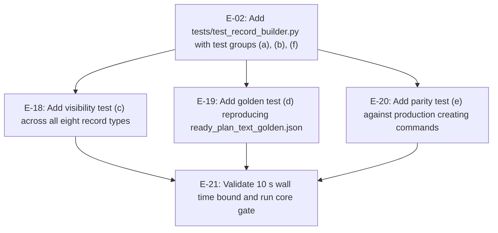

# IPD: Test the shared test record builder

- Date: 2026-11-09
- Kind: child
- Concern: Spec `4sd62s` section 6 requires ONE shared record builder for test data in phase B; it must itself be proved by behavioral tests before any test module moves onto it. `9rgn2w` E-02 held six test groups in one item. Research `nj8zdp` guidance (at most 5 E-items, about 8 named units per item) splits them here into one item per group cluster.
- Scope: Part 2 of the round-3 split of `9rgn2w` (2026-11-09, research `nj8zdp` guidance): `9rgn2w` E-02 (`tests/test_record_builder.py`), split into E-02 (groups (a), (b), (f)), E-18 (c), E-19 (d) and E-20 (e), plus the finishing item E-21 that applies the 10 s bound. EXCLUDES: the builder itself (`j6o96i`); the fixture conversion; production code; the switch-point test (`59aiyh` E-11).
- Scope-Paths: tests/test_record_builder.py, tests/slow_allowlist.txt, .aw/records/plans/pending/20261109-metastore-171-ijpay0-test-the-shared-test-record-builder.ipd.md
- Item-Dependencies: executed:g5hpbb, executed:tve77h, executed:7yr827, executed:xexn45, executed:j6o96i
- Status: reviewed
- Readiness: go-pending-approval
- Review-Depth: standard
- From-Spec: 4sd62s
- Work-Kind: feature
- Priority: high
- Blocks-Release: next
- Set: metastore
- Order: 171
- Highest E allocated: 21
- Author: opencode its_direct/pt3-claude-opus-5.5-1m-us
- Id: ijpay0

> Reviewed and proofread per the technical writing standard, `.aw/system/workflows/technical-writing/technical-writing.md`, including requirement 12 (diagrams).

## Workflow history

- 2026-11-14 reviewed (aw set): APPROVE WITH REVISIONS APPLIED; PR-001..PR-005 FIXED
- 2026-11-14 /plan-review (antigravity/gemini-3.8-flash): APPROVE WITH REVISIONS APPLIED; PR-001..PR-005 FIXED; review record .aw/records/reviews/20261109-metastore-171-ijpay0-test-the-shared-test-record-builder.review.md
- 2026-11-09 to-review (opencode its_direct/pt3-claude-opus-5.5-1m-us): split from 9rgn2w (round 3, research nj8zdp guidance).

## Goal

`tests/test_record_builder.py` proves the builder round-trips, lints, is visible to the toolkit's readers, reproduces the `support.ready_plan_text` golden bytes, matches the production creating commands, and refuses bad input.

## Detailed Implementation Checklist (TODO)

Execution-state rule: mark an `E-*` item complete only after performing the action. That mark is not validation. Right-sizing rule: write for a modest executor that cannot hold much in its head. Each E-item is one step (one concern, about one file, executable in one focused pass) and its V-item names each unit it covers with its own check; a plan stays at about 5 E-items and 8 work Scope-Paths, else split it into more child plans (guidance, `IPD-Z603`). Accepted execution states: blocked, failed, pending, performed; terminal gate demands 'performed'.

Item ids E-01, E-02, E-10 and E-13 are the ids these items had in `59aiyh` and `9rgn2w`; they are kept so that every reference between them (for example "E-13's `full-before.txt`", "the builder's `raw_fields=` escape (E-01)") still points at the right item across the family. New ids added by the round-3 split start at E-15.

### Task group 1: builder tests

- [ ] E-02 (carried from `9rgn2w` E-02, round-3 split 2026-11-09: its test groups (c), (d) and (e) are E-18, E-19 and E-20) Add `tests/test_record_builder.py` (core, `pytestmark = pytest.mark.core`) with test groups (a), (b) and (f):
  - (a) ROUND TRIP. For each of the eight types, a built record round-trips through `artifact_meta.read` with every field equal to the builder input.
  - (b) LINT. A built plan with `support.ready_plan_text`'s defaults lints `conforming` at the `pre-execution` checkpoint.
  - (f) REFUSALS. An unknown field, an illegal status for the type and a `short_description` over 300 characters each raise.
  - Depends on: none
  - Expected outcome: every (a), (b) and (f) test passes.
  - Execution state: pending

- [ ] E-18 (test group (c) of `9rgn2w` E-02) Add to `tests/test_record_builder.py` the visibility test: (c) VISIBILITY. One fixture repository holds one record of each type. ONE call each of `aw find`, `aw attention --format json` and `aw check all --agent` sees every built record.
  - Depends on: E-02
  - Expected outcome: the test passes; its duration under `-n 0` is recorded for E-21's 10 s bound.
  - Execution state: pending

- [ ] E-19 (test group (d) of `9rgn2w` E-02) Add to `tests/test_record_builder.py` the golden test: (d) GOLDEN. `support.ready_plan_text` reproduces the E-13 golden bytes for every captured argument set (30 call expressions at review).
  - Depends on: E-02
  - Expected outcome: the test passes for every argument set in `tests/fixtures/record_builder/ready_plan_text_golden.json`.
  - Execution state: pending

- [ ] E-20 (test group (e) of `9rgn2w` E-02) Add to `tests/test_record_builder.py` the parity test: (e) PARITY. For plan, spec, backlog, research, release and prompt, the builder's file and the file the production creating command writes (`aw ipd scaffold`, `aw specs new`, `aw backlog new`, `aw research new`, `aw releases new`, `aw prompts new`, each with `--apply`) for the same fields give equal `artifact_meta.read` states, so a builder record is a record the toolkit itself would write. Review is excluded because no CLI creates review records; its rounds are checked by (a) through `review_findings.parse_review_text`.
  - Depends on: E-02
  - Expected outcome: the six-type parity test passes; its duration under `-n 0` is recorded for E-21.
  - Execution state: pending

### Task group 2: finish

- [ ] E-21 Finish this part, with the 10 s bound carried from `9rgn2w` E-02: run `python3 -m pytest -o addopts="" -n 0 -v --durations=0 tests/test_record_builder.py`; the module's total wall time under `-n 0` stays under 10 s, because (c) and (e) start CLI subprocesses (if it exceeds 10 s, (c) and (e) move to a separate module listed in `tests/slow_allowlist.txt` and the core module keeps (a), (b), (d) and (f)) (measured at review: about 0.4 s for `aw find`, 2.4 s for `aw attention --format json` and 0.9 s for `aw check all --agent` in an empty fixture repository). Run the bare core gate `python3 -m pytest`; commit through `aw commit ijpay0 -- <each changed path>`, never `git add -A`, a bare `git add` or `git commit -a`. Never push.
  - Depends on: E-18, E-19, E-20
  - Expected outcome: every test passes; total duration under 10 s or the moved module listed in `tests/slow_allowlist.txt` with its own passing run; every commit is path-scoped to Scope-Paths (or justified at finalize).
  - Execution state: pending

Add further leaves as `- [ ] E-NEW <action>` and run `aw ipd sync` to assign ids.

## Project conventions discovered (Step 0)

- Interface names from Order 02 (`tve77h`): `artifact_meta.registry_fields(type)`, `artifact_meta.validate_event`, `artifact_meta.validate_new_events(type, events, *, records_root, migration_import=False)`, `artifact_meta.read(id6) -> State`, `artifact_meta.create(...)` and `artifact_meta.append(id6, events, *, expect_seq)`. Order 02's `create`/`append` write the log format; `2xwb9b` E-03 adds the phase-B legacy branch of `append` and `7yr827` E-01 routes the phase-B branch of `create` and `append` through `write_legacy`, with `render_legacy_text(text, events)` (`7yr827` E-01) as the same renderer over a string (finishing in `xexn45`). In phase B the on-disk format is the bullet format; the legacy loader reads it into the cache.
- `review_findings.render_review` (pure) and `review_findings.write_review` render and write a `.review.md` record; no CLI calls `write_review` (`xexn45` Findings).
- The existing shared plan builder is `support.ready_plan_text`, which is "BUILT FROM THE REAL GENERATOR (`ipd_authoring.build_skeleton`)" and then fills the fields a draft leaves open; the builder keeps that approach for plans, so a scaffold change still reaches every fixture.
- Shared test plumbing lives in `tests/support.py` (`init_repo`, `git`, `run_cli`, `pinned_env`, `ready_plan_text`, `scope_drift_repo`); `tests/repo_template.py` (`copy_template_repo`) gives a pre-built repository; there is no `tests/conftest.py`, and the root `conftest.py` owns tier selection.
- Tests are behavioral (AGENTS.md "TEST OUTCOMES, NOT CODE STRUCTURE"); core modules set `pytestmark = pytest.mark.core`; `slow` tests are listed in `tests/slow_allowlist.txt`; `pyproject.toml` `addopts` deselects `slow` and `livecorpus`, so a complete comparison passes `-m ""`, and `pytest-randomly` is installed, so a deterministic order needs `-p no:randomly`.
- `tests/fixtures/review-pilot/` is the input corpus of `tools/review_pilot.py` (`manifest.json` names each plan file, `defects.json` quotes exact text to plant), and `tests/test_review_pilot.py` copies the whole directory into its fixture repository.
- Filenames come from `artifact_naming.build_clustered_name` and parse with `artifact_naming.parse_clustered`.
- Cite code by SYMBOL (`module.function`) or by a quoted content string, with a line number only appended to one of those and never alone: an offset expires before this plan executes (spec `ipd-structure-and-linting` Section 10.2; advisory `IPD-C801`).

## Findings

Measured 2026-11-07 at `ac76110f4` (the split measurement) unless a row says otherwise; carried from `9rgn2w`.

| Id | Evidence | Finding |
|---|---|---|
| F-04 | 92 matches of the E-09 helper pattern in 62 modules at `ac76110f4` (89 at review); `support.ready_plan_text` has 30 calls in 15 modules | E-13 captures the helper count; E-02 (d) covers every captured `ready_plan_text` argument set. |
| F-09 | At review, in an empty installed fixture repository: `aw find plans` 0.47 s, `aw attention --format json` 2.4 s, `aw check all --agent` 0.9 s; `aw install` into a fresh repository 4.6 s | E-02's bound is 10 s with a stated fallback. |

## Proposed changes (ordered, validatable)

1. Write test groups (a), (b), (f) (E-02).
2. Write the visibility, golden and parity tests (E-18, E-19, E-20).
3. Apply the 10 s bound, run the core gate, commit (E-21).

## Deferred / out of scope (with reason)

- The builder module.
  - Carrier: j6o96i
- The switch-point test (`RECORD_FORMAT` monkeypatch).
  - Carrier: 59aiyh

## Scope check

- Over-scope: none. No production module changes.
- Under-scope: none known. Size: 5 E-items in 2 task groups, 2 work Scope-Paths (plus at most one moved slow module, justified at finalize); per-item units: E-02 3 test groups, E-18 to E-20 1 test group each, E-21 1 run.

## Required tests / validation

New core test module `tests/test_record_builder.py`, behavioral: it builds records and asserts on what `artifact_meta.read`, `aw ipd lint`, `aw find`, `aw attention`, `aw check` and the production creating commands observe. Commands: `tests/test_record_builder.py`, the bare core gate `python3 -m pytest`.

## Spec / documentation sync

No spec change; implements the builder half of `4sd62s` section 6 and section 7 step 6.

## Open questions

### OQ-01: Which prior Orders does the builder depend on?

- Blocking: no
- Status: resolved
- Owner: plan author
- Resolution or deferral rationale: `tve77h`, `7yr827` and `xexn45` (and `g5hpbb`), carried from `59aiyh` OQ-02 and `j6o96i`: `7yr827` E-01 gives `artifact_meta.create` and `append` their phase-B legacy branch (`write_legacy`) and adds `render_legacy_text`, so depending on `7yr827` and `xexn45` avoids duplicate renderers. Recommendation strength: strong.

## Validation and cross-check (verify before reporting done)

Validation-state rule: inspect evidence in a separate pass. Do not mark a `V-*` item complete from memory or from the matching execution checkmark. Accepted validation results: blocked, failed, pass, pending; terminal gate demands 'pass'. Runtime-demonstration reachability rule: for each `V-*` item demanding the software be observed acting (such as a run, a dispatch, or a transition), as distinct from items demanding a diff, a file's content, or a test result, which are reachable by construction, name the code path that produces the observation or the sibling `E-*` that creates it, else the demand is UNDER-SCOPE.

- [ ] V-02 validates E-02
  - Required evidence: paste `python3 -m pytest -o addopts="" -n 0 -v tests/test_record_builder.py -k "round_trip or lint or refus"` with every test PASSED: one round-trip test per type (eight node ids, each naming its type), the lint test, and the three refusal tests (unknown field, illegal status, long `short_description`).
  - Observed evidence:
  - Result: pending

- [ ] V-18 validates E-18
  - Required evidence: paste the `-v` line of the visibility test PASSED and its duration, and the test's own printed counts showing `aw find`, `aw attention --format json` and `aw check all --agent` each saw all eight built records.
  - Observed evidence:
  - Result: pending

- [ ] V-19 validates E-19
  - Required evidence: paste the `-v` line of the golden test PASSED and `python3 -c "import json;print(len(json.load(open('tests/fixtures/record_builder/ready_plan_text_golden.json'))))"` printing the number of argument sets the test covered.
  - Observed evidence:
  - Result: pending

- [ ] V-20 validates E-20
  - Required evidence: paste the `-v` lines of the parity test PASSED for each of the six types (plan, spec, backlog, research, release, prompt) and its duration.
  - Observed evidence:
  - Result: pending

- [ ] V-21 validates E-21
  - Required evidence: paste `python3 -m pytest -o addopts="" -n 0 -v --durations=0 tests/test_record_builder.py` with every test PASSED: one round-trip test per type, the lint test, the `aw find`/`aw attention`/`aw check` visibility test, the golden test over every argument set in `tests/fixtures/record_builder/ready_plan_text_golden.json`, the six-type parity test, and the three refusal tests. Paste the total duration (under 10 s, or the moved module named in `tests/slow_allowlist.txt` with its own PASSED run). Also paste the bare `python3 -m pytest` summary line and wall time and every `aw commit ijpay0` output listing only Scope-Paths.
  - Observed evidence:
  - Result: pending

## Approval and execution gate

- Size assessment: standard
- Cohesion rationale: not required

Execute only after human approval (`Status: approved`) and after `g5hpbb`, `tve77h`, `7yr827`, `xexn45`, and `j6o96i` are executed. `OQ-01` is resolved and non-blocking. Safety stop: if any prerequisite in `- Item-Dependencies:` is not executed, or `tests/record_builder.py` is absent, stop and report rather than recording test failures for missing builder capabilities.

Scope fence: the paths in `- Scope-Paths:` are a declaration. A needed test-tree file outside the fence is edited and then justified at finalize (`--scope-reason`), and a declared path left unmodified is acknowledged (`--scope-ack`). Production code under `agent_workflows/` and `tools/` is out of this plan's purpose: if the work cannot be done without a production change, stop and report the missing capability.

Honesty rule: run every command a V-item names and paste the ACTUAL output; never claim a result you did not run.

Commits: commit only through `aw commit ijpay0 -- <paths>`; never run `git add -A`, a bare `git add` or `git commit -a`; never push.

Lifecycle transition: the plan moves to `.aw/records/plans/executed/` only through `aw ipd finalize`, never a hand `git mv`, and only after `aw ipd lint --phase pre-transition` conforms and every `V-*` reads `pass` with pasted evidence. When `aw oc run` or `aw agy run` executes the plan, the runner performs `aw ipd finalize`; a hand executor runs `aw ipd finalize ijpay0` itself.
