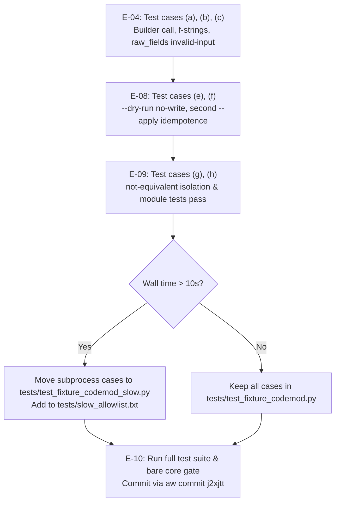

# IPD: Test the fixture codemod rewrite, invalid-input, dry-run, idempotence and equivalence cases

- Date: 2026-11-09
- Kind: child
- Concern: The codemod (`tools/fixture_codemod.py`, Order 172) rewrites hundreds of test fixtures, so its behavior must be proved by its own behavioral tests before any batch plan runs it. `653ndz` E-04 held eight test groups in one item; research `nj8zdp` guidance (about 8 named units per item) splits them.
- Scope: Part 2 of the round-3 split of `653ndz` (2026-11-09, research `nj8zdp` guidance): `653ndz` E-04 cases (a), (b), (c) as E-04, (e), (f) as E-08, (g), (h) as E-09, plus the finishing item E-10. Case (d), one fixture per refusal reason code, is Order 216 (`n0li9v`). EXCLUDES: the tool (`y3uowx`); the pilot and census (`653ndz`); production code.
- Scope-Paths: tests/test_fixture_codemod.py, tests/fixtures/fixture_codemod/**, tests/slow_allowlist.txt, .aw/records/plans/pending/20261109-metastore-173-j2xjtt-test-the-fixture-codemod-rewrite-invalid-input-dry-run-idemp.ipd.md
- Item-Dependencies: executed:9rgn2w, executed:g5hpbb, executed:tve77h, executed:xexn45, executed:y3uowx
- Status: reviewed
- From-Spec: 4sd62s
- Work-Kind: feature
- Priority: high
- Blocks-Release: next
- Set: metastore
- Order: 173
- Highest E allocated: 10
- Author: opencode its_direct/pt3-claude-opus-5.5-1m-us
- Id: j2xjtt
- Readiness: go-pending-approval
- Review-Depth: standard

> Written to `.aw/system/workflows/technical-writing/technical-writing.md`. Every obligation, exact identifier, quotation, evidence record, and lifecycle status is preserved.

## Workflow history

- 2026-11-14 reviewed (aw set): APPROVE WITH REVISIONS APPLIED; PR-001..PR-004 FIXED
- 2026-11-14 /plan-review (antigravity/gemini): APPROVE WITH REVISIONS APPLIED; PR-001..PR-004 FIXED; review record .aw/records/reviews/20261109-metastore-173-j2xjtt-test-the-fixture-codemod-rewrite-invalid-input-dry-run-idemp.review.md
- 2026-11-09 to-review (opencode its_direct/pt3-claude-opus-5.5-1m-us): split from 653ndz (round 3, research nj8zdp guidance).

## Goal

`tests/test_fixture_codemod.py` proves the codemod's rewrites, its `raw_fields=` path, its dry run, its idempotence and its equivalence isolation by driving it as a subprocess on fixture modules.

## Detailed Implementation Checklist (TODO)

Execution-state rule: mark an `E-*` item complete only after performing the action. That mark is not validation. Right-sizing rule: write for a modest executor that cannot hold much in its head. Each E-item is one step (one concern, about one file, executable in one focused pass) and its V-item names each unit it covers with its own check; a plan stays at about 5 E-items and 8 work Scope-Paths, else split it into more child plans (guidance, `IPD-Z603`). Accepted execution states: blocked, failed, pending, performed; terminal gate demands 'performed'.

Item ids E-01 to E-04 are the ids these items had in `653ndz`; they are kept so every cross-reference (for example "`653ndz` E-03" in the batch rule) still resolves. New ids added by the round-3 split start at E-07.

Terms used below. A SITE is one Python string literal (a constant or an f-string, found with `ast`) in a test module whose text matches the F-01 pattern. A REWRITE replaces the site's expression in place, and nothing else in the module, with the builder's text form (`RecordBuilder(...).<type>(..., text_only=True)`, `9rgn2w` E-01). A REFUSAL is a site the tool leaves untouched, with one reason code. Each reason code has one DISPOSITION: `hand` (a batch item converts it by hand) or `legacy-kept` (the site stays in legacy form on purpose and is listed with its F-06 reason class).

| Reason code | Disposition | Meaning |
|---|---|---|
| `dynamic-construction` | hand | The text is built by concatenation, a conditional, or an f-string placeholder that holds a whole line (for example `f"{br_line}"`), so no field-by-field mapping is statically known. |
| `unsupported-shape` | hand | The record type cannot be inferred from the heading or the written path, a field is unknown to the registry, or the builder's text form needs a repository root the site's scope does not provide by a simple name. |
| `not-equivalent` | hand | Apply mode rewrote the site and the module's outcome list changed; the tool reverted it (E-03). |
| `legacy-format subject` | legacy-kept | The module or test's subject is the legacy grammar (F-03 EXCLUDED list, `*legacy*`, `*m0001*`, `*migrat*`, `test_front_matter_loose*`, `test_selector_two_dialect*`, `test_history_block_bounding*`). |
| `displayed-output assertion` | legacy-kept | The site is the expected text of an assertion over command output. |
| `setter-byte assertion` | legacy-kept | The site is the expected text of an assertion over a record file's bytes (converted later by `iog3cw`, `w13bkp` and Orders 59 to 62). |
| `body prose` | legacy-kept | The bullets are body text (for example open-question `- Status: open` rows, N3). |

A deliberately invalid value (F-08, for example `- Status: EXECUTED`) is NOT a refusal: the tool writes it through the builder's `raw_fields=` escape and lists the site as a rewrite with class `invalid-input`.

### Task group 1: test cases

- [ ] E-04 (part of `653ndz` E-04, round-3 split 2026-11-09) Add to `tests/test_fixture_codemod.py` (core, `pytestmark = pytest.mark.core`) and fixture modules under `tests/fixtures/fixture_codemod/` the test cases (a) a plain constant metadata block becomes a builder call; (b) an f-string with field placeholders becomes keyword arguments; (c) an invalid value goes through `raw_fields=` and is listed `invalid-input`. Tests define `CODEMOD_PATH = Path(__file__).resolve().parent.parent / "tools" / "fixture_codemod.py"` and drive the tool as a subprocess via `sys.executable` on copies of the fixtures in a temporary repository made with `tests/support.py` `init_repo`, asserting on its stdout/stderr, exit code, and on the rewritten files. No test reads production source.
  - Depends on: none
  - Expected outcome: `python3 -m pytest -o addopts="" -n 0 -v tests/test_fixture_codemod.py` passes every case (a), (b), (c).
  - Execution state: pending

- [ ] E-08 (part of `653ndz` E-04, round-3 split 2026-11-09) Add to `tests/test_fixture_codemod.py` (core, `pytestmark = pytest.mark.core`) and fixture modules under `tests/fixtures/fixture_codemod/` the test cases (e) `--dry-run` writes nothing; (f) a second `--apply` changes nothing. Tests drive the tool as a subprocess on copies of the fixtures in a temporary repository made with `tests/support.py` `init_repo` and assert on its output and on the rewritten files. No test reads production source.
  - Depends on: E-04
  - Expected outcome: `python3 -m pytest -o addopts="" -n 0 -v tests/test_fixture_codemod.py` passes every case (e), (f).
  - Execution state: pending

- [ ] E-09 (part of `653ndz` E-04, round-3 split 2026-11-09) Add to `tests/test_fixture_codemod.py` (core, `pytestmark = pytest.mark.core`) and fixture modules under `tests/fixtures/fixture_codemod/` the test cases (g) the `not-equivalent` case of E-03 is isolated and reverted while the other rewrites stay; (h) the rewritten fixture module's own tests pass. Tests drive the tool as a subprocess on copies of the fixtures in a temporary repository made with `tests/support.py` `init_repo` and assert on its output and on the rewritten files. No test reads production source. (g) and (h) start pytest subprocesses (E-03); if the module's wall time under `-n 0` exceeds 10 s, the subprocess cases move to a second module `tests/test_fixture_codemod_slow.py` listed in `tests/slow_allowlist.txt` (justified under `--scope-reason`), and the core module keeps (a) to (f).
  - Depends on: E-08
  - Expected outcome: `python3 -m pytest -o addopts="" -n 0 -v tests/test_fixture_codemod.py` passes every case (g), (h).
  - Execution state: pending

### Task group 2: finish

- [ ] E-10 Finish this part: run `python3 -m pytest -o addopts="" -n 0 -v --durations=0 tests/test_fixture_codemod.py` (and the moved slow module, if E-09 moved one) and the bare core gate `python3 -m pytest`; commit through `aw commit j2xjtt -- <each changed path>`, never `git add -A`, a bare `git add` or `git commit -a`. Never push.
  - Depends on: E-09
  - Expected outcome: every case passes; total duration under 10 s or the moved slow module listed with its own passing run; every commit is path-scoped to Scope-Paths (or justified at finalize).
  - Execution state: pending

Add further leaves as `- [ ] E-NEW <action>` and run `aw ipd sync` to assign ids.

## Project conventions discovered (Step 0)

- Standalone maintenance tools live in `tools/` and are described in `tools/README.md`; their behavioral tests drive them as subprocesses by path (for example `tests/test_gate_drop_audit.py` sets `AUDITOR_PATH` to `tools/gate_drop_audit.py`).
- The builder interface (`9rgn2w` E-01): `RecordBuilder(repo_root)` with one method per record type, registry-named keyword fields, `raw_fields={legacy_name: text}` for deliberately invalid input, and `text_only=True` returning the string.
- `artifact_meta.registry_fields(type)` names each type's fields; `artifact_meta.read_text(text, *, record_type=None)` parses a record's text.
- Tests are behavioral (AGENTS.md "TEST OUTCOMES, NOT CODE STRUCTURE"); the codemod reads TEST source because rewriting it is its job, and no test of the codemod reads production source. Core modules set `pytestmark = pytest.mark.core`; `slow` tests are listed in `tests/slow_allowlist.txt`; a complete comparison passes `-m ""`, and a deterministic order needs `-p no:randomly`.
- Cite code by SYMBOL (`module.function`) or by a quoted content string, with a line number only appended to one of those and never alone (advisory `IPD-C801`).

## Findings

Measured 2026-11-08 at `ac76110f4`; carried from `653ndz`.

| Id | Evidence | Finding |
|---|---|---|
| F-29 | An `ast` walk over the 318 modules (string constants and f-strings whose text matches F-01, nested f-string parts not double-counted): 3,272 sites in 313 modules; by context: `write_text` argument 867, assigned or returned 882, argument of another call 930, inside an assertion 535, other 58 | About 1,750 sites sit in a write or an assignment, the shapes a rewrite handles; the 535 assertion sites are refusals by construction (`displayed-output` or `setter-byte`). The number of `dynamic-construction` refusals is unknown until E-05. |

## Proposed changes (ordered, validatable)

1. Write cases (a) to (c), (e) and (f), then (g) and (h) (E-04, E-08, E-09).
2. Apply the 10 s bound, run, commit (E-10).

## Deferred / out of scope (with reason)

- Case (d), one fixture per refusal reason code.
  - Carrier: n0li9v
- The tool itself.
  - Carrier: y3uowx

## Scope check

- Over-scope: none. No production module changes.
- Under-scope: none known. Size: 4 E-items, 3 work Scope-Paths; the fixture glob `tests/fixtures/fixture_codemod/**` holds about 6 fixture modules for these cases.

## Required tests / validation

New core test module `tests/test_fixture_codemod.py` (behavioral: subprocess runs over fixture modules, asserting output and rewritten bytes). Commands: `tests/test_fixture_codemod.py`, the bare core gate `python3 -m pytest`.

## Spec / documentation sync

No spec change; implements the tooling half of `4sd62s` section 7 step 6.

## Open questions

### OQ-01: Why is the proof per module and not per site?

- Blocking: no
- Status: resolved
- Owner: plan author (carried from 653ndz)
- Resolution or deferral rationale: The batch rule already defines equivalence as an identical per-test outcome list, and a site's effect is only observable through the tests that use it. Per-module proof with halving on failure costs one pytest run per module when every rewrite holds and about two times the logarithm of the site count when one does not, while a per-site run would cost one run per site (3,272 at F-29). Recommendation strength: strong.

### OQ-02: Why is the census static?

- Blocking: no
- Status: resolved
- Owner: plan author (carried from 653ndz)
- Resolution or deferral rationale: A proved census would be a serial run of every batch module's tests, which is the work the batch plans spread across turns. The static census bounds the known refusals; each batch item adds its apply-time `not-equivalent` refusals to its `hand` count and stops at 25. Recommendation strength: strong.

## Validation and cross-check (verify before reporting done)

Validation-state rule: inspect evidence in a separate pass. Do not mark a `V-*` item complete from memory or from the matching execution checkmark. Accepted validation results: blocked, failed, pass, pending; terminal gate demands 'pass'. Runtime-demonstration reachability rule: for each `V-*` item demanding the software be observed acting (such as a run, a dispatch, or a transition), as distinct from items demanding a diff, a file's content, or a test result, which are reachable by construction, name the code path that produces the observation or the sibling `E-*` that creates it, else the demand is UNDER-SCOPE.

- [ ] V-04 validates E-04
  - Required evidence: paste `python3 -m pytest -o addopts="" -n 0 -v --durations=0 tests/test_fixture_codemod.py` lines showing each of the cases (a) a plain constant metadata block becomes a builder call, (b) an f-string with field placeholders becomes keyword arguments, (c) an invalid value goes through `raw_fields=` and is listed `invalid-input` PASSED by its node id, with each case's duration; and `rg -n "inspect\.|getsource" tests/test_fixture_codemod.py` empty.
  - Observed evidence:
  - Result: pending

- [ ] V-08 validates E-08
  - Required evidence: paste `python3 -m pytest -o addopts="" -n 0 -v --durations=0 tests/test_fixture_codemod.py` lines showing each of the cases (e) `--dry-run` writes nothing, (f) a second `--apply` changes nothing PASSED by its node id, with each case's duration; and `rg -n "inspect\.|getsource" tests/test_fixture_codemod.py` empty.
  - Observed evidence:
  - Result: pending

- [ ] V-09 validates E-09
  - Required evidence: paste `python3 -m pytest -o addopts="" -n 0 -v --durations=0 tests/test_fixture_codemod.py` lines showing each of the cases (g) the `not-equivalent` case of E-03 is isolated and reverted while the other rewrites stay, (h) the rewritten fixture module's own tests pass PASSED by its node id, with each case's duration; and `rg -n "inspect\.|getsource" tests/test_fixture_codemod.py` empty.
  - Observed evidence:
  - Result: pending

- [ ] V-10 validates E-10
  - Required evidence: paste the `--durations=0` total for `tests/test_fixture_codemod.py` (under 10 s, or the moved slow module named in `tests/slow_allowlist.txt` with its own PASSED run), the bare `python3 -m pytest` summary line and wall time, and every `aw commit j2xjtt` output listing only Scope-Paths.
  - Observed evidence:
  - Result: pending

## Approval and execution gate

- Size assessment: standard
- Cohesion rationale: not required

Execute only after human approval (`Status: approved`) and after `9rgn2w`, `g5hpbb`, `tve77h`, `xexn45`, `y3uowx` are executed. Every open question is resolved.

Scope fence: the paths in `- Scope-Paths:` are a declaration. A needed test-tree file outside the fence is edited and then justified at finalize (`--scope-reason`), and a declared path left unmodified is acknowledged (`--scope-ack`). Production code under `agent_workflows/` and `tools/` is out of this plan's purpose: if the builder's text form cannot express a shape, the site is refused, and the builder is not changed here.

Honesty rule: run every command a V-item names and paste the ACTUAL output; never claim a result you did not run.

Commits: commit only through `aw commit j2xjtt -- <paths>`; never `git add -A`, a bare `git add` or `git commit -a`; never push.

Lifecycle transition: the plan moves to `.aw/records/plans/executed/` only through `aw ipd finalize`, and only after `aw ipd lint --phase pre-transition` conforms and every `V-*` reads `pass` with pasted evidence.
