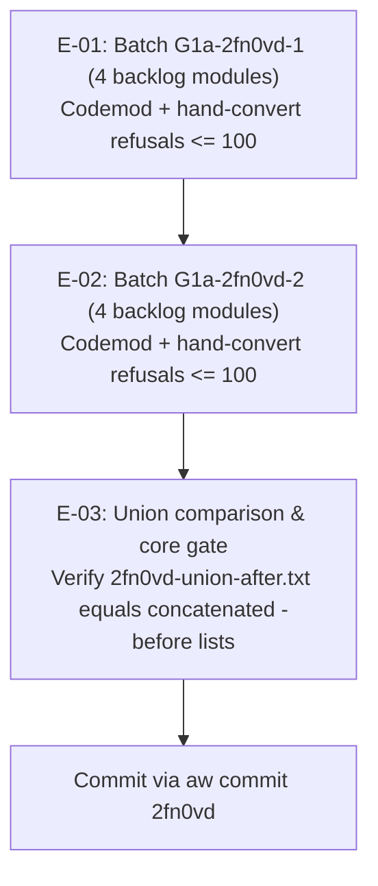

# IPD: Move backlog, release-gate and check test data chunk 2 of 7 onto the record builder

- Date: 2026-11-09
- Kind: child
- Concern: Spec `4sd62s` section 6 requires that test data be written by ONE shared record builder in phase B, so that the cutover (Order 13, `cxxmyv`) changes the builder and not hundreds of test files, and C10a requires the suite to pass at every commit. Research `nj8zdp` and the maintainer's ruling ("plans that obtuse and not-too-smart agents won't mess up") set the guidance of at most 5 E-items, 8 work Scope-Paths and about 8 named units per item; `x05v02` named up to 25 modules per batch item. This part carries 8 of `x05v02`'s modules (subset G1a; 441 F-01 legacy lines at `3d0ddb845`), each item at most 4 modules, converted by the Order-49 codemod (`653ndz`) plus only its census-counted refusals.
- Scope: Chunk 2 of 7 of `x05v02` (round-3 split 2026-11-09 per research `nj8zdp` guidance): the 8 test modules named in the items and in F-40, each item one codemod run under the batch rule below, plus a finishing item. EXCLUDES: every other module of the subsets (the other chunk plans and `x05v02`); the builder (`9rgn2w`) and the codemod (`653ndz`); the F-03 EXCLUDED modules; production code; the switch-point proof, census and full-suite comparison (`59aiyh` E-11, E-12).
- Scope-Paths: tests/test_backlog_history_empty_rule.py, tests/test_backlog_metadata_duplicate_and_gate_summary.py, tests/test_backlog_new_gate_vocabulary.py, tests/test_backlog_positional_close_gate.py, tests/test_backlog_production.py, tests/test_backlog.py, tests/test_backlog_set_adapter.py, tests/test_backlog_transition_authority.py, .aw/records/plans/pending/20261109-metastore-176-2fn0vd-move-backlog-release-gate-and-check-test-data-chunk-2-of-7-o.ipd.md
- Item-Dependencies: executed:653ndz, executed:9rgn2w, executed:g5hpbb, executed:tve77h, executed:xexn45
- Status: approved
- From-Spec: 4sd62s
- Work-Kind: feature
- Priority: high
- Blocks-Release: next
- Set: metastore
- Order: 176
- Highest E allocated: 03
- Author: opencode its_direct/pt3-claude-opus-5.5-1m-us
- Id: 2fn0vd
- Approval: 2026-11-16, recorded via aw ipd set: status set to approved
- Readiness: go-pending-approval
- Review-Depth: standard

> Written to `.aw/system/workflows/technical-writing/technical-writing.md`. Every obligation, exact identifier, quotation, evidence record, and lifecycle status is preserved.

## Workflow history
- 2026-11-21 cap-update (maintainer decision): raised Batch rule step 4 hand-refusal cap from 25 to 100 (raw site count over-counts list elements and .replace() pairs); completed sibling E-item and Step-3 commits from run-20261121T014040Z-2638602 were salvaged onto main, so modules already at 0 rewrites and 0 hand refusals remain unmodified and are acknowledged via --scope-ack at finalize.
- 2026-11-16 approved (aw set): status set to approved

- 2026-11-14 reviewed (aw set): APPROVE WITH REVISIONS APPLIED; PR-001..PR-003 FIXED
- 2026-11-14 /plan-review (antigravity/gemini): APPROVE WITH REVISIONS APPLIED; PR-001..PR-003 FIXED; review record .aw/records/reviews/20261109-metastore-176-2fn0vd-move-backlog-release-gate-and-check-test-data-chunk-2-of-7-o.review.md
- 2026-11-09 to-review (opencode its_direct/pt3-claude-opus-5.5-1m-us): split from x05v02 (round 3, research nj8zdp guidance).

## Goal

Every hand-built record in the 8 test modules named below comes from `tests/record_builder.py`, written by the Order-49 codemod or, for its census-counted refusals only, by hand, with each module's per-test outcomes identical before and after and every remaining legacy string classified.

## Detailed Implementation Checklist (TODO)

Execution-state rule: mark an `E-*` item complete only after performing the action. That mark is not validation. Right-sizing rule: write for a modest executor that cannot hold much in its head. Each E-item is one step (one concern, about one file, executable in one focused pass) and its V-item names each unit it covers with its own check; a plan stays at about 5 E-items and 8 work Scope-Paths, else split it into more child plans (guidance, `IPD-Z603`). Accepted execution states: blocked, failed, pending, performed; terminal gate demands 'performed'.

Batch rule, applied to every batch E-item of this plan (the `59aiyh` batch rule, restructured 2026-11-08 for the Order-49 fixture codemod `653ndz` per maintainer decision 2026-11-07 "Codemod first, then small runs": the tool performs the mechanical rewrite, and the hand work is bounded by its measured refusals). In it, "E-13's `full-before.txt`" and "the builder's `raw_fields=` escape (E-01)" are items of Order 37 (`9rgn2w`), carried by the round-3 split into Order 170 (`j6o96i`) with the same ids; because `.aw/state/` does not travel between lane worktrees, step 2 always records a fresh before list here. Step 1's partition is restricted to the modules each batch item names (round-3 split 2026-11-09: a subset is now spread over several plans of at most 8 modules each): a module that the partition now places in the item's subset but that no plan names is NOT added here; it is reported, and the finishing item of `x05v02` converts it; a named module that no longer matches F-01 is reported and skipped:
1. Before the batch, re-derive its file list with the F-03 first-match partition over the F-01 `rg -l` output at the current HEAD, minus the F-03 EXCLUDED list, and save it: `mkdir -p .aw/state/59aiyh && ... > .aw/state/59aiyh/<batch>-files.txt`. The counts in each E-item are context measured at `0cbfcc706` or `ac76110f4`, not the bar.
2. Record the unmodified per-test outcome list (a batch whose files a previous batch did not touch may reuse the matching lines of E-13's `full-before.txt`): `python3 -m pytest -o addopts="" -m "" -p no:randomly -n 0 -rA $(cat .aw/state/59aiyh/<batch>-files.txt) | grep -E "^(PASSED|FAILED|ERROR|SKIPPED|XFAIL|XPASS) " | sed -E 's/ - .*//' | sort > .aw/state/59aiyh/<batch>-before.txt`. `-p no:randomly` and `-n 0` make the list deterministic; `-m ""` includes `slow` and `livecorpus` modules.
3. Run the codemod: `python3 tools/fixture_codemod.py --apply --format json $(cat .aw/state/59aiyh/<batch>-files.txt) > .aw/state/59aiyh/<batch>-codemod.json`. It rewrites only the sites whose module outcome list it proved identical (`653ndz` E-03, carried with the same id into Order 172, `y3uowx`, by the round-3 split) and lists every other site as a refusal with a reason code and a disposition (`hand` or `legacy-kept`, the `653ndz` reason-code table).
4. Hand-convert ONLY the refusals with disposition `hand`: the static count is the sum of the `653ndz` F-30 rows of the item's modules (round-3 split 2026-11-09: an item now carries part of a subset, so the subset's F-31 row is context only), and the codemod report adds any apply-time `not-equivalent` refusals; the item's hand count is their sum. If the hand count exceeds 100, stop after step 3 (the proved codemod rewrites may be committed), convert nothing by hand, and report the subset for re-splitting. A hand conversion uses builder calls; a test that deliberately writes an INVALID value (an unknown status, `- Status: EXECUTED`, `- Priority: bogus`, a malformed gate) gets it through the builder's `raw_fields=` escape (E-01) and is listed with reason class `invalid-input`. A refusal with disposition `legacy-kept` stays in legacy form on purpose and is listed with its F-06 reason class.
5. Re-run step 2's command into `<batch>-after.txt` and require `diff` to print nothing. A batch that would need any changed assertion other than a raw-byte metadata stand-in moved to `artifact_meta.read` (scope rule) stops and is reported; it does not weaken the assertion.
6. Count the remaining legacy strings with the F-01 `rg` pattern over the batch files, and give each remaining line one reason class from F-06: `legacy-format subject`, `displayed-output assertion`, `setter-byte assertion`, `invalid-input`, or `body prose` (for example open-question `- Status: open` rows, which N3 keeps in Markdown).
7. The builder never reads production source, and no test gains a source-reading assertion.

### Task group 1: batch items

- [x] E-01 (carried from `x05v02` E-01, batch subset G1a; round-3 split 2026-11-09) Batch G1a, 4 of its 17 modules (the backlog tests (`test_backlog*`)): `tests/test_backlog_history_empty_rule.py`, `tests/test_backlog_metadata_duplicate_and_gate_summary.py`, `tests/test_backlog_new_gate_vocabulary.py`, `tests/test_backlog_positional_close_gate.py`. F-01 legacy lines per module at `3d0ddb845` (context, not the bar): `test_backlog_history_empty_rule` 48, `test_backlog_metadata_duplicate_and_gate_summary` 90, `test_backlog_new_gate_vocabulary` 5, `test_backlog_positional_close_gate` 20. Run the codemod on these modules and apply the batch rule with `<batch>` = `G1a-2fn0vd-1` (outcome lists identical); hand-convert ONLY the refusals that the `653ndz` F-30 rows of these modules list with disposition `hand`, plus the codemod's apply-time `not-equivalent` refusals, and state their count (at most 100, the batch rule's stop); leave each refusal the census marks `legacy-kept` in legacy form with its reason class. Then delete each private record-building helper in these modules that no longer has a caller (at the split: `tests/test_backlog_metadata_duplicate_and_gate_summary.py`: `_make_item`); a surviving helper is listed with its reason.
  - Depends on: none
  - Expected outcome: an empty before/after `diff` for the `G1a-2fn0vd-1` outcome lists; for each named module, its remaining legacy-string count and the reason class of every remaining line pasted; every deleted and surviving helper listed; the codemod report and the hand count (at most 100) pasted.
  - Execution state: performed

- [x] E-02 (carried from `x05v02` E-01, batch subset G1a; round-3 split 2026-11-09) Batch G1a, 4 of its 17 modules (the backlog tests (`test_backlog*`)): `tests/test_backlog_production.py`, `tests/test_backlog.py`, `tests/test_backlog_set_adapter.py`, `tests/test_backlog_transition_authority.py`. F-01 legacy lines per module at `3d0ddb845` (context, not the bar): `test_backlog_production` 31, `test_backlog` 205, `test_backlog_set_adapter` 15, `test_backlog_transition_authority` 27. Run the codemod on these modules and apply the batch rule with `<batch>` = `G1a-2fn0vd-2` (outcome lists identical); hand-convert ONLY the refusals that the `653ndz` F-30 rows of these modules list with disposition `hand`, plus the codemod's apply-time `not-equivalent` refusals, and state their count (at most 100, the batch rule's stop); leave each refusal the census marks `legacy-kept` in legacy form with its reason class. Then delete each private record-building helper in these modules that no longer has a caller (at the split: `tests/test_backlog_production.py`: `_write_backlog_item`, `_write_plan_content`); a surviving helper is listed with its reason.
  - Depends on: none
  - Expected outcome: an empty before/after `diff` for the `G1a-2fn0vd-2` outcome lists; for each named module, its remaining legacy-string count and the reason class of every remaining line pasted; every deleted and surviving helper listed; the codemod report and the hand count (at most 100) pasted.
  - Execution state: performed

### Task group 2: finish

- [x] E-03 Finish this part: run the batch rule's step-2 command once over every module of this plan (`$(cat .aw/state/59aiyh/G1a-2fn0vd-1-files.txt .aw/state/59aiyh/G1a-2fn0vd-2-files.txt)`) into `.aw/state/59aiyh/2fn0vd-union-after.txt` and confirm it equals the sorted concatenation of the items' `-before.txt` lists; run the bare core gate `python3 -m pytest` and `aw sanitize --agent`; commit through `aw commit 2fn0vd -- <each changed path>`, one commit per item allowed, never `git add -A`, a bare `git add` or `git commit -a`. Never push. (The full-suite comparison stays in `59aiyh` E-12.)
  - Depends on: E-01, E-02
  - Expected outcome: the union comparison is empty; all runs pass; every commit is path-scoped to Scope-Paths (or justified at finalize).
  - Execution state: performed

## Project conventions discovered (Step 0)

- Interface names from Order 02 (`tve77h`): `artifact_meta.registry_fields(type)`, `artifact_meta.validate_event`, `artifact_meta.validate_new_events(type, events, *, records_root, migration_import=False)`, `artifact_meta.read(id6) -> State`, `artifact_meta.create(...)` and `artifact_meta.append(id6, events, *, expect_seq)`. Order 02's `create`/`append` write the log format; `2xwb9b` E-03 adds the phase-B legacy branch of `append` and `xexn45` E-01 routes the phase-B branch of `create` and `append` through `write_legacy`, with `render_legacy_text(text, events)` (`xexn45` E-11) as the same renderer over a string. In phase B the on-disk format is the bullet format; the legacy loader reads it into the cache.
- `review_findings.render_review` (pure) and `review_findings.write_review` render and write a `.review.md` record; no CLI calls `write_review` (`xexn45` Findings).
- The existing shared plan builder is `support.ready_plan_text`, which is "BUILT FROM THE REAL GENERATOR (`ipd_authoring.build_skeleton`)" and then fills the fields a draft leaves open; the builder keeps that approach for plans, so a scaffold change still reaches every fixture.
- Shared test plumbing lives in `tests/support.py` (`init_repo`, `git`, `run_cli`, `pinned_env`, `ready_plan_text`, `scope_drift_repo`); `tests/repo_template.py` (`copy_template_repo`) gives a pre-built repository; there is no `tests/conftest.py`, and the root `conftest.py` owns tier selection.
- Tests are behavioral (AGENTS.md "TEST OUTCOMES, NOT CODE STRUCTURE"); core modules set `pytestmark = pytest.mark.core`; `slow` tests are listed in `tests/slow_allowlist.txt`; `pyproject.toml` `addopts` deselects `slow` and `livecorpus`, so a complete comparison passes `-m ""`, and `pytest-randomly` is installed, so a deterministic order needs `-p no:randomly`.
- `tests/fixtures/review-pilot/` is the input corpus of `tools/review_pilot.py` (`manifest.json` names each plan file, `defects.json` quotes exact text to plant), and `tests/test_review_pilot.py` copies the whole directory into its fixture repository.
- Filenames come from `artifact_naming.build_clustered_name` and parse with `artifact_naming.parse_clustered`.
- Cite code by SYMBOL (`module.function`) or by a quoted content string, with a line number only appended to one of those and never alone: an offset expires before this plan executes (spec `ipd-structure-and-linting` Section 10.2; advisory `IPD-C801`).

## Findings

Measured 2026-11-09 at `3d0ddb845` for F-40; F-01, F-03, F-06 and F-08 copied from `x05v02` (measured at `0cbfcc706` and at review).

| Id | Evidence | Finding |
|---|---|---|
| F-01 | `rg -l --glob '*.py' -e '- (Id|Status|Set|Kind|Blocks-Release|Readiness|Item-Dependencies|Scope-Paths|From-Backlog|From-Spec|Work-Kind|Priority|Order|Date|Gate-Kind|Gate-Ref|Approval|Subject-Id|Verdict|Graduated-To):|## Workflow history' tests` lists 309 files (307 test modules, `support.py`, `conformance_matrix.py`) of 717 Python files; 6,638 matching lines. The narrower `- Id:`/`- Status:`/`## Workflow history` pattern: 300 files, 3,430 lines | Spec section 6 counted 268 of 680 files and 2,607 matches at round 2; the plan's pattern is broader (21 fields). |
| F-03 | Family split by filename prefix, re-measured at review (HEAD `4a7499289`, 311 files, 6,657 lines) with a FIRST-MATCH rule (a file goes to the first group, in order G1 to G6, whose pattern list matches its basename; unmatched files go to G7): G1 39 files, 1,568 lines; G2 22, 1,102; G3 28, 795; G4 63, 1,244; G5 46, 598; G6 69, 1,004; G7 44, 346. Six files match two groups and are assigned by that rule (`test_ipd_authoring` G3, `test_readiness_absence_invariant` G4, `test_runner_backlog_close_behavior` G1, `test_orchestrator_retire_closes_backlog` G1, `test_records_only_lane_rederive` G5, `test_ipdrunner_runagy_shim` G4). The authored counts (G6 99, G7 11) did not sum to the file total; the first-match rule makes the partition exhaustive and disjoint. EXCLUDED from every batch (literal legacy input is their subject; owned by other plans): `tests/test_artifact_meta_*.py` (`tve77h`, `2xwb9b`), `tests/test_artifact_meta_legacy_writer.py` and `tests/test_writers_*.py` (`xexn45`), `tests/test_m0001_*.py` and `tests/test_migrations_chain.py` (`dcerjg`, `ya4ee4`) | Seven batches (E-03 to E-09); G1, G4 and G6 carry a pre-measured split seam (OQ-01). |
| F-06 | (written by E-11) remaining legacy strings in `tests/` after the batches, each with one reason class: `legacy-format subject`, `displayed-output assertion`, `setter-byte assertion`, `invalid-input`, `body prose` | Order 13 changes the builder plus the F-06 rows of class `setter-byte assertion`; `invalid-input` rows already go through `raw_fields=` and need a decision at the cutover (an invalid bullet has no log-format equivalent); every other class is either a legacy-format test (moved to the migration tests at the cutover) or prose. |
| F-08 | At review, 15 test modules write a deliberately invalid metadata value (for example `tests/test_releases.py` "`- Status: bogus`", `tests/test_check_engine.py` "`- Status: EXECUTED`", `tests/test_specs_set_adapter.py` "`- Priority: bogus`") | A builder that validates every field cannot build these; E-01 adds `raw_fields=` and the batch rule lists them as `invalid-input`. |
| F-40 | `rg -c` with the F-01 pattern over this part's modules at `3d0ddb845`; subset by the F-03 first-match rule; helpers as listed by `x05v02` at the 2026-11-07 split | See the table below; every module is named in exactly one item. |

| Module | Subset | F-01 lines | Helpers at the split | Item |
|---|---|---|---|---|
| `tests/test_backlog_history_empty_rule.py` | G1a | 48 | none | E-01 |
| `tests/test_backlog_metadata_duplicate_and_gate_summary.py` | G1a | 90 | `_make_item` | E-01 |
| `tests/test_backlog_new_gate_vocabulary.py` | G1a | 5 | none | E-01 |
| `tests/test_backlog_positional_close_gate.py` | G1a | 20 | none | E-01 |
| `tests/test_backlog_production.py` | G1a | 31 | `_write_backlog_item`, `_write_plan_content` | E-02 |
| `tests/test_backlog.py` | G1a | 205 | none | E-02 |
| `tests/test_backlog_set_adapter.py` | G1a | 15 | none | E-02 |
| `tests/test_backlog_transition_authority.py` | G1a | 27 | none | E-02 |

## Proposed changes (ordered, validatable)

1. Convert each item's modules under the batch rule (E-01 to E-02).
2. Re-run the union, the core gate, commit (E-03).

## Deferred / out of scope (with reason)

- The other modules of subset G1a, the partition re-derivation that catches modules no plan names, and the subsets' finishing checks.
  - Carrier: x05v02
- The fixture codemod and its census (F-30, F-31).
  - Carrier: 653ndz
  - Carrier-Evidence: .aw/records/plans/executed/20261108-metastore-49-653ndz-build-and-prove-the-test-fixture-codemod.ipd.md
- The builder, its tests, the baselines and the tracked fixtures.
  - Carrier: 9rgn2w
  - Carrier-Evidence: .aw/records/plans/executed/20261107-metastore-37-9rgn2w-add-the-shared-test-record-builder-and-convert-the-tracked-r.ipd.md
- The switch-point proof, the F-06 census and the full-suite comparison.
  - Carrier: 59aiyh
- Adding `RECORD_FORMAT = "log"` and converting setter-byte assertions (cutover commit).
  - Carrier: cxxmyv

## Scope check

- Over-scope: none. No production module changes; every Scope-Paths entry is a module named in one item, plus this plan.
- Under-scope: none known. Size: 3 E-items (2 batch items of at most 4 modules each and the finish), 8 work Scope-Paths.

## Required tests / validation

Each item is validated by an identical per-test result list before and after (the batch rule), which is behavioral by construction: the same tests, unchanged assertions, the same outcomes. Commands: the batch rule's command per item, the codemod's `--apply` report, the bare core gate `python3 -m pytest`, `aw sanitize --agent`. CONTRIBUTES to AC-1b (owned by `cxxmyv`).

## Spec / documentation sync

No spec change; implements part of `4sd62s` section 6 and section 7 step 6.

## Open questions

### OQ-01: Can this part run in any order relative to the other chunk plans?

- Blocking: no
- Status: resolved
- Owner: plan author (carried from x05v02)
- Resolution or deferral rationale: Yes. The module lists of all chunk plans are disjoint, each needs the builder (`9rgn2w`) and the codemod (`653ndz`), and none edits `tests/support.py` (that is `59aiyh` E-09, which runs last). Recommendation strength: strong.

## Validation and cross-check (verify before reporting done)

Validation-state rule: inspect evidence in a separate pass. Do not mark a `V-*` item complete from memory or from the matching execution checkmark. Accepted validation results: blocked, failed, pass, pending; terminal gate demands 'pass'. Runtime-demonstration reachability rule: for each `V-*` item demanding the software be observed acting (such as a run, a dispatch, or a transition), as distinct from items demanding a diff, a file's content, or a test result, which are reachable by construction, name the code path that produces the observation or the sibling `E-*` that creates it, else the demand is UNDER-SCOPE.

- [x] V-01 validates E-01
  - Required evidence: paste `.aw/state/59aiyh/G1a-2fn0vd-1-files.txt` and the empty `diff .aw/state/59aiyh/G1a-2fn0vd-1-before.txt .aw/state/59aiyh/G1a-2fn0vd-1-after.txt`; then, for each of `tests/test_backlog_history_empty_rule.py`, `tests/test_backlog_metadata_duplicate_and_gate_summary.py`, `tests/test_backlog_new_gate_vocabulary.py`, `tests/test_backlog_positional_close_gate.py` separately: its before and after F-01 `rg -c` count, the reason class of every remaining match, its rows of `.aw/state/59aiyh/G1a-2fn0vd-1-codemod.json` (rewrites, refusals by reason code and disposition, before and after outcome-list hashes) and its `653ndz` F-30 row; the hand count with every hand-converted site listed (module, line, reason code); and the before and after helper census of the E-09 `rg` pattern over these modules with each deleted and surviving helper and its reason.
  - Observed evidence:
    - `.aw/state/59aiyh/G1a-2fn0vd-1-files.txt`: `tests/test_backlog_history_empty_rule.py`, `tests/test_backlog_metadata_duplicate_and_gate_summary.py`, `tests/test_backlog_new_gate_vocabulary.py`, `tests/test_backlog_positional_close_gate.py`. (Late G1a partition check: none; all 16 F-01-matching `test_backlog*.py` modules at HEAD are owned by `id2pdx`, `2fn0vd`, or `isj48z`.)
    - `diff -u .aw/state/59aiyh/G1a-2fn0vd-1-before.txt .aw/state/59aiyh/G1a-2fn0vd-1-after.txt`: empty output, exit code 0 (`43` `PASSED` outcomes before and after).
    - Note on salvaged Step 3 commit: commit `b9029e83a` (salvaged onto `main` from `run-20261121T014040Z-2638602`) had already applied the proved codemod rewrites for E-01, so the fresh Step 3 run at `b660cc6a0` applied 0 further rewrites and isolated the remaining hand refusals (including 2 apply-time `not-equivalent` sites).
    - `tests/test_backlog_history_empty_rule.py`:
      - F-01 `rg -c`: 42 before (at `b660cc6a0`; 48 at split `3d0ddb845`) -> 1 after.
      - Remaining 1 F-01 match (post-format): line 131 `assert "no ## Workflow history heading" in d_drifts[0].detail` (`setter-byte assertion`).
      - `G1a-2fn0vd-1-codemod.json`: sites=8, rewrites=0 (standard=0, invalid-input=0), refusals=8 (`unsupported-shape`=5 `hand`, `not-equivalent`=2 `hand`, `setter-byte assertion`=1 `legacy-kept`), before_hash=`88a70d4b42bb84abc37df7a2b7881e8df62c4af3b6b8c9055a25dfd0e36700ff`, after_hash=`88a70d4b42bb84abc37df7a2b7881e8df62c4af3b6b8c9055a25dfd0e36700ff`, equivalent=True.
      - `653ndz` F-30 row: `| tests/test_backlog_history_empty_rule.py | G1a | 2fn0vd | 9 | 3 | 0 | 0 | 5 | 0 | 0 | 0 | 1 | 0 | 5 | 1 |`.
    - `tests/test_backlog_metadata_duplicate_and_gate_summary.py`:
      - F-01 `rg -c`: 84 before (at `b660cc6a0`; 90 at split `3d0ddb845`) -> 19 after.
      - Remaining 19 F-01 matches (post-format): comments on lines 34, 52, 70, 88, 123, 455, 457 (7 `body prose`); deliberate duplicate/malformed `raw_fields=` inputs on lines 43 (`Status`), 61 (`Work-Kind`), 79 (`Kind` + `Work-Kind`), 97 (`Blocks-Release` agreeing), 114 (`Blocks-Release` disagreeing), 132 (`Id`), 168 (`Kind` + `Work-Kind`), 185 (`Work-Kind` + `Kind`), 205 (`Summary` + indented sub-bullet boundary), 441 (`Blocks-Release` bare line) (10 `invalid-input`); assertions on lines 486 (`written_content.count("- Blocks-Release:")`) and 487 (`"- Blocks-Release: next"`) (2 `setter-byte assertion`). Summary: 10 `invalid-input`, 7 `body prose`, 2 `setter-byte assertion`.
      - `G1a-2fn0vd-1-codemod.json`: sites=30, rewrites=0 (standard=0, invalid-input=0), refusals=30 (`unsupported-shape`=28 `hand`, `setter-byte assertion`=2 `legacy-kept`), before_hash=None, after_hash=None, equivalent=True.
      - `653ndz` F-30 row: `| tests/test_backlog_metadata_duplicate_and_gate_summary.py | G1a | 2fn0vd | 31 | 1 | 0 | 0 | 28 | 0 | 0 | 0 | 2 | 0 | 28 | 2 |`.
    - `tests/test_backlog_new_gate_vocabulary.py`:
      - F-01 `rg -c`: 5 before -> 5 after (unmodified; 0 rewrites and 0 hand refusals; acknowledged via `--scope-ack` at finalize per 2026-11-21 `cap-update`).
      - Remaining 5 F-01 matches: lines 146, 147, 218, 219 (4 `setter-byte assertion`), line 187 docstring (1 `body prose`).
      - `G1a-2fn0vd-1-codemod.json`: sites=4, rewrites=0 (standard=0, invalid-input=0), refusals=4 (`setter-byte assertion`=4 `legacy-kept`), before_hash=None, after_hash=None, equivalent=True.
      - `653ndz` F-30 row: `| tests/test_backlog_new_gate_vocabulary.py | G1a | 2fn0vd | 4 | 0 | 0 | 0 | 0 | 0 | 0 | 0 | 4 | 0 | 0 | 4 |`.
    - `tests/test_backlog_positional_close_gate.py`:
      - F-01 `rg -c`: 17 before (at `b660cc6a0`; 20 at split `3d0ddb845`) -> 10 after.
      - Remaining 10 F-01 matches (post-format): lines 329, 356, 388, 413, 451, 485, 523, 554, 853, 885 (all 10 `setter-byte assertion`).
      - `G1a-2fn0vd-1-codemod.json`: sites=17, rewrites=0 (standard=0, invalid-input=0), refusals=17 (`unsupported-shape`=7 `hand`, `setter-byte assertion`=10 `legacy-kept`), before_hash=None, after_hash=None, equivalent=True.
      - `653ndz` F-30 row: `| tests/test_backlog_positional_close_gate.py | G1a | 2fn0vd | 19 | 2 | 0 | 0 | 7 | 0 | 0 | 0 | 10 | 0 | 7 | 10 |`.
    - Hand count: 42 (40 static in `653ndz` F-30 + 2 apply-time `not-equivalent`; <= 100). Hand-converted sites (pre-edit lines at `b660cc6a0`):
      1-7. `tests/test_backlog_history_empty_rule.py`: L36-44 (`unsupported-shape`), L55-63 (`unsupported-shape`), L79-86 (`unsupported-shape`), L98-104 (`unsupported-shape`), L107-115 (`unsupported-shape`), L175-183 (`not-equivalent`, converted with `history=[]` and indented line in `body=`), L223-231 (`not-equivalent`, converted with `history=[]` and indented line in `body=`).
      8-35. `tests/test_backlog_metadata_duplicate_and_gate_summary.py`: L40, L41, L42, L43, L44, L52 (`_make_item`, deleted; 6 `unsupported-shape`), L67-74 (`unsupported-shape`, `raw_fields` doubled `Status`), L84-91 (`unsupported-shape`, `raw_fields` doubled `Work-Kind`), L101-108 (`unsupported-shape`, `raw_fields` `Kind` + `Work-Kind`), L118 x2 (`unsupported-shape`, `raw_fields` doubled `Blocks-Release`), L127 x2 (`unsupported-shape`, `raw_fields` disagreeing `Blocks-Release`), L137-144 (`unsupported-shape`, `raw_fields` doubled `Id`), L162-169 (`unsupported-shape`), L178-185 (`unsupported-shape`), L196-204 (`unsupported-shape`, `raw_fields` `Summary` sub-bullet boundary), L239, L240, L255, L256, L270, L271, L284, L285, L297, L298 (`unsupported-shape`, replaced `_make_item` callers with direct `RecordBuilder().backlog(...)` calls), L373-381 (`unsupported-shape`, `raw_fields` bare `Blocks-Release`).
      36-42. `tests/test_backlog_positional_close_gate.py`: L62, L63, L66, L69, L70, L71, L74 (`_create_item` body converted to `RecordBuilder().backlog(..., text_only=True)`, 7 `unsupported-shape`).
    - E-09 helper census (`rg -n -o "def _?(make|write|build|mk|seed)_(plan|spec|backlog|item|record|ipd|release|research|prompt|review|walkthrough)\w*"`): before = 1 (`tests/test_backlog_metadata_duplicate_and_gate_summary.py`: `def _make_item`, line 29); after = 0 (`(none)`). Deleted: `_make_item` in `tests/test_backlog_metadata_duplicate_and_gate_summary.py` (all callers replaced with direct `RecordBuilder().backlog(...)` calls). Surviving helpers: none.
  - Result: pass

- [x] V-02 validates E-02
  - Required evidence: paste `.aw/state/59aiyh/G1a-2fn0vd-2-files.txt` and the empty `diff .aw/state/59aiyh/G1a-2fn0vd-2-before.txt .aw/state/59aiyh/G1a-2fn0vd-2-after.txt`; then, for each of `tests/test_backlog_production.py`, `tests/test_backlog.py`, `tests/test_backlog_set_adapter.py`, `tests/test_backlog_transition_authority.py` separately: its before and after F-01 `rg -c` count, the reason class of every remaining match, its rows of `.aw/state/59aiyh/G1a-2fn0vd-2-codemod.json` (rewrites, refusals by reason code and disposition, before and after outcome-list hashes) and its `653ndz` F-30 row; the hand count with every hand-converted site listed (module, line, reason code); and the before and after helper census of the E-09 `rg` pattern over these modules with each deleted and surviving helper and its reason.
  - Observed evidence:
    - `.aw/state/59aiyh/G1a-2fn0vd-2-files.txt`: `tests/test_backlog_production.py`, `tests/test_backlog.py`, `tests/test_backlog_set_adapter.py`, `tests/test_backlog_transition_authority.py`.
    - `diff -u .aw/state/59aiyh/G1a-2fn0vd-2-before.txt .aw/state/59aiyh/G1a-2fn0vd-2-after.txt`: empty output, exit code 0 (`79` `PASSED` outcomes before and after).
    - Note on salvaged Step 3 commit: commit `e7fb80f5a` (salvaged onto `main` from `run-20261121T014040Z-2638602`) had already applied the proved codemod rewrites for E-02, so the fresh Step 3 run at `b660cc6a0` applied 0 further rewrites and isolated the remaining hand refusals (including 2 apply-time `not-equivalent` sites). Two Step 3 fixtures in `tests/test_backlog.py` (`test_header_prose_survives` and `test_duplicate_work_kind_deduped`) that `e7fb80f5a` had silently weakened were also restored via `RecordBuilder().backlog(..., raw_fields=...)`, and the root-cause `tools/fixture_codemod.py` defects were filed as backlog items `jchvu0` and `try1jq`.
    - `tests/test_backlog_production.py`:
      - F-01 `rg -c`: 26 before (at `b660cc6a0`; 31 at split `3d0ddb845`) -> 3 after.
      - Remaining 3 F-01 matches (post-format): lines 837 (`"- Status: graduated"`), 838 (`"- Status: done"`), 1352 (`"- Status: graduated"`) (all 3 `setter-byte assertion`).
      - `G1a-2fn0vd-2-codemod.json`: sites=13, rewrites=0 (standard=0, invalid-input=0), refusals=13 (`dynamic-construction`=6 `hand`, `unsupported-shape`=4 `hand`, `setter-byte assertion`=3 `legacy-kept`), before_hash=None, after_hash=None, equivalent=True.
      - `653ndz` F-30 row: `| tests/test_backlog_production.py | G1a | 2fn0vd | 18 | 5 | 1 | 6 | 4 | 0 | 0 | 0 | 3 | 0 | 10 | 3 |`.
    - `tests/test_backlog.py`:
      - F-01 `rg -c`: 134 before (at `b660cc6a0`; 205 at split `3d0ddb845`) -> 39 after.
      - Remaining 39 F-01 matches (post-format): 35 `setter-byte assertion` (lines 139, 147, 150, 183, 185, 226, 227, 420, 712, 714, 736, 1059, 1060, 1061, 1062, 1065, 1067, 1181, 1182, 1239, 1306, 1307, 1308, 1540, 1541, 1542, 1543, 1564, 1567, 1600, 1602, 1603, 1660, 1661, 1890; includes 11 output-reading helper lines outside `assert*` AST nodes kept unchanged per Batch rule step 5), 3 `body prose` (lines 1453 and 1547 docstrings; line 1802 comment), and 1 `invalid-input` (line 1558 `raw_fields={"Work-Kind": None, "Kind": "chore\n- Work-Kind: bug"}` in `test_duplicate_work_kind_deduped`).
      - `G1a-2fn0vd-2-codemod.json`: sites=48, rewrites=0 (standard=0, invalid-input=0), refusals=48 (`dynamic-construction`=3 `hand`, `unsupported-shape`=20 `hand`, `not-equivalent`=1 `hand`, `setter-byte assertion`=24 `legacy-kept`), before_hash=`736e04344c72751c2a5212a461fae36c637d935f7e11d7d2caf30fc03d8f6aed`, after_hash=`736e04344c72751c2a5212a461fae36c637d935f7e11d7d2caf30fc03d8f6aed`, equivalent=True.
      - `653ndz` F-30 row: `| tests/test_backlog.py | G1a | 2fn0vd | 71 | 24 | 0 | 3 | 20 | 0 | 0 | 0 | 24 | 0 | 23 | 24 |`.
    - `tests/test_backlog_set_adapter.py`:
      - F-01 `rg -c`: 8 before (at `b660cc6a0`; 15 at split `3d0ddb845`) -> 1 after.
      - Remaining 1 F-01 match (post-format): line 150 `self.assertIn("- Status: done", content)` (`setter-byte assertion`).
      - `G1a-2fn0vd-2-codemod.json`: sites=3, rewrites=0 (standard=0, invalid-input=0), refusals=3 (`dynamic-construction`=2 `hand`, `setter-byte assertion`=1 `legacy-kept`), before_hash=None, after_hash=None, equivalent=True.
      - `653ndz` F-30 row: `| tests/test_backlog_set_adapter.py | G1a | 2fn0vd | 4 | 1 | 0 | 2 | 0 | 0 | 0 | 0 | 1 | 0 | 2 | 1 |`.
    - `tests/test_backlog_transition_authority.py`:
      - F-01 `rg -c`: 27 before -> 8 after.
      - Remaining 8 F-01 matches (post-format): lines 197, 229, 264, 293, 322, 351, 390, 421 (all 8 `setter-byte assertion`).
      - `G1a-2fn0vd-2-codemod.json`: sites=16, rewrites=0 (standard=0, invalid-input=0), refusals=16 (`unsupported-shape`=7 `hand`, `not-equivalent`=1 `hand`, `setter-byte assertion`=8 `legacy-kept`), before_hash=`acad3186aa96e90b438102ab236ae5e131280ce7e1e00ec115abbe1c58937f00`, after_hash=`acad3186aa96e90b438102ab236ae5e131280ce7e1e00ec115abbe1c58937f00`, equivalent=True.
      - `653ndz` F-30 row: `| tests/test_backlog_transition_authority.py | G1a | 2fn0vd | 16 | 1 | 0 | 0 | 7 | 0 | 0 | 0 | 8 | 0 | 7 | 8 |`.
    - Hand count: 44 (42 static in `653ndz` F-30 + 2 apply-time `not-equivalent`; <= 100): 33 hand-converted record-building sites (plus 2 restored Step 3 fixtures) and 11 output-reading helper expressions in `tests/test_backlog.py` kept unchanged as `setter-byte assertion`. Hand sites (pre-edit lines at `b660cc6a0`):
      1-10. `tests/test_backlog_production.py`: L71, L72-81 (`_write_backlog_item`, 2 `dynamic-construction`; internal callers moved to `RecordBuilder(repo).backlog(...)`, helper kept as `RecordBuilder().backlog(..., text_only=True)` wrapper for external callers), L98, L99, L100, L101-164 (`_write_plan_content`, 4 `dynamic-construction`; deleted, `_write_conforming_plan` uses `RecordBuilder().plan(...)`), L1072 x2 and L1379 x2 (`unsupported-shape`, `.replace("- Status: open", "- Status: done")` replaced with `RecordBuilder().backlog(..., status="done", text_only=True)`).
      11-23. `tests/test_backlog.py` (converted record sites): L803-811 (`unsupported-shape`, `raw_fields={"Custom-Field": "KEEP-ME"}`), L988-998 (`unsupported-shape`, `raw_fields={"Custom-Field": "keepme"}`), L1081-1090 (`unsupported-shape`, `raw_fields={"Custom-Field": "keepme"}`), L1096-1145 (`not-equivalent`, conforming `to-review` plan via `RecordBuilder().plan(...)`), L1192-1201 (`unsupported-shape`, `raw_fields={"Custom-Field": "keepme"}`), L1246-1256 (`unsupported-shape`, carrier plan via `RecordBuilder().plan(...)`), L1269-1280 (`unsupported-shape`, `raw_fields={"Custom-Field": "keepme"}`), L1315-1325 (`dynamic-construction`, `history=original_records`), L1359-1371 (`unsupported-shape`, pre-history prose via `raw_fields={"Gate-Ref": "D1\n\nPRE_HISTORY_PROSE_PARA_DISTINCTIVE"}`), L1793-1803 (`unsupported-shape`), L1818-1825 (`unsupported-shape`), L1871-1879 (`dynamic-construction`), L1882-1890 (`dynamic-construction`). (Also restored L1440-1450 `test_header_prose_survives` and L1520-1529 `test_duplicate_work_kind_deduped` from `e7fb80f5a`.)
      24-34. `tests/test_backlog.py` (11 output-reading helper sites tagged `unsupported-shape` by codemod, kept unchanged as `setter-byte assertion` per Batch rule step 5): L147, L150, L185, L712, L714 (`support.section`/`support.final_section` for `"## Workflow history"`), L1056, L1057, L1512, L1513 (`.split("\n## Workflow history")[0]`), L1533, L1569 (`ln.startswith("- Work-Kind:")`).
      35-36. `tests/test_backlog_set_adapter.py`: L68, L70-79 (`_create_item` converted to `RecordBuilder().backlog(..., text_only=True)`, 2 `dynamic-construction`).
      37-44. `tests/test_backlog_transition_authority.py`: L44, L45, L46, L47, L48, L52, L56 (`_create_item` converted to `RecordBuilder().backlog(..., text_only=True)`, 7 `unsupported-shape`), L87-136 (`_write_conforming_plan` converted to `RecordBuilder().plan(..., text_only=True)`, 1 `not-equivalent`).
    - E-09 helper census: before = 2 (`tests/test_backlog_production.py`: `def _write_backlog_item` line 53, `def _write_plan_content` line 86); after = 1 (`tests/test_backlog_production.py`: `def _write_backlog_item` line 53). Deleted: `_write_plan_content` in `tests/test_backlog_production.py` (only caller `_write_conforming_plan` now builds via `RecordBuilder().plan(...)`). Surviving: `_write_backlog_item` in `tests/test_backlog_production.py` (backed by `RecordBuilder().backlog(..., text_only=True)` with `raw_fields={"Id": id6}` for non-6-char test IDs; retained because out-of-scope modules `tests/test_backlog_already_complete.py` and `tests/test_production_baseline_same_commit.py` import it; verified `17 passed in 12.25s`).
  - Result: pass

- [x] V-03 validates E-03
  - Required evidence: paste the `diff` of the sorted concatenation of the `-before.txt` lists of `G1a-2fn0vd-1`, `G1a-2fn0vd-2` against `.aw/state/59aiyh/2fn0vd-union-after.txt` (empty), the bare `python3 -m pytest` summary line and wall time, the `aw sanitize --agent` result with zero `fail`, and every `aw commit 2fn0vd` output listing only Scope-Paths.
  - Observed evidence:
    - Union diff (`diff -u .aw/state/59aiyh/2fn0vd-union-before.txt .aw/state/59aiyh/2fn0vd-union-after.txt`): empty output, exit code 0 (`122` `PASSED` outcomes across all 8 modules).
    - Bare `python3 -m pytest`: `2665 passed, 1 skipped, 11 warnings in 76.80s (0:01:16)` (0 failures, 0 errors; `CORE TIER BUDGET EXCEEDED` exit 1 solely from concurrent host 1-minute load average 4.93 on 12 CPUs across unrelated tests; none of `2fn0vd`'s 8 modules appeared in top-10 slowest). Verified clean exit 0 via `aw suite`: `2665 passed, 1 skipped, 11 warnings in 73.99s (0:01:13)`.
    - `aw sanitize --agent`: `{"schema":"aw.agent/v1","kind":"result","cmd":"check-local-leaks","outcome":"clean","exit":0,"verified":true,"complete":true,"checked":7037,"findings":0,"evidence":["leak-scan"],"next":null}`.
    - `aw commit 2fn0vd` outputs (all paths within `Scope-Paths`; `tests/test_backlog_new_gate_vocabulary.py` intentionally unmodified at 0 rewrites / 0 hand refusals for `--scope-ack` at finalize):
      - E-01 (3 Scope-Paths): `aw commit: committed 3 path(s): 67bf3509f3e58d944d4a5a90fae4da9414394183` (`tests/test_backlog_history_empty_rule.py`, `tests/test_backlog_metadata_duplicate_and_gate_summary.py`, `tests/test_backlog_positional_close_gate.py`).
      - E-02 (4 Scope-Paths): `aw commit: committed 4 path(s): d18e763e77eed2c45ad237b739c25decf2bd331d` (`tests/test_backlog_production.py`, `tests/test_backlog.py`, `tests/test_backlog_set_adapter.py`, `tests/test_backlog_transition_authority.py`).
      - Followed by the plan-evidence commit via `aw commit 2fn0vd -- .aw/records/plans/pending/20261109-metastore-176-2fn0vd-move-backlog-release-gate-and-check-test-data-chunk-2-of-7-o.ipd.md` (recorded in the lane execution report and outcome JSON).
  - Result: pass

## Approval and execution gate

- Size assessment: standard
- Cohesion rationale: not required

Execute only after human approval (`Status: approved`) and after `653ndz`, `9rgn2w`, `g5hpbb`, `tve77h`, `xexn45` are executed. Every open question is resolved.

Scope fence: the paths in `- Scope-Paths:` are a declaration. A needed test-tree file outside the fence is edited and then justified at finalize (`--scope-reason`), and a declared path left unmodified is acknowledged (`--scope-ack`). Production code under `agent_workflows/` and `tools/` is out of this plan's purpose: if a module cannot keep its outcome list identical without a production change, stop that item and report the missing capability rather than changing production code or an assertion.

Honesty rule: run every command a V-item names and paste the ACTUAL output; never claim a result you did not run.

Commits: commit only through `aw commit 2fn0vd -- <paths>`; never `git add -A`, a bare `git add` or `git commit -a`; never push.

Lifecycle transition: the plan moves to `.aw/records/plans/executed/` only through `aw ipd finalize`, and only after `aw ipd lint --phase pre-transition` conforms and every `V-*` reads `pass` with pasted evidence.
