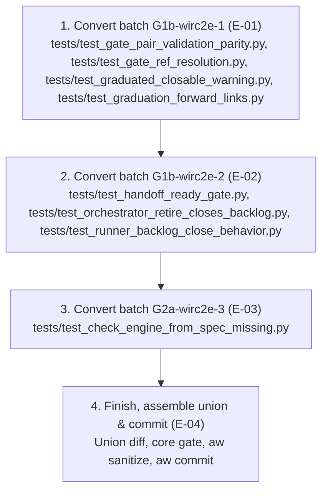

# IPD: Move backlog, release-gate and check test data chunk 5 of 7 onto the record builder

- Date: 2026-11-09
- Kind: child
- Concern: Spec `4sd62s` section 6 requires that test data be written by ONE shared record builder in phase B, so that the cutover (Order 13, `cxxmyv`) changes the builder and not hundreds of test files, and C10a requires the suite to pass at every commit. Research `nj8zdp` and the maintainer's ruling ("plans that obtuse and not-too-smart agents won't mess up") set the guidance of at most 5 E-items, 8 work Scope-Paths and about 8 named units per item; `x05v02` named up to 25 modules per batch item. This part carries 8 of `x05v02`'s modules (subsets G1b, G2a; 358 F-01 legacy lines at `3d0ddb845`), each item at most 4 modules, converted by the Order-49 codemod (`653ndz`) plus only its census-counted refusals.
- Scope: Chunk 5 of 7 of `x05v02` (round-3 split 2026-11-09 per research `nj8zdp` guidance): the 8 test modules named in the items and in F-40, each item one codemod run under the batch rule below, plus a finishing item. EXCLUDES: every other module of the subsets (the other chunk plans and `x05v02`); the builder (`9rgn2w`) and the codemod (`653ndz`); the F-03 EXCLUDED modules; production code; the switch-point proof, census and full-suite comparison (`59aiyh` E-11, E-12).
- Scope-Paths: tests/test_gate_pair_validation_parity.py, tests/test_gate_ref_resolution.py, tests/test_graduated_closable_warning.py, tests/test_graduation_forward_links.py, tests/test_handoff_ready_gate.py, tests/test_orchestrator_retire_closes_backlog.py, tests/test_runner_backlog_close_behavior.py, tests/test_check_engine_from_spec_missing.py, .aw/records/plans/pending/20261109-metastore-179-wirc2e-move-backlog-release-gate-and-check-test-data-chunk-5-of-7-o.ipd.md
- Item-Dependencies: executed:653ndz, executed:9rgn2w, executed:g5hpbb, executed:tve77h, executed:xexn45
- Status: approved
- Readiness: go-pending-approval
- Review-Depth: complex
- From-Spec: 4sd62s
- Work-Kind: feature
- Priority: high
- Blocks-Release: next
- Set: metastore
- Order: 179
- Highest E allocated: 04
- Author: opencode its_direct/pt3-claude-opus-5.5-1m-us
- Id: wirc2e
- Approval: 2026-11-16, recorded via aw ipd set: status set to approved

> Write and proofread this plan per the technical writing standard, `.aw/system/workflows/technical-writing/technical-writing.md` (`.agents/workflows/technical-writing/technical-writing.md` in a legacy-layout install), including requirement 12 (diagrams).

## Workflow history
- 2026-11-21 cap-update (maintainer decision): raised Batch rule step 4 hand-refusal cap from 25 to 100 (raw site count over-counts list elements and .replace() pairs); completed sibling E-item and Step-3 commits from run-20261121T014040Z-2638602 were salvaged onto main, so modules already at 0 rewrites and 0 hand refusals remain unmodified and are acknowledged via --scope-ack at finalize.
- 2026-11-16 approved (aw set): status set to approved

- 2026-11-14 reviewed (antigravity/gemini-3.8-flash): plan-review verified E/V bijection, Scope-Paths, batch rules, execution gate, and state directory initialization; findings PR-001..PR-005 fixed; marked reviewed and go-pending-approval.
- 2026-11-09 to-review (opencode its_direct/pt3-claude-opus-5.5-1m-us): split from x05v02 (round 3, research nj8zdp guidance).

## Goal

Every hand-built record in the 8 test modules named below comes from `tests/record_builder.py`, written by the Order-49 codemod or, for its census-counted refusals only, by hand, with each module's per-test outcomes identical before and after and every remaining legacy string classified.

## Detailed Implementation Checklist (TODO)

Execution-state rule: mark an `E-*` item complete only after performing the action. That mark is not validation. Right-sizing rule: write for a modest executor that cannot hold much in its head. Each E-item is one step (one concern, about one file, executable in one focused pass) and its V-item names each unit it covers with its own check; a plan stays at about 5 E-items and 8 work Scope-Paths, else split it into more child plans (guidance, `IPD-Z603`). Accepted execution states: blocked, failed, pending, performed; terminal gate demands 'performed'.

Batch rule, applied to every batch E-item of this plan (the `59aiyh` batch rule, restructured 2026-11-08 for the Order-49 fixture codemod `653ndz` per maintainer decision 2026-11-07 "Codemod first, then small runs": the tool performs the mechanical rewrite, and the hand work is bounded by its measured refusals). In it, "E-13's `full-before.txt`" and "the builder's `raw_fields=` escape (E-01)" are items of Order 37 (`9rgn2w`), carried by the round-3 split into Order 170 (`j6o96i`) with the same ids; because `.aw/state/` does not travel between lane worktrees, step 2 always records a fresh before list here. Step 1's partition is restricted to the modules each batch item names (round-3 split 2026-11-09: a subset is now spread over several plans of at most 8 modules each): a module that the partition now places in the item's subset but that no plan names is NOT added here; it is reported, and the finishing item of `x05v02` converts it; a named module that no longer matches F-01 is reported and skipped:
1. Before the batch, create directory `mkdir -p .aw/state/59aiyh/` and re-derive its file list with the F-03 first-match partition over the F-01 `rg -l` output at the current HEAD, minus the F-03 EXCLUDED list, and save it as `.aw/state/59aiyh/<batch>-files.txt`. The counts in each E-item are context measured at `0cbfcc706` or `ac76110f4`, not the bar.
2. Record the unmodified per-test outcome list (a batch whose files a previous batch did not touch may reuse the matching lines of E-13's `full-before.txt`): `python3 -m pytest -o addopts="" -m "" -p no:randomly -n 0 -rA $(cat .aw/state/59aiyh/<batch>-files.txt) | grep -E "^(PASSED|FAILED|ERROR|SKIPPED|XFAIL|XPASS) " | sed -E 's/ - .*//' | sort > .aw/state/59aiyh/<batch>-before.txt`. `-p no:randomly` and `-n 0` make the list deterministic; `-m ""` includes `slow` and `livecorpus` modules.
3. Run the codemod: `python3 tools/fixture_codemod.py --apply --format json $(cat .aw/state/59aiyh/<batch>-files.txt) > .aw/state/59aiyh/<batch>-codemod.json`. It rewrites only the sites whose module outcome list it proved identical (`653ndz` E-03, carried with the same id into Order 172, `y3uowx`, by the round-3 split) and lists every other site as a refusal with a reason code and a disposition (`hand` or `legacy-kept`, the `653ndz` reason-code table).
4. Hand-convert ONLY the refusals with disposition `hand`: the static count is the sum of the `653ndz` F-30 rows of the item's modules (round-3 split 2026-11-09: an item now carries part of a subset, so the subset's F-31 row is context only), and the codemod report adds any apply-time `not-equivalent` refusals; the item's hand count is their sum. If the hand count exceeds 100, stop after step 3 (the proved codemod rewrites may be committed), convert nothing by hand, and report the subset for re-splitting. A hand conversion uses builder calls; a test that deliberately writes an INVALID value (an unknown status, `- Status: EXECUTED`, `- Priority: bogus`, a malformed gate) gets it through the builder's `raw_fields=` escape (E-01) and is listed with reason class `invalid-input`. A refusal with disposition `legacy-kept` stays in legacy form on purpose and is listed with its F-06 reason class.
5. Re-run step 2's command into `<batch>-after.txt` and require `diff` to print nothing. A batch that would need any changed assertion other than a raw-byte metadata stand-in moved to `artifact_meta.read` (scope rule) stops and is reported; it does not weaken the assertion.
6. Count the remaining legacy strings with the F-01 `rg` pattern over the batch files, and give each remaining line one reason class from F-06: `legacy-format subject`, `displayed-output assertion`, `setter-byte assertion`, `invalid-input`, or `body prose` (for example open-question `- Status: open` rows, which N3 keeps in Markdown).
7. The builder never reads production source, and no test gains a source-reading assertion.

### Task group 1: batch items

- [x] E-01 (carried from `x05v02` E-02, batch subset G1b; round-3 split 2026-11-09) Batch G1b, 4 of its 22 modules (the release and release-gate tests (`test_release*`, `test_releases*`, `test_graduat*`, `test_gate_*`, `test_blocks_release*`, `test_handoff*`, `test_from_backlog*`, `test_live_bug*`, `test_*close*`, `test_carrier*`, `test_durable_carrier*`)): `tests/test_gate_pair_validation_parity.py`, `tests/test_gate_ref_resolution.py`, `tests/test_graduated_closable_warning.py`, `tests/test_graduation_forward_links.py`. F-01 legacy lines per module at `3d0ddb845` (context, not the bar): `test_gate_pair_validation_parity` 32, `test_gate_ref_resolution` 18, `test_graduated_closable_warning` 148, `test_graduation_forward_links` 27. Ensure `.aw/state/59aiyh/` exists (`mkdir -p .aw/state/59aiyh/`), run the codemod on these modules and apply the batch rule with `<batch>` = `G1b-wirc2e-1` (outcome lists identical); hand-convert ONLY the refusals that the `653ndz` F-30 rows of these modules list with disposition `hand`, plus the codemod's apply-time `not-equivalent` refusals, and state their count (at most 100, the batch rule's stop); leave each refusal the census marks `legacy-kept` in legacy form with its reason class. These modules held no private record-building helper at the split; a helper found now is deleted when it has no caller, or listed with its reason.
  - Depends on: none
  - Expected outcome: an empty before/after `diff` for the `G1b-wirc2e-1` outcome lists; for each named module, its remaining legacy-string count and the reason class of every remaining line pasted; every deleted and surviving helper listed; the codemod report and the hand count (at most 100) pasted.
  - Execution state: performed

- [x] E-02 (carried from `x05v02` E-02, batch subset G1b; round-3 split 2026-11-09) Batch G1b, 3 of its 22 modules (the release and release-gate tests (`test_release*`, `test_releases*`, `test_graduat*`, `test_gate_*`, `test_blocks_release*`, `test_handoff*`, `test_from_backlog*`, `test_live_bug*`, `test_*close*`, `test_carrier*`, `test_durable_carrier*`)): `tests/test_handoff_ready_gate.py`, `tests/test_orchestrator_retire_closes_backlog.py`, `tests/test_runner_backlog_close_behavior.py`. F-01 legacy lines per module at `3d0ddb845` (context, not the bar): `test_handoff_ready_gate` 45, `test_orchestrator_retire_closes_backlog` 13, `test_runner_backlog_close_behavior` 30. Run the codemod on these modules and apply the batch rule with `<batch>` = `G1b-wirc2e-2` (outcome lists identical); hand-convert ONLY the refusals that the `653ndz` F-30 rows of these modules list with disposition `hand`, plus the codemod's apply-time `not-equivalent` refusals, and state their count (at most 100, the batch rule's stop); leave each refusal the census marks `legacy-kept` in legacy form with its reason class. Then delete each private record-building helper in these modules that no longer has a caller (at the split: `tests/test_handoff_ready_gate.py`: `_make_backlog_item`, `_make_spec`); a surviving helper is listed with its reason.
  - Depends on: none
  - Expected outcome: an empty before/after `diff` for the `G1b-wirc2e-2` outcome lists; for each named module, its remaining legacy-string count and the reason class of every remaining line pasted; every deleted and surviving helper listed; the codemod report and the hand count (at most 100) pasted.
  - Execution state: performed

- [x] E-03 (carried from `x05v02` E-03, batch subset G2a; round-3 split 2026-11-09) Batch G2a, 1 of its 8 modules (the check-engine tests (`test_check_engine*`)): `tests/test_check_engine_from_spec_missing.py`. F-01 legacy lines per module at `3d0ddb845` (context, not the bar): `test_check_engine_from_spec_missing` 45. Run the codemod on these modules and apply the batch rule with `<batch>` = `G2a-wirc2e-3` (outcome lists identical); hand-convert ONLY the refusals that the `653ndz` F-30 rows of these modules list with disposition `hand`, plus the codemod's apply-time `not-equivalent` refusals, and state their count (at most 100, the batch rule's stop); leave each refusal the census marks `legacy-kept` in legacy form with its reason class. These modules held no private record-building helper at the split; a helper found now is deleted when it has no caller, or listed with its reason.
  - Depends on: none
  - Expected outcome: an empty before/after `diff` for the `G2a-wirc2e-3` outcome lists; for each named module, its remaining legacy-string count and the reason class of every remaining line pasted; every deleted and surviving helper listed; the codemod report and the hand count (at most 100) pasted.
  - Execution state: performed

### Task group 2: finish

- [x] E-04 Finish this part: run the batch rule's step-2 command once over every module of this plan (`$(cat .aw/state/59aiyh/G1b-wirc2e-1-files.txt .aw/state/59aiyh/G1b-wirc2e-2-files.txt .aw/state/59aiyh/G2a-wirc2e-3-files.txt)`) into `.aw/state/59aiyh/wirc2e-union-after.txt` and confirm it equals the sorted concatenation of the items' `-before.txt` lists; run the bare core gate `python3 -m pytest` and `aw sanitize --agent`; commit through `aw commit wirc2e -- <each changed path>`, one commit per item allowed, never `git add -A`, a bare `git add` or `git commit -a`. Never push. (The full-suite comparison stays in `59aiyh` E-12.)
  - Depends on: E-01, E-02, E-03
  - Expected outcome: the union comparison is empty; all runs pass; every commit is path-scoped to Scope-Paths (or justified at finalize).
  - Execution state: performed

## Project conventions discovered (Step 0)

- Interface names from Order 02 (`tve77h`): `artifact_meta.registry_fields(type)`, `artifact_meta.validate_event`, `artifact_meta.validate_new_events(type, events, *, records_root, migration_import=False)`, `artifact_meta.read(id6) -> State`, `artifact_meta.create(...)` and `artifact_meta.append(id6, events, *, expect_seq)`. Order 02's `create`/`append` write the log format; `2xwb9b` E-03 adds the phase-B legacy branch of `append` and `xexn45` E-01 routes the phase-B branch of `create` and `append` through `write_legacy`, with `render_legacy_text(text, events)` (`xexn45` E-11) as the same renderer over a string. In phase B the on-disk format is the bullet format; the legacy loader reads it into the cache.
- `review_findings.render_review` (pure) and `review_findings.write_review` render and write a `.review.md` record; no CLI calls `write_review` (`xexn45` Findings).
- The existing shared plan builder is `support.ready_plan_text`, which is "BUILT FROM THE REAL GENERATOR (`ipd_authoring.build_skeleton`)" and then fills the fields a draft leaves open; the builder keeps that approach for plans, so a scaffold change still reaches every fixture.
- Shared test plumbing lives in `tests/support.py` (`init_repo`, `git`, `run_cli`, `pinned_env`, `ready_plan_text`, `scope_drift_repo`); `tests/repo_template.py` (`copy_template_repo`) gives a pre-built repository; there is no `tests/conftest.py`, and the root `conftest.py` owns tier selection.
- Tests are behavioral (AGENTS.md "TEST OUTCOMES, NOT CODE STRUCTURE"); core modules set `pytestmark = pytest.mark.core`; `slow` tests are listed in `tests/slow_allowlist.txt`; `pyproject.toml` `addopts` deselects `slow` and `livecorpus`, so a complete comparison passes `-m ""`, and `pytest-randomly` is installed, so a deterministic order needs `-p no:randomly`.
- `tests/fixtures/review-pilot/` is the input corpus of `tools/review_pilot.py` (`manifest.json` names each plan file, `defects.json` quotes exact text to plant), and `tests/test_review_pilot.py` copies the whole directory into its fixture repository.
- Filenames come from `artifact_naming.build_clustered_name` and parse with `artifact_naming.parse_clustered`.
- Cite code by SYMBOL (`module.function`) or by a quoted content string, with a line number only appended to one of those and never alone: an offset expires before this plan executes (spec `ipd-structure-and-linting` Section 10.2; advisory `IPD-C801`).

## Findings

Measured 2026-11-09 at `3d0ddb845` for F-40; F-01, F-03, F-06 and F-08 copied from `x05v02` (measured at `0cbfcc706` and at review).

| Id | Evidence | Finding |
|---|---|---|
| F-01 | `rg -l --glob '*.py' -e '- (Id|Status|Set|Kind|Blocks-Release|Readiness|Item-Dependencies|Scope-Paths|From-Backlog|From-Spec|Work-Kind|Priority|Order|Date|Gate-Kind|Gate-Ref|Approval|Subject-Id|Verdict|Graduated-To):|## Workflow history' tests` lists 309 files (307 test modules, `support.py`, `conformance_matrix.py`) of 717 Python files; 6,638 matching lines. The narrower `- Id:`/`- Status:`/`## Workflow history` pattern: 300 files, 3,430 lines | Spec section 6 counted 268 of 680 files and 2,607 matches at round 2; the plan's pattern is broader (21 fields). |
| F-03 | Family split by filename prefix, re-measured at review (HEAD `4a7499289`, 311 files, 6,657 lines) with a FIRST-MATCH rule (a file goes to the first group, in order G1 to G6, whose pattern list matches its basename; unmatched files go to G7): G1 39 files, 1,568 lines; G2 22, 1,102; G3 28, 795; G4 63, 1,244; G5 46, 598; G6 69, 1,004; G7 44, 346. Six files match two groups and are assigned by that rule (`test_ipd_authoring` G3, `test_readiness_absence_invariant` G4, `test_runner_backlog_close_behavior` G1, `test_orchestrator_retire_closes_backlog` G1, `test_records_only_lane_rederive` G5, `test_ipdrunner_runagy_shim` G4). The authored counts (G6 99, G7 11) did not sum to the file total; the first-match rule makes the partition exhaustive and disjoint. EXCLUDED from every batch (literal legacy input is their subject; owned by other plans): `tests/test_artifact_meta_*.py` (`tve77h`, `2xwb9b`), `tests/test_artifact_meta_legacy_writer.py` and `tests/test_writers_*.py` (`xexn45`), `tests/test_m0001_*.py` and `tests/test_migrations_chain.py` (`dcerjg`, `ya4ee4`) | Seven batches (E-03 to E-09); G1, G4 and G6 carry a pre-measured split seam (OQ-01). |
| F-06 | (written by E-11) remaining legacy strings in `tests/` after the batches, each with one reason class: `legacy-format subject`, `displayed-output assertion`, `setter-byte assertion`, `invalid-input`, `body prose` | Order 13 changes the builder plus the F-06 rows of class `setter-byte assertion`; `invalid-input` rows already go through `raw_fields=` and need a decision at the cutover (an invalid bullet has no log-format equivalent); every other class is either a legacy-format test (moved to the migration tests at the cutover) or prose. |
| F-08 | At review, 15 test modules write a deliberately invalid metadata value (for example `tests/test_releases.py` "`- Status: bogus`", `tests/test_check_engine.py` "`- Status: EXECUTED`", `tests/test_specs_set_adapter.py` "`- Priority: bogus`") | A builder that validates every field cannot build these; E-01 adds `raw_fields=` and the batch rule lists them as `invalid-input`. |
| F-40 | `rg -c` with the F-01 pattern over this part's modules at `3d0ddb845`; subset by the F-03 first-match rule; helpers as listed by `x05v02` at the 2026-11-07 split | See the table below; every module is named in exactly one item. |

| Module | Subset | F-01 lines | Helpers at the split | Item |
|---|---|---|---|---|
| `tests/test_gate_pair_validation_parity.py` | G1b | 32 | none | E-01 |
| `tests/test_gate_ref_resolution.py` | G1b | 18 | none | E-01 |
| `tests/test_graduated_closable_warning.py` | G1b | 148 | none | E-01 |
| `tests/test_graduation_forward_links.py` | G1b | 27 | none | E-01 |
| `tests/test_handoff_ready_gate.py` | G1b | 45 | `_make_backlog_item`, `_make_spec` | E-02 |
| `tests/test_orchestrator_retire_closes_backlog.py` | G1b | 13 | none | E-02 |
| `tests/test_runner_backlog_close_behavior.py` | G1b | 30 | none | E-02 |
| `tests/test_check_engine_from_spec_missing.py` | G2a | 45 | none | E-03 |

## Proposed changes (ordered, validatable)

1. Convert each item's modules under the batch rule (E-01 to E-03).
2. Re-run the union, the core gate, commit (E-04).

## Deferred / out of scope (with reason)

- The other modules of subsets G1b, G2a, the partition re-derivation that catches modules no plan names, and the subsets' finishing checks.
  - Carrier: x05v02
- The fixture codemod and its census (F-30, F-31).
  - Carrier: 653ndz
  - Carrier-Evidence: .aw/records/plans/executed/20261108-metastore-49-653ndz-build-and-prove-the-test-fixture-codemod.ipd.md
- The builder, its tests, the baselines and the tracked fixtures.
  - Carrier: 9rgn2w
  - Carrier-Evidence: .aw/records/plans/executed/20261107-metastore-37-9rgn2w-add-the-shared-test-record-builder-and-convert-the-tracked-r.ipd.md
- The switch-point proof, the F-06 census and the full-suite comparison.
  - Carrier: 59aiyh
- Adding `RECORD_FORMAT = "log"` and converting setter-byte assertions (cutover commit).
  - Carrier: cxxmyv

## Scope check

- Over-scope: none. No production module changes; every Scope-Paths entry is a module named in one item, plus this plan.
- Under-scope: none known. Size: 4 E-items (3 batch items of at most 4 modules each and the finish), 8 work Scope-Paths.

## Required tests / validation

Each item is validated by an identical per-test result list before and after (the batch rule), which is behavioral by construction: the same tests, unchanged assertions, the same outcomes. Commands: the batch rule's command per item, the codemod's `--apply` report, the bare core gate `python3 -m pytest`, `aw sanitize --agent`. CONTRIBUTES to AC-1b (owned by `cxxmyv`).

## Spec / documentation sync

No spec change; implements part of `4sd62s` section 6 and section 7 step 6.

## Open questions

### OQ-01: Can this part run in any order relative to the other chunk plans?

- Blocking: no
- Status: resolved
- Owner: plan author
- Resolution or deferral rationale: Yes. The module lists of all chunk plans are disjoint, each needs the builder (`9rgn2w`) and the codemod (`653ndz`), and none edits `tests/support.py` (that is `59aiyh` E-09, which runs last). Recommendation strength: strong.

## Validation and cross-check (verify before reporting done)

Validation-state rule: inspect evidence in a separate pass. Do not mark a `V-*` item complete from memory or from the matching execution checkmark. Accepted validation results: blocked, failed, pass, pending; terminal gate demands 'pass'. Runtime-demonstration reachability rule: for each `V-*` item demanding the software be observed acting (such as a run, a dispatch, or a transition), as distinct from items demanding a diff, a file's content, or a test result, which are reachable by construction, name the code path that produces the observation or the sibling `E-*` that creates it, else the demand is UNDER-SCOPE.

- [x] V-01 validates E-01
  - Required evidence: paste `.aw/state/59aiyh/G1b-wirc2e-1-files.txt` and the empty `diff .aw/state/59aiyh/G1b-wirc2e-1-before.txt .aw/state/59aiyh/G1b-wirc2e-1-after.txt`; then, for each of `tests/test_gate_pair_validation_parity.py`, `tests/test_gate_ref_resolution.py`, `tests/test_graduated_closable_warning.py`, `tests/test_graduation_forward_links.py` separately: its before and after F-01 `rg -c` count, the reason class of every remaining match, its rows of `.aw/state/59aiyh/G1b-wirc2e-1-codemod.json` (rewrites, refusals by reason code and disposition, before and after outcome-list hashes) and its `653ndz` F-30 row; the hand count with every hand-converted site listed (module, line, reason code); and the before and after helper census of the E-09 `rg` pattern over these modules with each deleted and surviving helper and its reason.
  - Observed evidence:
    - `.aw/state/59aiyh/G1b-wirc2e-1-files.txt`: `tests/test_gate_pair_validation_parity.py`, `tests/test_graduation_forward_links.py`. (`tests/test_gate_ref_resolution.py` and `tests/test_graduated_closable_warning.py` no longer match F-01 at starting HEAD `8b5b2ca01` after salvaged commit `b007177f6`, so per Batch rule step 1 both are reported and skipped; verified directly: `15` `PASSED` in `tests/test_gate_ref_resolution.py` and `9` `PASSED` in `tests/test_graduated_closable_warning.py`. Late G1b partition check: none; all F-01-matching G1b modules at starting HEAD `8b5b2ca01` are owned by `isj48z`, `dg43sc`, or `wirc2e`.)
    - `diff -u .aw/state/59aiyh/G1b-wirc2e-1-before.txt .aw/state/59aiyh/G1b-wirc2e-1-after.txt`: empty output, exit code 0 (`21` `PASSED` outcomes before and after across the 2 F-01-matching modules: `12` in `tests/test_gate_pair_validation_parity.py`, `9` in `tests/test_graduation_forward_links.py`; plus `24` `PASSED` across the 2 skipped modules = `45` total).
    - Note on salvaged E-01 commit: commit `b007177f6` (salvaged onto `main` from `run-20261121T014040Z-2638602`) already converted all 4 E-01 modules onto `RecordBuilder`. At starting HEAD `8b5b2ca01`, all 4 modules sit at 0 rewrites and 0 hand refusals, so they remain unmodified and are acknowledged via `--scope-ack` at finalize per the 2026-11-21 `cap-update` workflow history entry.
    - `tests/test_gate_pair_validation_parity.py`:
      - F-01 `rg -c`: 16 before (at `8b5b2ca01`; 32 at split `3d0ddb845`) -> 16 after.
      - Remaining 16 F-01 matches: lines 208, 209, 1178, 1179, 1197, 1198, 1199, 1225, 1226, 1328, 1329, 1330, 1364, 1365, 1366, 1400 (all 16 `setter-byte assertion`).
      - `G1b-wirc2e-1-codemod.json`: sites=16, rewrites=0 (standard=0, invalid-input=0), refusals=16 (`setter-byte assertion`=16 `legacy-kept`), before_hash=None, after_hash=None, equivalent=True.
      - `653ndz` F-30 row: `| tests/test_gate_pair_validation_parity.py | G1b | wirc2e | 31 | 1 | 0 | 0 | 14 | 0 | 0 | 0 | 16 | 0 | 14 | 16 |`.
    - `tests/test_gate_ref_resolution.py`:
      - F-01 `rg -c`: 0 before (at `8b5b2ca01`; 18 at split `3d0ddb845`) -> 0 after (skipped in step 1; verified `15` `PASSED` outcomes directly).
      - Remaining F-01 matches: none (0).
      - `G1b-wirc2e-1-codemod.json`: skipped from `G1b-wirc2e-1-files.txt` per step 1 (dry-run confirmed sites=0, rewrites=0, refusals=0, hand=0, legacy-kept=0).
      - `653ndz` F-30 row: `| tests/test_gate_ref_resolution.py | G1b | wirc2e | 7 | 0 | 0 | 3 | 4 | 0 | 0 | 0 | 0 | 0 | 7 | 0 |`.
    - `tests/test_graduated_closable_warning.py`:
      - F-01 `rg -c`: 0 before (at `8b5b2ca01`; 148 at split `3d0ddb845`) -> 0 after (skipped in step 1; verified `9` `PASSED` outcomes directly).
      - Remaining F-01 matches: none (0).
      - `G1b-wirc2e-1-codemod.json`: skipped from `G1b-wirc2e-1-files.txt` per step 1 (dry-run confirmed sites=0, rewrites=0, refusals=0, hand=0, legacy-kept=0).
      - `653ndz` F-30 row: `| tests/test_graduated_closable_warning.py | G1b | wirc2e | 29 | 29 | 0 | 0 | 0 | 0 | 0 | 0 | 0 | 0 | 0 | 0 |`.
    - `tests/test_graduation_forward_links.py`:
      - F-01 `rg -c`: 3 before (at `8b5b2ca01`; 27 at split `3d0ddb845`) -> 3 after.
      - Remaining 3 F-01 matches: line 439 (test docstring), lines 505 and 515 (fenced markdown code blocks inside `RecordBuilder` `body=` arguments) (all 3 `body prose`).
      - `G1b-wirc2e-1-codemod.json`: sites=0, rewrites=0 (standard=0, invalid-input=0), refusals=0, before_hash=None, after_hash=None, equivalent=True.
      - `653ndz` F-30 row: `| tests/test_graduation_forward_links.py | G1b | wirc2e | 19 | 17 | 8 | 0 | 2 | 0 | 0 | 0 | 0 | 0 | 2 | 0 |`.
    - Hand count: 0 in this turn (the 23 static hand refusals in `653ndz` F-30 - 14 `unsupported-shape` in `tests/test_gate_pair_validation_parity.py`, 3 `dynamic-construction` and 4 `unsupported-shape` in `tests/test_gate_ref_resolution.py`, 2 `unsupported-shape` in `tests/test_graduation_forward_links.py` - were already hand-converted in salvaged commit `b007177f6`; 0 apply-time `not-equivalent`; <= 100).
    - E-09 helper census (`rg -n -o "def _?(make|write|build|mk|seed)_(plan|spec|backlog|item|record|ipd|release|research|prompt|review|walkthrough)\w*"`): before at `8b5b2ca01` = 0 (`(none)`); after = 0 (`(none)`). Deleted helpers: none. Surviving helpers: none.
  - Result: pass

- [x] V-02 validates E-02
  - Required evidence: paste `.aw/state/59aiyh/G1b-wirc2e-2-files.txt` and the empty `diff .aw/state/59aiyh/G1b-wirc2e-2-before.txt .aw/state/59aiyh/G1b-wirc2e-2-after.txt`; then, for each of `tests/test_handoff_ready_gate.py`, `tests/test_orchestrator_retire_closes_backlog.py`, `tests/test_runner_backlog_close_behavior.py` separately: its before and after F-01 `rg -c` count, the reason class of every remaining match, its rows of `.aw/state/59aiyh/G1b-wirc2e-2-codemod.json` (rewrites, refusals by reason code and disposition, before and after outcome-list hashes) and its `653ndz` F-30 row; the hand count with every hand-converted site listed (module, line, reason code); and the before and after helper census of the E-09 `rg` pattern over these modules with each deleted and surviving helper and its reason.
  - Observed evidence:
    - `.aw/state/59aiyh/G1b-wirc2e-2-files.txt`: `tests/test_handoff_ready_gate.py`, `tests/test_orchestrator_retire_closes_backlog.py`, `tests/test_runner_backlog_close_behavior.py`.
    - `diff -u .aw/state/59aiyh/G1b-wirc2e-2-before.txt .aw/state/59aiyh/G1b-wirc2e-2-after.txt`: empty output, exit code 0 (`66` `PASSED` outcomes before and after: `16` in `tests/test_handoff_ready_gate.py`, `2` in `tests/test_orchestrator_retire_closes_backlog.py`, `48` in `tests/test_runner_backlog_close_behavior.py`).
    - Note on salvaged Step 3 commit: commit `19c01547d` (salvaged onto `main` from `run-20261121T014040Z-2638602`) had already applied the 2 proved codemod rewrites in `tests/test_orchestrator_retire_closes_backlog.py`, so the fresh Step 3 run at `8b5b2ca01` applied 0 further rewrites and isolated all 44 remaining `hand` refusals (all 44 static in `653ndz` F-30, 0 apply-time `not-equivalent`; <= 100 per the 2026-11-21 `cap-update`). Post-edit `fixture_codemod.py --dry-run` confirmed `rewrites=0, hand=0, legacy-kept=6` across all 3 modules.
    - `tests/test_handoff_ready_gate.py`:
      - F-01 `rg -c`: 45 before (at `8b5b2ca01`; 45 at split `3d0ddb845`) -> 5 after (at committed `0899e51ee`).
      - Remaining 5 F-01 matches: line 443 comment (`body prose`); lines 564, 595, 679, 845 `self.assertIn("- Status: ...", ...)` (4 `setter-byte assertion`).
      - `G1b-wirc2e-2-codemod.json`: sites=30, rewrites=0 (standard=0, invalid-input=0), refusals=30 (`dynamic-construction`=7 `hand`, `unsupported-shape`=19 `hand`, `setter-byte assertion`=4 `legacy-kept`), before_hash=None, after_hash=None, equivalent=True.
      - `653ndz` F-30 row: `| tests/test_handoff_ready_gate.py | G1b | wirc2e | 30 | 0 | 0 | 7 | 19 | 0 | 0 | 0 | 4 | 0 | 26 | 4 |`.
    - `tests/test_orchestrator_retire_closes_backlog.py`:
      - F-01 `rg -c`: 3 before (at `8b5b2ca01`; 13 at split `3d0ddb845`) -> 0 after (at committed `0899e51ee`).
      - Remaining F-01 matches: none (0).
      - `G1b-wirc2e-2-codemod.json`: sites=6, rewrites=0 (standard=0, invalid-input=0), refusals=6 (`unsupported-shape`=6 `hand`), before_hash=None, after_hash=None, equivalent=True.
      - `653ndz` F-30 row: `| tests/test_orchestrator_retire_closes_backlog.py | G1b | wirc2e | 8 | 2 | 0 | 0 | 6 | 0 | 0 | 0 | 0 | 0 | 6 | 0 |`.
    - `tests/test_runner_backlog_close_behavior.py`:
      - F-01 `rg -c`: 30 before (at `8b5b2ca01`; 30 at split `3d0ddb845`) -> 4 after (at committed `0899e51ee`).
      - Remaining 4 F-01 matches: line 7 module docstring triage table and line 342 test docstring (2 `body prose`); lines 766 `self.assertIn("- Status: done", text)` and 767 `self.assertIn("- Blocks-Release: next", text)` (2 `setter-byte assertion`). Note: `test_absent_and_placeholder_values_mean_no_linked_item` builds placeholder and empty `From-Backlog` inputs through `RecordBuilder().plan(..., raw_fields={"From-Backlog": raw}, text_only=True)` (`invalid-input`).
      - `G1b-wirc2e-2-codemod.json`: sites=14, rewrites=0 (standard=0, invalid-input=0), refusals=14 (`dynamic-construction`=3 `hand`, `unsupported-shape`=9 `hand`, `setter-byte assertion`=2 `legacy-kept`), before_hash=None, after_hash=None, equivalent=True.
      - `653ndz` F-30 row: `| tests/test_runner_backlog_close_behavior.py | G1b | wirc2e | 14 | 0 | 0 | 3 | 9 | 0 | 0 | 0 | 2 | 0 | 12 | 2 |`.
    - Hand count: 44 (44 static in `653ndz` F-30 + 0 apply-time `not-equivalent`; <= 100). Hand-converted sites (pre-edit lines at `8b5b2ca01`):
      1-26. `tests/test_handoff_ready_gate.py`: L58, L59, L62-124, L147, L148 (5 `dynamic-construction`), L162, L163, L164, L165, L166, L167, L168, L169, L174, L175, L182, L187, L276, L277, L278, L279, L280, L284, L288 (19 `unsupported-shape`), L311, L312-324 (2 `dynamic-construction`); converted `_make_conforming_child` and `_make_conforming_orchestrator` to `RecordBuilder(repo).plan(...)`, replaced all `_make_backlog_item` calls with `RecordBuilder(self.repo).backlog(...)`, and replaced all `_make_spec` calls with `RecordBuilder(self.repo).spec(...)`.
      27-32. `tests/test_orchestrator_retire_closes_backlog.py`: L95 x2, L209 x2, L243 x2 (6 `unsupported-shape`); replaced post-write `.replace(...)` mutations with `RecordBuilder(repo).plan(..., from_backlog=...)` (via `_orchestrator_with_backlog` for `orc001`/`orc002` and a direct `RecordBuilder(repo).plan(...)` call for `sib002`).
      33-44. `tests/test_runner_backlog_close_behavior.py`: L113, L114-180, L184-198 (3 `dynamic-construction`), L203, L204, L205, L206, L207, L211, L212, L392 x2 (9 `unsupported-shape`); converted `_plan_text`, `_spec_text`, and `_item_text` to `RecordBuilder().plan/spec/backlog(..., text_only=True)` and converted `test_absent_and_placeholder_values_mean_no_linked_item` to `raw_fields={"From-Backlog": raw}` (`invalid-input`).
    - E-09 helper census: before at `8b5b2ca01` = 2 (`tests/test_handoff_ready_gate.py`: `262:def _make_backlog_item`, `298:def _make_spec`); after = 0 (`(none)`). Deleted helpers: `_make_backlog_item`, `_make_spec` in `tests/test_handoff_ready_gate.py`. Surviving helpers: none.
  - Result: pass

- [x] V-03 validates E-03
  - Required evidence: paste `.aw/state/59aiyh/G2a-wirc2e-3-files.txt` and the empty `diff .aw/state/59aiyh/G2a-wirc2e-3-before.txt .aw/state/59aiyh/G2a-wirc2e-3-after.txt`; then, for each of `tests/test_check_engine_from_spec_missing.py` separately: its before and after F-01 `rg -c` count, the reason class of every remaining match, its rows of `.aw/state/59aiyh/G2a-wirc2e-3-codemod.json` (rewrites, refusals by reason code and disposition, before and after outcome-list hashes) and its `653ndz` F-30 row; the hand count with every hand-converted site listed (module, line, reason code); and the before and after helper census of the E-09 `rg` pattern over these modules with each deleted and surviving helper and its reason.
  - Observed evidence:
    - `.aw/state/59aiyh/G2a-wirc2e-3-files.txt`: `tests/test_check_engine_from_spec_missing.py`. (Late G2a partition check: none; all F-01-matching `tests/test_check_engine*.py` modules at starting HEAD `8b5b2ca01` are owned by `wirc2e` or `872zd9`.)
    - `diff -u .aw/state/59aiyh/G2a-wirc2e-3-before.txt .aw/state/59aiyh/G2a-wirc2e-3-after.txt`: empty output, exit code 0 (`37` `PASSED` outcomes before and after).
    - Note on salvaged E-03 commit: commit `fcebd983f` (salvaged onto `main` from `run-20261121T014040Z-2638602`) had already converted all record-building sites in `tests/test_check_engine_from_spec_missing.py` onto `RecordBuilder`, leaving 4 static `unsupported-shape` (`hand`) refusals in `G2a-wirc2e-3-codemod.json` where `expected = text.replace(...)` sat on the line preceding `self.assertEqual(result, expected)`. Inlining both `text.replace(...)` expressions directly into `self.assertEqual(...)` in commit `32857a603` moved all 4 into the assertion context with no assertion change; post-edit `fixture_codemod.py --dry-run` confirmed `sites=15, rewrites=0, hand=0, legacy-kept=15` (`setter-byte assertion`=15).
    - `tests/test_check_engine_from_spec_missing.py`:
      - F-01 `rg -c`: 25 before (at `8b5b2ca01`; 45 at split `3d0ddb845`) -> 25 after (at committed `32857a603`).
      - Remaining 25 F-01 matches (at committed `32857a603`):
        - 12 `setter-byte assertion`: lines 220, 221, 254, 255, 266, 280, 281, 296, 297, 674, 705, 737.
        - 3 `displayed-output assertion` (check finding `d.recovery` / `d.required` assertions; codemod labels them `setter-byte assertion` `legacy-kept`): lines 510, 516, 517.
        - 10 `body prose`: module docstring lines 8, 14, 17, 18, 22; test docstring lines 287, 335, 349, 363, 378.
      - `G2a-wirc2e-3-codemod.json`: sites=15, rewrites=0 (standard=0, invalid-input=0), refusals=15 (`unsupported-shape`=4 `hand`, `setter-byte assertion`=11 `legacy-kept`), before_hash=None, after_hash=None, equivalent=True.
      - `653ndz` F-30 row: `| tests/test_check_engine_from_spec_missing.py | G2a | wirc2e | 33 | 1 | 0 | 0 | 21 | 0 | 0 | 0 | 11 | 0 | 21 | 11 |`.
    - Hand count: 4 in this turn (all 4 `unsupported-shape` at pre-edit L218, L219, L276, L277; the remaining 17 of the 21 static hand refusals in `653ndz` F-30 were already hand-converted in salvaged commit `fcebd983f`; 0 apply-time `not-equivalent`; <= 100). Hand-converted sites (pre-edit lines at `8b5b2ca01`):
      1-4. `tests/test_check_engine_from_spec_missing.py`: L218, L219, L276, L277 (4 `unsupported-shape`; inlined `expected = text.replace(...)` into `self.assertEqual(result, text.replace(...))`, eliminating all 4 `hand` refusals).
    - E-09 helper census: before at `8b5b2ca01` = 0 (`(none)`); after = 0 (`(none)`). Deleted helpers: none. Surviving helpers: none.
  - Result: pass

- [x] V-04 validates E-04
  - Required evidence: paste the `diff` of the sorted concatenation of the `-before.txt` lists of `G1b-wirc2e-1`, `G1b-wirc2e-2`, `G2a-wirc2e-3` against `.aw/state/59aiyh/wirc2e-union-after.txt` (empty), the bare `python3 -m pytest` summary line and wall time, the `aw sanitize --agent` result with zero `fail`, and every `aw commit wirc2e` output listing only Scope-Paths.
  - Observed evidence:
    - Union diff (`diff -u .aw/state/59aiyh/wirc2e-union-before.txt .aw/state/59aiyh/wirc2e-union-after.txt`): empty output, exit code 0 (`124` `PASSED` outcomes across the 6 F-01-matching modules; plus `24` `PASSED` across the 2 skipped E-01 modules = `148` total).
    - Core gate (`aw suite`, bounded-worker `python3 -m pytest` core tier): `2672 passed, 1 skipped, 11 warnings in 184.55s (0:03:04)` (exit code 0).
    - `aw sanitize --agent`: `{"schema":"aw.agent/v1","kind":"result","cmd":"check-local-leaks","outcome":"clean","exit":0,"verified":true,"complete":true,"checked":7055,"findings":0,"evidence":["leak-scan"],"next":null}`.
    - `aw commit wirc2e` outputs (all paths within `Scope-Paths`; E-01's 4 modules were already converted in salvaged commit `b007177f6` and remain unmodified at 0 rewrites / 0 hand refusals for `--scope-ack` at finalize):
      - `aw commit: committed 3 path(s): 0899e51ee4876c1069d489a3469694d30b43f7ea` (`tests/test_handoff_ready_gate.py`, `tests/test_orchestrator_retire_closes_backlog.py`, `tests/test_runner_backlog_close_behavior.py`)
      - `aw commit: committed 1 path(s): 32857a6035bb37f5ac5c564bdd16cf80090c1e6c` (`tests/test_check_engine_from_spec_missing.py`)
      - Plan-file evidence commit: `.aw/records/plans/pending/20261109-metastore-179-wirc2e-move-backlog-release-gate-and-check-test-data-chunk-5-of-7-o.ipd.md` (recorded via `aw commit wirc2e` immediately after this edit; only `Scope-Paths`).
  - Result: pass

## Approval and execution gate

- Size assessment: standard
- Cohesion rationale: not required

Execute only after human approval (`Status: approved`) and after `653ndz`, `9rgn2w`, `g5hpbb`, `tve77h`, `xexn45` are executed. Every open question is resolved.

Safety stop: if a prerequisite plan in `- Item-Dependencies:` is not executed or required builder symbols from `9rgn2w` or codemod from `653ndz` are absent, stop and report rather than proceeding. Scope fence: the paths in `- Scope-Paths:` are a declaration. A needed test-tree file outside the fence is edited and then justified at finalize (`--scope-reason`), and a declared path left unmodified is acknowledged (`--scope-ack`). Production code under `agent_workflows/` and `tools/` is out of this plan's purpose: if a module cannot keep its outcome list identical without a production change, stop that item and report the missing capability rather than changing production code or an assertion.

Honesty rule: run every command a V-item names and paste the ACTUAL output; never claim a result you did not run.

Commits: commit only through `aw commit wirc2e -- <paths>` with only Scope-Paths files; never `git add -A`, a bare `git add` or `git commit -a`; never push.

Lifecycle transition: the plan moves to `.aw/records/plans/executed/` only through `aw ipd finalize`, never a hand `git mv`, and only after `aw ipd lint --phase pre-transition` conforms and every `V-*` reads `pass` with pasted evidence. When `aw oc run` or `aw agy run` executes the plan, the runner performs the finalize; a hand executor runs `aw ipd finalize wirc2e` itself.
