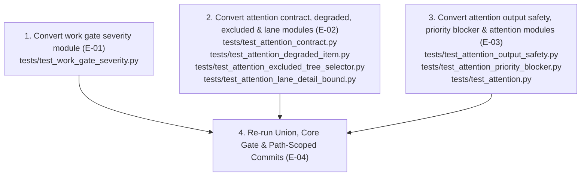

# IPD: Move runner-family, reader, record and review test data chunk 4 of 11 onto the record builder

- Date: 2026-11-09
- Kind: child
- Concern: Spec `4sd62s` section 6 requires that test data be written by ONE shared record builder in phase B, so that the cutover (Order 13, `cxxmyv`) changes the builder and not hundreds of test files, and C10a requires the suite to pass at every commit. Research `nj8zdp` and the maintainer's ruling ("plans that obtuse and not-too-smart agents won't mess up") set the guidance of at most 5 E-items, 8 work Scope-Paths and about 8 named units per item; `nbfg7w` named up to 25 modules per batch item. This part carries 8 of `nbfg7w`'s modules (subsets G5b, G6a; 136 F-01 legacy lines at `3d0ddb845`), each item at most 4 modules, converted by the Order-49 codemod (`653ndz`) plus only its census-counted refusals.
- Scope: Chunk 4 of 11 of `nbfg7w` (round-3 split 2026-11-09 per research `nj8zdp` guidance): the 8 test modules named in the items and in F-40, each item one codemod run under the batch rule below, plus a finishing item. EXCLUDES: every other module of the subsets (the other chunk plans and `nbfg7w`); the builder (`9rgn2w`) and the codemod (`653ndz`); the F-03 EXCLUDED modules; production code; the switch-point proof, census and full-suite comparison (`59aiyh` E-11, E-12).
- Scope-Paths: tests/test_work_gate_severity.py, tests/test_attention_contract.py, tests/test_attention_degraded_item.py, tests/test_attention_excluded_tree_selector.py, tests/test_attention_lane_detail_bound.py, tests/test_attention_output_safety.py, tests/test_attention_priority_blocker.py, tests/test_attention.py, .aw/records/plans/pending/20261109-metastore-195-lf0fe4-move-runner-family-reader-record-and-review-test-data-chunk.ipd.md
- Item-Dependencies: executed:653ndz, executed:9rgn2w, executed:g5hpbb, executed:tve77h, executed:xexn45
- Status: approved
- Readiness: go-pending-approval
- Review-Depth: complex
- From-Spec: 4sd62s
- Work-Kind: feature
- Priority: high
- Blocks-Release: next
- Set: metastore
- Order: 195
- Highest E allocated: 04
- Author: opencode its_direct/pt3-claude-opus-5.5-1m-us
- Id: lf0fe4
- Approval: 2026-11-16, recorded via aw ipd set: status set to approved

> Write and proofread this plan per the technical writing standard, `.aw/system/workflows/technical-writing/technical-writing.md` (`.agents/workflows/technical-writing/technical-writing.md` in a legacy-layout install), including requirement 12 (diagrams).

## Workflow history
- 2026-11-16 approved (aw set): status set to approved

- 2026-11-09 to-review (opencode its_direct/pt3-claude-opus-5.5-1m-us): split from nbfg7w (round 3, research nj8zdp guidance).
- 2026-11-14 reviewed (antigravity): plan-review verified E/V bijection, Scope-Paths, batch rules, and execution gate; marked reviewed and go-pending-approval.

## Goal

Every hand-built record in the 8 test modules named below comes from `tests/record_builder.py`, written by the Order-49 codemod or, for its census-counted refusals only, by hand, with each module's per-test outcomes identical before and after and every remaining legacy string classified.

## Detailed Implementation Checklist (TODO)

Execution-state rule: mark an `E-*` item complete only after performing the action. That mark is not validation. Right-sizing rule: write for a modest executor that cannot hold much in its head. Each E-item is one step (one concern, about one file, executable in one focused pass) and its V-item names each unit it covers with its own check; a plan stays at about 5 E-items and 8 work Scope-Paths, else split it into more child plans (guidance, `IPD-Z603`). Accepted execution states: blocked, failed, pending, performed; terminal gate demands 'performed'.

Batch rule, applied to every batch E-item of this plan (the `59aiyh` batch rule, restructured 2026-11-08 for the Order-49 fixture codemod `653ndz` per maintainer decision 2026-11-07 "Codemod first, then small runs": the tool performs the mechanical rewrite, and the hand work is bounded by its measured refusals). In it, "E-13's `full-before.txt`" and "the builder's `raw_fields=` escape (E-01)" are items of Order 37 (`9rgn2w`), carried by the round-3 split into Order 170 (`j6o96i`) with the same ids; because `.aw/state/` does not travel between lane worktrees, step 2 always records a fresh before list here. Step 1's partition is restricted to the modules each batch item names (round-3 split 2026-11-09: a subset is now spread over several plans of at most 8 modules each): a module that the partition now places in the item's subset but that no plan names is NOT added here; it is reported, and the finishing item of `nbfg7w` converts it; a named module that no longer matches F-01 is reported and skipped:
1. Before the batch, re-derive its file list with the F-03 first-match partition over the F-01 `rg -l` output at the current HEAD, minus the F-03 EXCLUDED list, and save it as `.aw/state/59aiyh/<batch>-files.txt`. The counts in each E-item are context measured at `0cbfcc706` or `ac76110f4`, not the bar.
2. Record the unmodified per-test outcome list (a batch whose files a previous batch did not touch may reuse the matching lines of E-13's `full-before.txt`): `python3 -m pytest -o addopts="" -m "" -p no:randomly -n 0 -rA $(cat .aw/state/59aiyh/<batch>-files.txt) | grep -E "^(PASSED|FAILED|ERROR|SKIPPED|XFAIL|XPASS) " | sed -E 's/ - .*//' | sort > .aw/state/59aiyh/<batch>-before.txt`. `-p no:randomly` and `-n 0` make the list deterministic; `-m ""` includes `slow` and `livecorpus` modules.
3. Run the codemod: `python3 tools/fixture_codemod.py --apply --format json $(cat .aw/state/59aiyh/<batch>-files.txt) > .aw/state/59aiyh/<batch>-codemod.json`. It rewrites only the sites whose module outcome list it proved identical (`653ndz` E-03, carried with the same id into Order 172, `y3uowx`, by the round-3 split) and lists every other site as a refusal with a reason code and a disposition (`hand` or `legacy-kept`, the `653ndz` reason-code table).
4. Hand-convert ONLY the refusals with disposition `hand`: the static count is the sum of the `653ndz` F-30 rows of the item's modules (round-3 split 2026-11-09: an item now carries part of a subset, so the subset's F-31 row is context only), and the codemod report adds any apply-time `not-equivalent` refusals; the item's hand count is their sum. If the hand count exceeds 25, stop after step 3 (the proved codemod rewrites may be committed), convert nothing by hand, and report the subset for re-splitting. A hand conversion uses builder calls; a test that deliberately writes an INVALID value (an unknown status, `- Status: EXECUTED`, `- Priority: bogus`, a malformed gate) gets it through the builder's `raw_fields=` escape (E-01) and is listed with reason class `invalid-input`. A refusal with disposition `legacy-kept` stays in legacy form on purpose and is listed with its F-06 reason class.
5. Re-run step 2's command into `<batch>-after.txt` and require `diff` to print nothing. A batch that would need any changed assertion other than a raw-byte metadata stand-in moved to `artifact_meta.read` (scope rule) stops and is reported; it does not weaken the assertion.
6. Count the remaining legacy strings with the F-01 `rg` pattern over the batch files, and give each remaining line one reason class from F-06: `legacy-format subject`, `displayed-output assertion`, `setter-byte assertion`, `invalid-input`, or `body prose` (for example open-question `- Status: open` rows, which N3 keeps in Markdown).
7. The builder never reads production source, and no test gains a source-reading assertion.

### Task group 1: batch items

- [x] E-01 (carried from `nbfg7w` E-01, batch subset G5b; round-3 split 2026-11-09) Batch G5b, 1 of its 25 modules (the other runner-family tests (`test_integrat*`, `test_isolation*`, `test_freeze*`, `test_typed_queue*`, `test_attempt*`, `test_attended*`, `test_turn*`, `test_verifier*`, `test_runwire*`, `test_runfresh*`, `test_red_ci*`, `test_silent*`, `test_prior*`, `test_reask*`, `test_hostcap*`, `test_host*`, `test_fixfirst*`, `test_fix_it*`, `test_clean_target*`, `test_commit*`, `test_work_*`, `test_ipdrunner*`, `test_stdin*`)): `tests/test_work_gate_severity.py`. F-01 legacy lines per module at `3d0ddb845` (context, not the bar): `test_work_gate_severity` 22. Run the codemod on these modules and apply the batch rule with `<batch>` = `G5b-lf0fe4-1` (outcome lists identical); hand-convert ONLY the refusals that the `653ndz` F-30 rows of these modules list with disposition `hand`, plus the codemod's apply-time `not-equivalent` refusals, and state their count (at most 25, the batch rule's stop); leave each refusal the census marks `legacy-kept` in legacy form with its reason class. A test that builds a two-branch merge or a lane worktree commits builder-made records on each branch with real `git`. These modules held no private record-building helper at the split; a helper found now is deleted when it has no caller, or listed with its reason.
  - Depends on: none
  - Expected outcome: an empty before/after `diff` for the `G5b-lf0fe4-1` outcome lists; for each named module, its remaining legacy-string count and the reason class of every remaining line pasted; every deleted and surviving helper listed; the codemod report and the hand count (at most 25) pasted.
  - Execution state: performed

- [x] E-02 (carried from `nbfg7w` E-02, batch subset G6a; round-3 split 2026-11-09) Batch G6a, 4 of its 25 modules (the find, attention, CLI, selector, front-matter, read and resolver tests (`test_find*`, `test_attention*`, `test_cli*`, `test_selector*`, `test_front_matter*`, `test_read*`, `test_resolver*`)): `tests/test_attention_contract.py`, `tests/test_attention_degraded_item.py`, `tests/test_attention_excluded_tree_selector.py`, `tests/test_attention_lane_detail_bound.py`. F-01 legacy lines per module at `3d0ddb845` (context, not the bar): `test_attention_contract` 9, `test_attention_degraded_item` 25, `test_attention_excluded_tree_selector` 1, `test_attention_lane_detail_bound` 3. Run the codemod on these modules and apply the batch rule with `<batch>` = `G6a-lf0fe4-2` (outcome lists identical); hand-convert ONLY the refusals that the `653ndz` F-30 rows of these modules list with disposition `hand`, plus the codemod's apply-time `not-equivalent` refusals, and state their count (at most 25, the batch rule's stop); leave each refusal the census marks `legacy-kept` in legacy form with its reason class. The `aw-prompt` comment tests use `prompt(...)`. Tests whose subject is the legacy grammar itself (`test_front_matter_loose_whitespace.py`, `test_history_block_bounding.py`, the quoted-example cases of `test_selector_two_dialect_readers.py`) keep their literal input and are listed as `legacy-format subject`. These modules held no private record-building helper at the split; a helper found now is deleted when it has no caller, or listed with its reason.
  - Depends on: none
  - Expected outcome: an empty before/after `diff` for the `G6a-lf0fe4-2` outcome lists; for each named module, its remaining legacy-string count and the reason class of every remaining line pasted; every deleted and surviving helper listed; the codemod report and the hand count (at most 25) pasted.
  - Execution state: performed

- [x] E-03 (carried from `nbfg7w` E-02, batch subset G6a; round-3 split 2026-11-09) Batch G6a, 3 of its 25 modules (the find, attention, CLI, selector, front-matter, read and resolver tests (`test_find*`, `test_attention*`, `test_cli*`, `test_selector*`, `test_front_matter*`, `test_read*`, `test_resolver*`)): `tests/test_attention_output_safety.py`, `tests/test_attention_priority_blocker.py`, `tests/test_attention.py`. F-01 legacy lines per module at `3d0ddb845` (context, not the bar): `test_attention_output_safety` 4, `test_attention_priority_blocker` 17, `test_attention` 55. Run the codemod on these modules and apply the batch rule with `<batch>` = `G6a-lf0fe4-3` (outcome lists identical); hand-convert ONLY the refusals that the `653ndz` F-30 rows of these modules list with disposition `hand`, plus the codemod's apply-time `not-equivalent` refusals, and state their count (at most 25, the batch rule's stop); leave each refusal the census marks `legacy-kept` in legacy form with its reason class. The `aw-prompt` comment tests use `prompt(...)`. Tests whose subject is the legacy grammar itself (`test_front_matter_loose_whitespace.py`, `test_history_block_bounding.py`, the quoted-example cases of `test_selector_two_dialect_readers.py`) keep their literal input and are listed as `legacy-format subject`. Then delete each private record-building helper in these modules that no longer has a caller (at the split: `tests/test_attention_output_safety.py`: `_make_item`; `tests/test_attention_priority_blocker.py`: `_mk_plan`, `_mk_plan`; `tests/test_attention.py`: `_write_research`, `_mk_plan`); a surviving helper is listed with its reason.
  - Depends on: none
  - Expected outcome: an empty before/after `diff` for the `G6a-lf0fe4-3` outcome lists; for each named module, its remaining legacy-string count and the reason class of every remaining line pasted; every deleted and surviving helper listed; the codemod report and the hand count (at most 25) pasted.
  - Execution state: performed

### Task group 2: finish

- [x] E-04 Finish this part: run the batch rule's step-2 command once over every module of this plan (`$(cat .aw/state/59aiyh/G5b-lf0fe4-1-files.txt .aw/state/59aiyh/G6a-lf0fe4-2-files.txt .aw/state/59aiyh/G6a-lf0fe4-3-files.txt)`) into `.aw/state/59aiyh/lf0fe4-union-after.txt` and confirm it equals the sorted concatenation of the items' `-before.txt` lists; run the bare core gate `python3 -m pytest` and `aw sanitize --agent`; commit through `aw commit lf0fe4 -- <each changed path>`, one commit per item allowed, never `git add -A`, a bare `git add` or `git commit -a`. Never push. (The full-suite comparison stays in `59aiyh` E-12.)
  - Depends on: E-01, E-02, E-03
  - Expected outcome: the union comparison is empty; all runs pass; every commit is path-scoped to Scope-Paths (or justified at finalize).
  - Execution state: performed

## Project conventions discovered (Step 0)

- Interface names from Order 02 (`tve77h`): `artifact_meta.registry_fields(type)`, `artifact_meta.validate_event`, `artifact_meta.validate_new_events(type, events, *, records_root, migration_import=False)`, `artifact_meta.read(id6) -> State`, `artifact_meta.create(...)` and `artifact_meta.append(id6, events, *, expect_seq)`. Order 02's `create`/`append` write the log format; `2xwb9b` E-03 adds the phase-B legacy branch of `append` and `xexn45` E-01 routes the phase-B branch of `create` and `append` through `write_legacy`, with `render_legacy_text(text, events)` (`xexn45` E-11) as the same renderer over a string. In phase B the on-disk format is the bullet format; the legacy loader reads it into the cache.
- `review_findings.render_review` (pure) and `review_findings.write_review` render and write a `.review.md` record; no CLI calls `write_review` (`xexn45` Findings).
- The existing shared plan builder is `support.ready_plan_text`, which is "BUILT FROM THE REAL GENERATOR (`ipd_authoring.build_skeleton`)" and then fills the fields a draft leaves open; the builder keeps that approach for plans, so a scaffold change still reaches every fixture.
- Shared test plumbing lives in `tests/support.py` (`init_repo`, `git`, `run_cli`, `pinned_env`, `ready_plan_text`, `scope_drift_repo`); `tests/repo_template.py` (`copy_template_repo`) gives a pre-built repository; there is no `tests/conftest.py`, and the root `conftest.py` owns tier selection.
- Tests are behavioral (AGENTS.md "TEST OUTCOMES, NOT CODE STRUCTURE"); core modules set `pytestmark = pytest.mark.core`; `slow` tests are listed in `tests/slow_allowlist.txt`; `pyproject.toml` `addopts` deselects `slow` and `livecorpus`, so a complete comparison passes `-m ""`, and `pytest-randomly` is installed, so a deterministic order needs `-p no:randomly`.
- `tests/fixtures/review-pilot/` is the input corpus of `tools/review_pilot.py` (`manifest.json` names each plan file, `defects.json` quotes exact text to plant), and `tests/test_review_pilot.py` copies the whole directory into its fixture repository.
- Filenames come from `artifact_naming.build_clustered_name` and parse with `artifact_naming.parse_clustered`.
- Cite code by SYMBOL (`module.function`) or by a quoted content string, with a line number only appended to one of those and never alone: an offset expires before this plan executes (spec `ipd-structure-and-linting` Section 10.2; advisory `IPD-C801`).

## Findings

Measured 2026-11-09 at `3d0ddb845` for F-40; F-01, F-03, F-06 and F-08 copied from `nbfg7w` (measured at `0cbfcc706` and at review).

| Id | Evidence | Finding |
|---|---|---|
| F-01 | `rg -l --glob '*.py' -e '- (Id|Status|Set|Kind|Blocks-Release|Readiness|Item-Dependencies|Scope-Paths|From-Backlog|From-Spec|Work-Kind|Priority|Order|Date|Gate-Kind|Gate-Ref|Approval|Subject-Id|Verdict|Graduated-To):|## Workflow history' tests` lists 309 files (307 test modules, `support.py`, `conformance_matrix.py`) of 717 Python files; 6,638 matching lines. The narrower `- Id:`/`- Status:`/`## Workflow history` pattern: 300 files, 3,430 lines | Spec section 6 counted 268 of 680 files and 2,607 matches at round 2; the plan's pattern is broader (21 fields). |
| F-03 | Family split by filename prefix, re-measured at review (HEAD `4a7499289`, 311 files, 6,657 lines) with a FIRST-MATCH rule (a file goes to the first group, in order G1 to G6, whose pattern list matches its basename; unmatched files go to G7): G1 39 files, 1,568 lines; G2 22, 1,102; G3 28, 795; G4 63, 1,244; G5 46, 598; G6 69, 1,004; G7 44, 346. Six files match two groups and are assigned by that rule (`test_ipd_authoring` G3, `test_readiness_absence_invariant` G4, `test_runner_backlog_close_behavior` G1, `test_orchestrator_retire_closes_backlog` G1, `test_records_only_lane_rederive` G5, `test_ipdrunner_runagy_shim` G4). The authored counts (G6 99, G7 11) did not sum to the file total; the first-match rule makes the partition exhaustive and disjoint. EXCLUDED from every batch (literal legacy input is their subject; owned by other plans): `tests/test_artifact_meta_*.py` (`tve77h`, `2xwb9b`), `tests/test_artifact_meta_legacy_writer.py` and `tests/test_writers_*.py` (`xexn45`), `tests/test_m0001_*.py` and `tests/test_migrations_chain.py` (`dcerjg`, `ya4ee4`) | Seven batches (E-03 to E-09); G1, G4 and G6 carry a pre-measured split seam (OQ-01). |
| F-06 | (written by E-11) remaining legacy strings in `tests/` after the batches, each with one reason class: `legacy-format subject`, `displayed-output assertion`, `setter-byte assertion`, `invalid-input`, `body prose` | Order 13 changes the builder plus the F-06 rows of class `setter-byte assertion`; `invalid-input` rows already go through `raw_fields=` and need a decision at the cutover (an invalid bullet has no log-format equivalent); every other class is either a legacy-format test (moved to the migration tests at the cutover) or prose. |
| F-08 | At review, 15 test modules write a deliberately invalid metadata value (for example `tests/test_releases.py` "`- Status: bogus`", `tests/test_check_engine.py` "`- Status: EXECUTED`", `tests/test_specs_set_adapter.py` "`- Priority: bogus`") | A builder that validates every field cannot build these; E-01 adds `raw_fields=` and the batch rule lists them as `invalid-input`. |
| F-40 | `rg -c` with the F-01 pattern over this part's modules at `3d0ddb845`; subset by the F-03 first-match rule; helpers as listed by `nbfg7w` at the 2026-11-07 split | See the table below; every module is named in exactly one item. |

| Module | Subset | F-01 lines | Helpers at the split | Item |
|---|---|---|---|---|
| `tests/test_work_gate_severity.py` | G5b | 22 | none | E-01 |
| `tests/test_attention_contract.py` | G6a | 9 | none | E-02 |
| `tests/test_attention_degraded_item.py` | G6a | 25 | none | E-02 |
| `tests/test_attention_excluded_tree_selector.py` | G6a | 1 | none | E-02 |
| `tests/test_attention_lane_detail_bound.py` | G6a | 3 | none | E-02 |
| `tests/test_attention_output_safety.py` | G6a | 4 | `_make_item` | E-03 |
| `tests/test_attention_priority_blocker.py` | G6a | 17 | `_mk_plan`, `_mk_plan` | E-03 |
| `tests/test_attention.py` | G6a | 55 | `_write_research`, `_mk_plan` | E-03 |

## Proposed changes (ordered, validatable)



1. Convert each item's modules under the batch rule (E-01 to E-03).
2. Re-run the union, the core gate, commit (E-04).

## Deferred / out of scope (with reason)

- The other modules of subsets G5b, G6a, the partition re-derivation that catches modules no plan names, and the subsets' finishing checks.
  - Carrier: nbfg7w
- The fixture codemod and its census (F-30, F-31).
  - Carrier: 653ndz
  - Carrier-Evidence: .aw/records/plans/executed/20261108-metastore-49-653ndz-build-and-prove-the-test-fixture-codemod.ipd.md
- The builder, its tests, the baselines and the tracked fixtures.
  - Carrier: 9rgn2w
  - Carrier-Evidence: .aw/records/plans/executed/20261107-metastore-37-9rgn2w-add-the-shared-test-record-builder-and-convert-the-tracked-r.ipd.md
- The switch-point proof, the F-06 census and the full-suite comparison.
  - Carrier: 59aiyh
- Adding `RECORD_FORMAT = "log"` and converting setter-byte assertions (cutover commit).
  - Carrier: cxxmyv

## Scope check

- Over-scope: none. No production module changes; every Scope-Paths entry is a module named in one item, plus this plan.
- Under-scope: none known. Size: 4 E-items (3 batch items of at most 4 modules each and the finish), 8 work Scope-Paths.

## Required tests / validation

Each item is validated by an identical per-test result list before and after (the batch rule), which is behavioral by construction: the same tests, unchanged assertions, the same outcomes. Commands: the batch rule's command per item, the codemod's `--apply` report, the bare core gate `python3 -m pytest`, `aw sanitize --agent`. CONTRIBUTES to AC-1b (owned by `cxxmyv`).

## Spec / documentation sync

No spec change; implements part of `4sd62s` section 6 and section 7 step 6.

## Open questions

### OQ-01: Can this part run in any order relative to the other chunk plans?

- Blocking: no
- Status: resolved
- Owner: plan author
- Resolution or deferral rationale: Yes. The module lists of all chunk plans are disjoint, each needs the builder (`9rgn2w`) and the codemod (`653ndz`), and none edits `tests/support.py` (that is `59aiyh` E-09, which runs last). Recommendation strength: strong.

## Validation and cross-check (verify before reporting done)

Validation-state rule: inspect evidence in a separate pass. Do not mark a `V-*` item complete from memory or from the matching execution checkmark. Accepted validation results: blocked, failed, pass, pending; terminal gate demands 'pass'. Runtime-demonstration reachability rule: for each `V-*` item demanding the software be observed acting (such as a run, a dispatch, or a transition), as distinct from items demanding a diff, a file's content, or a test result, which are reachable by construction, name the code path that produces the observation or the sibling `E-*` that creates it, else the demand is UNDER-SCOPE.

- [x] V-01 validates E-01
  - Required evidence: paste `.aw/state/59aiyh/G5b-lf0fe4-1-files.txt` and the empty `diff .aw/state/59aiyh/G5b-lf0fe4-1-before.txt .aw/state/59aiyh/G5b-lf0fe4-1-after.txt`; then, for each of `tests/test_work_gate_severity.py` separately: its before and after F-01 `rg -c` count, the reason class of every remaining match, its rows of `.aw/state/59aiyh/G5b-lf0fe4-1-codemod.json` (rewrites, refusals by reason code and disposition, before and after outcome-list hashes) and its `653ndz` F-30 row; the hand count with every hand-converted site listed (module, line, reason code); the outcome lists are run with the batch rule's `-m ""`, so `slow` tests are included; paste the count of `slow` node ids in the list; and the before and after helper census of the E-09 `rg` pattern over these modules with each deleted and surviving helper and its reason.
  - Observed evidence:
    - `.aw/state/59aiyh/G5b-lf0fe4-1-files.txt`:
      - `tests/test_work_gate_severity.py`
    - Outcome diff (`diff -u .aw/state/59aiyh/G5b-lf0fe4-1-before.txt .aw/state/59aiyh/G5b-lf0fe4-1-after.txt`): empty output, exit code 0 (14 `PASSED` outcomes; `slow` node id count: 0 via `python3 -m pytest -o addopts="" -m "slow" --collect-only -q tests/test_work_gate_severity.py`, 14 deselected).
    - Per-module F-01 counts, remaining classifications, codemod rows, and `653ndz` F-30 rows:
      - `tests/test_work_gate_severity.py`:
        - F-01 `rg -c`: before 22, after 0. Remaining matches: none.
        - Codemod JSON row: `sites=2`, `rewrites=2` (`standard=2`, `invalid-input=0`), `refusals=0` (`hand=0`, `legacy-kept=0`), `before_hash=d4795d4f1492319102425e6e09e659bb0dbd1bd829b9a182e0dc7dd408a889e9`, `after_hash=d4795d4f1492319102425e6e09e659bb0dbd1bd829b9a182e0dc7dd408a889e9`, `equivalent=true`, `pytest_runs=2`.
        - `653ndz` F-30 row: `G5b | lf0fe4 | 2 | 2 | 0 | 0 | 0 | 0 | 0 | 0 | 0 | 0 | 0 | 0`.
    - Hand count: 0 (0 static + 0 apply-time `not-equivalent`; <= 25). Hand-converted sites: none.
    - E-09 helper census (`rg -n -o 'def _?(make|write|build|mk|seed)_(plan|spec|backlog|item|record|ipd|release|research|prompt|review|walkthrough)\w*'`):
      - Before (0): none.
      - After (0): none.
      - Deleted helpers (0): none.
      - Surviving helpers (0): none.
  - Result: pass

- [x] V-02 validates E-02
  - Required evidence: paste `.aw/state/59aiyh/G6a-lf0fe4-2-files.txt` and the empty `diff .aw/state/59aiyh/G6a-lf0fe4-2-before.txt .aw/state/59aiyh/G6a-lf0fe4-2-after.txt`; then, for each of `tests/test_attention_contract.py`, `tests/test_attention_degraded_item.py`, `tests/test_attention_excluded_tree_selector.py`, `tests/test_attention_lane_detail_bound.py` separately: its before and after F-01 `rg -c` count, the reason class of every remaining match, its rows of `.aw/state/59aiyh/G6a-lf0fe4-2-codemod.json` (rewrites, refusals by reason code and disposition, before and after outcome-list hashes) and its `653ndz` F-30 row; the hand count with every hand-converted site listed (module, line, reason code); and the before and after helper census of the E-09 `rg` pattern over these modules with each deleted and surviving helper and its reason.
  - Observed evidence:
    - `.aw/state/59aiyh/G6a-lf0fe4-2-files.txt`:
      - `tests/test_attention_contract.py`
      - `tests/test_attention_degraded_item.py`
      - `tests/test_attention_excluded_tree_selector.py`
      - `tests/test_attention_lane_detail_bound.py`
    - Outcome diff (`diff -u .aw/state/59aiyh/G6a-lf0fe4-2-before.txt .aw/state/59aiyh/G6a-lf0fe4-2-after.txt`): empty output, exit code 0 (50 `PASSED` outcomes).
    - Per-module F-01 counts, remaining classifications, codemod rows, and `653ndz` F-30 rows:
      - `tests/test_attention_contract.py`:
        - F-01 `rg -c`: before 9, after 1. Remaining match (1): line 337 (`self.assertIsNotNone(status, f"{f.name}: no bare-enum - Status: bullet")`, `setter-byte assertion`, `legacy-kept`).
        - Codemod JSON row: `sites=9`, `rewrites=4` (`standard=0`, `invalid-input=4`), `refusals=5` (`unsupported-shape=3`, `not-equivalent=1`, `setter-byte assertion=1`, `hand=4`, `legacy-kept=1`), `before_hash=f85a7f1abff41f61f38e1242c25a902231112d59b0b1d4c77a0f4c3a747bd20a`, `after_hash=f85a7f1abff41f61f38e1242c25a902231112d59b0b1d4c77a0f4c3a747bd20a`, `equivalent=true`, `pytest_runs=8`.
        - `653ndz` F-30 row: `G6a | lf0fe4 | 9 | 5 | 4 | 0 | 3 | 0 | 0 | 0 | 1 | 0 | 3 | 1`.
      - `tests/test_attention_degraded_item.py`:
        - F-01 `rg -c`: before 25, after 2. Remaining matches (2): line 58 (`# 1. Malformed plan: no - Status: bullet (id6: ab12cd)`, `body prose`, comment), line 77 (`# 2. Well-formed plan: has - Status: to-review (id6: ef34gh)`, `body prose`, comment). Malformed/unknown-status fixtures use `raw_fields={"Status": None}` and `raw_fields={"Status": "completely-bogus-status"}` (`invalid-input`).
        - Codemod JSON row: `sites=3`, `rewrites=2` (`standard=1`, `invalid-input=1`), `refusals=1` (`not-equivalent=1`, `hand=1`, `legacy-kept=0`), `before_hash=ccf56b3065ba06a2c7830575c4a96ead75437119bde081ecd02d3e9fa528755e`, `after_hash=ccf56b3065ba06a2c7830575c4a96ead75437119bde081ecd02d3e9fa528755e`, `equivalent=true`, `pytest_runs=4`.
        - `653ndz` F-30 row: `G6a | lf0fe4 | 3 | 3 | 1 | 0 | 0 | 0 | 0 | 0 | 0 | 0 | 0 | 0`.
      - `tests/test_attention_excluded_tree_selector.py`:
        - F-01 `rg -c`: before 1, after 0. Remaining matches: none.
        - Codemod JSON row: `sites=1`, `rewrites=1` (`standard=1`, `invalid-input=0`), `refusals=0` (`hand=0`, `legacy-kept=0`), `before_hash=20ef877491850c944597c0e51f408ae55ae7b224c0d2d9723dc3a5b654f10639`, `after_hash=20ef877491850c944597c0e51f408ae55ae7b224c0d2d9723dc3a5b654f10639`, `equivalent=true`, `pytest_runs=2`.
        - `653ndz` F-30 row: `G6a | lf0fe4 | 1 | 1 | 0 | 0 | 0 | 0 | 0 | 0 | 0 | 0 | 0 | 0`.
      - `tests/test_attention_lane_detail_bound.py`:
        - F-01 `rg -c`: before 3, after 0. Remaining matches: none.
        - Codemod JSON row: `sites=3`, `rewrites=3` (`standard=3`, `invalid-input=0`), `refusals=0` (`hand=0`, `legacy-kept=0`), `before_hash=803f7a073447711560c410aaf4f88ef51a55175daea0205e92b192758e142371`, `after_hash=803f7a073447711560c410aaf4f88ef51a55175daea0205e92b192758e142371`, `equivalent=true`, `pytest_runs=2`.
        - `653ndz` F-30 row: `G6a | lf0fe4 | 3 | 3 | 0 | 0 | 0 | 0 | 0 | 0 | 0 | 0 | 0 | 0`.
    - Hand count: 5 (3 static + 2 apply-time `not-equivalent`; <= 25). Every hand-converted site:
      1. `tests/test_attention_contract.py` pre-edit lines 245-247 (`unsupported-shape`; converted to `RecordBuilder().plan(title="x", status="approved", history=[...], body="## Goal\n", text_only=True)`).
      2. `tests/test_attention_contract.py` pre-edit line 493 (`unsupported-shape`; converted to `RecordBuilder().plan(title="Plan", status="to-review", set="set", order=1, raw_fields={"Id": "p1", "Kind": "primary"}, text_only=True)`, `invalid-input` for 2-char id `p1` and legacy `Kind: primary`).
      3. `tests/test_attention_contract.py` pre-edit line 501 (`unsupported-shape`; converted to `RecordBuilder().backlog(status="open", priority="high", work_kind="feature", summary="test", raw_fields={"Id": "b1"}, text_only=True)`, `invalid-input` for 2-char id `b1`).
      4. `tests/test_attention_contract.py` pre-edit lines 583-584 (`not-equivalent`; 5-char synthetic id `relr{status[0]}` failed `validate_id6`, converted to `RecordBuilder().release(status=status, version="9.9.9", history=[...], raw_fields={"Id": f"relr{status[0]}"}, text_only=True)`, `invalid-input`).
      5. `tests/test_attention_degraded_item.py` pre-edit lines 60-73 (`not-equivalent`; codemod emitted default `- Status: draft` on a malformed missing-status plan, converted to `RecordBuilder().plan(..., raw_fields={"Status": None}, text_only=True)`, `invalid-input`).
    - E-09 helper census (`rg -n -o 'def _?(make|write|build|mk|seed)_(plan|spec|backlog|item|record|ipd|release|research|prompt|review|walkthrough)\w*'`):
      - Before (0): none.
      - After (0): none.
      - Deleted helpers (0): none.
      - Surviving helpers (0): none.
  - Result: pass

- [x] V-03 validates E-03
  - Required evidence: paste `.aw/state/59aiyh/G6a-lf0fe4-3-files.txt` and the empty `diff .aw/state/59aiyh/G6a-lf0fe4-3-before.txt .aw/state/59aiyh/G6a-lf0fe4-3-after.txt`; then, for each of `tests/test_attention_output_safety.py`, `tests/test_attention_priority_blocker.py`, `tests/test_attention.py` separately: its before and after F-01 `rg -c` count, the reason class of every remaining match, its rows of `.aw/state/59aiyh/G6a-lf0fe4-3-codemod.json` (rewrites, refusals by reason code and disposition, before and after outcome-list hashes) and its `653ndz` F-30 row; the hand count with every hand-converted site listed (module, line, reason code); and the before and after helper census of the E-09 `rg` pattern over these modules with each deleted and surviving helper and its reason.
  - Observed evidence:
    - `.aw/state/59aiyh/G6a-lf0fe4-3-files.txt`:
      - `tests/test_attention_output_safety.py`
      - `tests/test_attention_priority_blocker.py`
      - `tests/test_attention.py`
    - Outcome diff (`diff -u .aw/state/59aiyh/G6a-lf0fe4-3-before.txt .aw/state/59aiyh/G6a-lf0fe4-3-after.txt`): empty output, exit code 0 (111 `PASSED` outcomes).
    - Per-module F-01 counts, remaining classifications, codemod rows, and `653ndz` F-30 rows:
      - `tests/test_attention_output_safety.py`:
        - F-01 `rg -c`: before 4, after 0. Remaining matches: none.
        - Codemod JSON row: `sites=4`, `rewrites=1` (`standard=1`, `invalid-input=0`), `refusals=3` (`not-equivalent=3`, `hand=3`, `legacy-kept=0`), `before_hash=4249e7cc98b8c4ccc7dff9b6aae3a782cb8295c5b0069c41772e4b9920627384`, `after_hash=4249e7cc98b8c4ccc7dff9b6aae3a782cb8295c5b0069c41772e4b9920627384`, `equivalent=true`, `pytest_runs=8`.
        - `653ndz` F-30 row: `G6a | lf0fe4 | 4 | 4 | 0 | 0 | 0 | 0 | 0 | 0 | 0 | 0 | 0 | 0`.
      - `tests/test_attention_priority_blocker.py`:
        - F-01 `rg -c`: before 17, after 9. Remaining matches (9): line 229 (docstring `"""The '- Readiness:' reader...`, `body prose`); lines 240, 244, 251, 256, 257, 259 (`setter-byte assertion`, `legacy-kept` — direct `attention.read_readiness(...)` assertions); lines 387, 395 (`body prose`, `legacy-kept` — N3 open-question `- Status: deferred` and `- Status: resolved` rows).
        - Codemod JSON row: `sites=11`, `rewrites=2` (`standard=2`, `invalid-input=0`), `refusals=9` (`unsupported-shape=1`, `setter-byte assertion=6`, `body prose=2`, `hand=1`, `legacy-kept=8`), `before_hash=9301d524e9336d2452481eaf290ab5f9a47103041f6b4ce76d1456c198841151`, `after_hash=9301d524e9336d2452481eaf290ab5f9a47103041f6b4ce76d1456c198841151`, `equivalent=true`, `pytest_runs=2`.
        - `653ndz` F-30 row: `G6a | lf0fe4 | 11 | 2 | 0 | 0 | 1 | 0 | 0 | 0 | 6 | 2 | 1 | 8`.
      - `tests/test_attention.py`:
        - F-01 `rg -c`: before 55, after 21. Remaining matches (21): lines 52, 3144 (`body='\n# r\n\n## Workflow history\n...'` inside codemod-rewritten `RecordBuilder().research(...)`, `body prose`); lines 785, 1186, 1191, 1198 (`open_questions='... - Status: open|resolved|deferred'` inside codemod-rewritten `RecordBuilder().plan(...)`, `body prose`); line 1271 (`body='\n# Prompt quoting an IPD\n\n```markdown\n- Blocks-Release: next\n```\n'` inside codemod-rewritten `RecordBuilder().research(...)`, `body prose`); lines 2392, 2393, 2394, 2395 (N3 open-question `- Status: open|resolved|closed` rows inside `RecordBuilder().plan(..., body=...)`, `body prose`); lines 2584, 2585, 2594, 2595, 2836 (`body="# IPD: ..."` arguments to `_mk_plan`, left in legacy form as codemod `body prose` / `legacy-kept` per batch rule; codemod `_is_body_or_oq_kwarg` bug filed as backlog `lufe6m`); lines 3515, 3517, 3542, 3605 (docstrings/comments mentioning `- Id:`, `body prose`); line 3529 (`self.assertEqual(text.index(f"- Id: {id6}"), offset)`, `setter-byte assertion`, `legacy-kept`).
        - Codemod JSON row: `sites=42`, `rewrites=30` (`standard=26`, `invalid-input=4`), `refusals=12` (`dynamic-construction=2`, `unsupported-shape=3`, `not-equivalent=3`, `setter-byte assertion=1`, `body prose=3`, `hand=8`, `legacy-kept=4`), `before_hash=ae0f8e719ac629c1047000d6b9a45183c8d4aa4ccf9f0b79b5e302e74210463f`, `after_hash=ae0f8e719ac629c1047000d6b9a45183c8d4aa4ccf9f0b79b5e302e74210463f`, `equivalent=true`, `pytest_runs=26`.
        - `653ndz` F-30 row: `G6a | lf0fe4 | 42 | 33 | 4 | 2 | 3 | 0 | 0 | 0 | 1 | 3 | 5 | 4`.
    - Hand count: 12 (6 static + 6 apply-time `not-equivalent`; <= 25). Every hand-converted site:
      1. `tests/test_attention_output_safety.py` pre-edit line 192 (`not-equivalent`; codemod dropped `- Scope:` per `b1j6bl`, converted with `RecordBuilder().plan(title="p1", status="approved", raw_fields={"Scope": ...}, text_only=True)`).
      2. `tests/test_attention_output_safety.py` pre-edit line 198 (`not-equivalent`; codemod dropped `- Scope:` per `b1j6bl`, converted with `RecordBuilder().plan(title="p3", status="approved", raw_fields={"Scope": ...}, text_only=True)`).
      3. `tests/test_attention_output_safety.py` pre-edit line 236 (`not-equivalent`; codemod dropped `- Scope:` per `b1j6bl`, converted with `RecordBuilder().plan(title="p", status="draft", id6="abc123", history=[...], raw_fields={"Scope": ...}, text_only=True)`).
      4. `tests/test_attention_priority_blocker.py` pre-edit line 264 (`unsupported-shape`; converted `text = f"- Readiness: {value}\n"` to `RecordBuilder().plan(raw_fields={"Readiness": value}, text_only=True)`, `invalid-input` for out-of-vocab cases).
      5. `tests/test_attention.py` pre-edit line 221 (`dynamic-construction`; deleted `_write_research` and converted all 13 call sites to `RecordBuilder(root).research(..., outcome="none-yet")` with `raw_fields={"status": "intake"}` for legacy `intake` status and `raw_fields={"id": "recon01"}` for 7-char `recon01`, `invalid-input`).
      6. `tests/test_attention.py` pre-edit line 289 (`unsupported-shape`; converted `plnexe` fixture to `builder.plan(id6="plnexe", set="set", order=1, title="Plan", when="2026-08-01", status="executed", disposition="executed", slug="x", body="Adopts RSCH-solo11.")`).
      7. `tests/test_attention.py` pre-edit line 489 (`not-equivalent`; codemod dropped `- Scope:` per `b1j6bl`, converted with `raw_fields={"Scope": "Build test subsystem."}`).
      8. `tests/test_attention.py` pre-edit line 1243 (`not-equivalent`; codemod passed unregistered `blocks_release=` kwarg to `RecordBuilder().research()`, converted with `raw_fields={"blocks-release": "next"}`, `invalid-input`).
      9. `tests/test_attention.py` pre-edit lines 2362-2384 (`unsupported-shape`; converted `doc` to `RecordBuilder().plan(title="Test IPD", status="approved", body=..., text_only=True)`).
      10. `tests/test_attention.py` pre-edit line 2952 (`not-equivalent`; codemod dropped `- Scope:` per `b1j6bl`, converted with `raw_fields={"Scope": "the declared scope"}`).
      11. `tests/test_attention.py` pre-edit line 3508 (`dynamic-construction`; converted `_text_with_id_at` to `RecordBuilder().plan(title="p", id6=id6, raw_fields={"Concern": pad}, text_only=True)`).
      12. `tests/test_attention.py` pre-edit line 3589 (`unsupported-shape`; converted inbox drop `a.md` to `RecordBuilder().plan(id6="abc123", text_only=True)`).
    - E-09 helper census (`rg -n -o 'def _?(make|write|build|mk|seed)_(plan|spec|backlog|item|record|ipd|release|research|prompt|review|walkthrough)\w*'`):
      - Before (5): `tests/test_attention_output_safety.py`: `def _make_item` (line 25); `tests/test_attention_priority_blocker.py`: `def _mk_plan` (line 123), `def _mk_plan` (line 181); `tests/test_attention.py`: `def _write_research` (line 191), `def _mk_plan` (line 2510).
      - After (2): `tests/test_attention_output_safety.py`: `def _make_item` (line 26); `tests/test_attention.py`: `def _mk_plan` (line 2524).
      - Deleted helpers (3): `tests/test_attention_priority_blocker.py`: `PlanReleaseBlockerSurfacingTests._mk_plan`, `RetiredPlanIsNotAReleaseBlockerTests._mk_plan` (single-caller wrappers inlined to `RecordBuilder(root).plan(...)`); `tests/test_attention.py`: `StaleResearchReclassifyTests._write_research` (all 13 call sites converted directly to `RecordBuilder`).
      - Surviving E-09 helpers (2): `tests/test_attention_output_safety.py`: `_make_item` — builds an in-memory `att.Item` dataclass for board/table rendering tests (not a disk record builder; 8 active callers); `tests/test_attention.py`: `_mk_plan` — thin path-writing wrapper (`p.write_text(body)`) with zero legacy strings of its own, retained for 6 active callers including archive-sharded `executed/202609/` and the 3 codemod `legacy-kept` `body=` sites.
  - Result: pass

- [x] V-04 validates E-04
  - Required evidence: paste the `diff` of the sorted concatenation of the `-before.txt` lists of `G5b-lf0fe4-1`, `G6a-lf0fe4-2`, `G6a-lf0fe4-3` against `.aw/state/59aiyh/lf0fe4-union-after.txt` (empty), the bare `python3 -m pytest` summary line and wall time, the `aw sanitize --agent` result with zero `fail`, and every `aw commit lf0fe4` output listing only Scope-Paths.
  - Observed evidence:
    - Union diff (`diff -u <(sort .aw/state/59aiyh/G5b-lf0fe4-1-before.txt .aw/state/59aiyh/G6a-lf0fe4-2-before.txt .aw/state/59aiyh/G6a-lf0fe4-3-before.txt) .aw/state/59aiyh/lf0fe4-union-after.txt`): empty output, exit code 0 (175 `PASSED` outcomes across all 8 modules).
    - Post-edit codemod dry-run over all 8 modules (`python3 tools/fixture_codemod.py --dry-run --format json`): `sites=13`, `rewrites=0`, `hand=0`, `legacy-kept=13` (`setter-byte assertion=8`, `body prose=5`).
    - Core gate (`aw suite`, running bare core `python3 -m pytest` with bounded xdist workers): `2661 passed, 11 warnings in 112.09s (0:01:52)`, exit code 0 (0 failures; none of `lf0fe4`'s 8 modules appeared in the top-10 slowest or slow-tests report).
    - `aw sanitize --agent`: `{"schema":"aw.agent/v1","kind":"result","cmd":"check-local-leaks","outcome":"clean","exit":0,"verified":true,"complete":true,"checked":6871,"findings":0,"evidence":["leak-scan"],"next":null}`.
    - `aw commit lf0fe4` (all 8 modified test Scope-Paths): `aw commit: committed 8 path(s): be845d4cf5111f8faa770353b5e40063db343c38` (`tests/test_work_gate_severity.py`, `tests/test_attention_contract.py`, `tests/test_attention_degraded_item.py`, `tests/test_attention_excluded_tree_selector.py`, `tests/test_attention_lane_detail_bound.py`, `tests/test_attention_output_safety.py`, `tests/test_attention_priority_blocker.py`, `tests/test_attention.py`). Followed by the plan-evidence commit via `aw commit lf0fe4 -- .aw/records/plans/pending/20261109-metastore-195-lf0fe4-move-runner-family-reader-record-and-review-test-data-chunk.ipd.md` (recorded in the lane execution report and outcome JSON).
  - Result: pass

## Approval and execution gate

- Size assessment: standard
- Cohesion rationale: not required

Execute only after human approval (`Status: approved`) and after `653ndz`, `9rgn2w`, `g5hpbb`, `tve77h`, `xexn45` are executed. Every open question is resolved.

Scope fence: the paths in `- Scope-Paths:` are a declaration. A needed test-tree file outside the fence is edited and then justified at finalize (`--scope-reason`), and a declared path left unmodified is acknowledged (`--scope-ack`). Production code under `agent_workflows/` and `tools/` is out of this plan's purpose: if a module cannot keep its outcome list identical without a production change, stop that item and report the missing capability rather than changing production code or an assertion.

Honesty rule: run every command a V-item names and paste the ACTUAL output; never claim a result you did not run.

Commits: commit only through `aw commit lf0fe4 -- <paths>`; never `git add -A`, a bare `git add` or `git commit -a`; never push.

Lifecycle transition: the plan moves to `.aw/records/plans/executed/` only through `aw ipd finalize`, never a hand `git mv`, and only after `aw ipd lint --phase pre-transition` conforms and every `V-*` reads `pass` with pasted evidence. When `aw oc run` or `aw agy run` executes the plan, the runner performs the finalize; a hand executor runs `aw ipd finalize lf0fe4` itself.
