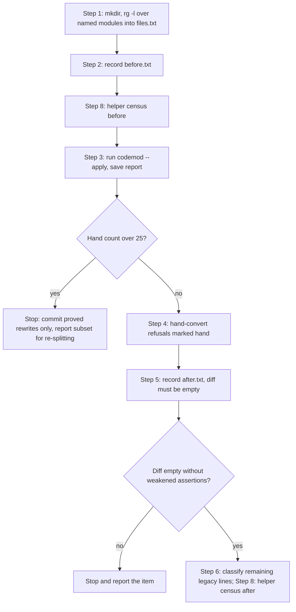

# IPD: Move runner-family, reader, record and review test data chunk 7 of 11 onto the record builder

- Date: 2026-11-09
- Kind: child
- Concern: Spec `4sd62s` section 6 requires that test data be written by ONE shared record builder in phase B, so that the cutover (Order 13, `cxxmyv`) changes the builder and not hundreds of test files, and C10a requires the suite to pass at every commit. Research `nj8zdp` and the maintainer's ruling ("plans that obtuse and not-too-smart agents won't mess up") set the guidance of at most 5 E-items, 8 work Scope-Paths and about 8 named units per item; `nbfg7w` named up to 25 modules per batch item. This part carries 8 of `nbfg7w`'s modules (subsets G6a, G6b; 123 F-01 legacy lines at `3d0ddb845`), each item at most 4 modules, converted by the Order-49 codemod (`653ndz`) plus only its census-counted refusals.
- Scope: Chunk 7 of 11 of `nbfg7w` (round-3 split 2026-11-09 per research `nj8zdp` guidance): the 8 test modules named in the items and in F-40, each item one codemod run under the batch rule below, plus a finishing item. EXCLUDES: every other module of the subsets (the other chunk plans and `nbfg7w`); the builder (`9rgn2w`) and the codemod (`653ndz`); the F-03 EXCLUDED modules; production code; the switch-point proof, census and full-suite comparison (`59aiyh` E-11, E-12).
- Scope-Paths: tests/test_selector_two_dialect_readers.py, tests/test_selector_type_containment.py, tests/test_artifact_adopt.py, tests/test_artifact_audit_cache_eviction.py, tests/test_artifact_audit_identity_staleness.py, tests/test_artifact_audit_index_cache.py, tests/test_artifact_audit.py, tests/test_artifact_audit_verdicts.py, .aw/records/plans/pending/20261109-metastore-198-a1b70x-move-runner-family-reader-record-and-review-test-data-chunk.ipd.md
- Item-Dependencies: executed:653ndz, executed:9rgn2w, executed:g5hpbb, executed:tve77h, executed:xexn45
- Status: approved
- Readiness: go-pending-approval
- Review-Depth: standard
- From-Spec: 4sd62s
- Work-Kind: feature
- Priority: high
- Blocks-Release: next
- Set: metastore
- Order: 198
- Highest E allocated: 04
- Author: opencode its_direct/pt3-claude-opus-5.5-1m-us
- Id: a1b70x
- Approval: 2026-11-16, recorded via aw ipd set: status set to approved

> Write and proofread this plan per the technical writing standard, `.aw/system/workflows/technical-writing/technical-writing.md` (`.agents/workflows/technical-writing/technical-writing.md` in a legacy-layout install), including requirement 12 (diagrams).

## Workflow history
- 2026-11-16 approved (aw set): status set to approved
- 2026-11-14 reviewed (antigravity/claude-opus-5.5): plan-review APPROVE WITH REVISIONS APPLIED; PR-001..PR-010 FIXED

- 2026-11-14 /plan-review (antigravity/claude-opus-5.5): APPROVE WITH REVISIONS APPLIED; PR-001..PR-010 FIXED; review record .aw/records/reviews/20261109-metastore-198-a1b70x-move-runner-family-reader-record-and-review-test-data-chunk.review.md
- 2026-11-09 to-review (opencode its_direct/pt3-claude-opus-5.5-1m-us): split from nbfg7w (round 3, research nj8zdp guidance).

## Goal

Every hand-built record in the 8 test modules named below comes from `tests/record_builder.py`, written by the Order-49 codemod or, for its census-counted refusals only, by hand, with each module's per-test outcomes identical before and after and every remaining legacy string classified.

## Detailed Implementation Checklist (TODO)

Execution-state rule: mark an `E-*` item complete only after performing the action. That mark is not validation. Right-sizing rule: write for a modest executor that cannot hold much in its head. Each E-item is one step (one concern, about one file, executable in one focused pass) and its V-item names each unit it covers with its own check; a plan stays at about 5 E-items and 8 work Scope-Paths, else split it into more child plans (guidance, `IPD-Z603`). Accepted execution states: blocked, failed, pending, performed; terminal gate demands 'performed'.

Batch rule, applied to every batch E-item of this plan (the `59aiyh` batch rule, restructured 2026-11-08 for the Order-49 fixture codemod `653ndz` per maintainer decision 2026-11-07 "Codemod first, then small runs": the tool performs the mechanical rewrite, and the hand work is bounded by its measured refusals). In it, "E-13's `full-before.txt`" and "the builder's `raw_fields=` escape (E-01)" are items of Order 37 (`9rgn2w`), carried by the round-3 split into Order 170 (`j6o96i`) with the same ids; because `.aw/state/` does not travel between lane worktrees, step 2 always records a fresh before list here. Step 1's partition is restricted to the modules each batch item names (round-3 split 2026-11-09: a subset is now spread over several plans of at most 8 modules each): a module that the partition now places in the item's subset but that no plan names is NOT added here; it is reported, and the finishing item of `nbfg7w` converts it; a named module that no longer matches F-01 is reported and skipped:
1. Before the batch, run `mkdir -p .aw/state/59aiyh` (`.aw/state/` is untracked and starts empty in a lane worktree), then re-derive its file list at the current HEAD. Because the partition is restricted to the item's named modules, which all sit in the item's subset under the F-03 first-match rule (`test_selector*` in G6a, `test_artifact*` in G6b, per `nbfg7w` F-41) and none is on the F-03 EXCLUDED list (`tests/test_artifact_meta_*.py` does not match these names), the re-derivation is the F-01 pattern run over the named modules only: `rg -l --glob '*.py' -e '<the F-01 pattern>' <the item's named modules> > .aw/state/59aiyh/<batch>-files.txt`. A named module absent from the output no longer matches F-01 and is reported and skipped. The counts in each E-item are context measured at `3d0ddb845`, not the bar.
2. Record the unmodified per-test outcome list (a batch whose files a previous batch did not touch may reuse the matching lines of E-13's `full-before.txt`): `python3 -m pytest -o addopts="" -m "" -p no:randomly -n 0 -rA $(cat .aw/state/59aiyh/<batch>-files.txt) | grep -E "^(PASSED|FAILED|ERROR|SKIPPED|XFAIL|XPASS) " | sed -E 's/ - .*//' | sort > .aw/state/59aiyh/<batch>-before.txt`. `-p no:randomly` and `-n 0` make the list deterministic; `-m ""` includes `slow` and `livecorpus` modules.
3. Run the codemod: `python3 tools/fixture_codemod.py --apply --format json $(cat .aw/state/59aiyh/<batch>-files.txt) > .aw/state/59aiyh/<batch>-codemod.json`. It rewrites only the sites whose module outcome list it proved identical (`653ndz` E-03, carried with the same id into Order 172, `y3uowx`, by the round-3 split) and lists every other site as a refusal with a reason code and a disposition (`hand` or `legacy-kept`, the `653ndz` reason-code table). `y3uowx` E-01 specifies `--format table|json` for `--dry-run`; if `--apply` refuses `--format json`, run `--apply` without it, save its report as `.aw/state/59aiyh/<batch>-codemod.txt`, and read the same per-module rows (rewrites, refusals by reason code and disposition, before and after outcome-list hashes) from that file. V-items accept either file.
4. Hand-convert ONLY the refusals with disposition `hand`: the static count is the sum of the `653ndz` F-30 rows of the item's modules (round-3 split 2026-11-09: an item now carries part of a subset, so the subset's F-31 row is context only), and the codemod report adds any apply-time `not-equivalent` refusals; the item's hand count is their sum. If the hand count exceeds 25, stop after step 3 (the proved codemod rewrites may be committed), convert nothing by hand, and report the subset for re-splitting. A hand conversion uses builder calls; a test that deliberately writes an INVALID value (an unknown status, `- Status: EXECUTED`, `- Priority: bogus`, a malformed gate) gets it through the builder's `raw_fields=` escape (E-01) and is listed with reason class `invalid-input`. A refusal with disposition `legacy-kept` stays in legacy form on purpose and is listed with its F-06 reason class.
5. Re-run step 2's command into `<batch>-after.txt` and require `diff` to print nothing. A batch that would need any changed assertion other than a raw-byte metadata stand-in moved to `artifact_meta.read` (scope rule) stops and is reported; it does not weaken the assertion.
6. Count the remaining legacy strings with the F-01 `rg` pattern over the batch files, and give each remaining line one reason class from F-06: `legacy-format subject`, `displayed-output assertion`, `setter-byte assertion`, `invalid-input`, or `body prose` (for example open-question `- Status: open` rows, which N3 keeps in Markdown). A match inside a Python comment or docstring is not record text and gets `body prose`.
7. The builder never reads production source, and no test gains a source-reading assertion.
8. Helper census: run `rg -n "def _?(make|write|build|mk|seed)_(plan|spec|backlog|item|record|ipd|release|research|prompt|review|walkthrough)\w*" <the item's named modules>` before step 3 and after step 4 (the helper pattern of `59aiyh` V-09 and `1bshrb` E-38). The pattern misses record-text helpers with other names, so the census also lists each private function or method in the item's modules that returns or writes record text, named per item below; each such helper is deleted when it has no caller, otherwise listed with its reason.

### Task group 1: batch items

- [x] E-01 (carried from `nbfg7w` E-02, batch subset G6a; round-3 split 2026-11-09) Batch G6a, 2 of its 25 modules (the find, attention, CLI, selector, front-matter, read and resolver tests (`test_find*`, `test_attention*`, `test_cli*`, `test_selector*`, `test_front_matter*`, `test_read*`, `test_resolver*`)): `tests/test_selector_two_dialect_readers.py`, `tests/test_selector_type_containment.py`. F-01 legacy lines per module at `3d0ddb845` (context, not the bar): `test_selector_two_dialect_readers` 18, `test_selector_type_containment` 34. Run the codemod on these modules and apply the batch rule with `<batch>` = `G6a-a1b70x-1` (outcome lists identical); hand-convert ONLY the refusals that the `653ndz` F-30 rows of these modules list with disposition `hand`, plus the codemod's apply-time `not-equivalent` refusals, and state their count (at most 25, the batch rule's stop); leave each refusal the census marks `legacy-kept` in legacy form with its reason class. `tests/test_selector_two_dialect_readers.py` tests the selector readers over BOTH metadata dialects (YAML research front matter and bullet plan front matter), so its quoted-example cases and its literal bullet inputs whose dialect is under test keep their literal input and are listed as `legacy-format subject`. Then delete each private record-building helper in these modules that no longer has a caller (at the split: `tests/test_selector_two_dialect_readers.py`: `make_research_record`; step 8's other-named class, measured at review HEAD `b5a492301`: `tests/test_selector_two_dialect_readers.py::SelectorTwoDialectReadersBase.make_bullet_plan`); a surviving helper is listed with its reason.
  - Depends on: none
  - Expected outcome: an empty before/after `diff` for the `G6a-a1b70x-1` outcome lists; for each named module, its remaining legacy-string count and the reason class of every remaining line pasted; every deleted and surviving helper listed; the codemod report and the hand count (at most 25) pasted.
  - Execution state: performed

- [x] E-02 (carried from `nbfg7w` E-03, batch subset G6b; round-3 split 2026-11-09) Batch G6b, 4 of its 25 modules (the history, artifact, group, record and reference tests (`test_history*`, `test_artifact*`, `test_group*`, `test_record*`, `test_reference*`)): `tests/test_artifact_adopt.py`, `tests/test_artifact_audit_cache_eviction.py`, `tests/test_artifact_audit_identity_staleness.py`, `tests/test_artifact_audit_index_cache.py`. F-01 legacy lines per module at `3d0ddb845` (context, not the bar): `test_artifact_adopt` 10, `test_artifact_audit_cache_eviction` 6, `test_artifact_audit_identity_staleness` 14, `test_artifact_audit_index_cache` 12. Run the codemod on these modules and apply the batch rule with `<batch>` = `G6b-a1b70x-2` (outcome lists identical); hand-convert ONLY the refusals that the `653ndz` F-30 rows of these modules list with disposition `hand`, plus the codemod's apply-time `not-equivalent` refusals, and state their count (at most 25, the batch rule's stop); leave each refusal the census marks `legacy-kept` in legacy form with its reason class. `tests/test_artifact_adopt.py` tests adoption of raw inbox drops, including a forged bullet `- Id:` in a drop's body; those drop texts are inbox material, not records, so they keep their literal input and are listed as `legacy-format subject`. These modules held no helper matching step 8's pattern at the split; step 8's other-named class, measured at review HEAD `b5a492301`: `tests/test_artifact_adopt.py::AlreadyAdoptedWarningTests._seed_adopted_copy` (writes a YAML research record); `_drop` and `_leaky_drop` write raw inbox drops and are not record builders. A helper is deleted when it has no caller, or listed with its reason.
  - Depends on: none
  - Expected outcome: an empty before/after `diff` for the `G6b-a1b70x-2` outcome lists; for each named module, its remaining legacy-string count and the reason class of every remaining line pasted; every deleted and surviving helper listed; the codemod report and the hand count (at most 25) pasted.
  - Execution state: performed

- [x] E-03 (carried from `nbfg7w` E-03, batch subset G6b; round-3 split 2026-11-09) Batch G6b, 2 of its 25 modules (the history, artifact, group, record and reference tests (`test_history*`, `test_artifact*`, `test_group*`, `test_record*`, `test_reference*`)): `tests/test_artifact_audit.py`, `tests/test_artifact_audit_verdicts.py`. F-01 legacy lines per module at `3d0ddb845` (context, not the bar): `test_artifact_audit` 23, `test_artifact_audit_verdicts` 6. Run the codemod on these modules and apply the batch rule with `<batch>` = `G6b-a1b70x-3` (outcome lists identical); hand-convert ONLY the refusals that the `653ndz` F-30 rows of these modules list with disposition `hand`, plus the codemod's apply-time `not-equivalent` refusals, and state their count (at most 25, the batch rule's stop); leave each refusal the census marks `legacy-kept` in legacy form with its reason class. `tests/test_artifact_audit_verdicts.py` writes `- Status: EXECUTED (approved by maintainer)` on purpose; that site is `invalid-input` through `raw_fields=`. These modules held no helper matching step 8's pattern at the split; `tests/test_artifact_audit.py::TestArtifactAuditEngine._write_file` is a generic file writer that takes record text from its callers, so its callers' literals are the conversion sites, and it survives while any caller writes non-record files. A helper is deleted when it has no caller, or listed with its reason.
  - Depends on: none
  - Expected outcome: an empty before/after `diff` for the `G6b-a1b70x-3` outcome lists; for each named module, its remaining legacy-string count and the reason class of every remaining line pasted; every deleted and surviving helper listed; the codemod report and the hand count (at most 25) pasted.
  - Execution state: performed

### Task group 2: finish

- [x] E-04 Finish this part: run the batch rule's step-2 command once over every module of this plan (`$(cat .aw/state/59aiyh/G6a-a1b70x-1-files.txt .aw/state/59aiyh/G6b-a1b70x-2-files.txt .aw/state/59aiyh/G6b-a1b70x-3-files.txt)`) into `.aw/state/59aiyh/a1b70x-union-after.txt` and confirm it equals the sorted concatenation of the items' `-before.txt` lists; run the bare core gate `python3 -m pytest` and `aw sanitize --agent`; commit through `aw commit a1b70x -- <each changed path>`, one commit per item allowed, never `git add -A`, a bare `git add` or `git commit -a`. Never push. (The full-suite comparison stays in `59aiyh` E-12.)
  - Depends on: E-01, E-02, E-03
  - Expected outcome: the union comparison is empty; all runs pass; every commit is path-scoped to Scope-Paths (or justified at finalize).
  - Execution state: performed

## Project conventions discovered (Step 0)

- Interface names from Order 02 (`tve77h`): `agent_workflows/artifact_meta.py::registry_fields`, `agent_workflows/artifact_meta.py::validate_event`, `agent_workflows/artifact_meta.py::validate_new_events`, `agent_workflows/artifact_meta.py::read`, `agent_workflows/artifact_meta.py::create` and `agent_workflows/artifact_meta.py::append`. Order 02's `create`/`append` write the log format; `2xwb9b` E-03 adds the phase-B legacy branch of `append` and `xexn45` E-01 routes the phase-B branch of `create` and `append` through `write_legacy`, with `agent_workflows/artifact_meta.py::render_legacy_text` (`xexn45` E-11) as the same renderer over a string. In phase B the on-disk format is the bullet format; the legacy loader reads it into the cache.
- `agent_workflows/review_findings.py::render_review` (pure) and `agent_workflows/review_findings.py::write_review` render and write a `.review.md` record; no CLI calls `write_review` (`xexn45` Findings).
- The existing shared plan builder is `tests/support.py::ready_plan_text`, which is "BUILT FROM THE REAL GENERATOR (`agent_workflows/ipd_authoring.py::build_skeleton`)" and then fills the fields a draft leaves open; the builder keeps that approach for plans, so a scaffold change still reaches every fixture.
- Shared test plumbing lives in `tests/support.py` (`init_repo`, `git`, `run_cli`, `pinned_env`, `ready_plan_text`, `scope_drift_repo`); `tests/repo_template.py` (`copy_template_repo`) gives a pre-built repository; there is no `tests/conftest.py`, and the root `conftest.py` owns tier selection.
- Tests are behavioral (AGENTS.md "TEST OUTCOMES, NOT CODE STRUCTURE"); core modules set `pytestmark = pytest.mark.core`; `slow` tests are listed in `tests/slow_allowlist.txt`; `pyproject.toml` `addopts` deselects `slow` and `livecorpus`, so a complete comparison passes `-m ""`, and `pytest-randomly` is installed, so a deterministic order needs `-p no:randomly`.
- `tests/fixtures/review-pilot/` is the input corpus of `tools/review_pilot.py` (`manifest.json` names each plan file, `defects.json` quotes exact text to plant), and `tests/test_review_pilot.py` copies the whole directory into its fixture repository.
- Filenames come from `agent_workflows/artifact_naming.py::build_clustered_name` and parse with `agent_workflows/artifact_naming.py::parse_clustered`.
- Cite code by repo-relative `path::Symbol` or by a quoted content string, with a line number only appended to one of those and never alone: an offset expires before this plan executes (spec `ipd-structure-and-linting` Section 10.2; advisory `IPD-C801`).

## Findings

Measured 2026-11-09 at `3d0ddb845` for F-40; F-01, F-03, F-06 and F-08 copied from `nbfg7w` (measured at `0cbfcc706` and at review).

| Id | Evidence | Finding |
|---|---|---|
| F-01 | `rg -l --glob '*.py' -e '- (Id|Status|Set|Kind|Blocks-Release|Readiness|Item-Dependencies|Scope-Paths|From-Backlog|From-Spec|Work-Kind|Priority|Order|Date|Gate-Kind|Gate-Ref|Approval|Subject-Id|Verdict|Graduated-To):|## Workflow history' tests` lists 309 files (307 test modules, `support.py`, `conformance_matrix.py`) of 717 Python files; 6,638 matching lines. The narrower `- Id:`/`- Status:`/`## Workflow history` pattern: 300 files, 3,430 lines | Spec section 6 counted 268 of 680 files and 2,607 matches at round 2; the plan's pattern is broader (21 fields). |
| F-03 | Family split by filename prefix, re-measured at review (HEAD `4a7499289`, 311 files, 6,657 lines) with a FIRST-MATCH rule (a file goes to the first group, in order G1 to G6, whose pattern list matches its basename; unmatched files go to G7): G1 39 files, 1,568 lines; G2 22, 1,102; G3 28, 795; G4 63, 1,244; G5 46, 598; G6 69, 1,004; G7 44, 346. Six files match two groups and are assigned by that rule (`test_ipd_authoring` G3, `test_readiness_absence_invariant` G4, `test_runner_backlog_close_behavior` G1, `test_orchestrator_retire_closes_backlog` G1, `test_records_only_lane_rederive` G5, `test_ipdrunner_runagy_shim` G4). The authored counts (G6 99, G7 11) did not sum to the file total; the first-match rule makes the partition exhaustive and disjoint. EXCLUDED from every batch (literal legacy input is their subject; owned by other plans): `tests/test_artifact_meta_*.py` (`tve77h`, `2xwb9b`), `tests/test_artifact_meta_legacy_writer.py` and `tests/test_writers_*.py` (`xexn45`), `tests/test_m0001_*.py` and `tests/test_migrations_chain.py` (`dcerjg`, `ya4ee4`) | Seven batches (E-03 to E-09); G1, G4 and G6 carry a pre-measured split seam (OQ-01). |
| F-06 | (written by E-11) remaining legacy strings in `tests/` after the batches, each with one reason class: `legacy-format subject`, `displayed-output assertion`, `setter-byte assertion`, `invalid-input`, `body prose` | Order 13 changes the builder plus the F-06 rows of class `setter-byte assertion`; `invalid-input` rows already go through `raw_fields=` and need a decision at the cutover (an invalid bullet has no log-format equivalent); every other class is either a legacy-format test (moved to the migration tests at the cutover) or prose. |
| F-08 | At review, 15 test modules write a deliberately invalid metadata value (for example `tests/test_releases.py` "`- Status: bogus`", `tests/test_check_engine.py` "`- Status: EXECUTED`", `tests/test_specs_set_adapter.py` "`- Priority: bogus`") | A builder that validates every field cannot build these; E-01 adds `raw_fields=` and the batch rule lists them as `invalid-input`. |
| F-40 | `rg -c` with the F-01 pattern over this part's modules at `3d0ddb845`; subset by the F-03 first-match rule; helpers as listed by `nbfg7w` at the 2026-11-07 split | See the table below; every module is named in exactly one item. |

| Module | Subset | F-01 lines | Helpers at the split | Item |
|---|---|---|---|---|
| `tests/test_selector_two_dialect_readers.py` | G6a | 18 | `make_research_record` | E-01 |
| `tests/test_selector_type_containment.py` | G6a | 34 | none | E-01 |
| `tests/test_artifact_adopt.py` | G6b | 10 | none | E-02 |
| `tests/test_artifact_audit_cache_eviction.py` | G6b | 6 | none | E-02 |
| `tests/test_artifact_audit_identity_staleness.py` | G6b | 14 | none | E-02 |
| `tests/test_artifact_audit_index_cache.py` | G6b | 12 | none | E-02 |
| `tests/test_artifact_audit.py` | G6b | 23 | none | E-03 |
| `tests/test_artifact_audit_verdicts.py` | G6b | 6 | none | E-03 |

## Proposed changes (ordered, validatable)

1. Convert each item's modules under the batch rule (E-01 to E-03).
2. Re-run the union, the core gate, commit (E-04).

Batch rule per item (E-01 to E-03); the numbered text above is normative:

## Deferred / out of scope (with reason)

- The other modules of subsets G6a, G6b, the partition re-derivation that catches modules no plan names, and the subsets' finishing checks.
  - Carrier: nbfg7w
- The fixture codemod and its census (F-30, F-31).
  - Carrier: 653ndz
  - Carrier-Evidence: .aw/records/plans/executed/20261108-metastore-49-653ndz-build-and-prove-the-test-fixture-codemod.ipd.md
- The builder, its tests, the baselines and the tracked fixtures.
  - Carrier: 9rgn2w
  - Carrier-Evidence: .aw/records/plans/executed/20261107-metastore-37-9rgn2w-add-the-shared-test-record-builder-and-convert-the-tracked-r.ipd.md
- The switch-point proof, the F-06 census and the full-suite comparison.
  - Carrier: 59aiyh
- Adding `RECORD_FORMAT = "log"` and converting setter-byte assertions (cutover commit).
  - Carrier: cxxmyv

## Scope check

- Over-scope: none. No production module changes; every Scope-Paths entry is a module named in one item, plus this plan.
- Under-scope: none known. Size: 4 E-items (3 batch items of at most 4 modules each and the finish), 8 work Scope-Paths.

## Required tests / validation

Each item is validated by an identical per-test result list before and after (the batch rule), which is behavioral by construction: the same tests, unchanged assertions, the same outcomes. Commands: the batch rule's command per item, the codemod's `--apply` report, the bare core gate `python3 -m pytest`, `aw sanitize --agent`. CONTRIBUTES to AC-1b (owned by `cxxmyv`).

## Spec / documentation sync

No spec change; implements part of `4sd62s` section 6 and section 7 step 6.

## Open questions

### OQ-01: Can this part run in any order relative to the other chunk plans?

- Blocking: no
- Status: resolved
- Owner: plan author
- Resolution or deferral rationale: Yes. The module lists of all chunk plans are disjoint, each needs the builder (`9rgn2w`) and the codemod (`653ndz`), and none edits `tests/support.py` (that is `59aiyh` E-09, which runs last). Recommendation strength: strong.

## Validation and cross-check (verify before reporting done)

Validation-state rule: inspect evidence in a separate pass. Do not mark a `V-*` item complete from memory or from the matching execution checkmark. Accepted validation results: blocked, failed, pass, pending; terminal gate demands 'pass'. Runtime-demonstration reachability rule: for each `V-*` item demanding the software be observed acting (such as a run, a dispatch, or a transition), as distinct from items demanding a diff, a file's content, or a test result, which are reachable by construction, name the code path that produces the observation or the sibling `E-*` that creates it, else the demand is UNDER-SCOPE.

- [x] V-01 validates E-01
  - Required evidence: paste `.aw/state/59aiyh/G6a-a1b70x-1-files.txt` and the empty `diff .aw/state/59aiyh/G6a-a1b70x-1-before.txt .aw/state/59aiyh/G6a-a1b70x-1-after.txt`; then, for each of `tests/test_selector_two_dialect_readers.py`, `tests/test_selector_type_containment.py` separately: its before and after F-01 `rg -c` count, the reason class of every remaining match, its rows of `.aw/state/59aiyh/G6a-a1b70x-1-codemod.json` (or `-codemod.txt`, batch rule step 3) (rewrites, refusals by reason code and disposition, before and after outcome-list hashes) and its `653ndz` F-30 row; the hand count with every hand-converted site listed (module, line, reason code); and the before and after helper census of batch rule step 8 over these modules (its `rg` output and its other-named helpers) with each deleted and surviving helper and its reason.
  - Observed evidence:
    - `.aw/state/59aiyh/G6a-a1b70x-1-files.txt`:
      - `tests/test_selector_two_dialect_readers.py`
      - `tests/test_selector_type_containment.py`
    - Outcome diff (`diff -u .aw/state/59aiyh/G6a-a1b70x-1-before.txt .aw/state/59aiyh/G6a-a1b70x-1-after.txt`): empty output, exit code 0 (21 `PASSED` outcomes).
    - Per-module F-01 counts, remaining classifications, codemod rows, and `653ndz` F-30 rows:
      - `tests/test_selector_two_dialect_readers.py`:
        - F-01 `rg -c`: before 18, after 14. Remaining matches (14):
          - `body prose` (3): line 100 (`# - Id: ffffff, - Status: approved, - Set: quotedset in body prose.`, comment); line 131 (`# 2. Quoting research report declaring bbbbbb, but quoting - Id: aaaaaa in its body before ##`, comment); line 288 (`"""Bullet front-matter reader deliberately preserves backticks verbatim on - Set:."""`, docstring).
          - `legacy-format subject` (11): lines 110-112, 114 (`- Id: ffffff`, `- Status: approved`, `- Set: quotedset`, `## Workflow history` in `quoting_text`); lines 140-142 (`- Id: aaaaaa`, `- Status: approved`, `- Set: realset` in the quoted body of `test_metadata_region_prevents_id6_collision_from_quoted_block`); lines 291-294 (`- Id: asy001`, `- Status: draft`, `- Set: \`bulletset\``, `## Workflow history` in `bullet_text`).
        - Codemod JSON row (`.aw/state/59aiyh/G6a-a1b70x-1-codemod.json`): `sites=5`, `rewrites=0` (`standard=0`, `invalid-input=0`), `refusals=5` (`legacy-format subject=5`, `hand=0`, `legacy-kept=5`), `before_hash=null`, `after_hash=null`, `equivalent=true`, `pytest_runs=0`, `changed=false`.
        - `653ndz` F-30 row: `G6a | a1b70x | 5 | 0 | 0 | 0 | 0 | 0 | 5 | 0 | 0 | 0 | 0 | 5`.
      - `tests/test_selector_type_containment.py`:
        - F-01 `rg -c`: before 34, after 0. Remaining matches: none. (Seven codemod-rewritten plan sites use `raw_fields={'Status': 'pending'}`, `invalid-input`; two hand-converted spec sites use `raw_fields={'Set': 'demoset'}` because `RecordBuilder.spec()` validates `set` for the filename but does not include `set` in `render_fields`.)
        - Codemod JSON row (`.aw/state/59aiyh/G6a-a1b70x-1-codemod.json`): `sites=14`, `rewrites=11` (`standard=4`, `invalid-input=7`), `refusals=3` (`unsupported-shape=1`, `not-equivalent=2`, `hand=3`, `legacy-kept=0`), `before_hash=f4ec3f20b1e59a8d5d5a6eabc4e84674f8943cc2af4af68a3dd35ce8154a295b`, `after_hash=f4ec3f20b1e59a8d5d5a6eabc4e84674f8943cc2af4af68a3dd35ce8154a295b`, `equivalent=true`, `pytest_runs=12`, `changed=true`.
        - `653ndz` F-30 row: `G6a | a1b70x | 14 | 13 | 7 | 0 | 1 | 0 | 0 | 0 | 0 | 0 | 1 | 0`.
    - Hand count: 3 (1 static + 2 apply-time `not-equivalent`; <= 25). Every hand-converted site:
      1. `tests/test_selector_type_containment.py` pre-edit lines 111-115 (`unsupported-shape`): converted `citing_content` backlog fixture `c1t301` to `RecordBuilder().backlog(id6="c1t301", summary="Citing item", status="open", when="2026-09-29", set="demo", body=..., text_only=True)`.
      2. `tests/test_selector_type_containment.py` pre-edit line 455 (`not-equivalent`): converted `spec1` (`sp0001`) to `RecordBuilder().spec(title="One", when="2026-09-29", status="draft", id6="sp0001", set="demoset", raw_fields={"Set": "demoset"}, text_only=True)`.
      3. `tests/test_selector_type_containment.py` pre-edit line 460 (`not-equivalent`): converted `spec2` (`sp0002`) to `RecordBuilder().spec(title="Two", when="2026-09-29", status="draft", id6="sp0002", set="demoset", raw_fields={"Set": "demoset"}, text_only=True)`.
    - Step 8 helper census (`rg -n "def _?(make|write|build|mk|seed)_(plan|spec|backlog|item|record|ipd|release|research|prompt|review|walkthrough)\w*"` plus other-named helpers):
      - Before: `rg` matched `tests/test_selector_two_dialect_readers.py:66:    def make_research_record(`; other-named: `tests/test_selector_two_dialect_readers.py::SelectorTwoDialectReadersBase.make_bullet_plan` (line 93).
      - After: `rg` matched `tests/test_selector_two_dialect_readers.py:66:    def make_research_record(`; other-named: none.
      - Deleted helpers (1): `tests/test_selector_two_dialect_readers.py::SelectorTwoDialectReadersBase.make_bullet_plan` (zero callers across the repository).
      - Surviving helpers (1): `tests/test_selector_two_dialect_readers.py::SelectorTwoDialectReadersBase.make_research_record` (9 callers testing the raw YAML front-matter dialect directly, including backtick-wrapped and quoted YAML scalars).
  - Result: pass

- [x] V-02 validates E-02
  - Required evidence: paste `.aw/state/59aiyh/G6b-a1b70x-2-files.txt` and the empty `diff .aw/state/59aiyh/G6b-a1b70x-2-before.txt .aw/state/59aiyh/G6b-a1b70x-2-after.txt`; then, for each of `tests/test_artifact_adopt.py`, `tests/test_artifact_audit_cache_eviction.py`, `tests/test_artifact_audit_identity_staleness.py`, `tests/test_artifact_audit_index_cache.py` separately: its before and after F-01 `rg -c` count, the reason class of every remaining match, its rows of `.aw/state/59aiyh/G6b-a1b70x-2-codemod.json` (or `-codemod.txt`, batch rule step 3) (rewrites, refusals by reason code and disposition, before and after outcome-list hashes) and its `653ndz` F-30 row; the hand count with every hand-converted site listed (module, line, reason code); and the before and after helper census of batch rule step 8 over these modules (its `rg` output and its other-named helpers) with each deleted and surviving helper and its reason.
  - Observed evidence:
    - `.aw/state/59aiyh/G6b-a1b70x-2-files.txt`:
      - `tests/test_artifact_adopt.py`
      - `tests/test_artifact_audit_cache_eviction.py`
      - `tests/test_artifact_audit_identity_staleness.py`
      - `tests/test_artifact_audit_index_cache.py`
    - Outcome diff (`diff -u .aw/state/59aiyh/G6b-a1b70x-2-before.txt .aw/state/59aiyh/G6b-a1b70x-2-after.txt`): empty output, exit code 0 (55 `PASSED` outcomes).
    - Per-module F-01 counts, remaining classifications, codemod rows, and `653ndz` F-30 rows:
      - `tests/test_artifact_adopt.py`:
        - F-01 `rg -c`: before 10, after 8. Remaining matches (8):
          - `body prose` (4): line 6 (module docstring), line 119 (comment about `^- Id:`), line 139 (method docstring), line 648 (method docstring).
          - `legacy-format subject` (4): lines 103, 152, 168, 178 (raw inbox drop texts passed to `self._drop(...)` carrying forged bullet `- Id: abc123`, kept literal per E-02 because inbox drops are untrusted drop material, not records). Note: pre-edit line 121 (`test_yaml_dialect_id6_is_reported_but_not_adopted`, not an F-01 match) was auto-rewritten by the codemod via `_YAML_RESEARCH_SITE_RE` and restored to its literal YAML inbox drop string per E-02 so it remains a raw YAML-fenced inbox drop across the log-format cutover.
        - Codemod JSON row (`.aw/state/59aiyh/G6b-a1b70x-2-codemod.json`): `sites=10`, `rewrites=5` (`standard=5`, `invalid-input=0`), `refusals=5` (`dynamic-construction=1`, `unsupported-shape=4`, `hand=5`, `legacy-kept=0`), `before_hash=65e07eb7072814147ee23582da5f7f082d3013aaa7cb3282d7b409e8c70a2147`, `after_hash=65e07eb7072814147ee23582da5f7f082d3013aaa7cb3282d7b409e8c70a2147`, `equivalent=true`, `pytest_runs=2`, `changed=true`.
        - `653ndz` F-30 row: `G6b | a1b70x | 10 | 5 | 0 | 1 | 4 | 0 | 0 | 0 | 0 | 0 | 5 | 0`.
      - `tests/test_artifact_audit_cache_eviction.py`:
        - F-01 `rg -c`: before 6, after 0. Remaining matches: none.
        - Codemod JSON row (`.aw/state/59aiyh/G6b-a1b70x-2-codemod.json`): `sites=6`, `rewrites=6` (`standard=6`, `invalid-input=0`), `refusals=0` (`hand=0`, `legacy-kept=0`), `before_hash=e2b32318b77237725777c8dfa9e0ed7dab8fa7d266a53bb5a8c705cf0910ab19`, `after_hash=e2b32318b77237725777c8dfa9e0ed7dab8fa7d266a53bb5a8c705cf0910ab19`, `equivalent=true`, `pytest_runs=2`, `changed=true`.
        - `653ndz` F-30 row: `G6b | a1b70x | 6 | 6 | 0 | 0 | 0 | 0 | 0 | 0 | 0 | 0 | 0 | 0`.
      - `tests/test_artifact_audit_identity_staleness.py`:
        - F-01 `rg -c`: before 14, after 1. Remaining match (1): line 4 (`answers reachable from an in-place - Id: rewrite without widening the signature,`, `body prose`, module docstring).
        - Codemod JSON row (`.aw/state/59aiyh/G6b-a1b70x-2-codemod.json`): `sites=13`, `rewrites=13` (`standard=13`, `invalid-input=0`), `refusals=0` (`hand=0`, `legacy-kept=0`), `before_hash=5061ecf6fae93d65663893a8028e646ae8a954e56590a8d2fcce2bb62c2a73cc`, `after_hash=5061ecf6fae93d65663893a8028e646ae8a954e56590a8d2fcce2bb62c2a73cc`, `equivalent=true`, `pytest_runs=2`, `changed=true`.
        - `653ndz` F-30 row: `G6b | a1b70x | 13 | 13 | 0 | 0 | 0 | 0 | 0 | 0 | 0 | 0 | 0 | 0`.
      - `tests/test_artifact_audit_index_cache.py`:
        - F-01 `rg -c`: before 12, after 0. Remaining matches: none. (Four codemod-rewritten deep research fixtures use `raw_fields={'Status': 'draft'}`, `invalid-input`.)
        - Codemod JSON row (`.aw/state/59aiyh/G6b-a1b70x-2-codemod.json`): `sites=12`, `rewrites=8` (`standard=4`, `invalid-input=4`), `refusals=4` (`unsupported-shape=4`, `hand=4`, `legacy-kept=0`), `before_hash=dd39746de04db45d38f6e48c12f8f10c39e25e8bbf44ca95a2a1ed80228739cd`, `after_hash=dd39746de04db45d38f6e48c12f8f10c39e25e8bbf44ca95a2a1ed80228739cd`, `equivalent=true`, `pytest_runs=2`, `changed=true`.
        - `653ndz` F-30 row: `G6b | a1b70x | 12 | 8 | 4 | 0 | 4 | 0 | 0 | 0 | 0 | 0 | 4 | 0`.
    - Hand count: 9 reported by codemod (9 static + 0 apply-time `not-equivalent`; <= 25; 5 hand-converted to `RecordBuilder`, 4 kept as `legacy-format subject` raw inbox drops per E-02):
      1. `tests/test_artifact_adopt.py` pre-edit lines 390-393 (`dynamic-construction`): converted `_seed_adopted_copy` YAML research record `xn6f6u` to `RecordBuilder().research(...)`.
      2. `tests/test_artifact_adopt.py` pre-edit lines 102, 151, 167, 177 (`unsupported-shape`, 4 sites): kept literal raw inbox drops (`legacy-format subject`, per E-02).
      3. `tests/test_artifact_audit_index_cache.py` pre-edit line 61 (`unsupported-shape`): converted `prompt-library` fixture `aaaaaa` to `RecordBuilder().plan(...)`.
      4. `tests/test_artifact_audit_index_cache.py` pre-edit line 67 (`unsupported-shape`): converted `prompt-library` fixture `bbbbbb` to `RecordBuilder().plan(...)`.
      5. `tests/test_artifact_audit_index_cache.py` pre-edit line 155 (`unsupported-shape`): converted `prompt-library` fixture `aaaaaa` to `RecordBuilder().plan(...)`.
      6. `tests/test_artifact_audit_index_cache.py` pre-edit line 162 (`unsupported-shape`): converted `prompt-library` fixture `bbbbbb` to `RecordBuilder().plan(...)`.
    - Step 8 helper census (`rg -n "def _?(make|write|build|mk|seed)_(plan|spec|backlog|item|record|ipd|release|research|prompt|review|walkthrough)\w*"` plus other-named helpers):
      - Before: `rg` output `(none)`; other-named: `tests/test_artifact_adopt.py::AlreadyAdoptedWarningTests._seed_adopted_copy` (`_drop` and `_leaky_drop` write raw inbox drops and are not record builders).
      - After: `rg` output `(none)`; other-named: `tests/test_artifact_adopt.py::AlreadyAdoptedWarningTests._seed_adopted_copy`.
      - Deleted helpers (0): none.
      - Surviving helpers (1): `tests/test_artifact_adopt.py::AlreadyAdoptedWarningTests._seed_adopted_copy` (3 callers in `AlreadyAdoptedWarningTests`; now delegates YAML research record creation to `RecordBuilder().research(...)` and writes into shard `reference/202609/`).
  - Result: pass

- [x] V-03 validates E-03
  - Required evidence: paste `.aw/state/59aiyh/G6b-a1b70x-3-files.txt` and the empty `diff .aw/state/59aiyh/G6b-a1b70x-3-before.txt .aw/state/59aiyh/G6b-a1b70x-3-after.txt`; then, for each of `tests/test_artifact_audit.py`, `tests/test_artifact_audit_verdicts.py` separately: its before and after F-01 `rg -c` count, the reason class of every remaining match, its rows of `.aw/state/59aiyh/G6b-a1b70x-3-codemod.json` (or `-codemod.txt`, batch rule step 3) (rewrites, refusals by reason code and disposition, before and after outcome-list hashes) and its `653ndz` F-30 row; the hand count with every hand-converted site listed (module, line, reason code); and the before and after helper census of batch rule step 8 over these modules (its `rg` output and its other-named helpers) with each deleted and surviving helper and its reason.
  - Observed evidence:
    - `.aw/state/59aiyh/G6b-a1b70x-3-files.txt`:
      - `tests/test_artifact_audit.py`
      - `tests/test_artifact_audit_verdicts.py`
    - Outcome diff (`diff -u .aw/state/59aiyh/G6b-a1b70x-3-before.txt .aw/state/59aiyh/G6b-a1b70x-3-after.txt`): empty output, exit code 0 (30 `PASSED` outcomes).
    - Per-module F-01 counts, remaining classifications, codemod rows, and `653ndz` F-30 rows:
      - `tests/test_artifact_audit.py`:
        - F-01 `rg -c`: before 23, after 2. Remaining matches (2): line 470 (`(a) A plan UNMOVED in pending/ reading - Status: approved must NOT be flagged`, `body prose`, docstring); line 472 (`(b) A plan in executed/ reading - Status: executed must KEEP being flagged on both`, `body prose`, docstring). (Two hand-converted loop sites use `raw_fields={"Id": ..., "Status": ...}`, `invalid-input`, for synthetic id6 tokens such as `preto-` and non-plan statuses such as `queued`, `running`, `complete`.)
        - Codemod JSON row (`.aw/state/59aiyh/G6b-a1b70x-3-codemod.json`): `sites=21`, `rewrites=6` (`standard=6`, `invalid-input=0`), `refusals=15` (`dynamic-construction=1`, `unsupported-shape=13`, `not-equivalent=1`, `hand=15`, `legacy-kept=0`), `before_hash=833535e8637e4be4743dbc4000ab138ac1c9cd441bd382523277fbec76d3111d`, `after_hash=833535e8637e4be4743dbc4000ab138ac1c9cd441bd382523277fbec76d3111d`, `equivalent=true`, `pytest_runs=8`, `changed=true`.
        - `653ndz` F-30 row: `G6b | a1b70x | 21 | 7 | 0 | 1 | 13 | 0 | 0 | 0 | 0 | 0 | 14 | 0`.
      - `tests/test_artifact_audit_verdicts.py`:
        - F-01 `rg -c`: before 6, after 0. Remaining matches: none. (Site `mww001` uses `raw_fields={"Status": "EXECUTED (approved by maintainer)"}` with `body=""`, `invalid-input`.)
        - Codemod JSON row (`.aw/state/59aiyh/G6b-a1b70x-3-codemod.json`): `sites=6`, `rewrites=4` (`standard=4`, `invalid-input=0`), `refusals=2` (`unsupported-shape=2`, `hand=2`, `legacy-kept=0`), `before_hash=94a0ee398ff4590d66260104acae03c78b5582769d45f28ab71827b923906789`, `after_hash=94a0ee398ff4590d66260104acae03c78b5582769d45f28ab71827b923906789`, `equivalent=true`, `pytest_runs=2`, `changed=true`.
        - `653ndz` F-30 row: `G6b | a1b70x | 6 | 4 | 0 | 0 | 2 | 0 | 0 | 0 | 0 | 0 | 2 | 0`.
    - Hand count: 17 (16 static + 1 apply-time `not-equivalent`; <= 25). Every hand-converted site:
      1. `tests/test_artifact_audit.py` pre-edit line 102 (`unsupported-shape`, backlog `bk0001` `graduated` -> `RecordBuilder().backlog(...)`).
      2. `tests/test_artifact_audit.py` pre-edit line 121 (`unsupported-shape`, backlog `bk0002` `done` -> `RecordBuilder().backlog(...)`).
      3. `tests/test_artifact_audit.py` pre-edit line 137 (`unsupported-shape`, spec `sp0001` `implementing` -> `RecordBuilder().spec(...)`).
      4. `tests/test_artifact_audit.py` pre-edit line 153 (`unsupported-shape`, backlog `bk0003` `open` -> `RecordBuilder().backlog(...)`).
      5. `tests/test_artifact_audit.py` pre-edit line 171 (`unsupported-shape`, backlog `bk0004` `done` -> `RecordBuilder().backlog(...)`).
      6. `tests/test_artifact_audit.py` pre-edit line 190 (`unsupported-shape`, backlog `bk0005` `open` -> `RecordBuilder().backlog(...)`).
      7. `tests/test_artifact_audit.py` pre-edit line 230 (`unsupported-shape`, backlog `bk0006` `open` -> `RecordBuilder().backlog(...)`).
      8. `tests/test_artifact_audit.py` pre-edit line 253 (`unsupported-shape`, spec `sp0002` `approved` -> `RecordBuilder().spec(...)`).
      9. `tests/test_artifact_audit.py` pre-edit line 272 (`unsupported-shape`, backlog `bk0007` `graduated` -> `RecordBuilder().backlog(...)`).
      10. `tests/test_artifact_audit.py` pre-edit line 300 (`unsupported-shape`, backlog `bk0008` `graduated` -> `RecordBuilder().backlog(...)`).
      11. `tests/test_artifact_audit.py` pre-edit line 348 (`unsupported-shape`, plan `pl0003` `executed` -> `RecordBuilder().plan(...)`).
      12. `tests/test_artifact_audit.py` pre-edit line 355 (`unsupported-shape`, plan `pl0004` `approved` -> `RecordBuilder().plan(...)`).
      13. `tests/test_artifact_audit.py` pre-edit line 362 (`unsupported-shape`, plan `pl0005` `superseded` -> `RecordBuilder().plan(...)`).
      14. `tests/test_artifact_audit.py` pre-edit line 434 (`not-equivalent`, pre-terminal sweep plan via `RecordBuilder().plan(..., raw_fields={"Id": f"pre{pre_st[:3]}", "Status": pre_st})`).
      15. `tests/test_artifact_audit.py` pre-edit line 576 (`dynamic-construction`, lifecycle matrix plans via `RecordBuilder().plan(..., body=banner, raw_fields={"Id": f"{disp[:3]}{ds[:3]}", "Status": ds})`).
      16. `tests/test_artifact_audit_verdicts.py` pre-edit line 111 (`unsupported-shape`, `mww001` multi-word status `invalid-input` via `RecordBuilder().plan(id6="mww001", body="", raw_fields={"Status": "EXECUTED (approved by maintainer)"}, text_only=True)`).
      17. `tests/test_artifact_audit_verdicts.py` pre-edit line 118 (`unsupported-shape`, `mww002` positive control via `RecordBuilder().plan(id6="mww002", status="executed", text_only=True)`).
    - Step 8 helper census (`rg -n "def _?(make|write|build|mk|seed)_(plan|spec|backlog|item|record|ipd|release|research|prompt|review|walkthrough)\w*"` plus other-named helpers):
      - Before: `rg` output `(none)`; other-named: `tests/test_artifact_audit.py::TestArtifactAuditEngine._write_file`.
      - After: `rg` output `(none)`; other-named: `tests/test_artifact_audit.py::TestArtifactAuditEngine._write_file`.
      - Deleted helpers (0): none.
      - Surviving helpers (1): `tests/test_artifact_audit.py::TestArtifactAuditEngine._write_file` (generic file writer called 21 times across `TestArtifactAuditEngine` to create parent directories and write caller-supplied text; all record callers now supply `RecordBuilder` output).
  - Result: pass

- [x] V-04 validates E-04
  - Required evidence: paste the `diff` of the sorted concatenation of the `-before.txt` lists of `G6a-a1b70x-1`, `G6b-a1b70x-2`, `G6b-a1b70x-3` against `.aw/state/59aiyh/a1b70x-union-after.txt` (empty), the bare `python3 -m pytest` summary line and wall time, the `aw sanitize --agent` result with zero `fail`, and every `aw commit a1b70x` output listing only Scope-Paths.
  - Observed evidence:
    - Union diff (`diff -u <(sort .aw/state/59aiyh/G6a-a1b70x-1-before.txt .aw/state/59aiyh/G6b-a1b70x-2-before.txt .aw/state/59aiyh/G6b-a1b70x-3-before.txt) .aw/state/59aiyh/a1b70x-union-after.txt`): empty output, exit code 0 (106 `PASSED` outcomes across all 8 modules).
    - Post-edit codemod dry-run over all 8 modules (`python3 tools/fixture_codemod.py --dry-run --format json`): 6 modules at `sites=0`; `tests/test_selector_two_dialect_readers.py` `sites=3, rewrites=0, refusals=3 (legacy-format subject=3, legacy-kept=3)`; `tests/test_artifact_adopt.py` `sites=5` (4 raw bullet inbox drops + 1 raw YAML inbox drop intentionally kept literal per E-02).
    - Core gate (`aw suite`, running bare `python3 -m pytest` with 6 xdist workers): `2661 passed, 11 warnings in 110.58s (0:01:50)`, exit code 0 (0 failures; none of `a1b70x`'s 8 modules appeared in the top-10 slowest or unlisted slow-tests report).
    - `aw sanitize --agent`: `{"schema":"aw.agent/v1","kind":"result","cmd":"check-local-leaks","outcome":"clean","exit":0,"verified":true,"complete":true,"checked":6877,"findings":0,"evidence":["leak-scan"],"next":null}`.
    - `aw commit a1b70x` (8 modified test Scope-Paths): `aw commit: committed 8 path(s): 88a71da862b4c9ca748327915f92abaaa2e18884` (`tests/test_selector_two_dialect_readers.py`, `tests/test_selector_type_containment.py`, `tests/test_artifact_adopt.py`, `tests/test_artifact_audit_cache_eviction.py`, `tests/test_artifact_audit_identity_staleness.py`, `tests/test_artifact_audit_index_cache.py`, `tests/test_artifact_audit.py`, `tests/test_artifact_audit_verdicts.py`), followed by the plan-evidence commit via `aw commit a1b70x -- .aw/records/plans/pending/20261109-metastore-198-a1b70x-move-runner-family-reader-record-and-review-test-data-chunk.ipd.md`. Every committed path is in Scope-Paths; never pushed.
  - Result: pass

## Approval and execution gate

- Size assessment: standard
- Cohesion rationale: not required

Execute only after human approval (`Status: approved`) and after `653ndz`, `9rgn2w`, `g5hpbb`, `tve77h`, `xexn45` are executed. Every open question is resolved.

Scope fence: the paths in `- Scope-Paths:` are a declaration. A needed test-tree file outside the fence is edited and then justified at finalize (`--scope-reason`), and a declared path left unmodified is acknowledged (`--scope-ack`). Production code under `agent_workflows/` and `tools/` is out of this plan's purpose: if a module cannot keep its outcome list identical without a production change, stop that item and report the missing capability rather than changing production code or an assertion.

Honesty rule: run every command a V-item names and paste the ACTUAL output; never claim a result you did not run.

Commits: commit only through `aw commit a1b70x -- <paths>`; never `git add -A`, a bare `git add` or `git commit -a`; never push.

Lifecycle transition: the plan moves to `.aw/records/plans/executed/` only through `aw ipd finalize`, never a hand `git mv`, and only after `aw ipd lint --phase pre-transition` conforms and every `V-*` reads `pass` with pasted evidence. Finalizing is an unconditional obligation; who performs it is conditional: under `aw oc run` or `aw agy run` the runner finalizes after its merge-and-revalidate gate, and the executor does not; in a hand execution the executor runs `aw ipd finalize a1b70x` itself.

Stop rule: stop and report (rather than proceed) only for a genuinely unsafe condition: a prerequisite capability that is absent (for example `tests/record_builder.py`, the builder's `raw_fields=` or `research(...)`, or `tools/fixture_codemod.py --apply`), or a concurrent edit to a Scope-Paths module that cannot be combined safely.
