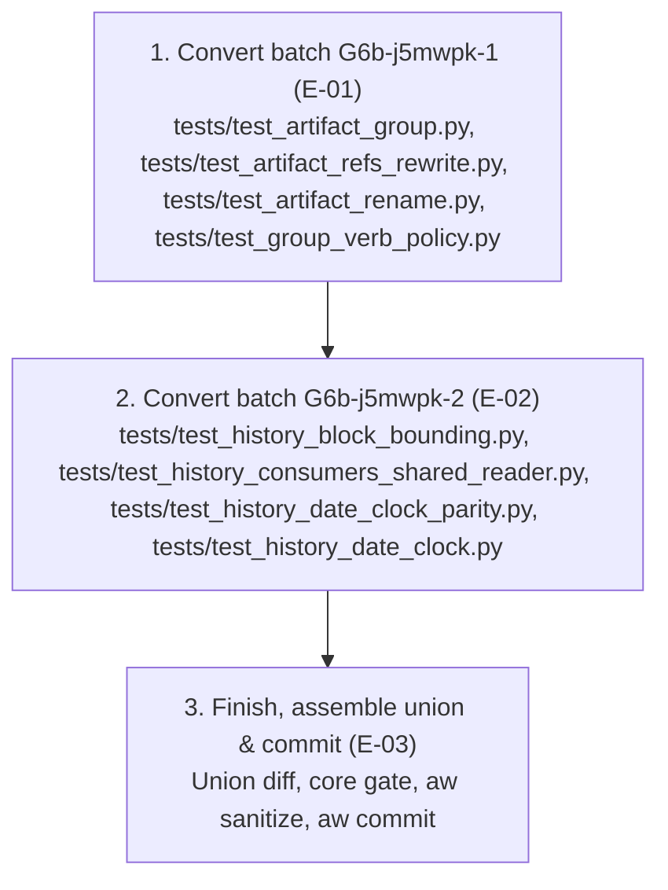

# IPD: Move runner-family, reader, record and review test data chunk 8 of 11 onto the record builder

- Date: 2026-11-09
- Kind: child
- Concern: Spec `4sd62s` section 6 requires that test data be written by ONE shared record builder in phase B, so that the cutover (Order 13, `cxxmyv`) changes the builder and not hundreds of test files, and C10a requires the suite to pass at every commit. Research `nj8zdp` and the maintainer's ruling ("plans that obtuse and not-too-smart agents won't mess up") set the guidance of at most 5 E-items, 8 work Scope-Paths and about 8 named units per item; `nbfg7w` named up to 25 modules per batch item. This part carries 8 of `nbfg7w`'s modules (subset G6b; 200 F-01 legacy lines at `3d0ddb845`), each item at most 4 modules, converted by the Order-49 codemod (`653ndz`) plus only its census-counted refusals.
- Scope: Chunk 8 of 11 of `nbfg7w` (round-3 split 2026-11-09 per research `nj8zdp` guidance): the 8 test modules named in the items and in F-40, each item one codemod run under the batch rule below, plus a finishing item. EXCLUDES: every other module of the subsets (the other chunk plans and `nbfg7w`); the builder (`9rgn2w`) and the codemod (`653ndz`); the F-03 EXCLUDED modules; production code; the switch-point proof, census and full-suite comparison (`59aiyh` E-11, E-12).
- Scope-Paths: tests/test_artifact_group.py, tests/test_artifact_refs_rewrite.py, tests/test_artifact_rename.py, tests/test_group_verb_policy.py, tests/test_history_block_bounding.py, tests/test_history_consumers_shared_reader.py, tests/test_history_date_clock_parity.py, tests/test_history_date_clock.py, .aw/records/plans/pending/20261109-metastore-199-j5mwpk-move-runner-family-reader-record-and-review-test-data-chunk.ipd.md
- Item-Dependencies: executed:653ndz, executed:9rgn2w, executed:g5hpbb, executed:tve77h, executed:xexn45
- Status: approved
- Readiness: go-pending-approval
- Review-Depth: complex
- From-Spec: 4sd62s
- Work-Kind: feature
- Priority: high
- Blocks-Release: next
- Set: metastore
- Order: 199
- Highest E allocated: 03
- Author: opencode its_direct/pt3-claude-opus-5.5-1m-us
- Id: j5mwpk
- Approval: 2026-11-16, recorded via aw ipd set: status set to approved

> Write and proofread this plan per the technical writing standard, `.aw/system/workflows/technical-writing/technical-writing.md` (`.agents/workflows/technical-writing/technical-writing.md` in a legacy-layout install), including requirement 12 (diagrams).

## Workflow history
- 2026-11-16 approved (aw set): status set to approved

- 2026-11-14 reviewed (antigravity/gemini-3.8-flash): plan-review verified E/V bijection, Scope-Paths, batch rules, execution gate, and state directory initialization; findings PR-001..PR-005 fixed; marked reviewed and go-pending-approval.
- 2026-11-09 to-review (opencode its_direct/pt3-claude-opus-5.5-1m-us): split from nbfg7w (round 3, research nj8zdp guidance).

## Goal

Every hand-built record in the 8 test modules named below comes from `tests/record_builder.py`, written by the Order-49 codemod or, for its census-counted refusals only, by hand, with each module's per-test outcomes identical before and after and every remaining legacy string classified.

## Detailed Implementation Checklist (TODO)

Execution-state rule: mark an `E-*` item complete only after performing the action. That mark is not validation. Right-sizing rule: write for a modest executor that cannot hold much in its head. Each E-item is one step (one concern, about one file, executable in one focused pass) and its V-item names each unit it covers with its own check; a plan stays at about 5 E-items and 8 work Scope-Paths, else split it into more child plans (guidance, `IPD-Z603`). Accepted execution states: blocked, failed, pending, performed; terminal gate demands 'performed'.

Batch rule, applied to every batch E-item of this plan (the `59aiyh` batch rule, restructured 2026-11-08 for the Order-49 fixture codemod `653ndz` per maintainer decision 2026-11-07 "Codemod first, then small runs": the tool performs the mechanical rewrite, and the hand work is bounded by its measured refusals). In it, "E-13's `full-before.txt`" and "the builder's `raw_fields=` escape (E-01)" are items of Order 37 (`9rgn2w`), carried by the round-3 split into Order 170 (`j6o96i`) with the same ids; because `.aw/state/` does not travel between lane worktrees, step 2 always records a fresh before list here. Step 1's partition is restricted to the modules each batch item names (round-3 split 2026-11-09: a subset is now spread over several plans of at most 8 modules each): a module that the partition now places in the item's subset but that no plan names is NOT added here; it is reported, and the finishing item of `nbfg7w` converts it; a named module that no longer matches F-01 is reported and skipped:
1. Before the batch, create directory `mkdir -p .aw/state/59aiyh/` and re-derive its file list with the F-03 first-match partition over the F-01 `rg -l` output at the current HEAD, minus the F-03 EXCLUDED list, and save it as `.aw/state/59aiyh/<batch>-files.txt`. The counts in each E-item are context measured at `0cbfcc706` or `ac76110f4`, not the bar.
2. Record the unmodified per-test outcome list (a batch whose files a previous batch did not touch may reuse the matching lines of E-13's `full-before.txt`): `python3 -m pytest -o addopts="" -m "" -p no:randomly -n 0 -rA $(cat .aw/state/59aiyh/<batch>-files.txt) | grep -E "^(PASSED|FAILED|ERROR|SKIPPED|XFAIL|XPASS) " | sed -E 's/ - .*//' | sort > .aw/state/59aiyh/<batch>-before.txt`. `-p no:randomly` and `-n 0` make the list deterministic; `-m ""` includes `slow` and `livecorpus` modules.
3. Run the codemod: `python3 tools/fixture_codemod.py --apply --format json $(cat .aw/state/59aiyh/<batch>-files.txt) > .aw/state/59aiyh/<batch>-codemod.json`. It rewrites only the sites whose module outcome list it proved identical (`653ndz` E-03, carried with the same id into Order 172, `y3uowx`, by the round-3 split) and lists every other site as a refusal with a reason code and a disposition (`hand` or `legacy-kept`, the `653ndz` reason-code table).
4. Hand-convert ONLY the refusals with disposition `hand`: the static count is the sum of the `653ndz` F-30 rows of the item's modules (round-3 split 2026-11-09: an item now carries part of a subset, so the subset's F-31 row is context only), and the codemod report adds any apply-time `not-equivalent` refusals; the item's hand count is their sum. If the hand count exceeds 25, stop after step 3 (the proved codemod rewrites may be committed), convert nothing by hand, and report the subset for re-splitting. A hand conversion uses builder calls; a test that deliberately writes an INVALID value (an unknown status, `- Status: EXECUTED`, `- Priority: bogus`, a malformed gate) gets it through the builder's `raw_fields=` escape (E-01) and is listed with reason class `invalid-input`. A refusal with disposition `legacy-kept` stays in legacy form on purpose and is listed with its F-06 reason class.
5. Re-run step 2's command into `<batch>-after.txt` and require `diff` to print nothing. A batch that would need any changed assertion other than a raw-byte metadata stand-in moved to `artifact_meta.read` (scope rule) stops and is reported; it does not weaken the assertion.
6. Count the remaining legacy strings with the F-01 `rg` pattern over the batch files, and give each remaining line one reason class from F-06: `legacy-format subject`, `displayed-output assertion`, `setter-byte assertion`, `invalid-input`, or `body prose` (for example open-question `- Status: open` rows, which N3 keeps in Markdown).
7. The builder never reads production source, and no test gains a source-reading assertion.

### Task group 1: batch items

- [x] E-01 (carried from `nbfg7w` E-03, batch subset G6b; round-3 split 2026-11-09) Batch G6b, 4 of its 25 modules (the history, artifact, group, record and reference tests (`test_history*`, `test_artifact*`, `test_group*`, `test_record*`, `test_reference*`)): `tests/test_artifact_group.py`, `tests/test_artifact_refs_rewrite.py`, `tests/test_artifact_rename.py`, `tests/test_group_verb_policy.py`. F-01 legacy lines per module at `3d0ddb845` (context, not the bar): `test_artifact_group` 21, `test_artifact_refs_rewrite` 23, `test_artifact_rename` 5, `test_group_verb_policy` 39. Ensure `.aw/state/59aiyh/` exists (`mkdir -p .aw/state/59aiyh/`), run the codemod on these modules and apply the batch rule with `<batch>` = `G6b-j5mwpk-1` (outcome lists identical); hand-convert ONLY the refusals that the `653ndz` F-30 rows of these modules list with disposition `hand`, plus the codemod's apply-time `not-equivalent` refusals, and state their count (at most 25, the batch rule's stop); leave each refusal the census marks `legacy-kept` in legacy form with its reason class. The `aw-prompt` comment tests use `prompt(...)`. Tests whose subject is the legacy grammar itself (`test_front_matter_loose_whitespace.py`, `test_history_block_bounding.py`, the quoted-example cases of `test_selector_two_dialect_readers.py`) keep their literal input and are listed as `legacy-format subject`. Then delete each private record-building helper in these modules that no longer has a caller (at the split: `tests/test_group_verb_policy.py`: `_seed_research_record`, `_seed_plan_record`); a surviving helper is listed with its reason.
  - Depends on: none
  - Expected outcome: an empty before/after `diff` for the `G6b-j5mwpk-1` outcome lists; for each named module, its remaining legacy-string count and the reason class of every remaining line pasted; every deleted and surviving helper listed; the codemod report and the hand count (at most 25) pasted.
  - Execution state: performed

- [x] E-02 (carried from `nbfg7w` E-03, batch subset G6b; round-3 split 2026-11-09) Batch G6b, 4 of its 25 modules (the history, artifact, group, record and reference tests (`test_history*`, `test_artifact*`, `test_group*`, `test_record*`, `test_reference*`)): `tests/test_history_block_bounding.py`, `tests/test_history_consumers_shared_reader.py`, `tests/test_history_date_clock_parity.py`, `tests/test_history_date_clock.py`. F-01 legacy lines per module at `3d0ddb845` (context, not the bar): `test_history_block_bounding` 47, `test_history_consumers_shared_reader` 30, `test_history_date_clock_parity` 29, `test_history_date_clock` 6. Run the codemod on these modules and apply the batch rule with `<batch>` = `G6b-j5mwpk-2` (outcome lists identical); hand-convert ONLY the refusals that the `653ndz` F-30 rows of these modules list with disposition `hand`, plus the codemod's apply-time `not-equivalent` refusals, and state their count (at most 25, the batch rule's stop); leave each refusal the census marks `legacy-kept` in legacy form with its reason class. The `aw-prompt` comment tests use `prompt(...)`. Tests whose subject is the legacy grammar itself (`test_front_matter_loose_whitespace.py`, `test_history_block_bounding.py`, the quoted-example cases of `test_selector_two_dialect_readers.py`) keep their literal input and are listed as `legacy-format subject`. These modules held no private record-building helper at the split; a helper found now is deleted when it has no caller, or listed with its reason.
  - Depends on: none
  - Expected outcome: an empty before/after `diff` for the `G6b-j5mwpk-2` outcome lists; for each named module, its remaining legacy-string count and the reason class of every remaining line pasted; every deleted and surviving helper listed; the codemod report and the hand count (at most 25) pasted.
  - Execution state: performed

### Task group 2: finish

- [x] E-03 Finish this part: run the batch rule's step-2 command once over every module of this plan (`$(cat .aw/state/59aiyh/G6b-j5mwpk-1-files.txt .aw/state/59aiyh/G6b-j5mwpk-2-files.txt)`) into `.aw/state/59aiyh/j5mwpk-union-after.txt` and confirm it equals the sorted concatenation of the items' `-before.txt` lists; run the bare core gate `python3 -m pytest` and `aw sanitize --agent`; commit through `aw commit j5mwpk -- <each changed path>`, one commit per item allowed, never `git add -A`, a bare `git add` or `git commit -a`. Never push. (The full-suite comparison stays in `59aiyh` E-12.)
  - Depends on: E-01, E-02
  - Expected outcome: the union comparison is empty; all runs pass; every commit is path-scoped to Scope-Paths (or justified at finalize).
  - Execution state: performed

## Project conventions discovered (Step 0)

- Interface names from Order 02 (`tve77h`): `artifact_meta.registry_fields(type)`, `artifact_meta.validate_event`, `artifact_meta.validate_new_events(type, events, *, records_root, migration_import=False)`, `artifact_meta.read(id6) -> State`, `artifact_meta.create(...)` and `artifact_meta.append(id6, events, *, expect_seq)`. Order 02's `create`/`append` write the log format; `2xwb9b` E-03 adds the phase-B legacy branch of `append` and `xexn45` E-01 routes the phase-B branch of `create` and `append` through `write_legacy`, with `render_legacy_text(text, events)` (`xexn45` E-11) as the same renderer over a string. In phase B the on-disk format is the bullet format; the legacy loader reads it into the cache.
- `review_findings.render_review` (pure) and `review_findings.write_review` render and write a `.review.md` record; no CLI calls `write_review` (`xexn45` Findings).
- The existing shared plan builder is `support.ready_plan_text`, which is "BUILT FROM THE REAL GENERATOR (`ipd_authoring.build_skeleton`)" and then fills the fields a draft leaves open; the builder keeps that approach for plans, so a scaffold change still reaches every fixture.
- Shared test plumbing lives in `tests/support.py` (`init_repo`, `git`, `run_cli`, `pinned_env`, `ready_plan_text`, `scope_drift_repo`); `tests/repo_template.py` (`copy_template_repo`) gives a pre-built repository; there is no `tests/conftest.py`, and the root `conftest.py` owns tier selection.
- Tests are behavioral (AGENTS.md "TEST OUTCOMES, NOT CODE STRUCTURE"); core modules set `pytestmark = pytest.mark.core`; `slow` tests are listed in `tests/slow_allowlist.txt`; `pyproject.toml` `addopts` deselects `slow` and `livecorpus`, so a complete comparison passes `-m ""`, and `pytest-randomly` is installed, so a deterministic order needs `-p no:randomly`.
- `tests/fixtures/review-pilot/` is the input corpus of `tools/review_pilot.py` (`manifest.json` names each plan file, `defects.json` quotes exact text to plant), and `tests/test_review_pilot.py` copies the whole directory into its fixture repository.
- Filenames come from `artifact_naming.build_clustered_name` and parse with `artifact_naming.parse_clustered`.
- Cite code by SYMBOL (`module.function`) or by a quoted content string, with a line number only appended to one of those and never alone: an offset expires before this plan executes (spec `ipd-structure-and-linting` Section 10.2; advisory `IPD-C801`).

## Findings

Measured 2026-11-09 at `3d0ddb845` for F-40; F-01, F-03, F-06 and F-08 copied from `nbfg7w` (measured at `0cbfcc706` and at review).

| Id | Evidence | Finding |
|---|---|---|
| F-01 | `rg -l --glob '*.py' -e '- (Id|Status|Set|Kind|Blocks-Release|Readiness|Item-Dependencies|Scope-Paths|From-Backlog|From-Spec|Work-Kind|Priority|Order|Date|Gate-Kind|Gate-Ref|Approval|Subject-Id|Verdict|Graduated-To):|## Workflow history' tests` lists 309 files (307 test modules, `support.py`, `conformance_matrix.py`) of 717 Python files; 6,638 matching lines. The narrower `- Id:`/`- Status:`/`## Workflow history` pattern: 300 files, 3,430 lines | Spec section 6 counted 268 of 680 files and 2,607 matches at round 2; the plan's pattern is broader (21 fields). |
| F-03 | Family split by filename prefix, re-measured at review (HEAD `4a7499289`, 311 files, 6,657 lines) with a FIRST-MATCH rule (a file goes to the first group, in order G1 to G6, whose pattern list matches its basename; unmatched files go to G7): G1 39 files, 1,568 lines; G2 22, 1,102; G3 28, 795; G4 63, 1,244; G5 46, 598; G6 69, 1,004; G7 44, 346. Six files match two groups and are assigned by that rule (`test_ipd_authoring` G3, `test_readiness_absence_invariant` G4, `test_runner_backlog_close_behavior` G1, `test_orchestrator_retire_closes_backlog` G1, `test_records_only_lane_rederive` G5, `test_ipdrunner_runagy_shim` G4). The authored counts (G6 99, G7 11) did not sum to the file total; the first-match rule makes the partition exhaustive and disjoint. EXCLUDED from every batch (literal legacy input is their subject; owned by other plans): `tests/test_artifact_meta_*.py` (`tve77h`, `2xwb9b`), `tests/test_artifact_meta_legacy_writer.py` and `tests/test_writers_*.py` (`xexn45`), `tests/test_m0001_*.py` and `tests/test_migrations_chain.py` (`dcerjg`, `ya4ee4`) | Seven batches (E-03 to E-09); G1, G4 and G6 carry a pre-measured split seam (OQ-01). |
| F-06 | (written by E-11) remaining legacy strings in `tests/` after the batches, each with one reason class: `legacy-format subject`, `displayed-output assertion`, `setter-byte assertion`, `invalid-input`, `body prose` | Order 13 changes the builder plus the F-06 rows of class `setter-byte assertion`; `invalid-input` rows already go through `raw_fields=` and need a decision at the cutover (an invalid bullet has no log-format equivalent); every other class is either a legacy-format test (moved to the migration tests at the cutover) or prose. |
| F-08 | At review, 15 test modules write a deliberately invalid metadata value (for example `tests/test_releases.py` "`- Status: bogus`", `tests/test_check_engine.py` "`- Status: EXECUTED`", `tests/test_specs_set_adapter.py` "`- Priority: bogus`") | A builder that validates every field cannot build these; E-01 adds `raw_fields=` and the batch rule lists them as `invalid-input`. |
| F-40 | `rg -c` with the F-01 pattern over this part's modules at `3d0ddb845`; subset by the F-03 first-match rule; helpers as listed by `nbfg7w` at the 2026-11-07 split | See the table below; every module is named in exactly one item. |

| Module | Subset | F-01 lines | Helpers at the split | Item |
|---|---|---|---|---|
| `tests/test_artifact_group.py` | G6b | 21 | none | E-01 |
| `tests/test_artifact_refs_rewrite.py` | G6b | 23 | none | E-01 |
| `tests/test_artifact_rename.py` | G6b | 5 | none | E-01 |
| `tests/test_group_verb_policy.py` | G6b | 39 | `_seed_research_record`, `_seed_plan_record` | E-01 |
| `tests/test_history_block_bounding.py` | G6b | 47 | none | E-02 |
| `tests/test_history_consumers_shared_reader.py` | G6b | 30 | none | E-02 |
| `tests/test_history_date_clock_parity.py` | G6b | 29 | none | E-02 |
| `tests/test_history_date_clock.py` | G6b | 6 | none | E-02 |

## Proposed changes (ordered, validatable)

1. Convert each item's modules under the batch rule (E-01 to E-02).
2. Re-run the union, the core gate, commit (E-03).

## Deferred / out of scope (with reason)

- The other modules of subset G6b, the partition re-derivation that catches modules no plan names, and the subsets' finishing checks.
  - Carrier: nbfg7w
- The fixture codemod and its census (F-30, F-31).
  - Carrier: 653ndz
  - Carrier-Evidence: .aw/records/plans/executed/20261108-metastore-49-653ndz-build-and-prove-the-test-fixture-codemod.ipd.md
- The builder, its tests, the baselines and the tracked fixtures.
  - Carrier: 9rgn2w
  - Carrier-Evidence: .aw/records/plans/executed/20261107-metastore-37-9rgn2w-add-the-shared-test-record-builder-and-convert-the-tracked-r.ipd.md
- The switch-point proof, the F-06 census and the full-suite comparison.
  - Carrier: 59aiyh
- Adding `RECORD_FORMAT = "log"` and converting setter-byte assertions (cutover commit).
  - Carrier: cxxmyv

## Scope check

- Over-scope: none. No production module changes; every Scope-Paths entry is a module named in one item, plus this plan.
- Under-scope: none known. Size: 3 E-items (2 batch items of at most 4 modules each and the finish), 8 work Scope-Paths.

## Required tests / validation

Each item is validated by an identical per-test result list before and after (the batch rule), which is behavioral by construction: the same tests, unchanged assertions, the same outcomes. Commands: the batch rule's command per item, the codemod's `--apply` report, the bare core gate `python3 -m pytest`, `aw sanitize --agent`. CONTRIBUTES to AC-1b (owned by `cxxmyv`).

## Spec / documentation sync

No spec change; implements part of `4sd62s` section 6 and section 7 step 6.

## Open questions

### OQ-01: Can this part run in any order relative to the other chunk plans?

- Blocking: no
- Status: resolved
- Owner: plan author
- Resolution or deferral rationale: Yes. The module lists of all chunk plans are disjoint, each needs the builder (`9rgn2w`) and the codemod (`653ndz`), and none edits `tests/support.py` (that is `59aiyh` E-09, which runs last). Recommendation strength: strong.

## Validation and cross-check (verify before reporting done)

Validation-state rule: inspect evidence in a separate pass. Do not mark a `V-*` item complete from memory or from the matching execution checkmark. Accepted validation results: blocked, failed, pass, pending; terminal gate demands 'pass'. Runtime-demonstration reachability rule: for each `V-*` item demanding the software be observed acting (such as a run, a dispatch, or a transition), as distinct from items demanding a diff, a file's content, or a test result, which are reachable by construction, name the code path that produces the observation or the sibling `E-*` that creates it, else the demand is UNDER-SCOPE.

- [x] V-01 validates E-01
  - Required evidence: paste `.aw/state/59aiyh/G6b-j5mwpk-1-files.txt` and the empty `diff .aw/state/59aiyh/G6b-j5mwpk-1-before.txt .aw/state/59aiyh/G6b-j5mwpk-1-after.txt`; then, for each of `tests/test_artifact_group.py`, `tests/test_artifact_refs_rewrite.py`, `tests/test_artifact_rename.py`, `tests/test_group_verb_policy.py` separately: its before and after F-01 `rg -c` count, the reason class of every remaining match, its rows of `.aw/state/59aiyh/G6b-j5mwpk-1-codemod.json` (rewrites, refusals by reason code and disposition, before and after outcome-list hashes) and its `653ndz` F-30 row; the hand count with every hand-converted site listed (module, line, reason code); and the before and after helper census of the E-09 `rg` pattern over these modules with each deleted and surviving helper and its reason.
  - Observed evidence:
    - `.aw/state/59aiyh/G6b-j5mwpk-1-files.txt`:
      - `tests/test_artifact_group.py`
      - `tests/test_artifact_refs_rewrite.py`
      - `tests/test_artifact_rename.py`
      - `tests/test_group_verb_policy.py`
    - Partition check at current HEAD: zero unnamed extra G6b modules found.
    - Outcome diff (`diff -u .aw/state/59aiyh/G6b-j5mwpk-1-before.txt .aw/state/59aiyh/G6b-j5mwpk-1-after.txt`): empty output, exit code 0 (84 `PASSED` outcomes).
    - Per-module F-01 counts, remaining classifications, codemod rows, and `653ndz` F-30 rows:
      - `tests/test_artifact_group.py`:
        - F-01 `rg -c`: before 21, after 12. Remaining matches (12):
          - `setter-byte assertion` (10): lines 107 (`- Set: newgrp`), 108 (`- Id: bk1234`), 137 (`- Set: newgrp`), 156 (`- Set: specgrp`), 172 (`- Set: wtgrp`), 222 (`- Set: rdgrp`), 263 (`- Set: newrel`), 264 (`- Id: re1234`), 279 (`- Set: relnext`), 300 (`- Set: relinj`).
          - `body prose` (1): line 282 (`# 4. Inject - Set: into a release without existing Set`, comment).
          - `legacy-format subject` (1): line 213 (`rm.write_text("# Roadmap\n\n- Date: 2026-08-23\n", encoding="utf-8")`; `roadmap` is outside `RecordBuilder`'s 8 governed record types).
        - Codemod JSON row (`.aw/state/59aiyh/G6b-j5mwpk-1-codemod.json`): `sites=20`, `rewrites=4` (`standard=4`, `invalid-input=0`), `refusals=16` (`unsupported-shape=3`, `not-equivalent=1`, `setter-byte assertion=12`, `hand=4`, `legacy-kept=12`), `before_hash=b8621d9867bd71e99c92f6c2fd57b81a84cdb1239f95f14d0e60a26e4b34c920`, `after_hash=b8621d9867bd71e99c92f6c2fd57b81a84cdb1239f95f14d0e60a26e4b34c920`, `equivalent=true`, `pytest_runs=6`, `changed=true`.
        - `653ndz` F-30 row: `G6b | j5mwpk | 20 | 5 | 0 | 0 | 3 | 0 | 0 | 0 | 12 | 0 | 3 | 12`.
      - `tests/test_artifact_refs_rewrite.py`:
        - F-01 `rg -c`: before 23, after 2. Remaining matches (2):
          - `setter-byte assertion` (2): line 797 (`self.assertIn(f"- Scope-Paths: {new_p}, other.py", updated)`), line 922 (`self.assertIn("missing - Id:", skip_dict[p_no_id])`). (Codemod-rewritten site pre-edit line 523 uses `raw_fields={'Status': 'draft'}` and hand-converted site pre-edit line 813 uses `raw_fields={"Id": None}`, both `invalid-input`.)
        - Codemod JSON row (`.aw/state/59aiyh/G6b-j5mwpk-1-codemod.json`): `sites=24`, `rewrites=17` (`standard=16`, `invalid-input=1`), `refusals=7` (`dynamic-construction=1`, `unsupported-shape=2`, `not-equivalent=2`, `setter-byte assertion=2`, `hand=5`, `legacy-kept=2`), `before_hash=51645b1725da27776e7e50e1266c0617625bbc3927cd76dda4337968282e1376`, `after_hash=51645b1725da27776e7e50e1266c0617625bbc3927cd76dda4337968282e1376`, `equivalent=true`, `pytest_runs=18`, `changed=true`.
        - `653ndz` F-30 row: `G6b | j5mwpk | 24 | 19 | 1 | 1 | 2 | 0 | 0 | 0 | 2 | 0 | 3 | 2`.
      - `tests/test_artifact_rename.py`:
        - F-01 `rg -c`: before 5, after 1. Remaining matches (1):
          - `setter-byte assertion` (1): line 109 (`self.assertIn("- Id: bk1234", new_bkl.read_text(encoding="utf-8"))`).
        - Codemod JSON row (`.aw/state/59aiyh/G6b-j5mwpk-1-codemod.json`): `sites=5`, `rewrites=3` (`standard=3`, `invalid-input=0`), `refusals=2` (`unsupported-shape=1`, `setter-byte assertion=1`, `hand=1`, `legacy-kept=1`), `before_hash=eb912c6a7603428f7f1d37096327166598228d1f35f3b4309949fe0c1314414c`, `after_hash=eb912c6a7603428f7f1d37096327166598228d1f35f3b4309949fe0c1314414c`, `equivalent=true`, `pytest_runs=2`, `changed=true`.
        - `653ndz` F-30 row: `G6b | j5mwpk | 5 | 3 | 0 | 0 | 1 | 0 | 0 | 0 | 1 | 0 | 1 | 1`.
      - `tests/test_group_verb_policy.py`:
        - F-01 `rg -c`: before 39, after 33. Remaining matches (33):
          - `body prose` (6): lines 9, 501, 522, 543, 752, 1100 (module and test docstrings referencing `- Date:` and `- Kind:`).
          - `setter-byte assertion` (27): lines 746, 747, 748, 770, 771, 772, 819, 820, 821, 857, 858, 876, 877, 976, 1010, 1118, 1119, 1120, 1148, 1149, 1167, 1168, 1169, 1192, 1193, 1331, 1367 (`assert "- Set: ..."` / `"- Order: ..."` / `"- Kind: ..."` assertions). (`_seed_plan_record` uses `raw_fields={"Set": set_line, "Date": date_line, ...}` for intentionally absent/malformed `Date`, absent `Kind`, and parenthetical `Set` values, `invalid-input`; `test_group_research_tier_disagreement_follows_filename` uses `raw_fields={"order": "03"}`, `invalid-input`.)
        - Codemod JSON row (`.aw/state/59aiyh/G6b-j5mwpk-1-codemod.json`): `sites=34`, `rewrites=0` (`standard=0`, `invalid-input=0`), `refusals=34` (`unsupported-shape=6`, `not-equivalent=1`, `setter-byte assertion=27`, `hand=7`, `legacy-kept=27`), `before_hash=1e5b959abd656a284688f35326e2ea24464888e8f44bc1b26f54b8add204f347`, `after_hash=1e5b959abd656a284688f35326e2ea24464888e8f44bc1b26f54b8add204f347`, `equivalent=true`, `pytest_runs=2`, `changed=false`.
        - `653ndz` F-30 row: `G6b | j5mwpk | 34 | 1 | 0 | 0 | 6 | 0 | 0 | 0 | 27 | 0 | 6 | 27`.
    - Hand count: 17 reported by codemod (13 static + 4 apply-time `not-equivalent`; <= 25; 16 hand-converted to `RecordBuilder`, 1 roadmap literal kept as `legacy-format subject`):
      1. `tests/test_artifact_group.py` pre-edit line 68 (`unsupported-shape`): backlog `bk1234` -> `RecordBuilder().backlog(...)`.
      2. `tests/test_artifact_group.py` pre-edit line 111 (`unsupported-shape`): backlog `bk1234` -> `RecordBuilder().backlog(...)`.
      3. `tests/test_artifact_group.py` pre-edit line 157 (`not-equivalent`): prompt `pr1234` -> `RecordBuilder().prompt(...)` with its two raw-byte metadata stand-in assertions moved to `artifact_meta.read("pr1234", ...)` per batch rule step 5.
      4. `tests/test_artifact_group.py` pre-edit line 185 (`unsupported-shape`): roadmap fixture kept literal (`legacy-format subject`; `roadmap` is not one of `RecordBuilder`'s 8 record types).
      5. `tests/test_artifact_refs_rewrite.py` pre-edit line 156 (`unsupported-shape`): prompt `20260701-1200-01-other.prompt.md` -> `RecordBuilder().prompt(...)`.
      6. `tests/test_artifact_refs_rewrite.py` pre-edit line 236 (`not-equivalent`): plan `p11111` -> `RecordBuilder().plan(when="2026-07-01", id6="p11111", set="p11111", order=0, kind="orchestrator", status="draft", text_only=True)`.
      7. `tests/test_artifact_refs_rewrite.py` pre-edit line 463 (`unsupported-shape`): prompt `fix-bar.prompt.md` -> `RecordBuilder().prompt(...)`.
      8. `tests/test_artifact_refs_rewrite.py` pre-edit lines 702-708 (`dynamic-construction`): plan `pl0001` with prose and fenced citation -> `RecordBuilder().plan(..., body=...)`.
      9. `tests/test_artifact_refs_rewrite.py` pre-edit line 813 (`not-equivalent`): missing-Id plan `p_no_id` -> `RecordBuilder().plan(scope_paths="foo.py", raw_fields={"Id": None}, text_only=True)` (`invalid-input`).
      10. `tests/test_artifact_rename.py` pre-edit line 70 (`unsupported-shape`): backlog `bk1234` -> `RecordBuilder().backlog(...)`.
      11. `tests/test_group_verb_policy.py` pre-edit lines 188-201 (`not-equivalent`): `_seed_research_record` YAML fixture replaced across all 8 callers with direct `RecordBuilder(temp_git_repo).research(...)` calls (with `raw_fields={"order": "03"}` for the tier-disagreement test) and helper deleted.
      12-17. `tests/test_group_verb_policy.py` pre-edit lines 385, 388, 391, 392, 396, 398 (`unsupported-shape`, 6 sites inside `_seed_plan_record`): replaced with a single `RecordBuilder().plan(..., raw_fields=...)` call.
    - E-09 helper census (`rg -n "def _?(make|write|build|mk|seed)_(plan|spec|backlog|item|record|ipd|release|research|prompt|review|walkthrough)\w*"`):
      - Before: `tests/test_group_verb_policy.py:172:def _seed_research_record(`, `tests/test_group_verb_policy.py:367:def _seed_plan_record(`.
      - After: `tests/test_group_verb_policy.py:406:def _seed_plan_record(`.
      - Deleted helpers (1): `tests/test_group_verb_policy.py::_seed_research_record` (all 8 callers replaced directly with `RecordBuilder(temp_git_repo).research(...)`; zero callers remaining).
      - Surviving helpers (1): `tests/test_group_verb_policy.py::_seed_plan_record` (26 active callers in `tests/test_group_verb_policy.py` seeding custom clustered/legacy filenames and intentionally absent/malformed `Date`/`Kind`/`Set` fields; now delegates record construction to `RecordBuilder().plan(..., raw_fields=...)` with zero raw legacy strings).
  - Result: pass

- [x] V-02 validates E-02
  - Required evidence: paste `.aw/state/59aiyh/G6b-j5mwpk-2-files.txt` and the empty `diff .aw/state/59aiyh/G6b-j5mwpk-2-before.txt .aw/state/59aiyh/G6b-j5mwpk-2-after.txt`; then, for each of `tests/test_history_block_bounding.py`, `tests/test_history_consumers_shared_reader.py`, `tests/test_history_date_clock_parity.py`, `tests/test_history_date_clock.py` separately: its before and after F-01 `rg -c` count, the reason class of every remaining match, its rows of `.aw/state/59aiyh/G6b-j5mwpk-2-codemod.json` (rewrites, refusals by reason code and disposition, before and after outcome-list hashes) and its `653ndz` F-30 row; the hand count with every hand-converted site listed (module, line, reason code); and the before and after helper census of the E-09 `rg` pattern over these modules with each deleted and surviving helper and its reason.
  - Observed evidence:
    - `.aw/state/59aiyh/G6b-j5mwpk-2-files.txt`:
      - `tests/test_history_block_bounding.py`
      - `tests/test_history_consumers_shared_reader.py`
      - `tests/test_history_date_clock_parity.py`
      - `tests/test_history_date_clock.py`
    - Outcome diff (`diff -u .aw/state/59aiyh/G6b-j5mwpk-2-before.txt .aw/state/59aiyh/G6b-j5mwpk-2-after.txt`): empty output, exit code 0 (26 lines: 25 `PASSED` outcomes plus 1 stdout line `SKIPPED SPELLINGS: ...` emitted identically before and after).
    - Per-module F-01 counts, remaining classifications, codemod rows, and `653ndz` F-30 rows:
      - `tests/test_history_block_bounding.py`:
        - F-01 `rg -c`: before 47, after 47 (unchanged per E-02). Remaining matches (47):
          - `body prose` (1): line 1 (module docstring referencing `## Workflow history`).
          - `legacy-format subject` (46): lines 57-59, 82-84, 100, 120, 149, 175-179, 181-183, 224-228, 230-232, 269-273, 275, 319-323, 325, 364, 370, 376, 382, 389, 416-419 (literal legacy `## Workflow history` bounding inputs kept per E-02).
        - Codemod JSON row (`.aw/state/59aiyh/G6b-j5mwpk-2-codemod.json`): `sites=15`, `rewrites=0` (`standard=0`, `invalid-input=0`), `refusals=15` (`legacy-format subject=15`, `hand=0`, `legacy-kept=15`), `before_hash=null`, `after_hash=null`, `equivalent=true`, `pytest_runs=0`, `changed=false`.
        - `653ndz` F-30 row: `G6b | j5mwpk | 15 | 0 | 0 | 0 | 0 | 0 | 15 | 0 | 0 | 0 | 0 | 15`.
      - `tests/test_history_consumers_shared_reader.py`:
        - F-01 `rg -c`: before 30, after 0. Remaining matches: none. (Sites pre-edit lines 28-38 and 56-66 use `raw_fields={"Readiness": "go-pending-approval"}`, `invalid-input`.)
        - Codemod JSON row (`.aw/state/59aiyh/G6b-j5mwpk-2-codemod.json`): `sites=6`, `rewrites=0` (`standard=0`, `invalid-input=0`), `refusals=6` (`dynamic-construction=4`, `unsupported-shape=1`, `not-equivalent=1`, `hand=6`, `legacy-kept=0`), `before_hash=d02d94307a212a6c91777a205c0d79f6b93dd0b336152fb80a02299fd580578d`, `after_hash=d02d94307a212a6c91777a205c0d79f6b93dd0b336152fb80a02299fd580578d`, `equivalent=true`, `pytest_runs=2`, `changed=false`.
        - `653ndz` F-30 row: `G6b | j5mwpk | 6 | 1 | 0 | 4 | 1 | 0 | 0 | 0 | 0 | 0 | 5 | 0`.
      - `tests/test_history_date_clock_parity.py`:
        - F-01 `rg -c`: before 29, after 0. Remaining matches: none. (Sites pre-edit lines 546-561 and 603 use `raw_fields` for synthetic 5-character IDs `pl{z_idx}01` / `pr{z_idx}01` and non-TODO plan fields, `invalid-input`.)
        - Codemod JSON row (`.aw/state/59aiyh/G6b-j5mwpk-2-codemod.json`): `sites=14`, `rewrites=5` (`standard=5`, `invalid-input=0`), `refusals=9` (`unsupported-shape=7`, `not-equivalent=2`, `hand=9`, `legacy-kept=0`), `before_hash=1cdf27174cb5a4f7c34996cd4176e14e9be028a4d40ad163bd624c502679f27b`, `after_hash=1cdf27174cb5a4f7c34996cd4176e14e9be028a4d40ad163bd624c502679f27b`, `equivalent=true`, `pytest_runs=8`, `changed=true`.
        - `653ndz` F-30 row: `G6b | j5mwpk | 14 | 7 | 0 | 0 | 7 | 0 | 0 | 0 | 0 | 0 | 7 | 0`.
      - `tests/test_history_date_clock.py`:
        - F-01 `rg -c`: before 6, after 0. Remaining matches: none.
        - Codemod JSON row (`.aw/state/59aiyh/G6b-j5mwpk-2-codemod.json`): `sites=3`, `rewrites=2` (`standard=2`, `invalid-input=0`), `refusals=1` (`unsupported-shape=1`, `hand=1`, `legacy-kept=0`), `before_hash=75f63484292ebbe4c4519cdd50d713956579a5003f19974f4331fedca475106c`, `after_hash=75f63484292ebbe4c4519cdd50d713956579a5003f19974f4331fedca475106c`, `equivalent=true`, `pytest_runs=2`, `changed=true`.
        - `653ndz` F-30 row: `G6b | j5mwpk | 3 | 2 | 0 | 0 | 1 | 0 | 0 | 0 | 0 | 0 | 1 | 0`.
    - Hand count: 16 reported by codemod (13 static + 3 apply-time `not-equivalent`; <= 25; all 16 hand-converted to `RecordBuilder`):
      1. `tests/test_history_consumers_shared_reader.py` pre-edit lines 28-38 (`dynamic-construction`): plan `tst001` -> `RecordBuilder().plan(..., raw_fields={"Readiness": "go-pending-approval"}, history=[...], body=...)`.
      2. `tests/test_history_consumers_shared_reader.py` pre-edit lines 56-66 (`dynamic-construction`): plan `tst002` -> `RecordBuilder().plan(..., raw_fields={"Readiness": "go-pending-approval"}, history=[...], body=...)`.
      3. `tests/test_history_consumers_shared_reader.py` pre-edit lines 85-92 (`not-equivalent`): backlog `tst003` with indented history line -> `RecordBuilder().backlog(..., history=[], body="    - 2026-10-12 created: indented line", text_only=True)`.
      4. `tests/test_history_consumers_shared_reader.py` pre-edit lines 108-117 (`unsupported-shape`): backlog `tst004` with prose-bounded history -> `RecordBuilder().backlog(..., history=[], body=...)`.
      5. `tests/test_history_consumers_shared_reader.py` pre-edit lines 120-126 (`dynamic-construction`): spec `tst005` with prose-bounded history -> `RecordBuilder().spec(..., body="", history=[], text_only=True)` plus trailing prose-bounded lines.
      6. `tests/test_history_consumers_shared_reader.py` pre-edit lines 142-152 (`dynamic-construction`): plan `tst006` with wrapped continuation record -> `RecordBuilder().plan(..., history=[f"{first_record}\n    indented continuation line", ...], body=...)`.
      7. `tests/test_history_date_clock_parity.py` pre-edit lines 371-372 (`unsupported-shape`): spec `spf{z_idx}01` -> `RecordBuilder().spec(...)`.
      8. `tests/test_history_date_clock_parity.py` pre-edit lines 417-418 (`unsupported-shape`): spec `spp{z_idx}01` -> `RecordBuilder().spec(...)`.
      9. `tests/test_history_date_clock_parity.py` pre-edit lines 463-464 (`unsupported-shape`): spec `spn{z_idx}01` -> `RecordBuilder().spec(...)`.
      10. `tests/test_history_date_clock_parity.py` pre-edit lines 501-502 (`unsupported-shape`): spec `spb{z_idx}01` -> `RecordBuilder().spec(...)`.
      11. `tests/test_history_date_clock_parity.py` pre-edit lines 546-561 (`not-equivalent`): plan `pl{z_idx}01` -> `RecordBuilder().plan(..., raw_fields={"Id": f"pl{z_idx}01", "Concern": "c", "Scope": "s", "Highest E allocated": "01"}, body=...)` (`invalid-input`).
      12. `tests/test_history_date_clock_parity.py` pre-edit line 603 (`not-equivalent`): prompt `pr{z_idx}01` -> `RecordBuilder().prompt(id6=f"pr0{z_idx}01", status="pending", raw_fields={"Id": f"pr{z_idx}01"}, text_only=True)` (`invalid-input`).
      13. `tests/test_history_date_clock_parity.py` pre-edit lines 745-746 (`unsupported-shape`): spec `ags{z_idx}01` -> `RecordBuilder().spec(...)`.
      14. `tests/test_history_date_clock_parity.py` pre-edit lines 759-760 (`unsupported-shape`): spec `ags{z_idx}02` -> `RecordBuilder().spec(...)`.
      15. `tests/test_history_date_clock_parity.py` pre-edit lines 773-774 (`unsupported-shape`): spec `ags{z_idx}03` -> `RecordBuilder().spec(...)`.
      16. `tests/test_history_date_clock.py` pre-edit lines 253-254 (`unsupported-shape`): spec `sp0001` -> `RecordBuilder().spec(...)`.
    - E-09 helper census (`rg -n "def _?(make|write|build|mk|seed)_(plan|spec|backlog|item|record|ipd|release|research|prompt|review|walkthrough)\w*"`):
      - Before: `(none)`.
      - After: `(none)`.
      - Deleted helpers (0): none. Surviving helpers (0): none.
  - Result: pass

- [x] V-03 validates E-03
  - Required evidence: paste the `diff` of the sorted concatenation of the `-before.txt` lists of `G6b-j5mwpk-1`, `G6b-j5mwpk-2` against `.aw/state/59aiyh/j5mwpk-union-after.txt` (empty), the bare `python3 -m pytest` summary line and wall time, the `aw sanitize --agent` result with zero `fail`, and every `aw commit j5mwpk` output listing only Scope-Paths.
  - Observed evidence:
    - Union diff (`diff -u <(sort .aw/state/59aiyh/G6b-j5mwpk-1-before.txt .aw/state/59aiyh/G6b-j5mwpk-2-before.txt) .aw/state/59aiyh/j5mwpk-union-after.txt`): empty output, exit code 0 (110 lines = 84 + 26 across all 8 modules).
    - Post-edit codemod dry-run over all 8 modules (`python3 tools/fixture_codemod.py --dry-run --format json`): 3 modules at `sites=0` (`test_history_consumers_shared_reader`, `test_history_date_clock_parity`, `test_history_date_clock`); 4 modules with only `legacy-kept` refusals (`test_artifact_refs_rewrite` 2, `test_artifact_rename` 1, `test_group_verb_policy` 27, `test_history_block_bounding` 15); `test_artifact_group` with 10 `setter-byte assertion` (`legacy-kept`) and 1 `roadmap` literal (`legacy-format subject`, outside `RecordBuilder`'s 8 record types).
    - Core gate (`aw suite`, running bare `python3 -m pytest` with 6 xdist workers): `2661 passed, 11 warnings in 122.23s (0:02:02)`, exit code 0 (0 failures; none of `j5mwpk`'s 8 modules appeared in the top-10 slowest or unlisted slow-tests report).
    - `aw sanitize --agent`: `{"schema":"aw.agent/v1","kind":"result","cmd":"check-local-leaks","outcome":"clean","exit":0,"verified":true,"complete":true,"checked":6879,"findings":0,"evidence":["leak-scan"],"next":null}`.
    - `aw commit j5mwpk` (7 modified test Scope-Paths; `tests/test_history_block_bounding.py` intentionally unmodified per E-02 because all 15 of its sites are `legacy-format subject` `legacy-kept`): `aw commit: committed 7 path(s): 7e7287267d6ce00898ec99deb5e668659e7d001b` (`tests/test_artifact_group.py`, `tests/test_artifact_refs_rewrite.py`, `tests/test_artifact_rename.py`, `tests/test_group_verb_policy.py`, `tests/test_history_consumers_shared_reader.py`, `tests/test_history_date_clock_parity.py`, `tests/test_history_date_clock.py`), followed by the plan-evidence commit via `aw commit j5mwpk -- .aw/records/plans/pending/20261109-metastore-199-j5mwpk-move-runner-family-reader-record-and-review-test-data-chunk.ipd.md`. Every committed path is in Scope-Paths; never pushed.
  - Result: pass

## Approval and execution gate

- Size assessment: standard
- Cohesion rationale: not required

Execute only after human approval (`Status: approved`) and after `653ndz`, `9rgn2w`, `g5hpbb`, `tve77h`, `xexn45` are executed. Every open question is resolved.

Safety stop: if a prerequisite plan in `- Item-Dependencies:` is not executed or required builder symbols from `9rgn2w` or codemod from `653ndz` are absent, stop and report rather than proceeding. Scope fence: the paths in `- Scope-Paths:` are a declaration. A needed test-tree file outside the fence is edited and then justified at finalize (`--scope-reason`), and a declared path left unmodified is acknowledged (`--scope-ack`). Production code under `agent_workflows/` and `tools/` is out of this plan's purpose: if a module cannot keep its outcome list identical without a production change, stop that item and report the missing capability rather than changing production code or an assertion.

Honesty rule: run every command a V-item names and paste the ACTUAL output; never claim a result you did not run.

Commits: commit only through `aw commit j5mwpk -- <paths>` with only Scope-Paths files; never `git add -A`, a bare `git add` or `git commit -a`; never push.

Lifecycle transition: the plan moves to `.aw/records/plans/executed/` only through `aw ipd finalize`, never a hand `git mv`, and only after `aw ipd lint --phase pre-transition` conforms and every `V-*` reads `pass` with pasted evidence. When `aw oc run` or `aw agy run` executes the plan, the runner performs the finalize; a hand executor runs `aw ipd finalize j5mwpk` itself.
