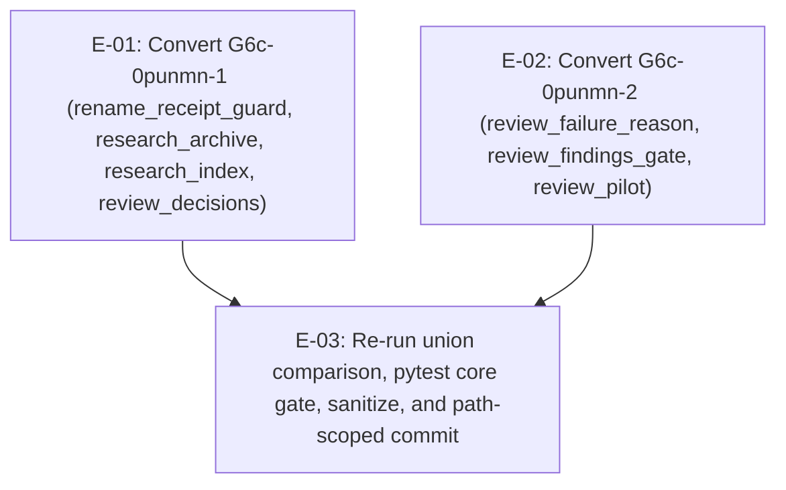

# IPD: Move runner-family, reader, record and review test data chunk 11 of 11 onto the record builder

- Date: 2026-11-09
- Kind: child
- Concern: Spec `4sd62s` section 6 requires that test data be written by ONE shared record builder in phase B, so that the cutover (Order 13, `cxxmyv`) changes the builder and not hundreds of test files, and C10a requires the suite to pass at every commit. Research `nj8zdp` and the maintainer's ruling ("plans that obtuse and not-too-smart agents won't mess up") set the guidance of at most 5 E-items, 8 work Scope-Paths and about 8 named units per item; `nbfg7w` named up to 25 modules per batch item. This part carries 7 of `nbfg7w`'s modules (subset G6c; 41 F-01 legacy lines at `3d0ddb845`), each item at most 4 modules, converted by the Order-49 codemod (`653ndz`) plus only its census-counted refusals.
- Scope: Chunk 11 of 11 of `nbfg7w` (round-3 split 2026-11-09 per research `nj8zdp` guidance): the 7 test modules named in the items and in F-40, each item one codemod run under the batch rule below, plus a finishing item. EXCLUDES: every other module of the subsets (the other chunk plans and `nbfg7w`); the builder (`9rgn2w`) and the codemod (`653ndz`); the F-03 EXCLUDED modules; production code; the switch-point proof, census and full-suite comparison (`59aiyh` E-11, E-12).
- Scope-Paths: tests/test_rename_receipt_guard.py, tests/test_research_archive.py, tests/test_research_index.py, tests/test_review_decisions.py, tests/test_review_failure_reason.py, tests/test_review_findings_gate.py, tests/test_review_pilot.py, .aw/records/plans/pending/20261109-metastore-202-0punmn-move-runner-family-reader-record-and-review-test-data-chunk.ipd.md
- Item-Dependencies: executed:653ndz, executed:9rgn2w, executed:g5hpbb, executed:tve77h, executed:xexn45
- Status: approved
- Readiness: go-pending-approval
- Review-Depth: complex
- From-Spec: 4sd62s
- Work-Kind: feature
- Priority: high
- Blocks-Release: next
- Set: metastore
- Order: 202
- Highest E allocated: 03
- Author: opencode its_direct/pt3-claude-opus-5.5-1m-us
- Id: 0punmn
- Approval: 2026-11-16, recorded via aw ipd set: status set to approved

> Written to .aw/system/workflows/technical-writing/technical-writing.md. Every obligation, exact identifier, quotation, evidence record, and lifecycle status is preserved.

## Workflow history
- 2026-11-16 approved (aw set): status set to approved
- 2026-11-14 reviewed (aw set): APPROVE WITH REVISIONS APPLIED; PR-001..PR-006 FIXED

- 2026-11-14 /plan-review (antigravity/gemini-4-carbon): APPROVE WITH REVISIONS APPLIED; PR-001..PR-006 FIXED; review record .aw/records/reviews/20261109-metastore-202-0punmn-move-runner-family-reader-record-and-review-test-data-chunk.review.md
- 2026-11-09 to-review (opencode its_direct/pt3-claude-opus-5.5-1m-us): split from nbfg7w (round 3, research nj8zdp guidance).

## Goal

Every hand-built record in the 7 test modules named below comes from `tests/record_builder.py`, written by the Order-49 codemod or, for its census-counted refusals only, by hand, with each module's per-test outcomes identical before and after and every remaining legacy string classified.

## Detailed Implementation Checklist (TODO)

Execution-state rule: mark an `E-*` item complete only after performing the action. That mark is not validation. Right-sizing rule: write for a modest executor that cannot hold much in its head. Each E-item is one step (one concern, about one file, executable in one focused pass) and its V-item names each unit it covers with its own check; a plan stays at about 5 E-items and 8 work Scope-Paths, else split it into more child plans (guidance, `IPD-Z603`). Accepted execution states: blocked, failed, pending, performed; terminal gate demands 'performed'.

Batch rule, applied to every batch E-item of this plan (the `59aiyh` batch rule, restructured 2026-11-08 for the Order-49 fixture codemod `653ndz` per maintainer decision 2026-11-07 "Codemod first, then small runs": the tool performs the mechanical rewrite, and the hand work is bounded by its measured refusals). In it, "E-13's `full-before.txt`" and "the builder's `raw_fields=` escape (E-01)" are items of Order 37 (`9rgn2w`), carried by the round-3 split into Order 170 (`j6o96i`) with the same ids; because `.aw/state/` does not travel between lane worktrees, step 2 always records a fresh before list here. Step 1's partition is restricted to the modules each batch item names (round-3 split 2026-11-09: a subset is now spread over several plans of at most 8 modules each): a module that the partition now places in the item's subset but that no plan names is NOT added here; it is reported, and the finishing item of `nbfg7w` converts it; a named module that no longer matches F-01 is reported and skipped:
1. Before the batch, ensure the state directory exists (`mkdir -p .aw/state/59aiyh`), re-derive its file list with the F-03 first-match partition over the F-01 `rg -l` output at the current HEAD, minus the F-03 EXCLUDED list, and save it as `.aw/state/59aiyh/<batch>-files.txt`. The counts in each E-item are context measured at `0cbfcc706` or `ac76110f4`, not the bar.
2. Record the unmodified per-test outcome list (a batch whose files a previous batch did not touch may reuse the matching lines of E-13's `full-before.txt`): `python3 -m pytest -o addopts="" -m "" -p no:randomly -n 0 -rA $(cat .aw/state/59aiyh/<batch>-files.txt) | grep -E "^(PASSED|FAILED|ERROR|SKIPPED|XFAIL|XPASS) " | sed -E 's/ - .*//' | sort > .aw/state/59aiyh/<batch>-before.txt`. `-p no:randomly` and `-n 0` make the list deterministic; `-m ""` includes `slow` and `livecorpus` modules.
3. Run the codemod: `python3 tools/fixture_codemod.py --apply --format json $(cat .aw/state/59aiyh/<batch>-files.txt) > .aw/state/59aiyh/<batch>-codemod.json`. It rewrites only the sites whose module outcome list it proved identical (`653ndz` E-03, carried with the same id into Order 172, `y3uowx`, by the round-3 split) and lists every other site as a refusal with a reason code and a disposition (`hand` or `legacy-kept`, the `653ndz` reason-code table).
4. Hand-convert ONLY the refusals with disposition `hand`: the static count is the sum of the `653ndz` F-30 rows of the item's modules (round-3 split 2026-11-09: an item now carries part of a subset, so the subset's F-31 row is context only), and the codemod report adds any apply-time `not-equivalent` refusals; the item's hand count is their sum. If the hand count exceeds 25, stop after step 3 (the proved codemod rewrites may be committed), convert nothing by hand, and report the subset for re-splitting. A hand conversion uses builder calls; a test that deliberately writes an INVALID value (an unknown status, `- Status: EXECUTED`, `- Priority: bogus`, a malformed gate) gets it through the builder's `raw_fields=` escape (E-01) and is listed with reason class `invalid-input`. A refusal with disposition `legacy-kept` stays in legacy form on purpose and is listed with its F-06 reason class.
5. Re-run step 2's command into `<batch>-after.txt` and require `diff` to print nothing. A batch that would need any changed assertion other than a raw-byte metadata stand-in moved to `artifact_meta.read` (scope rule) stops and is reported; it does not weaken the assertion.
6. Count the remaining legacy strings with the F-01 `rg` pattern over the batch files, and give each remaining line one reason class from F-06: `legacy-format subject`, `displayed-output assertion`, `setter-byte assertion`, `invalid-input`, or `body prose` (for example open-question `- Status: open` rows, which N3 keeps in Markdown).
7. The builder never reads production source, and no test gains a source-reading assertion.

### Task group 1: batch items

- [x] E-01 (carried from `nbfg7w` E-04, batch subset G6c; round-3 split 2026-11-09) Batch G6c, 4 of its 19 modules (the rename, research, prompt, walkthrough and review tests (`test_rename*`, `test_research*`, `test_prompt*`, `test_prompts*`, `test_walkthrough*`, `test_review*`, `test_reviews*`)): `tests/test_rename_receipt_guard.py`, `tests/test_research_archive.py`, `tests/test_research_index.py`, `tests/test_review_decisions.py`. F-01 legacy lines per module at `3d0ddb845` (context, not the bar): `test_rename_receipt_guard` 6, `test_research_archive` 1, `test_research_index` 6, `test_review_decisions` 10. Run the codemod on these modules and apply the batch rule with `<batch>` = `G6c-0punmn-1` (outcome lists identical); hand-convert ONLY the refusals that the `653ndz` F-30 rows of these modules list with disposition `hand`, plus the codemod's apply-time `not-equivalent` refusals, and state their count (at most 25, the batch rule's stop); leave each refusal the census marks `legacy-kept` in legacy form with its reason class. The `aw-prompt` comment tests use `prompt(...)`. Tests whose subject is the legacy grammar itself (`test_front_matter_loose_whitespace.py`, `test_history_block_bounding.py`, the quoted-example cases of `test_selector_two_dialect_readers.py`) keep their literal input and are listed as `legacy-format subject`. Then delete each private record-building helper in these modules that no longer has a caller (at the split, matched by the `59aiyh` V-09 census pattern: `tests/test_research_archive.py::_write_prompt`; `tests/test_research_index.py::StaleStateDriftTests._write_plan`, `tests/test_research_index.py::ConsumedByValidationTests._write_plan_with_id`; `tests/test_review_decisions.py::_Repo.write_plan`, `tests/test_review_decisions.py::_Repo.write_review`; plus module-local helpers outside that regex such as `tests/test_rename_receipt_guard.py::_plan_text`, `tests/test_review_decisions.py::_plan_text`, and `tests/test_review_decisions.py::_Repo.write_malformed_review`); a surviving helper is listed with its reason.
  - Depends on: none
  - Expected outcome: an empty before/after `diff` for the `G6c-0punmn-1` outcome lists; for each named module, its remaining legacy-string count and the reason class of every remaining line pasted; every deleted and surviving helper listed; the codemod report and the hand count (at most 25) pasted.
  - Execution state: performed

- [x] E-02 (carried from `nbfg7w` E-04, batch subset G6c; round-3 split 2026-11-09) Batch G6c, 3 of its 19 modules (the rename, research, prompt, walkthrough and review tests (`test_rename*`, `test_research*`, `test_prompt*`, `test_prompts*`, `test_walkthrough*`, `test_review*`, `test_reviews*`)): `tests/test_review_failure_reason.py`, `tests/test_review_findings_gate.py`, `tests/test_review_pilot.py`. F-01 legacy lines per module at `3d0ddb845` (context, not the bar): `test_review_failure_reason` 5, `test_review_findings_gate` 12, `test_review_pilot` 1. Run the codemod on these modules and apply the batch rule with `<batch>` = `G6c-0punmn-2` (outcome lists identical); hand-convert ONLY the refusals that the `653ndz` F-30 rows of these modules list with disposition `hand`, plus the codemod's apply-time `not-equivalent` refusals, and state their count (at most 25, the batch rule's stop); leave each refusal the census marks `legacy-kept` in legacy form with its reason class. The `aw-prompt` comment tests use `prompt(...)`. Tests whose subject is the legacy grammar itself (`test_front_matter_loose_whitespace.py`, `test_history_block_bounding.py`, the quoted-example cases of `test_selector_two_dialect_readers.py`) keep their literal input and are listed as `legacy-format subject`. These modules held zero matches of the `59aiyh` V-09 census pattern at the split; any private record-building helper found now (including module-local helpers outside that regex such as `tests/test_review_failure_reason.py::ReviewFailureReasonIntegrationTests._setup_repo_and_plan`, `tests/test_review_findings_gate.py::_plan`, and `tests/test_review_findings_gate.py::_review`) is deleted when it has no caller, or listed with its reason.
  - Depends on: none
  - Expected outcome: an empty before/after `diff` for the `G6c-0punmn-2` outcome lists; for each named module, its remaining legacy-string count and the reason class of every remaining line pasted; every deleted and surviving helper listed; the codemod report and the hand count (at most 25) pasted.
  - Execution state: performed

### Task group 2: finish

- [x] E-03 Finish this part: run the batch rule's step-2 command once over every module of this plan (`$(cat .aw/state/59aiyh/G6c-0punmn-1-files.txt .aw/state/59aiyh/G6c-0punmn-2-files.txt)`) into `.aw/state/59aiyh/0punmn-union-after.txt` and confirm it equals the sorted concatenation of the items' `-before.txt` lists; run the bare core gate `python3 -m pytest` and `aw sanitize --agent`; commit through `aw commit 0punmn -- <each changed path>`, one commit per item allowed, never `git add -A`, a bare `git add` or `git commit -a`. Never push. (The full-suite comparison stays in `59aiyh` E-12.)
  - Depends on: E-01, E-02
  - Expected outcome: the union comparison is empty; all runs pass; every commit is path-scoped to Scope-Paths (or justified at finalize).
  - Execution state: performed

## Project conventions discovered (Step 0)

- Interface names from Order 02 (`tve77h`): `agent_workflows/artifact_meta.py::registry_fields`, `agent_workflows/artifact_meta.py::validate_event`, `agent_workflows/artifact_meta.py::validate_new_events`, `agent_workflows/artifact_meta.py::read`, `agent_workflows/artifact_meta.py::create`, and `agent_workflows/artifact_meta.py::append`. Order 02's `create`/`append` write the log format; `2xwb9b` E-03 adds the phase-B legacy branch of `append` and `7yr827` (split from `xexn45` E-01 and E-11; covered by `executed:xexn45`) routes the phase-B branch of `create` and `append` through `agent_workflows/artifact_meta.py::write_legacy`, with `agent_workflows/artifact_meta.py::render_legacy_text` as the same renderer over a string. In phase B the on-disk format is the bullet format; the legacy loader reads it into the cache.
- `agent_workflows/review_findings.py::render_review` (pure) and `agent_workflows/review_findings.py::write_review` render and write a `.review.md` record; no CLI calls `write_review` (`xexn45` Findings).
- The existing shared plan builder is `tests/support.py::ready_plan_text`, which starts from the real generator (`agent_workflows/ipd_authoring.py::build_skeleton`) and then fills the fields a draft leaves open; the builder keeps that approach for plans, so a scaffold change still reaches every fixture.
- Shared test plumbing lives in `tests/support.py` (`tests/support.py::init_repo`, `tests/support.py::git`, `tests/support.py::run_cli`, `tests/support.py::pinned_env`, `tests/support.py::ready_plan_text`, `tests/support.py::scope_drift_repo`); `tests/repo_template.py` (`tests/repo_template.py::copy_template_repo`) gives a pre-built repository; there is no `tests/conftest.py`, and the root `conftest.py` owns tier selection.
- Tests are behavioral (AGENTS.md "TEST OUTCOMES, NOT CODE STRUCTURE"); core modules set `pytestmark = pytest.mark.core`; `slow` tests are listed in `tests/slow_allowlist.txt`; `pyproject.toml` `addopts` deselects `slow` and `livecorpus`, so a complete comparison passes `-m ""`, and `pytest-randomly` is installed, so a deterministic order needs `-p no:randomly`.
- `tests/fixtures/review-pilot/` is the input corpus of `tools/review_pilot.py` (`manifest.json` names each plan file, `defects.json` quotes exact text to plant), and `tests/test_review_pilot.py` copies the whole directory into its fixture repository.
- Filenames come from `agent_workflows/artifact_naming.py::build_clustered_name` and parse with `agent_workflows/artifact_naming.py::parse_clustered`.
- Cite code by SYMBOL (`path::Symbol`) or by a quoted content string, with a line number only appended to one of those and never alone: an offset expires before this plan executes (spec `ipd-structure-and-linting` Section 10.2; advisory `IPD-C801`).

## Findings

Measured 2026-11-09 at `3d0ddb845` for F-40; F-01, F-03, F-06 and F-08 copied from `nbfg7w` (measured at `0cbfcc706` and at review).

| Id | Evidence | Finding |
|---|---|---|
| F-01 | `rg -l --glob '*.py' -e '- (Id|Status|Set|Kind|Blocks-Release|Readiness|Item-Dependencies|Scope-Paths|From-Backlog|From-Spec|Work-Kind|Priority|Order|Date|Gate-Kind|Gate-Ref|Approval|Subject-Id|Verdict|Graduated-To):|## Workflow history' tests` lists 309 files (307 test modules, `support.py`, `conformance_matrix.py`) of 717 Python files; 6,638 matching lines. The narrower `- Id:`/`- Status:`/`## Workflow history` pattern: 300 files, 3,430 lines | Spec section 6 counted 268 of 680 files and 2,607 matches at round 2; the plan's pattern is broader (21 fields). |
| F-03 | Family split by filename prefix, re-measured at review (HEAD `4a7499289`, 311 files, 6,657 lines) with a FIRST-MATCH rule (a file goes to the first group, in order G1 to G6, whose pattern list matches its basename; unmatched files go to G7): G1 39 files, 1,568 lines; G2 22, 1,102; G3 28, 795; G4 63, 1,244; G5 46, 598; G6 69, 1,004; G7 44, 346. Six files match two groups and are assigned by that rule (`test_ipd_authoring` G3, `test_readiness_absence_invariant` G4, `test_runner_backlog_close_behavior` G1, `test_orchestrator_retire_closes_backlog` G1, `test_records_only_lane_rederive` G5, `test_ipdrunner_runagy_shim` G4). The authored counts (G6 99, G7 11) did not sum to the file total; the first-match rule makes the partition exhaustive and disjoint. EXCLUDED from every batch (literal legacy input is their subject; owned by other plans): `tests/test_artifact_meta_*.py` (`tve77h`, `2xwb9b`), `tests/test_artifact_meta_legacy_writer.py` and `tests/test_writers_*.py` (`xexn45`), `tests/test_m0001_*.py` and `tests/test_migrations_chain.py` (`dcerjg`, `ya4ee4`) | Seven batches (E-03 to E-09); G1, G4 and G6 carry a pre-measured split seam (OQ-01). |
| F-06 | (written by E-11) remaining legacy strings in `tests/` after the batches, each with one reason class: `legacy-format subject`, `displayed-output assertion`, `setter-byte assertion`, `invalid-input`, `body prose` | Order 13 changes the builder plus the F-06 rows of class `setter-byte assertion`; `invalid-input` rows already go through `raw_fields=` and need a decision at the cutover (an invalid bullet has no log-format equivalent); every other class is either a legacy-format test (moved to the migration tests at the cutover) or prose. |
| F-08 | At review, 15 test modules write a deliberately invalid metadata value (for example `tests/test_releases.py` "`- Status: bogus`", `tests/test_check_engine.py` "`- Status: EXECUTED`", `tests/test_specs_set_adapter.py` "`- Priority: bogus`") | A builder that validates every field cannot build these; E-01 adds `raw_fields=` and the batch rule lists them as `invalid-input`. |
| F-40 | `rg -c` with the F-01 pattern over this part's modules at `3d0ddb845` (verified unchanged at `537a13f3e`: 41 lines total); subset by the F-03 first-match rule; helpers as listed by `nbfg7w` at the 2026-11-07 split | See the table below; every module is named in exactly one item. |
| F-41 | Measured 2026-11-14 at HEAD `537a13f3e` across all 7 target test modules: 156 passed in 6.87s (`test_rename_receipt_guard` 14, `test_research_archive` 26, `test_research_index` 52, `test_review_decisions` 26, `test_review_failure_reason` 21, `test_review_findings_gate` 10, `test_review_pilot` 7) | Context only (step 2 re-derives the baseline at execution time); confirms all 7 target modules pass unmodified before conversion. |

| Module | Subset | F-01 lines | Helpers at the split (`59aiyh` V-09 pattern) | Item |
|---|---|---|---|---|
| `tests/test_rename_receipt_guard.py` | G6c | 6 | none | E-01 |
| `tests/test_research_archive.py` | G6c | 1 | `_write_prompt` | E-01 |
| `tests/test_research_index.py` | G6c | 6 | `StaleStateDriftTests._write_plan`, `ConsumedByValidationTests._write_plan_with_id` | E-01 |
| `tests/test_review_decisions.py` | G6c | 10 | `_Repo.write_plan`, `_Repo.write_review` | E-01 |
| `tests/test_review_failure_reason.py` | G6c | 5 | none | E-02 |
| `tests/test_review_findings_gate.py` | G6c | 12 | none | E-02 |
| `tests/test_review_pilot.py` | G6c | 1 | none | E-02 |

## Proposed changes (ordered, validatable)

1. Convert each item's modules under the batch rule (E-01 to E-02).
2. Re-run the union, the core gate, commit (E-03).

## Deferred / out of scope (with reason)

- The other modules of subset G6c, the partition re-derivation that catches modules no plan names, and the subsets' finishing checks.
  - Carrier: nbfg7w
- The fixture codemod and its census (F-30, F-31).
  - Carrier: 653ndz
  - Carrier-Evidence: .aw/records/plans/executed/20261108-metastore-49-653ndz-build-and-prove-the-test-fixture-codemod.ipd.md
- The builder, its tests, the baselines and the tracked fixtures.
  - Carrier: 9rgn2w
  - Carrier-Evidence: .aw/records/plans/executed/20261107-metastore-37-9rgn2w-add-the-shared-test-record-builder-and-convert-the-tracked-r.ipd.md
- The switch-point proof, the F-06 census and the full-suite comparison.
  - Carrier: 59aiyh
- Adding `RECORD_FORMAT = "log"` and converting setter-byte assertions (cutover commit).
  - Carrier: cxxmyv

## Scope check

- Over-scope: none. No production module changes; every Scope-Paths entry is a module named in one item, plus this plan.
- Under-scope: none known. Size: 3 E-items (2 batch items of at most 4 modules each and the finish), 7 work Scope-Paths.

## Required tests / validation

Each item is validated by an identical per-test result list before and after (the batch rule), which is behavioral by construction: the same tests, unchanged assertions, the same outcomes. Context baseline measured at HEAD `537a13f3e` (not the bar; re-derived at execution time by step 2): 156 tests passing in 6.87s across the 7 target modules (`test_rename_receipt_guard.py`: 14, `test_research_archive.py`: 26, `test_research_index.py`: 52, `test_review_decisions.py`: 26, `test_review_failure_reason.py`: 21, `test_review_findings_gate.py`: 10, `test_review_pilot.py`: 7). Commands: the batch rule's command per item, the codemod's `--apply` report, the bare core gate `python3 -m pytest`, `aw sanitize --agent`. CONTRIBUTES to `4sd62s` AC-1b (owned by `cxxmyv`).

## Spec / documentation sync

No spec change; implements part of `4sd62s` section 6 and section 7 step 6.

## Open questions

### OQ-01: Can this part run in any order relative to the other chunk plans?

- Blocking: no
- Status: resolved
- Owner: plan author
- Resolution or deferral rationale: Yes. The module lists of all chunk plans are disjoint, each needs the builder (`9rgn2w`) and the codemod (`653ndz`), and none edits `tests/support.py` (that is `59aiyh` E-09, which runs last). Recommendation strength: strong.

## Validation and cross-check (verify before reporting done)

Validation-state rule: inspect evidence in a separate pass. Do not mark a `V-*` item complete from memory or from the matching execution checkmark. Accepted validation results: blocked, failed, pass, pending; terminal gate demands 'pass'. Runtime-demonstration reachability rule: for each `V-*` item demanding the software be observed acting (such as a run, a dispatch, or a transition), as distinct from items demanding a diff, a file's content, or a test result, which are reachable by construction, name the code path that produces the observation or the sibling `E-*` that creates it, else the demand is UNDER-SCOPE.

- [x] V-01 validates E-01
  - Required evidence: paste `.aw/state/59aiyh/G6c-0punmn-1-files.txt` and the empty `diff .aw/state/59aiyh/G6c-0punmn-1-before.txt .aw/state/59aiyh/G6c-0punmn-1-after.txt`; then, for each of `tests/test_rename_receipt_guard.py`, `tests/test_research_archive.py`, `tests/test_research_index.py`, `tests/test_review_decisions.py` separately: its before and after F-01 `rg -c` count, the reason class of every remaining match, its rows of `.aw/state/59aiyh/G6c-0punmn-1-codemod.json` (rewrites, refusals by reason code and disposition, before and after outcome-list hashes) and its `653ndz` F-30 row; the hand count with every hand-converted site listed (module, line, reason code); and the before and after helper census of the `59aiyh` V-09 `rg` pattern (`rg -n "def _?(make|write|build|mk|seed)_(plan|spec|backlog|item|record|ipd|release|research|prompt|review|walkthrough)\w*"`) over these modules, plus any deleted or surviving module-local record-building helper outside that regex and its reason.
  - Observed evidence:
    - `.aw/state/59aiyh/G6c-0punmn-1-files.txt`:
      - `tests/test_rename_receipt_guard.py`
      - `tests/test_research_archive.py`
      - `tests/test_research_index.py`
      - `tests/test_review_decisions.py`
    - Partition check at HEAD `e9958bde6`: all 4 named modules matched F-01 before conversion; 2 unnamed post-split modules match G6c prefixes (`tests/test_research_meta_writer_characterization.py`, `tests/test_review_unreviewed_deps.py`) and are not added here per batch rule Step 1 (deferred to `nbfg7w` E-06).
    - Outcome diff (`diff -u .aw/state/59aiyh/G6c-0punmn-1-before.txt .aw/state/59aiyh/G6c-0punmn-1-after.txt`): empty output, exit code 0 (118 `PASSED` outcomes).
    - Per-module F-01 counts, remaining classifications, codemod rows, and `653ndz` F-30 rows:
      - `tests/test_rename_receipt_guard.py`:
        - F-01 `rg -c`: before 6, after 0. Remaining matches: none.
        - Codemod JSON row (`.aw/state/59aiyh/G6c-0punmn-1-codemod.json`): `sites=6`, `rewrites=4` (`standard=4`, `invalid-input=0`), `refusals=2` (`unsupported-shape=2`, `hand=2`, `legacy-kept=0`), `before_hash=2fddec50d2a1e346007c116ef5888c5225892e1f3663a42dd8ce99c649d8b86b`, `after_hash=2fddec50d2a1e346007c116ef5888c5225892e1f3663a42dd8ce99c649d8b86b`, `equivalent=true`, `pytest_runs=2`, `changed=true`.
        - `653ndz` F-30 row: `G6c | 0punmn | 6 | 4 | 0 | 0 | 2 | 0 | 0 | 0 | 0 | 0 | 2 | 0`.
      - `tests/test_research_archive.py`:
        - F-01 `rg -c`: before 1, after 0. Remaining matches: none.
        - Codemod JSON row (`.aw/state/59aiyh/G6c-0punmn-1-codemod.json`): `sites=1`, `rewrites=0` (`standard=0`, `invalid-input=0`), `refusals=1` (`unsupported-shape=1`, `hand=1`, `legacy-kept=0`), `before_hash=null`, `after_hash=null`, `equivalent=true`, `pytest_runs=0`, `changed=false`.
        - `653ndz` F-30 row: `G6c | 0punmn | 1 | 0 | 0 | 0 | 1 | 0 | 0 | 0 | 0 | 0 | 1 | 0`.
      - `tests/test_research_index.py`:
        - F-01 `rg -c`: before 6, after 0. Remaining matches: none. (`CheckDriftTests.test_invalid_frontmatter_detected` uses `RecordBuilder().research(..., raw_fields={"id": None, "status": "intake"}, text_only=True)` for a deliberately missing `id` key, `invalid-input`.)
        - Codemod JSON row (`.aw/state/59aiyh/G6c-0punmn-1-codemod.json`): `sites=7`, `rewrites=2` (`standard=2`, `invalid-input=0`), `refusals=5` (`dynamic-construction=1`, `unsupported-shape=3`, `not-equivalent=1`, `hand=5`, `legacy-kept=0`), `before_hash=f75aa84d0d4455609311252764b368568462b6800e6fdae29971ada28d58f7c5`, `after_hash=f75aa84d0d4455609311252764b368568462b6800e6fdae29971ada28d58f7c5`, `equivalent=true`, `pytest_runs=4`, `changed=true`.
        - `653ndz` F-30 row: `G6c | 0punmn | 7 | 3 | 1 | 1 | 3 | 0 | 0 | 0 | 0 | 0 | 4 | 0`.
      - `tests/test_review_decisions.py`:
        - F-01 `rg -c`: before 10, after 1. Remaining match (1):
          - `body prose` (1, `legacy-kept` per `653ndz` F-30 and codemod): `_BLOCKING_OQ` (`"- Status: open\n"`, line 40; open-question Markdown bullet retained per N3).
        - Codemod JSON row (`.aw/state/59aiyh/G6c-0punmn-1-codemod.json`): `sites=3`, `rewrites=0` (`standard=0`, `invalid-input=0`), `refusals=3` (`dynamic-construction=2`, `body prose=1`, `hand=2`, `legacy-kept=1`), `before_hash=null`, `after_hash=null`, `equivalent=true`, `pytest_runs=0`, `changed=false`.
        - `653ndz` F-30 row: `G6c | 0punmn | 3 | 0 | 0 | 2 | 0 | 0 | 0 | 0 | 0 | 1 | 2 | 1`.
    - Hand count: 10 reported by codemod (9 static + 1 apply-time `not-equivalent`; <= 25; all 10 hand-converted to `RecordBuilder`):
      1. `tests/test_rename_receipt_guard.py` pre-edit line 33 (`_plan_text`, `unsupported-shape`): `"- Scope-Paths: agent_workflows/x.py\n"` -> `RecordBuilder().plan(..., scope_paths="agent_workflows/x.py", ...)` in `_GuardCase._cite`.
      2. `tests/test_rename_receipt_guard.py` pre-edit line 35 (`_plan_text`, `unsupported-shape`): `f"- Scope-Paths: {cite}\n"` -> `RecordBuilder().plan(..., scope_paths=cite, ...)` in `_GuardCase._cite`.
      3. `tests/test_research_archive.py` pre-edit line 419 (`SuggestTriageTests.setUp`, `unsupported-shape`): executed plan `plnexe` -> `RecordBuilder(self.root).plan(id6="plnexe", ..., disposition="executed", body="Adopts research RSCH-rprt01.")`.
      4. `tests/test_research_index.py` pre-edit line 264 (`CheckDriftTests.test_invalid_frontmatter_detected`, `not-equivalent`): YAML missing `id` -> `RecordBuilder().research(when="2026-07-01", research_kind="notes", raw_fields={"id": None, "status": "intake"}, text_only=True)` (`invalid-input`).
      5. `tests/test_research_index.py` pre-edit line 363 (`StaleStateDriftTests._write_plan`, `dynamic-construction`): pending and executed citer plans `pln001`/`pln002` -> `RecordBuilder(self.root).plan(...)` in `test_trigger_b_cited_by_executed_plan_flags_but_pending_does_not`.
      6. `tests/test_research_index.py` pre-edit line 464 (`StaleStateDriftTests.test_cited_by_executed_ids_reverse_traversal`, `unsupported-shape`): implemented spec `spc001` -> `RecordBuilder().spec(id6="spc001", ..., status="implemented", body="cites RSCH-solo11 here", text_only=True)`.
      7. `tests/test_research_index.py` pre-edit line 471 (`StaleStateDriftTests.test_cited_by_executed_ids_reverse_traversal`, `unsupported-shape`): draft spec `spc002` -> `RecordBuilder().spec(id6="spc002", ..., status="draft", body="cites RSCH-nofind here", text_only=True)`.
      8. `tests/test_research_index.py` pre-edit line 528 (`ConsumedByValidationTests._write_plan_with_id`, `unsupported-shape`): executed plans `pln001`/`pln002`/`pln003` -> `RecordBuilder(self.root).plan(...)` at the 3 call sites.
      9. `tests/test_review_decisions.py` pre-edit lines 54-60 (`_plan_text`, `dynamic-construction`): plan fixture -> `repo.builder.plan(...)` at every test call site (with `open_questions=_BLOCKING_OQ` where escalated).
      10. `tests/test_review_decisions.py` pre-edit lines 148-160 (`_Repo.write_malformed_review`, `dynamic-construction`): malformed review fixture -> `repo.builder.review(...)` followed by replacing `"| low |"` with `"| HGIH |"` in `test_malformed_artifact_is_reported_and_does_not_raise`.
    - `59aiyh` V-09 helper census (`rg -n "def _?(make|write|build|mk|seed)_(plan|spec|backlog|item|record|ipd|release|research|prompt|review|walkthrough)\w*"`):
      - Before (5 matches): `tests/test_research_archive.py::_write_prompt` (pre-edit line 537); `tests/test_research_index.py::StaleStateDriftTests._write_plan` (pre-edit line 359); `tests/test_research_index.py::ConsumedByValidationTests._write_plan_with_id` (pre-edit line 524); `tests/test_review_decisions.py::_Repo.write_plan` (pre-edit line 109); `tests/test_review_decisions.py::_Repo.write_review` (pre-edit line 118).
      - After: `(none)` (0 matches).
      - Deleted helpers (8 total: all 5 V-09 matches plus 3 module-local helpers outside the regex): `tests/test_research_archive.py::_write_prompt` (2 callers replaced with `RecordBuilder().research(...)`); `tests/test_research_index.py::StaleStateDriftTests._write_plan`; `tests/test_research_index.py::ConsumedByValidationTests._write_plan_with_id`; `tests/test_review_decisions.py::_Repo.write_plan`; `tests/test_review_decisions.py::_Repo.write_review`; `tests/test_rename_receipt_guard.py::_plan_text`; `tests/test_review_decisions.py::_plan_text`; `tests/test_review_decisions.py::_Repo.write_malformed_review`.
      - Surviving module-local helpers (outside V-09 regex, using production `research_cmd.build_frontmatter`, zero F-01 matches): `tests/test_research_archive.py::_write_doc`, `tests/test_research_archive.py::_write_kind_doc`, `tests/test_research_index.py::_write`, `tests/test_research_index.py::RepeatedFrontmatterKeyTests._write_doc`, `tests/test_research_index.py::StatusTierMismatchTests._write_doc` (retained because they have active callers testing research frontmatter/tier behaviors via production `research_cmd.build_frontmatter` and legacy `.agents/docs/research` paths, with zero F-01 legacy strings).
  - Result: pass

- [x] V-02 validates E-02
  - Required evidence: paste `.aw/state/59aiyh/G6c-0punmn-2-files.txt` and the empty `diff .aw/state/59aiyh/G6c-0punmn-2-before.txt .aw/state/59aiyh/G6c-0punmn-2-after.txt`; then, for each of `tests/test_review_failure_reason.py`, `tests/test_review_findings_gate.py`, `tests/test_review_pilot.py` separately: its before and after F-01 `rg -c` count, the reason class of every remaining match, its rows of `.aw/state/59aiyh/G6c-0punmn-2-codemod.json` (rewrites, refusals by reason code and disposition, before and after outcome-list hashes) and its `653ndz` F-30 row; the hand count with every hand-converted site listed (module, line, reason code); and the before and after helper census of the `59aiyh` V-09 `rg` pattern (`rg -n "def _?(make|write|build|mk|seed)_(plan|spec|backlog|item|record|ipd|release|research|prompt|review|walkthrough)\w*"`) over these modules, plus any deleted or surviving module-local record-building helper outside that regex and its reason.
  - Observed evidence:
    - `.aw/state/59aiyh/G6c-0punmn-2-files.txt`:
      - `tests/test_review_failure_reason.py`
      - `tests/test_review_findings_gate.py`
      - `tests/test_review_pilot.py`
    - Partition check at HEAD `e9958bde6`: all 3 named modules matched F-01 before conversion; the 2 unnamed post-split G6c modules noted in V-01 remain deferred to `nbfg7w` E-06 per batch rule Step 1.
    - Outcome diff (`diff -u .aw/state/59aiyh/G6c-0punmn-2-before.txt .aw/state/59aiyh/G6c-0punmn-2-after.txt`): empty output, exit code 0 (38 `PASSED` outcomes).
    - Per-module F-01 counts, remaining classifications, codemod rows, and `653ndz` F-30 rows:
      - `tests/test_review_failure_reason.py`:
        - F-01 `rg -c`: before 5, after 0. Remaining matches: none.
        - Codemod JSON row (`.aw/state/59aiyh/G6c-0punmn-2-codemod.json`): `sites=1`, `rewrites=1` (`standard=1`, `invalid-input=0`), `refusals=0` (`hand=0`, `legacy-kept=0`), `before_hash=f5084ca41068810fdc3c8d1082ab8f2f5104d5a0e4f3ef3ea64ff4cdda07250f`, `after_hash=f5084ca41068810fdc3c8d1082ab8f2f5104d5a0e4f3ef3ea64ff4cdda07250f`, `equivalent=true`, `pytest_runs=2`, `changed=true`.
        - `653ndz` F-30 row: `G6c | 0punmn | 1 | 1 | 0 | 0 | 0 | 0 | 0 | 0 | 0 | 0 | 0 | 0`.
      - `tests/test_review_findings_gate.py`:
        - F-01 `rg -c`: before 12, after 6. Remaining matches (6):
          - `body prose` (2): `_oq` (`f"- Status: {status}"`, line 108; open-question Markdown bullet per N3) and `GateOutcomeTests.CASES` (`"- Blocking: yes\n- Status: open\n- Owner: maintainer\n"`, line 552; `legacy-kept` per codemod).
          - `legacy-format subject` (3): `_build` (`"- Subject-Id: aaa111", "- Plan-Id: aaa111"`, line 279), `SubjectFieldIndexTests.SPELLINGS` (`"- Subject-Id: aaa111"`, line 1059), and `SubjectFieldIndexTests.test_the_index_and_the_gate_agree_on_the_subject_spelling` (`"- Subject-Id: aaa111", field_line`, line 1087) — these tests mutate the legacy review bullet spelling from `- Subject-Id:` to retired `- Plan-Id:` to verify that `_review_index` does not index the retired spelling.
          - `setter-byte assertion` (1, `legacy-kept` per `653ndz` F-30 and codemod): `SubjectFieldIndexTests.test_the_index_and_the_gate_agree_on_the_subject_spelling` assertion message (`"NEUTRAL row went silent, `_review_index` stopped recognizing `- Subject-Id:` and NO "`, line 1128).
        - Codemod JSON row (`.aw/state/59aiyh/G6c-0punmn-2-codemod.json`): `sites=8`, `rewrites=1` (`standard=1`, `invalid-input=0`), `refusals=7` (`unsupported-shape=5`, `setter-byte assertion=1`, `body prose=1`, `hand=5`, `legacy-kept=2`), `before_hash=a7060bea58303c7d1c5857be72854b83cea4e4dc5cc1bf9e012080568cd1967d`, `after_hash=a7060bea58303c7d1c5857be72854b83cea4e4dc5cc1bf9e012080568cd1967d`, `equivalent=true`, `pytest_runs=2`, `changed=true`.
        - `653ndz` F-30 row: `G6c | 0punmn | 8 | 1 | 0 | 0 | 5 | 0 | 0 | 0 | 1 | 1 | 5 | 2`.
      - `tests/test_review_pilot.py`:
        - F-01 `rg -c`: before 1, after 0. Remaining matches: none.
        - Codemod JSON row (`.aw/state/59aiyh/G6c-0punmn-2-codemod.json`): `sites=1`, `rewrites=0` (`standard=0`, `invalid-input=0`), `refusals=1` (`unsupported-shape=1`, `hand=1`, `legacy-kept=0`), `before_hash=null`, `after_hash=null`, `equivalent=true`, `pytest_runs=0`, `changed=false`.
        - `653ndz` F-30 row: `G6c | 0punmn | 1 | 0 | 0 | 0 | 1 | 0 | 0 | 0 | 0 | 0 | 1 | 0`.
    - Hand count: 6 reported by codemod (6 static + 0 apply-time `not-equivalent`; <= 25; 2 fixture sites hand-converted to `RecordBuilder`, 4 non-fixture sites classified and retained):
      1. `tests/test_review_findings_gate.py` pre-edit lines 237-238 (`_MALFORMED_BODY`, `unsupported-shape`): hand-converted to `RecordBuilder().review("aaa111", when="2026-08-29", reviewer="test", verdict="v", rounds=(), text_only=True) + "\nthis file has no rounds at all\n"`.
      2. `tests/test_review_pilot.py` pre-edit lines 304-309 (`ReviewPilotTests.test_f_redaction_replaces_agent_model_host_runid`, `unsupported-shape`): hand-converted to `RecordBuilder().review(...)` + `RecordBuilder().plan(...)`.
      3. `tests/test_review_findings_gate.py` pre-edit line 107 (`_oq`, `unsupported-shape`): `f"- Status: {status}"` — open-question Markdown body prose retained per N3 (`body prose`).
      4. `tests/test_review_findings_gate.py` pre-edit line 256 (`_build`, `unsupported-shape`): `"- Subject-Id: aaa111"` replacement target — retained (`legacy-format subject`).
      5. `tests/test_review_findings_gate.py` pre-edit line 1036 (`SubjectFieldIndexTests.SPELLINGS`, `unsupported-shape`): `"- Subject-Id: aaa111"` spelling contrast row — retained (`legacy-format subject`).
      6. `tests/test_review_findings_gate.py` pre-edit line 1064 (`SubjectFieldIndexTests.test_the_index_and_the_gate_agree_on_the_subject_spelling`, `unsupported-shape`): `"- Subject-Id: aaa111"` replacement target — retained (`legacy-format subject`).
    - `59aiyh` V-09 helper census (`rg -n "def _?(make|write|build|mk|seed)_(plan|spec|backlog|item|record|ipd|release|research|prompt|review|walkthrough)\w*"`):
      - Before: `(none)` (0 matches).
      - After: `(none)` (0 matches).
      - Deleted helpers (0): none.
      - Surviving module-local helpers outside the V-09 regex (3):
        - `tests/test_review_failure_reason.py::ReviewFailureReasonIntegrationTests._setup_repo_and_plan`: survives with 4 active callers; initializes git repo, `.gitignore`, initial commit, and `run_dir` layout while delegating plan creation to `RecordBuilder().plan(...)`.
        - `tests/test_review_findings_gate.py::_plan`: survives with 7 active callers; thin wrapper delegating directly to `RecordBuilder(repo).plan(...)` with shared gate-fixture defaults.
        - `tests/test_review_findings_gate.py::_review`: survives with 5 active callers; delegates valid reviews to `RecordBuilder(repo).review(...)` and falls back to `rf.write_review(...)` only for the deliberate invalid-severity (`hgih`) malformed-review test row.
  - Result: pass

- [x] V-03 validates E-03
  - Required evidence: paste the `diff` of the sorted concatenation of the `-before.txt` lists of `G6c-0punmn-1`, `G6c-0punmn-2` against `.aw/state/59aiyh/0punmn-union-after.txt` (empty), the bare `python3 -m pytest` summary line and wall time, the `aw sanitize --agent` result with zero `fail`, and every `aw commit 0punmn` output listing only Scope-Paths.
  - Observed evidence:
    - Union diff (`diff -u <(sort .aw/state/59aiyh/G6c-0punmn-1-before.txt .aw/state/59aiyh/G6c-0punmn-2-before.txt) .aw/state/59aiyh/0punmn-union-after.txt`): empty output, exit code 0 (156 lines = 118 + 38 across all 7 modules).
    - Post-edit codemod dry-run over all 7 modules (`python3 tools/fixture_codemod.py --dry-run --format table`): 5 modules at `sites=0` (`test_rename_receipt_guard`, `test_research_archive`, `test_research_index`, `test_review_failure_reason`, `test_review_pilot`); `test_review_decisions` has 1 `body prose` (`legacy-kept`) refusal and 0 `hand` refusals; `test_review_findings_gate` has 2 `legacy-kept` refusals (`body prose=1`, `setter-byte assertion=1`) and 4 `unsupported-shape` (`hand`) sites verified to be open-question Markdown prose (`_oq`) and retired-spelling replacement strings (`legacy-format subject`).
    - Core gate (`aw suite`, running bare `python3 -m pytest` with 6 xdist workers): `2661 passed, 11 warnings in 134.03s (0:02:14)`, exit code 0 (0 failures; none of `0punmn`'s 7 modules appeared in the top-10 slowest or unlisted slow-tests report).
    - `aw sanitize --agent`: `{"schema":"aw.agent/v1","kind":"result","cmd":"check-local-leaks","outcome":"clean","exit":0,"verified":true,"complete":true,"checked":6883,"findings":0,"evidence":["leak-scan"],"next":null}`.
    - `aw commit 0punmn` (all 7 test Scope-Paths): `aw commit: committed 7 path(s): a5d0e7c90e5ccf0dd5ea94e3baa97d4ea7aed8a4` (`tests/test_rename_receipt_guard.py`, `tests/test_research_archive.py`, `tests/test_research_index.py`, `tests/test_review_decisions.py`, `tests/test_review_failure_reason.py`, `tests/test_review_findings_gate.py`, `tests/test_review_pilot.py`), followed by the plan-evidence commit via `aw commit 0punmn -- .aw/records/plans/pending/20261109-metastore-202-0punmn-move-runner-family-reader-record-and-review-test-data-chunk.ipd.md`. Every committed path is in Scope-Paths; never pushed.
  - Result: pass

## Approval and execution gate

- Size assessment: standard
- Cohesion rationale: not required

Execute only after human approval (`Status: approved`) and after `653ndz`, `9rgn2w`, `g5hpbb`, `tve77h`, `xexn45` are executed. Every open question is resolved.

Scope fence: the paths in `- Scope-Paths:` are a declaration. A needed test-tree file outside the fence is edited and then justified at finalize (`--scope-reason`), and a declared path left unmodified is acknowledged (`--scope-ack`). Production code under `agent_workflows/` and `tools/` is out of this plan's purpose: if a module cannot keep its outcome list identical without a production change, stop that item and report the missing capability rather than changing production code or an assertion.

Safety rule: uncommitted changes and untracked files you did not create are not yours; never revert, stage, commit, discard, reformat, or clean up another party's work. Stop and report without editing production code or tests if prerequisite `tests/record_builder.py` (`9rgn2w`/`j6o96i`) or `tools/fixture_codemod.py` (`653ndz`/`y3uowx`) is absent on HEAD, or if concurrent edits in a shared checkout conflict with `- Scope-Paths:` and cannot be safely combined.

Honesty rule: run every command a V-item names and paste the ACTUAL output; never claim a result you did not run.

Commits: commit only through `aw commit 0punmn -- <paths>`; never `git add -A`, a bare `git add` or `git commit -a`; never push.

Lifecycle transition: the plan moves to `.aw/records/plans/executed/` only through `aw ipd finalize`, never a hand `git mv`, and only after `aw ipd lint --phase pre-transition` conforms and every `V-*` reads `pass` with pasted evidence. When `aw oc run` or `aw agy run` executes the plan, the runner performs the finalize automatically upon task completion; when executed standalone, the executor runs `aw ipd finalize 0punmn`.
