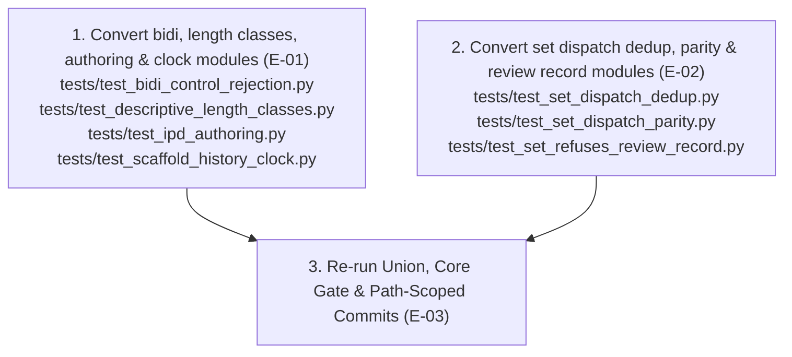

# IPD: Move setter, runner-lane and first-half unmatched test data chunk 1 of 7 onto the record builder

- Date: 2026-11-09
- Kind: child
- Concern: Spec `4sd62s` section 6 requires that test data be written by ONE shared record builder in phase B, so that the cutover (Order 13, `cxxmyv`) changes the builder and not hundreds of test files, and C10a requires the suite to pass at every commit. Research `nj8zdp` and the maintainer's ruling ("plans that obtuse and not-too-smart agents won't mess up") set the guidance of at most 5 E-items, 8 work Scope-Paths and about 8 named units per item; `1upea0` named up to 25 modules per batch item. This part carries 7 of `1upea0`'s modules (subset G3a; 132 F-01 legacy lines at `3d0ddb845`), each item at most 4 modules, converted by the Order-49 codemod (`653ndz`) plus only its census-counted refusals.
- Scope: Chunk 1 of 7 of `1upea0` (round-3 split 2026-11-09 per research `nj8zdp` guidance): the 7 test modules named in the items and in F-40, each item one codemod run under the batch rule below, plus a finishing item. EXCLUDES: every other module of the subsets (the other chunk plans and `1upea0`); the builder (`9rgn2w`) and the codemod (`653ndz`); the F-03 EXCLUDED modules; production code; the switch-point proof, census and full-suite comparison (`59aiyh` E-11, E-12).
- Scope-Paths: tests/test_bidi_control_rejection.py, tests/test_descriptive_length_classes.py, tests/test_ipd_authoring.py, tests/test_scaffold_history_clock.py, tests/test_set_dispatch_dedup.py, tests/test_set_dispatch_parity.py, tests/test_set_refuses_review_record.py, .aw/records/plans/pending/20261109-metastore-203-2ll84l-move-setter-runner-lane-and-first-half-unmatched-test-data-c.ipd.md
- Item-Dependencies: executed:653ndz, executed:9rgn2w, executed:g5hpbb, executed:tve77h, executed:xexn45
- Status: approved
- Readiness: go-pending-approval
- Review-Depth: complex
- From-Spec: 4sd62s
- Work-Kind: feature
- Priority: high
- Blocks-Release: next
- Set: metastore
- Order: 203
- Highest E allocated: 03
- Author: opencode its_direct/pt3-claude-opus-5.5-1m-us
- Id: 2ll84l
- Approval: 2026-11-16, recorded via aw ipd set: status set to approved

> Written to `.aw/system/workflows/technical-writing/technical-writing.md`. Every obligation, exact identifier, quotation, evidence record, and lifecycle status is preserved.

## Workflow history
- 2026-11-16 approved (aw set): status set to approved

- 2026-11-14 reviewed (aw set): APPROVE WITH REVISIONS APPLIED; PR-001..PR-005 FIXED
- 2026-11-14 /plan-review (antigravity/gemini): APPROVE WITH REVISIONS APPLIED; PR-001..PR-005 FIXED; review record .aw/records/reviews/20261109-metastore-203-2ll84l-move-setter-runner-lane-and-first-half-unmatched-test-data-c.review.md
- 2026-11-09 to-review (opencode its_direct/pt3-claude-opus-5.5-1m-us): split from 1upea0 (round 3, research nj8zdp guidance).

## Goal

Every hand-built record in the 7 test modules named below comes from `tests/record_builder.py`, written by the Order-49 codemod or, for its census-counted refusals only, by hand, with each module's per-test outcomes identical before and after and every remaining legacy string classified.

## Detailed Implementation Checklist (TODO)

Execution-state rule: mark an `E-*` item complete only after performing the action. That mark is not validation. Right-sizing rule: write for a modest executor that cannot hold much in its head. Each E-item is one step (one concern, about one file, executable in one focused pass) and its V-item names each unit it covers with its own check; a plan stays at about 5 E-items and 8 work Scope-Paths, else split it into more child plans (guidance, `IPD-Z603`). Accepted execution states: blocked, failed, pending, performed; terminal gate demands 'performed'.

Batch rule, applied to every batch E-item of this plan (the `59aiyh` batch rule, restructured 2026-11-08 for the Order-49 fixture codemod `653ndz` per maintainer decision 2026-11-07 "Codemod first, then small runs": the tool performs the mechanical rewrite, and the hand work is bounded by its measured refusals). In it, "E-13's `full-before.txt`" and "the builder's `raw_fields=` escape (E-01)" are items of Order 37 (`9rgn2w`), carried by the round-3 split into Order 170 (`j6o96i`) with the same ids; because `.aw/state/` does not travel between lane worktrees, step 2 always records a fresh before list here. Step 1's partition is restricted to the modules each batch item names (round-3 split 2026-11-09: a subset is now spread over several plans of at most 8 modules each): a module that the partition now places in the item's subset but that no plan names is NOT added here; it is reported, and the finishing item of `1upea0` converts it; a named module that no longer matches F-01 is reported and skipped:
1. Before the batch, ensure the state directory exists (`mkdir -p .aw/state/59aiyh`), re-derive its file list with the F-03 first-match partition over the F-01 `rg -l` output at the current HEAD, minus the F-03 EXCLUDED list, and save it as `.aw/state/59aiyh/<batch>-files.txt`. The counts in each E-item are context measured at `0cbfcc706` or `ac76110f4`, not the bar.
2. Record the unmodified per-test outcome list (a batch whose files a previous batch did not touch may reuse the matching lines of E-13's `full-before.txt`): `python3 -m pytest -o addopts="" -m "" -p no:randomly -n 0 -rA $(cat .aw/state/59aiyh/<batch>-files.txt) | grep -E "^(PASSED|FAILED|ERROR|SKIPPED|XFAIL|XPASS) " | sed -E 's/ - .*//' | sort > .aw/state/59aiyh/<batch>-before.txt`. `-p no:randomly` and `-n 0` make the list deterministic; `-m ""` includes `slow` and `livecorpus` modules.
3. Run the codemod: `python3 tools/fixture_codemod.py --apply --format json $(cat .aw/state/59aiyh/<batch>-files.txt) > .aw/state/59aiyh/<batch>-codemod.json`. It rewrites only the sites whose module outcome list it proved identical (`653ndz` E-03, carried with the same id into Order 172, `y3uowx`, by the round-3 split) and lists every other site as a refusal with a reason code and a disposition (`hand` or `legacy-kept`, the `653ndz` reason-code table).
4. Hand-convert ONLY the refusals with disposition `hand`: the static count is the sum of the `653ndz` F-30 rows of the item's modules (round-3 split 2026-11-09: an item now carries part of a subset, so the subset's F-31 row is context only), and the codemod report adds any apply-time `not-equivalent` refusals; the item's hand count is their sum. If the hand count exceeds 25, stop after step 3 (the proved codemod rewrites may be committed), convert nothing by hand, and report the subset for re-splitting. A hand conversion uses builder calls; a test that deliberately writes an INVALID value (an unknown status, `- Status: EXECUTED`, `- Priority: bogus`, a malformed gate) gets it through the builder's `raw_fields=` escape (E-01) and is listed with reason class `invalid-input`. A refusal with disposition `legacy-kept` stays in legacy form on purpose and is listed with its F-06 reason class.
5. Re-run step 2's command into `<batch>-after.txt` and require `diff` to print nothing. A batch that would need any changed assertion other than a raw-byte metadata stand-in moved to `artifact_meta.read` (scope rule) stops and is reported; it does not weaken the assertion.
6. Count the remaining legacy strings with the F-01 `rg` pattern over the batch files, and give each remaining line one reason class from F-06: `legacy-format subject`, `displayed-output assertion`, `setter-byte assertion`, `invalid-input`, or `body prose` (for example open-question `- Status: open` rows, which N3 keeps in Markdown).
7. The builder never reads production source, and no test gains a source-reading assertion.

### Task group 1: batch items

- [x] E-01 (carried from `1upea0` E-01, batch subset G3a; round-3 split 2026-11-09) Batch G3a, 4 of its 12 modules (the setter, scaffold and authoring tests (`test_status*`, `test_set_*`, `test_scaffold*`, `test_ipd_authoring*`, `test_descriptive*`, `test_bidi*`)): `tests/test_bidi_control_rejection.py`, `tests/test_descriptive_length_classes.py`, `tests/test_ipd_authoring.py`, `tests/test_scaffold_history_clock.py`. F-01 legacy lines per module at `3d0ddb845` (context, not the bar): `test_bidi_control_rejection` 2, `test_descriptive_length_classes` 4, `test_ipd_authoring` 14, `test_scaffold_history_clock` 7. Run the codemod on these modules and apply the batch rule with `<batch>` = `G3a-2ll84l-1` (outcome lists identical); hand-convert ONLY the refusals that the `653ndz` F-30 rows of these modules list with disposition `hand`, plus the codemod's apply-time `not-equivalent` refusals, and state their count (at most 25, the batch rule's stop); leave each refusal the census marks `legacy-kept` in legacy form with its reason class. A test that asserts the bytes a SETTER wrote (for example `test_status_set.py` checking the rewritten `- Status:` line) keeps that assertion in phase B, because the written format is the subject. Each such assertion is listed with reason class `setter-byte assertion`, so Order 13 can convert it to `artifact_meta.read` plus the in-file mirror. These modules held no private record-building helper at the split; a helper found now is deleted when it has no caller, or listed with its reason.
  - Depends on: none
  - Expected outcome: an empty before/after `diff` for the `G3a-2ll84l-1` outcome lists; for each named module, its remaining legacy-string count and the reason class of every remaining line pasted; every deleted and surviving helper listed; the codemod report and the hand count (at most 25) pasted.
  - Execution state: performed

- [x] E-02 (carried from `1upea0` E-01, batch subset G3a; round-3 split 2026-11-09) Batch G3a, 3 of its 12 modules (the setter, scaffold and authoring tests (`test_status*`, `test_set_*`, `test_scaffold*`, `test_ipd_authoring*`, `test_descriptive*`, `test_bidi*`)): `tests/test_set_dispatch_dedup.py`, `tests/test_set_dispatch_parity.py`, `tests/test_set_refuses_review_record.py`. F-01 legacy lines per module at `3d0ddb845` (context, not the bar): `test_set_dispatch_dedup` 50, `test_set_dispatch_parity` 48, `test_set_refuses_review_record` 7. Run the codemod on these modules and apply the batch rule with `<batch>` = `G3a-2ll84l-2` (outcome lists identical); hand-convert ONLY the refusals that the `653ndz` F-30 rows of these modules list with disposition `hand`, plus the codemod's apply-time `not-equivalent` refusals, and state their count (at most 25, the batch rule's stop); leave each refusal the census marks `legacy-kept` in legacy form with its reason class. A test that asserts the bytes a SETTER wrote (for example `test_status_set.py` checking the rewritten `- Status:` line) keeps that assertion in phase B, because the written format is the subject. Each such assertion is listed with reason class `setter-byte assertion`, so Order 13 can convert it to `artifact_meta.read` plus the in-file mirror. These modules held no private record-building helper at the split; a helper found now is deleted when it has no caller, or listed with its reason.
  - Depends on: none
  - Expected outcome: an empty before/after `diff` for the `G3a-2ll84l-2` outcome lists; for each named module, its remaining legacy-string count and the reason class of every remaining line pasted; every deleted and surviving helper listed; the codemod report and the hand count (at most 25) pasted.
  - Execution state: performed

### Task group 2: finish

- [x] E-03 Finish this part: run the batch rule's step-2 command once over every module of this plan (`$(cat .aw/state/59aiyh/G3a-2ll84l-1-files.txt .aw/state/59aiyh/G3a-2ll84l-2-files.txt)`) into `.aw/state/59aiyh/2ll84l-union-after.txt` and confirm it equals the sorted concatenation of the items' `-before.txt` lists; run the bare core gate `python3 -m pytest` and `aw sanitize --agent`; commit through `aw commit 2ll84l -- <each changed path>`, one commit per item allowed, never `git add -A`, a bare `git add` or `git commit -a`. Never push. (The full-suite comparison stays in `59aiyh` E-12.)
  - Depends on: E-01, E-02
  - Expected outcome: the union comparison is empty; all runs pass; every commit is path-scoped to Scope-Paths (or justified at finalize).
  - Execution state: performed

## Project conventions discovered (Step 0)

- Interface names from Order 02 (`tve77h`): `artifact_meta.registry_fields(type)`, `artifact_meta.validate_event`, `artifact_meta.validate_new_events(type, events, *, records_root, migration_import=False)`, `artifact_meta.read(id6) -> State`, `artifact_meta.create(...)` and `artifact_meta.append(id6, events, *, expect_seq)`. Order 02's `create`/`append` write the log format; `2xwb9b` E-03 adds the phase-B legacy branch of `append` and `xexn45` E-01 routes the phase-B branch of `create` and `append` through `write_legacy`, with `render_legacy_text(text, events)` (`xexn45` E-11) as the same renderer over a string. In phase B the on-disk format is the bullet format; the legacy loader reads it into the cache.
- `review_findings.render_review` (pure) and `review_findings.write_review` render and write a `.review.md` record; no CLI calls `write_review` (`xexn45` Findings).
- The existing shared plan builder is `support.ready_plan_text`, which is "BUILT FROM THE REAL GENERATOR (`ipd_authoring.build_skeleton`)" and then fills the fields a draft leaves open; the builder keeps that approach for plans, so a scaffold change still reaches every fixture.
- Shared test plumbing lives in `tests/support.py` (`init_repo`, `git`, `run_cli`, `pinned_env`, `ready_plan_text`, `scope_drift_repo`); `tests/repo_template.py` (`copy_template_repo`) gives a pre-built repository; there is no `tests/conftest.py`, and the root `conftest.py` owns tier selection.
- Tests are behavioral (AGENTS.md "TEST OUTCOMES, NOT CODE STRUCTURE"); core modules set `pytestmark = pytest.mark.core`; `slow` tests are listed in `tests/slow_allowlist.txt`; `pyproject.toml` `addopts` deselects `slow` and `livecorpus`, so a complete comparison passes `-m ""`, and `pytest-randomly` is installed, so a deterministic order needs `-p no:randomly`.
- `tests/fixtures/review-pilot/` is the input corpus of `tools/review_pilot.py` (`manifest.json` names each plan file, `defects.json` quotes exact text to plant), and `tests/test_review_pilot.py` copies the whole directory into its fixture repository.
- Filenames come from `artifact_naming.build_clustered_name` and parse with `artifact_naming.parse_clustered`.
- Cite code by SYMBOL (`module.function`) or by a quoted content string, with a line number only appended to one of those and never alone: an offset expires before this plan executes (spec `ipd-structure-and-linting` Section 10.2; advisory `IPD-C801`).

## Findings

Measured 2026-11-09 at `3d0ddb845` for F-40; F-01, F-03, F-06 and F-08 copied from `1upea0` (measured at `0cbfcc706` and at review).

| Id | Evidence | Finding |
|---|---|---|
| F-01 | `rg -l --glob '*.py' -e '- (Id|Status|Set|Kind|Blocks-Release|Readiness|Item-Dependencies|Scope-Paths|From-Backlog|From-Spec|Work-Kind|Priority|Order|Date|Gate-Kind|Gate-Ref|Approval|Subject-Id|Verdict|Graduated-To):|## Workflow history' tests` lists 309 files (307 test modules, `support.py`, `conformance_matrix.py`) of 717 Python files; 6,638 matching lines. The narrower `- Id:`/`- Status:`/`## Workflow history` pattern: 300 files, 3,430 lines | Spec section 6 counted 268 of 680 files and 2,607 matches at round 2; the plan's pattern is broader (21 fields). |
| F-03 | Family split by filename prefix, re-measured at review (HEAD `4a7499289`, 311 files, 6,657 lines) with a FIRST-MATCH rule (a file goes to the first group, in order G1 to G6, whose pattern list matches its basename; unmatched files go to G7): G1 39 files, 1,568 lines; G2 22, 1,102; G3 28, 795; G4 63, 1,244; G5 46, 598; G6 69, 1,004; G7 44, 346. Six files match two groups and are assigned by that rule (`test_ipd_authoring` G3, `test_readiness_absence_invariant` G4, `test_runner_backlog_close_behavior` G1, `test_orchestrator_retire_closes_backlog` G1, `test_records_only_lane_rederive` G5, `test_ipdrunner_runagy_shim` G4). The authored counts (G6 99, G7 11) did not sum to the file total; the first-match rule makes the partition exhaustive and disjoint. EXCLUDED from every batch (literal legacy input is their subject; owned by other plans): `tests/test_artifact_meta_*.py` (`tve77h`, `2xwb9b`), `tests/test_artifact_meta_legacy_writer.py` and `tests/test_writers_*.py` (`xexn45`), `tests/test_m0001_*.py` and `tests/test_migrations_chain.py` (`dcerjg`, `ya4ee4`) | Seven batches (E-03 to E-09); G1, G4 and G6 carry a pre-measured split seam (OQ-01). |
| F-06 | (written by E-11) remaining legacy strings in `tests/` after the batches, each with one reason class: `legacy-format subject`, `displayed-output assertion`, `setter-byte assertion`, `invalid-input`, `body prose` | Order 13 changes the builder plus the F-06 rows of class `setter-byte assertion`; `invalid-input` rows already go through `raw_fields=` and need a decision at the cutover (an invalid bullet has no log-format equivalent); every other class is either a legacy-format test (moved to the migration tests at the cutover) or prose. |
| F-08 | At review, 15 test modules write a deliberately invalid metadata value (for example `tests/test_releases.py` "`- Status: bogus`", `tests/test_check_engine.py` "`- Status: EXECUTED`", `tests/test_specs_set_adapter.py` "`- Priority: bogus`") | A builder that validates every field cannot build these; E-01 adds `raw_fields=` and the batch rule lists them as `invalid-input`. |
| F-40 | `rg -c` with the F-01 pattern over this part's modules at `3d0ddb845`; subset by the F-03 first-match rule; helpers as listed by `1upea0` at the 2026-11-07 split | See the table below; every module is named in exactly one item. |
| F-41 | pytest measured at f00424716 (119 passed across the 7 modules: test_bidi_control_rejection.py 19, test_descriptive_length_classes.py 6, test_ipd_authoring.py 31, test_scaffold_history_clock.py 8, test_set_dispatch_dedup.py 10, test_set_dispatch_parity.py 40, test_set_refuses_review_record.py 5) | Baseline test count for this chunk's target modules before conversion. |

| Module | Subset | F-01 lines | Helpers at the split | Item |
|---|---|---|---|---|
| `tests/test_bidi_control_rejection.py` | G3a | 2 | none | E-01 |
| `tests/test_descriptive_length_classes.py` | G3a | 4 | none | E-01 |
| `tests/test_ipd_authoring.py` | G3a | 14 | none | E-01 |
| `tests/test_scaffold_history_clock.py` | G3a | 7 | none | E-01 |
| `tests/test_set_dispatch_dedup.py` | G3a | 50 | none | E-02 |
| `tests/test_set_dispatch_parity.py` | G3a | 48 | none | E-02 |
| `tests/test_set_refuses_review_record.py` | G3a | 7 | none | E-02 |

## Proposed changes (ordered, validatable)

1. Convert each item's modules under the batch rule (E-01 to E-02).
2. Re-run the union, the core gate, commit (E-03).

## Deferred / out of scope (with reason)

- The other modules of subset G3a, the partition re-derivation that catches modules no plan names, and the subsets' finishing checks.
  - Carrier: 1upea0
- The fixture codemod and its census (F-30, F-31).
  - Carrier: 653ndz
  - Carrier-Evidence: .aw/records/plans/executed/20261108-metastore-49-653ndz-build-and-prove-the-test-fixture-codemod.ipd.md
- The builder, its tests, the baselines and the tracked fixtures.
  - Carrier: 9rgn2w
  - Carrier-Evidence: .aw/records/plans/executed/20261107-metastore-37-9rgn2w-add-the-shared-test-record-builder-and-convert-the-tracked-r.ipd.md
- The switch-point proof, the F-06 census and the full-suite comparison.
  - Carrier: 59aiyh
- Adding `RECORD_FORMAT = "log"` and converting setter-byte assertions (cutover commit).
  - Carrier: cxxmyv

## Scope check

- Over-scope: none. No production module changes; every Scope-Paths entry is a module named in one item, plus this plan.
- Under-scope: none known. Size: 3 E-items (2 batch items of at most 4 modules each and the finish), 7 work Scope-Paths.

## Required tests / validation

Each item is validated by an identical per-test result list before and after (the batch rule), which is behavioral by construction: the same tests, unchanged assertions, the same outcomes (119 passed total across the 7 modules: 19, 6, 31, 8, 10, 40, 5). Commands: the batch rule's command per item, the codemod's `--apply` report, the bare core gate `python3 -m pytest`, `aw sanitize --agent`. CONTRIBUTES to AC-1b (owned by `cxxmyv`).

## Spec / documentation sync

No spec change; implements part of `4sd62s` section 6 and section 7 step 6.

## Open questions

### OQ-01: Can this part run in any order relative to the other chunk plans?

- Blocking: no
- Status: resolved
- Owner: plan author
- Resolution or deferral rationale: Yes. The module lists of all chunk plans are disjoint, each needs the builder (`9rgn2w`) and the codemod (`653ndz`), and none edits `tests/support.py` (that is `59aiyh` E-09, which runs last). Recommendation strength: strong.

## Validation and cross-check (verify before reporting done)

Validation-state rule: inspect evidence in a separate pass. Do not mark a `V-*` item complete from memory or from the matching execution checkmark. Accepted validation results: blocked, failed, pass, pending; terminal gate demands 'pass'. Runtime-demonstration reachability rule: for each `V-*` item demanding the software be observed acting (such as a run, a dispatch, or a transition), as distinct from items demanding a diff, a file's content, or a test result, which are reachable by construction, name the code path that produces the observation or the sibling `E-*` that creates it, else the demand is UNDER-SCOPE.

- [x] V-01 validates E-01
  - Required evidence: paste `.aw/state/59aiyh/G3a-2ll84l-1-files.txt` and the empty `diff .aw/state/59aiyh/G3a-2ll84l-1-before.txt .aw/state/59aiyh/G3a-2ll84l-1-after.txt`; then, for each of `tests/test_bidi_control_rejection.py`, `tests/test_descriptive_length_classes.py`, `tests/test_ipd_authoring.py`, `tests/test_scaffold_history_clock.py` separately: its before and after F-01 `rg -c` count, the reason class of every remaining match, its rows of `.aw/state/59aiyh/G3a-2ll84l-1-codemod.json` (rewrites, refusals by reason code and disposition, before and after outcome-list hashes) and its `653ndz` F-30 row; the hand count with every hand-converted site listed (module, line, reason code), and the list of setter-byte assertions kept for Order 13 (file::test and the asserted line); and the before and after helper census of the E-09 `rg` pattern over these modules with each deleted and surviving helper and its reason.
  - Observed evidence:
    - `.aw/state/59aiyh/G3a-2ll84l-1-files.txt`:
      - `tests/test_bidi_control_rejection.py`
      - `tests/test_descriptive_length_classes.py`
      - `tests/test_ipd_authoring.py`
      - `tests/test_scaffold_history_clock.py`
    - Partition check at starting HEAD `75cc37c81ea30f0ce260be54c23de9a567c9345f`: all 4 named modules matched F-01 before conversion; 0 unnamed G3a modules matched F-01 at HEAD.
    - Outcome diff (`diff -u .aw/state/59aiyh/G3a-2ll84l-1-before.txt .aw/state/59aiyh/G3a-2ll84l-1-after.txt`): empty output, exit code 0 (64 `PASSED` outcomes).
    - Per-module F-01 counts, remaining classifications, codemod rows, and `653ndz` F-30 rows:
      - `tests/test_bidi_control_rejection.py`:
        - F-01 `rg -c`: before 2, after 0. Remaining matches: none.
        - Codemod JSON row (`.aw/state/59aiyh/G3a-2ll84l-1-codemod.json`): `sites=1`, `rewrites=0` (`standard=0`, `invalid-input=0`), `refusals=1` (`unsupported-shape=1`, `hand=1`, `legacy-kept=0`), `before_hash=null`, `after_hash=null`, `equivalent=true`, `pytest_runs=0`, `changed=false`.
        - `653ndz` F-30 row: `G3a | 2ll84l | 1 | 0 | 0 | 0 | 1 | 0 | 0 | 0 | 0 | 0 | 1 | 0`.
      - `tests/test_descriptive_length_classes.py`:
        - F-01 `rg -c`: before 4, after 0. Remaining matches: none. (`_spec_with_metadata` routes all 4 calls through `RecordBuilder().spec(..., raw_fields=..., text_only=True)`, including `invalid-input` over-length `Summary` 301 chars, `Scope` 4301 chars, and `hostile_scope` 4313 chars.)
        - Codemod JSON row (`.aw/state/59aiyh/G3a-2ll84l-1-codemod.json`): `sites=1`, `rewrites=0` (`standard=0`, `invalid-input=0`), `refusals=1` (`unsupported-shape=1`, `hand=1`, `legacy-kept=0`), `before_hash=null`, `after_hash=null`, `equivalent=true`, `pytest_runs=0`, `changed=false`.
        - `653ndz` F-30 row: `G3a | 2ll84l | 1 | 0 | 0 | 0 | 1 | 0 | 0 | 0 | 0 | 0 | 1 | 0`.
      - `tests/test_ipd_authoring.py`:
        - F-01 `rg -c`: before 14, after 10. Remaining matches (10):
          - `setter-byte assertion` (6, all `legacy-kept` in codemod): `ScaffoldTests::test_scaffold_emits_scope_paths_stub` line 117 (`any(ln.startswith("- Scope-Paths:") for ln in meta_lines),`); `ScaffoldTests::test_scaffold_emits_unique_valid_id._scaffold` line 167 (`m = _re.search(r"(?m)^- Id: ([0-9a-z]{6})$", target.read_text())`); `SyncTests::test_sync_backfills_missing_id_and_leaves_present_id` line 419 (`m0 = _re.search(r"(?m)^- Id: ([0-9a-z]{6})$", t)`), line 427 (`m1 = _re.search(r"(?m)^- Id: ([0-9a-z]{6})$", t_after)`), and line 432 (`ids = _re.findall(r"(?m)^- Id: ([0-9a-z]{6})$", self.path.read_text())`); `SyncTests::test_sync_backfills_id_on_approved_plan_without_touching_structure` line 454 (`m = _re.search(r"(?m)^- Id: ([0-9a-z]{6})\n", after)`).
          - `legacy-format subject` (1, `legacy-kept` in codemod): `SyncTests::test_sync_backfills_missing_id_and_leaves_present_id` line 422 (`t_noid = _re.sub(r"(?m)^- Id: [0-9a-z]{6}\n", "", t)`; strips `- Id:` from freshly scaffolded plan to test `run_sync` legacy backfill).
          - `body prose` (3 comments): line 150 (`# plans-adopter Order 02: scaffold emits a valid, collision-checked '- Id:'.`), line 415 (`# plans-adopter Order 02: sync backfills a missing '- Id:', leaves an existing one.`), line 661 (`# Assertion 3: editing example question heading to a real heading with - Status: open`).
        - Codemod JSON row (`.aw/state/59aiyh/G3a-2ll84l-1-codemod.json`): `sites=13`, `rewrites=0` (`standard=0`, `invalid-input=0`), `refusals=13` (`unsupported-shape=4`, `setter-byte assertion=1`, `body prose=8`, `hand=4`, `legacy-kept=9`), `before_hash=null`, `after_hash=null`, `equivalent=true`, `pytest_runs=0`, `changed=false`.
        - `653ndz` F-30 row: `G3a | 2ll84l | 13 | 0 | 0 | 0 | 4 | 0 | 0 | 0 | 1 | 8 | 4 | 9`.
      - `tests/test_scaffold_history_clock.py`:
        - F-01 `rg -c`: before 7, after 7 (unmodified; every plan in this module is produced by `ipd_authoring.run_scaffold` with no hand-built record fixtures). Remaining matches (7):
          - `setter-byte assertion` (3): `ScaffoldHistoryClockTests::_extract_plan_details` line 98 (`if line.startswith("- Date:"):`) and line 100 (`elif line.startswith("- Id:"):`) reading back `run_scaffold` output; `ScaffoldHistoryClockTests::_run_state_check` line 176 (`f"- Date: field must be local {local_date}, got {front_date}",`, `legacy-kept`).
          - `body prose` (4 docstrings/comments): lines 5, 10, 92, 172.
        - Codemod JSON row (`.aw/state/59aiyh/G3a-2ll84l-1-codemod.json`): `sites=3`, `rewrites=0` (`standard=0`, `invalid-input=0`), `refusals=3` (`unsupported-shape=2`, `setter-byte assertion=1`, `hand=2`, `legacy-kept=1`), `before_hash=null`, `after_hash=null`, `equivalent=true`, `pytest_runs=0`, `changed=false`.
        - `653ndz` F-30 row: `G3a | 2ll84l | 3 | 0 | 0 | 0 | 2 | 0 | 0 | 0 | 1 | 0 | 2 | 1`.
    - Hand count: 8 reported by codemod (8 static + 0 apply-time `not-equivalent`; <= 25; 6 fixture sites hand-converted to `RecordBuilder`, 2 non-fixture readback sites classified and retained as `setter-byte assertion`):
      1. `tests/test_bidi_control_rejection.py` pre-edit lines 179-184 (`BidiConsumerSurfacesTests.test_consumer_releases_validate_release_prose_rejects_bidi`, `unsupported-shape`): hand-converted to `RecordBuilder().release(id6="rel001", version="1.0.0", status="planned", summary="", body=..., text_only=True)`.
      2. `tests/test_descriptive_length_classes.py` pre-edit lines 31-41 (`_SPEC_TEMPLATE`, `unsupported-shape`): removed `_SPEC_TEMPLATE` and hand-converted all 4 callers to `_spec_with_metadata` delegating to `RecordBuilder().spec(..., raw_fields=..., text_only=True)` (`invalid-input` for over-length/hostile cases).
      3. `tests/test_ipd_authoring.py` pre-edit line 441 (`SyncTests.test_sync_backfills_id_on_approved_plan_without_touching_structure`, `unsupported-shape`): hand-converted to `RecordBuilder().plan(..., status="approved", raw_fields={"id": None}, text_only=True)` (`invalid-input` missing `Id`).
      4. `tests/test_ipd_authoring.py` pre-edit line 500 site 1 (`SyncTests.test_refuses_when_approved`, `unsupported-shape`): `"- Status: draft"` replacement hand-converted to `RecordBuilder().plan(..., status="approved", approval="approved by x 2026-08-03", text_only=True)`.
      5. `tests/test_ipd_authoring.py` pre-edit line 500 site 2 (`SyncTests.test_refuses_when_approved`, `unsupported-shape`): `"- Status: approved"` replacement hand-converted in the same `RecordBuilder().plan(...)` call.
      6. `tests/test_ipd_authoring.py` pre-edit line 503 (`SyncTests.test_refuses_when_approved`, `unsupported-shape`): `"- Approval: approved by x 2026-08-03\n- Author: tester"` replacement hand-converted in the same `RecordBuilder().plan(...)` call.
      7. `tests/test_scaffold_history_clock.py` line 98 (`ScaffoldHistoryClockTests._extract_plan_details`, `unsupported-shape`): `if line.startswith("- Date:"):` — non-fixture readback of `run_scaffold` output, retained as `setter-byte assertion`.
      8. `tests/test_scaffold_history_clock.py` line 100 (`ScaffoldHistoryClockTests._extract_plan_details`, `unsupported-shape`): `elif line.startswith("- Id:"):` — non-fixture readback of `run_scaffold` output, retained as `setter-byte assertion`.
    - Setter-byte assertions kept for Order 13 (9):
      - `tests/test_ipd_authoring.py::ScaffoldTests::test_scaffold_emits_scope_paths_stub`: `any(ln.startswith("- Scope-Paths:") for ln in meta_lines),` (line 117)
      - `tests/test_ipd_authoring.py::ScaffoldTests::test_scaffold_emits_unique_valid_id`: `m = _re.search(r"(?m)^- Id: ([0-9a-z]{6})$", target.read_text())` (line 167)
      - `tests/test_ipd_authoring.py::SyncTests::test_sync_backfills_missing_id_and_leaves_present_id`: `m0 = _re.search(r"(?m)^- Id: ([0-9a-z]{6})$", t)` (line 419), `m1 = _re.search(r"(?m)^- Id: ([0-9a-z]{6})$", t_after)` (line 427), `ids = _re.findall(r"(?m)^- Id: ([0-9a-z]{6})$", self.path.read_text())` (line 432)
      - `tests/test_ipd_authoring.py::SyncTests::test_sync_backfills_id_on_approved_plan_without_touching_structure`: `m = _re.search(r"(?m)^- Id: ([0-9a-z]{6})\n", after)` (line 454)
      - `tests/test_scaffold_history_clock.py::ScaffoldHistoryClockTests::_extract_plan_details`: `if line.startswith("- Date:"):` (line 98), `elif line.startswith("- Id:"):` (line 100)
      - `tests/test_scaffold_history_clock.py::ScaffoldHistoryClockTests::_run_state_check`: `f"- Date: field must be local {local_date}, got {front_date}",` (line 176)
    - Helper census (`rg -n "def _?(make|write|build|mk|seed)_(plan|spec|backlog|item|record|ipd|release|research|prompt|review|walkthrough)\w*"`):
      - Before: `(none)` (0 matches).
      - After: `(none)` (0 matches).
      - Deleted helpers (0): none (`_SPEC_TEMPLATE` string template constant removed).
      - Surviving module-local helpers outside the E-09 regex (1): `tests/test_descriptive_length_classes.py::_spec_with_metadata` (4 active callers; thin wrapper delegating to `RecordBuilder().spec(...)` with zero F-01 legacy strings).
  - Result: pass

- [x] V-02 validates E-02
  - Required evidence: paste `.aw/state/59aiyh/G3a-2ll84l-2-files.txt` and the empty `diff .aw/state/59aiyh/G3a-2ll84l-2-before.txt .aw/state/59aiyh/G3a-2ll84l-2-after.txt`; then, for each of `tests/test_set_dispatch_dedup.py`, `tests/test_set_dispatch_parity.py`, `tests/test_set_refuses_review_record.py` separately: its before and after F-01 `rg -c` count, the reason class of every remaining match, its rows of `.aw/state/59aiyh/G3a-2ll84l-2-codemod.json` (rewrites, refusals by reason code and disposition, before and after outcome-list hashes) and its `653ndz` F-30 row; the hand count with every hand-converted site listed (module, line, reason code), and the list of setter-byte assertions kept for Order 13 (file::test and the asserted line); and the before and after helper census of the E-09 `rg` pattern over these modules with each deleted and surviving helper and its reason.
  - Observed evidence:
    - `.aw/state/59aiyh/G3a-2ll84l-2-files.txt`:
      - `tests/test_set_dispatch_dedup.py`
      - `tests/test_set_dispatch_parity.py`
      - `tests/test_set_refuses_review_record.py`
    - Partition check at starting HEAD `75cc37c81ea30f0ce260be54c23de9a567c9345f`: all 3 named modules matched F-01 before conversion; 0 unnamed G3a modules matched F-01 at HEAD.
    - Outcome diff (`diff -u .aw/state/59aiyh/G3a-2ll84l-2-before.txt .aw/state/59aiyh/G3a-2ll84l-2-after.txt`): empty output, exit code 0 (55 `PASSED` outcomes).
    - Per-module F-01 counts, remaining classifications, codemod rows, and `653ndz` F-30 rows:
      - `tests/test_set_dispatch_dedup.py`:
        - F-01 `rg -c`: before 50, after 27. Remaining matches (27):
          - `displayed-output assertion` (9, `legacy-kept` per codemod): lines 529, 531, 562, 593, 622, 650, 678, 709, 738 (asserting `inherited - Blocks-Release:` presence/absence in `proc.stdout`).
          - `setter-byte assertion` (16, `legacy-kept` per codemod): lines 534, 535, 565, 566, 595, 596, 624, 625, 652, 653, 680, 681, 711, 712, 740, 741 (asserting `- From-Backlog:` and `- Blocks-Release:` lines in spec `content`).
          - `body prose` (2 docstrings): line 16 (`(d) existing - Blocks-Release: on artifact is preserved on both spellings.`) and line 628 (`"""(d) an artifact that already carries a - Blocks-Release: keeps its own value on both spellings."""`).
        - Codemod JSON row (`.aw/state/59aiyh/G3a-2ll84l-2-codemod.json`): `sites=30`, `rewrites=4` (`standard=4`, `invalid-input=0`), `refusals=26` (`dynamic-construction=1`, `displayed-output assertion=9`, `setter-byte assertion=16`, `hand=1`, `legacy-kept=25`), `before_hash=96ef274000aa10460f0b8e13d9794494781f24442ac29cfd904bf2b30e3f26ef`, `after_hash=96ef274000aa10460f0b8e13d9794494781f24442ac29cfd904bf2b30e3f26ef`, `equivalent=true`, `pytest_runs=2`, `changed=true`.
        - `653ndz` F-30 row: `G3a | 2ll84l | 30 | 4 | 0 | 1 | 0 | 0 | 0 | 9 | 16 | 0 | 1 | 25`.
      - `tests/test_set_dispatch_parity.py`:
        - F-01 `rg -c`: before 48, after 17. Remaining matches (17):
          - `setter-byte assertion` (16: 14 `legacy-kept` per codemod plus 2 readback lines in `_get_newest_inline_record`): lines 410, 506, 612, 664, 757, 758, 816, 817, 1538, 1739, 1792, 1885, 2269, 2271, 3034, 3052.
          - `body prose` (1 docstring): line 369 (`"""Both spellings write identical - Status: <status> value."""`).
        - Codemod JSON row (`.aw/state/59aiyh/G3a-2ll84l-2-codemod.json`): `sites=35`, `rewrites=1` (`standard=1`, `invalid-input=0`), `refusals=34` (`unsupported-shape=19`, `not-equivalent=1`, `setter-byte assertion=14`, `hand=20`, `legacy-kept=14`), `before_hash=dc2429626c6d5c0512f8ec33adbb7c83b0d3cd531d6f2aa38ba6933537e377d3`, `after_hash=dc2429626c6d5c0512f8ec33adbb7c83b0d3cd531d6f2aa38ba6933537e377d3`, `equivalent=true`, `pytest_runs=4`, `changed=true`.
        - `653ndz` F-30 row: `G3a | 2ll84l | 35 | 2 | 0 | 0 | 19 | 0 | 0 | 0 | 14 | 0 | 19 | 14`.
      - `tests/test_set_refuses_review_record.py`:
        - F-01 `rg -c`: before 7, after 1. Remaining matches (1):
          - `setter-byte assertion` (1, `legacy-kept` per codemod): `test_set_positive_control_backlog_item` line 180 (`assert "- Status: parked" in parked_text`).
        - Codemod JSON row (`.aw/state/59aiyh/G3a-2ll84l-2-codemod.json`): `sites=3`, `rewrites=2` (`standard=2`, `invalid-input=0`), `refusals=1` (`setter-byte assertion=1`, `hand=0`, `legacy-kept=1`), `before_hash=817056aacc69e574538c33687cd0c90c941061a6dc524fa1b33a85cb927102a0`, `after_hash=817056aacc69e574538c33687cd0c90c941061a6dc524fa1b33a85cb927102a0`, `equivalent=true`, `pytest_runs=2`, `changed=true`.
        - `653ndz` F-30 row: `G3a | 2ll84l | 3 | 2 | 0 | 0 | 0 | 0 | 0 | 0 | 1 | 0 | 0 | 1`.
    - Hand count: 21 reported by codemod (20 static + 1 apply-time `not-equivalent`; <= 25; 19 fixture sites hand-converted to `RecordBuilder`, 2 non-fixture readback sites classified and retained as `setter-byte assertion`):
      1. `tests/test_set_dispatch_dedup.py` pre-edit lines 73-80 (`_setup_test_repo`, `dynamic-construction`): conditional `Blocks-Release` backlog fixture hand-converted to `RecordBuilder().backlog(id6="bkl001", ..., blocks_release="relaaa" if with_gate else None, history=["- 2026-09-30 open (tester): created"], text_only=True)`.
      2. `tests/test_set_dispatch_parity.py` pre-edit lines 108-157 (`_write_conforming_plan`, `not-equivalent`): hand-converted to `RecordBuilder().plan(id6=id6, ..., status="to-review", from_backlog=backlog_id6, body=body, raw_fields={"Concern": "Test concern.", "Scope": "Test scope."}, text_only=True)` preserving the conforming non-TODO checklist body required by graduation checks.
      3. `tests/test_set_dispatch_parity.py` pre-edit lines 225, 226, 229, 232, 233, 234, 239, 241, 242 (9 sites in `_create_backlog_item`, `unsupported-shape`): hand-converted the entire helper body to `RecordBuilder().backlog(id6=item_id, status=status, set_name=set_id, priority=priority, work_kind=work_kind, summary="Parity test item", when="2026-09-28", blocks_release=blocks_release, gate_kind=gate_kind, gate_ref=gate_ref, history=..., text_only=True)`.
      4. `tests/test_set_dispatch_parity.py` pre-edit lines 287, 288, 291, 294, 295, 300, 302, 303 (8 sites in `_create_spec`, `unsupported-shape`): hand-converted the entire helper body to `RecordBuilder().spec(id6=spec_id, title=f"Parity Spec {spec_id}", status=status, set_name=set_id, when="2026-10-01", work_kind=work_kind, priority=priority, blocks_release=blocks_release, gate_kind=gate_kind, gate_ref=gate_ref, history=..., body="", raw_fields={"Scope": "Parity testing"}, text_only=True)`.
      5. `tests/test_set_dispatch_parity.py` pre-edit lines 2278 and 2280 (post-edit lines 2269 and 2271, 2 sites in `TestSetEntryConvergence._get_newest_inline_record`, `unsupported-shape`): `if "## Workflow history" not in text:` and `after = support.final_section(text, "## Workflow history", next_marker="## ")` — non-fixture readback inspecting inline history written by `aw backlog set`/`aw specs set`, retained as `setter-byte assertion`.
    - Setter-byte assertions kept for Order 13 (33):
      - `tests/test_set_dispatch_dedup.py::TestFromBacklogInheritanceDedup::test_inheritance_specs_set_status_notice_prefix`: `self.assertIn("- From-Backlog: bkl001\n", content)` (line 534), `self.assertIn("- Blocks-Release: relaaa\n", content)` (line 535)
      - `tests/test_set_dispatch_dedup.py::TestFromBacklogInheritanceDedup::test_inheritance_specs_set_positional_notice_prefix`: `self.assertIn("- From-Backlog: bkl001\n", content)` (line 565), `self.assertIn("- Blocks-Release: relaaa\n", content)` (line 566)
      - `tests/test_set_dispatch_dedup.py::TestFromBacklogInheritanceDedup::test_inheritance_explicit_blocks_release_wins`: `self.assertIn("- From-Backlog: bkl001\n", content)` (lines 595, 624), `self.assertNotIn("- Blocks-Release:", content)` (lines 596, 625)
      - `tests/test_set_dispatch_dedup.py::TestFromBacklogInheritanceDedup::test_inheritance_existing_gate_preserved`: `self.assertIn("- From-Backlog: bkl001\n", content)` (lines 652, 680), `self.assertIn("- Blocks-Release: relorig\n", content)` (lines 653, 681)
      - `tests/test_set_dispatch_dedup.py::TestFromBacklogInheritanceDedup::test_inheritance_resolvable_ungated_backlog_item`: `self.assertIn("- From-Backlog: bklung\n", content)` (lines 711, 740), `self.assertNotIn("- Blocks-Release:", content)` (lines 712, 741)
      - `tests/test_set_dispatch_parity.py::TestBacklogSetDispatchParity::test_backlog_resulting_status_agreement`: `self.assertIn("- Status: done", text)` (line 410)
      - `tests/test_set_dispatch_parity.py::TestBacklogSetDispatchParity::test_backlog_gate_field_clearing_on_transition_out_of_blocked_agreement`: `self.assertIn("- Status: open", text)` (line 506)
      - `tests/test_set_dispatch_parity.py::TestBacklogSetDispatchParity::test_backlog_gate_default_on_bug_transition_to_live_status_agreement`: `self.assertIn("- Blocks-Release: next", text)` (line 612)
      - `tests/test_set_dispatch_parity.py::TestBacklogSetDispatchParity::test_backlog_blocks_release_set_and_cleared_agreement`: `"- Blocks-Release: rel001", moved.read_text(encoding="utf-8")` (line 664)
      - `tests/test_set_dispatch_parity.py::TestBacklogSetDispatchParity::test_backlog_graduated_to_canonicalization_agreement`: `self.assertIn("- Status: graduated", text)` (line 757), `self.assertIn("- Graduated-To: pl0001", text)` (line 758)
      - `tests/test_set_dispatch_parity.py::TestBacklogSetDispatchParity::test_backlog_priority_and_work_kind_writes_agreement`: `self.assertIn("- Priority: high", text)` (line 816), `self.assertIn("- Work-Kind: feature", text)` (line 817)
      - `tests/test_set_dispatch_parity.py::TestSpecsSetDispatchParity::test_specs_resulting_status_and_file_location_agreement`: `self.assertIn("- Status: to-review", moved.read_text(encoding="utf-8"))` (line 1538)
      - `tests/test_set_dispatch_parity.py::TestSpecsSetDispatchParity::test_specs_by_human_authority_floor_refusal_agreement`: `"- Status: approved", spec_after.read_text(encoding="utf-8")` (line 1739)
      - `tests/test_set_dispatch_parity.py::TestSpecsSetDispatchParity::test_specs_blocks_release_set_and_cleared_agreement`: `"- Blocks-Release: rel001", moved.read_text(encoding="utf-8")` (line 1792)
      - `tests/test_set_dispatch_parity.py::TestSpecsSetDispatchParity::test_specs_graduated_to_agreement`: `"- Graduated-To: pl0001", moved.read_text(encoding="utf-8")` (line 1885)
      - `tests/test_set_dispatch_parity.py::TestSetEntryConvergence::_get_newest_inline_record`: `if "## Workflow history" not in text:` (line 2269), `after = support.final_section(text, "## Workflow history", next_marker="## ")` (line 2271)
      - `tests/test_set_dispatch_parity.py::TestSetEntryConvergence::test_hand_built_namespace_shape_path_attribute`: `self.assertIn("- Status: done", moved.read_text(encoding="utf-8"))` (line 3034), `self.assertIn("- Status: to-review", moved.read_text(encoding="utf-8"))` (line 3052)
      - `tests/test_set_refuses_review_record.py::test_set_positive_control_backlog_item`: `assert "- Status: parked" in parked_text` (line 180)
    - Helper census (`rg -n "def _?(make|write|build|mk|seed)_(plan|spec|backlog|item|record|ipd|release|research|prompt|review|walkthrough)\w*"`):
      - Before: `(none)` (0 matches).
      - After: `(none)` (0 matches).
      - Deleted helpers (0): none.
      - Surviving module-local helpers outside the E-09 regex (3, all in `tests/test_set_dispatch_parity.py`, all now delegating to `RecordBuilder` with zero F-01 legacy strings):
        - `_write_conforming_plan` (2 active callers; delegates to `RecordBuilder().plan(...)`)
        - `_create_backlog_item` (36 active callers; delegates to `RecordBuilder().backlog(...)`)
        - `_create_spec` (22 active callers; delegates to `RecordBuilder().spec(...)`)
  - Result: pass

- [x] V-03 validates E-03
  - Required evidence: paste the `diff` of the sorted concatenation of the `-before.txt` lists of `G3a-2ll84l-1`, `G3a-2ll84l-2` against `.aw/state/59aiyh/2ll84l-union-after.txt` (empty), the bare `python3 -m pytest` summary line and wall time, the `aw sanitize --agent` result with zero `fail`, and every `aw commit 2ll84l` output listing only Scope-Paths.
  - Observed evidence:
    - Union diff (`diff -u .aw/state/59aiyh/2ll84l-union-before.txt .aw/state/59aiyh/2ll84l-union-after.txt`, where `2ll84l-union-before.txt` is `sort .aw/state/59aiyh/G3a-2ll84l-1-before.txt .aw/state/59aiyh/G3a-2ll84l-2-before.txt`): empty output, exit code 0 (119 `PASSED` outcomes = 64 + 55 across all 7 modules).
    - Post-edit codemod dry-run over all 7 modules (`python3 tools/fixture_codemod.py --dry-run --format table`): 0 rewrites; 2 modules at `sites=0` (`test_bidi_control_rejection.py`, `test_descriptive_length_classes.py`); 3 modules with 0 `hand` sites and only `legacy-kept` assertions/prose (`test_ipd_authoring.py` 7, `test_set_dispatch_dedup.py` 25, `test_set_refuses_review_record.py` 1); 2 modules with 4 total `unsupported-shape` (`hand`) sites verified to be non-fixture setter-output readback lines (`test_scaffold_history_clock.py` lines 98, 100 and `test_set_dispatch_parity.py` lines 2269, 2271) plus 15 `legacy-kept` setter-byte assertions.
    - Core gate (`aw suite`, running bare `python3 -m pytest` with 6 xdist workers): `2666 passed, 11 warnings in 127.19s (0:02:07)`, exit code 0 (0 failures; none of `2ll84l`'s 7 modules appeared in the top-10 slowest or unlisted slow-tests report).
    - `aw sanitize --agent`: `{"schema":"aw.agent/v1","kind":"result","cmd":"check-local-leaks","outcome":"clean","exit":0,"verified":true,"complete":true,"checked":6885,"findings":0,"evidence":["leak-scan"],"next":null}`.
    - `aw commit 2ll84l` (6 modified test Scope-Paths; `tests/test_scaffold_history_clock.py` left unmodified because it has no hand-built test fixtures and requires `--scope-ack` at finalize): `aw commit: committed 6 path(s): fd33b4dd87358ca3ef184cfb02015ba12b8856e0` (`tests/test_bidi_control_rejection.py`, `tests/test_descriptive_length_classes.py`, `tests/test_ipd_authoring.py`, `tests/test_set_dispatch_dedup.py`, `tests/test_set_dispatch_parity.py`, `tests/test_set_refuses_review_record.py`), followed by the plan-evidence commit via `aw commit 2ll84l -- .aw/records/plans/pending/20261109-metastore-203-2ll84l-move-setter-runner-lane-and-first-half-unmatched-test-data-c.ipd.md`. Every committed path is in Scope-Paths; never pushed.
  - Result: pass

## Approval and execution gate

- Size assessment: standard
- Cohesion rationale: not required

Execute only after human approval (`Status: approved`) and after `653ndz`, `9rgn2w`, `g5hpbb`, `tve77h`, `xexn45` are executed. Every open question is resolved.

Scope fence: the paths in `- Scope-Paths:` are a declaration. A needed test-tree file outside the fence is edited and then justified at finalize (`--scope-reason`), and a declared path left unmodified is acknowledged (`--scope-ack`). Production code under `agent_workflows/` and `tools/` is out of this plan's purpose: if a module cannot keep its outcome list identical without a production change, stop that item and report the missing capability rather than changing production code or an assertion.

Safety rule: Stop and report rather than editing production code outside Scope-Paths or weakening test assertions if an unexpected failure occurs on unmodified code, or if an unresolvable concurrent-edit conflict occurs.

Honesty rule: run every command a V-item names and paste the ACTUAL output; never claim a result you did not run.

Commits: commit only through `aw commit 2ll84l -- <paths>`; never `git add -A`, a bare `git add` or `git commit -a`; never push.

Lifecycle transition: the plan moves to `.aw/records/plans/executed/` only through `aw ipd finalize`, never a hand `git mv`, and only after `aw ipd lint --phase pre-transition` conforms and every `V-*` reads `pass` with pasted evidence. When `aw oc run` or `aw agy run` executes the plan, the runner performs the finalize; a hand executor runs `aw ipd finalize 2ll84l` itself.
