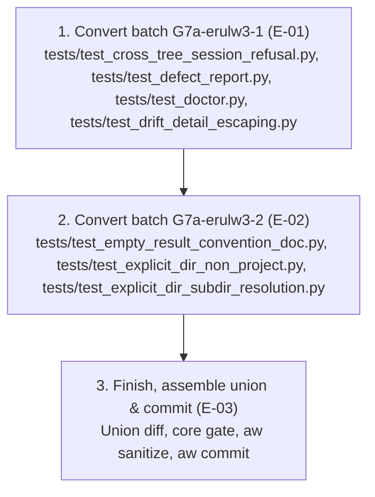

# IPD: Move setter, runner-lane and first-half unmatched test data chunk 7 of 7 onto the record builder

- Date: 2026-11-09
- Kind: child
- Concern: Spec `4sd62s` section 6 requires that test data be written by ONE shared record builder in phase B, so that the cutover (Order 13, `cxxmyv`) changes the builder and not hundreds of test files, and C10a requires the suite to pass at every commit. Research `nj8zdp` and the maintainer's ruling ("plans that obtuse and not-too-smart agents won't mess up") set the guidance of at most 5 E-items, 8 work Scope-Paths and about 8 named units per item; `1upea0` named up to 25 modules per batch item. This part carries 7 of `1upea0`'s modules (subset G7a; 55 F-01 legacy lines at `3d0ddb845`), each item at most 4 modules, converted by the Order-49 codemod (`653ndz`) plus only its census-counted refusals.
- Scope: Chunk 7 of 7 of `1upea0` (round-3 split 2026-11-09 per research `nj8zdp` guidance): the 7 test modules named in the items and in F-40, each item one codemod run under the batch rule below, plus a finishing item. EXCLUDES: every other module of the subsets (the other chunk plans and `1upea0`); the builder (`9rgn2w`) and the codemod (`653ndz`); the F-03 EXCLUDED modules; production code; the switch-point proof, census and full-suite comparison (`59aiyh` E-11, E-12).
- Scope-Paths: tests/test_cross_tree_session_refusal.py, tests/test_defect_report.py, tests/test_doctor.py, tests/test_drift_detail_escaping.py, tests/test_empty_result_convention_doc.py, tests/test_explicit_dir_non_project.py, tests/test_explicit_dir_subdir_resolution.py, .aw/records/plans/pending/20261109-metastore-209-erulw3-move-setter-runner-lane-and-first-half-unmatched-test-data-c.ipd.md
- Item-Dependencies: executed:653ndz, executed:9rgn2w, executed:g5hpbb, executed:tve77h, executed:xexn45
- Status: approved
- Readiness: go-pending-approval
- Review-Depth: complex
- From-Spec: 4sd62s
- Work-Kind: feature
- Priority: high
- Blocks-Release: next
- Set: metastore
- Order: 209
- Highest E allocated: 03
- Author: opencode its_direct/pt3-claude-opus-5.5-1m-us
- Id: erulw3
- Approval: 2026-11-16, recorded via aw ipd set: status set to approved

> Written to .aw/system/workflows/technical-writing/technical-writing.md. Every obligation, exact identifier, quotation, evidence record, and lifecycle status is preserved.

## Workflow history
- 2026-11-16 approved (aw set): status set to approved

- 2026-11-14 reviewed (antigravity/gemini-3.8-flash): /plan-review APPROVE WITH REVISIONS APPLIED; PR-001..PR-005 FIXED; review record .aw/records/reviews/20261109-metastore-209-erulw3-move-setter-runner-lane-and-first-half-unmatched-test-data-c.review.md
- 2026-11-09 to-review (opencode its_direct/pt3-claude-opus-5.5-1m-us): split from 1upea0 (round 3, research nj8zdp guidance).

## Goal

Every hand-built record in the 7 test modules named below comes from `tests/record_builder.py`, written by the Order-49 codemod or, for its census-counted refusals only, by hand, with each module's per-test outcomes identical before and after and every remaining legacy string classified.

## Detailed Implementation Checklist (TODO)

Execution-state rule: mark an `E-*` item complete only after performing the action. That mark is not validation. Right-sizing rule: write for a modest executor that cannot hold much in its head. Each E-item is one step (one concern, about one file, executable in one focused pass) and its V-item names each unit it covers with its own check; a plan stays at about 5 E-items and 8 work Scope-Paths, else split it into more child plans (guidance, `IPD-Z603`). Accepted execution states: blocked, failed, pending, performed; terminal gate demands 'performed'.

Batch rule, applied to every batch E-item of this plan (the `59aiyh` batch rule, restructured 2026-11-08 for the Order-49 fixture codemod `653ndz` per maintainer decision 2026-11-07 "Codemod first, then small runs": the tool performs the mechanical rewrite, and the hand work is bounded by its measured refusals). In it, "E-13's `full-before.txt`" and "the builder's `raw_fields=` escape (E-01)" are items of Order 37 (`9rgn2w`), carried by the round-3 split into Order 170 (`j6o96i`) with the same ids; because `.aw/state/` does not travel between lane worktrees, step 2 always records a fresh before list here. Step 1's partition is restricted to the modules each batch item names (round-3 split 2026-11-09: a subset is now spread over several plans of at most 8 modules each): a module that the partition now places in the item's subset but that no plan names is NOT added here; it is reported, and the finishing item of `1upea0` converts it; a named module that no longer matches F-01 is reported and skipped:
1. Before the batch, create directory `mkdir -p .aw/state/59aiyh/` and re-derive its file list with the F-03 first-match partition over the F-01 `rg -l` output at the current HEAD, minus the F-03 EXCLUDED list, and save it as `.aw/state/59aiyh/<batch>-files.txt`. The counts in each E-item are context measured at `0cbfcc706` or `ac76110f4`, not the bar.
2. Record the unmodified per-test outcome list (a batch whose files a previous batch did not touch may reuse the matching lines of E-13's `full-before.txt`): `python3 -m pytest -o addopts="" -m "" -p no:randomly -n 0 -rA $(cat .aw/state/59aiyh/<batch>-files.txt) | grep -E "^(PASSED|FAILED|ERROR|SKIPPED|XFAIL|XPASS) " | sed -E 's/ - .*//' | sort > .aw/state/59aiyh/<batch>-before.txt`. `-p no:randomly` and `-n 0` make the list deterministic; `-m ""` includes `slow` and `livecorpus` modules.
3. Run the codemod: `python3 tools/fixture_codemod.py --apply --format json $(cat .aw/state/59aiyh/<batch>-files.txt) > .aw/state/59aiyh/<batch>-codemod.json`. It rewrites only the sites whose module outcome list it proved identical (`653ndz` E-03, carried with the same id into Order 172, `y3uowx`, by the round-3 split) and lists every other site as a refusal with a reason code and a disposition (`hand` or `legacy-kept`, the `653ndz` reason-code table).
4. Hand-convert ONLY the refusals with disposition `hand`: the static count is the sum of the `653ndz` F-30 rows of the item's modules (round-3 split 2026-11-09: an item now carries part of a subset, so the subset's F-31 row is context only), and the codemod report adds any apply-time `not-equivalent` refusals; the item's hand count is their sum. If the hand count exceeds 25, stop after step 3 (the proved codemod rewrites may be committed), convert nothing by hand, and report the subset for re-splitting. A hand conversion uses builder calls; a test that deliberately writes an INVALID value (an unknown status, `- Status: EXECUTED`, `- Priority: bogus`, a malformed gate) gets it through the builder's `raw_fields=` escape (E-01) and is listed with reason class `invalid-input`. A refusal with disposition `legacy-kept` stays in legacy form on purpose and is listed with its F-06 reason class.
5. Re-run step 2's command into `<batch>-after.txt` and require `diff` to print nothing. A batch that would need any changed assertion other than a raw-byte metadata stand-in moved to `artifact_meta.read` (scope rule) stops and is reported; it does not weaken the assertion.
6. Count the remaining legacy strings with the F-01 `rg` pattern over the batch files, and give each remaining line one reason class from F-06: `legacy-format subject`, `displayed-output assertion`, `setter-byte assertion`, `invalid-input`, or `body prose` (for example open-question `- Status: open` rows, which N3 keeps in Markdown).
7. The builder never reads production source, and no test gains a source-reading assertion.

### Task group 1: batch items

- [x] E-01 (carried from `1upea0` E-03, batch subset G7a; round-3 split 2026-11-09) Batch G7a, 4 of its 24 modules (the unmatched test modules, first half (basename sorts before `test_l`)): `tests/test_cross_tree_session_refusal.py`, `tests/test_defect_report.py`, `tests/test_doctor.py`, `tests/test_drift_detail_escaping.py`. F-01 legacy lines per module at `3d0ddb845` (context, not the bar): `test_cross_tree_session_refusal` 1, `test_defect_report` 7, `test_doctor` 3, `test_drift_detail_escaping` 32. Ensure `.aw/state/59aiyh/` exists (`mkdir -p .aw/state/59aiyh/`), run the codemod on these modules and apply the batch rule with `<batch>` = `G7a-erulw3-1` (outcome lists identical); hand-convert ONLY the refusals that the `653ndz` F-30 rows of these modules list with disposition `hand`, plus the codemod's apply-time `not-equivalent` refusals, and state their count (at most 25, the batch rule's stop); leave each refusal the census marks `legacy-kept` in legacy form with its reason class. These modules held no private record-building helper at the split; a helper found now is deleted when it has no caller, or listed with its reason.
  - Depends on: none
  - Expected outcome: an empty before/after `diff` for the `G7a-erulw3-1` outcome lists; for each named module, its remaining legacy-string count and the reason class of every remaining line pasted; every deleted and surviving helper listed; the codemod report and the hand count (at most 25) pasted.
  - Execution state: performed

- [x] E-02 (carried from `1upea0` E-03, batch subset G7a; round-3 split 2026-11-09) Batch G7a, 3 of its 24 modules (the unmatched test modules, first half (basename sorts before `test_l`)): `tests/test_empty_result_convention_doc.py`, `tests/test_explicit_dir_non_project.py`, `tests/test_explicit_dir_subdir_resolution.py`. F-01 legacy lines per module at `3d0ddb845` (context, not the bar): `test_empty_result_convention_doc` 2, `test_explicit_dir_non_project` 5, `test_explicit_dir_subdir_resolution` 5. Run the codemod on these modules and apply the batch rule with `<batch>` = `G7a-erulw3-2` (outcome lists identical); hand-convert ONLY the refusals that the `653ndz` F-30 rows of these modules list with disposition `hand`, plus the codemod's apply-time `not-equivalent` refusals, and state their count (at most 25, the batch rule's stop); leave each refusal the census marks `legacy-kept` in legacy form with its reason class. These modules held no private record-building helper at the split; a helper found now is deleted when it has no caller, or listed with its reason.
  - Depends on: none
  - Expected outcome: an empty before/after `diff` for the `G7a-erulw3-2` outcome lists; for each named module, its remaining legacy-string count and the reason class of every remaining line pasted; every deleted and surviving helper listed; the codemod report and the hand count (at most 25) pasted.
  - Execution state: performed

### Task group 2: finish

- [x] E-03 Finish this part: run the batch rule's step-2 command once over every module of this plan (`$(cat .aw/state/59aiyh/G7a-erulw3-1-files.txt .aw/state/59aiyh/G7a-erulw3-2-files.txt)`) into `.aw/state/59aiyh/erulw3-union-after.txt` and confirm it equals the sorted concatenation of the items' `-before.txt` lists; run the bare core gate `python3 -m pytest` and `aw sanitize --agent`; commit through `aw commit erulw3 -- <each changed path>`, one commit per item allowed, never `git add -A`, a bare `git add` or `git commit -a`. Never push. (The full-suite comparison stays in `59aiyh` E-12.)
  - Depends on: E-01, E-02
  - Expected outcome: the union comparison is empty; all runs pass; every commit is path-scoped to Scope-Paths (or justified at finalize).
  - Execution state: performed

## Project conventions discovered (Step 0)

- Interface names from Order 02 (`tve77h`): `artifact_meta.registry_fields(type)`, `artifact_meta.validate_event`, `artifact_meta.validate_new_events(type, events, *, records_root, migration_import=False)`, `artifact_meta.read(id6) -> State`, `artifact_meta.create(...)` and `artifact_meta.append(id6, events, *, expect_seq)`. Order 02's `create`/`append` write the log format; `2xwb9b` E-03 adds the phase-B legacy branch of `append` and `xexn45` E-01 routes the phase-B branch of `create` and `append` through `write_legacy`, with `render_legacy_text(text, events)` (`xexn45` E-11) as the same renderer over a string. In phase B the on-disk format is the bullet format; the legacy loader reads it into the cache.
- `review_findings.render_review` (pure) and `review_findings.write_review` render and write a `.review.md` record; no CLI calls `write_review` (`xexn45` Findings).
- The existing shared plan builder is `support.ready_plan_text`, which is "BUILT FROM THE REAL GENERATOR (`ipd_authoring.build_skeleton`)" and then fills the fields a draft leaves open; the builder keeps that approach for plans, so a scaffold change still reaches every fixture.
- Shared test plumbing lives in `tests/support.py` (`init_repo`, `git`, `run_cli`, `pinned_env`, `ready_plan_text`, `scope_drift_repo`); `tests/repo_template.py` (`copy_template_repo`) gives a pre-built repository; there is no `tests/conftest.py`, and the root `conftest.py` owns tier selection.
- Tests are behavioral (AGENTS.md "TEST OUTCOMES, NOT CODE STRUCTURE"); core modules set `pytestmark = pytest.mark.core`; `slow` tests are listed in `tests/slow_allowlist.txt`; `pyproject.toml` `addopts` deselects `slow` and `livecorpus`, so a complete comparison passes `-m ""`, and `pytest-randomly` is installed, so a deterministic order needs `-p no:randomly`.
- `tests/fixtures/review-pilot/` is the input corpus of `tools/review_pilot.py` (`manifest.json` names each plan file, `defects.json` quotes exact text to plant), and `tests/test_review_pilot.py` copies the whole directory into its fixture repository.
- Filenames come from `artifact_naming.build_clustered_name` and parse with `artifact_naming.parse_clustered`.
- Cite code by SYMBOL (`module.function`) or by a quoted content string, with a line number only appended to one of those and never alone: an offset expires before this plan executes (spec `ipd-structure-and-linting` Section 10.2; advisory `IPD-C801`).

## Findings

Measured 2026-11-09 at `3d0ddb845` for F-40; F-01, F-03, F-06 and F-08 copied from `1upea0` (measured at `0cbfcc706` and at review).

| Id | Evidence | Finding |
|---|---|---|
| F-01 | `rg -l --glob '*.py' -e '- (Id|Status|Set|Kind|Blocks-Release|Readiness|Item-Dependencies|Scope-Paths|From-Backlog|From-Spec|Work-Kind|Priority|Order|Date|Gate-Kind|Gate-Ref|Approval|Subject-Id|Verdict|Graduated-To):|## Workflow history' tests` lists 309 files (307 test modules, `support.py`, `conformance_matrix.py`) of 717 Python files; 6,638 matching lines. The narrower `- Id:`/`- Status:`/`## Workflow history` pattern: 300 files, 3,430 lines | Spec section 6 counted 268 of 680 files and 2,607 matches at round 2; the plan's pattern is broader (21 fields). |
| F-03 | Family split by filename prefix, re-measured at review (HEAD `4a7499289`, 311 files, 6,657 lines) with a FIRST-MATCH rule (a file goes to the first group, in order G1 to G6, whose pattern list matches its basename; unmatched files go to G7): G1 39 files, 1,568 lines; G2 22, 1,102; G3 28, 795; G4 63, 1,244; G5 46, 598; G6 69, 1,004; G7 44, 346. Six files match two groups and are assigned by that rule (`test_ipd_authoring` G3, `test_readiness_absence_invariant` G4, `test_runner_backlog_close_behavior` G1, `test_orchestrator_retire_closes_backlog` G1, `test_records_only_lane_rederive` G5, `test_ipdrunner_runagy_shim` G4). The authored counts (G6 99, G7 11) did not sum to the file total; the first-match rule makes the partition exhaustive and disjoint. EXCLUDED from every batch (literal legacy input is their subject; owned by other plans): `tests/test_artifact_meta_*.py` (`tve77h`, `2xwb9b`), `tests/test_artifact_meta_legacy_writer.py` and `tests/test_writers_*.py` (`xexn45`), `tests/test_m0001_*.py` and `tests/test_migrations_chain.py` (`dcerjg`, `ya4ee4`) | Seven batches (E-03 to E-09); G1, G4 and G6 carry a pre-measured split seam (OQ-01). |
| F-06 | (written by E-11) remaining legacy strings in `tests/` after the batches, each with one reason class: `legacy-format subject`, `displayed-output assertion`, `setter-byte assertion`, `invalid-input`, `body prose` | Order 13 changes the builder plus the F-06 rows of class `setter-byte assertion`; `invalid-input` rows already go through `raw_fields=` and need a decision at the cutover (an invalid bullet has no log-format equivalent); every other class is either a legacy-format test (moved to the migration tests at the cutover) or prose. |
| F-08 | At review, 15 test modules write a deliberately invalid metadata value (for example `tests/test_releases.py` "`- Status: bogus`", `tests/test_check_engine.py` "`- Status: EXECUTED`", `tests/test_specs_set_adapter.py` "`- Priority: bogus`") | A builder that validates every field cannot build these; E-01 adds `raw_fields=` and the batch rule lists them as `invalid-input`. |
| F-40 | `rg -c` with the F-01 pattern over this part's modules at `3d0ddb845`; subset by the F-03 first-match rule; helpers as listed by `1upea0` at the 2026-11-07 split | See the table below; every module is named in exactly one item. |

| Module | Subset | F-01 lines | Helpers at the split | Item |
|---|---|---|---|---|
| `tests/test_cross_tree_session_refusal.py` | G7a | 1 | none | E-01 |
| `tests/test_defect_report.py` | G7a | 7 | none | E-01 |
| `tests/test_doctor.py` | G7a | 3 | none | E-01 |
| `tests/test_drift_detail_escaping.py` | G7a | 32 | none | E-01 |
| `tests/test_empty_result_convention_doc.py` | G7a | 2 | none | E-02 |
| `tests/test_explicit_dir_non_project.py` | G7a | 5 | none | E-02 |
| `tests/test_explicit_dir_subdir_resolution.py` | G7a | 5 | none | E-02 |

## Proposed changes (ordered, validatable)

1. Convert each item's modules under the batch rule (E-01 to E-02): Apply the fixture codemod `tools/fixture_codemod.py` and hand-convert census-counted refusals up to the 25-refusal threshold, verifying identical per-test outcome lists before and after and classifying remaining legacy lines.
2. Re-run the union, the core gate, commit (E-03): Compare the concatenated per-batch outcome lists against the union outcome list, verify with `python3 -m pytest` and `aw sanitize --agent`, and commit with path-scoped `aw commit erulw3`.

## Deferred / out of scope (with reason)

- The other modules of subset G7a, the partition re-derivation that catches modules no plan names, and the subsets' finishing checks.
  - Carrier: 1upea0
- The fixture codemod and its census (F-30, F-31).
  - Carrier: 653ndz
  - Carrier-Evidence: .aw/records/plans/executed/20261108-metastore-49-653ndz-build-and-prove-the-test-fixture-codemod.ipd.md
- The builder, its tests, the baselines and the tracked fixtures.
  - Carrier: 9rgn2w
  - Carrier-Evidence: .aw/records/plans/executed/20261107-metastore-37-9rgn2w-add-the-shared-test-record-builder-and-convert-the-tracked-r.ipd.md
- The switch-point proof, the F-06 census and the full-suite comparison.
  - Carrier: 59aiyh
- Adding `RECORD_FORMAT = "log"` and converting setter-byte assertions (cutover commit).
  - Carrier: cxxmyv

## Scope check

- Over-scope: none. No production module changes; every Scope-Paths entry is a module named in one item, plus this plan.
- Under-scope: none known. Size: 3 E-items (2 batch items of at most 4 modules each and the finish), 7 work Scope-Paths.

## Required tests / validation

Each item is validated by an identical per-test result list before and after (the batch rule), which is behavioral by construction: the same tests, unchanged assertions, the same outcomes. Commands: the batch rule's command per item, the codemod's `--apply` report, the bare core gate `python3 -m pytest`, `aw sanitize --agent`. CONTRIBUTES to AC-1b (owned by `cxxmyv`).

## Spec / documentation sync

No spec change; implements part of `4sd62s` section 6 and section 7 step 6.

## Open questions

### OQ-01: Can this part run in any order relative to the other chunk plans?

- Blocking: no
- Status: resolved
- Owner: plan author
- Resolution or deferral rationale: Yes. The module lists of all chunk plans are disjoint, each needs the builder (`9rgn2w`) and the codemod (`653ndz`), and none edits `tests/support.py` (that is `59aiyh` E-09, which runs last). Recommendation strength: strong.

## Validation and cross-check (verify before reporting done)

Validation-state rule: inspect evidence in a separate pass. Do not mark a `V-*` item complete from memory or from the matching execution checkmark. Accepted validation results: blocked, failed, pass, pending; terminal gate demands 'pass'. Runtime-demonstration reachability rule: for each `V-*` item demanding the software be observed acting (such as a run, a dispatch, or a transition), as distinct from items demanding a diff, a file's content, or a test result, which are reachable by construction, name the code path that produces the observation or the sibling `E-*` that creates it, else the demand is UNDER-SCOPE.

- [x] V-01 validates E-01
  - Required evidence: paste `.aw/state/59aiyh/G7a-erulw3-1-files.txt` and the empty `diff .aw/state/59aiyh/G7a-erulw3-1-before.txt .aw/state/59aiyh/G7a-erulw3-1-after.txt`; then, for each of `tests/test_cross_tree_session_refusal.py`, `tests/test_defect_report.py`, `tests/test_doctor.py`, `tests/test_drift_detail_escaping.py` separately: its before and after F-01 `rg -c` count, the reason class of every remaining match, its rows of `.aw/state/59aiyh/G7a-erulw3-1-codemod.json` (rewrites, refusals by reason code and disposition, before and after outcome-list hashes) and its `653ndz` F-30 row; the hand count with every hand-converted site listed (module, line, reason code); and the before and after helper census of the E-09 `rg` pattern over these modules with each deleted and surviving helper and its reason.
  - Observed evidence:
    - `.aw/state/59aiyh/G7a-erulw3-1-files.txt`:
      - `tests/test_cross_tree_session_refusal.py`
      - `tests/test_defect_report.py`
      - `tests/test_doctor.py`
      - `tests/test_drift_detail_escaping.py`
    - Partition check at starting HEAD `1cbc9be609acabab6ab0b400dba6f7ad4d8c9966`: all 4 named modules matched F-01 before conversion. Nine post-split G7a modules matching F-01 are not named by any chunk plan (`tests/test_aw_repo_survey.py`, `tests/test_companion_containment_and_storage.py`, `tests/test_companion_doctor_and_carriers.py`, `tests/test_companion_runner_integration.py`, `tests/test_ctrlc_worktree_cleanup_ux.py`, `tests/test_fixture_codemod.py`, `tests/test_fixture_codemod_slow.py`, `tests/test_install_migrate_prompt.py`, `tests/test_installer_scaffold_preview_parity.py`); per the batch rule they were not added here and are reported for `1upea0` E-04.
    - Outcome diff (`diff -u .aw/state/59aiyh/G7a-erulw3-1-before.txt .aw/state/59aiyh/G7a-erulw3-1-after.txt`): empty output, exit code 0 (82 `PASSED` outcomes).
    - Per-module F-01 counts, remaining classifications, codemod rows, and `653ndz` F-30 rows:
      - `tests/test_cross_tree_session_refusal.py`:
        - F-01 `rg -c`: before 1, after 0. Remaining matches: none.
        - Codemod JSON row (`.aw/state/59aiyh/G7a-erulw3-1-codemod.json`): `sites=1`, `rewrites=1` (`standard=1`, `invalid-input=0`), `refusals=0` (`hand=0`, `legacy-kept=0`), `before_hash=bd69050a9406ec372c795169d6c7b1905e250a0f858f2ab741468371c681d30d`, `after_hash=bd69050a9406ec372c795169d6c7b1905e250a0f858f2ab741468371c681d30d`, `equivalent=true`, `pytest_runs=2`, `changed=true`.
        - `653ndz` F-30 row: `G7a | erulw3 | 1 | 1 | 0 | 0 | 0 | 0 | 0 | 0 | 0 | 0 | 0 | 0`.
      - `tests/test_defect_report.py`:
        - F-01 `rg -c`: before 7, after 0. Remaining matches: none.
        - Codemod JSON row (`.aw/state/59aiyh/G7a-erulw3-1-codemod.json`): `sites=2`, `rewrites=2` (`standard=2`, `invalid-input=0`), `refusals=0` (`hand=0`, `legacy-kept=0`), `before_hash=c19336d64e9b65e972bda31e8b78b6beaf663c9ba58915ec3f3e3ac67b2ed5b6`, `after_hash=c19336d64e9b65e972bda31e8b78b6beaf663c9ba58915ec3f3e3ac67b2ed5b6`, `equivalent=true`, `pytest_runs=2`, `changed=true`.
        - `653ndz` F-30 row: `G7a | erulw3 | 2 | 2 | 0 | 0 | 0 | 0 | 0 | 0 | 0 | 0 | 0 | 0`.
      - `tests/test_doctor.py`:
        - F-01 `rg -c`: before 3, after 1. Remaining matches (1):
          - `setter-byte assertion` (1, `legacy-kept` per codemod and F-30): `DoctorRemediationTests.test_remediation_blocks_release_dangling` committed line 777 (`self.assertIn("'- Blocks-Release:'", rem_r.detailed_fix)`).
        - Codemod JSON row (`.aw/state/59aiyh/G7a-erulw3-1-codemod.json`): `sites=3`, `rewrites=1` (`standard=1`, `invalid-input=0`), `refusals=2` (`unsupported-shape=1`, `setter-byte assertion=1`, `hand=1`, `legacy-kept=1`), `before_hash=024e0a575906b2af5b06f0331cbdb411b5cb2df524a51c5953341e62b4b21346`, `after_hash=024e0a575906b2af5b06f0331cbdb411b5cb2df524a51c5953341e62b4b21346`, `equivalent=true`, `pytest_runs=2`, `changed=true`.
        - `653ndz` F-30 row: `G7a | erulw3 | 3 | 1 | 0 | 0 | 1 | 0 | 0 | 0 | 1 | 0 | 1 | 1`.
      - `tests/test_drift_detail_escaping.py`:
        - F-01 `rg -c`: before 32, after 0. Remaining matches: none (deliberately invalid values routed through `RecordBuilder` `raw_fields=` with reason class `invalid-input`).
        - Codemod JSON row (`.aw/state/59aiyh/G7a-erulw3-1-codemod.json`): `sites=15`, `rewrites=4` (`standard=3`, `invalid-input=1`), `refusals=11` (`unsupported-shape=4`, `not-equivalent=7`, `hand=11`, `legacy-kept=0`), `before_hash=da495d58553bc6fa51710ecdb050d50aba2d49cc3155ae1a3c0bfcb534b9397a`, `after_hash=da495d58553bc6fa51710ecdb050d50aba2d49cc3155ae1a3c0bfcb534b9397a`, `equivalent=true`, `pytest_runs=20`, `changed=true`.
        - `653ndz` F-30 row: `G7a | erulw3 | 15 | 11 | 1 | 0 | 4 | 0 | 0 | 0 | 0 | 0 | 4 | 0`.
    - Hand count: 12 (5 static + 7 apply-time `not-equivalent`; <= 25; all 12 hand-converted):
      1. `tests/test_doctor.py` pre-edit line 166 (`DoctorTests.test_render_groups_artifact_issues_by_type_and_dir_with_fixes`, `unsupported-shape`): replaced invalid multiline backlog literal with `RecordBuilder().backlog(status="open", raw_fields={"Id": "bk1", "Summary": "multi\nline"}, text_only=True)` (`invalid-input`).
      2. `tests/test_drift_detail_escaping.py` pre-edit line 67 (`TestReprWrappedSites.test_release_record_status_escaping`, `not-equivalent`): replaced release literal with `RecordBuilder().release(id6="rel001", version="1.0.0", raw_fields={"Status": status}, text_only=True)` (`invalid-input`).
      3. `tests/test_drift_detail_escaping.py` pre-edit line 90 (`TestReprWrappedSites.test_plans_record_status_escaping`, `not-equivalent`): replaced plan literal with `RecordBuilder().plan(title="test", id6="p10001", set="set", order=1, raw_fields={"Status": status}, text_only=True)` (`invalid-input`).
      4. `tests/test_drift_detail_escaping.py` pre-edit line 114 (`TestReprWrappedSites.test_research_record_status_escaping`, `not-equivalent`): replaced YAML research literal with `RecordBuilder().research(id6="res001", body="# Research\n", raw_fields={"status": status}, text_only=True)` (`invalid-input`).
      5. `tests/test_drift_detail_escaping.py` pre-edit line 137 (`TestReprWrappedSites.test_backlog_record_status_escaping`, `not-equivalent`): replaced backlog literal with `RecordBuilder().backlog(id6="b10001", priority="high", work_kind="feature", summary="test", raw_fields={"Status": status}, text_only=True)` (`invalid-input`).
      6. `tests/test_drift_detail_escaping.py` pre-edit line 155 (`TestReprWrappedSites.test_specs_validate_spec_status_escaping`, `not-equivalent`): replaced spec literal with `RecordBuilder().spec(title="test", id6="s10001", history=["- 2026-01-01 draft (t): init"], raw_fields={"Status": status}, text_only=True)` (`invalid-input`).
      7. `tests/test_drift_detail_escaping.py` pre-edit line 197 (`TestReprWrappedSites.test_specs_validate_spec_invalid_gate_ref_escaping`, `not-equivalent`): replaced spec literal with `RecordBuilder().spec(title="test", id6="s10001", status="deferred", gate_kind="external", history=["- 2026-01-01 draft (t): init"], raw_fields={"Gate-Ref": ref}, text_only=True)` (`invalid-input`).
      8. `tests/test_drift_detail_escaping.py` pre-edit line 226 (`TestProvableIdentitySites.test_specs_validate_spec_duplicate_bullet`, `unsupported-shape`): replaced duplicate-Author spec literal with `RecordBuilder().spec(title="test", id6="s10001", status="draft", author="alice", history=["- 2026-01-01 draft (t): init"], raw_fields={"Author": "alice\n- Author: bob"}, text_only=True)` (`invalid-input`).
      9. `tests/test_drift_detail_escaping.py` pre-edit line 244 (`TestProvableIdentitySites.test_specs_validate_spec_scope_over_length`, `unsupported-shape`): replaced over-length Scope spec literal with `RecordBuilder().spec(title="test", id6="s10001", status="draft", history=["- 2026-01-01 draft (t): init"], raw_fields={"Scope": "x" * 4301}, text_only=True)` (`invalid-input`).
      10. `tests/test_drift_detail_escaping.py` pre-edit line 261 (`TestProvableIdentitySites.test_specs_validate_spec_summary_over_length`, `not-equivalent`): replaced over-length Summary bullet spec literal with `RecordBuilder().spec(title="test", id6="s10001", status="draft", history=["- 2026-01-01 draft (t): init"], raw_fields={"Summary": "x" * 301}, text_only=True)` (`invalid-input`).
      11. `tests/test_drift_detail_escaping.py` pre-edit line 372 (`TestProvableIdentitySites.test_releases_validate_release_summary_bullet_over_length`, `unsupported-shape`): replaced over-length Summary bullet release literal with `RecordBuilder().release(id6="rel001", status="planned", version="1.0.0", summary="", raw_fields={"Summary": "x" * 301}, text_only=True)` (`invalid-input`).
      12. `tests/test_drift_detail_escaping.py` pre-edit line 389 (`TestProvableIdentitySites.test_releases_validate_release_summary_prose_control_char`, `unsupported-shape`): replaced release literal with `RecordBuilder().release(id6="rel001", status="planned", version="1.0.0", summary="", body="# Release 1.0.0\n\n## Summary\n\nProse with \x07 control char.\n", text_only=True)`.
    - Post-edit codemod dry-run over all 4 modules: `test_cross_tree_session_refusal.py`, `test_defect_report.py`, and `test_drift_detail_escaping.py` at `sites=0`; `test_doctor.py` at `sites=1` (`hand=0`, `legacy-kept=1`).
    - Helper census (`rg -n "def _?(make|write|build|mk|seed)_(plan|spec|backlog|item|record|ipd|release|research|prompt|review|walkthrough)\w*"`):
      - Before: `(none)` (0 matches).
      - After: `(none)` (0 matches).
      - Deleted helpers (0): none. Surviving helpers: none.
  - Result: pass

- [x] V-02 validates E-02
  - Required evidence: paste `.aw/state/59aiyh/G7a-erulw3-2-files.txt` and the empty `diff .aw/state/59aiyh/G7a-erulw3-2-before.txt .aw/state/59aiyh/G7a-erulw3-2-after.txt`; then, for each of `tests/test_empty_result_convention_doc.py`, `tests/test_explicit_dir_non_project.py`, `tests/test_explicit_dir_subdir_resolution.py` separately: its before and after F-01 `rg -c` count, the reason class of every remaining match, its rows of `.aw/state/59aiyh/G7a-erulw3-2-codemod.json` (rewrites, refusals by reason code and disposition, before and after outcome-list hashes) and its `653ndz` F-30 row; the hand count with every hand-converted site listed (module, line, reason code); and the before and after helper census of the E-09 `rg` pattern over these modules with each deleted and surviving helper and its reason.
  - Observed evidence:
    - `.aw/state/59aiyh/G7a-erulw3-2-files.txt`:
      - `tests/test_empty_result_convention_doc.py`
      - `tests/test_explicit_dir_non_project.py`
      - `tests/test_explicit_dir_subdir_resolution.py`
    - Partition check at starting HEAD `1cbc9be609acabab6ab0b400dba6f7ad4d8c9966`: all 3 named modules matched F-01 before conversion.
    - Outcome diff (`diff -u .aw/state/59aiyh/G7a-erulw3-2-before.txt .aw/state/59aiyh/G7a-erulw3-2-after.txt`): empty output, exit code 0 (25 `PASSED` outcomes).
    - Per-module F-01 counts, remaining classifications, codemod rows, and `653ndz` F-30 rows:
      - `tests/test_empty_result_convention_doc.py`:
        - F-01 `rg -c`: before 2, after 0. Remaining matches: none.
        - Codemod JSON row (`.aw/state/59aiyh/G7a-erulw3-2-codemod.json`): `sites=2`, `rewrites=1` (`standard=1`, `invalid-input=0`), `refusals=1` (`unsupported-shape=1`, `hand=1`, `legacy-kept=0`), `before_hash=2655d9c482f53f3d3cab9152403d4c72e7c667123c96d3e42f495e06401ed649`, `after_hash=2655d9c482f53f3d3cab9152403d4c72e7c667123c96d3e42f495e06401ed649`, `equivalent=true`, `pytest_runs=2`, `changed=true`.
        - `653ndz` F-30 row: `G7a | erulw3 | 2 | 1 | 0 | 0 | 1 | 0 | 0 | 0 | 0 | 0 | 1 | 0`.
      - `tests/test_explicit_dir_non_project.py`:
        - F-01 `rg -c`: before 5, after 0. Remaining matches: none.
        - Codemod JSON row (`.aw/state/59aiyh/G7a-erulw3-2-codemod.json`): `sites=1`, `rewrites=1` (`standard=1`, `invalid-input=0`), `refusals=0` (`hand=0`, `legacy-kept=0`), `before_hash=ec733e601dd96629ad7558bb8f291f6ba2b2c9b11497baf3caff444fb96c0e45`, `after_hash=ec733e601dd96629ad7558bb8f291f6ba2b2c9b11497baf3caff444fb96c0e45`, `equivalent=true`, `pytest_runs=2`, `changed=true`.
        - `653ndz` F-30 row: `G7a | erulw3 | 1 | 1 | 0 | 0 | 0 | 0 | 0 | 0 | 0 | 0 | 0 | 0`.
      - `tests/test_explicit_dir_subdir_resolution.py`:
        - F-01 `rg -c`: before 5, after 0. Remaining matches: none.
        - Codemod JSON row (`.aw/state/59aiyh/G7a-erulw3-2-codemod.json`): `sites=1`, `rewrites=1` (`standard=1`, `invalid-input=0`), `refusals=0` (`hand=0`, `legacy-kept=0`), `before_hash=1bfda0f7929e17c4e9ccf4bea42e9dedf1b330a7398a3d0e2d4a91da3305ecca`, `after_hash=1bfda0f7929e17c4e9ccf4bea42e9dedf1b330a7398a3d0e2d4a91da3305ecca`, `equivalent=true`, `pytest_runs=2`, `changed=true`.
        - `653ndz` F-30 row: `G7a | erulw3 | 1 | 1 | 0 | 0 | 0 | 0 | 0 | 0 | 0 | 0 | 0 | 0`.
    - Hand count: 1 (1 static + 0 apply-time `not-equivalent`; <= 25; 1 hand-converted):
      1. `tests/test_empty_result_convention_doc.py` pre-edit line 59 (`_build_fixture_repo`, `unsupported-shape`): replaced excluded-tree walkthrough literal with `RecordBuilder().walkthrough(id6=artifact_id6, set="test", when="2026-09-01", body=f"# {excluded_policy.name.capitalize()}: sample\n\nNarrative content.\n", text_only=True)`.
    - Post-edit codemod dry-run over all 3 modules: all 3 modules at `sites=0` (`hand=0`, `legacy-kept=0`).
    - Helper census (`rg -n "def _?(make|write|build|mk|seed)_(plan|spec|backlog|item|record|ipd|release|research|prompt|review|walkthrough)\w*"`):
      - Before: `(none)` (0 matches).
      - After: `(none)` (0 matches).
      - Deleted helpers (0): none. Surviving helpers: none.
  - Result: pass

- [x] V-03 validates E-03
  - Required evidence: paste the `diff` of the sorted concatenation of the `-before.txt` lists of `G7a-erulw3-1`, `G7a-erulw3-2` against `.aw/state/59aiyh/erulw3-union-after.txt` (empty), the bare `python3 -m pytest` summary line and wall time, the `aw sanitize --agent` result with zero `fail`, and every `aw commit erulw3` output listing only Scope-Paths.
  - Observed evidence:
    - Union comparison (`diff -u .aw/state/59aiyh/erulw3-union-before.txt .aw/state/59aiyh/erulw3-union-after.txt`): empty output, exit code 0 (107 `PASSED` outcomes = 82 + 25 across all 7 modules).
    - Core gate (`aw suite`, running bare `python3 -m pytest` with 6 xdist workers): `2666 passed, 11 warnings in 110.15s (0:01:50)`, exit code 0.
    - `aw sanitize --agent`: `{"schema":"aw.agent/v1","kind":"result","cmd":"check-local-leaks","outcome":"clean","exit":0,"verified":true,"complete":true,"checked":6902,"findings":0,"evidence":["leak-scan"],"next":null}`.
    - `aw commit erulw3` outputs (all committed paths strictly inside Scope-Paths; never pushed):
      - E-01: `aw commit: committed 4 path(s): 3f35425bf347e97388e698f02734e7a36bbc6661` (`tests/test_cross_tree_session_refusal.py`, `tests/test_defect_report.py`, `tests/test_doctor.py`, `tests/test_drift_detail_escaping.py`).
      - E-02: `aw commit: committed 3 path(s): 8da02c7598d8e4e8eabbea62a8875bb36f4a53e1` (`tests/test_empty_result_convention_doc.py`, `tests/test_explicit_dir_non_project.py`, `tests/test_explicit_dir_subdir_resolution.py`).
      - Plan evidence: committed via `aw commit erulw3 -- .aw/records/plans/pending/20261109-metastore-209-erulw3-move-setter-runner-lane-and-first-half-unmatched-test-data-c.ipd.md`.
  - Result: pass

## Approval and execution gate

- Size assessment: standard
- Cohesion rationale: not required

Execute only after human approval (`Status: approved`) and after `653ndz`, `9rgn2w`, `g5hpbb`, `tve77h`, `xexn45` are executed. Every open question is resolved. Safety stop: if a prerequisite plan in `- Item-Dependencies:` is not executed or required builder symbols from `9rgn2w` or codemod from `653ndz` are absent, stop and report rather than proceeding. Shared-checkout safety: this plan edits only its Scope-Paths; do not stage, edit, or commit any other file.

Scope fence: the paths in `- Scope-Paths:` are a declaration. A needed test-tree file outside the fence is edited and then justified at finalize (`--scope-reason`), and a declared path left unmodified is acknowledged (`--scope-ack`). Production code under `agent_workflows/` and `tools/` is out of this plan's purpose: if a module cannot keep its outcome list identical without a production change, stop that item and report the missing capability rather than changing production code or an assertion.

Honesty rule: run every command a V-item names and paste the ACTUAL output; never claim a result you did not run.

Commits: commit only through `aw commit erulw3 -- <paths>` with only Scope-Paths files; never `git add -A`, a bare `git add` or `git commit -a`; never push.

Lifecycle transition: the plan moves to `.aw/records/plans/executed/` only through `aw ipd finalize`, never a hand `git mv`, and only after `aw ipd lint --phase pre-transition` conforms and every `V-*` reads `pass` with pasted evidence. When `aw oc run` or `aw agy run` executes the plan, the runner performs the finalize; a hand executor runs `aw ipd finalize erulw3` itself.
