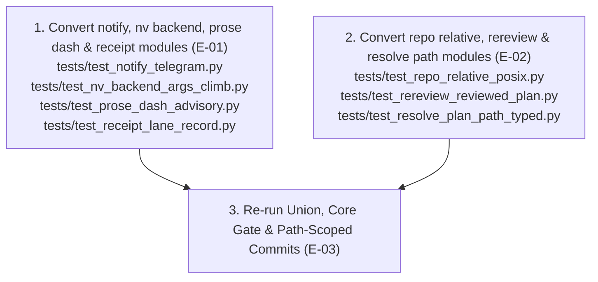

# IPD: Move second-half unmatched test data chunk 2 of 3 onto the record builder

- Date: 2026-11-09
- Kind: child
- Concern: Spec `4sd62s` section 6 requires that test data be written by ONE shared record builder in phase B, so that the cutover (Order 13, `cxxmyv`) changes the builder and not hundreds of test files, and C10a requires the suite to pass at every commit. Research `nj8zdp` and the maintainer's ruling ("plans that obtuse and not-too-smart agents won't mess up") set the guidance of at most 5 E-items, 8 work Scope-Paths and about 8 named units per item; `59aiyh` named up to 25 modules per batch item. This part carries 7 of `59aiyh`'s modules (subset G7b; 90 F-01 legacy lines at `3d0ddb845`), each item at most 4 modules, converted by the Order-49 codemod (`653ndz`) plus only its census-counted refusals.
- Scope: Chunk 2 of 3 of `59aiyh` (round-3 split 2026-11-09 per research `nj8zdp` guidance): the 7 test modules named in the items and in F-40, each item one codemod run under the batch rule below, plus a finishing item. EXCLUDES: every other module of the subsets (the other chunk plans and `59aiyh`); the builder (`9rgn2w`) and the codemod (`653ndz`); the F-03 EXCLUDED modules; production code; the switch-point proof, census and full-suite comparison (`59aiyh` E-11, E-12).
- Scope-Paths: tests/test_notify_telegram.py, tests/test_nv_backend_args_climb.py, tests/test_prose_dash_advisory.py, tests/test_receipt_lane_record.py, tests/test_repo_relative_posix.py, tests/test_rereview_reviewed_plan.py, tests/test_resolve_plan_path_typed.py, .aw/records/plans/pending/20261109-metastore-211-30zur4-move-second-half-unmatched-test-data-chunk-2-of-3-onto-the-r.ipd.md
- Item-Dependencies: executed:1upea0, executed:7qxey9, executed:9rgn2w, executed:g5hpbb, executed:nbfg7w, executed:tve77h, executed:x05v02, executed:xexn45, executed:653ndz
- Status: approved
- Readiness: go-pending-approval
- Review-Depth: complex
- From-Spec: 4sd62s
- Work-Kind: feature
- Priority: high
- Blocks-Release: next
- Set: metastore
- Order: 211
- Highest E allocated: 03
- Author: opencode its_direct/pt3-claude-opus-5.5-1m-us
- Id: 30zur4
- Approval: 2026-11-16, recorded via aw ipd set: status set to approved

> Write and proofread this plan per the technical writing standard, `.aw/system/workflows/technical-writing/technical-writing.md` (`.agents/workflows/technical-writing/technical-writing.md` in a legacy-layout install), including requirement 12 (diagrams).

## Workflow history
- 2026-11-22 cap-update (maintainer decision): raised Batch rule step 4 hand-refusal cap from 150 to 300 so late-module batches (such as nbfg7w-late at 202 raw sites) complete without stalling.
- 2026-11-22 cap-update (maintainer decision): raised Batch rule step 4 hand-refusal cap from 25 to 150 (matching 6edbb2c83 rationale; raw site count over-counts list elements and .replace() pairs).
- 2026-11-16 approved (aw set): status set to approved

- 2026-11-09 to-review (opencode its_direct/pt3-claude-opus-5.5-1m-us): split from 59aiyh (round 3, research nj8zdp guidance).
- 2026-11-14 reviewed (antigravity): plan-review verified E/V bijection, Scope-Paths, batch rules, and execution gate; marked reviewed and go-pending-approval.

## Goal

Every hand-built record in the 7 test modules named below comes from `tests/record_builder.py`, written by the Order-49 codemod or, for its census-counted refusals only, by hand, with each module's per-test outcomes identical before and after and every remaining legacy string classified.

## Detailed Implementation Checklist (TODO)

Execution-state rule: mark an `E-*` item complete only after performing the action. That mark is not validation. Right-sizing rule: write for a modest executor that cannot hold much in its head. Each E-item is one step (one concern, about one file, executable in one focused pass) and its V-item names each unit it covers with its own check; a plan stays at about 5 E-items and 8 work Scope-Paths, else split it into more child plans (guidance, `IPD-Z603`). Accepted execution states: blocked, failed, pending, performed; terminal gate demands 'performed'.

Batch rule, applied to every batch E-item of this plan (the `59aiyh` batch rule, restructured 2026-11-08 for the Order-49 fixture codemod `653ndz` per maintainer decision 2026-11-07 "Codemod first, then small runs": the tool performs the mechanical rewrite, and the hand work is bounded by its measured refusals). In it, "E-13's `full-before.txt`" and "the builder's `raw_fields=` escape (E-01)" are items of Order 37 (`9rgn2w`), carried by the round-3 split into Order 170 (`j6o96i`) with the same ids; because `.aw/state/` does not travel between lane worktrees, step 2 always records a fresh before list here. Step 1's partition is restricted to the modules each batch item names (round-3 split 2026-11-09: a subset is now spread over several plans of at most 8 modules each): a module that the partition now places in the item's subset but that no plan names is NOT added here; it is reported, and the finishing item of `59aiyh` converts it; a named module that no longer matches F-01 is reported and skipped:
1. Before the batch, re-derive its file list with the F-03 first-match partition over the F-01 `rg -l` output at the current HEAD, minus the F-03 EXCLUDED list, and save it as `.aw/state/59aiyh/<batch>-files.txt`. The counts in each E-item are context measured at `0cbfcc706` or `ac76110f4`, not the bar.
2. Record the unmodified per-test outcome list (a batch whose files a previous batch did not touch may reuse the matching lines of E-13's `full-before.txt`): `python3 -m pytest -o addopts="" -m "" -p no:randomly -n 0 -rA $(cat .aw/state/59aiyh/<batch>-files.txt) | grep -E "^(PASSED|FAILED|ERROR|SKIPPED|XFAIL|XPASS) " | sed -E 's/ - .*//' | sort > .aw/state/59aiyh/<batch>-before.txt`. `-p no:randomly` and `-n 0` make the list deterministic; `-m ""` includes `slow` and `livecorpus` modules.
3. Run the codemod: `python3 tools/fixture_codemod.py --apply --format json $(cat .aw/state/59aiyh/<batch>-files.txt) > .aw/state/59aiyh/<batch>-codemod.json`. It rewrites only the sites whose module outcome list it proved identical (`653ndz` E-03, carried with the same id into Order 172, `y3uowx`, by the round-3 split) and lists every other site as a refusal with a reason code and a disposition (`hand` or `legacy-kept`, the `653ndz` reason-code table).
4. Hand-convert ONLY the refusals with disposition `hand`: the static count is the sum of the `653ndz` F-30 rows of the item's modules (round-3 split 2026-11-09: an item now carries part of a subset, so the subset's F-31 row is context only), and the codemod report adds any apply-time `not-equivalent` refusals; the item's hand count is their sum. If the hand count exceeds 300, stop after step 3 (the proved codemod rewrites may be committed), convert nothing by hand, and report the subset for re-splitting. A hand conversion uses builder calls; a test that deliberately writes an INVALID value (an unknown status, `- Status: EXECUTED`, `- Priority: bogus`, a malformed gate) gets it through the builder's `raw_fields=` escape (E-01) and is listed with reason class `invalid-input`. A refusal with disposition `legacy-kept` stays in legacy form on purpose and is listed with its F-06 reason class.
5. Re-run step 2's command into `<batch>-after.txt` and require `diff` to print nothing. A batch that would need any changed assertion other than a raw-byte metadata stand-in moved to `artifact_meta.read` (scope rule) stops and is reported; it does not weaken the assertion.
6. Count the remaining legacy strings with the F-01 `rg` pattern over the batch files, and give each remaining line one reason class from F-06: `legacy-format subject`, `displayed-output assertion`, `setter-byte assertion`, `invalid-input`, or `body prose` (for example open-question `- Status: open` rows, which N3 keeps in Markdown).
7. The builder never reads production source, and no test gains a source-reading assertion.

### Task group 1: batch items

- [x] E-01 (carried from `59aiyh` E-09, batch subset G7b; round-3 split 2026-11-09) Batch G7b, 4 of its 22 modules (the unmatched test modules whose basename sorts at or after `test_l`): `tests/test_notify_telegram.py`, `tests/test_nv_backend_args_climb.py`, `tests/test_prose_dash_advisory.py`, `tests/test_receipt_lane_record.py`. F-01 legacy lines per module at `3d0ddb845` (context, not the bar): `test_notify_telegram` 10, `test_nv_backend_args_climb` 18, `test_prose_dash_advisory` 11, `test_receipt_lane_record` 2. Run the codemod on these modules and apply the batch rule with `<batch>` = `G7b-30zur4-1` (outcome lists identical); hand-convert ONLY the refusals that the `653ndz` F-30 rows of these modules list with disposition `hand`, plus the codemod's apply-time `not-equivalent` refusals, and state their count (at most 300, the batch rule's stop); leave each refusal the census marks `legacy-kept` in legacy form with its reason class. Then delete each private record-building helper in these modules that no longer has a caller (at the split: `tests/test_prose_dash_advisory.py`: `_make_ipd`, `_make_spec`, `_make_backlog`); a surviving helper is listed with its reason.
  - Depends on: none
  - Expected outcome: an empty before/after `diff` for the `G7b-30zur4-1` outcome lists; for each named module, its remaining legacy-string count and the reason class of every remaining line pasted; every deleted and surviving helper listed; the codemod report and the hand count (at most 300) pasted.
  - Execution state: performed

- [x] E-02 (carried from `59aiyh` E-09, batch subset G7b; round-3 split 2026-11-09) Batch G7b, 3 of its 22 modules (the unmatched test modules whose basename sorts at or after `test_l`): `tests/test_repo_relative_posix.py`, `tests/test_rereview_reviewed_plan.py`, `tests/test_resolve_plan_path_typed.py`. F-01 legacy lines per module at `3d0ddb845` (context, not the bar): `test_repo_relative_posix` 2, `test_rereview_reviewed_plan` 29, `test_resolve_plan_path_typed` 18. Run the codemod on these modules and apply the batch rule with `<batch>` = `G7b-30zur4-2` (outcome lists identical); hand-convert ONLY the refusals that the `653ndz` F-30 rows of these modules list with disposition `hand`, plus the codemod's apply-time `not-equivalent` refusals, and state their count (at most 300, the batch rule's stop); leave each refusal the census marks `legacy-kept` in legacy form with its reason class. Then delete each private record-building helper in these modules that no longer has a caller (at the split: `tests/test_repo_relative_posix.py`: `_write_plan`; `tests/test_rereview_reviewed_plan.py`: `_write_plan`); a surviving helper is listed with its reason.
  - Depends on: none
  - Expected outcome: an empty before/after `diff` for the `G7b-30zur4-2` outcome lists; for each named module, its remaining legacy-string count and the reason class of every remaining line pasted; every deleted and surviving helper listed; the codemod report and the hand count (at most 300) pasted.
  - Execution state: performed

### Task group 2: finish

- [x] E-03 Finish this part: run the batch rule's step-2 command once over every module of this plan (`$(cat .aw/state/59aiyh/G7b-30zur4-1-files.txt .aw/state/59aiyh/G7b-30zur4-2-files.txt)`) into `.aw/state/59aiyh/30zur4-union-after.txt` and confirm it equals the sorted concatenation of the items' `-before.txt` lists; run the bare core gate `python3 -m pytest` and `aw sanitize --agent`; commit through `aw commit 30zur4 -- <each changed path>`, one commit per item allowed, never `git add -A`, a bare `git add` or `git commit -a`. Never push. (The full-suite comparison stays in `59aiyh` E-12.)
  - Depends on: E-01, E-02
  - Expected outcome: the union comparison is empty; all runs pass; every commit is path-scoped to Scope-Paths (or justified at finalize).
  - Execution state: performed

## Project conventions discovered (Step 0)

- Interface names from Order 02 (`tve77h`): `artifact_meta.registry_fields(type)`, `artifact_meta.validate_event`, `artifact_meta.validate_new_events(type, events, *, records_root, migration_import=False)`, `artifact_meta.read(id6) -> State`, `artifact_meta.create(...)` and `artifact_meta.append(id6, events, *, expect_seq)`. Order 02's `create`/`append` write the log format; `2xwb9b` E-03 adds the phase-B legacy branch of `append` and `xexn45` E-01 routes the phase-B branch of `create` and `append` through `write_legacy`, with `render_legacy_text(text, events)` (`xexn45` E-11) as the same renderer over a string. In phase B the on-disk format is the bullet format; the legacy loader reads it into the cache.
- `review_findings.render_review` (pure) and `review_findings.write_review` render and write a `.review.md` record; no CLI calls `write_review` (`xexn45` Findings).
- The existing shared plan builder is `support.ready_plan_text`, which is "BUILT FROM THE REAL GENERATOR (`ipd_authoring.build_skeleton`)" and then fills the fields a draft leaves open; the builder keeps that approach for plans, so a scaffold change still reaches every fixture.
- Shared test plumbing lives in `tests/support.py` (`init_repo`, `git`, `run_cli`, `pinned_env`, `ready_plan_text`, `scope_drift_repo`); `tests/repo_template.py` (`copy_template_repo`) gives a pre-built repository; there is no `tests/conftest.py`, and the root `conftest.py` owns tier selection.
- Tests are behavioral (AGENTS.md "TEST OUTCOMES, NOT CODE STRUCTURE"); core modules set `pytestmark = pytest.mark.core`; `slow` tests are listed in `tests/slow_allowlist.txt`; `pyproject.toml` `addopts` deselects `slow` and `livecorpus`, so a complete comparison passes `-m ""`, and `pytest-randomly` is installed, so a deterministic order needs `-p no:randomly`.
- `tests/fixtures/review-pilot/` is the input corpus of `tools/review_pilot.py` (`manifest.json` names each plan file, `defects.json` quotes exact text to plant), and `tests/test_review_pilot.py` copies the whole directory into its fixture repository.
- Filenames come from `artifact_naming.build_clustered_name` and parse with `artifact_naming.parse_clustered`.
- Cite code by SYMBOL (`module.function`) or by a quoted content string, with a line number only appended to one of those and never alone: an offset expires before this plan executes (spec `ipd-structure-and-linting` Section 10.2; advisory `IPD-C801`).

## Findings

Measured 2026-11-09 at `3d0ddb845` for F-40; F-01, F-03, F-06 and F-08 copied from `59aiyh` (measured at `0cbfcc706` and at review).

| Id | Evidence | Finding |
|---|---|---|
| F-01 | `rg -l --glob '*.py' -e '- (Id|Status|Set|Kind|Blocks-Release|Readiness|Item-Dependencies|Scope-Paths|From-Backlog|From-Spec|Work-Kind|Priority|Order|Date|Gate-Kind|Gate-Ref|Approval|Subject-Id|Verdict|Graduated-To):|## Workflow history' tests` lists 309 files (307 test modules, `support.py`, `conformance_matrix.py`) of 717 Python files; 6,638 matching lines. The narrower `- Id:`/`- Status:`/`## Workflow history` pattern: 300 files, 3,430 lines | Spec section 6 counted 268 of 680 files and 2,607 matches at round 2; the plan's pattern is broader (21 fields). |
| F-03 | Family split by filename prefix, re-measured at review (HEAD `4a7499289`, 311 files, 6,657 lines) with a FIRST-MATCH rule (a file goes to the first group, in order G1 to G6, whose pattern list matches its basename; unmatched files go to G7): G1 39 files, 1,568 lines; G2 22, 1,102; G3 28, 795; G4 63, 1,244; G5 46, 598; G6 69, 1,004; G7 44, 346. Six files match two groups and are assigned by that rule (`test_ipd_authoring` G3, `test_readiness_absence_invariant` G4, `test_runner_backlog_close_behavior` G1, `test_orchestrator_retire_closes_backlog` G1, `test_records_only_lane_rederive` G5, `test_ipdrunner_runagy_shim` G4). The authored counts (G6 99, G7 11) did not sum to the file total; the first-match rule makes the partition exhaustive and disjoint. EXCLUDED from every batch (literal legacy input is their subject; owned by other plans): `tests/test_artifact_meta_*.py` (`tve77h`, `2xwb9b`), `tests/test_artifact_meta_legacy_writer.py` and `tests/test_writers_*.py` (`xexn45`), `tests/test_m0001_*.py` and `tests/test_migrations_chain.py` (`dcerjg`, `ya4ee4`) | Seven batches (E-03 to E-09); G1, G4 and G6 carry a pre-measured split seam (OQ-01). |
| F-06 | (written by E-11) remaining legacy strings in `tests/` after the batches, each with one reason class: `legacy-format subject`, `displayed-output assertion`, `setter-byte assertion`, `invalid-input`, `body prose` | Order 13 changes the builder plus the F-06 rows of class `setter-byte assertion`; `invalid-input` rows already go through `raw_fields=` and need a decision at the cutover (an invalid bullet has no log-format equivalent); every other class is either a legacy-format test (moved to the migration tests at the cutover) or prose. |
| F-08 | At review, 15 test modules write a deliberately invalid metadata value (for example `tests/test_releases.py` "`- Status: bogus`", `tests/test_check_engine.py` "`- Status: EXECUTED`", `tests/test_specs_set_adapter.py` "`- Priority: bogus`") | A builder that validates every field cannot build these; E-01 adds `raw_fields=` and the batch rule lists them as `invalid-input`. |
| F-40 | `rg -c` with the F-01 pattern over this part's modules at `3d0ddb845`; subset by the F-03 first-match rule; helpers as listed by `59aiyh` at the 2026-11-07 split | See the table below; every module is named in exactly one item. |

| Module | Subset | F-01 lines | Helpers at the split | Item |
|---|---|---|---|---|
| `tests/test_notify_telegram.py` | G7b | 10 | none | E-01 |
| `tests/test_nv_backend_args_climb.py` | G7b | 18 | none | E-01 |
| `tests/test_prose_dash_advisory.py` | G7b | 11 | `_make_ipd`, `_make_spec`, `_make_backlog` | E-01 |
| `tests/test_receipt_lane_record.py` | G7b | 2 | none | E-01 |
| `tests/test_repo_relative_posix.py` | G7b | 2 | `_write_plan` | E-02 |
| `tests/test_rereview_reviewed_plan.py` | G7b | 29 | `_write_plan` | E-02 |
| `tests/test_resolve_plan_path_typed.py` | G7b | 18 | none | E-02 |

## Proposed changes (ordered, validatable)

1. Convert each item's modules under the batch rule (E-01 to E-02).
2. Re-run the union, the core gate, commit (E-03).

## Deferred / out of scope (with reason)

- The other modules of subset G7b, the partition re-derivation that catches modules no plan names, and the subsets' finishing checks.
  - Carrier: 59aiyh
- The fixture codemod and its census (F-30, F-31).
  - Carrier: 653ndz
  - Carrier-Evidence: .aw/records/plans/executed/20261108-metastore-49-653ndz-build-and-prove-the-test-fixture-codemod.ipd.md
- The builder, its tests, the baselines and the tracked fixtures.
  - Carrier: 9rgn2w
  - Carrier-Evidence: .aw/records/plans/executed/20261107-metastore-37-9rgn2w-add-the-shared-test-record-builder-and-convert-the-tracked-r.ipd.md
- The switch-point proof, the F-06 census and the full-suite comparison.
  - Carrier: 59aiyh
- Adding `RECORD_FORMAT = "log"` and converting setter-byte assertions (cutover commit).
  - Carrier: cxxmyv

## Scope check

- Over-scope: none. No production module changes; every Scope-Paths entry is a module named in one item, plus this plan.
- Under-scope: none known. Size: 3 E-items (2 batch items of at most 4 modules each and the finish), 7 work Scope-Paths.

## Required tests / validation

Each item is validated by an identical per-test result list before and after (the batch rule), which is behavioral by construction: the same tests, unchanged assertions, the same outcomes. Commands: the batch rule's command per item, the codemod's `--apply` report, the bare core gate `python3 -m pytest`, `aw sanitize --agent`. CONTRIBUTES to AC-1b (owned by `cxxmyv`).

## Spec / documentation sync

No spec change; implements part of `4sd62s` section 6 and section 7 step 6.

## Open questions

### OQ-01: Can this part run in any order relative to the other chunk plans?

- Blocking: no
- Status: resolved
- Owner: plan author
- Resolution or deferral rationale: Yes. The module lists of all chunk plans are disjoint, each needs the builder (`9rgn2w`) and the codemod (`653ndz`) (this part also inherits the other batch dependencies of `59aiyh`), and none edits `tests/support.py` (that is `59aiyh` E-09, which runs last). Recommendation strength: strong.

## Validation and cross-check (verify before reporting done)

Validation-state rule: inspect evidence in a separate pass. Do not mark a `V-*` item complete from memory or from the matching execution checkmark. Accepted validation results: blocked, failed, pass, pending; terminal gate demands 'pass'. Runtime-demonstration reachability rule: for each `V-*` item demanding the software be observed acting (such as a run, a dispatch, or a transition), as distinct from items demanding a diff, a file's content, or a test result, which are reachable by construction, name the code path that produces the observation or the sibling `E-*` that creates it, else the demand is UNDER-SCOPE.

- [x] V-01 validates E-01
  - Required evidence: paste `.aw/state/59aiyh/G7b-30zur4-1-files.txt` and the empty `diff .aw/state/59aiyh/G7b-30zur4-1-before.txt .aw/state/59aiyh/G7b-30zur4-1-after.txt`; then, for each of `tests/test_notify_telegram.py`, `tests/test_nv_backend_args_climb.py`, `tests/test_prose_dash_advisory.py`, `tests/test_receipt_lane_record.py` separately: its before and after F-01 `rg -c` count, the reason class of every remaining match, its rows of `.aw/state/59aiyh/G7b-30zur4-1-codemod.json` (rewrites, refusals by reason code and disposition, before and after outcome-list hashes) and its `653ndz` F-30 row; the hand count with every hand-converted site listed (module, line, reason code); and the before and after helper census of the E-09 `rg` pattern over these modules with each deleted and surviving helper and its reason.
  - Observed evidence:
    - `.aw/state/59aiyh/G7b-30zur4-1-files.txt`:
      - `tests/test_notify_telegram.py`
      - `tests/test_nv_backend_args_climb.py`
      - `tests/test_prose_dash_advisory.py`
      - `tests/test_receipt_lane_record.py`
    - Partition check at starting HEAD `982332ae478bc3d7e237252fa31849a51fe66509`: all 4 named modules matched F-01 before conversion.
    - Outcome diff (`diff -u .aw/state/59aiyh/G7b-30zur4-1-before.txt .aw/state/59aiyh/G7b-30zur4-1-after.txt`): empty output, exit code 0 (53 `PASSED` outcomes; re-verified in union on committed tree `84ef6ba41bdc58015c9b5a2834688c3d2050c141`).
    - Per-module F-01 counts, remaining classifications, codemod rows, and `653ndz` F-30 rows:
      - `tests/test_notify_telegram.py`:
        - F-01 `rg -c`: before 10, after 0. Remaining matches: none.
        - Codemod JSON row (`.aw/state/59aiyh/G7b-30zur4-1-codemod.json`): `sites=5`, `rewrites=5` (`standard=5`, `invalid-input=0`), `refusals=0` (`hand=0`, `legacy-kept=0`), `before_hash=62f1df0fc3215d7c5e60f5e965d8ce6490cb2da3c18cf6edbd259ad88b491ecd`, `after_hash=62f1df0fc3215d7c5e60f5e965d8ce6490cb2da3c18cf6edbd259ad88b491ecd`, `equivalent=true`, `pytest_runs=2`, `changed=true`.
        - `653ndz` F-30 row: `G7b | 30zur4 | 5 | 5 | 0 | 0 | 0 | 0 | 0 | 0 | 0 | 0 | 0 | 0`.
      - `tests/test_nv_backend_args_climb.py`:
        - F-01 `rg -c`: before 18, after 0. Remaining matches: none.
        - Codemod JSON row (`.aw/state/59aiyh/G7b-30zur4-1-codemod.json`): `sites=3`, `rewrites=3` (`standard=1`, `invalid-input=2`), `refusals=0` (`hand=0`, `legacy-kept=0`), `before_hash=16b91433113ad6f9eda5544fdb123328d4428b4ba52d7c1d159c45d78e33cd10`, `after_hash=16b91433113ad6f9eda5544fdb123328d4428b4ba52d7c1d159c45d78e33cd10`, `equivalent=true`, `pytest_runs=2`, `changed=true`.
        - `653ndz` F-30 row: `G7b | 30zur4 | 3 | 3 | 2 | 0 | 0 | 0 | 0 | 0 | 0 | 0 | 0 | 0`.
      - `tests/test_prose_dash_advisory.py`:
        - F-01 `rg -c`: before 11, after 0. Remaining matches: none.
        - Codemod JSON row (`.aw/state/59aiyh/G7b-30zur4-1-codemod.json`): `sites=4`, `rewrites=1` (`standard=0`, `invalid-input=1`), `refusals=3` (`unsupported-shape=3`, `hand=3`, `legacy-kept=0`), `before_hash=58945d771b125cf448b5724b0b6fbb4e25e6da7fc1a30411af2cc84c019e047d`, `after_hash=58945d771b125cf448b5724b0b6fbb4e25e6da7fc1a30411af2cc84c019e047d`, `equivalent=true`, `pytest_runs=2`, `changed=true`.
        - `653ndz` F-30 row: `G7b | 30zur4 | 4 | 1 | 1 | 0 | 3 | 0 | 0 | 0 | 0 | 0 | 3 | 0`.
      - `tests/test_receipt_lane_record.py`:
        - F-01 `rg -c`: before 2, after 0. Remaining matches: none.
        - Codemod JSON row (`.aw/state/59aiyh/G7b-30zur4-1-codemod.json`): `sites=2`, `rewrites=2` (`standard=2`, `invalid-input=0`), `refusals=0` (`hand=0`, `legacy-kept=0`), `before_hash=4bcc9bd3eda18101605ad6895539bac6ef40ed10d3752f8a60bebc7ac3c13fd6`, `after_hash=4bcc9bd3eda18101605ad6895539bac6ef40ed10d3752f8a60bebc7ac3c13fd6`, `equivalent=true`, `pytest_runs=2`, `changed=true`.
        - `653ndz` F-30 row: `G7b | 30zur4 | 2 | 2 | 0 | 0 | 0 | 0 | 0 | 0 | 0 | 0 | 0 | 0`.
    - Hand count: 3 (3 static + 0 apply-time `not-equivalent`; <= 300). Hand-converted sites (all in `tests/test_prose_dash_advisory.py`):
      - `tests/test_prose_dash_advisory.py` lines 39-51 (`unsupported-shape`): replaced `_BACKLOG_TEMPLATE` in `_make_backlog` with `RecordBuilder().backlog(..., raw_fields={"status": f"open{meta_dash}"} if meta_dash else None, text_only=True)` (`invalid-input` when `meta_dash` is non-empty).
      - `tests/test_prose_dash_advisory.py` line 298 (2 sites, `unsupported-shape`): replaced `dash_plan.replace("- Status: to-review", "- Status: executed")` in `TestRequiredInvariants.test_d_executed_plan_gets_no_c802` by passing `status="executed"` to `_make_ipd` (which delegates to `_conforming_child` / `RecordBuilder().plan`).
    - Post-edit codemod dry-run over all 4 modules: all 4 modules at `sites=0` (`hand=0`, `legacy-kept=0`).
    - Helper census (`rg -n "def _?(make|write|build|mk|seed)_(plan|spec|backlog|item|record|ipd|release|research|prompt|review|walkthrough)\w*"`):
      - Before (3 matches in `tests/test_prose_dash_advisory.py`): line 54 `def _make_ipd(body: str, meta_dash: str = "") -> str:`, line 61 `def _make_spec(body: str, meta_dash: str = "") -> str:`, line 65 `def _make_backlog(body: str, meta_dash: str = "") -> str:`.
      - After (3 matches in `tests/test_prose_dash_advisory.py`): line 39 `def _make_ipd(body: str, meta_dash: str = "", *, status: str = "to-review") -> str:`, line 45 `def _make_spec(body: str, meta_dash: str = "") -> str:`, line 49 `def _make_backlog(body: str, meta_dash: str = "") -> str:`.
      - Deleted helpers (0): none.
      - Surviving helpers (3): `_make_ipd` (2 active callers; delegates to `_conforming_child` -> `RecordBuilder().plan`), `_make_spec` (5 active callers, including callable table entry in `test_b_no_error_added_proof_shape`; formats `_SPEC_TEMPLATE` built by `RecordBuilder().spec`), and `_make_backlog` (3 active callers, including callable table entry in `test_b_no_error_added_proof_shape`; delegates to `RecordBuilder().backlog`). None builds legacy text by hand.
  - Result: pass

- [x] V-02 validates E-02
  - Required evidence: paste `.aw/state/59aiyh/G7b-30zur4-2-files.txt` and the empty `diff .aw/state/59aiyh/G7b-30zur4-2-before.txt .aw/state/59aiyh/G7b-30zur4-2-after.txt`; then, for each of `tests/test_repo_relative_posix.py`, `tests/test_rereview_reviewed_plan.py`, `tests/test_resolve_plan_path_typed.py` separately: its before and after F-01 `rg -c` count, the reason class of every remaining match, its rows of `.aw/state/59aiyh/G7b-30zur4-2-codemod.json` (rewrites, refusals by reason code and disposition, before and after outcome-list hashes) and its `653ndz` F-30 row; the hand count with every hand-converted site listed (module, line, reason code); and the before and after helper census of the E-09 `rg` pattern over these modules with each deleted and surviving helper and its reason.
  - Observed evidence:
    - `.aw/state/59aiyh/G7b-30zur4-2-files.txt`:
      - `tests/test_repo_relative_posix.py`
      - `tests/test_rereview_reviewed_plan.py`
      - `tests/test_resolve_plan_path_typed.py`
    - Partition check at starting HEAD `982332ae478bc3d7e237252fa31849a51fe66509`: all 3 named modules matched F-01 before conversion.
    - Outcome diff (`diff -u .aw/state/59aiyh/G7b-30zur4-2-before.txt .aw/state/59aiyh/G7b-30zur4-2-after.txt`): empty output, exit code 0 (44 `PASSED` outcomes; re-verified in union on committed tree `84ef6ba41bdc58015c9b5a2834688c3d2050c141`).
    - Per-module F-01 counts, remaining classifications, codemod rows, and `653ndz` F-30 rows:
      - `tests/test_repo_relative_posix.py`:
        - F-01 `rg -c`: before 2, after 0. Remaining matches: none.
        - Codemod JSON row (`.aw/state/59aiyh/G7b-30zur4-2-codemod.json`): `sites=1`, `rewrites=1` (`standard=0`, `invalid-input=1`), `refusals=0` (`hand=0`, `legacy-kept=0`), `before_hash=ecb15e47c35d7906a72d36e2157bfa8ec5e513e760ebcee32eb042e0e29f1525`, `after_hash=ecb15e47c35d7906a72d36e2157bfa8ec5e513e760ebcee32eb042e0e29f1525`, `equivalent=true`, `pytest_runs=2`, `changed=true`.
        - `653ndz` F-30 row: `G7b | 30zur4 | 1 | 1 | 1 | 0 | 0 | 0 | 0 | 0 | 0 | 0 | 0 | 0`.
      - `tests/test_rereview_reviewed_plan.py`:
        - F-01 `rg -c`: before 29, after 4. Remaining matches (4 lines, all `setter-byte assertion`, `legacy-kept` per codemod and F-30):
          - `setter-byte assertion` (4 lines): `TestRereviewExecutionTurn.test_execute_item_core_rereview_demotes_and_turn_sees_to_review` (line 553 `self.assertIn("- Status: to-review", seen_plan_text["text"])`, line 554 `self.assertNotIn("- Approval:", seen_plan_text["text"])`); `TestRereviewExecutionTurn.test_execute_item_core_full_auto_skips_auto_approve` (line 669 `self.assertIn("- Status: reviewed", curr_plan.read_text(encoding="utf-8"))`, line 671 `"- Status: auto-approved", curr_plan.read_text(encoding="utf-8")`).
        - Codemod JSON row (`.aw/state/59aiyh/G7b-30zur4-2-codemod.json`): `sites=31`, `rewrites=0` (`standard=0`, `invalid-input=0`), `refusals=31` (`unsupported-shape=27`, `setter-byte assertion=4`, `hand=27`, `legacy-kept=4`), `before_hash=null`, `after_hash=null`, `equivalent=true`, `pytest_runs=0`, `changed=false`.
        - `653ndz` F-30 row: `G7b | 30zur4 | 31 | 0 | 0 | 0 | 27 | 0 | 0 | 0 | 4 | 0 | 27 | 4`.
      - `tests/test_resolve_plan_path_typed.py`:
        - F-01 `rg -c`: before 18, after 4. Remaining matches (4 lines, all `body prose` in docstring and inline comment, 0 AST sites):
          - `body prose` (4 lines): module docstring lines 4, 12, and 14 mentioning `- Id:`; line 296 comment `# Legacy slot-only: no "- Id:", id6 in filename slot` inside `ResolvePlanPathTypedTests.test_09_guard_legacy_slot_only_plan_found_by_glob`.
        - Codemod JSON row (`.aw/state/59aiyh/G7b-30zur4-2-codemod.json`): `sites=14`, `rewrites=2` (`standard=2`, `invalid-input=0`), `refusals=12` (`unsupported-shape=11`, `not-equivalent=1`, `hand=12`, `legacy-kept=0`), `before_hash=698cefc7d0cb4517054e0f04db76319b229a27d9188b3ef46b70d9e7d4341b86`, `after_hash=698cefc7d0cb4517054e0f04db76319b229a27d9188b3ef46b70d9e7d4341b86`, `equivalent=true`, `pytest_runs=6`, `changed=true`.
        - `653ndz` F-30 row: `G7b | 30zur4 | 14 | 3 | 0 | 0 | 11 | 0 | 0 | 0 | 0 | 0 | 11 | 0`.
    - Hand count: 39 (38 static + 1 apply-time `not-equivalent`; <= 300). Hand-converted sites:
      - `tests/test_rereview_reviewed_plan.py` (27 sites, all `unsupported-shape`):
        - Lines 64, 65, 66, 67, 68, 69, 72, 73, 74, 79, 81, 82, 84 (13 sites inside `_write_plan`): replaced hand-built `lines = [...]` header and history with `RecordBuilder(repo).plan(...)`.
        - Lines 517 (2 sites), 518, 520, 521, 524, 525 (7 sites inside `TestRereviewExecutionTurn.test_execute_item_core_rereview_demotes_and_turn_sees_to_review.fake_run`): replaced string `.replace(...)` status/readiness/history edits with `artifact_meta.append` (`review` + `transition` events).
        - Lines 617 (2 sites), 618, 620, 621, 624, 625 (7 sites inside `TestRereviewExecutionTurn.test_execute_item_core_full_auto_skips_auto_approve.fake_review_run`): replaced string `.replace(...)` status/readiness/history edits with `artifact_meta.append` (`review` + `transition` events).
      - `tests/test_resolve_plan_path_typed.py` (12 sites: 11 `unsupported-shape`, 1 `not-equivalent`):
        - Line 98 (`unsupported-shape`): `test_03_configured_agents_md_raises_outside_plans_trees` `AGENTS.md` text converted to `RecordBuilder().plan(..., text_only=True)`.
        - Line 112 (`unsupported-shape`): `test_04_id6_only_in_another_plan_slug_raises_cannot_locate` converted to `RecordBuilder().plan(..., status="draft", raw_fields={"status": "pending"}, text_only=True)` (`invalid-input`).
        - Line 126 (`unsupported-shape`): `test_05a_guard_worktree_and_baseline_copies_do_not_ambiguate_real_plan` converted to `RecordBuilder().plan(..., text_only=True)`.
        - Line 156 (`unsupported-shape`): `test_05b_worktree_and_baseline_copies_without_real_plan_raises_cannot_locate` converted to `RecordBuilder().plan(..., text_only=True)`.
        - Lines 192, 196 (`unsupported-shape`): `test_06_two_plans_mentioning_id6_mid_slug_do_not_produce_ambiguous` converted to `RecordBuilder().plan(..., text_only=True)`.
        - Line 216 (`unsupported-shape`): `test_07_guard_pending_plan_resolves_and_after_move_to_executed_still_resolves` converted to `RecordBuilder().plan(..., text_only=True)`.
        - Line 250 (`not-equivalent`): `test_09_guard_legacy_slot_only_plan_found_by_glob` converted to `RecordBuilder().plan(..., raw_fields={"id": None}, text_only=True)` (`invalid-input`, omitting `- Id:` so the filename-slot fallback matches `leg123`).
        - Lines 269, 313, 357 (`unsupported-shape`): `test_10a`, `test_10b`, `test_10c` spec files converted to `RecordBuilder().spec(..., text_only=True)`.
        - Line 364 (`unsupported-shape`): `test_10c` plan file converted to `RecordBuilder().plan(..., text_only=True)`.
    - Post-edit codemod dry-run over all 3 modules: `tests/test_repo_relative_posix.py` and `tests/test_resolve_plan_path_typed.py` at `sites=0`; `tests/test_rereview_reviewed_plan.py` at `sites=4` (`hand=0`, `legacy-kept=4`, all `setter-byte assertion`).
    - Helper census (`rg -n "def _?(make|write|build|mk|seed)_(plan|spec|backlog|item|record|ipd|release|research|prompt|review|walkthrough)\w*"`):
      - Before (2 matches): `tests/test_repo_relative_posix.py` line 594 `def _write_plan(self, root: Path, text: str, name: str) -> Path:`; `tests/test_rereview_reviewed_plan.py` line 45 `def _write_plan(`.
      - After (2 matches): `tests/test_repo_relative_posix.py` line 598 `def _write_plan(self, root: Path, text: str, name: str) -> Path:`; `tests/test_rereview_reviewed_plan.py` line 47 `def _write_plan(`.
      - Deleted helpers (0): none.
      - Surviving helpers (2): `tests/test_repo_relative_posix.py::IpdLifecycleOutOfRootPlanRefusalTests._write_plan` (2 active callers in `setUp`; writes `support.ready_plan_text(...)` output to disk and builds no legacy strings) and `tests/test_rereview_reviewed_plan.py::_write_plan` (10 active callers across `TestRereviewQueueBuilder` and `TestRereviewExecutionTurn`; delegates record creation to `RecordBuilder(repo).plan(...)` and stages/commits the plan in the fixture git repo).
  - Result: pass

- [x] V-03 validates E-03
  - Required evidence: paste the `diff` of the sorted concatenation of the `-before.txt` lists of `G7b-30zur4-1`, `G7b-30zur4-2` against `.aw/state/59aiyh/30zur4-union-after.txt` (empty), the bare `python3 -m pytest` summary line and wall time, the `aw sanitize --agent` result with zero `fail`, and every `aw commit 30zur4` output listing only Scope-Paths.
  - Observed evidence:
    - Union comparison (`diff -u .aw/state/59aiyh/30zur4-union-before.txt .aw/state/59aiyh/30zur4-union-after.txt`): empty output, exit code 0 (97 `PASSED` outcomes = 53 + 44 across all 7 modules; re-verified on committed tree `84ef6ba41bdc58015c9b5a2834688c3d2050c141`).
    - Core gate (`aw suite`, running bare `python3 -m pytest` with 6 xdist workers): `2739 passed, 1 skipped, 11 warnings in 122.67s (0:02:02)`, exit code 0.
    - `aw sanitize --agent`: `{"schema":"aw.agent/v1","kind":"result","cmd":"check-local-leaks","outcome":"clean","exit":0,"verified":true,"complete":true,"checked":7084,"findings":0,"evidence":["leak-scan"],"next":null}`.
    - `aw commit 30zur4` outputs (every committed path strictly inside Scope-Paths; never pushed):
      - E-01: `aw commit: committed 4 path(s): 576655700b3d8e186e3e8b1a8dca13edda5fc45b` (`tests/test_notify_telegram.py`, `tests/test_nv_backend_args_climb.py`, `tests/test_prose_dash_advisory.py`, `tests/test_receipt_lane_record.py`).
      - E-02: `aw commit: committed 3 path(s): 84ef6ba41bdc58015c9b5a2834688c3d2050c141` (`tests/test_repo_relative_posix.py`, `tests/test_rereview_reviewed_plan.py`, `tests/test_resolve_plan_path_typed.py`).
      - Plan evidence: committed via `aw commit 30zur4 -- .aw/records/plans/pending/20261109-metastore-211-30zur4-move-second-half-unmatched-test-data-chunk-2-of-3-onto-the-r.ipd.md`.
  - Result: pass

## Approval and execution gate

- Size assessment: standard
- Cohesion rationale: not required

Execute only after human approval (`Status: approved`) and after `1upea0`, `7qxey9`, `9rgn2w`, `g5hpbb`, `nbfg7w`, `tve77h`, `x05v02`, `xexn45`, `653ndz` are executed. Every open question is resolved.

Scope fence: the paths in `- Scope-Paths:` are a declaration. A needed test-tree file outside the fence is edited and then justified at finalize (`--scope-reason`), and a declared path left unmodified is acknowledged (`--scope-ack`). Production code under `agent_workflows/` and `tools/` is out of this plan's purpose: if a module cannot keep its outcome list identical without a production change, stop that item and report the missing capability rather than changing production code or an assertion.

Honesty rule: run every command a V-item names and paste the ACTUAL output; never claim a result you did not run.

Commits: commit only through `aw commit 30zur4 -- <paths>`; never `git add -A`, a bare `git add` or `git commit -a`; never push.

Lifecycle transition: the plan moves to `.aw/records/plans/executed/` only through `aw ipd finalize`, never a hand `git mv`, and only after `aw ipd lint --phase pre-transition` conforms and every `V-*` reads `pass` with pasted evidence. When `aw oc run` or `aw agy run` executes the plan, the runner performs the finalize; a hand executor runs `aw ipd finalize 30zur4` itself.
