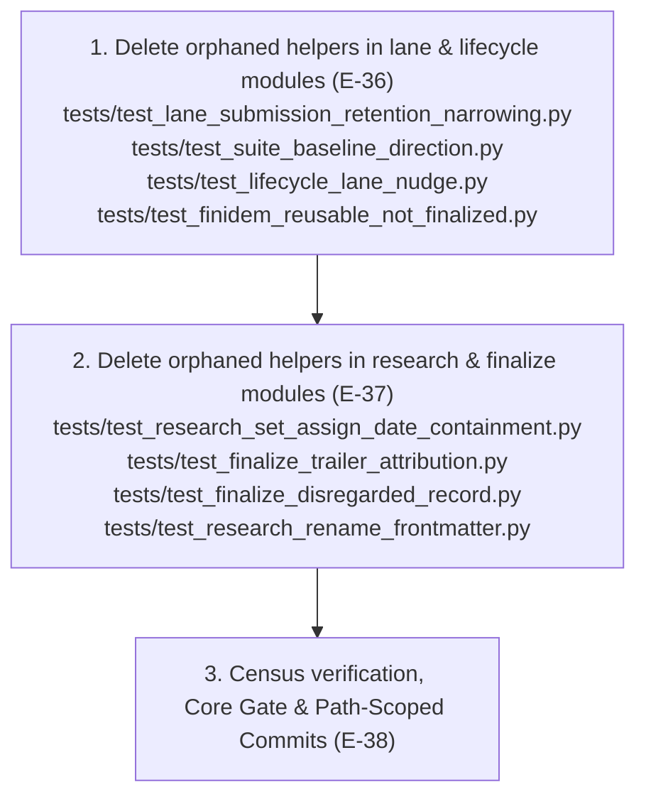

# IPD: Delete orphaned record-building helpers in test modules outside every batch

- Date: 2026-11-09
- Kind: child
- Concern: Spec `4sd62s` section 6 requires that test data come from ONE shared record builder, so private record-building helpers that lose their callers must go. `59aiyh` E-09 deleted them across the whole test tree along with 24 modules; research `nj8zdp` guidance (about 8 named units per item) moves the deletions in the 8 modules no batch names into this plan, 4 modules per item.
- Scope: Part of the round-3 split of `59aiyh` E-09 (2026-11-09, research `nj8zdp` guidance): the helper deletions in the 8 test modules outside every batch (E-36, E-37), plus the census and finish (E-38). EXCLUDES: helpers inside batch modules (each chunk plan deletes its own); `tests/support.py` (`59aiyh` E-09); production code.
- Scope-Paths: tests/test_lane_submission_retention_narrowing.py, tests/test_suite_baseline_direction.py, tests/test_lifecycle_lane_nudge.py, tests/test_finidem_reusable_not_finalized.py, tests/test_research_set_assign_date_containment.py, tests/test_finalize_trailer_attribution.py, tests/test_finalize_disregarded_record.py, tests/test_research_rename_frontmatter.py, .aw/records/plans/pending/20261109-metastore-215-1bshrb-delete-orphaned-record-building-helpers-in-test-modules-outs.ipd.md
- Item-Dependencies: executed:1upea0, executed:7qxey9, executed:9rgn2w, executed:g5hpbb, executed:nbfg7w, executed:tve77h, executed:x05v02, executed:xexn45, executed:653ndz, executed:j6o96i
- Status: reviewed
- Readiness: go-pending-approval
- Review-Depth: complex
- From-Spec: 4sd62s
- Work-Kind: feature
- Priority: high
- Blocks-Release: next
- Set: metastore
- Order: 215
- Highest E allocated: 38
- Author: opencode its_direct/pt3-claude-opus-5.5-1m-us
- Id: 1bshrb

> Write and proofread this plan per the technical writing standard, `.aw/system/workflows/technical-writing/technical-writing.md` (`.agents/workflows/technical-writing/technical-writing.md` in a legacy-layout install), including requirement 12 (diagrams).

## Workflow history
- 2026-11-14 reviewed (aw set): APPROVE WITH REVISIONS APPLIED; PR-001..PR-005 FIXED

- 2026-11-14 /plan-review (antigravity/gemini-3.8-flash): APPROVE WITH REVISIONS APPLIED; PR-001..PR-005 FIXED; review record .aw/records/reviews/20261109-metastore-215-1bshrb-delete-orphaned-record-building-helpers-in-test-modules-outs.review.md
- 2026-11-09 to-review (opencode its_direct/pt3-claude-opus-5.5-1m-us): split from 59aiyh (round 3, research nj8zdp guidance).

## Goal

The private record-building helpers in the 8 test modules that no batch names are deleted when unused, or listed with the reason they survive.

## Detailed Implementation Checklist (TODO)

Execution-state rule: mark an `E-*` item complete only after performing the action. That mark is not validation. Right-sizing rule: write for a modest executor that cannot hold much in its head. Each E-item is one step (one concern, about one file, executable in one focused pass) and its V-item names each unit it covers with its own check; a plan stays at about 5 E-items and 8 work Scope-Paths, else split it into more child plans (guidance, `IPD-Z603`). Accepted execution states: blocked, failed, pending, performed; terminal gate demands 'performed'.

### Task group 1: delete helpers

- [ ] E-36 (carried from `59aiyh` E-09, round-3 split 2026-11-09) Delete each private record-building helper in these test modules, which no batch names, when it no longer has a caller (at the split: `tests/test_lane_submission_retention_narrowing.py`: `_make_item`; `tests/test_suite_baseline_direction.py`: `_make_item`; `tests/test_lifecycle_lane_nudge.py`: `_write_plan`; `tests/test_finidem_reusable_not_finalized.py`: `_write_plan`); a surviving helper is listed with its reason. A helper that still has a caller and writes record text is replaced by `RecordBuilder` calls only when the module's per-test outcome list (batch-rule step-2 command over that module alone) stays identical; otherwise it survives and is listed.
  - Depends on: none
  - Expected outcome: for each named module, the helper is deleted or listed as a survivor with its reason; each changed module's outcome list is identical before and after.
  - Execution state: pending

- [ ] E-37 (carried from `59aiyh` E-09, round-3 split 2026-11-09) Delete each private record-building helper in these test modules, which no batch names, when it no longer has a caller (at the split: `tests/test_research_set_assign_date_containment.py`: `_seed_record`; `tests/test_finalize_trailer_attribution.py`: `_write_plan`; `tests/test_finalize_disregarded_record.py`: `_write_plan`; `tests/test_research_rename_frontmatter.py`: `_seed_research_doc`); a surviving helper is listed with its reason. A helper that still has a caller and writes record text is replaced by `RecordBuilder` calls only when the module's per-test outcome list (batch-rule step-2 command over that module alone) stays identical; otherwise it survives and is listed.
  - Depends on: E-36
  - Expected outcome: for each named module, the helper is deleted or listed as a survivor with its reason; each changed module's outcome list is identical before and after.
  - Execution state: pending

### Task group 2: finish

- [ ] E-38 Finish: run the helper census `rg --no-filename -o "def _?(make|write|build|mk|seed)_(plan|spec|backlog|item|record|ipd|release|research|prompt|review|walkthrough)\w*" tests | wc -l` and paste it beside F-10's `helpers-before.txt` count (F-10 lives in `j6o96i`); run the bare core gate `python3 -m pytest`; commit through `aw commit 1bshrb -- <each changed path>`, never `git add -A`, a bare `git add` or `git commit -a`. Never push.
  - Depends on: E-37
  - Expected outcome: the census number is pasted; the core gate passes; every commit is path-scoped to Scope-Paths.
  - Execution state: pending

Add further leaves as `- [ ] E-NEW <action>` and run `aw ipd sync` to assign ids.

## Project conventions discovered (Step 0)

- Interface names from Order 02 (`tve77h`): `agent_workflows/artifact_meta.py::registry_fields`, `agent_workflows/artifact_meta.py::validate_event`, `agent_workflows/artifact_meta.py::validate_new_events`, `agent_workflows/artifact_meta.py::read`, `agent_workflows/artifact_meta.py::create` and `agent_workflows/artifact_meta.py::append`. Order 02's `create`/`append` write the log format; `2xwb9b` E-03 adds the phase-B legacy branch of `append` and `xexn45` E-01 routes the phase-B branch of `create` and `append` through `write_legacy`, with `agent_workflows/artifact_meta.py::render_legacy_text` (`xexn45` E-11) as the same renderer over a string. In phase B the on-disk format is the bullet format; the legacy loader reads it into the cache.
- `agent_workflows/review_findings.py::render_review` (pure) and `agent_workflows/review_findings.py::write_review` render and write a `.review.md` record; no CLI calls `write_review` (`xexn45` Findings).
- The existing shared plan builder is `tests/support.py::ready_plan_text`, which is "BUILT FROM THE REAL GENERATOR (`agent_workflows/ipd_authoring.py::build_skeleton`)" and then fills the fields a draft leaves open; the builder keeps that approach for plans, so a scaffold change still reaches every fixture.
- Shared test plumbing lives in `tests/support.py` (`init_repo`, `git`, `run_cli`, `pinned_env`, `ready_plan_text`, `scope_drift_repo`); `tests/repo_template.py` (`copy_template_repo`) gives a pre-built repository; there is no `tests/conftest.py`, and the root `conftest.py` owns tier selection.
- Tests are behavioral (AGENTS.md "TEST OUTCOMES, NOT CODE STRUCTURE"); core modules set `pytestmark = pytest.mark.core`; `slow` tests are listed in `tests/slow_allowlist.txt`; `pyproject.toml` `addopts` deselects `slow` and `livecorpus`, so a complete comparison passes `-m ""`, and `pytest-randomly` is installed, so a deterministic order needs `-p no:randomly`.
- `tests/fixtures/review-pilot/` is the input corpus of `tools/review_pilot.py` (`manifest.json` names each plan file, `defects.json` quotes exact text to plant), and `tests/test_review_pilot.py` copies the whole directory into its fixture repository.
- Filenames come from `agent_workflows/artifact_naming.py::build_clustered_name` and parse with `agent_workflows/artifact_naming.py::parse_clustered`.
- Cite code by repo-relative `path::Symbol` identifiers or by a quoted content string, with a line number only appended to one of those and never alone: an offset expires before this plan executes (Technical Writing Standard Requirement 7; advisory `IPD-C801`).

## Findings

Carried from `59aiyh`; F-43 measured 2026-11-09 at `3d0ddb845`.

| Id | Evidence | Finding |
|---|---|---|
| F-04 | 88 private record-building helpers in 60 modules (89 matches of the E-09 pattern at review) (`_write_plan` 24, `_write_spec` 12, `_write_backlog_item` 7, `_make_item` 5, `write_plan` 3, `_mk_plan` 3, `_make_plan_text` 3, others 31); by type: plan 43, spec 15, backlog 16, review 5, research 4, release 2, prompt 1, walkthrough 0; `support.ready_plan_text` is used by 14 modules (29 calls) | The builder replaces these helpers. |
| F-43 | `rg -c 'def _?(make\|write\|build\|mk\|seed)_'` over each of the 8 modules: 1 each; the F-01 pattern matches none of them | Each module holds one helper and no inline legacy fixture text, so no codemod run is needed. |

### Behavior decisions

- D-1 (Execution prerequisite and ordering rationale, OQ-01). Inherits batch dependencies; waiting for batch completion ensures census accurately reflects surviving helpers.
- D-2 (Private test helper deletion and replacement rules). Helpers without callers are deleted directly; callers requiring record generation use `RecordBuilder` only if module per-test outcome lists remain identical; otherwise surviving helpers are listed with justification.
- D-3 (Helper census matching and verification). Compare helper census against F-10 baseline from Order 170 (`j6o96i`).
- D-4 (Outcome list invariance gate). Verify that test outcome lists for changed test modules remain strictly identical before and after deletion/conversion.
- D-5 (Preserving test isolation and behavioral assertions). No assertion changes or weakening allowed; production code under `agent_workflows/` and `tools/` remains unmodified.

## Proposed changes (ordered, validatable)

1. Delete or list the helpers, 4 modules per item (E-36, E-37).
2. Census, core gate, commit (E-38).

## Deferred / out of scope (with reason)

- The shared helpers in `tests/support.py` and the cross-tree survivor list.
  - Carrier: 59aiyh

## Scope check

- Over-scope: none. No production module changes.
- Under-scope: none known. Size: 3 E-items, 8 work Scope-Paths.

## Required tests / validation

Each changed module is validated by an identical per-test outcome list before and after. Commands: the batch-rule step-2 command per changed module, the helper census, the bare core gate `python3 -m pytest`.

## Spec / documentation sync

No spec change; implements part of `4sd62s` section 6.

## Open questions

### OQ-01: Why does this part wait for the batch plans?

- Blocking: no
- Status: resolved
- Owner: plan author
- Resolution or deferral rationale: By the split rule it inherits `59aiyh`'s own dependencies, which include every batch plan. Technically only the builder (`j6o96i`, `tests/record_builder.py::RecordBuilder`) is needed: these 8 modules hold no inline legacy fixture text (F-43) and no batch names them. Waiting also means the final helper census in E-38 runs after every batch plan has deleted its own helpers, so its number is the real survivor count. Recommendation strength: strong.

## Validation and cross-check (verify before reporting done)

Validation-state rule: inspect evidence in a separate pass. Do not mark a `V-*` item complete from memory or from the matching execution checkmark. Accepted validation results: blocked, failed, pass, pending; terminal gate demands 'pass'. Runtime-demonstration reachability rule: for each `V-*` item demanding the software be observed acting (such as a run, a dispatch, or a transition), as distinct from items demanding a diff, a file's content, or a test result, which are reachable by construction, name the code path that produces the observation or the sibling `E-*` that creates it, else the demand is UNDER-SCOPE.

- [ ] V-36 validates E-36
  - Required evidence: for each of `tests/test_lane_submission_retention_narrowing.py`, `tests/test_suite_baseline_direction.py`, `tests/test_lifecycle_lane_nudge.py`, `tests/test_finidem_reusable_not_finalized.py` separately: `rg -n "def _?(make|write|build|mk|seed)_" <module>` before and after, the helper's fate (deleted, or surviving with its reason), and for a changed module the empty `diff` of its before and after outcome lists.
  - Observed evidence:
  - Result: pending

- [ ] V-37 validates E-37
  - Required evidence: for each of `tests/test_research_set_assign_date_containment.py`, `tests/test_finalize_trailer_attribution.py`, `tests/test_finalize_disregarded_record.py`, `tests/test_research_rename_frontmatter.py` separately: `rg -n "def _?(make|write|build|mk|seed)_" <module>` before and after, the helper's fate (deleted, or surviving with its reason), and for a changed module the empty `diff` of its before and after outcome lists.
  - Observed evidence:
  - Result: pending

- [ ] V-38 validates E-38
  - Required evidence: paste the census output `rg --no-filename -o "def _?(make|write|build|mk|seed)_(plan|spec|backlog|item|record|ipd|release|research|prompt|review|walkthrough)\w*" tests | wc -l` beside F-10's `helpers-before.txt` count, the bare `python3 -m pytest` summary line and wall time, and every `aw commit 1bshrb` output listing only Scope-Paths.
  - Observed evidence:
  - Result: pending

## Approval and execution gate

- Size assessment: standard
- Cohesion rationale: not required

Execute only after human approval (`Status: approved`) and after `1upea0`, `7qxey9`, `9rgn2w`, `g5hpbb`, `nbfg7w`, `tve77h`, `x05v02`, `xexn45`, `653ndz`, `j6o96i` are executed. Every open question is resolved. Stop and report without editing production code or tests if prerequisite symbols from `j6o96i` (`tests/record_builder.py::RecordBuilder`) are absent on HEAD, if baseline test suites fail on unmodified HEAD before starting, or if concurrent edits in a shared checkout conflict with `- Scope-Paths:`.

Scope fence: the paths in `- Scope-Paths:` are a declaration. A needed test-tree file outside the fence is edited and then justified at finalize (`--scope-reason`), and a declared path left unmodified is acknowledged (`--scope-ack`). Production code under `agent_workflows/` and `tools/` is out of this plan's purpose: if a helper cannot be removed without a production change, it survives and is listed.

Honesty rule: run every command a V-item names and paste the ACTUAL output; never claim a result you did not run.

Commits: commit only through `aw commit 1bshrb -- <paths>`; never `git add -A`, a bare `git add` or `git commit -a`; never push.

Lifecycle transition: the plan moves to `.aw/records/plans/executed/` only through `aw ipd finalize`, never a hand `git mv`, and only after `aw ipd lint --phase pre-transition` conforms and every `V-*` reads `pass` with pasted evidence. When `aw oc run` or `aw agy run` executes the plan, the runner owns retirement to `executed/` and runs finalize automatically upon task completion; when executed standalone by hand or direct agent turn, the executor runs `aw ipd finalize 1bshrb`.
