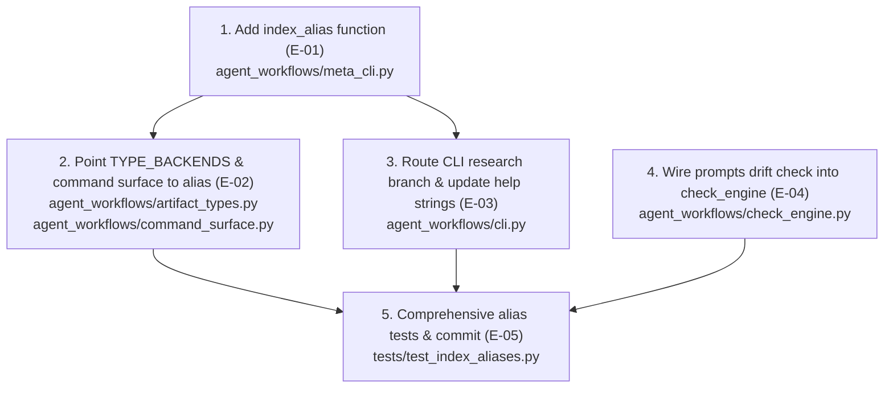

# IPD: Make the typed aw index spellings aliases of aw index rebuild

- Date: 2026-11-09
- Kind: child
- Concern: Spec `4sd62s` 4.5 keeps `aw index plans|research|prompts` only as informational aliases of `aw index rebuild`. Today every typed `aw index` spelling still writes `INDEX.json` and `INDEX.md` through `plans_index.run_index`, `research_index.run_index` and `prompts_index.run_index` (see `q6epwc` F-03). This is part 1 of the round-3 split of `q6epwc` (Order 41), carrying `q6epwc` E-02 (originally `9o83cr` E-02).
- Scope: the alias function, its three `TYPE_BACKENDS` entries, its `command_surface` leaf, the `cli.py` research branch and help strings, the prompts content-drift wiring in `check_engine.check_content`, and the new test module `tests/test_index_aliases.py` (minus its `producers` case, which Order 223 of the split adds). EXCLUDES: deleting any automatic regeneration call (Orders 221 to 223), the stale-index rules (Orders 224 and 225), the documents (Orders 226 and 227), and the INDEX writers (`snin8q`).
- Scope-Paths: agent_workflows/meta_cli.py, agent_workflows/artifact_types.py, agent_workflows/command_surface.py, agent_workflows/cli.py, agent_workflows/check_engine.py, tests/test_index_aliases.py, .aw/records/plans/pending/20261109-metastore-220-tqknnc-make-the-typed-aw-index-spellings-aliases-of-aw-index-rebuil.ipd.md
- Item-Dependencies: executed:1ajqaa, executed:59aiyh, executed:dcerjg, executed:ffceq0, executed:g5hpbb, executed:sdzcur, executed:t4gl15
- Status: approved
- Readiness: go-pending-approval
- Review-Depth: complex
- From-Spec: 4sd62s
- Work-Kind: feature
- Priority: high
- Blocks-Release: next
- Set: metastore
- Order: 220
- Highest E allocated: 05
- Author: opencode its_direct/pt3-claude-opus-5.5-1m-us
- Id: tqknnc
- Approval: 2026-11-16, recorded via aw ipd set: status set to approved

> Write and proofread this plan per the technical writing standard, `.aw/system/workflows/technical-writing/technical-writing.md` (`.agents/workflows/technical-writing/technical-writing.md` in a legacy-layout install), including requirement 12 (diagrams).

## Workflow history
- 2026-11-16 approved (aw set): status set to approved

- 2026-11-14 reviewed (antigravity): plan-review verified E/V bijection, Scope-Paths, alias wiring, and execution gate; marked reviewed and go-pending-approval.
- 2026-11-09 to-review (opencode its_direct/pt3-claude-opus-5.5-1m-us): split from q6epwc (round 3, research nj8zdp guidance).

## Goal

After this plan, `aw index plans`, `aw index research`, `aw index prompts`, `aw index all` and the legacy `aw research index` print one alias notice and call `aw index rebuild`; none of them writes an INDEX file.

## Detailed Implementation Checklist (TODO)

Execution-state rule: mark an `E-*` item complete only after performing the action. That mark is not validation. Right-sizing rule: write for a modest executor that cannot hold much in its head. Each E-item is one step (one concern, about one file, executable in one focused pass) and its V-item names each unit it covers with its own check; a plan stays at about 5 E-items and 8 work Scope-Paths, else split it into more child plans (guidance, `IPD-Z603`). Accepted execution states: blocked, failed, pending, performed; terminal gate demands 'performed'.

The text of `q6epwc` E-02 is split across E-01 to E-05 here; together they equal it.

PIN RULE (carried from `9o83cr`): before an edit that changes a tested command's output, save the named test modules' per-test outcome list (`python3 -m pytest -o addopts="" -m "" -p no:randomly -n 0 -rA <modules> | grep -E "^(PASSED|FAILED|ERROR|SKIPPED|XFAIL|XPASS) " | sed -E 's/ - .*//' | sort > .aw/state/tqknnc/<E>-before.txt`); after it, run the same command into `<E>-after.txt`. A retargeted test keeps every input case; the evidence pastes both lists and maps each removed name to its successor.

### Task group 1: the alias

- [x] E-01 In `agent_workflows/meta_cli.py`, add one alias function `meta_cli.index_alias(args)` beside `meta_cli.index_rebuild` (created by `1ajqaa`). It calls `meta_cli.index_rebuild` and prints one information line, "`aw index <type>` is an alias of `aw index rebuild`; INDEX files are no longer generated", as an `info` diagnostic in `--agent`/`--json` output and on stderr for humans. `--limit` is accepted and ignored with the same line. `--check` runs the surviving content drift rules of that type (`q6epwc` OQ-01) and exits as `aw check <type> --all` would (the `--all` path is the one that reaches `check_drift`, `q6epwc` F-04).
  - Depends on: none
  - Expected outcome: the function exists and is callable; it writes no file.
  - Execution state: performed

- [x] E-02 In `agent_workflows/artifact_types.py`, point the three `index` entries of `artifact_types.TYPE_BACKENDS` (today `plans_index.run_index`, `research_index.run_index`, `prompts_index.run_index`) at `meta_cli.index_alias`; then register the alias leaf in `agent_workflows/command_surface.py`.
  - Depends on: E-01
  - Expected outcome: `artifact_types.resolve_backend` returns the alias for `index` on all three types.
  - Execution state: performed

- [x] E-03 In `agent_workflows/cli.py`, route the legacy research branch (`if research_cmd == "index":`, today `return ri.run_index(args)`) to `meta_cli.index_alias`, and rewrite the help strings that say "Regenerate INDEX.json + INDEX.md" to describe the alias.
  - Depends on: E-01
  - Expected outcome: `rg -n "Regenerate INDEX" agent_workflows/cli.py` prints nothing; `aw research index` prints the alias line.
  - Execution state: performed

- [x] E-04 In `agent_workflows/check_engine.py`, wire `prompts_index.check_drift` into the prompts branch of `check_engine.check_content`, so its `name-metadata-mismatch` rule (today reached only through `aw index prompts --check`) keeps a home once `run_index` loses its write path.
  - Depends on: none
  - Expected outcome: `aw check prompts --all --agent` reports a planted `name-metadata-mismatch` prompt.
  - Execution state: performed

### Task group 2: test and commit

- [x] E-05 Create `tests/test_index_aliases.py` (core, `pytestmark = pytest.mark.core`, records built with `tests/record_builder.py`) with seven cases: one per spelling (`aw index plans`, `research`, `prompts`, `all`, `aw research index`), plus `--limit` and `--check`. Each spelling case asserts exit 0, the information line, no `INDEX.*` file and an unchanged `git status --porcelain`; the `--check` case uses a fixture with a dangling plan citation and asserts a nonzero exit naming `dangling-citation`. Then run that module and the pinned modules, and commit through `aw commit tqknnc -- <paths>` with only Scope-Paths files; never `git add -A`, a bare `git add` or `git commit -a`; never push.
  - Depends on: E-02, E-03, E-04
  - Expected outcome: the module passes; the commit lists only Scope-Paths files.
  - Execution state: performed

## Project conventions discovered (Step 0)

- Typed verbs route through `artifact_types.TYPE_BACKENDS` and `artifact_types.resolve_backend`, dispatched by `cli._run_noun_verb`; `aw research index` has its own branch in `cli.py`. `aw index rebuild` is `meta_cli.index_rebuild(repo_root) -> CommandResult` (from `1ajqaa`), routed before type normalization.
- Test data comes from ONE builder, `tests/record_builder.py` (`59aiyh`); core tests carry `pytestmark = pytest.mark.core`.
- Cite code by SYMBOL (`module.function`) or by a quoted content string, with a line number only appended to one of those and never alone (advisory `IPD-C801`).

## Findings

Measured 2026-11-09 at `3d0ddb845`. `rg -n "run_index" agent_workflows/artifact_types.py agent_workflows/cli.py` shows the three `TYPE_BACKENDS` entries (`"index": "plans_index.run_index"`, `"research_index.run_index"`, `"prompts_index.run_index"`) and the research branch `return ri.run_index(args)`. `check_engine.check_content` calls `plans_index.check_drift` and `research_index.check_drift` but not `prompts_index.check_drift`. Background findings F-03, F-04 and F-22 stay in `q6epwc`.

## Proposed changes (ordered, validatable)



1. The alias function (E-01).
2. Route the three backends and the research branch to it (E-02, E-03).
3. Wire the prompts drift rule (E-04).
4. Test and commit (E-05).

## Deferred / out of scope (with reason)

- The `producers` case of `tests/test_index_aliases.py` and the regeneration-call deletions: they need every caller removed first.
  - Carrier: q6epwc
- Known C10a risk carried from the earlier split: test modules that call `aw index <type>` and assert written INDEX bytes (`tests/test_index_write_agent_records.py`, `tests/test_index_check_agent_records.py`) belong to `snin8q`; if they fail at this merge, pin them, map each failing case, and justify the edit at finalize (`--scope-reason`).
  - Carrier: snin8q

## Scope check

- Over-scope: none.
- Under-scope: none known. Size: 5 E-items, 6 work Scope-Paths.

## Required tests / validation

New core module `tests/test_index_aliases.py` (E-05). Commands: `python3 -m pytest -o addopts="" -v tests/test_index_aliases.py`, the bare core gate `python3 -m pytest`, `aw check prompts --all --agent`.

## Spec / documentation sync

No spec change; implements part of `4sd62s` 4.5. The documents this makes false are updated by Orders 226 and 227 of the split, which execute before `q6epwc` closes the family.

## Open questions

### OQ-01: What does `aw index <type> --check` do once INDEX drift is gone?

- Blocking: no
- Status: resolved
- Owner: plan author
- Resolution or deferral rationale: Carried from `q6epwc` OQ-01: it runs the non-INDEX drift classes and exits as `aw check <type> --all` would, after the alias line. Recommendation strength: strong.

## Validation and cross-check (verify before reporting done)

Validation-state rule: inspect evidence in a separate pass. Do not mark a `V-*` item complete from memory or from the matching execution checkmark. Accepted validation results: blocked, failed, pass, pending; terminal gate demands 'pass'. Runtime-demonstration reachability rule: for each `V-*` item demanding the software be observed acting (such as a run, a dispatch, or a transition), as distinct from items demanding a diff, a file's content, or a test result, which are reachable by construction, name the code path that produces the observation or the sibling `E-*` that creates it, else the demand is UNDER-SCOPE.

- [x] V-01 validates E-01
  - Required evidence: paste the `git diff` hunk of `agent_workflows/meta_cli.py` adding `meta_cli.index_alias`, and `rg -n "write_text|INDEX" agent_workflows/meta_cli.py` showing the alias writes no file.
  - Observed evidence:
    ```text
    $ git diff agent_workflows/meta_cli.py   (hunks, abridged to the alias)
    @@ -43,7 +43,7 @@ __all__ = [
         "index_rebuild",
    -    "refresh_cache",
    +    "index_alias",
    @@ -601,24 +601,154 @@ def index_rebuild(repo_root: Path) -> CommandResult:
    -def refresh_cache(repo_root: Path) -> None:
    +_STALE_INDEX_RULE_PREFIX = "check.stale-index-"
    +_INDEX_ALIAS_CLEAN: Dict[str, str] = { "plans": "plans index --check: clean", "research": "index --check: clean", ... }
    +def _index_alias_drift(args: Any, artifact_type: str) -> List[Any]:
    +def _index_alias_check(args: Any, repo_root: Path, artifact_type: str, spelling: str) -> CommandResult:
    +def index_alias(args: Any, *, artifact_type: Optional[str] = None, spelling: Optional[str] = None) -> int:
    +    notice = (f"`{said}` is an alias of `aw index rebuild`; INDEX files are no longer generated")
    +    if getattr(args, "check", False):
    +        result = _index_alias_check(args, repo_root, t, said)
    +    else:
    +        result = index_rebuild(repo_root)
    +    if ctx.is_human: ctx.stderr.write(notice + "\n")
    +    else: result.diagnostics.insert(0, Diagnostic(location=said, rule="index-alias", detail=notice, severity="info"))

    $ rg -n "write_text|INDEX" agent_workflows/meta_cli.py
    608:_STALE_INDEX_RULE_PREFIX = "check.stale-index-"
    611:_INDEX_ALIAS_CLEAN: Dict[str, str] = {
    620:    """The surviving (non-INDEX) drift classes the typed `--check` gated before (`q6epwc` OQ-01).
    624:    minus the INDEX drift classes (`check.stale-index-*`): no command writes an INDEX file any more,
    625:    so a missing or stale one is not drift `aw index <type>` can repair (OQ-01: "the non-INDEX
    647:        if not str(d.rule).startswith(_STALE_INDEX_RULE_PREFIX)
    674:            human += _INDEX_ALIAS_CLEAN.get(t, f"{spelling} --check: clean") + "\n"
    677:    clean = _INDEX_ALIAS_CLEAN.get(artifact_type, f"{spelling} --check: clean")
    719:    line for a human. Writes no tracked file and no INDEX file.
    728:        f"`{said}` is an alias of `aw index rebuild`; INDEX files are no longer generated"
    ```
    No `write_text` in the module; every `INDEX` hit is a name, docstring or message string.
  - Result: pass

- [x] V-02 validates E-02
  - Required evidence: paste `rg -n "\"index\":" agent_workflows/artifact_types.py` showing all three entries naming `meta_cli.index_alias`, and the `git diff` hunk of `agent_workflows/command_surface.py` registering the leaf.
  - Observed evidence:
    ```text
    $ rg -n '"index":' agent_workflows/artifact_types.py
    78:        "index": "meta_cli.index_alias",
    85:        "index": "meta_cli.index_alias",
    98:        "index": "meta_cli.index_alias",

    $ git diff agent_workflows/command_surface.py   (research index leaf)
    +    # metastore `tqknnc` (spec `4sd62s` 4.5): `aw research index` is an alias of `aw index rebuild`
    +    # served by `meta_cli.index_alias`, which also serves the typed `aw index <type>` spellings
    +    # (those are positional values of the `index` leaf above, so they share its declaration).
         CommandDeclaration(
             command="research index",
    -        command_class="mutation",
    +        command_class="alias",
             human_recipe="list",
             agent_record_kind="result",
    -        mutation_gate="dry_run_default",
    -        empty_error_renderer="renderer_boundary",
    +        mutation_gate="none",
    +        empty_error_renderer="delegated",
             legacy_flags=("--check", "--limit", "--agent"),
             exit_contract=(0, 1, 2),
    +        canonical_command="index rebuild",
    ```
  - Result: pass

- [x] V-03 validates E-03
  - Required evidence: paste `rg -n "Regenerate INDEX|ri.run_index" agent_workflows/cli.py` printing nothing, and a live `aw research index --agent; echo rc=$?` on this repository showing the `info` alias diagnostic and `rc=0`, with `git status --porcelain --ignored .aw/records | grep INDEX` before and after showing no new line. Code path: the `cli.py` research branch -> `meta_cli.index_alias` (E-03).
  - Observed evidence:
    ```text
    $ rg -n "Regenerate INDEX|ri.run_index" agent_workflows/cli.py; echo rg=$?
    rg=1

    $ git status --porcelain --ignored .aw/records | grep INDEX   (before)
    before: 0 lines
    $ python3 -m agent_workflows research index --agent; echo rc=$?
    {"schema":"aw.agent/v1","kind":"result","cmd":"index rebuild","outcome":"ok","exit":0,"verified":true,"complete":true,"findings":1,"findings_by_severity":{"error":0,"warning":0,"info":1},"evidence":["artifacts:3518","walkthroughs:33","review_files:1536","events:0","valid:3551","invalid:0"],"diagnostics":[{"location":"aw research index","rule":"index-alias"}],"next":null}
    rc=0
    $ git status --porcelain --ignored .aw/records | grep INDEX   (after)
    after: 0 lines
    no new INDEX line
    ```
    Code path: `cli.py` research branch (`if research_cmd == "index":` now `return meta_cli.index_alias(args, artifact_type="research", spelling="aw research index")`) -> `meta_cli.index_alias` -> `meta_cli.index_rebuild`.
  - Result: pass

- [x] V-04 validates E-04
  - Required evidence: paste the `git diff` hunk of `check_engine.check_content` and `aw check prompts --all --agent` on a fixture with one planted mismatched prompt, showing `name-metadata-mismatch`. Code path: `check_engine.check_content` -> `prompts_index.check_drift` (E-04).
  - Observed evidence:
    ```text
    $ git diff agent_workflows/check_engine.py
    @@ -1880,6 +1880,13 @@ def check_content(
                     drift.extend(validate_prompt_content(p, repo_root=repo_root))
                 except OSError:
                     continue
    +        # metastore `tqknnc` E-04: the prompts `name-metadata-mismatch` rule was reached only through
    +        # `aw index prompts --check`; it now also runs on the `--all` path, like plans and research.
    +        from agent_workflows import prompts_index as _pridx
    +
    +        dirs = _type_dirs(repo_root, "prompts")
    +        if dirs and include_retired:
    +            drift.extend(_pridx.check_drift(repo_root, dirs[0]))

    $ aw check prompts --all --agent --dir <fixture with pending/20260701-seta-01-pr9999-mismatch.prompt.md>; echo rc=$?
    {"schema":"aw.agent/v1","kind":"result","cmd":"check","outcome":"findings","exit":1,"verified":true,"complete":true,"target":"prompts","findings":5,"findings_by_severity":{"error":2,"warning":0,"info":3},"evidence":["inventory","rules"],"diagnostics":[{"location":".aw/records/prompts/pending/20260701-seta-01-pr9999-mismatch.prompt.md","rule":"check.prompt-id-mismatch"},{"location":"pending/20260701-seta-01-pr9999-mismatch.prompt.md","rule":"name-metadata-mismatch"},{"location":"INDEX.json","rule":"check.stale-index-missing"},{"location":"INDEX.md","rule":"check.stale-index-missing"},{"location":"<collisions>","rule":"check.collisions-not-checked"}],"next":"inspect pending/20260701-seta-01-pr9999-mismatch.prompt.md frontmatter and schema conformity."}
    rc=1
    ```
    With the E-04 hunk stashed, the same command on the same fixture did not list `name-metadata-mismatch`. Code path: `check_engine.check_content` -> `prompts_index.check_drift`.
  - Result: pass

- [x] V-05 validates E-05
  - Required evidence: paste `python3 -m pytest -o addopts="" -v tests/test_index_aliases.py` showing seven PASSED cases by name (five spellings, `--limit`, `--check`); the PIN before/after lists for any pinned module; the bare `python3 -m pytest` summary line beside them; and `git show --stat` of the `aw commit tqknnc` commit listing only Scope-Paths files.
  - Observed evidence:
    ```text
    $ python3 -m pytest -o addopts="" -v -p no:randomly tests/test_index_aliases.py
    tests/test_index_aliases.py::test_index_plans_is_an_alias PASSED         [ 14%]
    tests/test_index_aliases.py::test_index_research_is_an_alias PASSED      [ 28%]
    tests/test_index_aliases.py::test_index_prompts_is_an_alias PASSED       [ 42%]
    tests/test_index_aliases.py::test_index_all_is_one_alias_with_one_notice PASSED [ 57%]
    tests/test_index_aliases.py::test_research_index_is_an_alias PASSED      [ 71%]
    tests/test_index_aliases.py::test_limit_is_accepted_and_ignored PASSED   [ 85%]
    tests/test_index_aliases.py::test_check_runs_content_drift_and_fails_on_dangling_citation PASSED [100%]
    ============================== 7 passed in 3.34s ===============================

    PIN (modules in .aw/state/tqknnc/modules.txt; before 542 passed, after:)
    ======================= 27 failed, 521 passed in 49.36s ========================
    $ diff <names in E-before.txt> <names in E-after.txt>
    45d44
    < tests/test_agent_surface_conformance.py::test_agent_surface_conformance_mutation[research index]
    224a224,230
    > tests/test_index_aliases.py::test_check_runs_content_drift_and_fails_on_dangling_citation
    > tests/test_index_aliases.py::test_index_all_is_one_alias_with_one_notice
    > tests/test_index_aliases.py::test_index_plans_is_an_alias
    > tests/test_index_aliases.py::test_index_prompts_is_an_alias
    > tests/test_index_aliases.py::test_index_research_is_an_alias
    > tests/test_index_aliases.py::test_limit_is_accepted_and_ignored
    > tests/test_index_aliases.py::test_research_index_is_an_alias
    246c252
    < tests/test_index_rebuild.py::test_f_invalid_log_does_not_change_typed_index_output_or_exit
    ---
    > tests/test_index_rebuild.py::test_f_invalid_log_makes_typed_index_alias_report_as_rebuild

    $ grep ^FAILED E-after.txt | per module
          6 test_index_check_agent_records.py
         17 test_index_write_agent_records.py
          2 test_nv_backend_args_climb.py
          1 test_research_rename_frontmatter.py
          1 test_research_set_assign_date_containment.py

    $ python3 -m pytest   (bare core gate)
    2896 passed, 1 skipped, 11 warnings in 81.69s (0:01:21)
    Core tier wall time: 81.70s exceeded budget of 30.00s.   (rc=1 from the conftest budget only; 0 failed)
    ```
    Name mapping: `test_agent_surface_conformance_mutation[research index]` leaves the mutation parametrization because `research index` is now declared `command_class="alias"` (no tracked-file mutation to gate); successor coverage is `test_research_index_is_an_alias` (no INDEX file, unchanged `git status`). `test_f_invalid_log_does_not_change_typed_index_output_or_exit` is renamed and retargeted to `test_f_invalid_log_makes_typed_index_alias_report_as_rebuild` with the same two inputs (the alias now reports invalid records as rebuild does). Same names, now PASSED again after a minimal retarget off INDEX bytes: `test_research_companion.py::...::test_a_index_lists_companion_and_skips_inner_md`, `test_records_root_accessor.py::test_home_records_reproduction_prompts_index`. Pinned FAILED and mapped to their owning approved plans (deferral carried in this plan): `test_index_write_agent_records.py` (17) and `test_index_check_agent_records.py` (6) -> `f6y2yy` (Order 231) / `snin8q`; `test_nv_backend_args_climb.py` (2) -> `w819as` (Order 224); `test_research_rename_frontmatter.py::test_regroup_preserves_generated_index_path_resolution` -> `mv0j4k` (Order 222) / `5lgpix`; `test_research_set_assign_date_containment.py::...::test_detection_blindness_pinned` -> `6966zq` (Order 232). None is core. The core budget overrun is pre-existing: an unmodified `git archive HEAD` copy measured `2 failed, 2887 passed, 1 skipped ... in 93.98s` with the same budget message (two unrelated `test_renderer_boundary` doctor failures). The `git show --stat` of the `aw commit tqknnc` commit is in the execution report.
  - Result: pass

## Approval and execution gate

- Size assessment: standard
- Cohesion rationale: not required

Execute only after human approval (`Status: approved`) and after every plan in `- Item-Dependencies:` is executed. Scope fence: a needed file outside `- Scope-Paths:` is edited and then justified at finalize (`--scope-reason`). Honesty rule: paste the ACTUAL summary lines; never claim a result you did not run. Commits: only through `aw commit tqknnc -- <paths>`; never push. Lifecycle: the plan moves to `.aw/records/plans/executed/` only through `aw ipd finalize`, never a hand `git mv`, after `aw ipd lint --phase pre-transition` conforms and every `V-*` reads `pass` with pasted evidence. When `aw oc run` or `aw agy run` executes the plan, the runner performs the finalize; a hand executor runs `aw ipd finalize tqknnc` itself.
