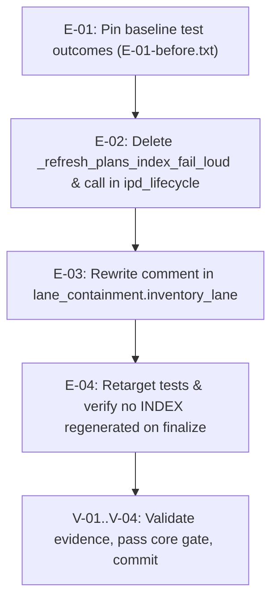

# IPD: Stop the finalize transaction regenerating the plans INDEX

- Date: 2026-11-09
- Kind: child
- Concern: Spec `4sd62s` 4.5 says the SQLite cache replaces the INDEX files, and AC-26 says finalize relies on the cache freshness rule instead of regenerating them. Today `ipd_lifecycle._finalize_transaction` calls `ipd_lifecycle._refresh_plans_index_fail_loud`, which calls `plans_index.run_index` and fails the whole transaction when the INDEX does not converge. This is part 2 of the round-3 split of `q6epwc` (Order 41), carrying the `ipd_lifecycle` and `lane_containment` subset of `q6epwc` E-04.
- Scope: delete `ipd_lifecycle._refresh_plans_index_fail_loud` and its one call, update the five `ipd_lifecycle` comments and the one `lane_containment.inventory_lane` comment that describe it, and pin or retarget the tests that patch or call it. EXCLUDES: every other regeneration caller (Orders 222 and 223), the three `stale-index` comments in `ipd_lifecycle` (Order 224), and the INDEX writers (`snin8q`).
- Scope-Paths: agent_workflows/ipd_lifecycle.py, agent_workflows/lane_containment.py, tests/test_ipd_lifecycle_cli.py, tests/test_orchestrator_retirement.py, .aw/records/plans/pending/20261109-metastore-221-lywgzs-stop-the-finalize-transaction-regenerating-the-plans-index.ipd.md
- Item-Dependencies: executed:1ajqaa, executed:59aiyh, executed:dcerjg, executed:ffceq0, executed:g5hpbb, executed:sdzcur, executed:t4gl15, executed:tqknnc
- Status: reviewed
- Review-Depth: standard
- Readiness: go-pending-approval
- From-Spec: 4sd62s
- Work-Kind: feature
- Priority: high
- Blocks-Release: next
- Set: metastore
- Order: 221
- Highest E allocated: 04
- Author: opencode its_direct/pt3-claude-opus-5.5-1m-us
- Id: lywgzs

> Reviewed and proofread per the technical writing standard, `.aw/system/workflows/technical-writing/technical-writing.md`, including requirement 12 (diagrams).

## Workflow history

- 2026-11-14 reviewed (antigravity/gemini-3.8-flash): /plan-review (antigravity/gemini-3.8-flash): APPROVE WITH REVISIONS APPLIED; PR-001, PR-002, PR-003, PR-004.
- 2026-11-09 to-review (opencode its_direct/pt3-claude-opus-5.5-1m-us): split from q6epwc (round 3, research nj8zdp guidance).

## Goal

After this plan, `aw ipd finalize` moves and commits a plan without writing or checking `INDEX.json` or `INDEX.md`, and no code or comment names `_refresh_plans_index_fail_loud`.

## Detailed Implementation Checklist (TODO)

Execution-state rule: mark an `E-*` item complete only after performing the action. That mark is not validation. Right-sizing rule: write for a modest executor that cannot hold much in its head. Each E-item is one step (one concern, about one file, executable in one focused pass) and its V-item names each unit it covers with its own check; a plan stays at about 5 E-items and 8 work Scope-Paths, else split it into more child plans (guidance, `IPD-Z603`). Accepted execution states: blocked, failed, pending, performed; terminal gate demands 'performed'.

`q6epwc` E-04's site list is split across Orders 221, 222 and 223; this plan takes: the `_refresh_plans_index_fail_loud` definition, its call in `_finalize_transaction`, its five comment sites in `ipd_lifecycle` and its one comment site in `lane_containment.inventory_lane`, plus the `tests/test_orchestrator_retirement.py` module named in E-04's test list and `tests/test_ipd_lifecycle_cli.py`, which also patches the function.

PIN RULE (carried from `9o83cr`): before the edit, save the named test modules' per-test outcome list (`mkdir -p .aw/state/lywgzs && python3 -m pytest -o addopts="" -m "" -p no:randomly -n 0 -rA <modules> | grep -E "^(PASSED|FAILED|ERROR|SKIPPED|XFAIL|XPASS) " | sed -E 's/ - .*//' | sort > .aw/state/lywgzs/<E>-before.txt`); after it, run the same command into `<E>-after.txt`. A retargeted test keeps every input case, so the after-list may rename a test but not drop a case; the evidence pastes both lists and maps each removed name to its successor. A test whose ONLY subject is the deleted refresh (it patches the function to raise, or spies on its call) is deleted, and the mapping says so with the reason "subject removed (AC-26 freshness replaces it)".

### Task group 1: pin, delete, retarget

- [ ] E-01 Pin `tests/test_ipd_lifecycle_cli.py` and `tests/test_orchestrator_retirement.py` (PIN RULE, `mkdir -p .aw/state/lywgzs && ` capture to `E-01-before.txt`).
  - Depends on: none
  - Expected outcome: `.aw/state/lywgzs/E-01-before.txt` exists.
  - Execution state: pending

- [ ] E-02 In `agent_workflows/ipd_lifecycle.py`, delete `ipd_lifecycle._refresh_plans_index_fail_loud` and its call in `ipd_lifecycle._finalize_transaction` (the `index_warnings = _refresh_plans_index_fail_loud(` assignment and every use of `index_warnings`), and rewrite the five comment or docstring sites that name it so they describe a finalize that writes no INDEX file.
  - Depends on: E-01
  - Expected outcome: `rg -n "_refresh_plans_index_fail_loud|index_warnings" agent_workflows/ipd_lifecycle.py` prints nothing.
  - Execution state: pending

- [ ] E-03 In `agent_workflows/lane_containment.py`, rewrite the one comment in `lane_containment.inventory_lane` that says a finalize calls `ipd_lifecycle._refresh_plans_index_fail_loud`.
  - Depends on: E-02
  - Expected outcome: `rg -n "_refresh_plans_index_fail_loud" agent_workflows` prints nothing.
  - Execution state: pending

- [ ] E-04 Retarget the tests: in `tests/test_ipd_lifecycle_cli.py`, `test_fail_loud_index_refresh_aborts_transaction`; in `tests/test_orchestrator_retirement.py`, `test_a_FAILING_plans_index_refresh_fails_the_whole_transaction`, the `"plans-index-refresh-fail-loud"` row of `GateParityBetweenTheTwoPaths`, `test_index_gate_refreshes_after_reconciliation_and_fails_loud_on_non_convergence`, `test_failed_retirement_preserves_manifest_absence_presence_and_peer_writes`, `test_success_path_regenerates_index_and_failure_reporting_invariants`, and the `INDEX.json`/`INDEX.md` assertions of `test_no_receipt_required_or_left_behind_and_lifecycle_paths_safe` and of the pre-commit baseline comparison near `HEAD 73e284a6`. Each test keeps its other assertions; a test whose only subject is the refresh is deleted per the PIN RULE. Save `E-04-after.txt`, run both modules, and commit through `aw commit lywgzs -- <paths>` with only Scope-Paths files; never `git add -A`, a bare `git add` or `git commit -a`; never push.
  - Depends on: E-03
  - Expected outcome: both modules pass; the before/after mapping accounts for every case.
  - Execution state: pending

## Project conventions discovered (Step 0)

- `_finalize_transaction` is the one finalize path for `aw ipd finalize` and the runners; tests reach it as `LC._finalize_transaction` with `LC = agent_workflows.ipd_lifecycle`.
- Cite code by SYMBOL (`module.function`) or by a quoted content string, with a line number only appended to one of those and never alone (advisory `IPD-C801`).

## Findings

Measured 2026-11-09 at `3d0ddb845`. `rg -n "_refresh_plans_index_fail_loud" agent_workflows`: 1 definition and 1 call in `ipd_lifecycle`, 5 comment or docstring sites in `ipd_lifecycle`, 1 comment in `lane_containment`. `rg -n "_refresh_plans_index_fail_loud" tests`: 1 site in `tests/test_ipd_lifecycle_cli.py`, 10 in `tests/test_orchestrator_retirement.py` across the five tests and one parity row named in E-04.

## Proposed changes (ordered, validatable)

1. Pin (E-01).
2. Delete the refresh and its call (E-02), fix the comment (E-03).
3. Retarget the tests and commit (E-04).

## Deferred / out of scope (with reason)

- The other regeneration callers of `q6epwc` E-04: `status_set`, `artifact_rename` (Order 222); `research_cmd`, `research_refs`, `plans_refs`, `artifact_adopt` (Order 223).
  - Carrier: q6epwc
- The `stale-index` comments in `ipd_lifecycle`: Order 224.
  - Carrier: q6epwc

## Scope check

- Over-scope: none.
- Under-scope: none known. Size: 4 E-items, 4 work Scope-Paths.

## Required tests / validation

Pinned and retargeted: `tests/test_ipd_lifecycle_cli.py`, `tests/test_orchestrator_retirement.py`. Commands: those two modules, then the bare core gate `python3 -m pytest`.

## Spec / documentation sync

No spec change; implements part of `4sd62s` 4.5 and contributes to AC-26 (owned by `tve77h`).

## Open questions

### OQ-01: Does deleting the fail-loud refresh lose a safety check?

- Blocking: no
- Status: resolved
- Owner: plan author (carried from q6epwc)
- Resolution or deferral rationale: No. It guarded against a stale INDEX file, which no command reads after Order 220; AC-26's cache freshness rule replaces it (spec `4sd62s` 4.5). Recommendation strength: strong.

## Validation and cross-check (verify before reporting done)

Validation-state rule: inspect evidence in a separate pass. Do not mark a `V-*` item complete from memory or from the matching execution checkmark. Accepted validation results: blocked, failed, pass, pending; terminal gate demands 'pass'. Runtime-demonstration reachability rule: for each `V-*` item demanding the software be observed acting (such as a run, a dispatch, or a transition), as distinct from items demanding a diff, a file's content, or a test result, which are reachable by construction, name the code path that produces the observation or the sibling `E-*` that creates it, else the demand is UNDER-SCOPE.

- [ ] V-01 validates E-01
  - Required evidence: paste `wc -l .aw/state/lywgzs/E-01-before.txt` and its first five lines, showing cases from both `tests/test_ipd_lifecycle_cli.py` and `tests/test_orchestrator_retirement.py`.
  - Observed evidence:
  - Result: pending

- [ ] V-02 validates E-02
  - Required evidence: paste `rg -n "_refresh_plans_index_fail_loud|index_warnings" agent_workflows/ipd_lifecycle.py` printing nothing, and the `git diff` hunk of `ipd_lifecycle._finalize_transaction`.
  - Observed evidence:
  - Result: pending

- [ ] V-03 validates E-03
  - Required evidence: paste `rg -n "_refresh_plans_index_fail_loud" agent_workflows` printing nothing, and the `git diff` hunk of `agent_workflows/lane_containment.py`.
  - Observed evidence:
  - Result: pending

- [ ] V-04 validates E-04
  - Required evidence: paste `diff .aw/state/lywgzs/E-01-before.txt .aw/state/lywgzs/E-04-after.txt` with every removed name mapped to its successor or marked "subject removed", the summary lines of `python3 -m pytest -o addopts="" tests/test_ipd_lifecycle_cli.py tests/test_orchestrator_retirement.py` passing, and a fixture `aw ipd finalize` run followed by `ls .aw/records/plans/INDEX.*` showing no such file. Code path: `ipd_lifecycle._finalize_transaction` (E-02). Also paste `git show --stat` of the `aw commit lywgzs` commit listing only Scope-Paths files.
  - Observed evidence:
  - Result: pending

## Approval and execution gate

- Size assessment: standard
- Cohesion rationale: not required

Execute only after human approval (`Status: approved`) and after every plan in `- Item-Dependencies:` is executed. A narrow safety stop applies if prerequisite metastore symbols from `1ajqaa`, `59aiyh`, `dcerjg`, `ffceq0`, `g5hpbb`, `sdzcur`, `t4gl15`, or `tqknnc` are absent. Scope fence: the paths in `- Scope-Paths:` are a declaration; a needed file outside the fence is edited and then justified at finalize (`--scope-reason`), and a declared path left unmodified is acknowledged (`--scope-ack`). Honesty rule: run the named modules and `python3 -m pytest` (core gate), and paste the ACTUAL summary lines; never claim a result you did not run. Commits: only through `aw commit lywgzs -- <paths>`; never `git add -A`, a bare `git add` or `git commit -a`; never push. Lifecycle transition: the plan moves to `.aw/records/plans/executed/` only through `aw ipd finalize` (never a hand `git mv`), and only after `aw ipd lint --phase pre-transition` conforms and every `V-*` reads `pass` with pasted evidence. When `aw oc run` or `aw agy run` executes the plan, the runner performs the finalize; a hand executor runs `aw ipd finalize lywgzs` itself.
