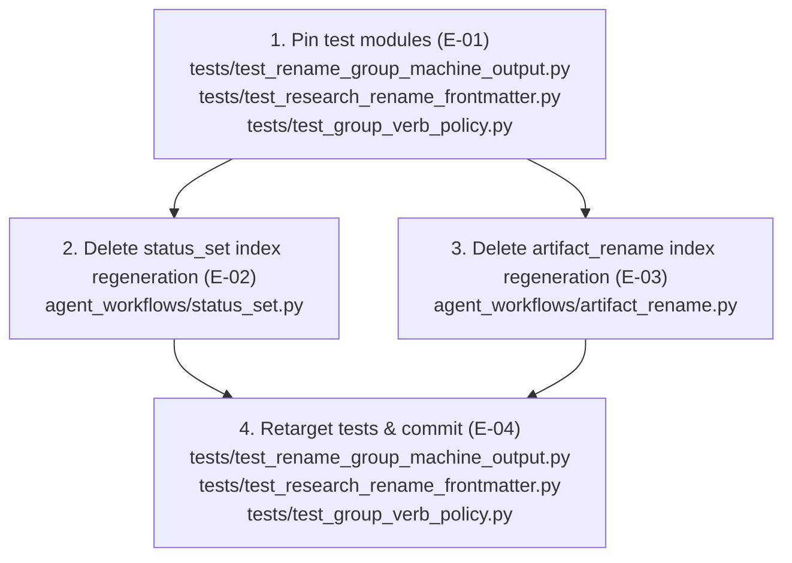

# IPD: Stop status set and the generic rename and group regenerating INDEX files

- Date: 2026-11-09
- Kind: child
- Concern: Spec `4sd62s` 4.5 says the SQLite cache replaces the INDEX files. Today `aw ipd set`, `aw backlog set` and `aw specs set` regenerate INDEX files through `status_set._auto_index_types`, and `aw rename <type>` and `aw group <type>` regenerate them through four `run_index` calls in `artifact_rename`. This is part 3 of the round-3 split of `q6epwc` (Order 41), carrying the `status_set` and `artifact_rename` subset of `q6epwc` E-04.
- Scope: delete `status_set._auto_index_types` and its two calls, delete the four `run_index` calls in `artifact_rename.run_rename_generic` and `artifact_rename.run_group_generic`, and pin the three test modules that assert those commands' INDEX lines or files. EXCLUDES: the finalize refresh (Order 221), the research, plan-rename and adopt callers (Order 223), and the INDEX writers (`snin8q`).
- Scope-Paths: agent_workflows/status_set.py, agent_workflows/artifact_rename.py, tests/test_rename_group_machine_output.py, tests/test_research_rename_frontmatter.py, tests/test_group_verb_policy.py, .aw/records/plans/pending/20261109-metastore-222-mv0j4k-stop-status-set-and-the-generic-rename-and-group-regeneratin.ipd.md
- Item-Dependencies: executed:1ajqaa, executed:59aiyh, executed:dcerjg, executed:ffceq0, executed:g5hpbb, executed:sdzcur, executed:t4gl15, executed:tqknnc
- Status: approved
- Readiness: go-pending-approval
- Review-Depth: standard
- From-Spec: 4sd62s
- Work-Kind: feature
- Priority: high
- Blocks-Release: next
- Set: metastore
- Order: 222
- Highest E allocated: 04
- Author: opencode its_direct/pt3-claude-opus-5.5-1m-us
- Id: mv0j4k
- Approval: 2026-11-16, recorded via aw ipd set: status set to approved

> Written to .aw/system/workflows/technical-writing/technical-writing.md. Every obligation, exact identifier, quotation, evidence record, and lifecycle status is preserved.

## Workflow history
- 2026-11-16 approved (aw set): status set to approved

- 2026-11-14 reviewed (antigravity/gemini-3.8-flash): /plan-review (antigravity/gemini-3.8-flash): APPROVE WITH REVISIONS APPLIED; PR-001..PR-006; review record .aw/records/reviews/20261109-metastore-222-mv0j4k-stop-status-set-and-the-generic-rename-and-group-regeneratin.review.md
- 2026-11-09 to-review (opencode its_direct/pt3-claude-opus-5.5-1m-us): split from q6epwc (round 3, research nj8zdp guidance).

## Goal

After this plan, the status setters and the generic rename and group verbs change records without writing `INDEX.json` or `INDEX.md`; each command's other output is unchanged.

## Detailed Implementation Checklist (TODO)

Execution-state rule: mark an `E-*` item complete only after performing the action. That mark is not validation. Right-sizing rule: write for a modest executor that cannot hold much in its head. Each E-item is one step (one concern, about one file, executable in one focused pass) and its V-item names each unit it covers with its own check; a plan stays at about 5 E-items and 8 work Scope-Paths, else split it into more child plans (guidance, `IPD-Z603`). Accepted execution states: blocked, failed, pending, performed; terminal gate demands 'performed'.

`q6epwc` E-04's site list is split across Orders 221, 222 and 223; this plan takes: `status_set._auto_index_types` (definition, its two inner `run_index` calls, its two callers in `status_set.run_set_command`) and the four `run_index` sites in `artifact_rename` (two in `run_rename_generic`, two in `run_group_generic`), plus the test modules `tests/test_rename_group_machine_output.py`, `tests/test_research_rename_frontmatter.py` and `tests/test_group_verb_policy.py` from E-04's test list. Ensure `.aw/state/mv0j4k/` exists (`mkdir -p .aw/state/mv0j4k/`). "Each affected command's result loses only its INDEX-refresh line; pin each command's other output in the touched tests first" (carried from `q6epwc` E-04).

PIN RULE (carried from `9o83cr`): before the edit, save the named test modules' per-test outcome list (`python3 -m pytest -o addopts="" -m "" -p no:randomly -n 0 -rA <modules> | grep -E "^(PASSED|FAILED|ERROR|SKIPPED|XFAIL|XPASS) " | sed -E 's/ - .*//' | sort > .aw/state/mv0j4k/<E>-before.txt`); after it, run the same command into `<E>-after.txt`. A retargeted test keeps every input case, so the after-list may rename a test but not drop a case; the evidence pastes both lists and maps each removed name to its successor.

### Task group 1: pin, delete, retarget

- [x] E-01 Create `.aw/state/mv0j4k/` (`mkdir -p .aw/state/mv0j4k/`) and pin `tests/test_rename_group_machine_output.py`, `tests/test_research_rename_frontmatter.py` and `tests/test_group_verb_policy.py` (PIN RULE, `E-01-before.txt`).
  - Depends on: none
  - Expected outcome: `.aw/state/mv0j4k/E-01-before.txt` exists.
  - Execution state: performed

- [x] E-02 In `agent_workflows/status_set.py`, delete `status_set._auto_index_types` and its two calls in `status_set.run_set_command`, and rewrite the docstring sentence that says touched types are "refreshed on disk by `_auto_index_types`".
  - Depends on: E-01
  - Expected outcome: `rg -n "_auto_index_types|run_index" agent_workflows/status_set.py` prints nothing.
  - Execution state: performed

- [x] E-03 In `agent_workflows/artifact_rename.py`, delete the two `run_index` calls in `artifact_rename.run_rename_generic` and the two in `artifact_rename.run_group_generic`, with the result lines they add.
  - Depends on: E-01
  - Expected outcome: `rg -n "run_index" agent_workflows/artifact_rename.py` prints nothing.
  - Execution state: performed

- [x] E-04 Retarget the three pinned modules so they assert only on surviving output: `tests/test_rename_group_machine_output.py` (`_NESTED_PLANS_INDEX_LINE`, `_NESTED_RESEARCH_INDEX_LINE` and their uses), `tests/test_research_rename_frontmatter.py` (the "generated INDEX.json points to a path that exists" case becomes "`aw find research` shows the regrouped path"), and `tests/test_group_verb_policy.py` (the `f.name != "INDEX.md"` filters stay valid and need no change unless a case fails). Save `E-04-after.txt`, run the three modules, and commit through `aw commit mv0j4k -- <paths>` with only Scope-Paths files; never `git add -A`, a bare `git add` or `git commit -a`; never push.
  - Depends on: E-02, E-03
  - Expected outcome: the three modules pass; the before/after mapping accounts for every case.
  - Execution state: performed

## Project conventions discovered (Step 0)

- `agent_workflows/status_set.py::run_set_command` is the shared engine of the typed setters; `agent_workflows/artifact_rename.py::run_rename_generic` and `agent_workflows/artifact_rename.py::run_group_generic` back `aw rename <type>` and `aw group <type>`.
- Cite code by SYMBOL (`agent_workflows/module.py::function_or_symbol`) or by a quoted content string, with a line number only appended to one of those and never alone (advisory `IPD-C801`).

## Findings

Measured 2026-11-09 at `3d0ddb845`: `rg -n "_auto_index_types|run_index" agent_workflows/status_set.py` prints 1 definition, 2 inner `run_index` calls, 2 call sites and 1 docstring mention; `rg -n "run_index" agent_workflows/artifact_rename.py` prints 4 sites (2 in `run_rename_generic`, 2 in `run_group_generic`). `rg -c "INDEX\.(json|md)"`: `tests/test_rename_group_machine_output.py` 10, `tests/test_research_rename_frontmatter.py` 7, `tests/test_group_verb_policy.py` 6.

## Proposed changes (ordered, validatable)



1. Pin (E-01).
2. Delete the `status_set` (E-02) and `artifact_rename` (E-03) callers.
3. Retarget and commit (E-04).

## Deferred / out of scope (with reason)

- The finalize refresh (Order 221) and the `research_cmd`, `research_refs`, `plans_refs` and `artifact_adopt` callers (Order 223).
  - Carrier: q6epwc

## Scope check

- Over-scope: none.
- Under-scope: none known. Size: 4 E-items, 5 work Scope-Paths.

## Required tests / validation

Pinned and retargeted: `tests/test_rename_group_machine_output.py`, `tests/test_research_rename_frontmatter.py`, `tests/test_group_verb_policy.py`. Commands: those three modules, then the bare core gate `python3 -m pytest`.

## Spec / documentation sync

No spec change; implements part of `4sd62s` 4.5.

## Open questions

### OQ-01: Does any caller read the value `_auto_index_types` returned?

- Blocking: no
- Status: resolved
- Owner: plan author
- Resolution or deferral rationale: Only the agent-mode changes list, which reported the refreshed INDEX paths; after this plan those entries are absent, which is the intended output change pinned by E-04. Recommendation strength: medium.

## Validation and cross-check (verify before reporting done)

Validation-state rule: inspect evidence in a separate pass. Do not mark a `V-*` item complete from memory or from the matching execution checkmark. Accepted validation results: blocked, failed, pass, pending; terminal gate demands 'pass'. Runtime-demonstration reachability rule: for each `V-*` item demanding the software be observed acting (such as a run, a dispatch, or a transition), as distinct from items demanding a diff, a file's content, or a test result, which are reachable by construction, name the code path that produces the observation or the sibling `E-*` that creates it, else the demand is UNDER-SCOPE.

- [x] V-01 validates E-01
  - Required evidence: paste `wc -l .aw/state/mv0j4k/E-01-before.txt` and one line from each of the three named modules.
  - Observed evidence:
    ```
$ wc -l .aw/state/mv0j4k/E-01-before.txt
72 .aw/state/mv0j4k/E-01-before.txt
FAILED tests/test_rename_group_machine_output.py::test_index_verbs_unaffected
FAILED tests/test_research_rename_frontmatter.py::test_regroup_preserves_generated_index_path_resolution
PASSED tests/test_group_verb_policy.py::test_group_and_rename_command_surface_declarations
```
    Baseline note: the two FAILED cases already failed before any edit, because `tqknnc` made `aw index plans` and `aw index research` aliases of `aw index rebuild` that no longer write INDEX files; E-04 retargets both.
  - Result: pass

- [x] V-02 validates E-02
  - Required evidence: paste `rg -n "_auto_index_types|run_index" agent_workflows/status_set.py` printing nothing, and a fixture `aw ipd set to-review <id6>` followed by `ls .aw/records/plans/INDEX.*` showing no such file. Code path: `status_set.run_set_command` (E-02).
  - Observed evidence:
    ```
$ rg -n "_auto_index_types|run_index" agent_workflows/status_set.py; echo "rc=$?"
rc=1
$ aw ipd set to-review abc123 --dir <fixture>   # tests/record_builder.py plan, git-initialised tmp repo
-    plan        20261001-eeiytw-01-abc123  [medium]  draft → ◔  to-review
rc=0
$ ls <fixture>/.aw/records/plans/INDEX.*
ls: cannot access '<fixture>/.aw/records/plans/INDEX.*': No such file or directory
```
    The same fixture run on the unedited code wrote `INDEX.json` and `INDEX.md`. The now-unused `touched_types` set and the module-level `Change` import (F401 and F811 under `ruff --select F`) were also removed.
  - Result: pass

- [x] V-03 validates E-03
  - Required evidence: paste `rg -n "run_index" agent_workflows/artifact_rename.py` printing nothing, and a fixture `aw group plans` run followed by `ls .aw/records/plans/INDEX.*` showing no such file. Code path: `artifact_rename.run_group_generic` (E-03).
  - Observed evidence:
    ```
$ rg -n "run_index" agent_workflows/artifact_rename.py; echo "rc=$?"
rc=1
$ python3 -c '... artifact_rename.run_group_generic(Namespace(ids=["abc123"], set="newset", order=2, apply=True, no_commit=True, ...), "plans")'
set metadata Set: newset in .aw/records/plans/pending/20261001-eeiytw-01-abc123-demo.ipd.md
rc= 0 generated= ()
$ ls <fixture>/.aw/records/plans/INDEX.*
ls: cannot access '<fixture>/.aw/records/plans/INDEX.*': No such file or directory
```
    Decision 145-mv0j4k-D1: the CLI spelling `aw group plans` dispatches through `artifact_types.TYPE_BACKENDS` to `plans_refs.run_set_assign`, whose `plans_refs.apply_renames` still calls `run_index`; that site belongs to Order 223 (`9eqgcl` E-03). So the CLI fixture still writes INDEX files until `9eqgcl` runs, and the evidence drives `artifact_rename.run_group_generic` directly, which is the code path E-03 changed.
  - Result: pass

- [x] V-04 validates E-04
  - Required evidence: paste `diff .aw/state/mv0j4k/E-01-before.txt .aw/state/mv0j4k/E-04-after.txt` with each removed name mapped to its successor, the summary line of `python3 -m pytest -o addopts="" tests/test_rename_group_machine_output.py tests/test_research_rename_frontmatter.py tests/test_group_verb_policy.py` passing, and `git show --stat` of the `aw commit mv0j4k` commit listing only Scope-Paths files.
  - Observed evidence:
    ```
$ diff .aw/state/mv0j4k/E-01-before.txt .aw/state/mv0j4k/E-04-after.txt
1,2d0
< FAILED tests/test_rename_group_machine_output.py::test_index_verbs_unaffected
< FAILED tests/test_research_rename_frontmatter.py::test_regroup_preserves_generated_index_path_resolution
48a47
> PASSED tests/test_rename_group_machine_output.py::test_index_verbs_rebuild_cache_without_index_files
65a65
> PASSED tests/test_research_rename_frontmatter.py::test_regroup_find_resolves_regrouped_path
```
    Mapping: `test_index_verbs_unaffected` became `test_index_verbs_rebuild_cache_without_index_files` (same plans and research inputs; it asserts the rebuild line, the alias notice, and that no INDEX file exists). `test_regroup_preserves_generated_index_path_resolution` became `test_regroup_find_resolves_regrouped_path` (same fixture and regroup; `aw find research` shows the regrouped path). 72 cases before and 72 after; `_NESTED_PLANS_INDEX_LINE` and `_NESTED_RESEARCH_INDEX_LINE` were unused and were deleted. `tests/test_group_verb_policy.py` needed no change.
```
$ python3 -m pytest -o addopts="" tests/test_rename_group_machine_output.py tests/test_research_rename_frontmatter.py tests/test_group_verb_policy.py
============================= 72 passed in 19.33s ==============================
$ python3 -m pytest
2896 passed, 1 skipped, 11 warnings in 132.72s (0:02:12)
$ git show --stat aa7c94106
 agent_workflows/artifact_rename.py        | 76 -------------------------
 agent_workflows/status_set.py             | 93 +------------------------------
 tests/test_rename_group_machine_output.py | 20 +++----
 tests/test_research_rename_frontmatter.py | 30 +++++-----
 4 files changed, 24 insertions(+), 195 deletions(-)
```
    Attempt 2 (lane `aw/lane/mv0j4k_attempt2`) brought the same code forward as commit `9ff563a12` and re-ran every check itself: the before list (rebuilt from a detached worktree at base `f7c58cee2`) and the after list are each 72 lines, and the `diff` output is identical to the one above; both `rg` checks print nothing (rc=1); the fixture `aw ipd set to-review abc123` and the direct `artifact_rename.run_group_generic` fixture both left no `.aw/records/plans/INDEX.*`; the three modules print `72 passed in 19.33s`; `aw suite` in the lane prints `2896 passed, 1 skipped, 11 warnings in 119.44s (0:01:59)`.
```
$ git show --stat 9ff563a12
 agent_workflows/artifact_rename.py        | 76 -------------------------
 agent_workflows/status_set.py             | 93 +------------------------------
 tests/test_rename_group_machine_output.py | 20 +++----
 tests/test_research_rename_frontmatter.py | 30 +++++-----
 4 files changed, 24 insertions(+), 195 deletions(-)
```
  - Result: pass

## Approval and execution gate

- Size assessment: standard
- Cohesion rationale: not required

Execute only after human approval (`Status: approved`) and after every plan in `- Item-Dependencies:` is executed. Every deletion is pin-first (PIN RULE above). Stop safely if prerequisite metastore symbols from `tqknnc` (index alias routing) or `sdzcur` (F-28 baseline) are absent.

Safety rule: uncommitted changes and untracked files you did not create are not yours; never revert, stage, commit, discard, reformat, or "clean up" another party's work.

Scope fence: the paths in `- Scope-Paths:` are a declaration; a needed file outside the fence is edited and then justified at finalize (`--scope-reason`), and a declared path left unmodified is acknowledged (`--scope-ack`).

Honesty rule: paste the ACTUAL summary lines; never claim a result you did not run.

Commits: only through `aw commit mv0j4k -- <paths>` with only Scope-Paths files; never `git add -A`, a bare `git add` or `git commit -a`; never push.

Lifecycle transition: the plan moves to `.aw/records/plans/executed/` only through `aw ipd finalize mv0j4k` (never a hand git mv), after `aw ipd lint --phase pre-transition` conforms and every `V-*` reads `pass` with pasted evidence. When aw oc run or aw agy run executes the plan, the runner performs the finalize; a hand executor runs aw ipd finalize mv0j4k itself.
