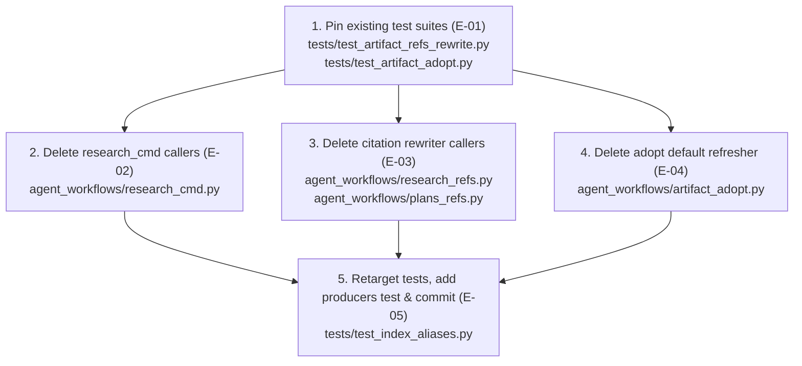

# IPD: Stop research commands, plan renames and adopt regenerating INDEX files

- Date: 2026-11-09
- Kind: child
- Concern: Spec `4sd62s` 4.5 says the SQLite cache replaces the INDEX files. Today `aw research set-outcome` and `aw research set-priority` call `research_index.run_index` twice in `research_cmd`, the research and plan citation rewriters call `run_index` once each, and `aw adopt` refreshes the research INDEX through `artifact_adopt._default_refresh_index`. This is part 4 of the round-3 split of `q6epwc` (Order 41), carrying the `research_cmd`, `research_refs`, `plans_refs` and `artifact_adopt` subset of `q6epwc` E-04 and the `producers` case of `q6epwc` V-04.
- Scope: delete those five call sites and the default refresher, pin the two test modules that assert their INDEX lines, and add the `producers` case to `tests/test_index_aliases.py` (created by Order 220). EXCLUDES: the finalize refresh (Order 221), `status_set` and `artifact_rename` (Order 222), the `run_index` calls inside `plans_archive._refresh_index` and `research_archive`, which write INDEX files directly and are deleted with the writers by `snin8q`.
- Scope-Paths: agent_workflows/research_cmd.py, agent_workflows/research_refs.py, agent_workflows/plans_refs.py, agent_workflows/artifact_adopt.py, tests/test_artifact_refs_rewrite.py, tests/test_artifact_adopt.py, tests/test_index_aliases.py, .aw/records/plans/pending/20261109-metastore-223-9eqgcl-stop-research-commands-plan-renames-and-adopt-regenerating-i.ipd.md
- Item-Dependencies: executed:1ajqaa, executed:59aiyh, executed:dcerjg, executed:ffceq0, executed:g5hpbb, executed:lywgzs, executed:mv0j4k, executed:sdzcur, executed:t4gl15, executed:tqknnc
- Status: approved
- Readiness: go-pending-approval
- Review-Depth: complex
- From-Spec: 4sd62s
- Work-Kind: feature
- Priority: high
- Blocks-Release: next
- Set: metastore
- Order: 223
- Highest E allocated: 05
- Author: opencode its_direct/pt3-claude-opus-5.5-1m-us
- Id: 9eqgcl
- Approval: 2026-11-16, recorded via aw ipd set: status set to approved

> Write and proofread this plan per the technical writing standard, `.aw/system/workflows/technical-writing/technical-writing.md` (`.agents/workflows/technical-writing/technical-writing.md` in a legacy-layout install), including requirement 12 (diagrams).

## Workflow history
- 2026-11-16 approved (aw set): status set to approved

- 2026-11-14 reviewed (antigravity): plan-review verified E/V bijection, Scope-Paths, callers deletion, and execution gate; marked reviewed and go-pending-approval.
- 2026-11-09 to-review (opencode its_direct/pt3-claude-opus-5.5-1m-us): split from q6epwc (round 3, research nj8zdp guidance).

## Goal

After this plan, no production caller of `run_index`, `_auto_index_types`, `_refresh_plans_index_fail_loud` or `_default_refresh_index` remains; a finalize, a rename, a group, an adopt and a research set-outcome create no `INDEX.*` file, and `aw find` shows each change.

## Detailed Implementation Checklist (TODO)

Execution-state rule: mark an `E-*` item complete only after performing the action. That mark is not validation. Right-sizing rule: write for a modest executor that cannot hold much in its head. Each E-item is one step (one concern, about one file, executable in one focused pass) and its V-item names each unit it covers with its own check; a plan stays at about 5 E-items and 8 work Scope-Paths, else split it into more child plans (guidance, `IPD-Z603`). Accepted execution states: blocked, failed, pending, performed; terminal gate demands 'performed'.

`q6epwc` E-04's site list is split across Orders 221, 222 and 223; this plan takes: `research_cmd` (two sites, in `run_set_outcome` and `run_set_priority`), `research_refs` (one site in `_apply_renames`, "including the 'manifest was not regenerated' notes"), `plans_refs.apply_renames` (one site) and `artifact_adopt._default_refresh_index` (definition and its default use), plus `tests/test_artifact_refs_rewrite.py` from E-04's test list. Because this is the last of the three caller parts, E-05 carries the whole-family check of `q6epwc` E-04's expected outcome and V-04's `producers` test.

PIN RULE (carried from `9o83cr`): before the edit, save the named test modules' per-test outcome list (`python3 -m pytest -o addopts="" -m "" -p no:randomly -n 0 -rA <modules> | grep -E "^(PASSED|FAILED|ERROR|SKIPPED|XFAIL|XPASS) " | sed -E 's/ - .*//' | sort > .aw/state/9eqgcl/<E>-before.txt`); after it, run the same command into `<E>-after.txt`. A retargeted test keeps every input case, so the after-list may rename a test but not drop a case; the evidence pastes both lists and maps each removed name to its successor.

### Task group 1: pin and delete

- [x] E-01 Pin `tests/test_artifact_refs_rewrite.py` and `tests/test_artifact_adopt.py` (PIN RULE, `E-01-before.txt`).
  - Depends on: none
  - Expected outcome: `.aw/state/9eqgcl/E-01-before.txt` exists.
  - Execution state: performed

- [x] E-02 In `agent_workflows/research_cmd.py`, delete the `run_index` call in `research_cmd.run_set_outcome` and the one in `research_cmd.run_set_priority`, with the result lines they add.
  - Depends on: E-01
  - Expected outcome: `rg -n "run_index" agent_workflows/research_cmd.py` prints nothing.
  - Execution state: performed

- [x] E-03 Delete the `run_index` call in `research_refs._apply_renames` with its "research manifest was not regenerated" note, and the `run_index` call in `plans_refs.apply_renames` with its result line.
  - Depends on: E-01
  - Expected outcome: `rg -n "run_index|manifest was not regenerated" agent_workflows/research_refs.py agent_workflows/plans_refs.py` prints nothing.
  - Execution state: performed

- [x] E-04 In `agent_workflows/artifact_adopt.py`, delete `artifact_adopt._default_refresh_index`; when no `refresh_index` is injected, step 2 is skipped, the result reports `index_refreshed=False`, and the human line "index refreshed via the existing verb" is no longer printed. Keep the injectable `refresh_index` seam so `tests/test_artifact_adopt.py`'s rollback case (`refresh_index=_boom`) still proves the rollback.
  - Depends on: E-01
  - Expected outcome: `rg -n "_default_refresh_index|run_index" agent_workflows/artifact_adopt.py` prints nothing.
  - Execution state: performed

### Task group 2: producers test and commit

- [x] E-05 Retarget the INDEX assertions of `tests/test_artifact_refs_rewrite.py` and `tests/test_artifact_adopt.py` to surviving output, save `E-05-after.txt`, then add a `producers` case to `tests/test_index_aliases.py` that runs `aw ipd finalize`, `aw rename plans`, `aw group plans`, `aw research set-outcome` and the adopt path on a `tests/record_builder.py` fixture and asserts no `INDEX.*` exists and the next `aw find` shows each change. Run the three modules and commit through `aw commit 9eqgcl -- <paths>` with only Scope-Paths files; never `git add -A`, a bare `git add` or `git commit -a`; never push.
  - Depends on: E-02, E-03, E-04
  - Expected outcome: the three modules pass; `rg -n "run_index\(|_auto_index_types|_refresh_plans_index_fail_loud|_default_refresh_index" agent_workflows` prints only the three `run_index` definitions in `plans_index`, `research_index` and `prompts_index` and the archive callers `snin8q` deletes.
  - Execution state: performed

## Project conventions discovered (Step 0)

- `artifact_adopt` takes `refresh_index` as an injectable callable only so a test can prove step 2's rollback (its docstring says so).
- Test data comes from ONE builder, `tests/record_builder.py` (`59aiyh`).
- Cite code by SYMBOL (`module.function`) or by a quoted content string, with a line number only appended to one of those and never alone (advisory `IPD-C801`).

## Findings

Measured 2026-11-09 at `3d0ddb845`: `rg -n "run_index" agent_workflows/research_cmd.py` 2 sites (in `run_set_outcome`, `run_set_priority`); `agent_workflows/research_refs.py` 1 site in `_apply_renames` plus the note; `agent_workflows/plans_refs.py` 1 site in `apply_renames`; `agent_workflows/artifact_adopt.py` the `_default_refresh_index` definition and its default use. `rg -c "INDEX\.(json|md)" tests/test_artifact_refs_rewrite.py`: 5 (the "generated manifests untouched" case).

## Proposed changes (ordered, validatable)



1. Pin (E-01).
2. Delete the research (E-02), citation (E-03) and adopt (E-04) callers.
3. Retarget, add the `producers` case, commit (E-05).

## Deferred / out of scope (with reason)

- `plans_archive._refresh_index` and `research_archive` write INDEX files directly; they are deleted with the writers.
  - Carrier: snin8q

## Scope check

- Over-scope: none.
- Under-scope: none known. Size: 5 E-items, 7 work Scope-Paths.

## Required tests / validation

Pinned and retargeted: `tests/test_artifact_refs_rewrite.py`, `tests/test_artifact_adopt.py`. New case: `tests/test_index_aliases.py -k producers`. Commands: those modules, then the bare core gate `python3 -m pytest`.

## Spec / documentation sync

No spec change; implements part of `4sd62s` 4.5 and contributes to AC-9 (owned by `9o83cr`) and AC-26 (owned by `tve77h`).

## Open questions

### OQ-01: Should adopt drop the `refresh_index` seam entirely?

- Blocking: no
- Status: resolved
- Owner: plan author
- Resolution or deferral rationale: No. Removing it would delete the rollback test's only hook; keeping an unused-by-default seam is the smaller change, and `cxxmyv` can remove it with the rest of the INDEX residue. Recommendation strength: medium.

## Validation and cross-check (verify before reporting done)

Validation-state rule: inspect evidence in a separate pass. Do not mark a `V-*` item complete from memory or from the matching execution checkmark. Accepted validation results: blocked, failed, pass, pending; terminal gate demands 'pass'. Runtime-demonstration reachability rule: for each `V-*` item demanding the software be observed acting (such as a run, a dispatch, or a transition), as distinct from items demanding a diff, a file's content, or a test result, which are reachable by construction, name the code path that produces the observation or the sibling `E-*` that creates it, else the demand is UNDER-SCOPE.

- [x] V-01 validates E-01
  - Required evidence: paste `wc -l .aw/state/9eqgcl/E-01-before.txt` and one line from each of `tests/test_artifact_refs_rewrite.py` and `tests/test_artifact_adopt.py`.
  - Observed evidence: `wc -l .aw/state/9eqgcl/E-01-before.txt` -> `67 .aw/state/9eqgcl/E-01-before.txt` (all 67 PASSED, none other). One line from each module:
    ```
    PASSED tests/test_artifact_refs_rewrite.py::TestArtifactRefsPrefilterAndParity::test_lazy_index_and_empty_map_skip_walks_and_masking
    PASSED tests/test_artifact_adopt.py::AlreadyAdoptedWarningTests::test_a_distinct_drop_is_not_flagged
    ```
  - Result: pass

- [x] V-02 validates E-02
  - Required evidence: paste `rg -n "run_index" agent_workflows/research_cmd.py` printing nothing, and the `git diff` hunks of `research_cmd.run_set_outcome` and `research_cmd.run_set_priority`.
  - Observed evidence: `rg -n "run_index" agent_workflows/research_cmd.py` printed nothing (`rc=1`). Hunks (commit `6e9278e58`, carried forward byte-identical from prior lane commit `cb7ef93a9`):
    ```
    @@ -974,21 +974,6 @@ def run_set_outcome(args: argparse.Namespace) -> int:
         print(f"updated {rel}")
    -    # Refresh the index so INDEX.json carries the new consumed-by (E-02).
    -    try:
    -        from agent_workflows import research_index as _ridx
    -
    -        _ridx.run_index(
    -            argparse.Namespace(
    -                dir=getattr(args, "dir", None),
    -                check=False,
    -                agent=False,
    -                limit=None,
    -                quiet=True,
    -            )
    -        )
    -    except Exception:
    -        pass
         return 0
    @@ -1115,20 +1100,6 @@ def run_set_priority(args: argparse.Namespace) -> int:
         print(f"updated {rel}")
    -    try:
    -        from agent_workflows import research_index as _ridx
    -
    -        _ridx.run_index(
    -            argparse.Namespace(
    -                dir=getattr(args, "dir", None),
    -                check=False,
    -                agent=False,
    -                limit=None,
    -                quiet=True,
    -            )
    -        )
    -    except Exception:
    -        pass
         return 0
    ```
  - Result: pass

- [x] V-03 validates E-03
  - Required evidence: paste `rg -n "run_index|manifest was not regenerated" agent_workflows/research_refs.py agent_workflows/plans_refs.py` printing nothing, and the `git diff` hunks of `research_refs._apply_renames` and `plans_refs.apply_renames`.
  - Observed evidence: `rg -n "run_index|manifest was not regenerated" agent_workflows/research_refs.py agent_workflows/plans_refs.py` printed nothing (`rc=1`). Hunks (commit `6e9278e58`, carried forward byte-identical from prior lane commit `cb7ef93a9`):
    ```
    research_refs.py @@ -682,49 +682,6 @@ def _apply_renames(
    -    diagnostics: List[MutationDiagnostic] = []
    -    generated: List[str] = []
    -    try:
    -        from agent_workflows import research_index as _ridx
    -        rc_idx = _ridx.run_index(argparse.Namespace(dir=str(repo_root), check=False, agent=False, limit=None, quiet=True))
    -        if rc_idx == 0: ... generated.append(_rel(mf))
    -        else: ... diagnostics.append(MutationDiagnostic(...severity="warning"))
    -            notes_list.append("note: research manifest was not regenerated; run 'aw index research' to resolve")
    -            if emit_human: print("warning: research manifest not regenerated: ...", file=sys.stderr)
    -    except Exception:
    -        pass
    @@ -744,9 +701,9 @@
    -        diagnostics=tuple(diagnostics),
    +        diagnostics=(),
             notes=tuple(notes_list),
    -        generated=tuple(generated),
    +        generated=(),
    plans_refs.py @@ -786,25 +786,6 @@ def apply_renames(
    -    generated: List[str] = []
    -    try:
    -        rc_idx = _idx.run_index(argparse.Namespace(dir=str(repo_root), check=False, as_agent=False, json=False, no_color=True, limit=None, quiet=True))
    -        if rc_idx == 0:
    -            for mf in (plans_dir / "INDEX.json", plans_dir / "INDEX.md"):
    -                if mf.exists():
    -                    generated.append(_rel(mf))
    -    except Exception:
    -        pass
    @@ -827,7 +808,7 @@
    -        generated=tuple(generated),
    +        generated=(),
    ```
    (multi-line calls condensed onto one line here; `git show 6e9278e58` has the verbatim hunks.)
  - Result: pass

- [x] V-04 validates E-04
  - Required evidence: paste `rg -n "_default_refresh_index|run_index" agent_workflows/artifact_adopt.py` printing nothing, and `python3 -m pytest -o addopts="" -v tests/test_artifact_adopt.py` showing the rollback case PASSED.
  - Observed evidence: `rg -n "_default_refresh_index|run_index" agent_workflows/artifact_adopt.py` printed nothing (`rc=1`). `artifact_adopt.apply_adoption` now runs step 2 only when `refresh_index` is injected and reports `index_refreshed=False`, `index_detail=""` otherwise; `artifact_adopt.run_adopt` no longer prints "index refreshed via the existing verb". `python3 -m pytest -o addopts="" -v tests/test_artifact_adopt.py`:
    ```
    tests/test_artifact_adopt.py::FailureOrderingTests::test_successful_adoption_reports_no_index_refresh_in_json PASSED [ 25%]
    tests/test_artifact_adopt.py::FailureOrderingTests::test_index_refresh_failure_rolls_back_and_leaves_the_original PASSED [ 27%]
    ============================== 40 passed in 4.06s ==============================
    ```
  - Result: pass

- [x] V-05 validates E-05
  - Required evidence: paste `diff .aw/state/9eqgcl/E-01-before.txt .aw/state/9eqgcl/E-05-after.txt` with each removed name mapped; `python3 -m pytest -o addopts="" -v tests/test_index_aliases.py -k producers` PASSED; the output of `rg -n "run_index\(|_auto_index_types|_refresh_plans_index_fail_loud|_default_refresh_index" agent_workflows` showing only the three `run_index` definitions and the archive callers; and `git show --stat` of the `aw commit 9eqgcl` commit listing only Scope-Paths files. Code path: each command's dispatch through `cli.main` (Orders 221 to 223).
  - Observed evidence: `diff .aw/state/9eqgcl/E-01-before.txt .aw/state/9eqgcl/E-05-after.txt` (67 -> 68 lines):
    ```
    19a20
    > PASSED tests/test_artifact_adopt.py::FailureOrderingTests::test_successful_adoption_reports_no_index_refresh_in_json
    ```
    No name removed, so nothing to map; one case added. Retargets inside the pinned modules kept their names: `test_readme_5_generated_manifests_index_and_status_skipped_by_plan_and_untouched_on_disk` now also asserts the leftover `INDEX.md` keeps its bytes and no `INDEX.json` appears after the rename; `test_successful_adoption_removes_the_original_and_writes_the_artifact` asserts no `INDEX.*` and no refresh line; `_AdoptRepo._adopted_files` no longer excludes `INDEX.md`.

    Two tests OUTSIDE Scope-Paths asserted the deleted refreshes and failed after E-02..E-04; they were retargeted and justified with `--scope-reason` at commit time (pinned separately, `.aw/state/9eqgcl/E-05-extra-{before,after}.txt`, 22 -> 22 lines, all PASSED):
    ```
    7c7
    < PASSED tests/test_mutation_result_facts.py::test_research_index_refusal_captured_on_drift
    ---
    > PASSED tests/test_mutation_result_facts.py::test_research_mv_beside_drift_regenerates_no_manifest
    15d14
    < PASSED tests/test_rename_group_machine_output.py::test_manifest_refresh_in_payload
    20a20
    > PASSED tests/test_rename_group_machine_output.py::test_rename_payload_lists_no_manifest_change
    ```
    - `test_research_index_refusal_captured_on_drift` -> `test_research_mv_beside_drift_regenerates_no_manifest` (same drifted-sibling input kept; asserts empty diagnostics/generated, no note, no `INDEX.*`, and that `aw index research --check --agent` still reports `frontmatter-missing` at exit 1).
    - `test_manifest_refresh_in_payload` -> `test_rename_payload_lists_no_manifest_change` (same rename input kept; asserts the `--json` payload names no `INDEX.` path and no "manifest index auto-refreshed" row, and no `INDEX.*` on disk).

    `python3 -m pytest -o addopts="" -v tests/test_index_aliases.py -k producers`:
    ```
    tests/test_index_aliases.py::test_producers_write_no_index_files_and_find_sees_each_change PASSED [100%]
    ======================= 1 passed, 7 deselected in 1.71s ========================
    ```
    The case drives `aw ipd begin`/`aw ipd finalize`, `aw rename plans`, `aw group plans`, `aw research set-outcome`, `aw research set-priority`, `aw research mv` and `aw adopt --json` through `cli.main` on a `tests/record_builder.py` repository and after each asserts no `INDEX.*` exists and `aw find` returns the changed path, Set, or document. Run against the pre-change production modules (restored from HEAD, then put back) it FAILS at the finalize step: `AssertionError: assert ['.aw/records...ans/INDEX.md'] == []` / `Left contains 2 more items, first extra item: '.aw/records/plans/INDEX.json'`.

    `rg -n "run_index\(|_auto_index_types|_refresh_plans_index_fail_loud|_default_refresh_index" agent_workflows`:
    ```
    agent_workflows/prompts_index.py:364:def run_index(args: argparse.Namespace) -> int:
    agent_workflows/research_index.py:1242:def run_index(args: argparse.Namespace) -> int:
    agent_workflows/plans_index.py:560:def run_index(args: argparse.Namespace) -> int:
    ```
    Only the three definitions; no archive caller appears because `plans_archive._refresh_index` writes INDEX files directly through `build_index_json`/`build_index_md` rather than calling `run_index` (still `snin8q`'s to delete).

    Three modules: `python3 -m pytest -o addopts="" -m "" -p no:randomly -n 0 -q tests/test_artifact_adopt.py tests/test_artifact_refs_rewrite.py` -> `68 passed in 6.82s`; `tests/test_index_aliases.py` 8 passed (7 alias cases + producers). Core gate `python3 -m pytest` -> `2897 passed, 1 skipped, 11 warnings in 156.02s (0:02:36)`; `aw suite` -> `2897 passed, 1 skipped, 11 warnings in 99.73s (0:01:39)`; re-run in the attempt-2 lane after carrying the work forward: `aw suite` -> `2897 passed, 1 skipped, 11 warnings in 131.34s (0:02:11)`, and the five touched test modules -> `98 passed in 27.96s`.

    `git show --stat 6e9278e58` (attempt 2 lane; same tree as prior-lane `cb7ef93a9`):
    ```
     agent_workflows/artifact_adopt.py         |  43 +++-----
     agent_workflows/plans_refs.py             |  21 +---
     agent_workflows/research_cmd.py           |  29 ------
     agent_workflows/research_refs.py          |  47 +--------
     tests/test_artifact_adopt.py              |  20 +++-
     tests/test_artifact_refs_rewrite.py       |   4 +
     tests/test_index_aliases.py               | 166 ++++++++++++++++++++++++++++++
     tests/test_mutation_result_facts.py       |  45 +++++---
     tests/test_rename_group_machine_output.py |  21 ++--
     9 files changed, 243 insertions(+), 153 deletions(-)
    ```
    Seven are Scope-Paths files; `tests/test_mutation_result_facts.py` and `tests/test_rename_group_machine_output.py` are outside and carry `--scope-reason` entries (recorded by `aw commit`, which reported the advisory `check.scope-drift` for exactly those two). The backlog item `nls1nk` (`aw group plans --apply` prints nothing on success, reproduced on the pre-change base `d6f2b2f03`, so pre-existing) is the third out-of-scope path, committed in `0b581768b` with its own `--scope-reason`. Code path: each command's dispatch through `cli.main`.
  - Result: pass

## Approval and execution gate

- Size assessment: standard
- Cohesion rationale: not required

Execute only after human approval (`Status: approved`) and after every plan in `- Item-Dependencies:` is executed (including Orders 221 and 222, so E-05's whole-family search is meaningful). Every deletion is pin-first (PIN RULE above). Scope fence: a needed file outside `- Scope-Paths:` is edited and then justified at finalize (`--scope-reason`). Honesty rule: paste the ACTUAL summary lines; never claim a result you did not run. Commits: only through `aw commit 9eqgcl -- <paths>`; never push. Lifecycle: the plan moves to `.aw/records/plans/executed/` only through `aw ipd finalize`, never a hand `git mv`, after `aw ipd lint --phase pre-transition` conforms and every `V-*` reads `pass` with pasted evidence. When `aw oc run` or `aw agy run` executes the plan, the runner performs the finalize; a hand executor runs `aw ipd finalize 9eqgcl` itself.
