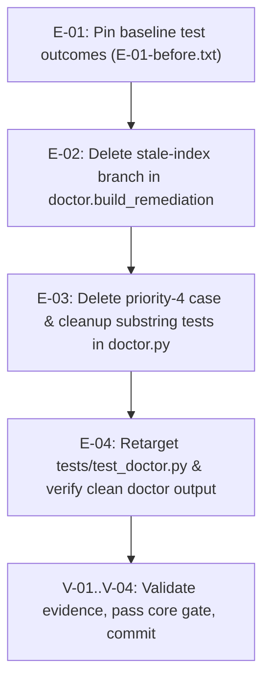

# IPD: Delete the stale-index remediation from doctor

- Date: 2026-11-09
- Kind: child
- Concern: Spec `4sd62s` 4.5 deletes `check.stale-index-*`. After Order 229 no code emits or registers those rules, but `doctor` still matches them: `doctor.build_remediation` has a `"stale-index" in rule` branch, `doctor.resolve_next_actions` has a priority-4 stale-index case, and three more `doctor` sites classify by the same substring. Its own comment says those sites must change together. This is part 7 of the round-3 split of `q6epwc` (Order 41), carrying the `doctor` subset of `q6epwc` E-05.
- Scope: delete or rewrite the 8 `stale-index` lines in `agent_workflows/doctor.py` in one edit and update `tests/test_doctor.py`. EXCLUDES every other module (Orders 224 and 229).
- Scope-Paths: agent_workflows/doctor.py, tests/test_doctor.py, .aw/records/plans/pending/20261109-metastore-225-f1yjlx-delete-the-stale-index-remediation-from-doctor.ipd.md
- Item-Dependencies: executed:1ajqaa, executed:59aiyh, executed:6qh68x, executed:dcerjg, executed:ffceq0, executed:g5hpbb, executed:sdzcur, executed:t4gl15, executed:tqknnc
- Status: reviewed
- Review-Depth: standard
- Readiness: go-pending-approval
- From-Spec: 4sd62s
- Work-Kind: feature
- Priority: high
- Blocks-Release: next
- Set: metastore
- Order: 225
- Highest E allocated: 04
- Author: opencode its_direct/pt3-claude-opus-5.5-1m-us
- Id: f1yjlx

> Reviewed and proofread per the technical writing standard, `.aw/system/workflows/technical-writing/technical-writing.md`, including requirement 12 (diagrams).

## Workflow history

- 2026-11-14 reviewed (antigravity/gemini-3.8-flash): /plan-review (antigravity/gemini-3.8-flash): APPROVE WITH REVISIONS APPLIED; PR-001, PR-002, PR-003, PR-004.
- 2026-11-09 to-review (opencode its_direct/pt3-claude-opus-5.5-1m-us): split from q6epwc (round 3, research nj8zdp guidance).

## Goal

After this plan, `rg -n "stale-index" agent_workflows` lists only the `engine.py` `.aw/.gitignore` template comment, and `aw doctor --agent` on a fresh clone with no INDEX files reports no index finding.

## Detailed Implementation Checklist (TODO)

Execution-state rule: mark an `E-*` item complete only after performing the action. That mark is not validation. Right-sizing rule: write for a modest executor that cannot hold much in its head. Each E-item is one step (one concern, about one file, executable in one focused pass) and its V-item names each unit it covers with its own check; a plan stays at about 5 E-items and 8 work Scope-Paths, else split it into more child plans (guidance, `IPD-Z603`). Accepted execution states: blocked, failed, pending, performed; terminal gate demands 'performed'.

`q6epwc` E-05's site list is split across Orders 224, 229 and 225; this plan takes "the `"stale-index" in rule` remediation branch of `doctor.build_remediation`, the priority-4 stale-index case of `doctor.resolve_next_actions` and the other `stale-index` substring sites in `doctor`" and the test module `tests/test_doctor.py` from E-05's list. Keep the `doctor.index-` prefix match if a `doctor.index-*` rule still exists after `rg -n "doctor.index-" agent_workflows`; today it occurs only in that same branch.

PIN RULE (carried from `9o83cr`): before the edit, save the named test modules' per-test outcome list (`mkdir -p .aw/state/f1yjlx && python3 -m pytest -o addopts="" -m "" -p no:randomly -n 0 -rA <modules> | grep -E "^(PASSED|FAILED|ERROR|SKIPPED|XFAIL|XPASS) " | sed -E 's/ - .*//' | sort > .aw/state/f1yjlx/<E>-before.txt`); after it, run the same command into `<E>-after.txt`. A retargeted test keeps every input case, so the after-list may rename a test but not drop a case; the evidence pastes both lists and maps each removed name to its successor.

### Task group 1: pin, delete, retarget

- [ ] E-01 Pin `tests/test_doctor.py` (PIN RULE, `mkdir -p .aw/state/f1yjlx && ` capture to `E-01-before.txt`).
  - Depends on: none
  - Expected outcome: `.aw/state/f1yjlx/E-01-before.txt` exists.
  - Execution state: pending

- [ ] E-02 In `doctor.build_remediation`, delete the `"stale-index" in rule` branch (with its `check.stale-index-missing` and `check.stale-index-stale` sub-cases and the comment that ties the five sites together).
  - Depends on: E-01
  - Expected outcome: `rg -n "stale-index" agent_workflows/doctor.py` no longer lists any line inside `build_remediation`.
  - Execution state: pending

- [ ] E-03 In `doctor.resolve_next_actions`, delete the priority-4 stale-index case, and remove `stale-index` from the substring tests in `doctor.classify_summary_buckets` and the `leak/stale-index` comment.
  - Depends on: E-02
  - Expected outcome: `rg -n "stale-index" agent_workflows/doctor.py` prints nothing.
  - Execution state: pending

- [ ] E-04 In `tests/test_doctor.py`, remove the two `check.stale-index-*` `core.Drift` fixtures from `DoctorRemediationTests` (the `doctor.index-stale` fixture stays if that rule survives) and adjust `test_remediation_family_guard` and `test_resolve_next_actions_advisory_rules_return_no_action` if they count them. Save `E-04-after.txt`, run the module, and commit through `aw commit f1yjlx -- <paths>` with only Scope-Paths files; never `git add -A`, a bare `git add` or `git commit -a`; never push.
  - Depends on: E-03
  - Expected outcome: `tests/test_doctor.py` passes.
  - Execution state: pending

## Project conventions discovered (Step 0)

- `doctor.build_remediation` matches `"stale-index" in rule` by substring, and its comment states the five `doctor` sites must change together; this plan changes all of them in one commit.
- Cite code by SYMBOL (`module.function`) or by a quoted content string, with a line number only appended to one of those and never alone (advisory `IPD-C801`).

## Findings

Measured 2026-11-09 at `3d0ddb845`: `rg -n "stale-index" agent_workflows/doctor.py` prints 8 lines: 5 in `build_remediation` (2 comment, the branch test, 2 sub-cases), 1 comment near the summary classifier, 1 priority-4 comment in `resolve_next_actions`, 1 substring test in the summary classifier. `rg -c "stale-index" tests/test_doctor.py`: 2.

## Proposed changes (ordered, validatable)

1. Pin (E-01).
2. Delete the remediation branch (E-02) and the other sites (E-03).
3. Retarget and commit (E-04).

## Deferred / out of scope (with reason)

- The `engine.py` `.aw/.gitignore` template comment: removed with the ignore lines at the cutover.
  - Carrier: cxxmyv

## Scope check

- Over-scope: none.
- Under-scope: none known. Size: 4 E-items, 2 work Scope-Paths.

## Required tests / validation

Pinned and retargeted: `tests/test_doctor.py`. Commands: that module, then the bare core gate `python3 -m pytest`.

## Spec / documentation sync

No spec change; implements part of `4sd62s` 4.5.

## Open questions

### OQ-01: Is the summary-classifier edit in `classify_summary_buckets` or a sibling?

- Blocking: no
- Status: resolved
- Owner: plan author (carried from q6epwc)
- Resolution or deferral rationale: The executor follows `rg -n "stale-index" agent_workflows/doctor.py`; the expected outcome (no line) is what counts, whichever function holds the substring test at execution time. Recommendation strength: strong.

## Validation and cross-check (verify before reporting done)

Validation-state rule: inspect evidence in a separate pass. Do not mark a `V-*` item complete from memory or from the matching execution checkmark. Accepted validation results: blocked, failed, pass, pending; terminal gate demands 'pass'. Runtime-demonstration reachability rule: for each `V-*` item demanding the software be observed acting (such as a run, a dispatch, or a transition), as distinct from items demanding a diff, a file's content, or a test result, which are reachable by construction, name the code path that produces the observation or the sibling `E-*` that creates it, else the demand is UNDER-SCOPE.

- [ ] V-01 validates E-01
  - Required evidence: paste `wc -l .aw/state/f1yjlx/E-01-before.txt` and the `DoctorRemediationTests` lines from it.
  - Observed evidence:
  - Result: pending

- [ ] V-02 validates E-02
  - Required evidence: paste the `git diff` hunk of `doctor.build_remediation` removing the `"stale-index" in rule` branch.
  - Observed evidence:
  - Result: pending

- [ ] V-03 validates E-03
  - Required evidence: paste `rg -n "stale-index" agent_workflows/doctor.py` printing nothing, `rg -n "stale-index" agent_workflows` listing only the `engine.py` template comment, and `aw doctor --agent` run in a fresh `git clone` of this repository at the plan's commit with no `index` diagnostic. Code path: `doctor.resolve_next_actions` (E-03).
  - Observed evidence:
  - Result: pending

- [ ] V-04 validates E-04
  - Required evidence: paste `diff .aw/state/f1yjlx/E-01-before.txt .aw/state/f1yjlx/E-04-after.txt` with each removed name mapped, `python3 -m pytest -o addopts="" -v tests/test_doctor.py -k "Remediation or next_actions"` with every case PASSED, and `git show --stat` of the `aw commit f1yjlx` commit listing only Scope-Paths files.
  - Observed evidence:
  - Result: pending

## Approval and execution gate

- Size assessment: standard
- Cohesion rationale: not required

Execute only after human approval (`Status: approved`) and after every plan in `- Item-Dependencies:` is executed (Order 229 first, so no emitter still produces a rule this plan stops remediating). A narrow safety stop applies if prerequisite metastore symbols from `1ajqaa`, `59aiyh`, `6qh68x`, `dcerjg`, `ffceq0`, `g5hpbb`, `sdzcur`, `t4gl15`, or `tqknnc` are absent. Scope fence: the paths in `- Scope-Paths:` are a declaration; a needed file outside the fence is edited and then justified at finalize (`--scope-reason`), and a declared path left unmodified is acknowledged (`--scope-ack`). Honesty rule: run the named modules and `python3 -m pytest` (core gate), and paste the ACTUAL summary lines; never claim a result you did not run. Commits: only through `aw commit f1yjlx -- <paths>`; never `git add -A`, a bare `git add` or `git commit -a`; never push. Lifecycle transition: the plan moves to `.aw/records/plans/executed/` only through `aw ipd finalize` (never a hand `git mv`), and only after `aw ipd lint --phase pre-transition` conforms and every `V-*` reads `pass` with pasted evidence. When `aw oc run` or `aw agy run` executes the plan, the runner performs the finalize; a hand executor runs `aw ipd finalize f1yjlx` itself.
