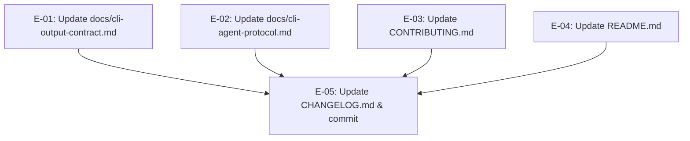

# IPD: Update the INDEX statements in the user documents and the changelog

- Date: 2026-11-09
- Kind: child
- Concern: After Order 220 no `aw` command writes `INDEX.json` or `INDEX.md`, so four user documents that describe INDEX generation as current behavior become wrong; C10a of spec `4sd62s` requires documents and behavior to agree at every commit of the family. This is part 8 of the round-3 split of `q6epwc` (Order 41), carrying the `docs/`, `README.md`, `CONTRIBUTING.md` and `CHANGELOG.md` subset of `q6epwc` E-15.
- Scope: edit the named INDEX sentences of `docs/cli-output-contract.md`, `docs/cli-agent-protocol.md`, `CONTRIBUTING.md` and `README.md`, and add one `CHANGELOG.md` line. EXCLUDES the plans and research READMEs and the installed template (Order 227).
- Scope-Paths: docs/cli-output-contract.md, docs/cli-agent-protocol.md, CONTRIBUTING.md, README.md, CHANGELOG.md, .aw/records/plans/pending/20261109-metastore-226-m8dblq-update-the-index-statements-in-the-user-documents-and-the-ch.ipd.md
- Item-Dependencies: executed:1ajqaa, executed:59aiyh, executed:dcerjg, executed:ffceq0, executed:g5hpbb, executed:sdzcur, executed:t4gl15, executed:tqknnc
- Status: reviewed
- Readiness: go-pending-approval
- Review-Depth: complex
- From-Spec: 4sd62s
- Work-Kind: feature
- Priority: high
- Blocks-Release: next
- Set: metastore
- Order: 226
- Highest E allocated: 05
- Author: opencode its_direct/pt3-claude-opus-5.5-1m-us
- Id: m8dblq

> Written to .aw/system/workflows/technical-writing/technical-writing.md. Every obligation, exact identifier, quotation, evidence record, and lifecycle status is preserved.

## Workflow history

- 2026-11-14 reviewed (aw set): APPROVE WITH REVISIONS APPLIED; PR-001..PR-006 FIXED
- 2026-11-14 /plan-review (antigravity/gemini): APPROVE WITH REVISIONS APPLIED; PR-001..PR-006 FIXED; review record .aw/records/reviews/20261109-metastore-226-m8dblq-update-the-index-statements-in-the-user-documents-and-the-ch.review.md
- 2026-11-09 to-review (opencode its_direct/pt3-claude-opus-5.5-1m-us): split from q6epwc (round 3, research nj8zdp guidance).

## Goal

After this plan, the four user documents describe `aw index rebuild` and the `aw index <type>` alias instead of INDEX file generation, and `CHANGELOG.md` records the change.

## Detailed Implementation Checklist (TODO)

Execution-state rule: mark an `E-*` item complete only after performing the action. That mark is not validation. Right-sizing rule: write for a modest executor that cannot hold much in its head. Each E-item is one step (one concern, about one file, executable in one focused pass) and its V-item names each unit it covers with its own check; a plan stays at about 5 E-items and 8 work Scope-Paths, else split it into more child plans (guidance, `IPD-Z603`). Accepted execution states: blocked, failed, pending, performed; terminal gate demands 'performed'.

`q6epwc` E-15's document list is split across Orders 226 and 227; this plan takes `docs/cli-output-contract.md`, `docs/cli-agent-protocol.md`, `CONTRIBUTING.md`, `README.md` and the `CHANGELOG.md` line. Replacement wording for every edit: "`aw index rebuild` rebuilds the local cache; `aw index <type>` is an alias". Write no em or en dashes in this user-facing prose (repository execution contract).

### Task group 1: one document per item

- [ ] E-01 `docs/cli-output-contract.md`: rewrite the `--limit` hot-window sentence and the `index` step-cue example.
  - Depends on: none
  - Expected outcome: `rg -n "INDEX\.(json|md)" docs/cli-output-contract.md` prints only lines that describe the removal.
  - Execution state: pending

- [ ] E-02 `docs/cli-agent-protocol.md`: rewrite the `INDEX.md` hot-window sentence (the `--limit` bullet).
  - Depends on: none
  - Expected outcome: `rg -n "INDEX\.(json|md)" docs/cli-agent-protocol.md` prints only removal-describing lines.
  - Execution state: pending

- [ ] E-03 `CONTRIBUTING.md`: rewrite the two manifest bullets (Plans Manifest, Research Manifest).
  - Depends on: none
  - Expected outcome: `rg -n "INDEX\.(json|md)" CONTRIBUTING.md` prints only removal-describing lines.
  - Execution state: pending

- [ ] E-04 `README.md`: rewrite the research "`INDEX.json`/`INDEX.md`" mention in the records layout list.
  - Depends on: none
  - Expected outcome: `rg -n "INDEX\.(json|md)" README.md` prints only removal-describing lines.
  - Execution state: pending

- [ ] E-05 `CHANGELOG.md`: add one `2.0.0 (pending)` line saying INDEX files are no longer generated and `aw index <type>` is an alias of `aw index rebuild`. Then commit through `aw commit m8dblq -- <paths>` with only Scope-Paths files; never `git add -A`, a bare `git add` or `git commit -a`; never push.
  - Depends on: E-01, E-02, E-03, E-04
  - Expected outcome: one new line under `2.0.0 (pending)`; the commit lists only Scope-Paths files.
  - Execution state: pending

## Project conventions discovered (Step 0)

- User-facing prose (READMEs, CHANGELOG, docs) carries no em or en dashes.
- Cite code by SYMBOL (`module.function`) or by a quoted content string, with a line number only appended to one of those and never alone (advisory `IPD-C801`).

## Findings

Measured 2026-11-09 at `3d0ddb845`: `rg -n "INDEX\.(json|md)|STATUS\.md" README.md CONTRIBUTING.md docs/cli-output-contract.md docs/cli-agent-protocol.md` prints `README.md` 1 line (records layout list), `CONTRIBUTING.md` 2 lines (the two manifest bullets), `docs/cli-agent-protocol.md` 1 line (`--limit`); `docs/cli-output-contract.md` describes the hot window and the `index` step cue without the literal filename, so E-01 finds those by `rg -n "hot.window|aw index" docs/cli-output-contract.md`.

## Proposed changes (ordered, validatable)

1. One edit per document (E-01 to E-04).
2. Changelog line and commit (E-05).

## Deferred / out of scope (with reason)

- `.aw/records/plans/README.md`, `.aw/records/research/README.md` and the template: Order 227.
  - Carrier: q6epwc
- Rewording the managed block and quickstarts for log-based commands: the alias keeps those commands working.
  - Carrier: 90iqr1

## Scope check

- Over-scope: none.
- Under-scope: none known. Size: 5 E-items, 5 work Scope-Paths.

## Required tests / validation

No test module targets these four documents. Commands: the per-document `rg` checks, the dash check, then the bare core gate `python3 -m pytest`.

## Spec / documentation sync

No spec change; this plan IS the documentation sync for `4sd62s` 4.5 in these four files.

## Open questions

### OQ-01: Should the documents mention the cutover that deletes on-disk INDEX files?

- Blocking: no
- Status: resolved
- Owner: plan author
- Resolution or deferral rationale: No. On-disk files are removed by `m0001` at the cutover (`cxxmyv`); these documents say only what the commands do now. Recommendation strength: medium.

## Validation and cross-check (verify before reporting done)

Validation-state rule: inspect evidence in a separate pass. Do not mark a `V-*` item complete from memory or from the matching execution checkmark. Accepted validation results: blocked, failed, pass, pending; terminal gate demands 'pass'. Runtime-demonstration reachability rule: for each `V-*` item demanding the software be observed acting (such as a run, a dispatch, or a transition), as distinct from items demanding a diff, a file's content, or a test result, which are reachable by construction, name the code path that produces the observation or the sibling `E-*` that creates it, else the demand is UNDER-SCOPE.

- [ ] V-01 validates E-01
  - Required evidence: paste the `git diff` hunks of `docs/cli-output-contract.md` and `grep -nP "[\x{2013}\x{2014}]"` over the changed lines printing nothing.
  - Observed evidence:
  - Result: pending

- [ ] V-02 validates E-02
  - Required evidence: paste the `git diff` hunk of `docs/cli-agent-protocol.md`, `rg -n "INDEX\.(json|md)" docs/cli-agent-protocol.md` showing only removal-describing lines, and the dash check over the changed lines printing nothing.
  - Observed evidence:
  - Result: pending

- [ ] V-03 validates E-03
  - Required evidence: paste the `git diff` hunks of `CONTRIBUTING.md`, `rg -n "INDEX\.(json|md)" CONTRIBUTING.md` output, and the dash check printing nothing.
  - Observed evidence:
  - Result: pending

- [ ] V-04 validates E-04
  - Required evidence: paste the `git diff` hunk of `README.md`, `rg -n "INDEX\.(json|md)" README.md` output, and the dash check printing nothing.
  - Observed evidence:
  - Result: pending

- [ ] V-05 validates E-05
  - Required evidence: paste the `git diff` hunk of `CHANGELOG.md` showing the one new line under `2.0.0 (pending)`, the dash check printing nothing, and `git show --stat` of the `aw commit m8dblq` commit listing only Scope-Paths files.
  - Observed evidence:
  - Result: pending

## Approval and execution gate

- Size assessment: standard
- Cohesion rationale: not required

Execute only after human approval (`Status: approved`) and after every plan in `- Item-Dependencies:` is executed (Order 220 first, so the documents change only once the behavior has).

Safety rule: uncommitted changes and untracked files you did not create are not yours; never revert, stage, commit, discard, reformat, or "clean up" another party's work.

Scope fence: a needed file outside `- Scope-Paths:` is edited and then justified at finalize (`--scope-reason`).

Honesty rule: paste the ACTUAL outputs; never claim a result you did not run.

Commits: only through `aw commit m8dblq -- <paths>`; never push.

Lifecycle transition: the plan moves to `.aw/records/plans/executed/` only through `aw ipd finalize m8dblq` (never a hand git mv), after `aw ipd lint --phase pre-transition` conforms and every `V-*` reads `pass` with pasted evidence. When aw oc run or aw agy run executes the plan, the runner performs the finalize; a hand executor runs aw ipd finalize m8dblq itself.
