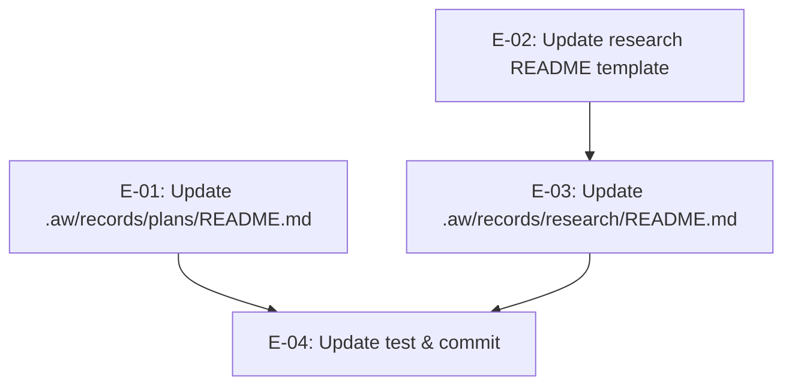

# IPD: Update the INDEX paragraphs in the plans and research READMEs and template

- Date: 2026-11-09
- Kind: child
- Concern: After Order 220 no `aw` command writes `INDEX.json` or `INDEX.md`, so the INDEX paragraphs of `.aw/records/plans/README.md`, `.aw/records/research/README.md` and its installed template `.aw/system/workflows/templates/agents-docs-research-README.md` become wrong (C10a of spec `4sd62s`). `tests/test_installed_text_current.py` checks the template text, and today quotes `check.stale-index-missing` and `check.stale-index-stale`, which Order 229 deletes. This is part 9 of the round-3 split of `q6epwc` (Order 41), carrying the README and template subset of `q6epwc` E-15.
- Scope: rewrite the three INDEX paragraphs and keep `tests/test_installed_text_current.py` green. EXCLUDES `docs/`, `README.md`, `CONTRIBUTING.md` and `CHANGELOG.md` (Order 226).
- Scope-Paths: .aw/records/plans/README.md, .aw/records/research/README.md, .aw/system/workflows/templates/agents-docs-research-README.md, tests/test_installed_text_current.py, .aw/records/plans/pending/20261109-metastore-227-kkftwj-update-the-index-paragraphs-in-the-plans-and-research-readme.ipd.md
- Item-Dependencies: executed:1ajqaa, executed:59aiyh, executed:6qh68x, executed:dcerjg, executed:ffceq0, executed:g5hpbb, executed:sdzcur, executed:t4gl15, executed:tqknnc
- Status: reviewed
- Readiness: go-pending-approval
- Review-Depth: complex
- From-Spec: 4sd62s
- Work-Kind: feature
- Priority: high
- Blocks-Release: next
- Set: metastore
- Order: 227
- Highest E allocated: 04
- Author: opencode its_direct/pt3-claude-opus-5.5-1m-us
- Id: kkftwj

> Written to .aw/system/workflows/technical-writing/technical-writing.md. Every obligation, exact identifier, quotation, evidence record, and lifecycle status is preserved.

## Workflow history

- 2026-11-14 reviewed (aw set): APPROVE WITH REVISIONS APPLIED; PR-001..PR-006 FIXED
- 2026-11-14 /plan-review (antigravity/gemini): APPROVE WITH REVISIONS APPLIED; PR-001..PR-006 FIXED; review record .aw/records/reviews/20261109-metastore-227-kkftwj-update-the-index-paragraphs-in-the-plans-and-research-readme.review.md
- 2026-11-09 to-review (opencode its_direct/pt3-claude-opus-5.5-1m-us): split from q6epwc (round 3, research nj8zdp guidance).

## Goal

After this plan, the plans and research READMEs and the installed research README template say "`aw index rebuild` rebuilds the local cache; `aw index <type>` is an alias" instead of describing INDEX generation, and `tests/test_installed_text_current.py` passes.

## Detailed Implementation Checklist (TODO)

Execution-state rule: mark an `E-*` item complete only after performing the action. That mark is not validation. Right-sizing rule: write for a modest executor that cannot hold much in its head. Each E-item is one step (one concern, about one file, executable in one focused pass) and its V-item names each unit it covers with its own check; a plan stays at about 5 E-items and 8 work Scope-Paths, else split it into more child plans (guidance, `IPD-Z603`). Accepted execution states: blocked, failed, pending, performed; terminal gate demands 'performed'.

`q6epwc` E-15's document list is split across Orders 226 and 227; this plan takes `.aw/records/plans/README.md`, `.aw/records/research/README.md` and `.aw/system/workflows/templates/agents-docs-research-README.md` ("the INDEX paragraphs: replace with '`aw index rebuild` rebuilds the local cache; `aw index <type>` is an alias'"), "keeping `tests/test_installed_text_current.py` green". Write no em or en dashes in this user-facing prose.

### Task group 1: one document per item

- [ ] E-01 `.aw/records/plans/README.md`: rewrite the INDEX paragraph(s).
  - Depends on: none
  - Expected outcome: `rg -n "INDEX\.(json|md)|STATUS\.md" .aw/records/plans/README.md` prints only removal-describing lines.
  - Execution state: pending

- [ ] E-02 `.aw/system/workflows/templates/agents-docs-research-README.md`: rewrite "## The index" (it names `INDEX.json`, `INDEX.md`, `check.stale-index-missing` and `check.stale-index-stale`) and the hot-glance sentence above it.
  - Depends on: none
  - Expected outcome: `rg -n "INDEX\.(json|md)|stale-index" .aw/system/workflows/templates/agents-docs-research-README.md` prints only removal-describing lines.
  - Execution state: pending

- [ ] E-03 `.aw/records/research/README.md`: apply the same rewrite as E-02, so the installed copy equals the template where the test requires.
  - Depends on: E-02
  - Expected outcome: the same `rg` over `.aw/records/research/README.md` prints only removal-describing lines.
  - Execution state: pending

- [ ] E-04 In `tests/test_installed_text_current.py`, update the expected template text to the E-02 wording; run the module; commit through `aw commit kkftwj -- <paths>` with only Scope-Paths files; never `git add -A`, a bare `git add` or `git commit -a`; never push.
  - Depends on: E-01, E-03
  - Expected outcome: `tests/test_installed_text_current.py` passes.
  - Execution state: pending

## Project conventions discovered (Step 0)

- `tests/test_installed_text_current.py` embeds the expected installed text and compares it to the template.
- Cite code by SYMBOL (`module.function`) or by a quoted content string, with a line number only appended to one of those and never alone (advisory `IPD-C801`).

## Findings

Measured 2026-11-09 at `3d0ddb845`: `rg -c "stale-index" tests/test_installed_text_current.py` 2 (the quoted "## The index" paragraph: "`aw research index` regenerates `INDEX.json` (every doc) and `INDEX.md` (the hot glance) purely from frontmatter").

## Proposed changes (ordered, validatable)

1. Plans README (E-01).
2. Template, then installed research README (E-02, E-03).
3. Test and commit (E-04).

## Deferred / out of scope (with reason)

- `docs/`, `README.md`, `CONTRIBUTING.md`, `CHANGELOG.md`: Order 226.
  - Carrier: q6epwc

## Scope check

- Over-scope: none.
- Under-scope: none known. Size: 4 E-items, 4 work Scope-Paths.

## Required tests / validation

Retargeted: `tests/test_installed_text_current.py`. Commands: that module, the dash check, then the bare core gate `python3 -m pytest`.

## Spec / documentation sync

No spec change; this plan IS the documentation sync for `4sd62s` 4.5 in these three files.

## Open questions

### OQ-01: Must the paragraph explaining why INDEX files were not committed survive?

- Blocking: no
- Status: resolved
- Owner: plan author
- Resolution or deferral rationale: It may be shortened to one sentence of history; the files are no longer generated, so the reasoning about committing them is no longer an operating instruction. Recommendation strength: medium.

## Validation and cross-check (verify before reporting done)

Validation-state rule: inspect evidence in a separate pass. Do not mark a `V-*` item complete from memory or from the matching execution checkmark. Accepted validation results: blocked, failed, pass, pending; terminal gate demands 'pass'. Runtime-demonstration reachability rule: for each `V-*` item demanding the software be observed acting (such as a run, a dispatch, or a transition), as distinct from items demanding a diff, a file's content, or a test result, which are reachable by construction, name the code path that produces the observation or the sibling `E-*` that creates it, else the demand is UNDER-SCOPE.

- [ ] V-01 validates E-01
  - Required evidence: paste the `git diff` hunk of `.aw/records/plans/README.md`, its `rg` output, and `grep -nP "[\x{2013}\x{2014}]"` over the changed lines printing nothing.
  - Observed evidence:
  - Result: pending

- [ ] V-02 validates E-02
  - Required evidence: paste the `git diff` hunk of `.aw/system/workflows/templates/agents-docs-research-README.md`, its `rg` output, and the dash check printing nothing.
  - Observed evidence:
  - Result: pending

- [ ] V-03 validates E-03
  - Required evidence: paste the `git diff` hunk of `.aw/records/research/README.md`, its `rg` output, and the dash check printing nothing.
  - Observed evidence:
  - Result: pending

- [ ] V-04 validates E-04
  - Required evidence: paste `python3 -m pytest -o addopts="" -v tests/test_installed_text_current.py` with every case PASSED, and `git show --stat` of the `aw commit kkftwj` commit listing only Scope-Paths files.
  - Observed evidence:
  - Result: pending

## Approval and execution gate

- Size assessment: standard
- Cohesion rationale: not required

Execute only after human approval (`Status: approved`) and after every plan in `- Item-Dependencies:` is executed (Orders 220 and 229 first, so the text changes only once the alias exists and the stale-index rules are gone).

Safety rule: uncommitted changes and untracked files you did not create are not yours; never revert, stage, commit, discard, reformat, or "clean up" another party's work.

Scope fence: a needed file outside `- Scope-Paths:` is edited and then justified at finalize (`--scope-reason`).

Honesty rule: paste the ACTUAL outputs; never claim a result you did not run.

Commits: only through `aw commit kkftwj -- <paths>`; never push.

Lifecycle transition: the plan moves to `.aw/records/plans/executed/` only through `aw ipd finalize kkftwj` (never a hand git mv), after `aw ipd lint --phase pre-transition` conforms and every `V-*` reads `pass` with pasted evidence. When aw oc run or aw agy run executes the plan, the runner performs the finalize; a hand executor runs aw ipd finalize kkftwj itself.
