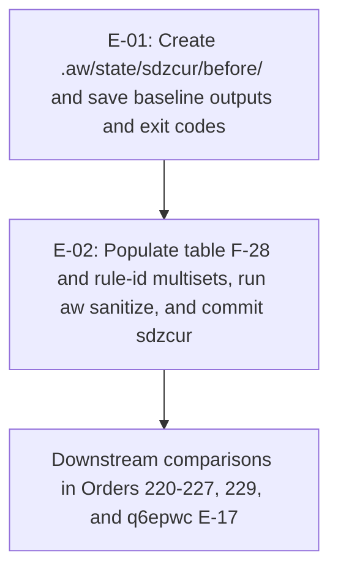

# IPD: Record the baseline for the INDEX alias and stale-index family

- Date: 2026-11-09
- Kind: child
- Concern: The finishing item of `q6epwc` (E-17) compares the `aw check all` rule multisets after the family's edits against a baseline taken BEFORE any edit. `.aw/state/` is gitignored and does not travel between lane worktrees, so after the round-3 split the baseline must be committed inside a plan file that every later part can read. This is the first part of the round-3 split of `q6epwc` (Order 41), carrying `q6epwc` E-01.
- Scope: run the read-only baseline commands and write their results into this plan's Findings table F-28, then commit this plan file. EXCLUDES every code or test edit (Orders 220 to 227 and 229 of the split).
- Scope-Paths: .aw/records/plans/pending/20261109-metastore-228-sdzcur-record-the-baseline-for-the-index-alias-and-stale-index-fami.ipd.md
- Item-Dependencies: executed:1ajqaa, executed:59aiyh, executed:dcerjg, executed:ffceq0, executed:g5hpbb, executed:t4gl15
- Status: approved
- Readiness: go-pending-approval
- Review-Depth: complex
- From-Spec: 4sd62s
- Work-Kind: feature
- Priority: high
- Blocks-Release: next
- Set: metastore
- Order: 228
- Highest E allocated: 02
- Author: opencode its_direct/pt3-claude-opus-5.5-1m-us
- Id: sdzcur
- Approval: 2026-11-16, recorded via aw ipd set: status set to approved

> Reviewed and proofread per the technical writing standard, `.aw/system/workflows/technical-writing/technical-writing.md`, including requirement 12 (diagrams).

## Workflow history
- 2026-11-16 approved (aw set): status set to approved

- 2026-11-14 reviewed (aw set): APPROVE WITH REVISIONS APPLIED; PR-001..PR-005 FIXED
- 2026-11-14 /plan-review (antigravity/gemini-3.8-flash): APPROVE WITH REVISIONS APPLIED; PR-001..PR-005 FIXED; review record .aw/records/reviews/20261109-metastore-228-sdzcur-record-the-baseline-for-the-index-alias-and-stale-index-fami.review.md
- 2026-11-09 to-review (opencode its_direct/pt3-claude-opus-5.5-1m-us): split from q6epwc (round 3, research nj8zdp guidance).

## Goal

Commit, inside this plan, the pre-edit outputs that `q6epwc` E-17 compares against, so the comparison survives the lane worktrees of the eight other parts of the family.

## Detailed Implementation Checklist (TODO)

Execution-state rule: mark an `E-*` item complete only after performing the action. That mark is not validation. Right-sizing rule: write for a modest executor that cannot hold much in its head. Each E-item is one step (one concern, about one file, executable in one focused pass) and its V-item names each unit it covers with its own check; a plan stays at about 5 E-items and 8 work Scope-Paths, else split it into more child plans (guidance, `IPD-Z603`). Accepted execution states: blocked, failed, pending, performed; terminal gate demands 'performed'.

The text of `q6epwc` E-01 is split across E-01 and E-02 here; together they equal it. Every other part of the family depends on this plan, so it runs before any edit.

### Task group 1: baseline

- [x] E-01 Create `.aw/state/sdzcur/before/` (`mkdir -p .aw/state/sdzcur/before/`, never `/tmp`, which a lane integration discards) on the unedited tree, then run each baseline command and save its stdout and exit code there: `aw index plans --agent` (`index-plans.txt`), `aw index research --check --agent` (`index-research.txt`), `aw check plans --all --agent` (`check-plans.jsonl`), `aw check research --all --agent` (`check-research.jsonl`), `aw check prompts --all --agent` (`check-prompts.jsonl`), `aw doctor --agent` (`doctor.txt`), the rule-id multisets of `aw check all --agent` and `aw check all --all --agent` (`jq -r '(.diagnostics // [])[].rule' | sort | uniq -c` saved as `check-all.multiset.txt` and `check-all-all.multiset.txt`; `--all` matters because `check_engine.check_content` reaches the `check_drift` functions only when `include_retired` is set), the bare core gate summary line of `python3 -m pytest` (`pytest-core.txt`), and all eight exit codes (`exit-codes.txt`).
  - Depends on: none
  - Expected outcome: all saved files exist under `.aw/state/sdzcur/before/`, and no file outside `.aw/state/` is modified.
  - Execution state: performed

- [x] E-02 Populate table F-28 in `## Findings` with each command's exit code, the `check.stale-index-*` counts in `aw check all` and `aw check all --all`, and the core gate summary line; directly beneath table F-28 under `### F-28 rule-id multisets`, insert the two full rule-id multisets inside fenced `text` code blocks (copied from `check-all.multiset.txt` and `check-all-all.multiset.txt`). Run bare `aw sanitize --agent` (repo-root scan; takes no file argument), then commit this plan file through `aw commit sdzcur -- .aw/records/plans/pending/20261109-metastore-228-sdzcur-record-the-baseline-for-the-index-alias-and-stale-index-fami.ipd.md`; never `git add -A`, a bare `git add` or `git commit -a`; never push.
  - Depends on: E-01
  - Expected outcome: table F-28 and its `### F-28 rule-id multisets` fenced blocks hold every baseline value verbatim; `aw sanitize --agent` reports `"outcome":"clean"` and `"findings":0`; the commit lists only this plan file.
  - Execution state: performed

## Project conventions discovered (Step 0)

- `agent_workflows/check_engine.py::check_content` calls `agent_workflows/plans_index.py::check_drift` and `agent_workflows/research_index.py::check_drift` only when `include_retired` is set (the `--all` path).
- When `aw check <type> --agent` reports zero findings, the JSON envelope omits `"diagnostics"`, so `jq -r '(.diagnostics // [])[].rule'` is required instead of `.diagnostics[].rule`.
- Cite code by symbol (`path::Symbol`) or by a quoted content string, with a line number only appended as a hint (advisory `IPD-C801`).

## Findings

| Id | Evidence | Finding |
|---|---|---|
| F-28 | Measured 2026-11-22 on unedited HEAD `28f1c587fb4bd0b9cd3d22f46cd9d704d05507a7` before any edit of the `q6epwc` family. Exit codes: `aw index plans --agent`: `0`; `aw index research --check --agent`: `1`; `aw check plans --all --agent`: `1`; `aw check research --all --agent`: `1`; `aw check prompts --all --agent`: `1`; `aw doctor --agent`: `1`; `aw check all --agent`: `1`; `aw check all --all --agent`: `1`; `python3 -m pytest`: `0`. `check.stale-index-*` counts: `aw check all --agent`: `0` (`check.stale-index-missing`: `0`, `check.stale-index-drift`: `0`); `aw check all --all --agent`: `2` (`check.stale-index-missing`: `2`, `check.stale-index-drift`: `0`). Bare core gate summary line (`python3 -m pytest`): `2803 passed, 1 skipped, 11 warnings in 170.07s (0:02:50)`. Full rule-id multisets appear directly beneath this table under `### F-28 rule-id multisets`. | `q6epwc` E-17 (now split into E-17 to E-19) compares against this table and its subsections. |

### F-28 rule-id multisets

`aw check all --agent` (`check-all.multiset.txt`):

```text
      1 check.graduated-to-dangling
      1 check.identity-absent-from-name
      1 check.ipd-uncarried-obligation
     33 check.lifecycle-transition-unvalidated
      4 check.name-nonconformant
      1 check.plan-spec-link-missing
      6 check.prompt-metadata-missing
     42 check.source-test-citation-dangling
      2 check.spec-criteria-uncovered
      1 check.system-layout-missing
      2 spec.prose-dash
```

`aw check all --all --agent` (`check-all-all.multiset.txt`):

```text
     35 adopted-without-consumer
      1 check.graduated-to-dangling
     12 check.identity-absent-from-name
      1 check.ipd-dependency-findings-blocked
      1 check.ipd-uncarried-obligation
     33 check.lifecycle-transition-unvalidated
      7 check.name-nonconformant
      1 check.plan-spec-link-missing
      6 check.prompt-metadata-missing
     42 check.source-test-citation-dangling
      2 check.spec-criteria-uncovered
      2 check.stale-index-missing
      1 check.system-layout-missing
    355 dangling-citation
      1 name-invalid
      4 spec.prose-dash
     30 stale-state-to-promote
      2 status-tier-mismatch
      4 unrecognized-model
```

## Proposed changes (ordered, validatable)



1. Run and save the baseline (E-01).
2. Write F-28 and commit (E-02).

## Deferred / out of scope (with reason)

- Every code, test and document edit of the family: Orders 220 to 227 and 229, and the final comparison in `q6epwc`.
  - Carrier: q6epwc

## Scope check

- Over-scope: none.
- Under-scope: none known. Size: 2 E-items, 0 work Scope-Paths (this plan file only).

## Required tests / validation

No test is written. The baseline commands are read-only.

## Spec / documentation sync

No spec or documentation change; records the pre-edit baseline supporting spec `4sd62s` section 4.5 and section 7 step 7.

## Open questions

### OQ-01: Why a separate baseline plan?

- Blocking: no
- Status: resolved
- Owner: plan author
- Resolution or deferral rationale: `.aw/state/` is gitignored and does not travel between isolated lane worktrees, and after the round-3 split the edits run across eight separate child plans (Orders 220 to 227 and 229) plus `q6epwc`; committing `F-28` in this plan provides a single tracked baseline that every downstream lane can read. Recommendation strength: strong.

## Validation and cross-check (verify before reporting done)

Validation-state rule: inspect evidence in a separate pass. Do not mark a `V-*` item complete from memory or from the matching execution checkmark. Accepted validation results: blocked, failed, pass, pending; terminal gate demands 'pass'. Runtime-demonstration reachability rule: for each `V-*` item demanding the software be observed acting (such as a run, a dispatch, or a transition), as distinct from items demanding a diff, a file's content, or a test result, which are reachable by construction, name the code path that produces the observation or the sibling `E-*` that creates it, else the demand is UNDER-SCOPE.

- [x] V-01 validates E-01
  - Required evidence: paste `ls -l .aw/state/sdzcur/before/` showing `index-plans.txt`, `index-research.txt`, `check-plans.jsonl`, `check-research.jsonl`, `check-prompts.jsonl`, `doctor.txt`, `check-all.multiset.txt`, `check-all-all.multiset.txt`, `pytest-core.txt`, and `exit-codes.txt`, plus `git status --porcelain` printing empty output (confirming no tracked or untracked changes outside gitignored `.aw/state/`).
  - Observed evidence: Ran `ls -ln .aw/state/sdzcur/before/` (`-n` displays numeric owner/group `1000 1000` so no local username enters tracked history and `aw sanitize --agent` stays clean):
    ```text
    total 196
    -rw-r--r-- 1 1000 1000   659 Nov 22 22:12 check-all-all.multiset.txt
    -rw-r--r-- 1 1000 1000   412 Nov 22 22:11 check-all.multiset.txt
    -rw-r--r-- 1 1000 1000  7366 Nov 22 22:06 check-plans.jsonl
    -rw-r--r-- 1 1000 1000  2540 Nov 22 22:06 check-prompts.jsonl
    -rw-r--r-- 1 1000 1000 69273 Nov 22 22:06 check-research.jsonl
    -rw-r--r-- 1 1000 1000 25463 Nov 22 22:10 doctor.txt
    -rw-r--r-- 1 1000 1000   260 Nov 22 22:15 exit-codes.txt
    -rw-r--r-- 1 1000 1000   290 Nov 22 22:05 index-plans.txt
    -rw-r--r-- 1 1000 1000 69009 Nov 22 22:05 index-research.txt
    -rw-r--r-- 1 1000 1000    57 Nov 22 22:15 pytest-core.txt
    ```
    Ran `git status --porcelain` immediately after E-01 (exit 0): empty output (no tracked or untracked changes outside gitignored `.aw/state/` and gitignored `.aw/records/plans/INDEX.{json,md}`).
  - Result: pass

- [ ] V-02 validates E-02
  - Required evidence: paste table F-28 as committed, paste the committed `### F-28 rule-id multisets` fenced blocks in full, paste `aw sanitize --agent` showing `"outcome":"clean"` and `"findings":0`, and paste `git show --stat` of the `aw commit sdzcur` commit listing only this plan file.
  - Observed evidence:
  - Result: pending

## Approval and execution gate

- Size assessment: standard
- Cohesion rationale: not required

Execute only after human approval (`Status: approved`), after every plan in `- Item-Dependencies:` (`1ajqaa`, `59aiyh`, `dcerjg`, `ffceq0`, `g5hpbb`, `t4gl15`) is executed, and before any other part of the `q6epwc` family (Orders 220 to 227 and 229). `OQ-01` is resolved and non-blocking. Safety stop: if any prerequisite in `- Item-Dependencies:` is not executed, stop and report rather than recording a premature baseline. Scope fence: `- Scope-Paths:` declares only this plan file; if an out-of-scope edit is genuinely needed, make it and justify it at finalize with `--scope-reason`, and acknowledge any declared path left unmodified with `--scope-ack`. Honesty rule: paste the ACTUAL outputs; never claim a result you did not run. Commits: commit only through `aw commit sdzcur -- <paths>`; never run `git add -A`, a bare `git add` or `git commit -a`; never push. Lifecycle transition: the plan moves to `.aw/records/plans/executed/` only through `aw ipd finalize`, never a hand `git mv`, after `aw ipd lint --phase pre-transition` conforms and every `V-*` reads `pass` with pasted evidence. When `aw oc run` or `aw agy run` executes the plan, the runner performs `aw ipd finalize`; a hand executor runs `aw ipd finalize sdzcur` itself.
