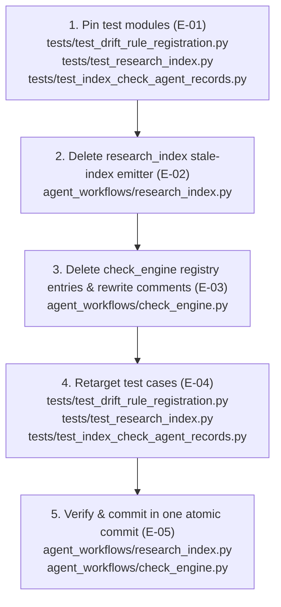

# IPD: Delete the research stale-index emitter and the two stale-index registry entries

- Date: 2026-11-09
- Kind: child
- Concern: Spec `4sd62s` 4.5 deletes `check.stale-index-*`. After Order 224 the only emitter left is `research_index.check_drift`, and `check_engine.RULE_REGISTRY` still registers `check.stale-index-missing` and `check.stale-index-stale`, with 16 `check_engine` comment lines that describe or cite them. This is part 6 of the round-3 split of `q6epwc` (Order 41), carrying the `research_index` and `check_engine` subset of `q6epwc` E-05.
- Scope: delete the last emitter and the two registry entries together, rewrite the `check_engine` comments that cite them, and update `tests/test_drift_rule_registration.py` plus the stale-index cases of `tests/test_research_index.py` and `tests/test_index_check_agent_records.py`. EXCLUDES: `doctor` (Order 225), the plans and prompts emitters (Order 224), and INDEX-byte assertions (`snin8q`).
- Scope-Paths: agent_workflows/research_index.py, agent_workflows/check_engine.py, tests/test_drift_rule_registration.py, tests/test_research_index.py, tests/test_index_check_agent_records.py, .aw/records/plans/pending/20261109-metastore-229-6qh68x-delete-the-research-stale-index-emitter-and-the-two-stale-in.ipd.md
- Item-Dependencies: executed:1ajqaa, executed:59aiyh, executed:dcerjg, executed:ffceq0, executed:g5hpbb, executed:sdzcur, executed:t4gl15, executed:tqknnc, executed:w819as
- Status: approved
- Readiness: go-pending-approval
- Review-Depth: standard
- From-Spec: 4sd62s
- Work-Kind: feature
- Priority: high
- Blocks-Release: next
- Set: metastore
- Order: 229
- Highest E allocated: 05
- Author: opencode its_direct/pt3-claude-opus-5.5-1m-us
- Id: 6qh68x
- Approval: 2026-11-16, recorded via aw ipd set: status set to approved

> Written to .aw/system/workflows/technical-writing/technical-writing.md. Every obligation, exact identifier, quotation, evidence record, and lifecycle status is preserved.

## Workflow history
- 2026-11-16 approved (aw set): status set to approved

- 2026-11-14 reviewed (antigravity/gemini-3.8-flash): /plan-review (antigravity/gemini-3.8-flash): APPROVE WITH REVISIONS APPLIED; PR-001..PR-006; review record .aw/records/reviews/20261109-metastore-229-6qh68x-delete-the-research-stale-index-emitter-and-the-two-stale-in.review.md
- 2026-11-09 to-review (opencode its_direct/pt3-claude-opus-5.5-1m-us): split from q6epwc (round 3, research nj8zdp guidance).

## Goal

After this plan, no `check_drift` emits a `check.stale-index-*` rule and `check_engine.RULE_REGISTRY` no longer registers one; every other research drift rule still fires.

## Detailed Implementation Checklist (TODO)

Execution-state rule: mark an `E-*` item complete only after performing the action. That mark is not validation. Right-sizing rule: write for a modest executor that cannot hold much in its head. Each E-item is one step (one concern, about one file, executable in one focused pass) and its V-item names each unit it covers with its own check; a plan stays at about 5 E-items and 8 work Scope-Paths, else split it into more child plans (guidance, `IPD-Z603`). Accepted execution states: blocked, failed, pending, performed; terminal gate demands 'performed'.

`q6epwc` E-05's site list is split across Orders 224, 229 and 225; this plan takes: the 2 `check_engine.RULE_REGISTRY` entries, the 2 emitter lines of `research_index.check_drift`, the 16 `check_engine` comment lines, the test module `tests/test_drift_rule_registration.py` from E-05's list, and the stale-index cases of `tests/test_research_index.py` and `tests/test_index_check_agent_records.py`. Ensure `.aw/state/6qh68x/` exists (`mkdir -p .aw/state/6qh68x/`). "Deleting the registry entry and the emitters together matters: an unregistered rule falls through to `check_engine._DEFAULT_RULESPEC` (severity `error`)" (carried from `q6epwc` E-05): E-02 and E-03 land in ONE commit.

PIN RULE (carried from `9o83cr`): before the edit, save the named test modules' per-test outcome list (`python3 -m pytest -o addopts="" -m "" -p no:randomly -n 0 -rA <modules> | grep -E "^(PASSED|FAILED|ERROR|SKIPPED|XFAIL|XPASS) " | sed -E 's/ - .*//' | sort > .aw/state/6qh68x/<E>-before.txt`); after it, run the same command into `<E>-after.txt`. A retargeted test keeps every input case, so the after-list may rename a test but not drop a case; the evidence pastes both lists and maps each removed name to its successor. A test whose only subject is a deleted rule is deleted, and the mapping says "subject removed".

### Task group 1: pin, delete, retarget

- [x] E-01 Create `.aw/state/6qh68x/` (`mkdir -p .aw/state/6qh68x/`) and pin `tests/test_drift_rule_registration.py`, `tests/test_research_index.py` and `tests/test_index_check_agent_records.py` (PIN RULE, `E-01-before.txt`).
  - Depends on: none
  - Expected outcome: `.aw/state/6qh68x/E-01-before.txt` exists.
  - Execution state: performed

- [x] E-02 Delete the code in `research_index.check_drift` that emits `check.stale-index-missing` and `check.stale-index-stale`; keep its other rules (`stale-state-to-promote`, `dangling-consumed-by`, `adopted-without-consumer`, `unrecognized-model`, `research.frontmatter-key-repeated`, `status-tier-mismatch`, `check.research-companion-orphaned`).
  - Depends on: E-01
  - Expected outcome: `rg -n "stale-index" agent_workflows/research_index.py` prints nothing.
  - Execution state: performed

- [x] E-03 In `agent_workflows/check_engine.py`, delete the `check.stale-index-missing` and `check.stale-index-stale` entries of `check_engine.RULE_REGISTRY`, and rewrite the comment lines that describe them or cite them as a severity precedent so each keeps its reasoning without naming a deleted rule.
  - Depends on: E-02
  - Expected outcome: `rg -n "stale-index" agent_workflows/check_engine.py` prints nothing.
  - Execution state: performed

- [x] E-04 Retarget `tests/test_drift_rule_registration.py` to the new rule set, and the stale-index cases `test_stale_index_detected` and `test_missing_index_is_informational_not_failing` in `tests/test_research_index.py`, and `test_human_drifting_output_per_verb`, `test_human_stale_output_per_verb` and `test_all_partial_stale_fixture` in `tests/test_index_check_agent_records.py` (each assertion that names a `check.stale-index-*` id). Save `E-04-after.txt`.
  - Depends on: E-03
  - Expected outcome: the three modules pass.
  - Execution state: performed

- [x] E-05 Run the three modules and `rg -n "stale-index" agent_workflows`, then commit E-02 to E-04 together through `aw commit 6qh68x -- <paths>` with only Scope-Paths files; never `git add -A`, a bare `git add` or `git commit -a`; never push.
  - Depends on: E-04
  - Expected outcome: `rg` lists only `doctor` lines (Order 225) and the `engine.py` `.aw/.gitignore` template comment (cutover); one commit holds the registry and emitter deletion.
  - Execution state: performed

## Project conventions discovered (Step 0)

- Severities come from `agent_workflows/check_engine.py::RULE_REGISTRY` (`RuleSpec`); an unregistered rule falls through to `agent_workflows/check_engine.py::_DEFAULT_RULESPEC` (severity `error`).
- Cite code by SYMBOL (`agent_workflows/module.py::function_or_symbol`) or by a quoted content string, with a line number only appended to one of those and never alone (advisory `IPD-C801`).

## Findings

Measured 2026-11-09 at `3d0ddb845`: `rg -n "stale-index" agent_workflows/check_engine.py` prints 18 lines (2 registry keys, 16 comments); `agent_workflows/research_index.py` 2 lines in `check_drift`. `rg -c "stale-index"`: `tests/test_research_index.py` 4, `tests/test_index_check_agent_records.py` 6.

## Proposed changes (ordered, validatable)



1. Pin (E-01).
2. Delete the research emitter (E-02) and the registry entries with their comments (E-03).
3. Retarget (E-04), verify and commit in one commit (E-05).

## Deferred / out of scope (with reason)

- `doctor`'s stale-index remediation: Order 225.
  - Carrier: q6epwc
- The `engine.py` `.aw/.gitignore` template comment: removed with the ignore lines at the cutover.
  - Carrier: cxxmyv

## Scope check

- Over-scope: none.
- Under-scope: none known. Size: 5 E-items, 5 work Scope-Paths.

## Required tests / validation

Pinned and retargeted: `tests/test_drift_rule_registration.py`, `tests/test_research_index.py`, `tests/test_index_check_agent_records.py`. Commands: those three modules, then the bare core gate `python3 -m pytest`.

## Spec / documentation sync

No spec change; implements part of `4sd62s` 4.5.

## Open questions

### OQ-01: Can `doctor` still match a deleted rule after this plan?

- Blocking: no
- Status: resolved
- Owner: plan author
- Resolution or deferral rationale: Its substring branches stay dead but harmless until Order 225 deletes them; no emitter produces the rule. Recommendation strength: strong.

## Validation and cross-check (verify before reporting done)

Validation-state rule: inspect evidence in a separate pass. Do not mark a `V-*` item complete from memory or from the matching execution checkmark. Accepted validation results: blocked, failed, pass, pending; terminal gate demands 'pass'. Runtime-demonstration reachability rule: for each `V-*` item demanding the software be observed acting (such as a run, a dispatch, or a transition), as distinct from items demanding a diff, a file's content, or a test result, which are reachable by construction, name the code path that produces the observation or the sibling `E-*` that creates it, else the demand is UNDER-SCOPE.

- [x] V-01 validates E-01
  - Required evidence: paste `wc -l .aw/state/6qh68x/E-01-before.txt` and one line from each of the three named modules.
  - Observed evidence:
    ```
$ wc -l .aw/state/6qh68x/E-01-before.txt
73 .aw/state/6qh68x/E-01-before.txt
PASSED tests/test_drift_rule_registration.py::DriftRuleRegistrationTests::test_property_1_registration_resolves_non_default_spec
PASSED tests/test_research_index.py::CheckDriftTests::test_clean_after_regen
FAILED tests/test_index_check_agent_records.py::IndexCheckSubprocessTests::test_agent_stale_fixture_emits_valid_record
```
    Baseline note: 67 PASSED, 6 FAILED before any edit. All six FAILED cases are in `tests/test_index_check_agent_records.py` (`test_agent_stale_fixture_emits_valid_record`, `test_all_partial_stale_fixture`, `test_human_drifting_output_per_verb`, `test_human_stale_output_per_verb`, `test_json_check_data_shape_and_no_leak_across_modes`, `test_json_stale_fixture_emits_json_document`). They already failed because `tqknnc` made `aw index <type> --check` filter out `check.stale-index-*` and `w819as` removed the plans/prompts emitters, so the stale fixture no longer exits 1; `tqknnc`'s V-04 pinned them FAILED. E-04 retargets all six.
  - Result: pass

- [x] V-02 validates E-02
  - Required evidence: paste `rg -n "stale-index" agent_workflows/research_index.py` printing nothing, and `aw check research --all --agent` on a fixture with one `dangling-consumed-by` research doc and no INDEX file, showing that rule and no `check.stale-index-*`. Code path: `check_engine.check_content` -> `research_index.check_drift` (E-02).
  - Observed evidence:
    ```
$ rg -n "stale-index" agent_workflows/research_index.py; echo "rc=$?"
rc=1

# Fixture: git-initialised tmp repo, one research doc .aw/records/research/20260701-fx-00-dang01-dangle.research-report.md
# (status todo, outcome none-yet, consumed-by: [zzzzz9] which resolves to nothing); no INDEX.json / INDEX.md
# (`ls -a .aw/records/research` -> `.  ..  20260701-fx-00-dang01-dangle.research-report.md`).
$ aw check research --all --agent; echo rc=$?
{"schema":"aw.agent/v1","kind":"result","cmd":"check","outcome":"findings","exit":1,"verified":true,"complete":true,"target":"research","findings":2,"findings_by_severity":{"error":1,"warning":0,"info":1},"evidence":["inventory","rules"],"diagnostics":[{"location":"20260701-fx-00-dang01-dangle.research-report.md","rule":"dangling-consumed-by"},{"location":"<collisions>","rule":"check.collisions-not-checked"}],"next":"aw check all"}
rc=1
```
    `dangling-consumed-by` is reported; no `check.stale-index-*` diagnostic appears although both INDEX files are absent.
  - Result: pass

- [x] V-03 validates E-03
  - Required evidence: paste `rg -n "stale-index" agent_workflows/check_engine.py` printing nothing, and `python3 -c "from agent_workflows import check_engine as c;print([k for k in c.RULE_REGISTRY if 'stale-index' in k])"` printing `[]`.
  - Observed evidence:
    ```
$ rg -n "stale-index" agent_workflows/check_engine.py; echo "rc=$?"
rc=1
$ python3 -c "from agent_workflows import check_engine as c;print([k for k in c.RULE_REGISTRY if 'stale-index' in k])"
[]
```
    The 16 comment lines were rewritten so each keeps its reasoning: precedents now cite `check.ipd-draft-ready-to-review`, `check.ipd-carrier-finished-unverified`, `check.system-layout-*`/`check.system-layout-drift`, or state the `info`-only-non-failing reason directly.
  - Result: pass

- [x] V-04 validates E-04
  - Required evidence: paste `diff .aw/state/6qh68x/E-01-before.txt .aw/state/6qh68x/E-04-after.txt` with each removed name of the five named cases mapped, and the summary line of `python3 -m pytest -o addopts="" tests/test_drift_rule_registration.py tests/test_research_index.py tests/test_index_check_agent_records.py` passing.
  - Observed evidence:
    ```
$ diff .aw/state/6qh68x/E-01-before.txt .aw/state/6qh68x/E-04-after.txt
1,6c1
< FAILED tests/test_index_check_agent_records.py::IndexCheckSubprocessTests::test_agent_stale_fixture_emits_valid_record
< FAILED tests/test_index_check_agent_records.py::IndexCheckSubprocessTests::test_all_partial_stale_fixture
< FAILED tests/test_index_check_agent_records.py::IndexCheckSubprocessTests::test_human_drifting_output_per_verb
< FAILED tests/test_index_check_agent_records.py::IndexCheckSubprocessTests::test_human_stale_output_per_verb
< FAILED tests/test_index_check_agent_records.py::IndexCheckSubprocessTests::test_json_check_data_shape_and_no_leak_across_modes
< FAILED tests/test_index_check_agent_records.py::IndexCheckSubprocessTests::test_json_stale_fixture_emits_json_document
---
> PASSED tests/test_drift_rule_registration.py::DriftRuleRegistrationTests::test_deleted_stale_index_rules_are_not_registered
14a10
> PASSED tests/test_index_check_agent_records.py::IndexCheckSubprocessTests::test_agent_stale_fixture_emits_valid_record
16a13
> PASSED tests/test_index_check_agent_records.py::IndexCheckSubprocessTests::test_all_partial_stale_fixture
18a16,17
> PASSED tests/test_index_check_agent_records.py::IndexCheckSubprocessTests::test_human_drifting_output_per_verb
> PASSED tests/test_index_check_agent_records.py::IndexCheckSubprocessTests::test_human_stale_output_per_verb
19a19
> PASSED tests/test_index_check_agent_records.py::IndexCheckSubprocessTests::test_json_check_data_shape_and_no_leak_across_modes
21a22
> PASSED tests/test_index_check_agent_records.py::IndexCheckSubprocessTests::test_json_stale_fixture_emits_json_document
25,26c26,27
< PASSED tests/test_research_index.py::CheckDriftTests::test_missing_index_is_informational_not_failing
< PASSED tests/test_research_index.py::CheckDriftTests::test_stale_index_detected
---
> PASSED tests/test_research_index.py::CheckDriftTests::test_missing_index_file_is_not_drift
> PASSED tests/test_research_index.py::CheckDriftTests::test_stale_index_file_is_not_drift

$ python3 -m pytest -o addopts="" tests/test_drift_rule_registration.py tests/test_research_index.py tests/test_index_check_agent_records.py
============================== 74 passed in 8.49s ==============================
```
    Name mapping (no case dropped; 73 -> 74): `test_research_index.py::test_stale_index_detected` -> `test_stale_index_file_is_not_drift` (same input: regen then overwrite INDEX.md; now asserts no drift, exit 0). `test_research_index.py::test_missing_index_is_informational_not_failing` -> `test_missing_index_file_is_not_drift` (same input: regen then unlink INDEX.json; now asserts no drift, exit 0). `test_index_check_agent_records.py::test_human_drifting_output_per_verb`, `test_human_stale_output_per_verb`, `test_all_partial_stale_fixture` keep their names and fixtures, FAILED -> PASSED, now asserting clean output / exit 0 and no `check.stale-index-*`; the other three pinned-FAILED cases in that module (`test_agent_stale_fixture_emits_valid_record`, `test_json_stale_fixture_emits_json_document`, `test_json_check_data_shape_and_no_leak_across_modes`) keep names and inputs with the stale-mode expected exit changed from 1 to 0. `test_drift_rule_registration.py::test_property_4_emitter_stamp_reaches_gate_on_fixture` keeps its name; it no longer writes INDEX files and additionally asserts no `check.stale-index-*`. Added: `test_deleted_stale_index_rules_are_not_registered`. Removed by "subject removed": none.
  - Result: pass

- [x] V-05 validates E-05
  - Required evidence: paste `rg -n "stale-index" agent_workflows` listing only `doctor.py` and `engine.py` lines, and `git show --stat` of the single `aw commit 6qh68x` commit listing `agent_workflows/research_index.py` and `agent_workflows/check_engine.py` together and only Scope-Paths files.
  - Observed evidence:
    ```
$ rg -n "stale-index" agent_workflows
agent_workflows/engine.py:6520:# `aw index research`; a fresh clone has none until then, which `check.stale-index-missing` reports
agent_workflows/doctor.py:1534:    # old conflated `stale-index` rule into `check.stale-index-missing` / `check.stale-index-stale`,
agent_workflows/doctor.py:1535:    # and both new ids CONTAIN `stale-index`, so this match (and the four other `"stale-index" in
agent_workflows/doctor.py:1543:    if "stale-index" in rule or rule.startswith("doctor.index-"):
agent_workflows/doctor.py:1544:        if rule == "check.stale-index-missing":
agent_workflows/doctor.py:1546:        elif rule == "check.stale-index-stale":
agent_workflows/doctor.py:1676:        # leak/stale-index).
agent_workflows/doctor.py:1864:    # 4. stale-index ("aw index" or "aw index <type>")
agent_workflows/doctor.py:1976:            or "stale-index" in rule

$ git show --stat 419e01d67
commit 419e01d67640d13f63998c0c09c64d36b8195d46
    6qh68x: delete the research stale-index emitter and the two stale-index registry entries (spec 4sd62s 4.5)
 agent_workflows/check_engine.py         | 72 ++++++++++-----------------------
 agent_workflows/meta_cli.py             | 16 +++-----
 agent_workflows/research_index.py       | 57 ++++----------------------
 tests/test_drift_rule_registration.py   | 31 +++++++++-----
 tests/test_index_check_agent_records.py | 47 ++++++++++++---------
 tests/test_research_index.py            | 26 +++++-------
 6 files changed, 94 insertions(+), 155 deletions(-)

$ aw suite   (core tier)
2897 passed, 1 skipped, 11 warnings in 147.53s (0:02:27)
```
    One commit holds the registry and emitter deletion. Out-of-fence path: `agent_workflows/meta_cli.py` (recorded with `--scope-reason` on the commit): `meta_cli._index_alias_drift` filtered `check.stale-index-*` findings via `_STALE_INDEX_RULE_PREFIX`; once this plan removed the last emitter the filter was dead code naming a deleted rule, and without removing it this V-item's `rg` would list a `meta_cli.py` line besides `doctor.py`/`engine.py`. Non-core: the 18 modules naming these rules or `research_index`/`check_drift` were also run (`18 failed, 286 passed`); all 18 failures are in `tests/test_index_write_agent_records.py` (17) and `tests/test_research_set_assign_date_containment.py` (1) and reproduce identically on an unmodified `git archive HEAD` copy (`18 failed, 22 passed`); they are pinned to `f6y2yy` (Order 231) and `6966zq` (Order 232) by `tqknnc` V-04.
  - Result: pass

## Approval and execution gate

- Size assessment: standard
- Cohesion rationale: not required

Execute only after human approval (`Status: approved`) and after every plan in `- Item-Dependencies:` is executed (Order 224 first, so this plan removes the LAST emitter with the registry entries). Every deletion is pin-first (PIN RULE above). Stop safely if prerequisite metastore symbols or comments from `w819as` (specifically `plans_index` and `prompts_index` stale-index emitter removals) or `sdzcur` (F-28 baseline) are absent.

Safety rule: uncommitted changes and untracked files you did not create are not yours; never revert, stage, commit, discard, reformat, or "clean up" another party's work.

Scope fence: the paths in `- Scope-Paths:` are a declaration; a needed file outside the fence is edited and then justified at finalize (`--scope-reason`), and a declared path left unmodified is acknowledged (`--scope-ack`).

Honesty rule: paste the ACTUAL summary lines; never claim a result you did not run.

Commits: only through `aw commit 6qh68x -- <paths>` with only Scope-Paths files; never `git add -A`, a bare `git add` or `git commit -a`; never push.

Lifecycle transition: the plan moves to `.aw/records/plans/executed/` only through `aw ipd finalize 6qh68x` (never a hand git mv), after `aw ipd lint --phase pre-transition` conforms and every `V-*` reads `pass` with pasted evidence. When aw oc run or aw agy run executes the plan, the runner performs the finalize; a hand executor runs aw ipd finalize 6qh68x itself.
