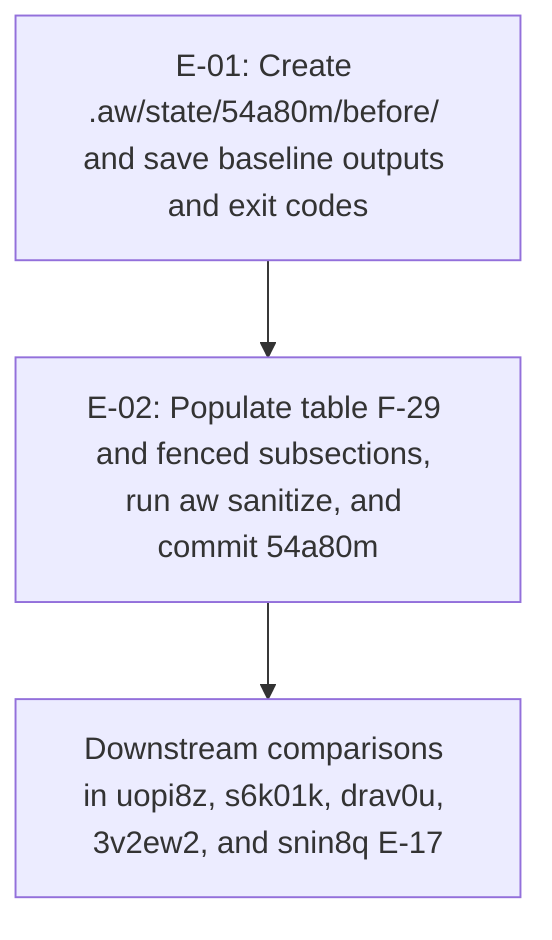

# IPD: Record the baseline for the INDEX writer deletion family

- Date: 2026-11-09
- Kind: child
- Concern: The finishing item of `snin8q` (E-17) compares the `aw check <type> --all` rule multisets and the `aw ipd board` output after the family's deletions against a baseline taken BEFORE any of them. `.aw/state/` is gitignored and does not travel between lane worktrees, so after the round-3 split the baseline must be committed in a plan file. This is the first part of the round-3 split of `snin8q` (Order 42), carrying `snin8q` E-01.
- Scope: run the read-only baseline commands, write their results into this plan's table F-29, and commit this plan file. EXCLUDES every code or test edit (Orders 231 to 237 of the split, and `snin8q`).
- Scope-Paths: .aw/records/plans/pending/20261109-metastore-230-54a80m-record-the-baseline-for-the-index-writer-deletion-family.ipd.md
- Item-Dependencies: executed:1ajqaa, executed:59aiyh, executed:dcerjg, executed:ffceq0, executed:g5hpbb, executed:q6epwc, executed:t4gl15
- Status: approved
- Readiness: go-pending-approval
- Review-Depth: complex
- From-Spec: 4sd62s
- Work-Kind: feature
- Priority: high
- Blocks-Release: next
- Set: metastore
- Order: 230
- Highest E allocated: 02
- Author: opencode its_direct/pt3-claude-opus-5.5-1m-us
- Id: 54a80m
- Approval: 2026-11-16, recorded via aw ipd set: status set to approved

> Reviewed and proofread per the technical writing standard, `.aw/system/workflows/technical-writing/technical-writing.md`, including requirement 12 (diagrams).

## Workflow history
- 2026-11-16 approved (aw set): status set to approved

- 2026-11-14 reviewed (aw set): APPROVE WITH REVISIONS APPLIED; PR-001, PR-002, PR-003, PR-004, PR-005
- 2026-11-09 to-review (opencode its_direct/pt3-claude-opus-5.5-1m-us): split from snin8q (round 3, research nj8zdp guidance).

## Goal

Commit, inside this plan, the pre-deletion outputs that `snin8q` E-17 and Order 236 compare against, so the comparison survives the lane worktrees of the other parts.

## Detailed Implementation Checklist (TODO)

Execution-state rule: mark an `E-*` item complete only after performing the action. That mark is not validation. Right-sizing rule: write for a modest executor that cannot hold much in its head. Each E-item is one step (one concern, about one file, executable in one focused pass) and its V-item names each unit it covers with its own check; a plan stays at about 5 E-items and 8 work Scope-Paths, else split it into more child plans (guidance, `IPD-Z603`). Accepted execution states: blocked, failed, pending, performed; terminal gate demands 'performed'.

The text of `snin8q` E-01 is split across E-01 and E-02 here; together they equal it. Every other part of the family depends on this plan.

### Task group 1: baseline

- [x] E-01 Create `.aw/state/54a80m/before/` (`mkdir -p .aw/state/54a80m/before/`, never `/tmp`) on the unedited tree, then run each baseline command and save its stdout and exit code there: `aw check plans --all --agent` (`check-plans.jsonl`), `aw check research --all --agent` (`check-research.jsonl`), `aw check prompts --all --agent` (`check-prompts.jsonl`), their three rule-id multisets (`jq -r '(.diagnostics // [])[].rule' | sort | uniq -c` saved as `check-plans.multiset.txt`, `check-research.multiset.txt`, and `check-prompts.multiset.txt`), `aw find plans --agent` (`find-plans.jsonl`), `aw ipd board` (`board.txt`), the bare core gate summary line of `python3 -m pytest` (`pytest-core.txt`), and all six exit codes (`exit-codes.txt`).
  - Depends on: none
  - Expected outcome: all saved files exist under `.aw/state/54a80m/before/`, and no file outside `.aw/state/` is modified.
  - Execution state: performed

- [x] E-02 Populate table `F-29` in `## Findings` with each command's exit code, the line count of `aw find plans --agent`, the line count and `sha256sum` of `board.txt`, and the core gate summary line; directly beneath table `F-29` under `### F-29 rule-id multisets` and `### F-29 board output`, insert the three full rule-id multisets and the verbatim `board.txt` inside fenced `text` code blocks (using Python `Path.read_text`/`write_text` from `.aw/state/54a80m/before/` so `board.txt` is copied byte-for-byte without truncation). Run bare `aw sanitize --agent` (repo-root scan; takes no file argument), then commit this plan file through `aw commit 54a80m -- .aw/records/plans/pending/20261109-metastore-230-54a80m-record-the-baseline-for-the-index-writer-deletion-family.ipd.md`; never `git add -A`, a bare `git add`, or `git commit -a`; never push.
  - Depends on: E-01
  - Expected outcome: table `F-29` and its `### F-29 rule-id multisets` and `### F-29 board output` fenced blocks hold every baseline value verbatim; `aw sanitize --agent` reports `"outcome":"clean"` and `"findings":0`; the commit lists only this plan file.
  - Execution state: performed

## Project conventions discovered (Step 0)

- `agent_workflows/check_engine.py::check_content` calls `agent_workflows/plans_index.py::check_drift`, `agent_workflows/research_index.py::check_drift`, and (after `q6epwc`) `agent_workflows/prompts_index.py::check_drift` on the `--all` path.
- When `aw check <type> --all --agent` reports zero findings, the JSON envelope omits `"diagnostics"`, so `jq -r '(.diagnostics // [])[].rule'` is required instead of `.diagnostics[].rule`.
- `board.txt` captures `aw ipd board` before `54a80m` finalizes, while `54a80m` itself is still in `.aw/records/plans/pending/`; downstream comparisons (`3v2ew2` V-02, `snin8q` E-17) account for plans that moved disposition between `54a80m` and the consumer run.
- Cite code by symbol (`path::Symbol`) or by a quoted content string, with a line number only appended as a hint (advisory `IPD-C801`).

## Findings

| Id | Evidence | Finding |
|---|---|---|
| F-29 | (written by E-02) per-command exit codes, `aw find plans --agent` line count, `board.txt` line count and `sha256sum`, and `python3 -m pytest` summary line in this table, with the three full rule-id multisets under `### F-29 rule-id multisets` and the full `aw ipd board` output fenced under `### F-29 board output`, recorded before any deletion of the family | Downstream plans (`uopi8z` V-02, `s6k01k` V-02, `drav0u` V-02, `3v2ew2` V-02, and `snin8q` E-17) compare against `F-29` and its subsections. |

Baseline recorded 2026-11-23 on lane branch `aw/lane/54a80m` at HEAD `0016badc09252f854c3a51d7f613127f2250c703` (unedited tree), run `run-20261124T000634Z-2966781`.

| Command | Exit code | Recorded value |
|---|---|---|
| `aw check plans --all --agent` | 1 | `"outcome":"findings"`, 46 diagnostics (multiset below) |
| `aw check research --all --agent` | 1 | `"outcome":"findings"`, 431 diagnostics (multiset below) |
| `aw check prompts --all --agent` | 1 | `"outcome":"findings"`, 13 diagnostics (multiset below) |
| `aw find plans --agent` | 0 | 1986 lines |
| `aw ipd board` | 0 | `board.txt` 2036 lines, `sha256sum` `a5f3b7d64b377c01cffd352a10b288eb202985600e3faad5c01c5f4963dac5f7` |
| `python3 -m pytest` (bare core gate) | 1 | `2898 passed, 1 skipped, 11 warnings in 148.92s (0:02:28)` (exit 1 is the core-tier wall-time budget only: "Core tier wall time: 148.93s exceeded budget of 30.00s.", host 1-minute load average 8.02 on 12 CPUs; no test failed) |

### F-29 rule-id multisets

`aw check plans --all --agent`:

```text
      1 check.collisions-not-checked
      1 check.ipd-dependency-findings-blocked
     41 check.lifecycle-transition-unvalidated
      1 check.plan-spec-link-missing
      2 check.spec-criteria-uncovered
```

`aw check research --all --agent`:

```text
     35 adopted-without-consumer
      1 check.collisions-not-checked
    358 dangling-citation
      1 name-invalid
     30 stale-state-to-promote
      2 status-tier-mismatch
      4 unrecognized-model
```

`aw check prompts --all --agent`:

```text
      1 check.collisions-not-checked
      6 check.name-nonconformant
      6 check.prompt-metadata-missing
```

### F-29 board output

```text
Total: 2015 plan/prompt file(s)

pending/ (109)
  to-review (37)
    .aw/records/plans/pending/20261119-2i04so-01-28k5h5-wrap-check-engine-check-types-in-artifact-meta-scan-once-and.ipd.md
    .aw/records/plans/pending/20261119-5uqo2g-01-rowsi5-hoist-generic-test-git-identity-tokens-into-leak-sanitizer.ipd.md
    .aw/records/plans/pending/20261119-63v9ph-01-4q1rri-skip-readme-md-in-artifact-meta-check-freshness-records-root.ipd.md
    .aw/records/plans/pending/20261119-9bg1uk-01-dvxh1p-ignore-companion-records-runs-via-git-info-exclude-in-m0001.ipd.md
    .aw/records/plans/pending/20261119-lflu5y-01-k1qi85-fix-test-proposal-continuation-agy-and-test-proposal-continu.ipd.md
    .aw/records/plans/pending/20261119-lz1igw-01-sz4h5i-fix-load-legacy-review-round-parsing-to-match-anchored-headi.ipd.md
    .aw/records/plans/pending/20261119-o2or8a-01-ippuby-align-project-json-preview-parity-and-staging-when-git-polic.ipd.md
    .aw/records/plans/pending/20261119-r20qqe-01-rulopj-move-runner-shared-fail-incomplete-status-reset-onto-artifac.ipd.md
    .aw/records/plans/pending/20261119-vo0y6q-01-rntx9a-route-artifact-meta-state-and-lock-paths-to-aw-home-when-rec.ipd.md
    .aw/records/plans/pending/20261121-2vj8w3-01-53z4se-route-control-state-to-aw-home-for-legacy-agents-and-unignor.ipd.md
    .aw/records/plans/pending/20261121-517n5n-01-mx7azn-verify-aw-meta-repair-subparser-description-and-required-lea.ipd.md
    .aw/records/plans/pending/20261121-83kkzh-01-bebahq-join-rev-mirrors-with-rev-log-states-in-artifact-meta-read-a.ipd.md
    .aw/records/plans/pending/20261121-b0en28-01-feol8w-preserve-completed-review-phase-across-full-auto-approval-an.ipd.md
    .aw/records/plans/pending/20261121-b1j6bl-01-kbh055-preserve-concern-and-scope-bullets-in-fixture-codemod-plan-s.ipd.md
    .aw/records/plans/pending/20261121-diobl2-01-behm9r-route-auto-approved-orchestrator-ipds-to-orchestrate-instead.ipd.md
    .aw/records/plans/pending/20261121-dogfood-bugs-00-p2zmjs-coordinate-six-dogfooding-bug-fixes-across-install-checkup-c.ipd.md
    .aw/records/plans/pending/20261121-dogfood-bugs-01-gftvh6-honor-no-interactive-in-aw-install-policy-update-checkpoint.ipd.md
    .aw/records/plans/pending/20261121-dogfood-bugs-02-qw9i5p-fix-aw-install-pre-write-plan-companion-delta-to-print-compa.ipd.md
    .aw/records/plans/pending/20261121-dogfood-bugs-03-5q8whb-handle-missing-local-ci-workflow-in-aw-checkup-instead-of-ra.ipd.md
    .aw/records/plans/pending/20261121-dogfood-bugs-04-p0hq1k-resolve-companion-records-paths-in-check-scope-path-target-s.ipd.md
    .aw/records/plans/pending/20261121-dogfood-bugs-05-c74ey2-fix-aw-doctor-stale-index-remediation-command-and-companion.ipd.md
    .aw/records/plans/pending/20261121-dogfood-bugs-06-d8b9rp-emit-actionable-action-review-hint-when-reviews-is-combined.ipd.md
    .aw/records/plans/pending/20261121-e0wwtc-01-osq7nu-map-h1-heading-titles-on-backlog-and-prompt-fixtures-in-fixt.ipd.md
    .aw/records/plans/pending/20261121-es4blt-01-wknwwz-read-the-lane-copy-of-an-orchestrator-plan-in-the-review-rea.ipd.md
    .aw/records/plans/pending/20261121-fbxkvo-01-2cv6rz-relocate-legacy-untracked-lanes-during-to-aw-and-guard-migra.ipd.md
    .aw/records/plans/pending/20261121-lufe6m-01-svpml2-distinguish-full-record-literals-from-body-prose-in-fixture.ipd.md
    .aw/records/plans/pending/20261121-rryabb-01-z6wodh-scrub-driver-restart-env-vars-and-ignore-stale-aw-invocation.ipd.md
    .aw/records/plans/pending/20261121-ujxi56-01-qpvem9-skip-legacy-agents-docs-readme-md-in-layout-migration-and-ve.ipd.md
    .aw/records/plans/pending/20261121-wdarhj-01-zeopzs-handle-non-utf-8-decode-errors-and-surface-incomplete-cache.ipd.md
    .aw/records/plans/pending/20261122-cliverbs-00-lmlji2-orchestrate-verb-first-top-level-cli-commands-and-unified-aw.ipd.md
    .aw/records/plans/pending/20261122-cliverbs-01-m7jcis-add-per-state-runner-profile-routing-path-host-fallback-and.ipd.md
    .aw/records/plans/pending/20261122-cliverbs-02-p06t7i-unify-read-only-views-under-aw-show-and-remove-aw-reviews-fo.ipd.md
    .aw/records/plans/pending/20261122-cliverbs-03-xocj8i-add-verb-first-top-level-cli-commands-review-exec-grad-appro.ipd.md
    .aw/records/plans/pending/20261122-selectors-00-3xwbvs-orchestrate-normalized-artifact-selector-flags-across-all-aw.ipd.md
    .aw/records/plans/pending/20261122-selectors-01-bzsoai-build-shared-normalized-selector-spec-parser-builder-and-dur.ipd.md
    .aw/records/plans/pending/20261122-selectors-02-mnlaoa-wire-normalized-artifact-selectors-into-query-and-mutation-c.ipd.md
    .aw/records/plans/pending/20261122-selectors-03-e36q6r-wire-normalized-artifact-selectors-into-runner-clis-shell-co.ipd.md
  reviewed (6)
    .aw/records/plans/pending/20261116-reverify-02-mgp655-implement-aw-agy-run-audit-via-shared-audit-runner-helper.ipd.md
    .aw/records/plans/pending/20261117-installmore-00-5qqgfb-package-gemini-quota-and-add-opt-in-aw-install-more-with-dis.ipd.md
    .aw/records/plans/pending/20261117-installmore-01-z403j4-add-gemini-quota-cli-module-and-behavioral-tests-to-agent-wo.ipd.md
    .aw/records/plans/pending/20261117-installmore-02-58isyp-add-aw-install-more-opt-in-companion-installer-and-discovery.ipd.md
    .aw/records/plans/pending/20261117-reanswer-01-04ygpo-support-replacing-or-updating-unconsumed-answers-in-aw-runs.ipd.md
    .aw/records/plans/pending/20261122-rereviewux-01-9ifwdx-clear-review-staleness-on-human-approval-and-add-aw-show-sta.ipd.md
  approved (65)
    .aw/records/plans/pending/20261102-metastore-00-63ib9r-build-the-artifact-metadata-store-of-spec-4sd62s-orchestrato.ipd.md
    .aw/records/plans/pending/20261102-metastore-11-9o83cr-delete-index-and-status-code-and-every-legacy-parser-outside.ipd.md
    .aw/records/plans/pending/20261102-metastore-12-90iqr1-rewrite-documents-managed-block-templates-and-quickstarts-fo.ipd.md
    .aw/records/plans/pending/20261102-metastore-13-cxxmyv-perform-the-attended-metadata-cutover-commit.ipd.md
    .aw/records/plans/pending/20261108-metastore-42-snin8q-delete-the-index-writers-the-status-code-and-the-audit-index.ipd.md
    .aw/records/plans/pending/20261108-metastore-43-k6jd6l-fold-the-value-writers-into-artifact-meta-delete-the-writer.ipd.md
    .aw/records/plans/pending/20261108-metastore-44-iog3cw-add-the-format-aware-field-assertion-helper-and-move-the-fir.ipd.md
    .aw/records/plans/pending/20261108-metastore-45-e8420v-delete-the-check-engine-runner-setter-and-release-metadata-p.ipd.md
    .aw/records/plans/pending/20261108-metastore-46-0xsx2n-delete-the-remaining-plans-family-ipd-family-and-module-meta.ipd.md
    .aw/records/plans/pending/20261108-metastore-47-w13bkp-move-the-remaining-setter-byte-test-assertions-onto-the-form.ipd.md
    .aw/records/plans/pending/20261108-metastore-59-87rvs2-move-setter-byte-assertions-of-batches-s05-to-s07-onto-the-f.ipd.md
    .aw/records/plans/pending/20261108-metastore-60-rdg0qv-move-setter-byte-assertions-of-batches-s08-to-s10-onto-the-f.ipd.md
    .aw/records/plans/pending/20261108-metastore-61-aqc3m6-move-setter-byte-assertions-of-batches-s15-to-s17-onto-the-f.ipd.md
    .aw/records/plans/pending/20261108-metastore-62-zgyna1-move-the-test-status-set-setter-byte-assertions-of-batches-s.ipd.md
    .aw/records/plans/pending/20261109-metastore-230-54a80m-record-the-baseline-for-the-index-writer-deletion-family.ipd.md
    .aw/records/plans/pending/20261109-metastore-231-f6y2yy-retarget-the-index-agent-record-tests-off-the-index-write-pa.ipd.md
    .aw/records/plans/pending/20261109-metastore-232-6966zq-retarget-five-research-and-registry-tests-off-the-index-buil.ipd.md
    .aw/records/plans/pending/20261109-metastore-233-uopi8z-delete-the-plans-index-writers-and-the-plans-archive-refresh.ipd.md
    .aw/records/plans/pending/20261109-metastore-234-s6k01k-delete-the-research-index-writers-and-the-research-archive-r.ipd.md
    .aw/records/plans/pending/20261109-metastore-235-drav0u-delete-the-prompts-index-writers.ipd.md
    .aw/records/plans/pending/20261109-metastore-236-3v2ew2-delete-the-unreachable-status-renderer.ipd.md
    .aw/records/plans/pending/20261109-metastore-237-h3jp4e-delete-the-artifact-audit-in-process-index-cache.ipd.md
    .aw/records/plans/pending/20261109-metastore-238-786w7r-record-the-baseline-for-the-remaining-metadata-regex-deletio.ipd.md
    .aw/records/plans/pending/20261109-metastore-239-7uq6xg-delete-the-check-engine-blob-and-status-parsers-and-retarget.ipd.md
    .aw/records/plans/pending/20261109-metastore-240-js35bz-delete-the-named-check-engine-metadata-regex-patterns.ipd.md
    .aw/records/plans/pending/20261109-metastore-241-bcrko1-delete-the-inline-check-engine-metadata-regex-literals.ipd.md
    .aw/records/plans/pending/20261109-metastore-242-k6nukd-delete-the-runner-shared-metadata-parsers-and-regex-literals.ipd.md
    .aw/records/plans/pending/20261109-metastore-243-kmf6w4-delete-the-status-set-and-releases-metadata-regex-literals.ipd.md
    .aw/records/plans/pending/20261109-metastore-244-tbvx4r-delete-the-plans-index-plans-refs-and-plans-archive-metadata.ipd.md
    .aw/records/plans/pending/20261109-metastore-245-qttoyc-delete-the-artifact-family-metadata-regex-literals.ipd.md
    .aw/records/plans/pending/20261109-metastore-246-nx7fws-delete-the-ipd-module-metadata-regex-literals.ipd.md
    .aw/records/plans/pending/20261109-metastore-247-akhrp5-delete-the-readiness-and-coverage-metadata-regex-literals.ipd.md
    .aw/records/plans/pending/20261109-metastore-248-tdhav3-delete-the-attention-review-and-research-metadata-regex-lite.ipd.md
    .aw/records/plans/pending/20261109-metastore-249-n2cvf0-delete-the-remaining-module-metadata-regex-literals.ipd.md
    .aw/records/plans/pending/20261109-metastore-250-qhay6a-inventory-the-docs-surface-and-start-the-cutover-docs-patch.ipd.md
    .aw/records/plans/pending/20261109-metastore-251-a49djh-add-review-workflow-recorder-command-and-template-rewrites-t.ipd.md
    .aw/records/plans/pending/20261109-metastore-252-y1zihp-add-readme-docs-and-reference-document-rewrites-to-the-cutov.ipd.md
    .aw/records/plans/pending/20261109-metastore-253-ngc2a2-add-kind-rename-and-quickstart-rewrites-to-the-cutover-docs.ipd.md
    .aw/records/plans/pending/20261109-metastore-254-tub3ir-record-the-description-model-and-run-the-attended-pre-cutove.ipd.md
    .aw/records/plans/pending/20261109-metastore-255-2k5t16-start-the-cutover-code-patch-with-the-log-format-loader-and.ipd.md
    .aw/records/plans/pending/20261109-metastore-256-g45vyv-add-the-log-only-writers-and-ledger-retirement-to-the-cutove.ipd.md
    .aw/records/plans/pending/20261109-metastore-257-x1mmdp-add-the-log-format-test-builder-switch-to-the-cutover-code-p.ipd.md
    .aw/records/plans/pending/20261109-metastore-258-0zylig-add-the-kind-option-renames-and-text-test-updates-to-the-cut.ipd.md
    .aw/records/plans/pending/20261109-metastore-259-33vxoi-write-the-post-cutover-acceptance-demonstration-script.ipd.md
    .aw/records/plans/pending/20261109-metastore-260-5qyba0-rehearse-the-full-metadata-cutover-on-a-clone-with-the-prepa.ipd.md
    .aw/records/plans/pending/20261109-metastore-261-j5fqax-add-the-format-aware-field-assertion-helper-and-move-batch-s.ipd.md
    .aw/records/plans/pending/20261109-metastore-262-545ag7-move-setter-byte-assertions-of-batch-s01-onto-the-format-awa.ipd.md
    .aw/records/plans/pending/20261109-metastore-263-qtvk2q-move-setter-byte-assertions-of-batch-s11-except-question-vis.ipd.md
    .aw/records/plans/pending/20261109-metastore-264-cxylsu-move-setter-byte-assertions-of-batch-s12-first-eight-modules.ipd.md
    .aw/records/plans/pending/20261109-metastore-265-810kpy-move-setter-byte-assertions-of-batch-s13-and-the-s11-and-s12.ipd.md
    .aw/records/plans/pending/20261109-metastore-270-wdz2l9-move-setter-byte-assertions-of-batch-s08-onto-the-format-awa.ipd.md
    .aw/records/plans/pending/20261109-metastore-286-8fxic1-delete-the-prompts-and-runner-shared-metadata-adapters.ipd.md
    .aw/records/plans/pending/20261109-metastore-287-ad86ym-move-parse-metadata-block-and-parse-metadata-comment-into-ar.ipd.md
    .aw/records/plans/pending/20261109-metastore-288-sq6v7i-move-parse-frontmatter-into-artifact-meta-and-retarget-its-p.ipd.md
    .aw/records/plans/pending/20261109-metastore-289-5lgpix-retarget-the-tests-that-still-call-parse-frontmatter.ipd.md
    .aw/records/plans/pending/20261109-metastore-290-bxupy8-delete-parse-frontmatter-and-move-the-history-grammar-into-a.ipd.md
    .aw/records/plans/pending/20261109-metastore-291-ay6sxp-move-the-plan-readiness-backlog-and-setter-history-readers-o.ipd.md
    .aw/records/plans/pending/20261109-metastore-292-csobg7-move-the-attention-history-readers-and-spec-status-re-and-de.ipd.md
    .aw/records/plans/pending/20261109-metastore-293-71ewpn-move-metadata-region-into-artifact-meta-and-retarget-the-gat.ipd.md
    .aw/records/plans/pending/20261109-metastore-294-8ysz6b-delete-the-selectors-record-text-readers-and-rebind-the-runn.ipd.md
    .aw/records/plans/pending/20261109-metastore-295-iup4lp-delete-the-prompts-text-readers-and-attention-frontmatter-bl.ipd.md
    .aw/records/plans/pending/20261109-metastore-296-hrbbhy-delete-the-plans-record-text-readers-and-verify-the-subset-1.ipd.md
    .aw/records/plans/pending/20261109-metastore-297-um2kvx-delete-the-specs-record-text-readers.ipd.md
    .aw/records/plans/pending/20261109-metastore-298-po3o1c-move-the-backlog-parse-item-metadata-callers-onto-artifact-m.ipd.md
    .aw/records/plans/pending/20261109-metastore-299-vw88h0-remove-the-metadata-part-of-backlog-parse-item-and-verify-th.ipd.md
  (no status) (1)
    .aw/records/prompts/pending/20260810-m1lc2t-01-m1lc2t-awphysical-spec-to-reviewed-focus.prompt.md

executed/ (1835)
  executed (1815)
    .aw/records/plans/executed/20260630-assess-documentation-00-7ibobm-assess-documentation.ipd.md
    .aw/records/plans/executed/20260701-add-generalization-00-rin79g-add-generalization-assess-lens.ipd.md
    .aw/records/plans/executed/20260701-installer-ignore-00-5c6bkj-installer-ignore-pyc-and-gitignore-backups.ipd.md
    .aw/records/plans/executed/20260701-installer-update-00-509kn1-installer-update-framework-files-by-default.ipd.md
    .aw/records/plans/executed/20260703-assess-documentation-00-yye9f8-assess-documentation.ipd.md
    .aw/records/plans/executed/20260703-assess-secrets-00-wxh9go-assess-secrets.ipd.md
    .aw/records/plans/executed/20260704-advise-workflow-00-d5tz36-advise-workflow-and-personas.ipd.md
    .aw/records/plans/executed/20260704-assess-documentation-00-ge2a5r-assess-documentation.ipd.md
    .aw/records/plans/executed/20260704-assessdoc01-00-g2payb-assess-documentation-2.ipd.md
    .aw/records/plans/executed/20260704-command-surface-00-bl0nph-command-surface-redesign.ipd.md
    .aw/records/plans/executed/20260704-guided-onboarding-00-ksvzgc-guided-onboarding-tour.ipd.md
    .aw/records/plans/executed/20260704-lifecycle-workflows-00-i9xi81-lifecycle-workflows.ipd.md
    .aw/records/plans/executed/20260704-self-tests-00-bqcbnk-self-tests-and-assess-all.ipd.md
    .aw/records/plans/executed/20260704-toolkit-discovery-00-or78s2-toolkit-discovery-and-version.ipd.md
    .aw/records/plans/executed/20260704-verification-evidence-00-4ys2p2-verification-evidence-layer.ipd.md
    .aw/records/plans/executed/20260706-versioning-git-00-qhh6mb-versioning-git-tag-semver.ipd.md
    .aw/records/plans/executed/20260707-pip-distribution-00-px86eh-pip-distribution-cli-config-wizard.ipd.md
    .aw/records/plans/executed/20260708-run-checks-00-3dfcdf-run-checks-windows-npm.ipd.md
    .aw/records/plans/executed/20260709-interactive-git-00-vfa1tl-interactive-git-workflow.ipd.md
    .aw/records/plans/executed/20260709-target-directory-00-vw1ich-target-directory-readmes.ipd.md
    .aw/records/plans/executed/20260710-plan-lifecycle-00-4025ak-plan-lifecycle-superseded-notexecuted-dirs.ipd.md
    .aw/records/plans/executed/20260711-agents-tree-00-scowgo-agents-tree-directory-readmes.ipd.md
    .aw/records/plans/executed/20260711-assess-documentation-00-5by84z-assess-documentation.ipd.md
    .aw/records/plans/executed/20260711-aw-plans-00-gwu2pv-aw-plans-status-board.ipd.md
    .aw/records/plans/executed/20260711-normalizer-fstime-00-g3wg0d-normalizer-fstime-fallback-and-broader-scope.ipd.md
    .aw/records/plans/executed/20260711-plan-filename-00-o7ilfm-plan-filename-convention-hhmm-nn.ipd.md
    .aw/records/plans/executed/20260711-plan-status-00-t1nlqc-plan-status-vocabulary-and-workflow-provenance.ipd.md
    .aw/records/plans/executed/20260711-relrev01-00-ez65jl-release-review-terminal-decision-and-ci-verify.ipd.md
    .aw/records/plans/executed/20260711-timestamp-convention-00-gv8nh8-timestamp-convention-utc-to-local.ipd.md
    .aw/records/plans/executed/20260712-agent-brain-00-lhmlzo-agent-brain-dir-plan-and-walkthrough-mirroring.ipd.md
    .aw/records/plans/executed/20260712-agent-execution-00-3obd0t-agent-execution-contract-in-pointer-block.ipd.md
    .aw/records/plans/executed/20260712-agents-docs-00-98dj6q-agents-docs-research-and-walkthroughs-convention.ipd.md
    .aw/records/plans/executed/20260712-assess-tests-00-lc5a3x-assess-tests.ipd.md
    .aw/records/plans/executed/20260712-assessbug01-00-hq4p3a-assess-bugs-in-scripts.ipd.md
    .aw/records/plans/executed/20260712-auto-approved-00-7w8b8u-auto-approved-status-for-mechanical-correctives.ipd.md
    .aw/records/plans/executed/20260712-aw-cli-00-sru7zx-aw-cli-ux-ctrlc-setup-and-plan-names-verb.ipd.md
    .aw/records/plans/executed/20260712-aw-install-00-ysuonq-aw-install-missing-git-diagnostics-preflight.ipd.md
    .aw/records/plans/executed/20260712-consolidate-reference-00-7waz4b-consolidate-reference-material-and-docs-bucket-standard.ipd.md
    .aw/records/plans/executed/20260712-falsely-marked-00-y6kuar-falsely-marked-executed-tests-still-red.ipd.md
    .aw/records/plans/executed/20260712-fix-installer-00-odclzm-fix-installer-shim-tests-left-red.ipd.md
    .aw/records/plans/executed/20260712-git-diagnostics-00-gs65w2-git-diagnostics-untracked-and-in-sync-false-alarm.ipd.md
    .aw/records/plans/executed/20260712-installer-shim-00-7y7pbh-installer-shim-detection-ctrlc-and-diff.ipd.md
    .aw/records/plans/executed/20260712-mirror-workflow-00-ndxj3i-mirror-workflow-pointer-into-native-agent-files.ipd.md
    .aw/records/plans/executed/20260712-preflight-gate-00-n267bi-preflight-gate-verdict-free-and-conditional.ipd.md
    .aw/records/plans/executed/20260712-pypi-publish-00-43zcc8-pypi-publish-doc-links-and-version-check.ipd.md
    .aw/records/plans/executed/20260712-release-consent-00-l9q4gs-release-consent-decision-tree-and-candidate-tier.ipd.md
    .aw/records/plans/executed/20260712-relrev02-00-6cdker-release-review-todo-and-pending-prompts.ipd.md
    .aw/records/plans/executed/20260712-scan-secrets-00-buofph-scan-secrets-history-line-offsets-refactor.ipd.md
    .aw/records/plans/executed/20260712-scope-review-00-ttyiqx-scope-review-gemini-bugs-tests-execution.ipd.md
    .aw/records/plans/executed/20260712-stale-baked-00-p2x0me-stale-baked-version-and-release-rebake-gap.ipd.md
    .aw/records/plans/executed/20260712-unify-install-00-wbr6u8-unify-install-orchestrator-single-source.ipd.md
    .aw/records/plans/executed/20260712-ux-and-00-ob9h6r-ux-and-data-modeling-principles-import.ipd.md
    .aw/records/plans/executed/20260712-verify-execution-00-c5685e-verify-execution-workflow.ipd.md
    .aw/records/plans/executed/20260713-auto-parallel-00-t88woq-auto-parallel-audit-lanes-shared-convention.ipd.md
    .aw/records/plans/executed/20260713-normalize-plan-00-qv04dz-normalize-plan-names-test-date-flakiness.ipd.md
    .aw/records/plans/executed/20260715-agent-comms-00-ssmov3-agent-comms-portable-convention.ipd.md
    .aw/records/plans/executed/20260715-assess-bugs-00-9gfezi-assess-bugs.ipd.md
    .aw/records/plans/executed/20260715-assess-documentation-00-z0416p-assess-documentation.ipd.md
    .aw/records/plans/executed/20260715-docs-consistency-00-49lbcl-docs-consistency-audit-corrections.ipd.md
    .aw/records/plans/executed/20260715-install-entry-00-1k3iq5-install-entry-point-parity-commit-and-isolation.ipd.md
    .aw/records/plans/executed/20260715-plan-set-00-nedvj7-plan-set-order-frontmatter.ipd.md
    .aw/records/plans/executed/20260715-unify-readiness-00-c59ziz-unify-readiness-verdict-vocabulary.ipd.md
    .aw/records/plans/executed/20260717-agentcont-01-6a3myl-whatnext-surveyor-workflow.ipd.md
    .aw/records/plans/executed/20260717-agentcont-03-5twbwf-handoff-workflow-session-continuity.ipd.md
    .aw/records/plans/executed/20260717-researchprompt-02-2txx9b-scaffold-agents-prompts-staging-convention.ipd.md
    .aw/records/plans/executed/20260718-purge-personal-00-3visab-purge-personal-path-and-identity-leaks.ipd.md
    .aw/records/plans/executed/20260719-local-leaks-00-8vc1r6-local-leaks-detection-capability.ipd.md
    .aw/records/plans/executed/20260720-assess-self-00-55vpda-assess-self-documentation.ipd.md
    .aw/records/plans/executed/20260721-leak-sanitizer-00-l994g9-leak-sanitizer-config-wizard.ipd.md
    .aw/records/plans/executed/20260721-leaksan01-00-kq6akq-leak-sanitizer-agent-rewire-and-optional-install.ipd.md
    .aw/records/plans/executed/20260721-per-workflow-00-lwug80-per-workflow-argument-hint-in-command-shims.ipd.md
    .aw/records/plans/executed/20260721-prompts-local-00-btn0my-prompts-local-quarantine-lane.ipd.md
    .aw/records/plans/executed/20260721-relrev03-00-s3axqd-release-review-full-release-publishes-gh-release.ipd.md
    .aw/records/plans/executed/20260721-sanitizer-engine-00-qjdklk-sanitizer-engine-and-local-leaks-migration.ipd.md
    .aw/records/plans/executed/20260721-self-contained-00-vgxk6c-self-contained-interactive-questions-convention.ipd.md
    .aw/records/plans/executed/20260721-version-resolver-00-ey1dex-version-resolver-match-release-tags-only.ipd.md
    .aw/records/plans/executed/20260721-whatnext-chat-00-wa7uiw-whatnext-chat-history-todowrite-save-to-todo.ipd.md
    .aw/records/plans/executed/20260722-assess-and-00-49eeuc-assess-and-producers-closing-artifacts-report.ipd.md
    .aw/records/plans/executed/20260722-instsafe-06-mv7hw7-deepen-interactive-questions-convention.ipd.md
    .aw/records/plans/executed/20260722-overwrite-prompt-00-1wt4qz-overwrite-prompt-clarity-and-input-validation.ipd.md
    .aw/records/plans/executed/20260723-instsafe-01-920qnm-install-manifest-and-managed-sections-model.ipd.md
    .aw/records/plans/executed/20260723-instsafe-02-kcjgmy-sectioned-managed-block-for-shared-files.ipd.md
    .aw/records/plans/executed/20260723-instsafe-03-2jovaz-untracked-safety-convention-and-tracking-warning.ipd.md
    .aw/records/plans/executed/20260723-instsafe-04-80128k-aw-uninstall-conservative.ipd.md
    .aw/records/plans/executed/20260723-instsafe-05-kemhdg-external-install-and-skills-delivery-research-spec.ipd.md
    .aw/records/plans/executed/20260723-instsafe-07-qrokie-clean-delta-and-tracking-modes-design-spec.ipd.md
    .aw/records/plans/executed/20260726-conformance-harness-00-hypynh-conformance-harness-phase0.ipd.md
    .aw/records/plans/executed/20260726-ipdcomplete-01-yyxyt9-ipd-checklist-and-completion-clause.ipd.md
    .aw/records/plans/executed/20260726-ipdcomplete-02-h409oe-ipd-spec-and-always-loaded-directive.ipd.md
    .aw/records/plans/executed/20260726-plan-review-00-yxai1b-plan-review-scope-ledger-wording.ipd.md
    .aw/records/plans/executed/20260727-dualchk-00-3a4wh8-dual-checklist-convention-orchestrator.ipd.md
    .aw/records/plans/executed/20260727-dualchk-01-r42p0d-ipd-template-dual-checklist.ipd.md
    .aw/records/plans/executed/20260727-dualchk-02-v46x84-plan-review-dual-checklist-duties.ipd.md
    .aw/records/plans/executed/20260727-dualchk-03-oz1cj6-ipd-spec-and-orchestrator-template.ipd.md
    .aw/records/plans/executed/20260727-two-sets-00-ykdobx-two-sets-prose-quality-fixes.ipd.md
    .aw/records/plans/executed/20260727-untrack-artifacts-00-r2lbj2-untrack-artifacts-prose-corrections.ipd.md
    .aw/records/plans/executed/20260727-untrackwf-00-wn2jto-untrack-workflow-artifacts-orchestrator.ipd.md
    .aw/records/plans/executed/20260727-untrackwf-01-0pf3pn-untrack-policy-code-and-docs.ipd.md
    .aw/records/plans/executed/20260727-untrackwf-02-1h8whs-untrack-policy-runbooks.ipd.md
    .aw/records/plans/executed/20260727-untrackwf-03-5zg7tu-migration-tool-and-remediation.ipd.md
    .aw/records/plans/executed/20260730-researchorg-00-jwbo2u-research-org-orchestrator.ipd.md
    .aw/records/plans/executed/20260730-researchorg-01-3x7po2-research-naming-and-frontmatter-contract.ipd.md
    .aw/records/plans/executed/20260730-researchorg-02-g7w8ul-aw-research-create-tool.ipd.md
    .aw/records/plans/executed/20260730-researchorg-03-7xzlug-research-index-generator.ipd.md
    .aw/records/plans/executed/20260730-researchorg-04-evuvbe-research-rename-and-refs-tool.ipd.md
    .aw/records/plans/executed/20260730-researchorg-05-9tdap2-research-archival-and-states.ipd.md
    .aw/records/plans/executed/20260730-researchorg-06-w2u8ws-migrate-existing-research.ipd.md
    .aw/records/plans/executed/20260730-researchorg-07-bv7oat-scaffold-directives-and-decision-updates.ipd.md
    .aw/records/plans/executed/20260802-ipdstruct-00-by245s-ipd-structure-orchestrator.ipd.md
    .aw/records/plans/executed/20260802-ipdstruct-01-ktv5h3-canonical-ipd-schema.ipd.md
    .aw/records/plans/executed/20260802-ipdstruct-02-dkpqmy-ipd-lint-parser-and-state-machine.ipd.md
    .aw/records/plans/executed/20260802-ipdstruct-03-l060ep-ipd-scaffold-and-sync.ipd.md
    .aw/records/plans/executed/20260802-ipdstruct-04-x9engh-templates-and-spec-and-defect-fixes.ipd.md
    .aw/records/plans/executed/20260802-ipdstruct-05-nyfgsz-review-preflight-and-enforcement.ipd.md
    .aw/records/plans/executed/20260802-ipdstruct-06-5xwaxi-migrate-nonterminal-and-adopt.ipd.md
    .aw/records/plans/executed/20260807-verify-execution-01-2p9fd3-thorough-execution-verification-workflow.ipd.md
    .aw/records/plans/executed/20260808-0004-00-plans-adopter-orchestrator.ipd.md
    .aw/records/plans/executed/20260808-0004-06-migrate-existing-plans.ipd.md
    .aw/records/plans/executed/20260808-0004-07-plans-scaffold-directives-decisions.ipd.md
    .aw/records/plans/executed/20260808-attnview-00-94dhrt-attention-view-orchestrator.ipd.md
    .aw/records/plans/executed/20260808-attnview-01-0i8ass-phase0-contracts-and-fixtures.ipd.md
    .aw/records/plans/executed/20260808-attnview-02-u4q8ml-aw-specs-owner-verbs.ipd.md
    .aw/records/plans/executed/20260808-attnview-03-h3dadd-aw-attention-scanner.ipd.md
    .aw/records/plans/executed/20260808-attnview-04-dxoxgi-specs-migration.ipd.md
    .aw/records/plans/executed/20260808-attnview-05-9y2fz1-whatnext-and-ci.ipd.md
    .aw/records/plans/executed/20260808-plansadopt-01-qkc93l-shared-artifact-core.ipd.md
    .aw/records/plans/executed/20260808-plansadopt-02-2bpoz6-plan-id-in-ipd-schema.ipd.md
    .aw/records/plans/executed/20260808-plansadopt-03-xh08he-plans-manifest-and-check.ipd.md
    .aw/records/plans/executed/20260808-plansadopt-04-qb3ubs-plans-regroup-and-refs.ipd.md
    .aw/records/plans/executed/20260808-plansadopt-05-gxa8xb-plans-shards-and-archival.ipd.md
    .aw/records/plans/executed/20260809-awlayout-00-az9912-aw-project-layout-orchestrator.ipd.md
    .aw/records/plans/executed/20260809-awlayout-01-m9tqof-aw-context-and-logical-roots.ipd.md
    .aw/records/plans/executed/20260809-awlayout-02-bgyymp-aw-home-project-identity-and-registry.ipd.md
    .aw/records/plans/executed/20260809-awlayout-03-g4y28x-records-backends-and-durability.ipd.md
    .aw/records/plans/executed/20260809-awlayout-04-q0wpk4-install-update-policy-wizard.ipd.md
    .aw/records/plans/executed/20260809-awlayout-05-tg60qo-system-config-state-layout-and-ownership.ipd.md
    .aw/records/plans/executed/20260809-awlayout-06-anlovz-operational-actions-and-install-history.ipd.md
    .aw/records/plans/executed/20260809-awlayout-07-b31tuy-action-workflow-and-status-integration.ipd.md
    .aw/records/plans/executed/20260809-awlayout-08-0me1hr-producing-workflow-record-routing.ipd.md
    .aw/records/plans/executed/20260809-awlayout-09-es1phc-layout-migration-rollback-and-uninstall.ipd.md
    .aw/records/plans/executed/20260809-awlayout-10-jmjh97-clean-delta-skills-and-host-gates.ipd.md
    .aw/records/plans/executed/20260809-awlayout-11-blw6qp-docs-release-and-end-to-end-cutover.ipd.md
    .aw/records/plans/executed/20260810-awphysical-00-rma3j4-physical-aw-hierarchy-and-migration-orchestrator.ipd.md
    .aw/records/plans/executed/20260810-awphysical-01-cwjnj0-physical-root-ownership-and-git-policy-contract.ipd.md
    .aw/records/plans/executed/20260810-awphysical-02-sywony-policy-schema-and-deterministic-context-resolution.ipd.md
    .aw/records/plans/executed/20260810-awphysical-03-x2dfen-wizard-presets-custom-placement-and-persistence.ipd.md
    .aw/records/plans/executed/20260810-awphysical-04-ru5pmd-canonical-system-installation-and-source-checkout-mode.ipd.md
    .aw/records/plans/executed/20260810-awphysical-05-1e9ggw-private-companion-attachment-and-durability.ipd.md
    .aw/records/plans/executed/20260810-awphysical-06-fcgala-migration-inventory-and-mapping-tools.ipd.md
    .aw/records/plans/executed/20260810-awphysical-07-nhv0qm-transactional-migration-rollback-and-resume.ipd.md
    .aw/records/plans/executed/20260810-awphysical-08-mb9xn2-record-producers-and-legacy-reference-cutover.ipd.md
    .aw/records/plans/executed/20260810-awphysical-09-2e2jrw-host-adapters-and-clean-delta-integration.ipd.md
    .aw/records/plans/executed/20260810-awphysical-10-n3fz8b-post-migration-independent-audit.ipd.md
    .aw/records/plans/executed/20260810-awphysical-11-g5zl1u-agent-workflows-source-repository-self-migration.ipd.md
    .aw/records/plans/executed/20260810-awphysical-12-pszk6x-documentation-release-and-end-to-end-acceptance.ipd.md
    .aw/records/plans/executed/20260810-clianx-01-3e70cv-cli-ux-exclude-alpha-help.ipd.md
    .aw/records/plans/executed/20260812-migdispo-01-bsxowq-generalize-layout-migration-dispositions-and-entrypoint.ipd.md
    .aw/records/plans/executed/20260813-backlogtier-01-crv40v-attention-visible-backlog-tier.ipd.md
    .aw/records/plans/executed/20260813-ipdexechist-01-69xrut-executed-history-lint-guard.ipd.md
    .aw/records/plans/executed/20260815-2156-01-installer-rollback-same-second-backup-collision.ipd.md
    .aw/records/plans/executed/20260815-humanapproval-01-0g0rid-by-human-attestation.ipd.md
    .aw/records/plans/executed/20260816-agyrun-01-71ibuy-agy-run-executor-validator.ipd.md
    .aw/records/plans/executed/20260816-awphysical-13-xzuxet-awsystem-nested-layout-reconciliation.ipd.md
    .aw/records/plans/executed/20260816-awphysical-14-hnzr8v-migration-move-not-copy.ipd.md
    .aw/records/plans/executed/20260816-awphysical-15-7cvh9t-fresh-install-aw-target.ipd.md
    .aw/records/plans/executed/20260816-awphysical-16-88bnw0-migrate-layout-wizard.ipd.md
    .aw/records/plans/executed/20260817-1357-01-assess-bugs-leftover-remove-dataloss.ipd.md
    .aw/records/plans/executed/20260817-awretrofit-00-pp6y76-orchestrator.ipd.md
    .aw/records/plans/executed/20260817-awretrofit-01-i7um6r-record-verbs-layout-aware.ipd.md
    .aw/records/plans/executed/20260817-awretrofit-02-ckvg3n-shipped-docs-and-agents-md.ipd.md
    .aw/records/plans/executed/20260817-awretrofit-03-giiowo-release-mechanics.ipd.md
    .aw/records/plans/executed/20260817-awretrofit-04-y5zxql-install-uninstall-migration-safety.ipd.md
    .aw/records/plans/executed/20260817-awretrofit-05-euqxi3-help-docstrings-manifest-deadcode.ipd.md
    .aw/records/plans/executed/20260817-awretrofit-06-uh295u-cwd-climb-project-root.ipd.md
    .aw/records/plans/executed/20260817-awretrofit-07-u7xtni-records-taxonomy-cleanup.ipd.md
    .aw/records/plans/executed/20260817-awretrofit-08-ksim8l-install-scaffolder-flat.ipd.md
    .aw/records/plans/executed/20260818-awcheck-00-t9a0b3-unified-check-and-validation-engine.ipd.md
    .aw/records/plans/executed/20260818-awcheck-01-iw1wlx-unified-check-engine-core.ipd.md
    .aw/records/plans/executed/20260818-awcheck-02-xwxxo8-cross-tree-id6-and-setid-collision-verifier.ipd.md
    .aw/records/plans/executed/20260818-awcheck-03-5qwy7d-legacy-flag-stale-message-fix-and-ipd-lint-name-conformity.ipd.md
    .aw/records/plans/executed/20260818-awcmdsurf-00-mvz3d2-aw-command-surface-redesign-noun-verb-grammar-hard-cutover.ipd.md
    .aw/records/plans/executed/20260818-awcmdsurf-01-p1859z-type-noun-vocabulary-and-cross-cutting-verb-parser-scaffolding.ipd.md
    .aw/records/plans/executed/20260818-awcmdsurf-02-vaghnb-read-verbs-find-search-index.ipd.md
    .aw/records/plans/executed/20260818-awcmdsurf-03-77ukqh-mutation-verbs-rename-group-archive.ipd.md
    .aw/records/plans/executed/20260818-awcmdsurf-04-1njmzt-merge-plans-into-ipd-and-rename-list-repos-and-todo-alias.ipd.md
    .aw/records/plans/executed/20260818-awcmdsurf-05-1z3byy-hard-cutover-remove-old-verbs-and-sweep-references.ipd.md
    .aw/records/plans/executed/20260818-awcolor-01-u88tb7-256-color-pretty-output-across-all-aw-verbs-by-default-on-tt.ipd.md
    .aw/records/plans/executed/20260818-awdoctor-00-zz2dum-aw-doctor-and-attention-view-upgrades.ipd.md
    .aw/records/plans/executed/20260818-awdoctor-01-zi9kjl-compact-attention-board-with-urgency-and-blocking-columns.ipd.md
    .aw/records/plans/executed/20260818-awdoctor-02-jc4fus-attention-highlights-setup-needed-and-release-blockers.ipd.md
    .aw/records/plans/executed/20260818-awdoctor-03-5vvlm3-aw-doctor-deep-repo-inspector.ipd.md
    .aw/records/plans/executed/20260818-awhelp-00-ny1pjz-help-text-and-agent-facing-ux-overhaul.ipd.md
    .aw/records/plans/executed/20260818-awhelp-01-1fpmg7-rewrite-terse-and-jargon-help-strings.ipd.md
    .aw/records/plans/executed/20260818-awhelp-02-vrk3l0-verbose-non-tty-agent-help-and-arg-hungry-verb-examples.ipd.md
    .aw/records/plans/executed/20260818-awhelp-03-oc4cph-json-output-and-documented-exit-codes-on-read-verbs.ipd.md
    .aw/records/plans/executed/20260818-awhelparg-01-n9ysag-rewrite-bare-help-token-to-help-in-argv-for-natural-ux.ipd.md
    .aw/records/plans/executed/20260818-awhistory-00-x97z83-global-history-sidecar-and-inline-metadata-slimming.ipd.md
    .aw/records/plans/executed/20260818-awhistory-01-im90a5-global-history-jsonl-store-and-writer-module.ipd.md
    .aw/records/plans/executed/20260818-awhistory-02-b0behn-route-status-writers-to-the-sidecar-and-slim-inline-history.ipd.md
    .aw/records/plans/executed/20260818-awhistory-03-cizkf4-inline-to-sidecar-migration-and-record-history-read-verb.ipd.md
    .aw/records/plans/executed/20260818-awlintmulti-01-o1ynz3-ipd-lint-accepts-multiple-files-and-defaults-to-all-pending.ipd.md
    .aw/records/plans/executed/20260818-awmigrename-01-0qp7u8-aw-migrate-layout-optional-rename-on-migrate-to-the-type-md.ipd.md
    .aw/records/plans/executed/20260818-awnaming-00-6gy9rf-awnaming-orchestrator.ipd.md
    .aw/records/plans/executed/20260818-awnaming-01-f8e6y7-grammar-and-producers.ipd.md
    .aw/records/plans/executed/20260818-awnaming-02-975whv-rename-and-docs.ipd.md
    .aw/records/plans/executed/20260818-awrelease-00-rreixg-releases-record-class-and-blocks-release-gate.ipd.md
    .aw/records/plans/executed/20260818-awrelease-01-wl6c7z-create-the-releases-record-class-and-tree.ipd.md
    .aw/records/plans/executed/20260818-awrelease-02-6wdjss-blocks-release-gate-field-parser-setter-and-validation.ipd.md
    .aw/records/plans/executed/20260818-awrelease-03-i7c6uv-document-blocks-release-vs-blocked-by-in-agents-md.ipd.md
    .aw/records/plans/executed/20260818-awresearchrev-01-z4m7bf-review-and-harden-aw-research-command-surface.ipd.md
    .aw/records/plans/executed/20260818-awretrofit-09-7m458z-managed-sections-regen.ipd.md
    .aw/records/plans/executed/20260818-awretrofit-10-oznad0-install-selfheal-and-shims.ipd.md
    .aw/records/plans/executed/20260818-awselect-00-1qe40j-universal-selectors-and-multi-target-and-aw-show-id6-resolut.ipd.md
    .aw/records/plans/executed/20260818-awselect-01-axkviw-shared-selector-resolver-module.ipd.md
    .aw/records/plans/executed/20260818-awselect-02-miggho-aw-show-resolves-records-id6-and-status-selection.ipd.md
    .aw/records/plans/executed/20260818-awuntracked-01-c32roo-rename-local-lanes-to-untracked-with-catch-all-gitignore.ipd.md
    .aw/records/plans/executed/20260819-awdoctorfix-01-hblwtx-attention-board-priority-labeled-blocker-columns-with-legend.ipd.md
    .aw/records/plans/executed/20260819-awdoctorfix-02-2pyjga-attention-board-shows-identity-stem-by-default-long-for-full.ipd.md
    .aw/records/plans/executed/20260819-awdoctorfix-03-qa1k8z-attention-hides-for-history-less-trees-aw-doctor-source-repo.ipd.md
    .aw/records/plans/executed/20260819-awgitignore-01-65t5sk-consolidate-untracked-lane-gitignore-to-a-single-framework-o.ipd.md
    .aw/records/plans/executed/20260819-awuntrackedfix-01-njfyjt-actually-rename-local-lanes-to-untracked-on-both-layouts-ret.ipd.md
    .aw/records/plans/executed/20260819-backlog-medhigh-260819-00-p1ku23-high-medium-open-backlog-remediation.ipd.md
    .aw/records/plans/executed/20260819-backlog-medhigh-260819-01-m2h1z4-ship-tools-awphysical-in-the-package-so-migrate-layout-works.ipd.md
    .aw/records/plans/executed/20260819-backlog-medhigh-260819-02-0qj4on-install-time-split-brain-layout-guard.ipd.md
    .aw/records/plans/executed/20260819-backlog-medhigh-260819-04-v1rj3p-aw-ipd-scaffold-enforces-clustering-grammar-and-requires-set.ipd.md
    .aw/records/plans/executed/20260819-backlog-medhigh-260819-05-ckw2ze-single-aw-slash-command-namespace-over-the-workflows.ipd.md
    .aw/records/plans/executed/20260819-backlog-medhigh-260819-06-0drnpf-research-topic-producer-workflow-drafts-a-handoff-prompt-int.ipd.md
    .aw/records/plans/executed/20260819-backlog-medhigh-260819-07-m7e2g3-verify-and-regression-test-aw-layout-inventory-walk-honors-g.ipd.md
    .aw/records/plans/executed/20260819-backlog-medhigh-260819-09-plt26j-migration-uninstall-sweep-untracked-stale-agents-litter.ipd.md
    .aw/records/plans/executed/20260819-setupmarker-260819-01-i80vz1-replace-the-action-ledger-with-a-self-explaining-setup-repo.ipd.md
    .aw/records/plans/executed/20260820-awinstallfix-01-e41hhs-atomic-install-wizard-no-writes-until-final-confirm-honest-a.ipd.md
    .aw/records/plans/executed/20260820-awuiux-01-ygeuha-unify-severity-labels-in-term-p14-bracketed-fixed-width-cons.ipd.md
    .aw/records/plans/executed/20260820-awuninstallfix-01-ejhzgk-complete-uninstall-remove-orphaned-config-state-gitignore-se.ipd.md
    .aw/records/plans/executed/20260821-awoptimize-00-p070c8-agent-workflows-optimal-architecture-program.ipd.md
    .aw/records/plans/executed/20260821-awoptimize-01-nmwy3m-canonical-workflow-schema-and-compiler.ipd.md
    .aw/records/plans/executed/20260821-awoptimize-02-viuzu4-ledger-and-evidence-record-schemas-and-requirement-freeze.ipd.md
    .aw/records/plans/executed/20260821-awoptimize-03-6psux0-append-only-tamper-evident-run-ledger-store.ipd.md
    .aw/records/plans/executed/20260821-awoptimize-04-yndh7k-evidence-capture-validators-completion-predicates-and-run-in.ipd.md
    .aw/records/plans/executed/20260821-awoptimize-05-b1v3wl-deterministic-run-state-machine-and-single-writer-engine.ipd.md
    .aw/records/plans/executed/20260821-awoptimize-06-ptsfjn-bounded-step-packets-outcome-envelopes-and-human-decision-ga.ipd.md
    .aw/records/plans/executed/20260821-awoptimize-07-7yqm1v-retry-correction-resume-cancel-crash-recovery-and-run-lifecy.ipd.md
    .aw/records/plans/executed/20260821-awoptimize-08-5hu6bd-verifier-roles-clean-packet-procedures-and-corrective-routin.ipd.md
    .aw/records/plans/executed/20260821-awoptimize-09-1m5ob8-isolation-hierarchy-concurrency-eligibility-and-merge-revali.ipd.md
    .aw/records/plans/executed/20260821-awoptimize-10-4fttzq-host-capability-evidence-registry-and-isolated-probes.ipd.md
    .aw/records/plans/executed/20260821-awoptimize-11-bmd1ur-generated-skills-host-adapters-and-agy-fresh-verifier.ipd.md
    .aw/records/plans/executed/20260821-awoptimize-12-1jfxvo-benchmark-corpus-seeded-tasks-and-preregistered-scoring.ipd.md
    .aw/records/plans/executed/20260821-awoptimize-13-9ihhzr-benchmark-runners-ablations-metrics-and-reports-offline.ipd.md
    .aw/records/plans/executed/20260821-awoptimize-14-h1d5aa-migration-disposition-inventory-and-shared-family-migration.ipd.md
    .aw/records/plans/executed/20260821-awoptimize-15-kh91or-complex-orchestrated-workflow-migration.ipd.md
    .aw/records/plans/executed/20260821-awoptimize-16-g6zjao-compact-workflow-migration-generated-shims-and-promotion-gat.ipd.md
    .aw/records/plans/executed/20260821-awoptimize-17-gnfkh8-compatibility-contract-migration-rollback-and-deprecation.ipd.md
    .aw/records/plans/executed/20260821-awoptimize-18-0zst62-documentation-security-hardening-lifecycle-fixtures-and-rele.ipd.md
    .aw/records/plans/executed/20260822-awcliux-00-r0brcg-aw-cli-dual-audience-output-program.ipd.md
    .aw/records/plans/executed/20260822-awcliux-01-hd3kln-output-mode-contract-and-renderer-boundary.ipd.md
    .aw/records/plans/executed/20260822-awcliux-02-czw99i-human-tty-information-design-and-256-color-system.ipd.md
    .aw/records/plans/executed/20260822-awcliux-03-8su0r3-token-efficient-agent-protocol-and-evidence-receipts.ipd.md
    .aw/records/plans/executed/20260822-awcliux-04-10jpsa-full-command-surface-migration-and-compatibility.ipd.md
    .aw/records/plans/executed/20260822-awcliux-05-e8hu4s-output-conformance-harness-documentation-and-rollout.ipd.md
    .aw/records/plans/executed/20260822-highpbacklog0822-00-wot0nc-high-priority-backlog-2026-08-22-program.ipd.md
    .aw/records/plans/executed/20260822-highpbacklog0822-02-n5kvff-fix-agy-run-py-false-error-on-sandboxed-write-to-file-reject.ipd.md
    .aw/records/plans/executed/20260822-highpbacklog0822-03-h4e9yi-deprecation-warning-for-per-workflow-slash-command-aliases.ipd.md
    .aw/records/plans/executed/20260822-highpbacklog0822-04-89bby9-empty-loading-and-error-state-ux-shared-helper-and-conventio.ipd.md
    .aw/records/plans/executed/20260822-highpbacklog0822-05-4ug8xp-empty-and-error-state-ux-surface-wide-rollout-and-tests.ipd.md
    .aw/records/plans/executed/20260822-highpbacklog0822-06-por1hi-ipd-right-sizing-rubric-in-review-workflows-and-authoring-gu.ipd.md
    .aw/records/plans/executed/20260822-highpbacklog0822-07-wb045s-ipd-right-sizing-mechanical-lint-heuristic.ipd.md
    .aw/records/plans/executed/20260823-archiveage-01-kjdtf5-support-age-duration-grammar-and-set-cohesive-archiving-swee.ipd.md
    .aw/records/plans/executed/20260823-artifactenginefix-01-p7dqwz-corrective-parameterized-artifact-engine-stale-research-inde.ipd.md
    .aw/records/plans/executed/20260823-autoindex-01-hszr72-automatic-manifest-index-refresh-on-status-transitions-and-a.ipd.md
    .aw/records/plans/executed/20260823-doctorremedy-01-tdlspr-doctor-actionable-remediation-commands-and-targeted-fixes.ipd.md
    .aw/records/plans/executed/20260823-execset-00-5ahblp-autonomous-ipd-set-execution-program.ipd.md
    .aw/records/plans/executed/20260823-execset-01-iy1a2g-ipd-set-graph-compiler-and-execution-manifest.ipd.md
    .aw/records/plans/executed/20260823-execset-02-3m4e54-deferred-questions-autonomous-decisions-and-skip-records.ipd.md
    .aw/records/plans/executed/20260823-execset-03-m2wwns-parallel-scheduler-worktree-integration-and-model-routing.ipd.md
    .aw/records/plans/executed/20260823-execset-04-31744f-host-session-adapters-and-capability-gated-launchers.ipd.md
    .aw/records/plans/executed/20260823-execset-05-2h7777-exec-set-workflow-skill-shims-and-conformance-tests.ipd.md
    .aw/records/plans/executed/20260823-grouptypes-01-o2ygf3-universal-artifact-type-support-in-aw-group.ipd.md
    .aw/records/plans/executed/20260823-indexoutput-01-3br8p0-enhance-aw-index-cli-output-with-path-location-change-awaren.ipd.md
    .aw/records/plans/executed/20260823-ipdgates-00-do64fh-enforce-single-ipd-lifecycle-and-scope-gates-fail-closed.ipd.md
    .aw/records/plans/executed/20260823-ipdgates-01-v6zie5-own-and-regression-test-the-p7dqwz-xdg-config-isolation-resi.ipd.md
    .aw/records/plans/executed/20260823-ipdgates-02-oorry1-canonical-scope-paths-allowlist-schema-and-grandfather-polic.ipd.md
    .aw/records/plans/executed/20260823-ipdgates-03-xjbvu2-aw-ipd-begin-fail-closed-execution-start-receipt.ipd.md
    .aw/records/plans/executed/20260823-ipdgates-04-v7e88a-aw-ipd-finalize-atomic-terminal-transaction.ipd.md
    .aw/records/plans/executed/20260823-ipdgates-05-qmt3yk-finalize-two-way-scope-reconciliation-unexpected-path-reason.ipd.md
    .aw/records/plans/executed/20260823-ipdgates-06-3xh53a-aw-ipd-finalize-rollback-and-failure-semantics.ipd.md
    .aw/records/plans/executed/20260823-ipdgates-07-wezhxg-remove-raw-terminal-transition-bypasses-and-strengthen-histo.ipd.md
    .aw/records/plans/executed/20260823-ipdgates-08-dulzpy-local-pre-commit-gate-on-plan-executed-transitions-verify-fi.ipd.md
    .aw/records/plans/executed/20260823-proclint-01-79li67-detect-process-violations-in-aw-check-and-aw-doctor-untooled.ipd.md
    .aw/records/plans/executed/20260823-renametypes-01-53yczi-universal-artifact-type-support-in-aw-rename.ipd.md
    .aw/records/plans/executed/20260823-shardmonth-01-nhbgcc-transition-cold-archival-shards-from-weekly-to-monthly-yyyym.ipd.md
    .aw/records/plans/executed/20260823-unifyfileio-00-g6mbht-unify-artifact-file-finding-reference-matching-and-naming-on.ipd.md
    .aw/records/plans/executed/20260823-unifyfileio-01-o6b8l3-canonical-artifact-naming-and-filename-grammar-authority.ipd.md
    .aw/records/plans/executed/20260823-unifyfileio-02-laykok-unified-selector-to-file-resolver.ipd.md
    .aw/records/plans/executed/20260823-unifyfileio-03-3cmnfc-unified-reference-matcher-rewriter-and-consistent-dangling-c.ipd.md
    .aw/records/plans/executed/20260823-unifyfileio-04-52zgqr-additive-rename-and-regroup-history-ledger-on-the-workflow-s.ipd.md
    .aw/records/plans/executed/20260823-unifyfileio-05-9a655p-enforce-filename-identity-slot-id6-uniqueness-in-aw-check-an.ipd.md
    .aw/records/plans/executed/20260824-8t5ghsgi-01-s2ufeo-aw-install-ensures-records-runs-directory-is-gitignored.ipd.md
    .aw/records/plans/executed/20260824-awocrunner-00-alkapp-graduate-the-opencode-ipd-runner-into-the-aw-oc-command-grou.ipd.md
    .aw/records/plans/executed/20260824-awocrunner-01-ckxgx4-extract-runipd-core-into-the-agent-workflows-package-unchang.ipd.md
    .aw/records/plans/executed/20260824-awocrunner-02-nfo184-add-aw-oc-opencode-subcommand-group-dispatching-to-the-packa.ipd.md
    .aw/records/plans/executed/20260824-awocrunner-03-4tlkgj-reduce-tools-ipdrunner-runipd-to-a-thin-compatibility-shim.ipd.md
    .aw/records/plans/executed/20260824-awocrunner-04-suks59-docs-sync-and-non-blocking-backlog-for-output-normalization.ipd.md
    .aw/records/plans/executed/20260824-awrenamebug-01-5rzupk-fix-aw-rename-order-slug-mangle-preserve-slug-when-order-cha.ipd.md
    .aw/records/plans/executed/20260824-ipdrbugs-01-a4j0ly-fix-correctness-bugs-in-tools-ipdrunner-ipdrunner-py.ipd.md
    .aw/records/plans/executed/20260824-ipdrunner-01-pr2nd0-harden-ipdrunner-process-lifecycle-dependency-validation-and.ipd.md
    .aw/records/plans/executed/20260824-reslife-00-rmwr8s-research-lifecycle-reliability-tool-owned-state-outcome-prov.ipd.md
    .aw/records/plans/executed/20260824-reslife-01-m383qb-structural-unrun-detection-and-tool-advanced-drift-checked-r.ipd.md
    .aw/records/plans/executed/20260824-reslife-02-xjrdjp-tooled-and-validated-research-outcome-and-consumed-by-proven.ipd.md
    .aw/records/plans/executed/20260824-reslife-03-h40usm-attention-and-query-surfacing-for-research-pending-and-stale.ipd.md
    .aw/records/plans/executed/20260824-runipdbugs-01-wk108w-fix-runipd-dependency-execution-gating-yaml-dependency-parsi.ipd.md
    .aw/records/plans/executed/20260824-runipdwd-01-iw793a-runipd-stall-watchdog-process-group-reaping-and-mmss-idle-fo.ipd.md
    .aw/records/plans/executed/20260824-vwios6ipd-00-uvsmmy-ipd-blocks-release-parity-schema-setter-and-check-validation.ipd.md
    .aw/records/plans/executed/20260824-vwios6ipd-01-si3mmt-add-blocks-release-to-ipd-schema-recognized-fields.ipd.md
    .aw/records/plans/executed/20260824-vwios6ipd-02-efnn74-aw-ipd-set-blocks-release-and-shared-setter-fix-for-plans-an.ipd.md
    .aw/records/plans/executed/20260824-vwios6ipd-03-7mw7m5-aw-check-validates-plan-blocks-release-and-attention-surfaci.ipd.md
    .aw/records/plans/executed/20260825-agentadhere-00-3b4f8u-layered-defense-in-depth-for-reliable-agent-process-adherenc.ipd.md
    .aw/records/plans/executed/20260825-agentadhere-01-gfokao-phase-0-threat-model-assurance-classes-invariant-catalog-and.ipd.md
    .aw/records/plans/executed/20260825-agentadhere-02-uisjns-phase-1-versioned-policy-schema-and-shared-aw-check-format-j.ipd.md
    .aw/records/plans/executed/20260825-agentadhere-03-8dto0g-phase-2-atomic-aw-work-test-commit-finish-primitives-that-pr.ipd.md
    .aw/records/plans/executed/20260825-agentadhere-04-wqj1ne-phase-3-event-derived-lifecycle-state-and-declared-file-scop.ipd.md
    .aw/records/plans/executed/20260825-agentadhere-05-diundn-phase-4-local-git-hooks-that-call-the-shared-checker-and-emi.ipd.md
    .aw/records/plans/executed/20260825-agentadhere-06-r2ks4k-phase-5-required-ci-and-protected-branch-enforcement-running.ipd.md
    .aw/records/plans/executed/20260825-beginscope-01-vaq9qf-scope-aw-ipd-begin-baseline-dirty-check-to-the-plan-scope-pa.ipd.md
    .aw/records/plans/executed/20260825-bklggrad-00-s65hhv-backlog-release-gate-graduation-guard-a-blocking-backlog-ite.ipd.md
    .aw/records/plans/executed/20260825-bklggrad-01-ku93tn-from-backlog-link-field-schema-recognition-on-ipds-and-backl.ipd.md
    .aw/records/plans/executed/20260825-bklggrad-02-orb9zb-shared-close-legitimacy-predicate-aw-backlog-set-done-fails.ipd.md
    .aw/records/plans/executed/20260825-bklggrad-03-f1dhht-optional-opt-in-pre-commit-hook-wired-by-aw-install-that-ref.ipd.md
    .aw/records/plans/executed/20260825-installerskill-00-rldro6-wire-skill-package-emission-into-the-installer-run-path-acro.ipd.md
    .aw/records/plans/executed/20260825-installerskill-01-kvfsak-emit-skill-package-adapter-bundle-from-install-all-across-ho.ipd.md
    .aw/records/plans/executed/20260825-runnernorm-00-ryvoi5-normalize-runner-interactive-output-and-graduate-remaining-t.ipd.md
    .aw/records/plans/executed/20260825-runnernorm-01-dg28i9-extract-runipd-render-event-palette-heartbeat-into-a-shared.ipd.md
    .aw/records/plans/executed/20260825-runnernorm-02-puot79-graduate-agy-run-sessions-view-and-pwatch-under-the-packaged.ipd.md
    .aw/records/plans/executed/20260825-selfcommit-00-88h0h8-records-mutating-commands-offer-to-commit-their-own-path-sco.ipd.md
    .aw/records/plans/executed/20260825-selfcommit-01-cv1rfd-shared-commit-what-i-changed-helper-path-scoped-tty-gated-no.ipd.md
    .aw/records/plans/executed/20260825-selfcommit-02-jgcm68-adopt-the-self-commit-helper-across-aw-archive-group-rename.ipd.md
    .aw/records/plans/executed/20260826-specid6-01-ha55fi-spec-id6-filenames-producer-emits-id6-clustered-names-checke.ipd.md
    .aw/records/plans/executed/20260827-driverfin-00-yt93ir-aw-oc-agy-run-self-finalize-each-verified-ipd-and-isolate-ea.ipd.md
    .aw/records/plans/executed/20260827-driverfin-01-p7peqf-driver-self-finalizes-run-aw-ipd-begin-before-and-aw-ipd-fin.ipd.md
    .aw/records/plans/executed/20260827-driverfin-02-emus4n-per-run-worktree-isolation-execute-each-ipd-in-its-own-git-w.ipd.md
    .aw/records/plans/executed/20260827-driverfin-03-7kbtkw-fail-closed-dirty-tree-integration-guard-and-merge-back-conf.ipd.md
    .aw/records/plans/executed/20260827-ipddeps-00-r7xku3-cross-ipd-dependency-tracking-mandatory-id6-grounded-item-de.ipd.md
    .aw/records/plans/executed/20260827-ipddeps-01-g69y23-item-dependencies-schema-field-grammar-and-aw-ipd-dependenci.ipd.md
    .aw/records/plans/executed/20260827-ipddeps-02-ovbnyq-shared-dependency-graph-predicate-and-check-ipd-dependency-r.ipd.md
    .aw/records/plans/executed/20260827-ipddeps-03-mp88bl-opt-in-commit-scoped-ipd-dependency-statement-gate-hook-dele.ipd.md
    .aw/records/plans/executed/20260827-rstodo-00-dh5gnl-rename-research-status-intake-todo-intuitive-you-still-need.ipd.md
    .aw/records/plans/executed/20260827-rstodo-01-p3o9je-rename-the-intake-status-token-to-todo-across-the-research-c.ipd.md
    .aw/records/plans/executed/20260827-rstodo-02-lpqy64-migrate-existing-on-disk-research-docs-status-intake-todo-an.ipd.md
    .aw/records/plans/executed/20260827-xprio-00-u5vyye-uniform-priority-field-low-medium-high-across-research-plans.ipd.md
    .aw/records/plans/executed/20260827-xprio-01-1b45el-add-recognized-but-optional-priority-to-the-ipd-schema-plus.ipd.md
    .aw/records/plans/executed/20260827-xprio-02-rp859c-add-priority-to-the-spec-contract-plus-aw-specs-set-and-atte.ipd.md
    .aw/records/plans/executed/20260827-xprio-03-6vgd0k-add-priority-to-the-research-frontmatter-contract-plus-aw-re.ipd.md
    .aw/records/plans/executed/20260828-assessdocs-01-pky603-assess-documentation-fixes-correct-inaccurate-readme-contrib.ipd.md
    .aw/records/plans/executed/20260828-puot79e04-01-ynix69-graduate-tools-agy-run-py-to-packaged-aw-agy-exec-non-collid.ipd.md
    .aw/records/plans/executed/20260828-tabcomp-00-e6h1p3-comprehensive-shell-tab-completion-for-aw-across-bash-zsh-fi.ipd.md
    .aw/records/plans/executed/20260828-tabcomp-01-bja8og-tab-completion-for-the-aw-cli-across-bash-zsh-fish-with-dyna.ipd.md
    .aw/records/plans/executed/20260828-tabcomp-02-4f1j25-integrate-tab-completion-into-aw-install-wizard-and-cli-setu.ipd.md
    .aw/records/plans/executed/20260828-tabcomp-03-jolfpj-drop-in-auto-discovery-installation-wizard-integration-and-c.ipd.md
    .aw/records/plans/executed/20260828-wtiso-01-8zgybk-phase-0-freeze-state-taxonomy-characterization-and-adversari.ipd.md
    .aw/records/plans/executed/20260828-wtiso-07-1o4eif-phase-6-optional-os-sandbox-hard-enforcement-profile-host-ca.ipd.md
    .aw/records/plans/executed/20260829-ackme8-01-w0ln4q-add-aw-releases-owner-verb-to-inspect-and-list-release-recor.ipd.md
    .aw/records/plans/executed/20260829-bkclose-01-zhr6mc-the-runner-closes-a-backlog-item-when-it-executes-the-last-p.ipd.md
    .aw/records/plans/executed/20260829-bklgrad-01-v58bvy-backlog-graduated-status-plus-the-graduate-implement-execute.ipd.md
    .aw/records/plans/executed/20260829-cfgverbs-01-75ov5j-cli-verbs-aw-config-get-set-and-show-with-typed-schema-regis.ipd.md
    .aw/records/plans/executed/20260829-cfgverbs-02-k99n3m-cli-verbs-aw-config-add-remove-show-var-and-is-in-with-conf.ipd.md
    .aw/records/plans/executed/20260829-coauthor-01-a5ni7v-installed-agent-contract-must-state-the-checkout-is-shared-a.ipd.md
    .aw/records/plans/executed/20260829-fullauto-01-97df1z-structured-readiness-field-replaces-prose-matching-in-the-fu.ipd.md
    .aw/records/plans/executed/20260829-gatestale-01-rygds7-a-terminal-plans-leaked-begin-receipt-must-not-drive-the-com.ipd.md
    .aw/records/plans/executed/20260829-lanename-01-j4v6ga-finish-the-local-untracked-lane-rename-in-agent-facing-prose.ipd.md
    .aw/records/plans/executed/20260829-laneorphan-01-zwnjp3-lane-allocation-adopts-or-attempt-scopes-instead-of-hard-fai.ipd.md
    .aw/records/plans/executed/20260829-lanetruth-00-y0gg8o-runner-truth-alignment-the-runner-must-consume-what-the-repo.ipd.md
    .aw/records/plans/executed/20260829-lanetruth-01-af7i6p-make-a-nested-aw-in-a-lane-run-the-drivers-own-tooling-not-t.ipd.md
    .aw/records/plans/executed/20260829-lanetruth-02-z2isfg-scope-begins-dirty-gate-to-the-tree-the-turn-will-actually-e.ipd.md
    .aw/records/plans/executed/20260829-lanetruth-03-8guhs0-runner-preflight-must-consume-the-shared-item-dependencies-p.ipd.md
    .aw/records/plans/executed/20260829-ocsync-01-g7hljt-aw-oc-update-models-config-driven-model-pricing-sync-for-ope.ipd.md
    .aw/records/plans/executed/20260829-promptmint-01-jxqdcw-aw-prompts-new-mints-a-conforming-staged-prompt-and-the-rese.ipd.md
    .aw/records/plans/executed/20260829-reposcfg-01-8h9lap-migrate-user-config-schema-to-nested-repos-hierarchy-with-au.ipd.md
    .aw/records/plans/executed/20260829-revgate-01-15zvu6-typed-review-findings-artifact-review-facet-and-the-findings.ipd.md
    .aw/records/plans/executed/20260829-revgate-02-plqjt7-unfixed-findings-at-or-above-the-threshold-must-carry-a-bloc.ipd.md
    .aw/records/plans/executed/20260829-revgate-03-7nkcgp-block-dependents-of-a-plan-carrying-unresolved-gating-findin.ipd.md
    .aw/records/plans/executed/20260829-revgate-04-c621h9-record-self-resolved-decisions-in-the-review-artifact-so-a-w.ipd.md
    .aw/records/plans/executed/20260829-runnamecollapse-01-0soncw-collapse-run-inspection-under-aw-runs-and-retire-the-aw-run.ipd.md
    .aw/records/plans/executed/20260829-runprofile-00-3m0urk-named-runner-profiles-and-collision-safe-run-as-dispatch.ipd.md
    .aw/records/plans/executed/20260829-runprofile-01-f2mrsw-versioned-user-local-runner-profile-schema-and-resolution.ipd.md
    .aw/records/plans/executed/20260829-runprofile-02-p0l1to-opencode-profile-management-wizard-and-model-selector.ipd.md
    .aw/records/plans/executed/20260829-runprofile-03-3cm15q-opencode-runner-model-variant-profile-and-durable-state-inte.ipd.md
    .aw/records/plans/executed/20260829-runprofile-04-ygzq71-host-neutral-run-as-dispatch-and-default-runner-routing.ipd.md
    .aw/records/plans/executed/20260829-runprofile-05-p7xhhm-setup-wizard-integration-documentation-and-full-regression-p.ipd.md
    .aw/records/plans/executed/20260829-runstale-01-ssk6nf-read-time-liveness-projection-aw-runs-must-not-report-a-dead.ipd.md
    .aw/records/plans/executed/20260829-runstatus-01-y7xygb-live-sticky-statusline-for-runner-terminal-streaming.ipd.md
    .aw/records/plans/executed/20260829-runstop-00-zpbx7o-runner-graceful-quit-protocol-adopt-spec-c4gd2h.ipd.md
    .aw/records/plans/executed/20260829-runstop-01-2ouj70-phase-0-the-shared-clean-shutdown-routine-reap-tree-release.ipd.md
    .aw/records/plans/executed/20260829-runstop-02-gq6m2u-phase-1-durable-monotonic-stop-request-flag-and-the-cooperat.ipd.md
    .aw/records/plans/executed/20260829-runstop-03-1qxuke-phase-2-levels-1-and-2-stop-after-call-stop-after-set-at-bet.ipd.md
    .aw/records/plans/executed/20260829-runstop-04-foi1b3-phase-3-level-3-stop-now-at-the-next-observed-safe-checkpoin.ipd.md
    .aw/records/plans/executed/20260829-runstop-05-m0z0ti-phase-4-level-4-stop-now-force-with-unknown-outcome-and-resu.ipd.md
    .aw/records/plans/executed/20260829-runstop-06-71vjbn-phase-5-trigger-ux-escalating-sigint-sigterm-and-the-aw-oc-a.ipd.md
    .aw/records/plans/executed/20260829-rununify-00-5e4sb6-unify-the-two-host-runners-onto-one-shared-runner-library-ph.ipd.md
    .aw/records/plans/executed/20260829-scopeattrib-01-lbgzxg-finalize-attributes-only-paths-this-execution-owns-not-every.ipd.md
    .aw/records/plans/executed/20260829-stallfp-01-kaga7s-stop-killing-healthy-turns-count-subagent-progress-toward-th.ipd.md
    .aw/records/plans/executed/20260829-terseout-01-ntf6sx-make-coding-agent-reporting-concise-across-opencode-agy-code.ipd.md
    .aw/records/plans/executed/20260829-testinvoke-01-uyd3lw-tell-agents-to-run-the-suite-bare-never-n0-or-an-extra-q.ipd.md
    .aw/records/plans/executed/20260829-testinvoke-02-i79rgh-fix-tests-that-assert-against-live-repo-state-instead-of-a-f.ipd.md
    .aw/records/plans/executed/20260829-ttywedge-01-g40w37-nested-aw-subprocesses-must-never-inherit-a-tty-and-finalize.ipd.md
    .aw/records/plans/executed/20260829-wkindname-00-c2tvmm-one-work-nature-field-name-across-backlog-plans-and-specs.ipd.md
    .aw/records/plans/executed/20260829-wkindname-01-9trlc3-rename-backlog-s-kind-field-to-work-kind-and-migrate-the-exi.ipd.md
    .aw/records/plans/executed/20260829-wkindname-02-ng2blv-add-the-recognized-but-optional-work-kind-field-to-ipds-and.ipd.md
    .aw/records/plans/executed/20260830-attcompact-01-af1dxn-compact-attention-board-layout-with-continuous-sections-and.ipd.md
    .aw/records/plans/executed/20260830-attdetails-01-8h4eoc-add-details-flag-to-aw-attention-to-surface-item-summary-and.ipd.md
    .aw/records/plans/executed/20260830-atttype-01-3vx9sj-add-type-flag-to-aw-attention-for-single-and-multi-type-arti.ipd.md
    .aw/records/plans/executed/20260830-attux-01-y9pj2h-deduplicate-release-blockers-move-setup-notice-and-legend-to.ipd.md
    .aw/records/plans/executed/20260830-boxstat-01-iy5u3m-boxed-rounded-border-statusline-layout-with-split-token-metr.ipd.md
    .aw/records/plans/executed/20260830-boxstat-02-158ds3-statusline-column-layout-with-action-and-artifact-category-a.ipd.md
    .aw/records/plans/executed/20260830-exittbl-01-bds6nd-formatted-exit-summary-table-for-runner-with-metrics-and-sig.ipd.md
    .aw/records/plans/executed/20260830-hostcap-01-mjx7ne-extend-the-shipped-sandbox-capability-contract-with-the-runn.ipd.md
    .aw/records/plans/executed/20260830-locksafe-01-y6mfgo-one-cross-platform-file-lock-via-filelock-replacing-every-ra.ipd.md
    .aw/records/plans/executed/20260830-runcodes-01-wlxkoz-the-deterministic-run-finding-code-vocabulary-over-the-shipp.ipd.md
    .aw/records/plans/executed/20260830-runmixed-01-6lu3rq-the-mixed-type-confirmation-gate-and-the-runner-facing-selec.ipd.md
    .aw/records/plans/executed/20260830-runtrail-01-m73aet-immutable-aw-run-and-aw-item-commit-trailers-on-the-shipped.ipd.md
    .aw/records/plans/executed/20260830-sessrot-01-jb6vys-rotate-sessions-after-max-items-per-session-to-prevent-conte.ipd.md
    .aw/records/plans/executed/20260830-timefmt-01-rhszxj-elapsed-time-formatting-in-statusbar-and-resume-starting-tim.ipd.md
    .aw/records/plans/executed/20260831-apprvguard-01-d7bnhc-aw-set-approved-must-refuse-a-plan-whose-newest-review-verdi.ipd.md
    .aw/records/plans/executed/20260831-novalnomerge-01-evgi9n-decouple-self-finalize-from-the-verifier-turn-and-earn-integ.ipd.md
    .aw/records/plans/executed/20260831-resumedupe-01-txc9l1-route-a-resumed-turn-whose-lane-already-holds-its-work-to-ve.ipd.md
    .aw/records/plans/executed/20260831-setgraph-01-4ot0r6-parse-the-orchestrator-child-table-robustly-instead-of-silen.ipd.md
    .aw/records/plans/executed/20260831-worksequence-01-i6015i-rename-attention-to-aw-next-and-add-an-explicit-order-by-inc.ipd.md
    .aw/records/plans/executed/20260901-ctlroot-01-eulhzt-anchor-control-state-on-the-checkout-not-the-cwd-close-dh0un.ipd.md
    .aw/records/plans/executed/20260901-findpaths-01-v8xdz4-update-cli-output-contract-and-aw-find-to-emit-plain-token-e.ipd.md
    .aw/records/plans/executed/20260901-lanectn-00-h0zljh-worker-lane-containment-adopt-spec-7ckptx.ipd.md
    .aw/records/plans/executed/20260901-lanectn-01-cqx5v7-lane-relative-prompt-and-closed-loop-submission-collection.ipd.md
    .aw/records/plans/executed/20260901-lanectn-02-nna8yz-lane-input-materialization-with-a-sealed-manifest-and-clean.ipd.md
    .aw/records/plans/executed/20260901-lanectn-03-lhmrhx-per-host-permission-posture-and-driver-side-turn-bounds.ipd.md
    .aw/records/plans/executed/20260901-lanectn-04-y5od1h-bounded-missing-input-repair-without-original-checkout-acces.ipd.md
    .aw/records/plans/executed/20260901-lanectn-05-xdr83v-retention-preserve-a-lane-holding-unclassifiable-content.ipd.md
    .aw/records/plans/executed/20260901-lanectn-06-604wra-shared-containment-predicates-and-their-fail-loud-discipline.ipd.md
    .aw/records/plans/executed/20260901-ocvariant-01-429f30-add-variant-flag-to-aw-oc-run-for-forwarding-model-reasoning.ipd.md
    .aw/records/plans/executed/20260901-wslayout-00-rh5tt6-unified-workspace-hierarchy-and-install-time-layout-emission.ipd.md
    .aw/records/plans/executed/20260901-wslayout-01-wpu5zu-core-layout-model-and-json-schema-in-layout-py.ipd.md
    .aw/records/plans/executed/20260901-wslayout-02-zvk796-consolidate-artifact-types-py-and-selectors-py-into-layout-m.ipd.md
    .aw/records/plans/executed/20260901-wslayout-03-rodj06-consolidate-record-producers-py-and-project-schema-py-into-l.ipd.md
    .aw/records/plans/executed/20260901-wslayout-04-hauwqh-install-time-layout-json-and-schema-emission-in-engine-py.ipd.md
    .aw/records/plans/executed/20260901-wslayout-05-30jug9-add-aw-layout-cli-command-and-workspace-health-check-rule.ipd.md
    .aw/records/plans/executed/20260903-runcodes-02-zub5f1-unverifiable-ok-aggregate-neutrality-within-its-two-spec-con.ipd.md
    .aw/records/plans/executed/20260903-runcodes-03-sq61qd-bounds-check-the-retry-budget-at-the-spec-s-0-10-on-the-ship.ipd.md
    .aw/records/plans/executed/20260903-runflags-01-uyeko5-wire-the-spec-2-1-run-flag-surface-onto-both-host-runners.ipd.md
    .aw/records/plans/executed/20260903-runorder-01-prpipy-honor-the-operator-s-typed-run-order-and-announce-every-reor.ipd.md
    .aw/records/plans/executed/20260903-rununify-01-2r306y-delete-the-already-extracted-re-forks-and-make-the-anti-re-f.ipd.md
    .aw/records/plans/executed/20260903-rununify-02-818uru-extract-the-34-common-symbols-into-a-shared-runner-library-p.ipd.md
    .aw/records/plans/executed/20260904-revsweep-01-76gsmv-document-the-reviews-selector-and-add-the-aw-host-review-ali.ipd.md
    .aw/records/plans/executed/20260904-revsweep-02-6ypimw-one-shared-needs-review-predicate-and-the-draft-admission-ga.ipd.md
    .aw/records/plans/executed/20260904-revsweep-03-eyh1fu-make-the-review-record-artifact-neutral-with-subject-id-and.ipd.md
    .aw/records/plans/executed/20260904-revsweep-04-5slbpi-spec-review-and-the-attested-to-review-to-reviewed-transitio.ipd.md
    .aw/records/plans/executed/20260904-revsweep-05-wpomxa-rename-the-plan-named-review-gating-predicates-to-subject-ne.ipd.md
    .aw/records/plans/executed/20260905-runprofile-06-kgpptv-let-the-verifier-turn-resolve-its-own-profile.ipd.md
    .aw/records/plans/executed/20260905-skilldigest-01-8fhjjc-remove-the-per-package-verify-digest-py-scripts-and-prove-th.ipd.md
    .aw/records/plans/executed/20260906-attorder-01-8ldrlx-multi-attribute-sorting-and-tty-table-sort-preservation-in-a.ipd.md
    .aw/records/plans/executed/20260906-attorderfix-01-03zubf-honor-explicit-ordering-in-the-non-colored-attention-board-a.ipd.md
    .aw/records/plans/executed/20260906-hostdefault-01-tm2cz8-move-the-verification-default-into-the-per-host-runner-regis.ipd.md
    .aw/records/plans/executed/20260906-hostdefault-02-ybkmzp-wire-the-resolved-verification-decision-into-both-host-drive.ipd.md
    .aw/records/plans/executed/20260906-idxuntrack-01-4r0qp1-stop-committing-the-generated-index-manifests-while-keeping.ipd.md
    .aw/records/plans/executed/20260906-idxuntrack-02-yvvf98-untrack-the-four-generated-index-manifests-and-reconcile-sta.ipd.md
    .aw/records/plans/executed/20260906-integpath-00-cczotj-make-the-lane-to-main-integration-path-survive-transient-con.ipd.md
    .aw/records/plans/executed/20260906-integpath-01-29wvmj-teach-the-executed-transition-gate-to-recognize-a-legitimate.ipd.md
    .aw/records/plans/executed/20260906-integpath-02-6sb3yu-extract-the-integration-refusal-and-dirty-overlap-check-into.ipd.md
    .aw/records/plans/executed/20260906-integpath-03-51vw4y-add-the-integration-deferral-ladder-so-transient-dirt-does-n.ipd.md
    .aw/records/plans/executed/20260906-integpath-04-rl67b0-add-an-integrate-verb-and-make-resume-merge-finished-lanes-i.ipd.md
    .aw/records/plans/executed/20260906-orchretire-00-84j8d7-runner-owned-orchestrator-retirement-adopt-spec-77tr3o.ipd.md
    .aw/records/plans/executed/20260906-orchretire-01-5942n7-the-shared-on-disk-set-completeness-decision-predicate.ipd.md
    .aw/records/plans/executed/20260906-orchretire-02-ueg5cf-the-runner-owned-orchestrator-retirement-transition.ipd.md
    .aw/records/plans/executed/20260906-orchretire-03-pgq326-wire-both-host-dispatch-paths-and-correct-the-documented-cla.ipd.md
    .aw/records/plans/executed/20260906-runsverify-01-7wei1o-refuse-an-unresolvable-aw-runs-target-instead-of-silently-re.ipd.md
    .aw/records/plans/executed/20260906-scopeattr-01-h9cn0y-attribute-a-scope-audit-to-the-execution-s-own-commits-inste.ipd.md
    .aw/records/plans/executed/20260906-streamfmt-01-mm6wuz-structured-live-event-stream-formatting-and-verbosity-tiers.ipd.md
    .aw/records/plans/executed/20260906-sysproto-01-eqzd0h-suppress-synthetic-system-protocol-messages-in-run-streams.ipd.md
    .aw/records/plans/executed/20260907-depreview-01-03ie04-read-a-dependency-target-s-status-field-instead-of-its-direc.ipd.md
    .aw/records/plans/executed/20260907-dirtybase-01-3i0aaz-guard-the-ungated-dirty-base-cases-nna8yz-leaves-open-untrac.ipd.md
    .aw/records/plans/executed/20260907-durablecapture-01-rnkqrc-require-a-durable-carrier-for-an-unfixed-defect-an-ipd-names.ipd.md
    .aw/records/plans/executed/20260907-integpath-05-3v7wo6-verify-the-whole-set-against-both-measured-incidents-and-rec.ipd.md
    .aw/records/plans/executed/20260907-mergedirty-01-fujm0y-widen-the-pre-merge-dirty-check-to-every-path-the-merge-woul.ipd.md
    .aw/records/plans/executed/20260907-orchprobe-00-yeh7gc-detect-and-surface-orchestrator-only-work-that-the-runner-wo.ipd.md
    .aw/records/plans/executed/20260907-orchprobe-01-r2i1b1-surface-a-per-item-refusal-reason-and-its-remedy-in-the-run.ipd.md
    .aw/records/plans/executed/20260907-orchprobe-02-8tgg6g-cache-an-orchestrator-probe-verdict-against-a-content-digest.ipd.md
    .aw/records/plans/executed/20260907-orchprobe-03-m7gvuz-probe-every-queued-orchestrator-for-uncovered-work-before-th.ipd.md
    .aw/records/plans/executed/20260907-specvis-01-st5klo-announce-declared-spec-edits-on-both-hosts-at-run-start-and.ipd.md
    .aw/records/plans/executed/20260907-streamfx-01-tlou48-align-think-prefix-and-remove-redundant-stream-status-glyphs.ipd.md
    .aw/records/plans/executed/20260907-streamfx-02-xs19dk-compact-stream-prefixes-merge-reason-into-think-rename-subag.ipd.md
    .aw/records/plans/executed/20260908-actmodel-01-btot17-decide-the-unit-a-model-attaches-to-before-building-per-acti.ipd.md
    .aw/records/plans/executed/20260908-actorparen-01-fn2l1u-reject-an-unparseable-actor-at-the-setter-instead-of-wedging.ipd.md
    .aw/records/plans/executed/20260908-auditshare-01-6ltz1y-extract-the-run-viewer-artifact-audit-into-one-shared-module.ipd.md
    .aw/records/plans/executed/20260908-awinbox-01-lznpv6-add-aw-adopt-to-file-a-raw-inbox-drop-into-a-typed-records-t.ipd.md
    .aw/records/plans/executed/20260908-awinbox-02-9iiqmm-count-waiting-aw-inbox-drops-in-aw-attention-by-listing-the.ipd.md
    .aw/records/plans/executed/20260908-bklgkind-01-b5sfwm-give-aw-backlog-set-the-work-kind-and-priority-setters-its-p.ipd.md
    .aw/records/plans/executed/20260908-commitguard-00-ao1rb7-commit-path-safety-wire-the-existing-gates-and-make-the-tool.ipd.md
    .aw/records/plans/executed/20260908-commitguard-01-kbqpkn-wire-the-four-unwired-gates-and-install-the-missing-pre-push.ipd.md
    .aw/records/plans/executed/20260908-commitguard-02-y9vpvv-add-a-plan-less-aw-commit-and-land-the-ruled-must-wording.ipd.md
    .aw/records/plans/executed/20260908-defreport-01-b7xarm-require-an-affirmative-or-negative-defect-report-from-every.ipd.md
    .aw/records/plans/executed/20260908-depblock-01-akzy45-distinguish-not-ready-yet-from-can-never-be-ready-so-a-trans.ipd.md
    .aw/records/plans/executed/20260908-depclosure-01-dhycim-build-the-with-dependencies-transitive-closure-expansion-bef.ipd.md
    .aw/records/plans/executed/20260908-depverb-01-f6idxs-refuse-a-dangling-dependency-target-pre-write-and-add-a-remo.ipd.md
    .aw/records/plans/executed/20260908-discclass-01-zexed1-classify-a-run-record-versus-artifact-difference-by-directio.ipd.md
    .aw/records/plans/executed/20260908-durablecapture-02-m867ox-scan-the-releases-tree-the-attention-contract-already-declar.ipd.md
    .aw/records/plans/executed/20260908-durablecapture-03-diof9n-close-the-todo-md-trap-so-work-written-there-cannot-vanish-a.ipd.md
    .aw/records/plans/executed/20260908-finalback-01-zzcrlo-send-a-refused-finalize-back-to-the-same-agent-with-the-gate.ipd.md
    .aw/records/plans/executed/20260908-findtier-01-826o13-add-a-filename-first-tier-to-aw-find-as-a-candidate-filter-u.ipd.md
    .aw/records/plans/executed/20260908-findtier-02-3i6rso-report-every-record-whose-declared-id-or-set-is-absent-from.ipd.md
    .aw/records/plans/executed/20260908-gatejrnl-01-i4c0c3-stop-the-executed-transition-gate-firing-on-a-follow-up-edit.ipd.md
    .aw/records/plans/executed/20260908-gatepin-01-h3bjue-pin-the-approval-gate-corpus-test-to-named-id6s-so-a-legitim.ipd.md
    .aw/records/plans/executed/20260908-graduate-00-y9s4vm-show-what-a-source-already-graduated-to-before-authoring-ano.ipd.md
    .aw/records/plans/executed/20260908-graduate-01-jxxec8-report-every-existing-plan-for-a-source-before-a-tenth-is-au.ipd.md
    .aw/records/plans/executed/20260908-graduate-02-iuxtjy-make-a-spec-or-backlog-selector-reachable-for-the-plan-actio.ipd.md
    .aw/records/plans/executed/20260908-groupord-01-e3hzyc-preserve-each-plan-order-in-aw-group-the-way-aw-rename-alrea.ipd.md
    .aw/records/plans/executed/20260908-hardreach-01-n5qca5-give-the-hardened-execution-profile-a-request-path-or-record.ipd.md
    .aw/records/plans/executed/20260908-hookretry-01-lqly9m-retry-once-inside-the-isolated-commit-when-a-hook-rewrote-ou.ipd.md
    .aw/records/plans/executed/20260908-id6integ-01-sk7ggr-mint-id6-against-the-unified-inventory-and-close-d140-s-decl.ipd.md
    .aw/records/plans/executed/20260908-id6integ-02-paw8so-surface-an-id6-collision-on-the-lookup-surfaces-instead-of-r.ipd.md
    .aw/records/plans/executed/20260908-idcapture-01-76w6mq-bound-identity-extraction-to-the-metadata-region-so-a-quoted.ipd.md
    .aw/records/plans/executed/20260908-instdiff-01-at61gc-show-generated-skill-members-in-aw-install-diff-so-the-previ.ipd.md
    .aw/records/plans/executed/20260908-integearn-03-daexj1-ask-the-agent-to-adjudicate-a-failing-suite-instead-of-refus.ipd.md
    .aw/records/plans/executed/20260908-integearn-04-ys1dor-report-a-run-whose-work-never-landed-as-not-done-in-red-from.ipd.md
    .aw/records/plans/executed/20260908-integearn-05-9lyg5h-give-the-adjudicating-agent-a-parallel-pre-work-suite-baseli.ipd.md
    .aw/records/plans/executed/20260908-lanestrand-01-pr5b0t-report-every-stranded-lane-in-aw-attention-and-fail-its-chec.ipd.md
    .aw/records/plans/executed/20260908-lcpolicy-01-u06zo2-specify-the-lifecycle-automation-policy-before-any-verb-impl.ipd.md
    .aw/records/plans/executed/20260908-ledgerhonest-01-i1hlgx-say-plainly-that-no-driver-run-writes-a-ledger-instead-of-re.ipd.md
    .aw/records/plans/executed/20260908-lintreach-01-k9awrq-run-the-ipd-lint-family-from-the-repo-wide-sweep-so-a-lint-r.ipd.md
    .aw/records/plans/executed/20260908-nogitmsg-01-quqyc4-offer-the-install-when-the-no-project-message-lands-in-a-git.ipd.md
    .aw/records/plans/executed/20260908-nopush-01-4h7tt0-decide-what-run-no-push-enforcement-means-before-binding-it.ipd.md
    .aw/records/plans/executed/20260908-rcptstale-01-wmnmei-decide-what-a-frozen-begin-base-means-once-main-has-moved-an.ipd.md
    .aw/records/plans/executed/20260908-rdattest-02-8v5pwa-make-the-auto-approve-predicate-require-the-review-evidence.ipd.md
    .aw/records/plans/executed/20260908-retrytier-01-y4adch-add-the-repository-policy-tier-of-the-retry-budget-precedenc.ipd.md
    .aw/records/plans/executed/20260908-retrywire-01-xipfy1-spend-the-frozen-retry-budget-on-a-retryable-failure-so-the.ipd.md
    .aw/records/plans/executed/20260908-reverify-01-mp289j-run-the-existing-verifier-prompt-against-an-already-executed.ipd.md
    .aw/records/plans/executed/20260908-roleadv-01-8b9ufm-state-the-runner-owns-begin-finalize-role-at-turn-start-inst.ipd.md
    .aw/records/plans/executed/20260908-runanalytics-00-5lxvl3-run-analytics-telemetry-cache-spa-and-data-sharing-orchestra.ipd.md
    .aw/records/plans/executed/20260908-runanalytics-01-xbwq8n-canonical-run-root-analytics-namespace-and-discovery-isolati.ipd.md
    .aw/records/plans/executed/20260908-runanalytics-02-bzz5e6-privacy-safe-incremental-per-run-analytics-cache.ipd.md
    .aw/records/plans/executed/20260908-runanalytics-03-lhccjf-cross-host-resource-telemetry-schema-collector-and-sampling.ipd.md
    .aw/records/plans/executed/20260908-runanalytics-04-5f2h8i-opencode-and-agy-runner-telemetry-lifecycle-integration.ipd.md
    .aw/records/plans/executed/20260908-runanalytics-05-8hald1-normalized-run-ingestion-fact-schema-and-conservation-checks.ipd.md
    .aw/records/plans/executed/20260908-runanalytics-06-aflsz3-activity-taxonomy-effective-dated-pricing-statistics-and-fin.ipd.md
    .aw/records/plans/executed/20260908-runanalytics-07-6eq3oq-self-contained-offline-analytics-spa-and-report-bundle.ipd.md
    .aw/records/plans/executed/20260908-runanalytics-08-mm5p3v-agent-friendly-aw-runs-analyze-and-query-interface.ipd.md
    .aw/records/plans/executed/20260908-runanalytics-09-ixis0c-sanitized-export-explicit-submission-and-setup-wizard-contro.ipd.md
    .aw/records/plans/executed/20260908-runanalytics-10-9xycbh-integration-fixtures-documentation-packaging-and-regression.ipd.md
    .aw/records/plans/executed/20260908-runghostid-01-zyw4n3-emit-a-refusal-record-when-an-orchestrator-is-deferred-so-a.ipd.md
    .aw/records/plans/executed/20260908-runnerbugs-01-hp9rot-runner-correctness-and-safety-bug-fixes-for-oc-runipd-and-ag.ipd.md
    .aw/records/plans/executed/20260908-runnerlayer-00-lyo1tz-make-the-two-host-drivers-peers-by-re-homing-the-host-neutra.ipd.md
    .aw/records/plans/executed/20260908-runnerlayer-01-9kmbr0-classify-all-47-oc-to-agy-imported-names-as-host-neutral-or.ipd.md
    .aw/records/plans/executed/20260908-runnerlayer-02-1f7xno-re-home-the-host-neutral-names-into-runner-shared-in-reviewa.ipd.md
    .aw/records/plans/executed/20260908-runnoop-00-7ewc74-report-every-matched-artifact-s-disposition-instead-of-exiti.ipd.md
    .aw/records/plans/executed/20260908-runnoop-01-zz5yxq-split-reviewed-out-of-the-run-success-bar-so-an-approval-blo.ipd.md
    .aw/records/plans/executed/20260908-runnoop-02-m85gxh-report-a-per-artifact-disposition-line-and-reason-for-every.ipd.md
    .aw/records/plans/executed/20260908-runnoop-03-bsc457-print-an-end-of-run-disposition-summary-with-per-disposition.ipd.md
    .aw/records/plans/executed/20260908-runrecon-01-d91i3e-point-a-driver-run-at-the-verb-that-can-help-it-instead-of-f.ipd.md
    .aw/records/plans/executed/20260908-runrecon-02-fduoj4-reconcile-a-crashed-step-from-its-own-recorded-outcome-inste.ipd.md
    .aw/records/plans/executed/20260908-runtrailwire-01-wao266-wire-the-run-ownership-trailers-the-runner-already-writes-no.ipd.md
    .aw/records/plans/executed/20260908-runverdict-05-1bfppy-map-the-verifier-verdict-through-one-fail-closed-table-so-a.ipd.md
    .aw/records/plans/executed/20260908-runverdict-05-bxx9af-consume-the-verifier-evidence-the-runner-already-asks-for-an.ipd.md
    .aw/records/plans/executed/20260908-runverdict-06-fzxfph-distinguish-verification-that-never-ran-from-verification-th.ipd.md
    .aw/records/plans/executed/20260908-runverdict-07-w33lrl-freeze-the-resolved-model-identity-and-rate-card-into-the-ru.ipd.md
    .aw/records/plans/executed/20260908-runviewdisc-02-vdabn5-stop-flagging-an-interrupted-item-as-a-status-discrepancy-wh.ipd.md
    .aw/records/plans/executed/20260908-selfmdialect-01-xo3244-teach-the-selector-both-front-matter-dialects-so-research-me.ipd.md
    .aw/records/plans/executed/20260908-setidhard-02-bwgyum-add-the-graduated-to-forward-link-and-its-dangling-check-mir.ipd.md
    .aw/records/plans/executed/20260908-specdirs-00-wfjsp4-give-specs-the-lifecycle-subdirs-every-other-lifecycle-beari.ipd.md
    .aw/records/plans/executed/20260908-specdirs-01-y4bdoz-make-every-spec-reader-recursive-so-a-spec-in-a-subdir-canno.ipd.md
    .aw/records/plans/executed/20260908-specdirs-02-1bdxcp-migrate-the-28-specs-into-status-subdirs-and-make-location-a.ipd.md
    .aw/records/plans/executed/20260908-specfresh-01-wenmg4-re-measure-spec-25kzda-s-infrastructure-paragraph-and-stop-i.ipd.md
    .aw/records/plans/executed/20260908-specreq-01-si24ia-decide-whether-spec-requirements-get-machine-readable-tracki.ipd.md
    .aw/records/plans/executed/20260908-stopdisc-01-wqq8ua-name-the-stop-levels-where-an-operator-actually-meets-them-t.ipd.md
    .aw/records/plans/executed/20260908-ttyflags-01-yaxr4i-make-the-presentation-override-flags-uniform-and-settle-the.ipd.md
    .aw/records/plans/executed/20260908-wtisoptr-01-2iye0e-retire-the-stale-wtiso-ownership-claims-so-five-pointers-and.ipd.md
    .aw/records/plans/executed/20260909-askmefix-01-5wtzqv-fix-the-four-measured-defects-in-askme-so-a-question-the-hum.ipd.md
    .aw/records/plans/executed/20260910-planprio-00-d0cbt3-require-priority-and-work-kind-on-a-plan-going-forward-grand.ipd.md
    .aw/records/plans/executed/20260910-planprio-01-lkexaw-emit-priority-and-work-kind-on-scaffold-and-enforce-them-at.ipd.md
    .aw/records/plans/executed/20260910-planprio-02-8u6770-backfill-priority-and-work-kind-on-the-84-pending-plans-that.ipd.md
    .aw/records/plans/executed/20260910-planprio-03-lc4unl-decide-and-record-priority-and-work-kind-for-the-20-pending.ipd.md
    .aw/records/plans/executed/20260910-rdyrecheck-01-qhy3i3-re-evaluate-a-stale-no-go-readiness-whose-recorded-cause-is.ipd.md
    .aw/records/plans/executed/20260910-setidfix-01-216rgg-re-scope-check-setid-collision-to-its-within-type-half-and-s.ipd.md
    .aw/records/plans/executed/20260910-setidfix-02-w2y5ac-resolve-a-setid-within-the-requested-type-and-report-candida.ipd.md
    .aw/records/plans/executed/20260910-setterguard-01-4bc1nd-extend-the-shipped-confirmation-refusal-to-the-interactive-p.ipd.md
    .aw/records/plans/executed/20260910-setterguard-02-vhbvwz-stop-losing-a-deliberate-history-message-write-it-on-a-same.ipd.md
    .aw/records/plans/executed/20260911-nobugship-00-qmgn12-make-the-no-known-bugs-release-rule-durable-instead-of-oral.ipd.md
    .aw/records/plans/executed/20260911-nobugship-01-zqs0px-record-the-no-known-bugs-rule-in-the-contributor-rules-and-t.ipd.md
    .aw/records/plans/executed/20260911-nobugship-02-di08i9-default-blocks-release-on-a-bug-at-creation-and-preserve-it.ipd.md
    .aw/records/plans/executed/20260911-nobugship-03-rgaasb-enforce-a-live-bug-carrying-a-release-gate-in-aw-check-and-b.ipd.md
    .aw/records/plans/executed/20260912-compargs-01-4y95tp-complete-a-command-s-own-arguments-instead-of-falling-throug.ipd.md
    .aw/records/plans/executed/20260912-compinert-01-92u0v9-report-and-remediate-a-completion-install-that-cannot-take-e.ipd.md
    .aw/records/plans/executed/20260912-doctorprobe-01-h90ij1-fix-aw-doctor-s-environment-probe-it-reads-three-nonexistent.ipd.md
    .aw/records/plans/executed/20260912-migleftover-01-z1yefm-stop-install-to-aw-leaving-a-permanent-split-brain-classify.ipd.md
    .aw/records/plans/executed/20260912-stalecrit-01-tgop8e-re-derive-a-plan-s-target-population-at-execution-time-inste.ipd.md
    .aw/records/plans/executed/20260912-verstamp-01-i8u6hh-stop-stamping-a-stale-version-into-every-target-the-installe.ipd.md
    .aw/records/plans/executed/20260912-wfartifacts-00-re772u-deliver-order-07-s-run-scratch-relocation-to-the-shipped-sur.ipd.md
    .aw/records/plans/executed/20260912-wfartifacts-01-gzhd7t-retarget-the-installer-and-stop-creating-a-repo-root-run-scr.ipd.md
    .aw/records/plans/executed/20260912-wfartifacts-02-vh14ku-ignore-aw-workflow-artifacts-from-the-framework-owned-gitign.ipd.md
    .aw/records/plans/executed/20260912-wfartifacts-03-9x1rps-rewrite-the-86-stale-workflow-artifacts-references-in-the-sh.ipd.md
    .aw/records/plans/executed/20260912-wfartifacts-04-l1c1iz-replace-the-two-readmes-that-state-the-opposite-of-the-track.ipd.md
    .aw/records/plans/executed/20260912-wfartifacts-05-y4pptx-migrate-an-existing-install-s-committed-run-records-into-aw.ipd.md
    .aw/records/plans/executed/20260913-dirtygates-00-8lfoum-stop-a-dirty-main-tree-from-blocking-a-run-and-let-git-be-th.ipd.md
    .aw/records/plans/executed/20260913-dirtygates-01-d7qoxv-delete-the-pre-launch-dirty-tree-refusal-and-report-it-as-a.ipd.md
    .aw/records/plans/executed/20260913-dirtygates-02-metc8b-let-git-decide-a-merge-back-instead-of-predicting-it-with-a.ipd.md
    .aw/records/plans/executed/20260913-dirtygates-03-9iq461-close-a-backlog-item-inside-the-lane-so-nothing-writes-to-th.ipd.md
    .aw/records/plans/executed/20260913-dirtygates-04-u23gbn-retire-an-orchestrator-in-a-coordinator-owned-throwaway-work.ipd.md
    .aw/records/plans/executed/20260913-dirtygates-05-ajxr5d-isolate-a-review-turn-in-a-worktree-too-so-no-turn-writes-to.ipd.md
    .aw/records/plans/executed/20260913-dirtygates-06-4xt6u4-stop-a-failed-orchestrator-retirement-leaving-regenerated-in.ipd.md
    .aw/records/plans/executed/20260913-specsweep-01-ui8b9b-register-type-on-both-runners-so-a-spec-sweep-is-operator-re.ipd.md
    .aw/records/plans/executed/20260914-scopeexact-01-gys47u-attribute-finalize-s-committed-half-by-the-run-record-s-exac.ipd.md
    .aw/records/plans/executed/20260915-rununify-03-i3d6ml-lift-the-48-non-conflicting-shared-runner-symbols-into-runne.ipd.md
    .aw/records/plans/executed/20260915-rununify-04-tx6q0h-parameterize-the-8-host-label-symbols-and-lift-them-to-runne.ipd.md
    .aw/records/plans/executed/20260915-rununify-05-ct4w0a-resolve-the-two-genuine-behavior-conflicts-union-the-session.ipd.md
    .aw/records/plans/executed/20260915-rununify-06-sy7uwh-unify-the-plan-record-type-and-its-two-readers-overriding-th.ipd.md
    .aw/records/plans/executed/20260915-rununify-07-yrqyxb-split-execute-item-into-a-shared-core-and-a-thin-host-hook.ipd.md
    .aw/records/plans/executed/20260915-rununify-08-ty3cj6-split-run-queue-into-a-shared-core-and-a-thin-host-hook.ipd.md
    .aw/records/plans/executed/20260915-rununify-09-orziju-split-initialize-run-into-a-shared-core-and-a-thin-host-hook.ipd.md
    .aw/records/plans/executed/20260915-rununify-10-s16omw-split-build-parser-into-a-shared-core-and-a-thin-host-hook.ipd.md
    .aw/records/plans/executed/20260915-rununify-11-3dki3o-split-main-into-a-shared-core-and-a-thin-host-hook.ipd.md
    .aw/records/plans/executed/20260916-lanectn-07-4fodkt-demonstrate-the-whole-set-acceptance-criteria-of-spec-7ckptx.ipd.md
    .aw/records/plans/executed/20260917-attcor-01-rkn8ya-attention-view-correctness-and-drift-audit-fixes.ipd.md
    .aw/records/plans/executed/20260917-attperf-01-2hj0el-attention-view-and-stranded-lane-drift-performance-optimizat.ipd.md
    .aw/records/plans/executed/20260917-attsel-01-fqnj8k-make-a-selector-that-matches-no-artifact-say-so-instead-of-p.ipd.md
    .aw/records/plans/executed/20260917-finidem-01-ld8lb3-make-the-driver-finalize-idempotent-and-tell-a-consumed-rece.ipd.md
    .aw/records/plans/executed/20260917-gate-contract-01-dcri4s-stop-the-plan-gate-execution-contract-from-prescribing-a-han.ipd.md
    .aw/records/plans/executed/20260917-hostdedup-00-a5wdne-collapse-the-remaining-runner-fork-so-a-new-host-is-a-descri.ipd.md
    .aw/records/plans/executed/20260917-hostdedup-01-li44r9-lift-the-seventeen-byte-identical-runner-symbols-into-runner.ipd.md
    .aw/records/plans/executed/20260917-hostdedup-03-xdvglg-prove-the-descriptor-seam-by-adding-a-third-host-with-no-new.ipd.md
    .aw/records/plans/executed/20260917-laneign-01-5w8g8j-stop-a-gitignored-build-artifact-from-making-every-lane-uncl.ipd.md
    .aw/records/plans/executed/20260917-laneorph-00-tb63qv-drain-and-prevent-orphaned-lane-worktrees.ipd.md
    .aw/records/plans/executed/20260917-laneorph-01-65cuw0-fix-lane-reclaim-so-a-merged-lane-is-reclaimable-and-torn-do.ipd.md
    .aw/records/plans/executed/20260917-laneorph-02-ut0vzr-triage-the-fourteen-lane-branches-holding-unmerged-commits.ipd.md
    .aw/records/plans/executed/20260917-lanesuite-01-e4lkv5-make-the-suite-green-inside-a-lane-by-controlling-the-execut.ipd.md
    .aw/records/plans/executed/20260917-metgap-01-6krsym-stop-the-analytics-metric-list-advertising-two-metrics-nothi.ipd.md
    .aw/records/plans/executed/20260917-rcptwiden-01-63425h-let-a-finalize-accept-a-widened-scope-paths-with-a-recorded.ipd.md
    .aw/records/plans/executed/20260917-revladder-01-i4ak5n-give-the-review-integration-path-the-deferral-ladder-the-exe.ipd.md
    .aw/records/plans/executed/20260917-spahermetic-01-zx9dkq-make-the-leak-sanitizer-bundle-tests-hermetic-so-they-do-not.ipd.md
    .aw/records/plans/executed/20260917-stranrep-01-0ta5vg-make-the-stranded-lane-report-tell-the-truth-content-landed.ipd.md
    .aw/records/plans/executed/20260918-citeanchor-01-mzc019-require-symbol-and-content-anchors-in-ipd-citations-because.ipd.md
    .aw/records/plans/executed/20260919-lifeglyph-00-2xz59a-cross-artifact-lifecycle-symbols-and-ansi-status-styling-one.ipd.md
    .aw/records/plans/executed/20260919-lifeglyph-01-n4xq3l-re-review-spec-uonrjg-against-the-shipped-yaxr4i-flag-surfac.ipd.md
    .aw/records/plans/executed/20260919-lifeglyph-02-udgilu-land-the-stdlib-only-lifecycle-style-resolver-with-exhaustiv.ipd.md
    .aw/records/plans/executed/20260919-lifeglyph-03-pow5sj-resolve-color-depth-once-in-term-py-and-add-the-authored-16.ipd.md
    .aw/records/plans/executed/20260919-lifeglyph-04-bn026f-add-the-term-lifecycle-rendering-helpers-and-the-capability.ipd.md
    .aw/records/plans/executed/20260919-lifeglyph-05-f9t5hz-convert-attention-py-to-the-shared-resolver-with-identical-s.ipd.md
    .aw/records/plans/executed/20260919-lifeglyph-06-9zvl2w-convert-indexes-status-commands-lint-views-and-run-viewers-t.ipd.md
    .aw/records/plans/executed/20260919-lifeglyph-07-qdd5jq-convert-both-runner-displays-and-render-stream-lifecycle-row.ipd.md
    .aw/records/plans/executed/20260919-lifeglyph-08-7p3tt8-amend-spec-25kzda-section-5-6-and-ship-the-canonical-legend.ipd.md
    .aw/records/plans/executed/20260919-lifeglyph-09-z8ddk0-unify-the-three-divergent-should-color-implementations-and-s.ipd.md
    .aw/records/plans/executed/20260919-orchtyped-00-d1u4sy-make-an-orchestrator-checklist-a-typed-child-tracking-row-so.ipd.md
    .aw/records/plans/executed/20260919-orchtyped-01-dpdyed-land-the-typed-child-tracking-row-grammar-and-its-one-shared.ipd.md
    .aw/records/plans/executed/20260919-orchtyped-02-r3xk1f-wire-the-shape-check-into-plan-review-as-a-bounded-repair-lo.ipd.md
    .aw/records/plans/executed/20260919-orchtyped-03-0xmk4e-wire-the-shape-check-into-both-runners-ahead-of-the-probe-an.ipd.md
    .aw/records/plans/executed/20260919-orchtyped-04-68uhp0-migrate-every-pending-orchestrator-checklist-to-the-typed-ro.ipd.md
    .aw/records/plans/executed/20260919-orchtyped-05-h9cbn4-prove-the-composed-control-on-the-merged-result-across-all-f.ipd.md
    .aw/records/plans/executed/20260919-reaskscore-00-s0gnha-stop-a-completed-turn-being-scored-as-partial-and-cascading.ipd.md
    .aw/records/plans/executed/20260919-reaskscore-01-skn8uk-rescore-the-disposition-after-a-defect-re-ask-whose-recollec.ipd.md
    .aw/records/plans/executed/20260919-reaskscore-02-ty7w6o-record-a-host-truncated-agy-turn-as-truncated-instead-of-acc.ipd.md
    .aw/records/plans/executed/20260919-reaskscore-03-dy9ymn-retry-a-turn-that-provably-attempted-nothing-instead-of-bloc.ipd.md
    .aw/records/plans/executed/20260919-reaskscore-04-svacmz-prove-the-composed-reaskscore-fix-against-both-measured-shap.ipd.md
    .aw/records/plans/executed/20260919-stopcrash-01-13xo5k-record-a-level-3-checkpoint-stop-instead-of-crashing-on-a-mi.ipd.md
    .aw/records/plans/executed/20260920-commitguard-03-2s0iym-perform-the-set-wide-honesty-comparison-across-both-children.ipd.md
    .aw/records/plans/executed/20260920-cutoverfix-01-ogs6a2-resolve-previous-cutovers-from-install-history.ipd.md
    .aw/records/plans/executed/20260920-gatewire-01-h5pyqa-act-on-the-integration-refusal-answer-at-the-turn-seam-so-a.ipd.md
    .aw/records/plans/executed/20260920-graduate-03-yv4tb1-verify-the-source-to-plan-index-the-single-enumeration-and-t.ipd.md
    .aw/records/plans/executed/20260920-promptid6-01-ubac5n-mint-an-id6-for-staged-prompts-and-migrate-the-prompts-tree.ipd.md
    .aw/records/plans/executed/20260920-setidlen-01-x75obw-enforce-setid-length-bounds-and-dynamic-cutover.ipd.md
    .aw/records/plans/executed/20260920-specdirs-03-r9uvwc-build-one-shared-record-placement-library-and-adopt-it-in-ev.ipd.md
    .aw/records/plans/executed/20260920-specdirs-04-ingpvc-verify-the-browse-affordance-arrived-and-that-nothing-readin.ipd.md
    .aw/records/plans/executed/20260921-hostdedup-04-04vf1h-verify-the-hostdedup-set-against-all-six-completion-criteria.ipd.md
    .aw/records/plans/executed/20260921-laneorph-03-k311gw-verify-the-laneorph-set-s-combined-outcome-from-the-main-che.ipd.md
    .aw/records/plans/executed/20260921-reaskscore-05-p9j6c0-close-the-reaskscore-set-receipt-check-svacmz-and-transition.ipd.md
    .aw/records/plans/executed/20260921-runresidue-01-gqo6if-close-the-runner-unification-residue-share-the-last-forked-s.ipd.md
    .aw/records/plans/executed/20260921-rununify-12-40it5e-verify-the-rununify-set-against-the-maintainer-s-one-shared.ipd.md
    .aw/records/plans/executed/20260922-gateinert-01-n9na1c-make-a-usable-not-mine-gate-answer-actually-release-the-inte.ipd.md
    .aw/records/plans/executed/20260922-laneraceplan-01-kl18sz-stop-a-bulk-front-matter-backfill-racing-its-own-run-by-re-d.ipd.md
    .aw/records/plans/executed/20260922-revalbase-01-tgyfs2-subtract-the-measured-suite-baseline-before-declaring-combin.ipd.md
    .aw/records/plans/executed/20260922-runconcur-01-vddpml-refuse-a-second-concurrent-unattended-driver-in-one-checkout.ipd.md
    .aw/records/plans/executed/20260922-stalemerge-01-87apfx-tell-a-cross-run-adjacency-conflict-from-a-real-failure-of-t.ipd.md
    .aw/records/plans/executed/20260923-envhermet-00-uvwqvz-fix-the-turn-bounds-ambient-env-defect-once-and-stop-it-bein.ipd.md
    .aw/records/plans/executed/20260923-envhermet-01-heglfv-make-the-turn-bounds-policy-assertions-read-the-constructed.ipd.md
    .aw/records/plans/executed/20260923-envhermet-02-fwgq2u-give-aw-backlog-new-a-near-duplicate-guard-so-one-defect-can.ipd.md
    .aw/records/plans/executed/20260923-gateci-01-2vw35i-make-the-release-gate-rule-family-reachable-from-a-per-type.ipd.md
    .aw/records/plans/executed/20260923-histresid-01-7jqev2-close-the-three-surviving-history-provenance-holes-the-vhbvw.ipd.md
    .aw/records/plans/executed/20260923-intgzero-01-o3cfk4-teach-the-write-time-records-integrity-self-check-the-zero-c.ipd.md
    .aw/records/plans/executed/20260923-lanecli-01-lhjsu0-make-a-lane-worktree-measure-its-own-code-by-giving-the-cli.ipd.md
    .aw/records/plans/executed/20260923-movehalf-01-hv9gar-refuse-or-expand-a-directory-argument-in-the-commit-path-so.ipd.md
    .aw/records/plans/executed/20260923-orchretire-01-kjqqzf-stop-orchestrator-retirement-ticking-unperformed-items-by-ma.ipd.md
    .aw/records/plans/executed/20260923-rolevac-01-8i0xa7-make-the-worker-role-guard-test-able-to-fail-again-after-the.ipd.md
    .aw/records/plans/executed/20260923-verdshadow-01-1i300e-stop-a-metadata-only-setter-write-from-shadowing-a-plan-s-re.ipd.md
    .aw/records/plans/executed/20260924-collpop-01-t0jyb2-make-aw-check-and-aw-doctor-report-one-collision-population.ipd.md
    .aw/records/plans/executed/20260924-commsbroker-00-u8tabj-agent-comms-broker-set-payload-blind-nudge-broker-discovery.ipd.md
    .aw/records/plans/executed/20260924-commsbroker-01-nomhl1-payload-blind-opt-in-opencode-comms-broker-that-nudges-a-tar.ipd.md
    .aw/records/plans/executed/20260924-commsbroker-02-ex539u-comms-broker-discovery-registry-of-live-opencode-targets-fil.ipd.md
    .aw/records/plans/executed/20260924-commsbroker-03-ozcfjr-agent-side-comms-ack-writing-and-per-message-status-aggregat.ipd.md
    .aw/records/plans/executed/20260924-ctrlstate-01-wmuu4k-keep-per-machine-control-state-in-repo-and-gitignored-and-ig.ipd.md
    .aw/records/plans/executed/20260924-followgen-01-hzdq8y-remove-the-never-built-follow-generated-run-flag-because-not.ipd.md
    .aw/records/plans/executed/20260924-gatesev-01-s7cu7n-make-aw-commit-and-aw-work-begin-block-only-on-error-severit.ipd.md
    .aw/records/plans/executed/20260924-historder-01-63h054-stop-inferring-workflow-history-order-from-line-position-in.ipd.md
    .aw/records/plans/executed/20260924-intrecon-01-87jnym-rewire-reconcile-item-on-interrupt-into-execute-item-core-an.ipd.md
    .aw/records/plans/executed/20260924-laneawpin-01-wj5b53-make-aw-detect-when-it-is-running-a-different-checkout-s-cod.ipd.md
    .aw/records/plans/executed/20260924-liftaudit-01-afpmdu-audit-every-symbol-lifted-by-70a2059f-and-li44r9-against-its.ipd.md
    .aw/records/plans/executed/20260924-mergeskip-01-8k0z40-stop-the-runner-re-dispatching-an-approved-plan-whose-lane-w.ipd.md
    .aw/records/plans/executed/20260924-nopushflag-01-01reg8-remove-the-unshipped-supports-deny-push-flag-and-the-three-u.ipd.md
    .aw/records/plans/executed/20260924-placelib-01-d1lo52-make-one-lifecycle-subdir-table-the-only-source-every-placem.ipd.md
    .aw/records/plans/executed/20260924-promptadopt-01-dx0u4s-make-staged-prompts-a-full-artifact-organization-and-attenti.ipd.md
    .aw/records/plans/executed/20260924-recovone-01-cdxcbh-give-classify-recovery-disposition-build-verify-and-continue.ipd.md
    .aw/records/plans/executed/20260924-resstatus-01-5e3nj2-split-research-pipeline-position-from-shelf-status-so-a-prom.ipd.md
    .aw/records/plans/executed/20260924-roleattest-01-u27oh3-require-a-positive-driver-attestation-for-the-terminal-final.ipd.md
    .aw/records/plans/executed/20260924-scopeglob-01-mxja4g-make-scope-match-honor-the-suffix-after-so-a-declared-scope.ipd.md
    .aw/records/plans/executed/20260924-sectfreeze-01-b4bvas-stop-managed-agents-md-sections-freezing-after-a-tracked-edi.ipd.md
    .aw/records/plans/executed/20260924-specpause-01-1g4i1t-pause-for-explicit-acknowledgement-before-a-run-that-declare.ipd.md
    .aw/records/plans/executed/20260924-specrpt-01-9npssm-make-the-end-of-run-spec-edit-report-read-the-record-execute.ipd.md
    .aw/records/plans/executed/20260924-statusvocab-00-zngiya-make-a-run-status-name-its-refusing-authority-and-make-an-an.ipd.md
    .aw/records/plans/executed/20260924-statusvocab-01-cyamvi-rename-the-terminal-status-vocabulary-so-a-label-names-its-r.ipd.md
    .aw/records/plans/executed/20260924-statusvocab-02-787hb4-send-back-an-answerable-finalize-refusal-instead-of-failing.ipd.md
    .aw/records/plans/executed/20260924-statusvocab-03-9x7otz-show-whether-each-item-landed-in-main-and-amend-the-specs-th.ipd.md
    .aw/records/plans/executed/20260924-untrackrec-01-lr0lln-add-a-repository-untracked-records-backend-git-ignored-in-tr.ipd.md
    .aw/records/plans/executed/20260924-verdictread-01-xpta5g-classify-a-review-history-record-by-its-structure-not-by-rev.ipd.md
    .aw/records/plans/executed/20260924-viewerguard-01-swps4w-guard-test-run-viewer-against-reading-the-live-runs-tree.ipd.md
    .aw/records/plans/executed/20260924-wfprune-01-muza7y-prune-aged-workflow-artifacts-run-dirs-with-a-dry-run-by-def.ipd.md
    .aw/records/plans/executed/20260925-agyinstall-01-peigax-install-the-unified-aw-router-skill-and-full-antigravity-ski.ipd.md
    .aw/records/plans/executed/20260925-agyprofile-01-6o8q4k-add-aw-agy-profile-writer-verbs-and-a-defaults-validate-writ.ipd.md
    .aw/records/plans/executed/20260925-carrierauth-01-vtkfq8-scaffold-plans-that-pass-the-durable-carrier-gate-refuse-wal.ipd.md
    .aw/records/plans/executed/20260925-citesym-01-x7i14a-tell-reviewers-to-re-locate-drifted-citations-by-symbol-befo.ipd.md
    .aw/records/plans/executed/20260925-cmdsurf-01-0yrtne-declare-the-five-aw-oc-profile-commands-and-restore-the-whol.ipd.md
    .aw/records/plans/executed/20260925-doctorhint-01-6k7xot-make-every-aw-doctor-remediation-command-runnable-as-printed.ipd.md
    .aw/records/plans/executed/20260925-doctorleak-01-rpqv4q-make-aw-doctor-report-a-found-leak-instead-of-a-probe-crash.ipd.md
    .aw/records/plans/executed/20260925-fencegate-01-kecxnb-make-the-executed-transition-hook-read-only-the-plan-s-own-s.ipd.md
    .aw/records/plans/executed/20260925-findonce-01-qfpnrm-make-aw-find-read-each-matched-record-once-instead-of-rescan.ipd.md
    .aw/records/plans/executed/20260925-forkresid-01-184tn9-share-the-lane-reclaim-prompt-and-the-deferred-integration-a.ipd.md
    .aw/records/plans/executed/20260925-gatekinds-01-kxawm4-make-the-release-gating-work-kind-set-configurable-per-repos.ipd.md
    .aw/records/plans/executed/20260925-gatesame-01-ooydp3-compare-release-gates-by-the-release-they-resolve-to-not-by.ipd.md
    .aw/records/plans/executed/20260925-intrmeta-01-zrvtm2-persist-session-id-cost-and-tokens-for-an-interrupted-execut.ipd.md
    .aw/records/plans/executed/20260925-isoperact-01-bzlxn0-make-worktree-isolation-configurable-per-action-type-in-repo.ipd.md
    .aw/records/plans/executed/20260925-lanevocab-01-xzroy8-scope-a-lane-input-revision-to-its-turn-so-a-shared-sweep-la.ipd.md
    .aw/records/plans/executed/20260925-m105term-01-lz0o6j-make-ipd-m105-see-a-non-terminal-status-sitting-in-a-termina.ipd.md
    .aw/records/plans/executed/20260925-revcommit-01-8apjpp-record-a-driver-side-review-output-commit-in-the-plan-s-own.ipd.md
    .aw/records/plans/executed/20260925-rollbackdead-01-zbh2yt-make-finalize-rollback-restore-the-recorded-index-entry-inst.ipd.md
    .aw/records/plans/executed/20260925-setprompt-01-vv6y7e-teach-the-layout-migration-preflight-that-agents-skills-and.ipd.md
    .aw/records/plans/executed/20260925-setprompt-02-je74a0-remember-answers-to-aw-install-policy-prompts-and-default-th.ipd.md
    .aw/records/plans/executed/20260925-smallfix-01-0i4fkt-five-small-cleanups-runner-parser-seam-stale-runner-comment.ipd.md
    .aw/records/plans/executed/20260925-specfb-01-uruqaz-let-aw-specs-set-record-and-inherit-from-backlog-on-both-spe.ipd.md
    .aw/records/plans/executed/20260925-upgrehearse-01-8ud1is-restore-the-upgrade-rehearsal-safety-tests-and-graduate-the.ipd.md
    .aw/records/plans/executed/20260926-artdispatch-01-7icz68-route-the-runners-action-derivation-through-one-public-reade.ipd.md
    .aw/records/plans/executed/20260926-artdispatch-02-8l8dgb-carry-spec-and-backlog-artifacts-as-typed-queue-entries-and.ipd.md
    .aw/records/plans/executed/20260926-artdispatch-03-jdn790-refuse-the-whole-run-at-freeze-time-on-an-undetermined-actio.ipd.md
    .aw/records/plans/executed/20260926-artdispatch-04-2ptgds-dispatch-a-to-review-spec-to-the-spec-review-and-advance-it.ipd.md
    .aw/records/plans/executed/20260926-artdispatch-05-aeq7f8-dispatch-an-approved-spec-as-a-report-only-production-action.ipd.md
    .aw/records/plans/executed/20260926-artdispatch-06-y3p3p5-dispatch-an-open-backlog-item-as-a-report-only-production-ac.ipd.md
    .aw/records/plans/executed/20260926-attemptfacts-01-s6ne9d-record-the-lane-s-own-head-and-status-on-an-isolated-attempt.ipd.md
    .aw/records/plans/executed/20260926-attemptkeys-01-slqvmx-correct-the-turn-correction-packet-docstring-and-document-th.ipd.md
    .aw/records/plans/executed/20260926-backedge-01-pyuhnl-make-reviewed-to-to-review-a-legal-backward-plan-edge-so-aw.ipd.md
    .aw/records/plans/executed/20260926-bklgdryrun-01-wd6npl-honor-dry-run-on-the-status-spelling-of-aw-backlog-set-and-a.ipd.md
    .aw/records/plans/executed/20260926-carrierauth-02-xz59ai-lead-the-discharged-carrier-refusal-with-a-pasteable-carrier.ipd.md
    .aw/records/plans/executed/20260926-carrierwarn-01-cnzrxb-warn-at-transition-time-when-a-terminal-carrier-leaves-anoth.ipd.md
    .aw/records/plans/executed/20260926-closescope-01-2a6phj-require-an-executed-carrier-before-a-release-blocking-backlo.ipd.md
    .aw/records/plans/executed/20260926-commitmsg-01-isgno7-derive-aw-commit-s-default-message-as-work-id6-plan-title-in.ipd.md
    .aw/records/plans/executed/20260926-deepclean-01-baxbdh-stop-aw-uninstall-deep-calling-the-framework-s-own-regenerab.ipd.md
    .aw/records/plans/executed/20260926-doctorhint-02-9aqrzu-make-the-status-untooled-remediation-clear-its-own-finding-b.ipd.md
    .aw/records/plans/executed/20260926-doctorleak-02-3xdgg0-make-aw-doctor-report-how-many-files-the-leak-sanitizer-actu.ipd.md
    .aw/records/plans/executed/20260926-faov03-01-wja06w-make-aw-find-honor-status-id-and-set-for-every-record-type-a.ipd.md
    .aw/records/plans/executed/20260926-fencegate-02-ahq0mq-bound-check-engine-status-reads-and-is-retired-to-the-metada.ipd.md
    .aw/records/plans/executed/20260926-finlockwait-01-y2vzit-make-finalize-wait-for-a-briefly-held-writer-lock-and-retry.ipd.md
    .aw/records/plans/executed/20260926-frombacklog-01-3cs7qg-make-every-from-backlog-reader-agree-on-the-absent-sentinels.ipd.md
    .aw/records/plans/executed/20260926-gateansrec-01-nzznlm-record-whether-a-gate-answer-actually-released-the-lane-besi.ipd.md
    .aw/records/plans/executed/20260926-gradtravers-01-pw2ln3-make-aw-graduation-surface-a-source-s-own-graduated-to-sets.ipd.md
    .aw/records/plans/executed/20260926-grouptest-01-qibtxq-outcome-test-that-every-aw-group-backend-enforces-the-setid.ipd.md
    .aw/records/plans/executed/20260926-oqproof-01-7nghg8-require-plan-review-to-prove-a-chosen-mechanism-works-before.ipd.md
    .aw/records/plans/executed/20260926-orchreason-01-ntto7n-give-an-orchestrator-whose-children-merely-await-approval-it.ipd.md
    .aw/records/plans/executed/20260926-partition-01-xu3yxw-add-aw-partition-command-to-cluster-dependent-plans-into-bal.ipd.md
    .aw/records/plans/executed/20260926-partition-02-e54nz9-defer-unmet-dependencies-in-runner-queue-and-wait-for-in-fli.ipd.md
    .aw/records/plans/executed/20260926-partition-03-jfza7e-close-xu3yxw-execution-gaps-shared-edge-parser-dead-depth-fa.ipd.md
    .aw/records/plans/executed/20260926-partition-04-c8wjpi-finalize-xu3yxw-and-jfza7e-through-a-runner-with-pasted-evid.ipd.md
    .aw/records/plans/executed/20260926-planpathtype-01-mxzogk-make-resolve-plan-path-fail-closed-on-a-non-plan-path-a-ment.ipd.md
    .aw/records/plans/executed/20260926-planstale-01-6h8j1r-refuse-to-dispatch-an-approved-plan-whose-declared-records-s.ipd.md
    .aw/records/plans/executed/20260926-promptren-01-iyi4hc-rename-the-grandfathered-legacy-named-staged-prompts-onto-th.ipd.md
    .aw/records/plans/executed/20260926-rafactmodel-01-7hek98-report-the-recorded-model-in-run-analytics-facts-including-d.ipd.md
    .aw/records/plans/executed/20260926-renamescan-01-5xzld0-make-aw-rename-rewrite-citations-in-reviews-and-tests-withou.ipd.md
    .aw/records/plans/executed/20260926-rendrop-01-2yqt0a-preserve-unrecognized-metadata-bullets-when-backlog-records.ipd.md
    .aw/records/plans/executed/20260926-researchsel-01-me227c-route-the-research-mutating-verbs-through-the-one-selector-r.ipd.md
    .aw/records/plans/executed/20260926-restorecov-01-6vozur-restore-the-outcome-tests-of-the-deleted-executed-transition.ipd.md
    .aw/records/plans/executed/20260926-restorecov-02-dmxc5h-restore-the-outcome-tests-of-the-deleted-lane-input-manifest.ipd.md
    .aw/records/plans/executed/20260926-runsrepo-01-8y13kn-accept-repo-as-an-alias-of-dir-on-aw-runs-so-the-run-footer.ipd.md
    .aw/records/plans/executed/20260926-setprompt-03-o7k6lt-default-the-unattended-install-time-leftover-disposition-to.ipd.md
    .aw/records/plans/executed/20260926-slowvis-01-4petcj-make-slow-marked-tests-visible-ci-runs-them-the-default-run.ipd.md
    .aw/records/plans/executed/20260926-spec25kfix-01-olkeju-correct-spec-25kzda-s-claim-that-nothing-passes-the-aw-run-a.ipd.md
    .aw/records/plans/executed/20260926-specsread-01-kifrou-emit-a-zero-checked-count-in-the-agent-record-instead-of-dro.ipd.md
    .aw/records/plans/executed/20260926-srcguard-01-96xtmi-delete-the-tests-that-pin-production-source-text-or-structur.ipd.md
    .aw/records/plans/executed/20260926-staledocs-01-3rsdbj-mark-the-retracted-non-tty-jsonl-cutover-as-retracted-in-the.ipd.md
    .aw/records/plans/executed/20260926-staledocs-03-fsme8o-delete-the-stale-interim-blocks-release-note-from-the-2-0-0.ipd.md
    .aw/records/plans/executed/20260926-statuslayout-01-4eecvh-make-aw-status-use-the-content-aware-split-brain-detector-so.ipd.md
    .aw/records/plans/executed/20260926-testhyg-01-yx9xsa-declare-the-execution-role-in-the-ten-undeclared-test-classe.ipd.md
    .aw/records/plans/executed/20260926-testhyg-02-tcx2ok-route-the-remaining-raw-agent-workflows-subprocess-spawns-in.ipd.md
    .aw/records/plans/executed/20260926-trailread-01-a6xbso-stamp-aw-run-and-aw-item-trailers-on-the-agent-s-own-aw-comm.ipd.md
    .aw/records/plans/executed/20260926-trailread-02-199u11-make-finalize-read-aw-run-and-aw-item-trailers-so-a-committe.ipd.md
    .aw/records/plans/executed/20260926-turnbudget-01-tb6wh7-state-the-per-turn-budget-in-the-shared-execute-prompt.ipd.md
    .aw/records/plans/executed/20260926-upgrehearse-02-sbo3hl-stop-the-upgrade-rehearsal-calling-the-live-agents-skills-in.ipd.md
    .aw/records/plans/executed/20260926-upgrehearse-03-btth0a-make-the-upgrade-rehearsal-install-with-the-checkout-under-t.ipd.md
    .aw/records/plans/executed/20260926-wintty-01-k4vi7z-treat-a-windows-nul-stdin-as-non-interactive-at-the-human-at.ipd.md
    .aw/records/plans/executed/20260926-wkthid6-01-nrqo90-mint-a-walkthrough-s-own-id6-in-write-walkthrough-add-the-wa.ipd.md
    .aw/records/plans/executed/20260927-mergeagent-01-ounhsn-send-a-merge-back-conflict-back-to-the-same-agent-to-resolve.ipd.md
    .aw/records/plans/executed/20260927-runsdash-01-97i0ao-drill-down-run-analytics-dashboard-for-aw-runs-analyze.ipd.md
    .aw/records/plans/executed/20260927-uniwait-01-9bq5o4-make-the-five-contention-waits-share-one-policy-check-every.ipd.md
    .aw/records/plans/executed/20260927-yvcdw1-01-iq3txw-read-the-prompt-lifecycle-lane-in-aw-find-so-its-status-colu.ipd.md
    .aw/records/plans/executed/20260928-168p5j-01-qurgra-key-the-begin-receipt-on-each-e-v-item-s-whole-action-block.ipd.md
    .aw/records/plans/executed/20260928-1zknu7-01-0ykozn-flag-a-plan-that-cites-a-spec-id6-without-carrying-from-spec.ipd.md
    .aw/records/plans/executed/20260928-2oq6s8-01-v3cw46-make-the-shipped-records-root-readme-template-describe-the-t.ipd.md
    .aw/records/plans/executed/20260928-3f4ayi-01-gygujf-make-an-aw-agent-v1-field-projection-preserve-every-per-kind.ipd.md
    .aw/records/plans/executed/20260928-3sh9d6-01-dv7c49-correct-9iiqmm-s-falsified-non-tty-claims-by-appended-note-a.ipd.md
    .aw/records/plans/executed/20260928-4vfkl1-01-5j7jv1-remove-the-install-emitted-layout-artifacts-on-uninstall-so.ipd.md
    .aw/records/plans/executed/20260928-4y4xo5-01-ao0v8x-preserve-each-research-record-order-in-aw-group-research-the.ipd.md
    .aw/records/plans/executed/20260928-5rebcb-01-w7e3e3-guard-item-reached-success-against-a-malformed-queue-entry-s.ipd.md
    .aw/records/plans/executed/20260928-7bj5sa-01-iot7hc-wire-the-host-capability-preflight-into-the-one-shared-dispa.ipd.md
    .aw/records/plans/executed/20260928-7pntcb-01-3dexf1-cross-check-a-spec-s-acceptance-criteria-against-the-coverag.ipd.md
    .aw/records/plans/executed/20260928-88manw-01-cpi6p3-make-spec-25kzda-section-5-5-the-canonical-home-of-the-0-10.ipd.md
    .aw/records/plans/executed/20260928-8cpbia-01-jpn6hy-document-the-per-item-carrier-scanners-as-single-item-only-a.ipd.md
    .aw/records/plans/executed/20260928-a0s33b-01-dtg7dz-refuse-an-unsafe-summary-at-backlog-creation-instead-of-writ.ipd.md
    .aw/records/plans/executed/20260928-a3ugp1-01-lqzoi9-pin-the-cleared-no-go-verdict-shape-in-the-default-suite-and.ipd.md
    .aw/records/plans/executed/20260928-attnblind-01-1qt1u3-make-the-unclassified-tree-drift-fire-for-a-records-tree-and.ipd.md
    .aw/records/plans/executed/20260928-b7oicl-01-4po0sc-say-no-work-performed-in-the-exit-summary-table-for-a-run-th.ipd.md
    .aw/records/plans/executed/20260928-bar5t8-01-mj18mi-correct-the-falsey-force-color-wording-in-the-published-colo.ipd.md
    .aw/records/plans/executed/20260928-bklghist-01-eikajx-close-the-surviving-history-provenance-holes-close-on-answer.ipd.md
    .aw/records/plans/executed/20260928-cldbus-01-ck0vya-declare-aw-runs-resume-by-its-measured-behavior-a-read-whose.ipd.md
    .aw/records/plans/executed/20260928-cnf7gw-01-4er1ev-give-the-contended-fast-forward-refusal-a-tooled-remedy-roll.ipd.md
    .aw/records/plans/executed/20260928-commitscope-01-ygb3nk-reach-the-sanctioned-out-of-scope-escape-from-aw-commit-by-s.ipd.md
    .aw/records/plans/executed/20260928-docremfall-01-x19law-stop-the-remediation-fallback-asserting-a-per-file-frontmatt.ipd.md
    .aw/records/plans/executed/20260928-drvident-01-otr54d-make-the-driver-identity-contract-enforced-by-a-test-and-a-r.ipd.md
    .aw/records/plans/executed/20260928-eventcountbf-01-vnt9it-make-an-analytics-cache-entry-rebuild-when-the-producer-s-me.ipd.md
    .aw/records/plans/executed/20260928-evwmm2-01-iyilwm-prefer-a-finding-s-structured-recovery-over-the-generic-reme.ipd.md
    .aw/records/plans/executed/20260928-findtier-01-y43g6q-pin-the-name-versus-metadata-set-agreement-the-trimmed-suite.ipd.md
    .aw/records/plans/executed/20260928-finstruct-01-qo9khm-carry-finalize-s-structured-findings-across-the-subprocess-b.ipd.md
    .aw/records/plans/executed/20260928-foreignmerge-01-g2z2pp-refuse-a-foreign-merge-instead-of-aborting-it-during-lane-in.ipd.md
    .aw/records/plans/executed/20260928-fvsyqk-01-5o1jye-render-one-authoritative-reason-per-unmet-dependency-and-res.ipd.md
    .aw/records/plans/executed/20260928-gatedir-01-9vglxd-split-the-setter-s-gate-tree-from-its-move-tree-with-an-expl.ipd.md
    .aw/records/plans/executed/20260928-gatefollows-01-vsgd48-default-the-release-gate-when-a-bug-transitions-into-a-live.ipd.md
    .aw/records/plans/executed/20260928-gatequote-01-q5l2r3-bound-the-last-unbounded-metadata-reader-in-the-executed-tra.ipd.md
    .aw/records/plans/executed/20260928-instdiff-01-3pwpq1-factor-the-only-when-absent-scaffolding-into-a-declarative-m.ipd.md
    .aw/records/plans/executed/20260928-jt01do-01-2o9osz-pin-the-shared-reaper-s-keyword-contract-with-a-protocol-so.ipd.md
    .aw/records/plans/executed/20260928-lifecycledup-01-tl2b2r-report-an-artifact-identity-present-at-more-than-one-lifecyc.ipd.md
    .aw/records/plans/executed/20260928-lifecycledup-02-46u3tu-refuse-a-lane-integration-that-would-leave-a-plan-at-two-lif.ipd.md
    .aw/records/plans/executed/20260928-lv92c6-01-cscv0c-amend-yaxr4i-s-falsified-engine-premise-with-a-history-note.ipd.md
    .aw/records/plans/executed/20260928-mh60nd-01-q32qeg-wire-both-drivers-run-exit-code-to-run-evidence-aggregate-ru.ipd.md
    .aw/records/plans/executed/20260928-modelvocab-01-t38a4o-make-the-research-model-vocabulary-an-open-data-driven-set-w.ipd.md
    .aw/records/plans/executed/20260928-nmg89m-01-3fat1n-make-the-mutating-hooks-verbatim-preservation-exclusion-name.ipd.md
    .aw/records/plans/executed/20260928-oii7hd-01-e6f0jx-resolve-aw-runs-repo-root-by-climbing-to-the-project-root-on.ipd.md
    .aw/records/plans/executed/20260928-os1b9j-01-rs03r2-coerce-source-to-path-so-aw-install-setup-source-cannot-cras.ipd.md
    .aw/records/plans/executed/20260928-pe7g6r-01-gvf2sq-record-the-in-flight-item-interrupted-at-the-terminal-sigint.ipd.md
    .aw/records/plans/executed/20260928-pftva5-01-5poaqh-make-the-setter-refusal-hints-echo-a-command-that-actually-r.ipd.md
    .aw/records/plans/executed/20260928-plsx3r-01-qul11h-make-supports-session-resume-true-for-both-hosts-by-probing.ipd.md
    .aw/records/plans/executed/20260928-probeprose-01-3brgb6-widen-the-orchestrator-coverage-probe-payload-and-its-cache.ipd.md
    .aw/records/plans/executed/20260928-reattclose-01-pjuoyj-perform-a-deferred-re-attempt-s-backlog-close-in-a-coordinat.ipd.md
    .aw/records/plans/executed/20260928-relexempt-01-ghna7l-make-a-release-gate-exemption-expressible-as-a-typed-atteste.ipd.md
    .aw/records/plans/executed/20260928-resvocab-01-4a8yws-finish-the-aw-set-research-vocabulary-fix-accept-the-intake.ipd.md
    .aw/records/plans/executed/20260928-runidcollide-01-6mdtnu-lift-the-collision-free-run-directory-mint-into-runner-share.ipd.md
    .aw/records/plans/executed/20260928-rv2ccz-01-bwo8hp-record-the-v-02-contradiction-on-u23gbn-and-make-a-review-ro.ipd.md
    .aw/records/plans/executed/20260928-selfmdialect-02-3xd1pm-restore-the-outcome-coverage-of-the-two-dialect-selector-rea.ipd.md
    .aw/records/plans/executed/20260928-setidxtype-01-jji5zx-pin-the-cross-type-setid-silence-sovauj-reported-and-retire.ipd.md
    .aw/records/plans/executed/20260928-strandwt-01-8njbv5-say-no-worktree-remains-on-a-stranded-lane-row-whose-recorde.ipd.md
    .aw/records/plans/executed/20260928-structpin-01-b02ohu-restate-the-surviving-code-structure-pins-as-behavioral-inva.ipd.md
    .aw/records/plans/executed/20260928-structpin-02-76ic0k-refuse-a-new-code-structure-pin-in-tests-at-author-time-inst.ipd.md
    .aw/records/plans/executed/20260928-suppressnarrow-01-8o709f-narrow-the-broad-suppress-exception-blocks-in-execute-item-c.ipd.md
    .aw/records/plans/executed/20260928-svqhmp-01-da9n1s-route-every-interactivity-decision-through-one-resolver-with.ipd.md
    .aw/records/plans/executed/20260928-svqhmp-02-bmf32u-add-the-interactive-no-interactive-flag-pair-over-the-shippe.ipd.md
    .aw/records/plans/executed/20260928-sxlvlu-01-r0iob3-make-a-cross-tree-or-zero-output-opencode-turn-observable-in.ipd.md
    .aw/records/plans/executed/20260928-testlocality-01-kmzude-decide-the-standing-convention-for-a-test-whose-property-dep.ipd.md
    .aw/records/plans/executed/20260928-typeaudit-01-mlhryi-audit-runner-queue-artifacts-by-type-and-action.ipd.md
    .aw/records/plans/executed/20260928-typeerrs-01-yifr0h-fix-the-bound-expiry-reaper-reap-annotation-and-record-that.ipd.md
    .aw/records/plans/executed/20260928-typepart-01-j3rlrf-require-artifact-type-flag-in-aw-partition-and-support-backl.ipd.md
    .aw/records/plans/executed/20260928-wfartgrowth-01-fzueyy-re-point-architecture-md-s-two-retired-repo-root-run-scratch.ipd.md
    .aw/records/plans/executed/20260928-xdgorn-01-7dz3wv-document-the-per-host-verification-flag-contract-in-spec-25k.ipd.md
    .aw/records/plans/executed/20260928-xtrwdb-01-cf7f8z-retarget-the-untrack-tool-onto-the-run-scratch-migration-and.ipd.md
    .aw/records/plans/executed/20260928-xw4rb7-01-t0ovw6-guard-the-already-landed-output-mode-flags-lift-so-the-fork.ipd.md
    .aw/records/plans/executed/20260928-xzdudk-01-5q924d-pin-and-stdin-deny-the-two-nested-aw-launches-in-the-release.ipd.md
    .aw/records/plans/executed/20260928-yyyqv7-01-2c0enr-normalize-every-execution-report-cell-the-run-viewer-parses.ipd.md
    .aw/records/plans/executed/20260928-z63xoh-01-fuuw94-return-exit-corrupted-ledger-from-the-three-run-readers-that.ipd.md
    .aw/records/plans/executed/20260928-zf999x-01-gjni4c-delete-the-two-dead-divergent-full-auto-constants-from-runne.ipd.md
    .aw/records/plans/executed/20260928-zy1okf-01-76fgt1-make-a-duplicate-aw-cli-option-definition-fail-loudly-instea.ipd.md
    .aw/records/plans/executed/20260929-03aicr-01-jefifu-restore-the-drain-test-s-real-branch-coverage-which-an-inter.ipd.md
    .aw/records/plans/executed/20260929-0kdwm3-01-hyuos6-reconcile-65cuw0-s-v-03-gitignored-refusal-wording-with-the.ipd.md
    .aw/records/plans/executed/20260929-2cnvh1-01-wef7yo-stop-the-check-cli-overwriting-a-finding-s-structured-recove.ipd.md
    .aw/records/plans/executed/20260929-2kspdy-01-nf71bz-inject-the-host-label-into-process-backlog-close-so-an-agy-r.ipd.md
    .aw/records/plans/executed/20260929-3z91mq-01-cup9r7-guard-the-disposition-renderers-against-a-malformed-queue-en.ipd.md
    .aw/records/plans/executed/20260929-41mtsm-01-0brmmy-prove-the-git-commit-helper-commit-prompt-fence-holds-and-st.ipd.md
    .aw/records/plans/executed/20260929-42da1n-01-dwbm7a-decide-emits-structured-tool-events-by-an-executed-probe-of.ipd.md
    .aw/records/plans/executed/20260929-5hf2qy-01-35mjqc-display-the-matched-artifact-count-in-the-progress-denominat.ipd.md
    .aw/records/plans/executed/20260929-7q9ycn-01-xt7n53-document-the-setter-confirmation-and-commit-semantics-accura.ipd.md
    .aw/records/plans/executed/20260929-8mkt5l-01-dea7dr-make-the-artifact-audit-index-cache-see-a-change-its-directo.ipd.md
    .aw/records/plans/executed/20260929-8mohre-01-zhqt51-give-the-dependency-disposition-a-typed-in-queue-signal-inst.ipd.md
    .aw/records/plans/executed/20260929-8xcsjr-01-4taj2e-measure-run-summary-table-cells-by-visible-columns-so-a-vari.ipd.md
    .aw/records/plans/executed/20260929-abandonedref-01-c8ioct-keep-an-abandoned-coordinator-commit-reachable-under-a-retai.ipd.md
    .aw/records/plans/executed/20260929-aced01-01-kcc71f-name-the-direction-the-pre-work-suite-baseline-prohibition-f.ipd.md
    .aw/records/plans/executed/20260929-agentemitswp-01-f36de0-pin-every-declared-machine-surface-with-an-executed-conforma.ipd.md
    .aw/records/plans/executed/20260929-ajomj3-01-2wmwf7-correct-the-two-dangling-spec-path-citations-in-live-source.ipd.md
    .aw/records/plans/executed/20260929-anycarrier-01-2o5wka-make-the-handoff-arm-require-every-same-gate-carrier-execute.ipd.md
    .aw/records/plans/executed/20260929-attselratify-01-o6ksmw-ratify-the-aw-attention-no-match-exit-contract-by-publishing.ipd.md
    .aw/records/plans/executed/20260929-awrenamesel-00-95jk4s-make-every-mutating-artifact-verb-accept-the-one-universal-s.ipd.md
    .aw/records/plans/executed/20260929-awrenamesel-01-eby93o-confine-a-path-selector-to-the-requested-type-tree-so-a-muta.ipd.md
    .aw/records/plans/executed/20260929-awrenamesel-02-87m438-route-the-plans-rename-and-group-backends-through-the-shared.ipd.md
    .aw/records/plans/executed/20260929-awrenamesel-03-1x4tdo-give-the-archive-plans-matcher-the-shared-selector-vocabular.ipd.md
    .aw/records/plans/executed/20260929-awrenamesel-04-3qxuw1-derive-the-rename-hint-type-from-where-the-record-lives-so-t.ipd.md
    .aw/records/plans/executed/20260929-b7tlsh-01-00pirb-stop-spec-25kzda-claiming-commit-gateway-enforcement-nothing.ipd.md
    .aw/records/plans/executed/20260929-baskrx-01-9oj6t2-lift-the-two-remaining-liftable-host-integrate-shells-into-r.ipd.md
    .aw/records/plans/executed/20260929-bklgdupemsg-01-8rsxy1-name-the-other-file-in-aw-backlog-check-s-id-duplicate-findi.ipd.md
    .aw/records/plans/executed/20260929-bn58ha-01-hlv737-make-finalize-precheck-report-the-wedged-finalize-journal-it.ipd.md
    .aw/records/plans/executed/20260929-byazcp-01-zdgc6t-refuse-a-contradictory-verification-flag-pair-on-oc-run-as-a.ipd.md
    .aw/records/plans/executed/20260929-caf5ed-01-qqg41f-restore-check-scope-drift-behavioral-coverage-on-a-shared-la.ipd.md
    .aw/records/plans/executed/20260929-checkinfotally-01-tzjtg4-tally-aw-check-findings-by-registered-severity-so-an-advisor.ipd.md
    .aw/records/plans/executed/20260929-ci9kx2-01-bjgqez-make-an-explicit-dir-at-a-non-aw-directory-report-cannot-run.ipd.md
    .aw/records/plans/executed/20260929-commitscope-02-9m4ujh-give-aw-commit-the-attested-scope-reason-escape-the-contract.ipd.md
    .aw/records/plans/executed/20260929-ct1n04-01-xs557y-group-the-check-findings-report-by-rule-and-severity-so-an-a.ipd.md
    .aw/records/plans/executed/20260929-deadshared-01-vbhat9-close-the-dead-divergent-shared-recovery-copies-item-verify.ipd.md
    .aw/records/plans/executed/20260929-defpass-01-gyam7x-state-the-deferral-passthrough-s-real-reachability-and-stop.ipd.md
    .aw/records/plans/executed/20260929-denypush-00-l4vw9o-decide-and-if-approved-build-a-landlock-backed-network-denia.ipd.md
    .aw/records/plans/executed/20260929-denypush-01-x2dwu5-record-the-measured-landlock-feasibility-and-amend-spec-25kz.ipd.md
    .aw/records/plans/executed/20260929-denypush-02-pi3bk8-add-a-probed-supports-deny-remote-ssh-push-capability-provin.ipd.md
    .aw/records/plans/executed/20260929-denypush-03-wzhe4n-file-the-carrier-for-host-granular-network-filtering-and-clo.ipd.md
    .aw/records/plans/executed/20260929-destshadow-01-8kd4eo-make-an-argparse-dest-that-shadows-a-subcommand-an-executed.ipd.md
    .aw/records/plans/executed/20260929-destshadow-02-zwv1sa-stop-the-runs-family-flags-being-silently-discarded-when-the.ipd.md
    .aw/records/plans/executed/20260929-devalrun-01-vfcnyd-make-the-deferral-ladder-honor-its-injected-validation-runne.ipd.md
    .aw/records/plans/executed/20260929-dirarg-01-o39zn9-make-the-commit-gateway-s-directory-argument-refusal-reachab.ipd.md
    .aw/records/plans/executed/20260929-dorm45-01-xjmjq4-pin-the-run-abort-partition-to-the-spec-action-text-instead.ipd.md
    .aw/records/plans/executed/20260929-driftsel-01-a21sr5-emit-a-degraded-attention-item-for-a-malformed-artifact-so-e.ipd.md
    .aw/records/plans/executed/20260929-eaffgr-01-wgp0g3-keep-the-nested-plans-index-refresh-off-a-machine-readable-f.ipd.md
    .aw/records/plans/executed/20260929-eh91an-01-e834yk-restore-the-deleted-run-recovery-and-aw-run-ledger-cli-outco.ipd.md
    .aw/records/plans/executed/20260929-exit3three-01-rwvzqm-retire-the-human-no-project-exit-3-into-the-published-three.ipd.md
    .aw/records/plans/executed/20260929-f7a2kc-01-ax8eg1-write-research-frontmatter-set-order-model-and-kind-in-the-s.ipd.md
    .aw/records/plans/executed/20260929-fbcardinal-01-okp2o4-make-the-from-backlog-value-grammar-single-valued-in-fact-on.ipd.md
    .aw/records/plans/executed/20260929-fcodik-01-0kh97v-make-write-report-tolerate-a-malformed-queue-entry-so-the-ru.ipd.md
    .aw/records/plans/executed/20260929-findtier-03-k6t24p-state-the-canonical-no-error-added-proof-shape-in-the-review.ipd.md
    .aw/records/plans/executed/20260929-fkmjoy-01-iqtt8d-audit-the-lane-an-execution-actually-ran-in-so-an-attempt-sc.ipd.md
    .aw/records/plans/executed/20260929-g0bdgg-01-ypnk56-give-the-eight-description-gap-subparsers-a-fuller-authored.ipd.md
    .aw/records/plans/executed/20260929-gatebypass-01-47ttnv-run-the-shared-release-gate-close-predicate-on-the-positiona.ipd.md
    .aw/records/plans/executed/20260929-ghff0p-01-kqb9ok-refuse-a-manifest-absent-queue-id-ahead-of-durable-state-and.ipd.md
    .aw/records/plans/executed/20260929-hblsqo-01-z3ifg8-guarantee-a-run-directory-s-log-and-prompt-parents-exist-ins.ipd.md
    .aw/records/plans/executed/20260929-hesb87-01-tx0q0e-refuse-to-promote-ipd-c801-to-a-gating-severity-and-fix-the.ipd.md
    .aw/records/plans/executed/20260929-htce8t-01-zojfn6-make-the-scaffolded-orchestrator-skeleton-conform-to-the-typ.ipd.md
    .aw/records/plans/executed/20260929-ibuxe6-01-6uhtko-bind-spec-25kzda-s-three-pre-transition-ipd-exec-finding-cod.ipd.md
    .aw/records/plans/executed/20260929-id6slotgate-01-aisk5z-retire-the-walkthrough-identity-slot-defect-unpin-the-census.ipd.md
    .aw/records/plans/executed/20260929-idcapture-02-xvon5j-bound-the-three-surviving-unbounded-identity-readers-to-the.ipd.md
    .aw/records/plans/executed/20260929-iguvci-01-nllamb-make-a-plan-targeted-ruling-carry-a-durable-per-target-artif.ipd.md
    .aw/records/plans/executed/20260929-iifcam-01-khiueh-clear-the-two-stale-escalations-by-amending-the-review-recor.ipd.md
    .aw/records/plans/executed/20260929-ipdsetback-01-nvsz19-route-plan-status-transitions-through-the-shared-lifecycle-p.ipd.md
    .aw/records/plans/executed/20260929-isjodh-01-yu47nf-admit-a-non-plan-dependency-target-into-the-with-dependencie.ipd.md
    .aw/records/plans/executed/20260929-j84jg3-01-949enf-resolve-a-plan-filename-date-from-the-name-before-inventing.ipd.md
    .aw/records/plans/executed/20260929-kx9md1-01-d7jpo3-correct-the-stale-aw-find-wtiso-count-in-the-one-live-guidance-site.ipd.md
    .aw/records/plans/executed/20260929-l76ir6-01-it6tpj-measure-every-statusline-box-column-in-visible-terminal-colu.ipd.md
    .aw/records/plans/executed/20260929-lanedangling-01-7eqw67-find-a-torn-down-lane-s-commits-in-dangling-objects-before-d.ipd.md
    .aw/records/plans/executed/20260929-lcnotice-01-mvcwsd-name-the-live-corpus-read-in-the-failure-report-and-refuse-t.ipd.md
    .aw/records/plans/executed/20260929-lz16f3-01-s2yf26-report-a-stale-installed-tab-completion-to-a-user-who-never.ipd.md
    .aw/records/plans/executed/20260929-mjrac4-01-8eei5p-give-every-dependency-block-producer-the-recovery-hint-by-th.ipd.md
    .aw/records/plans/executed/20260929-mwjepv-01-gonzhl-make-aw-ipd-lint-all-root-resolve-a-root-instead-of-crashing.ipd.md
    .aw/records/plans/executed/20260929-nbu56f-01-cvs2b7-re-justify-run-suite-check-s-primary-checkout-contract-on-th.ipd.md
    .aw/records/plans/executed/20260929-nos070-01-vtup6x-make-v-item-test-evidence-survive-test-reorganization-demand.ipd.md
    .aw/records/plans/executed/20260929-nos070-02-t5txjk-give-row-level-test-evidence-a-sound-repeatable-driver-and-f.ipd.md
    .aw/records/plans/executed/20260929-optanywhere-01-z593o5-accept-options-anywhere-among-positional-arguments-on-every.ipd.md
    .aw/records/plans/executed/20260929-p0a5kr-01-rlcq7g-key-the-derive-plan-status-baseline-by-plan-id6-so-a-termina.ipd.md
    .aw/records/plans/executed/20260929-posgate-01-2misq5-close-the-residue-plan-47ttnv-leaves-when-it-gates-the-posit.ipd.md
    .aw/records/plans/executed/20260929-qbfor9-01-r61br4-resolve-the-attention-run-column-through-the-shared-lifecycl.ipd.md
    .aw/records/plans/executed/20260929-qbz8i1-00-xhr0dj-refuse-an-unsafe-descriptive-value-at-spec-and-release-creat.ipd.md
    .aw/records/plans/executed/20260929-qbz8i1-01-uz05bl-refuse-an-unsafe-descriptive-value-at-every-specs-and-releas.ipd.md
    .aw/records/plans/executed/20260929-qbz8i1-02-ribg85-confine-the-derived-filename-so-a-specs-date-cannot-write-ou.ipd.md
    .aw/records/plans/executed/20260929-qbz8i1-03-ynhst5-give-the-specs-and-releases-checkers-the-unsafe-descriptive.ipd.md
    .aw/records/plans/executed/20260929-qdro85-01-ery0ia-delete-the-dead-ast-freeze-exemption-tables-so-the-two-docst.ipd.md
    .aw/records/plans/executed/20260929-r30nnz-01-qhcojn-refuse-a-kind-child-at-order-0-in-aw-group-and-aw-rename-by.ipd.md
    .aw/records/plans/executed/20260929-rcjorx-01-75ic2f-wire-fields-onto-the-shared-output-mode-parents-so-every-age.ipd.md
    .aw/records/plans/executed/20260929-rd2yh7-01-yumxwz-pin-the-leak-detector-fixture-inputs-as-location-independent.ipd.md
    .aw/records/plans/executed/20260929-rdyabsent-01-fx5op3-record-the-no-backfill-decision-by-pinning-absence-as-the-co.ipd.md
    .aw/records/plans/executed/20260929-reattclose-02-eg9jjm-perform-the-retired-lane-backlog-close-in-a-coordinator-owne.ipd.md
    .aw/records/plans/executed/20260929-refusalleak-01-7sc8fk-redact-absolute-paths-at-the-one-refusal-writer-so-every-ref.ipd.md
    .aw/records/plans/executed/20260929-relnextres-01-x4vf9p-resolve-the-release-sentinel-through-a-typed-explicit-succes.ipd.md
    .aw/records/plans/executed/20260929-s438xd-01-165lkb-render-a-malformed-queue-entry-as-an-honest-row-so-the-run-s.ipd.md
    .aw/records/plans/executed/20260929-sbh1o1-01-mt54wr-repoint-the-dead-spec-25kzda-quoted-string-citation-at-the-s.ipd.md
    .aw/records/plans/executed/20260929-secbound-01-78rxzc-give-the-suite-one-bounded-section-extractor-that-refuses-in.ipd.md
    .aw/records/plans/executed/20260929-secbound-02-tr8ugt-convert-the-measured-unbounded-section-sites-onto-the-bounde.ipd.md
    .aw/records/plans/executed/20260929-selnarrow-01-jw6cm3-document-the-two-match-selector-narrowing-sites-as-independe.ipd.md
    .aw/records/plans/executed/20260929-selquiet-01-zyj8io-make-aw-find-refuse-a-zero-match-selector-with-exit-2-exempt.ipd.md
    .aw/records/plans/executed/20260929-sevtruth-01-nwcf8j-report-each-finding-s-real-severity-in-the-doctor-and-attent.ipd.md
    .aw/records/plans/executed/20260929-sklbrt-01-h8e3sm-mint-an-id6-for-the-two-live-legacy-specs-so-they-are-reacha.ipd.md
    .aw/records/plans/executed/20260929-specfin7ck-01-e9ekuj-close-the-r6-1-porcelain-fork-and-refresh-spec-7ckptx-s-two.ipd.md
    .aw/records/plans/executed/20260929-specfin7ck-02-uuh71v-re-verify-the-changed-criteria-and-hand-spec-7ckptx-to-the-m.ipd.md
    .aw/records/plans/executed/20260929-speckwfix-01-xx5b7a-correct-spec-kw5y2s-s-stale-claim-that-aw-check-reviews-fail.ipd.md
    .aw/records/plans/executed/20260929-strandexit-01-entv1d-make-a-stranded-run-exit-nonzero-so-the-process-code-stops-c.ipd.md
    .aw/records/plans/executed/20260929-toolevtext-01-emzbut-make-capture-command-s-output-text-contract-explicit-and-tes.ipd.md
    .aw/records/plans/executed/20260929-treegap-01-uxb0tz-answer-an-id6-that-lives-in-a-deliberately-untracked-records.ipd.md
    .aw/records/plans/executed/20260929-un6ppd-01-wqiofa-degrade-an-invalid-aw-agent-v1-record-into-a-conforming-erro.ipd.md
    .aw/records/plans/executed/20260929-uwerb5-01-121j2r-report-the-examined-count-on-the-human-specs-check-surface-s.ipd.md
    .aw/records/plans/executed/20260929-verbdouble-01-z3si7r-fix-the-shipped-doubled-verb-remedy-and-pin-the-whole-class.ipd.md
    .aw/records/plans/executed/20260929-vreach-01-9aprci-catch-a-v-item-whose-demanded-runtime-demonstration-no-code.ipd.md
    .aw/records/plans/executed/20260929-warnadvisory-01-wm40yl-document-the-severity-tier-contract-so-warning-is-not-mistak.ipd.md
    .aw/records/plans/executed/20260929-wlockbudget-01-7pxyam-render-the-now-fail-closed-writer-lock-refusal-as-an-outcome.ipd.md
    .aw/records/plans/executed/20260929-wqk5s2-01-oi0sv9-restore-the-sigterm-and-terminal-rung-end-to-end-stop-covera.ipd.md
    .aw/records/plans/executed/20260929-y0t9u7-01-3b01h9-read-a-prompt-s-id6-from-its-metadata-comment-and-filename-s.ipd.md
    .aw/records/plans/executed/20260929-zdjhug-01-zosxj4-stop-the-cli-printing-the-retracted-non-tty-auto-switch-prom.ipd.md
    .aw/records/plans/executed/20260929-zftbta-01-68hdic-report-a-dangling-record-citation-in-packaged-source-as-a-ch.ipd.md
    .aw/records/plans/executed/20260930-089bq4-01-h65phz-make-spec-25kzda-section-4-2-byte-equality-promise-true-agai.ipd.md
    .aw/records/plans/executed/20260930-2jz47s-01-iocyf3-restore-a-behavioral-wheel-ship-vs-dev-packaging-guard-and-c.ipd.md
    .aw/records/plans/executed/20260930-3wofej-01-zb81ah-correct-the-managed-suite-instruction-s-stale-marker-filter.ipd.md
    .aw/records/plans/executed/20260930-5h8u3z-01-fqcax0-flag-a-present-but-unparseable-date-instead-of-letting-it-re.ipd.md
    .aw/records/plans/executed/20260930-7tixnq-01-9yd6tx-give-the-json-surface-one-declared-leak-posture-and-sanitize.ipd.md
    .aw/records/plans/executed/20260930-9rl7cm-01-7ohskw-flag-a-duplicated-metadata-bullet-and-a-non-blocked-or-unsaf.ipd.md
    .aw/records/plans/executed/20260930-9xap30-01-guti33-grade-the-plain-moved-scope-target-finding-as-advisory-and-p.ipd.md
    .aw/records/plans/executed/20260930-advisoryhdr-01-majlt4-stop-the-commit-and-work-begin-advisory-heading-hardcoding-w.ipd.md
    .aw/records/plans/executed/20260930-attmodel-00-1u4olp-record-the-resolved-model-per-attempt-so-run-analytics-can-c.ipd.md
    .aw/records/plans/executed/20260930-attmodel-01-czut8j-record-the-frozen-launch-model-on-every-attempt-so-a-per-att.ipd.md
    .aw/records/plans/executed/20260930-attmodel-02-ov2c9n-observe-the-model-the-opencode-host-actually-used-for-a-turn.ipd.md
    .aw/records/plans/executed/20260930-attmodel-03-r5fk4k-read-the-per-attempt-model-in-analytics-and-the-dashboard-so.ipd.md
    .aw/records/plans/executed/20260930-awinbox-03-olmvgw-re-land-the-inbox-waiting-drops-counter-that-never-reached-m.ipd.md
    .aw/records/plans/executed/20260930-bjcz05-01-ulepef-write-the-history-sidecar-event-only-after-the-durable-recor.ipd.md
    .aw/records/plans/executed/20260930-ci9kx2-02-lmyeas-decide-and-implement-explicit-dir-resolution-semantics-for-a.ipd.md
    .aw/records/plans/executed/20260930-cm80ge-01-mcdvx0-refresh-the-stale-crash-workaround-comment-in-run-analytics.ipd.md
    .aw/records/plans/executed/20260930-csjq81-01-p22nrx-print-each-unmet-dependency-s-reason-once-by-stripping-the-r.ipd.md
    .aw/records/plans/executed/20260930-cxrpwv-01-qvfd4l-sweep-the-status-token-readers-for-a-dead-comparison-the-sta.ipd.md
    .aw/records/plans/executed/20260930-d8o2cv-01-gyd8sq-document-the-resume-subcommand-verification-flag-asymmetry-i.ipd.md
    .aw/records/plans/executed/20260930-dispreach-01-9jkek2-report-the-runs-the-filters-excluded-instead-of-answering-a.ipd.md
    .aw/records/plans/executed/20260930-dispreach-02-4x9min-give-aw-set-dry-run-the-same-per-artifact-noop-disposition-i.ipd.md
    .aw/records/plans/executed/20260930-dwfmxz-01-2rtp96-guard-the-interrupt-path-merged-lane-reclaim-decision-order.ipd.md
    .aw/records/plans/executed/20260930-exitcontract-01-1mnit8-make-exit-contract-load-bearing-a-tree-wide-usage-error-floo.ipd.md
    .aw/records/plans/executed/20260930-f15tne-01-3vh74b-restore-behavioral-turn-bound-coverage-so-spec-7ckptx-a10-a1.ipd.md
    .aw/records/plans/executed/20260930-fcua9q-01-m7fllj-adopt-mypy-as-a-narrowed-high-signal-static-type-gate-in-ci.ipd.md
    .aw/records/plans/executed/20260930-fqseay-01-egywai-enforce-taskpacket-max-output-bytes-in-run-worker-process-so.ipd.md
    .aw/records/plans/executed/20260930-gateatrest-01-f7igdu-record-a-satisfying-close-evidence-citation-durably-on-the-b.ipd.md
    .aw/records/plans/executed/20260930-gateatrest-02-b24o3q-give-the-release-gate-close-backstop-an-at-rest-whole-tree-a.ipd.md
    .aw/records/plans/executed/20260930-gxsprh-01-o55eli-resolve-the-run-viewer-and-dashboard-host-labels-from-the-ho.ipd.md
    .aw/records/plans/executed/20260930-gzmr54-01-t9lcdu-restore-the-docs-check-and-docs-render-test-coverage-deleted.ipd.md
    .aw/records/plans/executed/20260930-histlabel-01-jbipfa-give-the-shared-backlog-history-writer-its-transition-label.ipd.md
    .aw/records/plans/executed/20260930-hv8zlg-01-mc6r92-bound-the-stranded-lane-drift-detail-to-the-section-8-8-desc.ipd.md
    .aw/records/plans/executed/20260930-id6slotgate-02-dta75n-pin-the-identity-slot-pass-to-the-terminal-inclusive-corpus.ipd.md
    .aw/records/plans/executed/20260930-ikxtkj-01-1jg2m2-repoint-or-retire-the-dangling-test-file-citations-in-publis.ipd.md
    .aw/records/plans/executed/20260930-isoraced-01-a1ygjp-stop-the-isolated-commit-s-compare-and-swap-exhaustion-from.ipd.md
    .aw/records/plans/executed/20260930-l8upzx-01-fv6kep-restore-the-order-preservation-regression-guard-for-aw-group.ipd.md
    .aw/records/plans/executed/20260930-lifegate-00-u4glub-replace-the-location-plus-token-lifecycle-gate-with-one-plan.ipd.md
    .aw/records/plans/executed/20260930-lifegate-01-urv602-record-the-machine-in-driver-lock-and-add-the-plan-scoped-li.ipd.md
    .aw/records/plans/executed/20260930-lifegate-02-e25iy9-delete-the-driver-token-and-the-location-guess-and-check-the.ipd.md
    .aw/records/plans/executed/20260930-lifegate-03-m47znv-nudge-toward-the-lane-when-begin-or-finalize-runs-in-main-wh.ipd.md
    .aw/records/plans/executed/20260930-malgate-00-qtz0us-apply-p15-to-the-existing-gates-audit-every-anti-malice-chec.ipd.md
    .aw/records/plans/executed/20260930-malgate-01-bec7ee-record-the-p15-gate-audit-every-anti-malice-mechanism-with-i.ipd.md
    .aw/records/plans/executed/20260930-malgate-02-38pxaz-delete-the-five-unowned-raising-predicates-in-wtiso-gate-and.ipd.md
    .aw/records/plans/executed/20260930-malgate-03-dmjp0u-reframe-every-determined-same-user-and-malicious-agent-justi.ipd.md
    .aw/records/plans/executed/20260930-nvymif-01-z8ex9f-distinguish-a-lane-that-provably-submitted-nothing-from-one.ipd.md
    .aw/records/plans/executed/20260930-nw9dmz-01-4gwgo3-refuse-an-unsafe-descriptive-value-at-the-shared-cross-tree.ipd.md
    .aw/records/plans/executed/20260930-obsevcont-01-0nxa8o-make-a-v-item-s-indented-multi-line-observed-evidence-count.ipd.md
    .aw/records/plans/executed/20260930-oye21y-01-2lxcwt-correct-the-stale-trailer-consumption-claims-in-run-evidence.ipd.md
    .aw/records/plans/executed/20260930-p5qx91-01-nw088c-honor-a-pinned-color-depth-in-the-lifecycle-renderer-instead.ipd.md
    .aw/records/plans/executed/20260930-p7dtbr-01-qkwu1r-teach-the-integration-poll-rung-that-a-mid-merge-base-is-not.ipd.md
    .aw/records/plans/executed/20260930-padvisible-01-n7yaa6-promote-the-private-visible-width-padding-helper-to-one-shar.ipd.md
    .aw/records/plans/executed/20260930-pn7rw3-01-x3zno3-correct-the-should-color-guard-citation-block-so-every-guard.ipd.md
    .aw/records/plans/executed/20260930-qkl8fs-01-4nbvfr-gate-the-runner-s-in-lane-backlog-close-against-main-with-a.ipd.md
    .aw/records/plans/executed/20260930-rb4wgj-01-4gx141-give-spec-25kzda-5-5-s-retry-classes-one-declared-mapping-on.ipd.md
    .aw/records/plans/executed/20260930-readmestale-01-xqf71x-give-the-framework-generated-records-root-readme-a-known-shi.ipd.md
    .aw/records/plans/executed/20260930-rederiveguard-01-9mi8eg-restore-the-anti-widening-guard-that-keeps-a-release-gate-of.ipd.md
    .aw/records/plans/executed/20260930-relwriteempty-01-izh17y-make-the-releases-metadata-line-writers-tolerate-an-empty-va.ipd.md
    .aw/records/plans/executed/20260930-reqids-00-9wzlou-decide-and-build-the-spec-requirement-id-convention-that-spe.ipd.md
    .aw/records/plans/executed/20260930-reqids-01-jjh4aj-specify-the-spec-requirement-id-addressing-convention-and-th.ipd.md
    .aw/records/plans/executed/20260930-reqids-02-rtvdak-build-the-requirement-id-parser-and-wire-spec-plan-trace-int.ipd.md
    .aw/records/plans/executed/20260930-rfhiu2-01-1fzist-refuse-a-finalize-against-a-plan-path-the-runner-knows-may-b.ipd.md
    .aw/records/plans/executed/20260930-runexitvocab-01-u28vqb-scope-the-published-three-state-exit-claim-to-the-surface-it.ipd.md
    .aw/records/plans/executed/20260930-runsexits-01-69rdv6-declare-runs-next-and-runs-status-by-their-measured-exit-cod.ipd.md
    .aw/records/plans/executed/20260930-runverdict-01-3x5wx9-advertise-the-verifier-verdict-tokens-the-runner-actually-ac.ipd.md
    .aw/records/plans/executed/20260930-runverdict-08-bjx20r-extract-the-tool-calls-a-verifier-turn-actually-made-from-it.ipd.md
    .aw/records/plans/executed/20260930-runverdict-09-btak7a-record-the-verifier-corroboration-verdict-on-the-attempt-and.ipd.md
    .aw/records/plans/executed/20260930-runviewdisc-03-p5yaqw-retire-the-redundant-status-tolerance-enumeration-in-artifac.ipd.md
    .aw/records/plans/executed/20260930-runwire-00-i18yaz-wire-the-run-state-machine-into-the-host-runners.ipd.md
    .aw/records/plans/executed/20260930-runwire-01-32jpl1-map-the-driver-item-status-vocabulary-onto-run-state-through.ipd.md
    .aw/records/plans/executed/20260930-runwire-02-eow7p4-enforce-verifier-session-independence-and-verifier-state-aut.ipd.md
    .aw/records/plans/executed/20260930-s4jctz-01-h0zk2g-retire-the-two-host-read-id-re-exports-onto-a-self-evidencin.ipd.md
    .aw/records/plans/executed/20260930-s4jctz-01-sznlsf-resolve-the-two-read-id-re-exports-in-the-host-runners-again.ipd.md
    .aw/records/plans/executed/20260930-s6om7k-01-szkgb8-enforce-the-no-duplicate-top-level-definition-property-in-ci.ipd.md
    .aw/records/plans/executed/20260930-s9z85a-01-1dcl10-record-the-disregarded-out-of-scope-paths-in-the-plan-s-perm.ipd.md
    .aw/records/plans/executed/20260930-sevreg-01-qgpanb-register-the-five-unregistered-live-drift-rules-with-recorde.ipd.md
    .aw/records/plans/executed/20260930-sevvocab-01-36sifo-translate-leak-sanitizer-severities-into-the-canonical-vocab.ipd.md
    .aw/records/plans/executed/20260930-statuscov-01-mzrr7x-honor-the-ascii-single-byte-guarantee-in-the-runner-statusli.ipd.md
    .aw/records/plans/executed/20260930-statuscov-02-6tjq2j-restore-behavioral-coverage-of-the-statusline-surface-the-su.ipd.md
    .aw/records/plans/executed/20260930-strandhead-01-w5uowt-put-the-stranded-review-shape-into-the-outcome-word-ladder-s.ipd.md
    .aw/records/plans/executed/20260930-structpin-03-44c42h-delete-the-two-redundant-length-literals-that-restate-a-neig.ipd.md
    .aw/records/plans/executed/20260930-tsvagent-01-n9ua3b-route-the-three-surviving-tsv-agent-surfaces-onto-aw-agent-v.ipd.md
    .aw/records/plans/executed/20260930-u7bfks-01-f7z10q-make-a-run-finding-code-s-bound-binding-mean-a-run-can-reach.ipd.md
    .aw/records/plans/executed/20260930-vresultvocab-01-uh9jsk-state-the-accepted-validation-result-vocabulary-where-an-aut.ipd.md
    .aw/records/plans/executed/20260930-xi5jt0-01-90z361-give-the-host-invariant-full-auto-approval-message-one-defin.ipd.md
    .aw/records/plans/executed/20260930-xvp5vx-01-oyh28b-build-a-reproducible-lost-guard-census-over-the-two-suite-tr.ipd.md
    .aw/records/plans/executed/20260930-zdsf35-01-mg8bag-migrate-the-35-cold-status-research-docs-from-the-hot-root-i.ipd.md
    .aw/records/plans/executed/20260930-zdsf35-02-ucwlwt-detect-a-research-doc-whose-status-tier-contradicts-its-on-d.ipd.md
    .aw/records/plans/executed/20260930-zgenuj-01-fjsbvt-report-divergent-module-level-constants-in-the-runner-fork-s.ipd.md
    .aw/records/plans/executed/20261001-3kr193-01-2kyw59-guarantee-the-run-directory-outcomes-parent-at-the-one-site.ipd.md
    .aw/records/plans/executed/20261001-4xtpvg-01-0b7fic-record-that-stdout-permission-detection-is-impossible-keep-t.ipd.md
    .aw/records/plans/executed/20261001-6wd42q-01-ug85or-decide-and-publish-what-exit-contract-means-a-returned-code.ipd.md
    .aw/records/plans/executed/20261001-7fzqop-01-prj0vm-document-the-table-driven-test-convention-as-the-measured-ho.ipd.md
    .aw/records/plans/executed/20261001-7qvs1c-01-5ivkdh-unify-every-artifact-history-date-onto-the-utc-clock-ruled-b.ipd.md
    .aw/records/plans/executed/20261001-7stpjm-01-lxcexr-bring-every-carrier-obligation-check-detail-inside-the-secti.ipd.md
    .aw/records/plans/executed/20261001-7w6zsl-01-deftzy-refuse-an-unsafe-descriptive-value-at-every-research-write-p.ipd.md
    .aw/records/plans/executed/20261001-8jl0rx-01-a6ootg-make-agy-run-resolve-spec-recursive-with-ignored-path-filter.ipd.md
    .aw/records/plans/executed/20261001-8mkt5l-02-0a7v0x-close-the-artifact-audit-cache-s-blindness-to-an-in-place-re.ipd.md
    .aw/records/plans/executed/20261001-8mkt5l-02-auqoig-restore-the-artifact-audit-verdict-coverage-as-outcome-tests.ipd.md
    .aw/records/plans/executed/20261001-8mkt5l-03-bvw2nd-evict-one-entry-from-the-artifact-audit-index-cache-instead.ipd.md
    .aw/records/plans/executed/20261001-9cff1j-01-g8q99a-make-aw-sanitize-fix-rewrite-the-windows-home-class-it-alrea.ipd.md
    .aw/records/plans/executed/20261001-a2zpzq-01-ayhveg-give-the-utc-history-date-ruling-a-durable-cross-spelling-gu.ipd.md
    .aw/records/plans/executed/20261001-anycarrier-02-jf3j4q-correct-the-three-shipped-handoff-prose-sites-to-state-the-a.ipd.md
    .aw/records/plans/executed/20261001-b7tlsh-02-e6w056-stop-spec-25kzda-5-2-guarantee-rows-1-and-3-claiming-push-de.ipd.md
    .aw/records/plans/executed/20261001-backlogtrans-01-cc2m29-give-backlog-items-an-enumerated-transition-table-so-an-ille.ipd.md
    .aw/records/plans/executed/20261001-brgate-01-b92m14-bound-every-blocks-release-reader-and-writer-to-the-metadata.ipd.md
    .aw/records/plans/executed/20261001-ddhpcb-01-1xthrh-hold-the-three-home-path-regexes-as-one-datum-shared-by-agen.ipd.md
    .aw/records/plans/executed/20261001-destshadow-03-z05z73-refuse-at-parser-build-an-argparse-dest-that-shadows-an-ance.ipd.md
    .aw/records/plans/executed/20261001-dkfthf-01-6i8knl-give-the-archive-verb-s-plan-date-the-same-filename-tiers-th.ipd.md
    .aw/records/plans/executed/20261001-dtq6jr-01-kfbom1-give-the-seven-aw-config-verbs-a-working-schema-valid-agent.ipd.md
    .aw/records/plans/executed/20261001-eeiytw-00-z2l43n-make-aw-rename-and-aw-group-honour-json-and-agent-across-eve.ipd.md
    .aw/records/plans/executed/20261001-eeiytw-01-x7unul-carry-the-rename-and-group-facts-out-of-the-backends-in-a-ty.ipd.md
    .aw/records/plans/executed/20261001-eeiytw-02-vfqjc0-emit-the-aw-agent-v1-payload-once-at-the-rename-and-group-di.ipd.md
    .aw/records/plans/executed/20261001-eeiytw-03-gzb2rq-silence-the-nested-index-refresh-and-pin-the-machine-surface.ipd.md
    .aw/records/plans/executed/20261001-emptyscope-01-a8e2l8-warn-and-record-when-an-execution-modified-none-of-its-decla.ipd.md
    .aw/records/plans/executed/20261001-enygec-01-z7ci8k-stop-a-home-path-selector-crashing-the-attention-runs-and-pa.ipd.md
    .aw/records/plans/executed/20261001-exitblocked-01-hrdmfy-make-a-step-s-running-state-durable-so-the-unknown-outcome-r.ipd.md
    .aw/records/plans/executed/20261001-f9nf0e-01-s2e2um-pin-both-suppressors-of-the-terminal-plan-scope-drift-silenc.ipd.md
    .aw/records/plans/executed/20261001-fbkfix-01-vfjw09-make-the-execute-item-core-driver-module-fallbacks-either-wo.ipd.md
    .aw/records/plans/executed/20261001-fnb8pl-01-qjm4bg-converge-the-eight-duplicate-history-clock-reports-onto-the.ipd.md
    .aw/records/plans/executed/20261001-gia5i7-01-9vtas9-strike-the-seven-dangling-norunnerimporttests-citations-and.ipd.md
    .aw/records/plans/executed/20261001-h0tiaw-00-l8wvv3-decide-what-survives-of-the-dormant-conformance-harness-and.ipd.md
    .aw/records/plans/executed/20261001-h0tiaw-01-dq9bj9-revive-the-dormant-conformance-matrix-as-a-live-structural-g.ipd.md
    .aw/records/plans/executed/20261001-h0tiaw-02-9i2hge-restore-the-renderer-level-output-quality-gates-so-the-four.ipd.md
    .aw/records/plans/executed/20261001-hernns-01-y8cgvm-stop-a-no-apply-finalize-preview-completing-the-committed-in.ipd.md
    .aw/records/plans/executed/20261001-in7pfz-01-1znlxy-detect-a-duplicated-single-valued-metadata-bullet-on-a-spec.ipd.md
    .aw/records/plans/executed/20261001-jd01a0-01-dwivqd-transition-spec-kw5y2s-to-implemented-through-implementing-w.ipd.md
    .aw/records/plans/executed/20261001-kkjrqr-01-6rcby1-preserve-a-summary-s-next-paging-continuation-through-a-fiel.ipd.md
    .aw/records/plans/executed/20261001-lijmwy-01-75gxkj-bound-stderr-against-max-output-bytes-with-a-per-stream-cap.ipd.md
    .aw/records/plans/executed/20261001-llnvwj-01-qpw45x-escape-markdown-metacharacters-in-the-attention-board-s-deta.ipd.md
    .aw/records/plans/executed/20261001-m5csyi-01-iumgvk-validate-the-research-date-against-the-grammar-it-fills-so-a.ipd.md
    .aw/records/plans/executed/20261001-m94le9-01-42ertq-record-the-allocated-lane-in-the-begin-receipt-so-the-scope.ipd.md
    .aw/records/plans/executed/20261001-mbjuv5-01-1hrlp3-audit-the-already-closed-release-gated-backlog-items-the-sta.ipd.md
    .aw/records/plans/executed/20261001-netnsfilter-00-m0kl28-build-host-granular-outbound-egress-filtering-as-a-probed-no.ipd.md
    .aw/records/plans/executed/20261001-netnsfilter-01-nxh5s4-probe-host-granular-egress-filtering-by-attempt-two-sided-an.ipd.md
    .aw/records/plans/executed/20261001-netnsfilter-02-rozdkp-build-the-egress-policy-and-the-parent-owned-filtering-broke.ipd.md
    .aw/records/plans/executed/20261001-oev4h7-01-xvi55d-refuse-an-orchestrator-at-a-nonzero-order-in-aw-group-and-aw.ipd.md
    .aw/records/plans/executed/20261001-p4hmpz-01-t6ledu-decide-the-scope-not-audited-advisory-s-severity-on-a-measur.ipd.md
    .aw/records/plans/executed/20261001-p7k57l-01-1o7i7g-restore-the-backlog-close-delegation-and-host-independence-g.ipd.md
    .aw/records/plans/executed/20261001-qm04zi-01-c4btis-wire-verbose-onto-the-shared-output-mode-parents-and-sanitiz.ipd.md
    .aw/records/plans/executed/20261001-rayd4c-01-yi24m0-delete-the-dead-cli-completion-configured-and-prove-no-calle.ipd.md
    .aw/records/plans/executed/20261001-rcp8c4-01-8wpjeq-strike-the-seven-dangling-test-run-flag-surface-citations-in.ipd.md
    .aw/records/plans/executed/20261001-rdyreq-01-fhinri-require-the-readiness-field-at-reviewed-and-approved-ipd-m11.ipd.md
    .aw/records/plans/executed/20261001-rulingcarrier-01-jge900-make-a-maintainer-ruling-s-existing-typed-reference-actually.ipd.md
    .aw/records/plans/executed/20261001-runviewdisc-04-8fo926-close-the-substantially-complete-audit-tolerance-question-on.ipd.md
    .aw/records/plans/executed/20261001-sbh1o1-02-atpvao-retarget-the-surviving-stale-spec-25kzda-line-anchors-onto-s.ipd.md
    .aw/records/plans/executed/20261001-secbound-03-jj5ju1-refuse-a-new-marker-located-unbounded-section-slice-in-tests.ipd.md
    .aw/records/plans/executed/20261001-setdisp-00-63zo2f-unify-the-forked-aw-backlog-set-and-aw-specs-set-dispatch-pa.ipd.md
    .aw/records/plans/executed/20261001-setdisp-01-c6f6sj-deduplicate-the-two-self-commit-helpers-and-the-two-from-bac.ipd.md
    .aw/records/plans/executed/20261001-setdisp-02-afdmn6-build-the-cross-spelling-differential-harness-that-makes-eve.ipd.md
    .aw/records/plans/executed/20261001-setdisp-03-m1jlwm-close-the-two-measured-positional-specs-set-gate-bypasses-by.ipd.md
    .aw/records/plans/executed/20261001-setdisp-04-m94eht-make-aw-specs-set-status-a-thin-adapter-delegating-to-the-sh.ipd.md
    .aw/records/plans/executed/20261001-setdisp-05-vhiqo6-make-aw-backlog-set-status-a-thin-adapter-delegating-to-the.ipd.md
    .aw/records/plans/executed/20261001-tf4jz5-01-j7dsci-repair-the-qrokie-plan-s-fabricated-filename-date-and-the-th.ipd.md
    .aw/records/plans/executed/20261001-u8dl3q-01-l1xkrr-hold-the-orchestrator-row-grammar-as-one-datum-and-render-th.ipd.md
    .aw/records/plans/executed/20261001-uip0z6-01-w89bo8-replace-the-false-exit-code-claim-in-the-config-get-help-wit.ipd.md
    .aw/records/plans/executed/20261001-verremand-01-t18l64-remand-verification-evidence-refusals-and-verification-failu.ipd.md
    .aw/records/plans/executed/20261001-voxbcx-01-tjags7-anchor-the-lane-owner-record-on-the-checkout-so-an-in-lane-r.ipd.md
    .aw/records/plans/executed/20261001-w78faq-01-vfv2db-drive-every-mutation-class-machine-surface-in-an-isolated-pr.ipd.md
    .aw/records/plans/executed/20261001-wdazvp-01-okiso1-make-aw-find-agent-emit-a-real-aw-agent-v1-record-stream-so.ipd.md
    .aw/records/plans/executed/20261002-0ougsh-01-plb8jx-confine-the-research-set-assign-destination-so-a-date-cannot.ipd.md
    .aw/records/plans/executed/20261002-10w6ww-01-5eygjt-make-the-outer-backlog-close-predicate-judge-spec-carriers-i.ipd.md
    .aw/records/plans/executed/20261002-3jez8u-01-0obt4k-widen-the-section-8-8-control-character-predicate-to-reject.ipd.md
    .aw/records/plans/executed/20261002-3rmvik-01-dyiasf-restore-behavioral-test-coverage-for-the-release-readiness-g.ipd.md
    .aw/records/plans/executed/20261002-4f7nlh-01-y3j6n7-replace-the-two-wall-clock-lock-wait-thresholds-with-a-hands.ipd.md
    .aw/records/plans/executed/20261002-6offt7-01-qsz23k-derive-the-deselect-notice-s-category-list-from-the-run-s-ow.ipd.md
    .aw/records/plans/executed/20261002-8sr0or-01-mat9bt-cut-the-statusline-swept-input-sweep-to-a-pairwise-covering.ipd.md
    .aw/records/plans/executed/20261002-9qya0k-01-moegsl-correct-the-token-control-escape-hatch-count-in-docs-cli-age.ipd.md
    .aw/records/plans/executed/20261002-agymodel-01-rejqff-record-the-model-the-antigravity-host-ran-which-today-is-nei.ipd.md
    .aw/records/plans/executed/20261002-awinbox-04-qp8fn1-give-an-explicit-agent-consumer-the-inbox-waiting-drops-coun.ipd.md
    .aw/records/plans/executed/20261002-awrenamesel-05-aqyh40-run-the-whole-set-end-state-consistency-check-for-the-univer.ipd.md
    .aw/records/plans/executed/20261002-backlogtrans-02-tm8k2n-decide-whether-any-backlog-status-transition-needs-an-author.ipd.md
    .aw/records/plans/executed/20261002-backlogtrans-03-miimjb-refuse-a-staged-hand-edited-illegal-backlog-status-transitio.ipd.md
    .aw/records/plans/executed/20261002-brokenpipe-01-63p8y2-make-every-stdout-surface-exit-cleanly-on-a-closed-pipe-with.ipd.md
    .aw/records/plans/executed/20261002-carriergate-01-rpw4sb-decide-whether-a-carried-open-question-gates-its-plan-and-re.ipd.md
    .aw/records/plans/executed/20261002-cjrjtu-01-3mv7li-anchor-the-lane-landing-predicate-s-target-on-the-checkout-s.ipd.md
    .aw/records/plans/executed/20261002-cvxbbu-01-xnogdl-give-the-research-checker-the-unsafe-descriptive-field-rule.ipd.md
    .aw/records/plans/executed/20261002-declabsent-01-gm9baj-restore-the-declared-but-absent-cli-leaf-gate-deleted-in-the.ipd.md
    .aw/records/plans/executed/20261002-dirsilent-00-axozpe-stop-the-silent-dir-and-bare-cwd-under-report-across-every-r.ipd.md
    .aw/records/plans/executed/20261002-dirsilent-01-i6mby8-add-the-shared-non-surveyable-root-refusal-primitive-every-r.ipd.md
    .aw/records/plans/executed/20261002-dirsilent-02-jei45f-convert-the-two-fail-closed-validators-specs-check-and-backl.ipd.md
    .aw/records/plans/executed/20261002-dirsilent-03-sjsb04-route-the-six-resolver-bypass-sites-through-resolve-verb-rep.ipd.md
    .aw/records/plans/executed/20261002-dirsilent-04-rlhmt9-split-the-shared-read-write-helpers-and-convert-the-remainin.ipd.md
    .aw/records/plans/executed/20261002-doe2fo-01-840y6i-read-the-staleness-age-marker-from-the-utc-clock-so-one-hist.ipd.md
    .aw/records/plans/executed/20261002-ezv744-01-5q9a6a-record-the-runtime-demonstration-reachability-property-of-re.ipd.md
    .aw/records/plans/executed/20261002-gateatrest-03-dtcgsz-delete-the-dead-backlog-done-dirs-helper-from-check-engine.ipd.md
    .aw/records/plans/executed/20261002-gateresolve-01-jdaozp-resolve-a-typed-gate-ref-against-its-target-so-a-gate-cannot.ipd.md
    .aw/records/plans/executed/20261002-gh409m-01-byzkr7-persist-a-portable-close-evidence-citation-on-both-setter-sp.ipd.md
    .aw/records/plans/executed/20261002-hangcpu-01-6ye76g-make-the-per-test-hang-guard-measure-cpu-time-so-machine-loa.ipd.md
    .aw/records/plans/executed/20261002-histdedup-01-evbx9s-deduplicate-the-same-status-history-record-on-the-aw-backlog.ipd.md
    .aw/records/plans/executed/20261002-hostcapgate-00-4qv834-make-the-probed-runner-safety-capabilities-gate-a-real-actio.ipd.md
    .aw/records/plans/executed/20261002-hostcapgate-01-bqtgmo-freeze-one-host-capability-descriptor-per-run-and-stop-re-pr.ipd.md
    .aw/records/plans/executed/20261002-hostcapgate-02-y9m1ya-require-the-probed-fresh-verifier-capability-for-the-execute.ipd.md
    .aw/records/plans/executed/20261002-hostcite-01-fnbtta-re-anchor-runner-shared-s-host-file-line-citations-by-symbol.ipd.md
    .aw/records/plans/executed/20261002-jnpl08-01-7d4bgs-report-a-repeated-research-front-matter-key-instead-of-silen.ipd.md
    .aw/records/plans/executed/20261002-jvw1kg-01-9wcei0-stamp-the-scaffold-s-draft-history-record-from-the-utc-clock.ipd.md
    .aw/records/plans/executed/20261002-ku8szz-01-fr19jr-refuse-a-dead-legacy-status-comparison-at-author-time-scoped.ipd.md
    .aw/records/plans/executed/20261002-kz4j7o-01-s2ewh8-triage-the-ten-host-invariant-duplicated-constants-share-the.ipd.md
    .aw/records/plans/executed/20261002-l07ohc-01-ua133b-put-the-runtime-demonstration-reachability-rule-in-the-scaff.ipd.md
    .aw/records/plans/executed/20261002-lanedangling-02-d8sc5n-restore-a-behavioral-stdlib-only-guard-for-worktree-lease-an.ipd.md
    .aw/records/plans/executed/20261002-lbbo9s-01-7pnneh-emit-a-conformant-agent-record-from-the-bare-aw-upgrade-test.ipd.md
    .aw/records/plans/executed/20261002-limitreach-01-2zvxhx-make-limit-honest-on-aw-check-and-aw-search-under-agent-and.ipd.md
    .aw/records/plans/executed/20261002-mflqqf-00-u57rfv-restore-the-security-hardening-and-packaging-boundary-covera.ipd.md
    .aw/records/plans/executed/20261002-mflqqf-01-gqyold-restore-the-security-hardening-boundary-coverage-as-outcome.ipd.md
    .aw/records/plans/executed/20261002-mflqqf-02-d0lg63-restore-the-packaging-boundary-coverage-the-wheel-guard-does.ipd.md
    .aw/records/plans/executed/20261002-mt6j1p-01-wyk11f-report-a-plan-filename-date-that-disagrees-with-its-own-date.ipd.md
    .aw/records/plans/executed/20261002-n5gsea-01-1dkj1n-decide-whether-on-conflict-s-undeclared-ask-value-is-a-decla.ipd.md
    .aw/records/plans/executed/20261002-negorder-01-yqv6b7-refuse-an-out-of-grammar-order-in-aw-group-and-aw-rename-and.ipd.md
    .aw/records/plans/executed/20261002-o53joz-01-y2ge26-guard-the-256-16-none-lifecycle-color-depth-ladder-by-observ.ipd.md
    .aw/records/plans/executed/20261002-o8l2y2-01-5xq2ng-keep-the-lifecycle-transition-gate-s-coverage-when-the-utc-h.ipd.md
    .aw/records/plans/executed/20261002-ol1m2q-01-wjvn8a-make-aw-research-new-comparison-honor-summary-by-composing-t.ipd.md
    .aw/records/plans/executed/20261002-pa0mjn-01-heh05a-report-the-grandfathered-release-gate-close-population-throu.ipd.md
    .aw/records/plans/executed/20261002-phdpbf-01-qhpov0-render-the-section-5-lifecycle-glyph-in-the-run-summary-tabl.ipd.md
    .aw/records/plans/executed/20261002-promptsset-01-7z3ovv-register-the-aw-prompts-set-subparser-and-bound-the-prompts.ipd.md
    .aw/records/plans/executed/20261002-qdd6ey-01-79piey-drop-the-retracted-non-tty-auto-switch-clause-from-19-cli-py.ipd.md
    .aw/records/plans/executed/20261002-rdyclosed-01-l56tyz-make-the-auto-approve-predicate-refuse-an-absent-readiness-f.ipd.md
    .aw/records/plans/executed/20261002-runclidoc-01-arhzce-make-run-cli-s-module-docstring-agree-with-its-own-module-by.ipd.md
    .aw/records/plans/executed/20261002-runledger-01-rdjka2-decide-whether-a-driver-run-writes-a-hash-chained-ledger-and.ipd.md
    .aw/records/plans/executed/20261002-runverdict-10-e08ssu-route-run-dashboard-s-two-per-host-tool-call-readers-through.ipd.md
    .aw/records/plans/executed/20261002-runverdict-11-q4uifc-decide-that-an-uncorroborated-verifier-turn-never-refuses-in.ipd.md
    .aw/records/plans/executed/20261002-scoperewrite-01-5h3qyy-decide-and-implement-whether-a-status-transition-rewrites-ci.ipd.md
    .aw/records/plans/executed/20261002-setdispgate-01-wdyz5n-run-the-shared-evidence-predicate-on-the-positional-aw-specs.ipd.md
    .aw/records/plans/executed/20261002-setdispgate-02-ju3rhs-validate-the-typed-gate-pair-in-the-shared-engine-so-both-aw.ipd.md
    .aw/records/plans/executed/20261002-spvm3v-01-bmxgt7-restore-the-run-analytics-privacy-doc-and-lifecycle-legend-h.ipd.md
    .aw/records/plans/executed/20261002-structpin-05-9g97e5-delete-the-redundant-len-swept-24-count-literal-from-the-ter.ipd.md
    .aw/records/plans/executed/20261002-structpin-06-fdmo2v-delete-the-last-dead-census-table-lane-integration-moved-and.ipd.md
    .aw/records/plans/executed/20261002-tapqf2-01-pl1lbb-split-the-section-8-8-descriptive-length-bound-into-a-one-li.ipd.md
    .aw/records/plans/executed/20261002-tf6x3a-01-kxwpqf-relocate-the-two-live-tree-check-end-to-end-flag-tests-to-li.ipd.md
    .aw/records/plans/executed/20261002-tj9dq9-01-wix4xe-wire-the-documentation-checks-into-the-release-readiness-gat.ipd.md
    .aw/records/plans/executed/20261002-tl8qmc-01-dmrbqa-put-the-gitignored-history-sidecar-on-the-utc-clock-so-one-e.ipd.md
    .aw/records/plans/executed/20261002-tvv8gg-01-pud8rp-restore-the-reusable-plan-fail-open-guard-for-plan-already-f.ipd.md
    .aw/records/plans/executed/20261002-uonrjgcite-01-xtensb-sweep-the-uonrjg-criteria-for-stale-citations-and-uncovered.ipd.md
    .aw/records/plans/executed/20261002-vf3mw2-01-0hz005-remove-partition-s-unreachable-unknown-key-from-both-machine.ipd.md
    .aw/records/plans/executed/20261002-w38q54-01-2eubdn-make-every-check-engine-finding-field-repo-relative-at-the-e.ipd.md
    .aw/records/plans/executed/20261002-woxgyo-01-57v89t-restore-the-two-truncated-run-policy-flags-doc-comment-lines.ipd.md
    .aw/records/plans/executed/20261002-xmnoy5-01-y6gsqw-publish-the-excluded-tree-selector-answer-as-the-third-zero.ipd.md
    .aw/records/plans/executed/20261002-xym8g8-01-wyy09f-thread-the-resolved-outputcontext-into-the-leak-sanitizer-so.ipd.md
    .aw/records/plans/executed/20261002-zllcnv-01-685iq8-hoist-the-duplicated-descriptive-refusal-helper-into-attenti.ipd.md
    .aw/records/plans/executed/20261004-gradcover-00-1f4faf-make-graduation-hand-off-only-orchestrator-plans-that-are-re.ipd.md
    .aw/records/plans/executed/20261004-gradcover-01-hm1h3l-amend-the-run-retirement-conformance-and-ipd-specs-for-orche.ipd.md
    .aw/records/plans/executed/20261004-gradcover-02-8mabmu-make-the-coverage-probe-quote-the-work-it-found-and-credit-w.ipd.md
    .aw/records/plans/executed/20261004-gradcover-03-qs00nc-add-one-shared-orchestrator-review-readiness-check-and-the-a.ipd.md
    .aw/records/plans/executed/20261004-gradcover-04-5etev3-run-the-coverage-probe-only-where-a-run-can-retire-an-orches.ipd.md
    .aw/records/plans/executed/20261004-gradcover-05-26m1nb-refuse-aw-ipd-set-to-review-reviewed-and-approved-for-an-orc.ipd.md
    .aw/records/plans/executed/20261004-gradcover-06-r2wa38-check-the-whole-set-before-a-production-action-hands-off-a-b.ipd.md
    .aw/records/plans/executed/20261004-gradcover-07-nnsa2o-send-a-refused-production-or-review-action-back-for-bounded.ipd.md
    .aw/records/plans/executed/20261004-gradcover-08-24qw39-let-a-production-action-resume-an-unfinished-handoff-instead.ipd.md
    .aw/records/plans/executed/20261004-gradcover-09-52opph-re-check-every-pending-orchestrator-and-send-the-failing-one.ipd.md
    .aw/records/plans/executed/20261004-gradcover-10-sbiv1j-refuse-aw-backlog-set-graduated-and-aw-specs-set-implementin.ipd.md
    .aw/records/plans/executed/20261004-gradcover-11-dalmk4-state-the-orchestrator-coverage-rule-in-the-production-promp.ipd.md
    .aw/records/plans/executed/20261004-gradcover-12-wytlly-prove-end-to-end-that-a-graduation-yields-an-orchestrator-th.ipd.md
    .aw/records/plans/executed/20261004-gradcover-13-jm27py-stop-the-from-spec-nudge-for-a-plan-that-declares-no-spec-so.ipd.md
    .aw/records/plans/executed/20261006-instbugs-00-i99ykd-fix-the-fresh-target-install-and-research-tooling-defects-fo.ipd.md
    .aw/records/plans/executed/20261006-instbugs-01-whz0oi-report-the-version-of-the-build-that-is-actually-executing-a.ipd.md
    .aw/records/plans/executed/20261006-instbugs-02-gi1w75-make-the-install-consent-plan-show-real-paths-and-the-tracki.ipd.md
    .aw/records/plans/executed/20261006-instbugs-03-pfub72-write-each-install-state-record-once-in-the-state-class-the.ipd.md
    .aw/records/plans/executed/20261006-instbugs-04-gzsfqn-make-the-post-install-report-match-what-was-written-staged-c.ipd.md
    .aw/records/plans/executed/20261006-instbugs-05-xzlu9b-install-the-inbox-lane-and-its-tracked-readme-into-every-tar.ipd.md
    .aw/records/plans/executed/20261006-instbugs-06-jbnkkh-remove-retired-paths-statuses-and-naming-rules-from-installe.ipd.md
    .aw/records/plans/executed/20261006-instbugs-07-ka0g86-make-the-managed-agents-md-block-target-neutral-and-refuse-d.ipd.md
    .aw/records/plans/executed/20261006-instbugs-08-okw4ke-make-research-index-check-catch-order-kind-and-model-mismatc.ipd.md
    .aw/records/plans/executed/20261006-instbugs-09-ic4eg0-give-atomically-written-records-the-normal-umask-mode-instea.ipd.md
    .aw/records/plans/executed/20261006-instbugs-10-zye6k4-number-the-first-non-prompt-document-in-a-new-research-set-0.ipd.md
    .aw/records/plans/executed/20261006-instbugs-11-kck7a5-prove-the-whole-set-with-one-fresh-install-regression-over-a.ipd.md
    .aw/records/plans/executed/20261006-runfresh-00-67lvds-keep-a-long-run-on-the-toolkit-code-its-own-children-have-la.ipd.md
    .aw/records/plans/executed/20261006-runfresh-01-0bjke0-amend-the-run-spec-so-a-run-restarts-on-the-toolkit-code-its.ipd.md
    .aw/records/plans/executed/20261006-runfresh-02-34zv7d-detect-when-an-integrated-item-changed-the-toolkit-code-the.ipd.md
    .aw/records/plans/executed/20261006-runfresh-03-re15ol-restart-the-runner-on-the-current-code-between-items-and-res.ipd.md
    .aw/records/plans/executed/20261006-runfresh-04-vvqr34-record-the-findings-when-a-finalize-or-retirement-lint-refus.ipd.md
    .aw/records/plans/executed/20261006-runfresh-05-hohlc6-prove-a-run-that-changes-its-own-linter-retires-its-orchestr.ipd.md
    .aw/records/plans/executed/20261006-runfresh-06-7kczdo-never-report-a-coverage-answer-as-recorded-when-it-was-not-w.ipd.md
    .aw/records/plans/executed/20261007-dirsilent-05-pua92o-route-the-noun-verb-backend-adapter-through-resolve-verb-rep.ipd.md
    .aw/records/plans/executed/20261007-fixfirst-00-lxb1ew-fix-first-send-agent-caused-run-failures-back-to-the-agent-i.ipd.md
    .aw/records/plans/executed/20261007-fixfirst-01-tb6lw3-rewrite-spec-25kzda-run-failure-policy-as-fix-first-with-onl.ipd.md
    .aw/records/plans/executed/20261007-fixfirst-02-tha7a6-let-an-agent-propose-a-gate-tool-or-approach-change-and-land.ipd.md
    .aw/records/plans/executed/20261007-fixfirst-03-mcbph5-send-one-shared-fix-it-message-that-names-what-failed-and-sa.ipd.md
    .aw/records/plans/executed/20261007-fixfirst-04-ytas91-give-fix-it-turns-for-a-crashed-stalled-or-unstarted-agent-t.ipd.md
    .aw/records/plans/executed/20261007-fixfirst-05-w9nvq4-give-fix-it-turns-for-hook-refusals-and-a-red-suite-at-final.ipd.md
    .aw/records/plans/executed/20261007-fixfirst-06-psgyzw-send-out-of-scope-edits-back-as-revert-or-justify-and-record.ipd.md
    .aw/records/plans/executed/20261007-fixfirst-07-62sdwr-detect-untooled-status-changes-and-hook-skipping-commits-in.ipd.md
    .aw/records/plans/executed/20261007-fixfirst-08-iksylm-prove-fix-first-end-to-end-with-one-scripted-run-per-failure.ipd.md
    .aw/records/plans/executed/20261007-lanegc-01-45z93e-remove-a-lane-once-its-work-is-on-main-at-run-end-and-on-dem.ipd.md
    .aw/records/plans/executed/20261007-lanegc-02-ckxypc-name-the-real-reason-a-review-turn-failed-instead-of-blaming.ipd.md
    .aw/records/plans/executed/20261007-orchfix-01-2pv5xd-treat-a-retired-child-as-finished-in-orchestrator-review-rea.ipd.md
    .aw/records/plans/executed/20261007-setbatch-01-f42oxd-ask-before-applying-the-rest-of-a-status-batch-when-some-pla.ipd.md
    .aw/records/plans/executed/20261007-setdisp-06-7zb4ny-audit-the-five-setdisp-children-together-and-run-the-set-lev.ipd.md
    .aw/records/plans/executed/20261007-setrefuse-01-juu1rj-clarify-and-style-status-refusal-messages-and-orchestrator-r.ipd.md
    .aw/records/plans/executed/20261010-partset-01-8t28wj-keep-each-set-s-orchestrator-with-its-children-in-aw-partiti.ipd.md
    .aw/records/plans/executed/20261011-046nys-01-dtelfb-record-retirement-of-the-runner-shared-module-level-import-p.ipd.md
    .aw/records/plans/executed/20261011-2rm0gz-01-hdep9j-confirm-render-stream-py-typecheck-fix-and-guard-the-non-dic.ipd.md
    .aw/records/plans/executed/20261011-3tov52-01-65d5zf-retire-dangling-citations-of-deleted-code-pin-tests-in-runne.ipd.md
    .aw/records/plans/executed/20261011-4ep6mp-01-8cu5ml-retire-the-redundant-escape-detail-calls-on-drift-details-wh.ipd.md
    .aw/records/plans/executed/20261011-4xtpvg-02-15db4k-on-a-maintainer-delete-ruling-remove-the-never-armed-permiss.ipd.md
    .aw/records/plans/executed/20261011-4xtpvg-02-thzrpo-deny-the-interactive-question-permission-on-non-isolated-una.ipd.md
    .aw/records/plans/executed/20261011-6bolin-01-oehkmh-verify-grandfatheringandcheckertests-passes-on-the-89xjll-sp.ipd.md
    .aw/records/plans/executed/20261011-79d4ix-01-o58r3r-reconcile-the-runner-s-live-failed-safely-writers-with-spec.ipd.md
    .aw/records/plans/executed/20261011-8jeh4x-01-3tmt98-make-the-unreachable-binding-perturbation-test-select-a-meas.ipd.md
    .aw/records/plans/executed/20261011-9vfxhn-01-l4lc6p-triage-and-resolve-the-24-dangling-test-citations-attributab.ipd.md
    .aw/records/plans/executed/20261011-agentfindings-01-wizzis-add-an-additive-per-severity-breakdown-beside-the-aw-agent-v.ipd.md
    .aw/records/plans/executed/20261011-auf552-01-8chbn9-put-the-coverage-record-and-proposal-fallback-history-writer.ipd.md
    .aw/records/plans/executed/20261011-b7tlsh-03-sa13no-state-spec-25kzda-5-2-guarantee-row-4-enforcement-status-wor.ipd.md
    .aw/records/plans/executed/20261011-bxnhdj-01-1m7js5-reconcile-test-must-not-refuse-matrix-docstring-with-order-0.ipd.md
    .aw/records/plans/executed/20261011-cqgr7f-01-d22iwu-verify-the-statusline-swept-inputs-hang-is-closed-by-mat9bt.ipd.md
    .aw/records/plans/executed/20261011-evidpend-01-ncmugb-require-an-executed-plan-when-a-backlog-close-cites-a-plan-a.ipd.md
    .aw/records/plans/executed/20261011-fh8x8k-01-vzk1iw-justify-agy-runipd-re-exports-by-its-same-name-idiom-and-rec.ipd.md
    .aw/records/plans/executed/20261011-gte0pd-01-g0u7f9-repair-and-collect-the-tools-ipdrunner-shim-tests.ipd.md
    .aw/records/plans/executed/20261011-indexagent-01-sn2svz-aw-index-write-path-emits-an-aw-agent-v1-record-under-agent.ipd.md
    .aw/records/plans/executed/20261011-iosmvn-00-6jp1ox-retire-or-repoint-the-residual-unowned-19313eed-dangling-tes.ipd.md
    .aw/records/plans/executed/20261011-iosmvn-01-yuhl6o-retire-or-repoint-the-residual-dangling-test-citations-in-ru.ipd.md
    .aw/records/plans/executed/20261011-iosmvn-02-9rthek-retire-or-repoint-the-dangling-test-citations-in-the-host-dr.ipd.md
    .aw/records/plans/executed/20261011-iosmvn-03-ev7t1w-retire-or-repoint-the-dangling-test-citations-in-the-non-run.ipd.md
    .aw/records/plans/executed/20261011-iosmvn-04-ellenm-reconcile-the-shipped-source-dangling-census-and-file-the-un.ipd.md
    .aw/records/plans/executed/20261011-j7daih-01-ml7b9e-add-an-advisory-check-rule-flagging-shipped-source-comments.ipd.md
    .aw/records/plans/executed/20261011-kntbbc-01-jykyqb-widen-the-handoff-arm-so-every-from-backlog-carrier-gated-or.ipd.md
    .aw/records/plans/executed/20261011-krwj2o-01-cqxq2a-verify-the-h0tiaw-restoration-discharged-krwj2o-and-pin-that.ipd.md
    .aw/records/plans/executed/20261011-livesweep-01-34iwyp-make-the-live-per-leaf-conformance-sweep-a-non-vacuous-fact.ipd.md
    .aw/records/plans/executed/20261011-md2o3y-01-k6clui-verify-specs-validate-spec-accepts-spec-89xjll-and-close-the.ipd.md
    .aw/records/plans/executed/20261011-mlcbk9-01-m734rl-make-agy-run-resolve-ipd-recursive-so-sharded-plans-resolve.ipd.md
    .aw/records/plans/executed/20261011-n8adhb-01-5s31xp-relocate-tools-test-agy-run-py-into-tests-and-gate-against-u.ipd.md
    .aw/records/plans/executed/20261011-rolswj-01-akhwp7-report-examined-counts-on-the-human-check-surfaces-of-backlo.ipd.md
    .aw/records/plans/executed/20261011-runexitvocab-02-p1kbhl-retarget-the-two-stale-severity-tier-citations-left-pointing.ipd.md
    .aw/records/plans/executed/20261011-runledger-02-1rozt5-make-run-suite-check-s-captured-ledger-records-schema-valid.ipd.md
    .aw/records/plans/executed/20261011-runverdict-12-n8we3u-resolve-the-antigravity-tool-name-through-one-shared-precede.ipd.md
    .aw/records/plans/executed/20261011-scoperewrite-02-69pxm5-guard-aw-rename-group-citation-rewrites-against-in-flight-be.ipd.md
    .aw/records/plans/executed/20261011-setdispfork-01-19fch9-collapse-the-residual-cli-main-set-dispatch-fork-so-both-spe.ipd.md
    .aw/records/plans/executed/20261011-structpin-07-aoy1uk-delete-the-redundant-len-terminal-states-canonical-14-count.ipd.md
    .aw/records/plans/executed/20261011-uncitedaudit-00-k93w2g-audit-and-mutation-prove-behavioral-coverage-across-the-unci.ipd.md
    .aw/records/plans/executed/20261011-uncitedaudit-01-1ub8ex-add-a-reproducible-uncited-deleted-file-inventory-to-the-los.ipd.md
    .aw/records/plans/executed/20261011-uncitedaudit-02-nzzu8n-add-a-deleted-test-replay-harness-that-runs-a-trim-deleted-t.ipd.md
    .aw/records/plans/executed/20261011-uncitedaudit-03-g55j1e-add-a-worktree-isolated-mutation-probe-that-reports-whether.ipd.md
    .aw/records/plans/executed/20261011-uncitedaudit-04-sk2rbf-add-a-coverage-differential-that-finds-production-lines-only.ipd.md
    .aw/records/plans/executed/20261011-uncitedaudit-05-8d0qsg-run-the-uncited-file-audit-and-record-each-file-s-verdict-an.ipd.md
    .aw/records/plans/executed/20261011-uncitedaudit-06-anzu8q-derive-the-asserted-production-property-for-each-lost-guard.ipd.md
    .aw/records/plans/executed/20261011-uncitedaudit-07-rq3q7v-mutation-prove-the-derived-properties-on-a-bounded-probe-bud.ipd.md
    .aw/records/plans/executed/20261011-uncitedaudit-08-xmr5qj-file-each-unguarded-or-regressed-property-as-grouped-backlog.ipd.md
    .aw/records/plans/executed/20261011-uonrjgcite-02-mq715m-give-uonrjg-criterion-a5-s-golden-output-clause-a-committed.ipd.md
    .aw/records/plans/executed/20261011-vbz06g-01-xl1iko-reconcile-the-long-form-live-artifact-rubric-bullet-to-the-v.ipd.md
    .aw/records/plans/executed/20261011-vxqtqm-01-4mv9ul-verify-the-five-aw-oc-profile-leaves-stay-declared-and-the-w.ipd.md
    .aw/records/plans/executed/20261011-x31lcm-01-ww744p-make-aw-pwatch-return-143-on-sigterm-while-keeping-exit-0-on.ipd.md
    .aw/records/plans/executed/20261012-0016hm-01-r6ykw2-confirm-and-harden-the-collision-guard-mutation-test-against.ipd.md
    .aw/records/plans/executed/20261012-110dg8-01-rrydjy-make-the-readiness-invariant-tests-plan-fixture-hermetic-so.ipd.md
    .aw/records/plans/executed/20261012-2wkzf7-01-2hgxi1-give-an-implementing-spec-with-uncited-non-deferred-trace-id.ipd.md
    .aw/records/plans/executed/20261012-303k5n-01-vql6j0-settle-the-gate-summary-refusal-wording-on-the-shared-descri.ipd.md
    .aw/records/plans/executed/20261012-38hwvk-01-c0oysi-add-global-fix-it-turn-caps-per-artifact-per-set-and-per-run.ipd.md
    .aw/records/plans/executed/20261012-3l0dmi-01-064awu-declare-one-outcome-word-arm-per-status-token-so-canonical-f.ipd.md
    .aw/records/plans/executed/20261012-4dktme-01-jo55oo-make-the-collision-guard-mutation-test-independent-of-the-fr.ipd.md
    .aw/records/plans/executed/20261012-6dmayw-01-8hhd7t-opt-in-memo-seam-for-runner-safety-probes-in-capability-test.ipd.md
    .aw/records/plans/executed/20261012-6ly144-01-hinpcf-widen-spec-2vev8j-section-4-4-to-bind-date-readers-to-the-cl.ipd.md
    .aw/records/plans/executed/20261012-6r7zmw-01-dlggmo-remove-dead-verdict-pre-seeds-and-prove-the-verdict-comes-fr.ipd.md
    .aw/records/plans/executed/20261012-877qmy-01-u3ji9d-give-the-four-none-defaulted-execute-item-core-bindings-work.ipd.md
    .aw/records/plans/executed/20261012-8o7gco-01-lp1zkb-guard-the-real-checkout-s-git-config-against-test-identity-l.ipd.md
    .aw/records/plans/executed/20261012-91pjax-01-0z7ds3-emit-an-aw-agent-v1-cannot-run-record-when-argparse-or-an-ea.ipd.md
    .aw/records/plans/executed/20261012-agentident-01-yr3d4o-mark-every-aw-made-commit-as-agent-made-with-an-agent-commit.ipd.md
    .aw/records/plans/executed/20261012-brgate-02-nrdrv6-bound-the-six-sibling-releases-line-writers-strip-to-the-met.ipd.md
    .aw/records/plans/executed/20261012-btw02e-01-9y27t2-contain-agent-turn-writes-to-the-operator-s-user-config.ipd.md
    .aw/records/plans/executed/20261012-carriergate-01-k81fqx-pass-the-parsed-edge-s-id6-to-the-runner-review-findings-dep.ipd.md
    .aw/records/plans/executed/20261012-cihealth-00-cntxsm-see-ci-fail-again-and-keep-it-from-going-unseen.ipd.md
    .aw/records/plans/executed/20261012-cihealth-01-ezyb4a-make-ci-pass-again-on-every-leg.ipd.md
    .aw/records/plans/executed/20261012-cihealth-02-n7xlhm-run-a-periodic-checkup-every-n-commits-and-show-its-result.ipd.md
    .aw/records/plans/executed/20261012-cihealth-03-s4z5n8-stop-starting-new-run-work-when-ci-has-not-passed-in-n-commi.ipd.md
    .aw/records/plans/executed/20261012-cihealth-04-mnwkqu-refuse-to-merge-a-lane-that-makes-a-spec-line-pointer-stale.ipd.md
    .aw/records/plans/executed/20261012-cleancfg-01-p425hv-write-clean-target-project-config-and-install-state-under-aw.ipd.md
    .aw/records/plans/executed/20261012-closemsg-01-lr6lnm-explain-why-each-backlog-item-is-still-open-at-run-end-and-c.ipd.md
    .aw/records/plans/executed/20261012-cvtg9u-01-lv0dvv-generic-color-axis-honors-the-color-depth-pin.ipd.md
    .aw/records/plans/executed/20261012-d6u2hz-01-gbizqt-refresh-the-run-analytics-cli-query-summary-comment-now-that.ipd.md
    .aw/records/plans/executed/20261012-fe6aro-01-0ev8cz-correct-host-runner-redaction-docstrings-to-say-detected-and.ipd.md
    .aw/records/plans/executed/20261012-go20fk-01-pbl020-case-fold-redactionpolicy-sensitive-key-matching.ipd.md
    .aw/records/plans/executed/20261012-gradfix-00-kht4vk-stop-backlog-graduation-runs-from-failing-on-already-finishe.ipd.md
    .aw/records/plans/executed/20261012-gradfix-01-0owirm-close-a-backlog-item-whose-carriers-are-all-executed-instead.ipd.md
    .aw/records/plans/executed/20261012-gradfix-02-s95x79-take-the-graduation-baseline-from-the-same-commit-the-lane-i.ipd.md
    .aw/records/plans/executed/20261012-gxvifo-01-7l1t6x-make-the-continuation-verdict-neutrality-corpus-test-accept.ipd.md
    .aw/records/plans/executed/20261012-histdedup-02-kgv213-bound-the-workflow-history-block-by-one-shared-rule.ipd.md
    .aw/records/plans/executed/20261012-histdedup-03-v5m5y8-refuse-a-backlog-item-whose-workflow-history-block-holds-no.ipd.md
    .aw/records/plans/executed/20261012-histdedup-04-6iab2o-migrate-the-read-only-history-consumers-onto-the-shared-hist.ipd.md
    .aw/records/plans/executed/20261012-hostcite-02-pyuw4v-resolve-python-source-file-line-offsets-in-comments-and-docs.ipd.md
    .aw/records/plans/executed/20261012-hostcite-03-jem77o-re-anchor-the-live-stale-python-source-file-line-citations-t.ipd.md
    .aw/records/plans/executed/20261012-i0nccw-01-kdje34-correct-research-record-7so8uz-outcome-from-invalid-answered.ipd.md
    .aw/records/plans/executed/20261012-k84fqu-01-0e41gc-emit-a-structured-record-from-aw-sanitize-s-fix-branch-and-i.ipd.md
    .aw/records/plans/executed/20261012-ki1uqk-01-7sy2gm-refuse-out-of-repository-destinations-in-the-shared-git-mv-f.ipd.md
    .aw/records/plans/executed/20261012-l5dq92-01-t76qdk-aw-runs-empty-state-agent-emits-an-aw-agent-v1-summary-recor.ipd.md
    .aw/records/plans/executed/20261012-lfko0e-01-n09qoq-gate-worker-output-evidence-on-the-canonical-secret-scanner.ipd.md
    .aw/records/plans/executed/20261012-m88gwh-01-jzeeky-mark-danglingcommitsearchtests-real-corpus-arm-livecorpus.ipd.md
    .aw/records/plans/executed/20261012-mv18lz-01-df486j-restore-behavioral-test-coverage-for-manifest-entry-is-selec.ipd.md
    .aw/records/plans/executed/20261012-mz9id3-01-7zutcc-delete-dead-cli-run-plan-names-argv-reserialization-and-its.ipd.md
    .aw/records/plans/executed/20261012-ncpc8z-01-masjx4-make-the-active-child-stall-watchdog-test-robust-to-interpre.ipd.md
    .aw/records/plans/executed/20261012-newgatevocab-01-7vs14y-validate-the-typed-gate-pair-at-creation-so-aw-backlog-new-r.ipd.md
    .aw/records/plans/executed/20261012-no88yi-01-i00j2o-make-aw-find-limit-bound-the-human-row-listing-and-say-how-m.ipd.md
    .aw/records/plans/executed/20261012-o7wwop-01-0qdl9e-family-root-agent-conformance-gate-for-every-cli-subparser-r.ipd.md
    .aw/records/plans/executed/20261012-o8cz48-01-2va0jb-route-aw-config-exclude-subcommand-less-refusal-through-the.ipd.md
    .aw/records/plans/executed/20261012-qkzet8-01-a8yn86-pin-that-a-disabled-distinct-session-guard-makes-the-execute.ipd.md
    .aw/records/plans/executed/20261012-qv0fi1-01-amt9fs-unify-the-repo-relative-path-renderers-behind-one-name-only.ipd.md
    .aw/records/plans/executed/20261012-r4a4ab-01-514wv3-prove-build-report-yields-go-with-the-subprocess-gates-live.ipd.md
    .aw/records/plans/executed/20261012-r73v9i-01-a63epo-keep-the-staged-git-mv-rename-when-aw-set-does-not-commit.ipd.md
    .aw/records/plans/executed/20261012-rescomp-01-mtdxiu-give-research-documents-a-companion-directory-that-index-mv.ipd.md
    .aw/records/plans/executed/20261012-runclileak-01-omst3h-redact-run-cli-human-mode-output-so-it-matches-the-machine-s.ipd.md
    .aw/records/plans/executed/20261012-runledger-03-v47z9u-add-aw-run-init-the-one-writer-of-a-conformant-ledger-header.ipd.md
    .aw/records/plans/executed/20261012-runverdict-13-0yvidi-count-an-antigravity-subagent-step-as-a-delegation-so-a-dele.ipd.md
    .aw/records/plans/executed/20261012-runverdict-13-u3enlv-count-an-antigravity-failed-tool-step-as-an-errored-observat.ipd.md
    .aw/records/plans/executed/20261012-sbh1o1-03-fz3i3m-make-the-spec-anchor-detector-honest-enough-to-gate-fix-the.ipd.md
    .aw/records/plans/executed/20261012-scoperewrite-03-yrq57q-teach-the-status-agnostic-glob-spelling-for-record-scope-pat.ipd.md
    .aw/records/plans/executed/20261012-selquiet-02-yxsfjc-make-reviews-decisions-record-history-graduation-and-ipd-rec.ipd.md
    .aw/records/plans/executed/20261012-suiteeff-00-z3cqvz-stop-wasting-full-test-suites-one-cached-bounded-serialized.ipd.md
    .aw/records/plans/executed/20261012-suiteeff-01-9ec94f-stop-launching-the-runner-suite-baseline-when-nothing-will-c.ipd.md
    .aw/records/plans/executed/20261012-suiteeff-02-0o0wt2-add-aw-suite-one-full-suite-entry-point-with-a-tree-keyed-re.ipd.md
    .aw/records/plans/executed/20261012-suiteeff-03-xvm6no-serialize-full-suites-machine-wide-with-a-lock-whose-wait-th.ipd.md
    .aw/records/plans/executed/20261012-suiteeff-04-1qut7y-measure-coverage-based-test-selection-on-real-main-steps-and.ipd.md
    .aw/records/plans/executed/20261012-toolidfail-01-s2tn4q-make-a-tool-identity-mismatch-fail-only-the-item-instead-of.ipd.md
    .aw/records/plans/executed/20261012-u18kic-01-3or4ce-verify-and-close-tests-test-scope-exceeded-py-setup-mint-dri.ipd.md
    .aw/records/plans/executed/20261012-upkghw-01-ic6vpg-update-stale-agents-prompt-path-assertion-in-test-tracking-w.ipd.md
    .aw/records/plans/executed/20261012-usggph-01-ttg9uz-give-the-generated-drift-workflow-disposition-and-capability.ipd.md
    .aw/records/plans/executed/20261012-usggph-02-wa64wz-add-a-read-only-aw-releases-readiness-command-that-renders-t.ipd.md
    .aw/records/plans/executed/20261012-uxq5mg-01-cgsrnb-behaviorally-gate-that-every-leaf-declaring-a-shared-common.ipd.md
    .aw/records/plans/executed/20261012-wc5c5e-01-z28jah-classify-the-two-load-sensitive-suite-nodes-and-close-the-re.ipd.md
    .aw/records/plans/executed/20261012-wfswdb-01-isnqja-surface-a-graduated-backlog-item-that-becomes-closable-when.ipd.md
    .aw/records/plans/executed/20261012-wxpytg-01-2t9l37-pin-doctor-machine-diagnostic-severity-preservation-with-reg.ipd.md
    .aw/records/plans/executed/20261012-xp6o3v-01-1v2e1o-rewrite-facet-less-stem-citations-on-rename-guarded-against.ipd.md
    .aw/records/plans/executed/20261012-yf1p8y-01-z2ugxc-triage-and-restore-the-residual-behavioral-coverage-of-the-d.ipd.md
    .aw/records/plans/executed/20261013-prop-j7dsci-01-bbxvpq-proposal-from-j7dsci-in-agent-workflows-runner-shared-py-che.ipd.md
    .aw/records/plans/executed/20261014-081smx-01-k6twdf-restore-behavioral-pty-coverage-of-pwatch-no-color-suppressi.ipd.md
    .aw/records/plans/executed/20261014-09f6x3-01-9vsezc-restore-behavioral-coverage-of-record-checkpoint-stop-git-st.ipd.md
    .aw/records/plans/executed/20261014-09i7fy-01-90yi49-restore-behavioral-round-trip-coverage-of-build-clustered-na.ipd.md
    .aw/records/plans/executed/20261014-0u0ako-01-h9pezo-scan-readme-md-files-for-citation-rewrites-on-rename-and-gro.ipd.md
    .aw/records/plans/executed/20261014-1h98o3-01-rowilw-discriminate-live-fail-gate-items-by-attempt-failure-and-out.ipd.md
    .aw/records/plans/executed/20261014-2ohbkj-01-aka0li-restore-behavioral-tests-that-bare-stop-and-audit-are-not-re.ipd.md
    .aw/records/plans/executed/20261014-3jkm7y-01-w9l8ph-wire-the-release-artifact-manifest-gate-to-validate-the-work.ipd.md
    .aw/records/plans/executed/20261014-3rj8wr-01-oi9kr8-verify-and-close-test-runagy-triage-relocation-and-collectio.ipd.md
    .aw/records/plans/executed/20261014-3vz4wj-01-yfo6z6-restore-behavioral-coverage-of-aw-commit-routing-through-the.ipd.md
    .aw/records/plans/executed/20261014-4d3ynu-01-3jg79f-aw-runs-non-empty-agent-stream-and-refusals-emit-aw-agent-v1.ipd.md
    .aw/records/plans/executed/20261014-4y614a-01-ksmdcd-honor-the-shared-fields-flag-in-parser-usage-refusals-under.ipd.md
    .aw/records/plans/executed/20261014-5gzno3-01-8ru81x-retire-unproven-supported-booleans-from-the-conformance-host.ipd.md
    .aw/records/plans/executed/20261014-5tj8g4-01-i44j8w-stop-project-root-climb-at-temp-roots-so-stray-tmp-aw-or-tmp.ipd.md
    .aw/records/plans/executed/20261014-6ljil4-01-ny8eh8-keep-conftest-pytest-xdist-auto-num-workers-optional-under-p.ipd.md
    .aw/records/plans/executed/20261014-7h2he0-01-sat4he-restore-behavioral-coverage-of-the-repository-plans-recogniz.ipd.md
    .aw/records/plans/executed/20261014-8owahv-01-55kl2u-restore-behavioral-coverage-that-lint-file-and-check-durable.ipd.md
    .aw/records/plans/executed/20261014-8ww1zo-01-33wan5-restore-behavioral-coverage-of-approved-orchestrator-end-to.ipd.md
    .aw/records/plans/executed/20261014-9yjp33-01-dojh96-restore-behavioral-coverage-of-the-lifecycle-notice-and-driv.ipd.md
    .aw/records/plans/executed/20261014-askmeplain-01-er11a0-make-askme-handle-current-and-rewrite-this-question-requests.ipd.md
    .aw/records/plans/executed/20261014-aws1tg-01-83ns86-honor-the-shared-fields-projection-under-agent-across-the-ni.ipd.md
    .aw/records/plans/executed/20261014-byz9pj-01-719lyq-repair-scenario-token-bindings-relocate-test-awphysical-tool.ipd.md
    .aw/records/plans/executed/20261014-bzjclz-01-eg6r2t-restore-behavioral-coverage-that-run-queue-exits-nonzero-on.ipd.md
    .aw/records/plans/executed/20261014-c4q9e8-01-swpf3q-surface-discarded-agent-user-config-changes-per-run-in-aw-ru.ipd.md
    .aw/records/plans/executed/20261014-cleancfg-03-on0keo-preserve-project-json-policy-keys-cutover-dates-and-local-js.ipd.md
    .aw/records/plans/executed/20261014-crk6wb-01-96qxfz-restore-behavioral-coverage-of-aw-check-findings-parity-betw.ipd.md
    .aw/records/plans/executed/20261014-dc80rp-01-og11nj-restore-behavioral-coverage-that-evaluate-clean-base-does-no.ipd.md
    .aw/records/plans/executed/20261014-dxe6w1-01-qrzowp-restore-behavioral-coverage-of-retire-refused-to-orch-reason.ipd.md
    .aw/records/plans/executed/20261014-evidpend-02-3392n9-require-executed-plans-in-carrier-evidence-and-implemented-s.ipd.md
    .aw/records/plans/executed/20261014-g73xcx-01-1i2kgq-strip-trailing-hyphens-after-slug-slice-in-hand-formatted-ba.ipd.md
    .aw/records/plans/executed/20261014-go6vzi-01-u1l9rx-keep-wrapped-prose-bullet-and-paragraph-continuations-in-una.ipd.md
    .aw/records/plans/executed/20261014-heknx6-01-4xqhsq-restore-behavioral-coverage-of-runner-profile-wizard-discove.ipd.md
    .aw/records/plans/executed/20261014-hybluq-01-k9niwu-restore-behavioral-coverage-that-check-release-gate-consiste.ipd.md
    .aw/records/plans/executed/20261014-idxjsonroot-01-7dcpe1-remove-absolute-repo-root-from-aw-index-check-json-data-whil.ipd.md
    .aw/records/plans/executed/20261014-indexallexit-01-7i4zba-emit-one-aggregate-aw-agent-v1-record-for-aw-index-all-acros.ipd.md
    .aw/records/plans/executed/20261014-indexmissdir-01-fbdxmh-refuse-aw-index-write-path-with-cannot-run-when-records-dire.ipd.md
    .aw/records/plans/executed/20261014-jfdk7p-01-pirm70-honor-the-shared-json-flag-across-the-five-non-json-leaves-a.ipd.md
    .aw/records/plans/executed/20261014-jgpts7-01-xssw86-restore-behavioral-coverage-that-the-suite-exit-code-not-the.ipd.md
    .aw/records/plans/executed/20261014-jodcz3-01-yd4tqw-classify-and-remand-verifier-transport-failures-under-verifi.ipd.md
    .aw/records/plans/executed/20261014-jt7ns3-01-jmogmv-wire-corrupt-run-state-exit-4-in-driver-runs-and-align-spec.ipd.md
    .aw/records/plans/executed/20261014-m7o4ew-01-ba6z1a-restore-behavioral-coverage-of-the-agy-runipd-skip-permissio.ipd.md
    .aw/records/plans/executed/20261014-m9dobx-01-qi5ljl-route-project-context-user-config-reads-through-config-confi.ipd.md
    .aw/records/plans/executed/20261014-mlm0b5-01-xocbpc-document-staged-rename-filtering-in-commit-backlog-transitio.ipd.md
    .aw/records/plans/executed/20261014-mmpjti-01-xvv7n4-emit-aw-agent-v1-cannot-run-records-on-remaining-handler-usa.ipd.md
    .aw/records/plans/executed/20261014-n2fx9i-01-e97wtz-restore-behavioral-coverage-of-the-run-cli-emit-error-machin.ipd.md
    .aw/records/plans/executed/20261014-ni8n5s-01-q9f0k7-restore-behavioral-coverage-of-selector-setid-precedence-ove.ipd.md
    .aw/records/plans/executed/20261014-nj13xp-01-ivq0nr-pass-dir-in-test-finalize-sendback-e2e-scaffold-and-bound-fi.ipd.md
    .aw/records/plans/executed/20261014-nrcvpg-01-ybf6za-restore-behavioral-coverage-that-reviews-is-a-type-noun-with.ipd.md
    .aw/records/plans/executed/20261014-o0gy5v-01-lyqn1t-restore-behavioral-coverage-of-driver-begin-child-env-pin-an.ipd.md
    .aw/records/plans/executed/20261014-pex4pv-01-i2ty4u-filter-staged-rename-sources-in-commit-spec-transition-outpu.ipd.md
    .aw/records/plans/executed/20261014-promptidxword-01-whri6h-report-up-to-date-and-partial-update-outcomes-in-aw-index-pr.ipd.md
    .aw/records/plans/executed/20261014-pyezbc-01-5apgyn-give-the-blocked-outcome-word-its-own-orange-208-color-inste.ipd.md
    .aw/records/plans/executed/20261014-qmpvcy-01-lcjlc3-restore-behavioral-coverage-of-parse-plan-file-and-front-mat.ipd.md
    .aw/records/plans/executed/20261014-rd6ei9-01-61lsze-adopt-the-shared-repo-relative-posix-renderer-across-the-rem.ipd.md
    .aw/records/plans/executed/20261014-reqids-03-uiej2a-enforce-the-deferred-id-implemented-gate-and-transition-spec.ipd.md
    .aw/records/plans/executed/20261014-runledger-04-9epp40-amend-spec-25kzda-1-2-step-8-and-5-1-to-scope-the-hash-chain.ipd.md
    .aw/records/plans/executed/20261014-runledger-05-g5s94t-add-ledger-leaves-to-live-safe-leaves-once-aw-run-init-lands.ipd.md
    .aw/records/plans/executed/20261014-runledger-05-um0twl-write-requirement-set-on-aw-run-init-and-add-aw-run-verify-f.ipd.md
    .aw/records/plans/executed/20261014-runledger-06-3a3hh9-classify-and-render-ledger-only-run-directories-in-aw-runs-v.ipd.md
    .aw/records/plans/executed/20261014-runledger-07-o34rb3-persist-workflow-beside-ledger-on-aw-run-init-and-verify-wor.ipd.md
    .aw/records/plans/executed/20261014-s4pys7-01-1vwjdl-contain-incidental-agent-turn-writes-to-aw-home-while-preser.ipd.md
    .aw/records/plans/executed/20261014-s8eaay-01-ztx39t-restore-behavioral-coverage-of-global-id6s-quoted-id-over-co.ipd.md
    .aw/records/plans/executed/20261014-sbh1o1-05-f0kolj-verify-and-close-the-source-anchors-agent-crash-fix-and-add.ipd.md
    .aw/records/plans/executed/20261014-selquiet-03-uhp38x-make-aw-show-refuse-a-zero-match-selector-with-exit-2-and-dr.ipd.md
    .aw/records/plans/executed/20261014-sfdwaz-01-2uw25m-restore-behavioral-coverage-of-scan-roots-classification-com.ipd.md
    .aw/records/plans/executed/20261014-structpin-08-8e7xrj-replace-the-three-bare-vocabulary-count-literals-in-test-run.ipd.md
    .aw/records/plans/executed/20261014-t8icgt-01-of6kpx-refuse-renaming-or-regrouping-an-in-flight-plan-holding-a-be.ipd.md
    .aw/records/plans/executed/20261014-txw63z-01-uwaasz-pass-decision-reason-and-inventory-detail-when-close-already.ipd.md
    .aw/records/plans/executed/20261014-u77lip-01-sqmzwj-restore-behavioral-coverage-of-ses-preference-over-an-earlie.ipd.md
    .aw/records/plans/executed/20261014-uu4rfe-01-9380pe-make-the-aw-runners-table-dashboard-return-143-on-sigterm-wh.ipd.md
    .aw/records/plans/executed/20261014-uypgvi-01-kmmoca-consume-the-release-readiness-report-in-release-review-secti.ipd.md
    .aw/records/plans/executed/20261014-w5opbr-01-6g08rp-replace-stale-and-non-resolving-owner-plan-ids-in-spec-25kzd.ipd.md
    .aw/records/plans/executed/20261014-x6trbp-01-9wqjac-restore-behavioral-coverage-of-evaluate-clean-base-identical.ipd.md
    .aw/records/plans/executed/20261014-xhrpeg-01-tosnwd-restore-behavioral-coverage-of-perform-gate-answer-baseline.ipd.md
    .aw/records/plans/executed/20261014-y11p5u-01-32fso3-raw-sgr-escapes-in-pwatch-runners-monitor-and-render-stream.ipd.md
    .aw/records/plans/executed/20261014-zgqs4e-01-5ne0fo-restore-behavioral-coverage-of-oc-runipd-main-interrupt-stde.ipd.md
    .aw/records/plans/executed/20261015-cleantgt-00-ucr3h8-make-clean-target-installs-leave-zero-agent-workflows-files.ipd.md
    .aw/records/plans/executed/20261015-cleantgt-01-kfnfji-route-every-records-reader-and-writer-through-one-records-ro.ipd.md
    .aw/records/plans/executed/20261015-cleantgt-02-4gn1ka-route-every-system-bundle-reader-through-one-system-root-acc.ipd.md
    .aw/records/plans/executed/20261015-cleantgt-03-fnnwj3-recognize-a-clean-target-project-with-no-in-repo-aw-includin.ipd.md
    .aw/records/plans/executed/20261015-cleantgt-04-qk0ew6-put-clean-target-run-state-and-isolated-worktrees-under-aw-h.ipd.md
    .aw/records/plans/executed/20261015-cleantgt-05-3m8aix-make-a-clean-target-install-write-nothing-into-the-target-an.ipd.md
    .aw/records/plans/executed/20261015-cleantgt-06-xoy5yg-make-uninstall-remove-clean-target-home-trees-keeping-record.ipd.md
    .aw/records/plans/executed/20261015-cleantgt-07-nwporz-prove-clean-target-zero-target-delta-end-to-end-through-ordi.ipd.md
    .aw/records/plans/executed/20261015-rereview-01-ggsdrl-let-aw-oc-review-and-aw-agy-review-re-review-a-reviewed-or-a.ipd.md
    .aw/records/plans/executed/20261015-rereview-02-ygngc2-flag-a-reviewed-or-approved-plan-whose-review-may-be-stale-a.ipd.md
    .aw/records/plans/executed/20261016-5slmvq-01-1ue3kr-restore-behavioral-test-coverage-for-run-migrate-layout.ipd.md
    .aw/records/plans/executed/20261016-707qi4-01-t1fri2-govern-and-regression-test-the-work-begin-plan-path-relativi.ipd.md
    .aw/records/plans/executed/20261016-9pu7sf-01-p4xo1u-aw-set-refuses-a-review-record-instead-of-writing-a-lifecycl.ipd.md
    .aw/records/plans/executed/20261016-askmeplain-02-lkn1zt-run-live-askme-interactive-trials-per-host-model-and-record.ipd.md
    .aw/records/plans/executed/20261016-cfgreloc-00-c54a4z-relocate-project-config-and-retire-the-old-footprint-on-a-cr.ipd.md
    .aw/records/plans/executed/20261016-cfgreloc-01-ppu39q-refuse-a-cross-placement-policy-write-at-every-entry-point-a.ipd.md
    .aw/records/plans/executed/20261016-cfgreloc-02-xvlemm-pure-placement-switch-planner-with-blockers-and-per-item-mov.ipd.md
    .aw/records/plans/executed/20261016-cfgreloc-03-gjylny-retire-the-old-placement-s-aw-owned-footprint-after-a-placem.ipd.md
    .aw/records/plans/executed/20261016-cfgreloc-04-6u755v-journaled-placement-switch-executor-with-verify-authority-fl.ipd.md
    .aw/records/plans/executed/20261016-cfgreloc-05-ozr356-wire-the-placement-switch-into-aw-install-behind-an-explicit.ipd.md
    .aw/records/plans/executed/20261016-cleantgt-01-jl0bv0-make-clean-target-recognition-setup-tolerate-a-zero-delta-re.ipd.md
    .aw/records/plans/executed/20261016-cleantgt-08-ki6t17-reverse-map-record-files-under-aw-home-to-their-owning-repos.ipd.md
    .aw/records/plans/executed/20261016-cleantgt-09-7hvkk0-repair-the-two-red-home-backend-tests-in-test-records-root-a.ipd.md
    .aw/records/plans/executed/20261016-cleantgt-09-diya77-map-record-files-under-a-companion-records-root-to-their-own.ipd.md
    .aw/records/plans/executed/20261016-cmpreloc-00-aqun5z-support-placement-switches-into-and-out-of-the-public-target.ipd.md
    .aw/records/plans/executed/20261016-cmpreloc-01-xc8nae-extend-the-placement-switch-planner-to-companion-pairs.ipd.md
    .aw/records/plans/executed/20261016-cmpreloc-02-fo08zx-execute-companion-placement-switches-with-companion-staging.ipd.md
    .aw/records/plans/executed/20261016-cmpreloc-03-y1e2m9-make-companion-placement-switches-reachable-from-aw-install.ipd.md
    .aw/records/plans/executed/20261016-g9kupi-01-4v8s0m-decouple-test-home-records-runner-discovery-from-the-live-re.ipd.md
    .aw/records/plans/executed/20261016-rbswitch-00-vg7zw3-stop-a-records-backend-change-from-orphaning-the-existing-re.ipd.md
    .aw/records/plans/executed/20261016-rbswitch-01-s07f73-refuse-a-records-root-switch-at-every-install-entry-point-an.ipd.md
    .aw/records/plans/executed/20261016-rbswitch-02-fxbm7j-records-only-relocation-in-the-placement-switch-planner-and.ipd.md
    .aw/records/plans/executed/20261016-rbswitch-03-vv9ki4-wire-records-only-relocation-into-aw-install-relocate-with-e.ipd.md
    .aw/records/plans/executed/20261016-runledger-01-tgfxin-run-init-agent-honors-fields-projection.ipd.md
    .aw/records/plans/executed/20261016-runledger-02-lpvcln-runs-decisions-questions-emit-structured-machine-output-runs.ipd.md
    .aw/records/plans/executed/20261016-testprune-00-8wfzb5-prune-consolidate-and-speed-up-the-test-suite-to-a-full-reta.ipd.md
    .aw/records/plans/executed/20261016-testprune-01-qqrgv3-build-the-test-classification-and-per-test-coverage-tooling.ipd.md
    .aw/records/plans/executed/20261016-testprune-02-tv72xy-delete-tests-that-pin-code-structure-names-or-architecture-r.ipd.md
    .aw/records/plans/executed/20261016-testprune-03-83nnyn-consolidate-duplicate-marginal-and-combinatorial-tests-into.ipd.md
    .aw/records/plans/executed/20261016-testprune-04-c8bfp9-speed-up-the-slowest-tests-and-shared-fixtures-so-the-retain.ipd.md
    .aw/records/plans/executed/20261016-testprune-05-vgus66-prove-the-pruned-suite-still-catches-regressions-with-covera.ipd.md
    .aw/records/plans/executed/20261016-testtier-01-hguae9-split-the-suite-into-a-marker-selected-core-tier-under-30s-a.ipd.md
    .aw/records/plans/executed/20261016-trimcarry-00-e5jijr-carry-the-uncited-trim-audit-carrier-needed-outcomes-to-reso.ipd.md
    .aw/records/plans/executed/20261016-trimcarry-01-24h56i-restore-the-deleted-benchmark-runners-and-reports-tests-and.ipd.md
    .aw/records/plans/executed/20261016-trimcarry-02-x9z0ve-restore-the-env-limited-run-evidence-completion-tests-with-a.ipd.md
    .aw/records/plans/executed/20261016-trimcarry-03-8dyt88-re-measure-surviving-reach-for-every-rollup-key-and-pass-sha.ipd.md
    .aw/records/plans/executed/20261016-trimcarry-04-we3kkb-classify-each-test-name-the-recreated-files-did-not-restore.ipd.md
    .aw/records/plans/executed/20261016-trimcarry-05-rf1xxr-mutation-probe-the-reached-rollup-properties-on-a-bounded-bu.ipd.md
    .aw/records/plans/executed/20261016-trimcarry-06-z2xs98-file-grouped-backlog-items-for-every-rollup-gap-and-reconcil.ipd.md
    .aw/records/plans/executed/20261016-uypgvi-02-4bw2u5-release-readiness-report-a-gate-whose-input-files-are-absent.ipd.md
    .aw/records/plans/executed/20261016-uypgvi-03-e9l2e0-installer-stamps-the-resolved-version-into-the-installed-ind.ipd.md
    .aw/records/plans/executed/20261016-uypgvi-04-snhhw2-release-readiness-disposition-a-managed-repo-s-own-workflow.ipd.md
    .aw/records/plans/executed/20261017-2mcirl-01-r20rid-restore-behavioral-test-coverage-for-compat-migration.ipd.md
    .aw/records/plans/executed/20261017-48hjbx-01-44nfmd-make-the-core-tier-wall-time-budget-load-aware-and-name-a-bu.ipd.md
    .aw/records/plans/executed/20261017-4qu8zm-01-kb64ea-fix-trailing-newline-inconsistency-for-project-json-during-f.ipd.md
    .aw/records/plans/executed/20261017-6i9viq-01-3nczai-derive-the-private-target-install-commit-expectation-instead.ipd.md
    .aw/records/plans/executed/20261017-96lj37-01-rg7rnx-eliminate-hardcoded-file-count-in-test-case-l-and-verify-der.ipd.md
    .aw/records/plans/executed/20261017-aenl8o-01-7g4o5c-sterilize-stdin-in-clineverleakstheinteractivityoverridetest.ipd.md
    .aw/records/plans/executed/20261017-denczr-01-gbnrdf-make-the-install-wizard-write-project-json-and-local-json-wi.ipd.md
    .aw/records/plans/executed/20261017-geajrj-01-h8peam-print-reclassified-refusal-reason-on-unmeasured-integration.ipd.md
    .aw/records/plans/executed/20261017-jiqna0-01-mi6655-replace-the-nonexistent-tests-test-foo-py-example-citation-i.ipd.md
    .aw/records/plans/executed/20261017-jndec6-01-2t033b-run-cli-agent-error-payloads-become-aw-agent-v1-error-record.ipd.md
    .aw/records/plans/executed/20261017-kv7tj0-01-aan0nv-render-the-aw-runs-not-a-ledger-refusal-message-with-a-repo.ipd.md
    .aw/records/plans/executed/20261017-m8d13e-01-t54fet-prove-every-runner-revalidation-seam-reports-an-all-green-ov.ipd.md
    .aw/records/plans/executed/20261017-mo9oza-01-fv2u4t-verify-the-mypy-gate-fix-for-comms-broker-engine-and-ipd-aut.ipd.md
    .aw/records/plans/executed/20261017-nyvyb4-01-2jzld4-run-cli-agent-success-payloads-become-aw-agent-v1-result-rec.ipd.md
    .aw/records/plans/executed/20261017-o58dro-01-sa629y-budget-only-post-merge-red-defers-as-unmeasured.ipd.md
    .aw/records/plans/executed/20261017-p7bvku-01-u1ujw9-decide-the-aw-agent-v1-protocol-boundary-for-run-cli-wide-ex.ipd.md
    .aw/records/plans/executed/20261017-q2cgcu-01-s56tsu-feed-interactive-stdin-in-order15clitests-legacy-migration-a.ipd.md
    .aw/records/plans/executed/20261017-q3ogs0-01-l5t4vx-keep-this-repo-s-agents-md-section-records-in-step-with-join.ipd.md
    .aw/records/plans/executed/20261017-qchan-00-wpv9r7-let-runner-turns-ask-the-maintainer-and-take-answers-while-t.ipd.md
    .aw/records/plans/executed/20261017-qchan-01-0jooqz-carry-emergent-questions-in-the-worker-outcome-file-with-dri.ipd.md
    .aw/records/plans/executed/20261017-qchan-02-epsti7-park-a-questioning-item-non-terminally-and-keep-the-queue-mo.ipd.md
    .aw/records/plans/executed/20261017-qchan-03-mtmqlm-write-a-per-run-question-and-answer-inbox-through-one-shared.ipd.md
    .aw/records/plans/executed/20261017-qchan-04-j0ufrj-consume-answers-at-dispatch-checkpoints-and-resume-the-parke.ipd.md
    .aw/records/plans/executed/20261017-qchan-05-8u071n-add-aw-runs-answer-to-answer-a-live-or-finished-run-s-questi.ipd.md
    .aw/records/plans/executed/20261017-qchan-06-y1vjzp-make-parked-questions-visible-mid-run-in-the-statusline-a-be.ipd.md
    .aw/records/plans/executed/20261017-qchan-07-4kkcex-sweep-pre-existing-open-questions-before-dispatch.ipd.md
    .aw/records/plans/executed/20261017-qchan-08-jshwxb-deduplicate-and-order-questions-ask-at-the-drain-bound-round.ipd.md
    .aw/records/plans/executed/20261017-qchan-09-txl556-add-the-notification-channel-core-with-user-level-config-san.ipd.md
    .aw/records/plans/executed/20261017-qchan-10-qrup8m-add-a-standard-library-two-way-telegram-channel.ipd.md
    .aw/records/plans/executed/20261017-qchan-11-mrlblc-add-aw-notify-setup-test-status-and-listen.ipd.md
    .aw/records/plans/executed/20261017-qchan-12-uqp95y-show-question-groups-in-notification-and-chat-channels.ipd.md
    .aw/records/plans/executed/20261017-trimgap-00-kn7xtw-restore-behavioral-test-coverage-for-the-residual-trim-audit.ipd.md
    .aw/records/plans/executed/20261017-trimgap-02-znjxom-restore-behavioral-test-coverage-for-run-analytics-cli-analy.ipd.md
    .aw/records/plans/executed/20261017-trimgap-04-t8j7mn-restore-behavioral-test-coverage-for-run-analytics-taxonomy.ipd.md
    .aw/records/plans/executed/20261017-trimgap-05-5jevb2-restore-behavioral-test-coverage-for-run-packet-step-packets.ipd.md
    .aw/records/plans/executed/20261017-trimgap-06-d2vfp2-restore-behavioral-test-coverage-for-run-analytics-submit-tr.ipd.md
    .aw/records/plans/executed/20261017-trimgap-07-438gkf-restore-behavioral-test-coverage-for-run-analytics-export.ipd.md
    .aw/records/plans/executed/20261017-trimgap-08-pdemar-restore-behavioral-test-coverage-for-migration-complex-coord.ipd.md
    .aw/records/plans/executed/20261017-trimgap-09-33f8tn-restore-behavioral-test-coverage-for-engine-py-opt-in-hooks.ipd.md
    .aw/records/plans/executed/20261017-trimgap-10-jy7439-restore-behavioral-test-coverage-for-lifecycle-fixtures-matr.ipd.md
    .aw/records/plans/executed/20261017-trimgap-11-syzi9i-restore-behavioral-test-coverage-for-migration-compact-contr.ipd.md
    .aw/records/plans/executed/20261017-trimgap-12-94wi2f-restore-behavioral-test-coverage-for-migration-inventory-dis.ipd.md
    .aw/records/plans/executed/20261017-trimgap-13-dwjfu4-restore-behavioral-test-coverage-for-clean-delta-adapter-man.ipd.md
    .aw/records/plans/executed/20261017-trimgap-14-tf8fwt-restore-behavioral-test-coverage-for-run-gates-human-decisio.ipd.md
    .aw/records/plans/executed/20261017-trimgap-15-8bhcd3-restore-behavioral-test-coverage-for-run-analytics-telemetry.ipd.md
    .aw/records/plans/executed/20261017-trimgap-16-ivap17-restore-behavioral-test-coverage-for-run-analytics-wizard-re.ipd.md
    .aw/records/plans/executed/20261017-trimgap-17-vqr3xq-restore-behavioral-test-coverage-for-the-set-executor-worktr.ipd.md
    .aw/records/plans/executed/20261017-trimgap-18-zhoul7-restore-behavioral-test-coverage-for-check-engine-layout-dep.ipd.md
    .aw/records/plans/executed/20261017-trimgap-19-78g6ic-restore-behavioral-test-coverage-for-benchmark-manifest-corp.ipd.md
    .aw/records/plans/executed/20261017-trimgap-20-5e7czd-restore-behavioral-test-coverage-for-layout-migration-litter.ipd.md
    .aw/records/plans/executed/20261017-trimgap-21-y4bt1c-restore-behavioral-test-coverage-for-agy-cli-surfaces-term-c.ipd.md
    .aw/records/plans/executed/20261017-trimgap-22-9gjvrq-restore-behavioral-test-coverage-for-rename-history-selector.ipd.md
    .aw/records/plans/executed/20261017-trimgap-23-ya63p5-restore-the-stranded-run-and-dispatchable-work-tests-of-test.ipd.md
    .aw/records/plans/executed/20261017-trimprobe-00-roi8f1-probe-the-319-budget-exhausted-rollup-keys-and-carry-every-u.ipd.md
    .aw/records/plans/executed/20261017-trimprobe-01-g00ljy-re-measure-head-reach-for-the-319-budget-exhausted-keys-and.ipd.md
    .aw/records/plans/executed/20261017-trimprobe-02-lictgf-mutation-probe-the-budget-exhausted-keys-with-small-survivin.ipd.md
    .aw/records/plans/executed/20261017-trimprobe-03-f4pbs5-mutation-probe-the-budget-exhausted-keys-with-large-survivin.ipd.md
    .aw/records/plans/executed/20261017-trimprobe-04-pr6lo9-mutation-probe-the-subprocess-only-budget-exhausted-keys.ipd.md
    .aw/records/plans/executed/20261017-trimprobe-05-b83dpg-file-restore-backlog-items-for-every-non-guarded-probed-key.ipd.md
    .aw/records/plans/executed/20261017-vtcqpf-01-xc1xh9-prove-end-to-end-that-a-budget-only-post-merge-red-is-never.ipd.md
    .aw/records/plans/executed/20261017-w4eswb-01-ej30u4-await-detached-baseline-thread-in-suitebaselinemodegatetests.ipd.md
    .aw/records/plans/executed/20261017-zcouni-01-nj640e-fix-unboundlocalerror-on-policycancellederror-in-cli-run-ins.ipd.md
    .aw/records/plans/executed/20261023-8hs2kx-01-qp9lh0-diagnose-and-fix-the-load-sensitive-flake-in-selffinalizewir.ipd.md
    .aw/records/plans/executed/20261023-askmeplain-03-9vttho-stop-bare-askme-from-scanning-the-repository-for-other-autho.ipd.md
    .aw/records/plans/executed/20261023-askmeplain-04-lf4j52-record-only-the-reason-the-user-gave-check-the-premises-it-r.ipd.md
    .aw/records/plans/executed/20261023-askmeplain-05-wfy9ii-make-askme-refuse-to-treat-a-code-comment-or-code-default-as.ipd.md
    .aw/records/plans/executed/20261023-askmeplain-06-l5f2hg-make-a-plain-text-use-askme-reply-rewrite-the-outstanding-qu.ipd.md
    .aw/records/plans/executed/20261023-askmeplain-07-pkz19w-make-askme-write-each-answer-to-the-record-before-asking-the.ipd.md
    .aw/records/plans/executed/20261023-ih2q1a-01-b9n3ad-prove-and-harden-the-core-tier-gate-suite-tests-against-mach.ipd.md
    .aw/records/plans/executed/20261023-jycfw3-01-zyy2yg-isolate-tests-test-suite-cache-py-from-the-machine-wide-suit.ipd.md
    .aw/records/plans/executed/20261023-mqsitd-01-ge4qh3-record-oq-answer-appends-the-pre-flight-answer-to-existing-o.ipd.md
    .aw/records/plans/executed/20261023-prodfixit-01-ob7aq9-give-a-stalled-crashed-or-unstarted-backlog-or-spec-producti.ipd.md
    .aw/records/plans/executed/20261023-quickpipe-01-e41qgx-specify-the-quick-pipeline-for-small-changes-before-any-verb.ipd.md
    .aw/records/plans/executed/20261023-revcost-01-avg8qv-record-review-readiness-on-review-attempts-and-close-the-okj.ipd.md
    .aw/records/plans/executed/20261023-trimgap-24-92tzo6-verify-and-lock-behavioral-coverage-for-run-analytics-findin.ipd.md
    .aw/records/plans/executed/20261023-trimgap-24-btubm6-restore-behavioral-test-coverage-for-benchmark-corpus-load-c.ipd.md
    .aw/records/plans/executed/20261023-trimgap-25-2qlg0w-probe-then-restore-core-tier-behavioral-coverage-for-ipd-lif.ipd.md
    .aw/records/plans/executed/20261023-trimgap-25-a5drqh-restore-behavioral-coverage-for-the-attention-board-shared-g.ipd.md
    .aw/records/plans/executed/20261023-trimgap-25-qpmq2o-verify-and-lock-behavioral-coverage-for-run-analytics-teleme.ipd.md
    .aw/records/plans/executed/20261023-trimgap-25-ya0h23-restore-behavioral-test-coverage-for-benchmark-manifest-dige.ipd.md
    .aw/records/plans/executed/20261023-trimgap-26-di5puw-resolve-probe-applicability-for-run-analytics-spa-keys-and-l.ipd.md
    .aw/records/plans/executed/20261023-trimgap-26-s461lz-restore-behavioral-test-coverage-for-the-run-evidence-git-pr.ipd.md
    .aw/records/plans/executed/20261023-trimgap-27-p79jts-restore-behavioral-test-coverage-for-check-engine-review-fin.ipd.md
    .aw/records/plans/executed/20261023-trimgap-27-r495ec-lock-record-history-rename-ledger-mutation-coverage-into-the.ipd.md
    .aw/records/plans/executed/20261023-trimgap-28-3wkrng-lock-ipd-lint-lint-file-and-check-item-dependencies-dependen.ipd.md
    .aw/records/plans/executed/20261023-trimgap-29-1z19cn-restore-behavioral-coverage-for-benchmark-ablation-cell-key.ipd.md
    .aw/records/plans/executed/20261023-trimgap-29-f6el0l-probe-then-restore-core-tier-behavioral-coverage-for-config.ipd.md
    .aw/records/plans/executed/20261023-trimgap-29-wfm5iv-probe-then-restore-core-tier-behavioral-coverage-for-runner.ipd.md
    .aw/records/plans/executed/20261023-trimgap-30-qx3ppg-restore-the-commit-refusal-diagnosis-and-mutation-verb-contr.ipd.md
    .aw/records/plans/executed/20261023-trimgap-31-j77z5h-restore-behavioral-coverage-for-residual-render-and-citation.ipd.md
    .aw/records/plans/executed/20261023-trimgap-32-sbcmke-restore-behavioral-coverage-for-residual-runner-lane-storage.ipd.md
    .aw/records/plans/executed/20261023-trimgap-33-v44udc-restore-behavioral-coverage-for-agent-record-validation-id6.ipd.md
    .aw/records/plans/executed/20261023-trimgap-34-e6lq6y-verify-and-record-the-core-tier-guard-for-the-24-residual-ke.ipd.md
    .aw/records/plans/executed/20261023-trimgap-35-bli2ba-verify-and-lock-behavioral-coverage-for-run-analytics-teleme.ipd.md
    .aw/records/plans/executed/20261023-trimgap-36-x8p9ek-reconcile-load-corpus-docstring-with-its-seed-directory-name.ipd.md
    .aw/records/plans/executed/20261023-trimgap-37-rempo8-lock-trialresult-to-dict-and-runneradapter-adapter-digest-be.ipd.md
    .aw/records/plans/executed/20261023-twz0tw-01-f4txy2-verify-and-lock-in-the-gate-suite-slot-isolation-fix-in-test.ipd.md
    .aw/records/plans/executed/20261024-revsteps-00-tiwj2o-build-stage-1-of-the-runner-driven-tiered-plan-review-and-ru.ipd.md
    .aw/records/plans/executed/20261024-revsteps-01-3bwrfx-split-plan-review-into-step-files-with-a-section-map-round-l.ipd.md
    .aw/records/plans/executed/20261024-revsteps-02-gv3smb-add-the-review-depth-field-pre-pass-tier-facts-and-run-state.ipd.md
    .aw/records/plans/executed/20261024-revsteps-04-uiyoax-drive-a-plan-review-as-a-tiered-sequence-of-prompts-in-one-s.ipd.md
    .aw/records/plans/executed/20261024-revsteps-05-is2xiv-add-the-aw-review-re-review-marker-runner-triggers-and-the-b.ipd.md
    .aw/records/plans/executed/20261024-revsteps-09-kk62qt-run-the-review-pilot-against-the-current-plan-review-and-rec.ipd.md
    .aw/records/plans/executed/20261025-writestd-00-8fvkmp-adopt-the-technical-artifact-writing-standard-spec-ecmw83.ipd.md
    .aw/records/plans/executed/20261025-writestd-01-g4719s-ship-the-writing-standard-file-and-point-prompt-wcisgc-at-it.ipd.md
    .aw/records/plans/executed/20261025-writestd-02-gzhw9c-add-the-writing-standard-paragraph-to-the-agents-md-managed.ipd.md
    .aw/records/plans/executed/20261025-writestd-03-k2x0yl-report-em-and-en-dashes-as-info-advisories-in-ipd-lint-specs.ipd.md
    .aw/records/plans/executed/20261025-writestd-04-yz4jdm-point-the-spec-backlog-and-plan-generators-at-the-writing-st.ipd.md
    .aw/records/plans/executed/20261025-writestd-05-jhdti8-point-the-runner-authoring-and-review-prompts-at-the-writing.ipd.md
    .aw/records/plans/executed/20261025-writestd-06-e4n4p3-point-the-authoring-and-review-workflow-bodies-at-the-writin.ipd.md
    .aw/records/plans/executed/20261025-writestd-07-sfez3e-sweep-live-specs-against-the-writing-standard.ipd.md
    .aw/records/plans/executed/20261025-writestd-08-uog8nc-sweep-live-backlog-items-against-the-writing-standard.ipd.md
    .aw/records/plans/executed/20261025-writestd-09-381ml6-sweep-pending-and-reusable-plans-against-the-writing-standar.ipd.md
    .aw/records/plans/executed/20261102-metastore-01-7ehv8l-supersede-spec-2vev8j-and-re-home-backlog-ms06pi-s-release-g.ipd.md
    .aw/records/plans/executed/20261102-metastore-02-tve77h-build-the-artifact-meta-core-registry-event-schema-append-ke.ipd.md
    .aw/records/plans/executed/20261102-metastore-03-1ajqaa-serve-aw-show-history-aw-show-format-json-and-aw-index-rebui.ipd.md
    .aw/records/plans/executed/20261102-metastore-04-dcerjg-build-the-migration-chain-and-the-m0001-dry-run-with-census.ipd.md
    .aw/records/plans/executed/20261102-metastore-05-ya4ee4-build-the-short-description-journal-and-the-tool-less-saniti.ipd.md
    .aw/records/plans/executed/20261102-metastore-06-2xwb9b-move-the-status-set-setter-engine-onto-artifact-meta.ipd.md
    .aw/records/plans/executed/20261102-metastore-07-xexn45-move-the-remaining-metadata-writers-onto-artifact-meta.ipd.md
    .aw/records/plans/executed/20261102-metastore-08-ffceq0-move-selectors-check-engine-attention-and-ipd-lint-reads-ont.ipd.md
    .aw/records/plans/executed/20261102-metastore-09-t4gl15-move-runner-gate-hook-and-module-reads-onto-artifact-meta-an.ipd.md
    .aw/records/plans/executed/20261102-metastore-10-59aiyh-move-test-data-to-one-shared-record-builder-over-artifact-me.ipd.md
    .aw/records/plans/executed/20261105-legacyfin-01-18kg7o-finalize-and-lint-legacy-plans-git-derived-baseline-legacy-f.ipd.md
    .aw/records/plans/executed/20261106-legacyfin-02-9en4fy-finish-legacy-plans-end-to-end-annotated-header-values-migra.ipd.md
    .aw/records/plans/executed/20261107-metastore-14-g5hpbb-make-aw-migrate-metadata-migrate-any-repository-from-any-pri.ipd.md
    .aw/records/plans/executed/20261107-metastore-15-vxevph-build-the-migration-chain-metadata-schema-stamp-m0001-prefli.ipd.md
    .aw/records/plans/executed/20261107-metastore-16-1vfqdu-add-the-aw-migrate-command-group-bare-aw-migrate-and-the-ins.ipd.md
    .aw/records/plans/executed/20261107-metastore-17-dky26u-build-the-m0001-legacy-name-rename-map-and-citation-rewrite.ipd.md
    .aw/records/plans/executed/20261107-metastore-18-ghhzb6-build-the-m0001-log-builder-and-convert-plans-backlog-items.ipd.md
    .aw/records/plans/executed/20261107-metastore-19-hpedmn-build-the-m0001-review-events-and-convert-research-records-w.ipd.md
    .aw/records/plans/executed/20261107-metastore-20-odeo9z-build-the-m0001-description-journal-tool-less-model-call-and.ipd.md
    .aw/records/plans/executed/20261107-metastore-21-7yr827-add-the-phase-b-legacy-writer-and-move-the-runner-writer-hel.ipd.md
    .aw/records/plans/executed/20261107-metastore-22-g6tw94-move-the-specs-backlog-and-releases-create-note-and-setter-w.ipd.md
    .aw/records/plans/executed/20261107-metastore-23-n5sxxk-move-the-prompts-scaffold-research-adopt-and-set-records-cre.ipd.md
    .aw/records/plans/executed/20261107-metastore-24-6e93gt-write-short-description-at-creation-and-add-the-aw-describe.ipd.md
    .aw/records/plans/executed/20261107-metastore-25-bsl45u-move-the-rename-regroup-and-archive-field-writers-onto-artif.ipd.md
    .aw/records/plans/executed/20261107-metastore-26-8q27jt-move-the-attestation-finalize-scope-and-retirement-writers-o.ipd.md
    .aw/records/plans/executed/20261107-metastore-27-r81uvz-move-selectors-aw-find-aw-ipd-board-and-status-set-reads-ont.ipd.md
    .aw/records/plans/executed/20261107-metastore-28-dqutt8-move-the-attention-and-ipd-lint-reads-onto-artifact-meta.ipd.md
    .aw/records/plans/executed/20261107-metastore-29-w1cs3p-move-the-check-engine-identity-set-date-and-from-spec-reader.ipd.md
    .aw/records/plans/executed/20261107-metastore-30-na188y-move-the-check-engine-plan-rule-and-review-readers-onto-arti.ipd.md
    .aw/records/plans/executed/20261107-metastore-31-i3b5zu-move-the-check-engine-release-gate-and-from-backlog-readers.ipd.md
    .aw/records/plans/executed/20261107-metastore-32-ebrc4t-move-the-check-engine-graduation-and-handoff-readers-onto-ar.ipd.md
    .aw/records/plans/executed/20261107-metastore-33-h58z9n-move-the-check-engine-hook-and-setter-git-content-readers-on.ipd.md
    .aw/records/plans/executed/20261107-metastore-34-y97k46-pin-the-runner-reads-and-move-the-runner-selection-and-git-c.ipd.md
    .aw/records/plans/executed/20261107-metastore-35-jd7874-move-the-plans-research-and-prompts-module-reads-onto-artifa.ipd.md
    .aw/records/plans/executed/20261107-metastore-36-2zpw22-move-the-review-orchestration-production-check-and-work-modu.ipd.md
    .aw/records/plans/executed/20261107-metastore-37-9rgn2w-add-the-shared-test-record-builder-and-convert-the-tracked-r.ipd.md
    .aw/records/plans/executed/20261107-metastore-38-x05v02-move-backlog-release-gate-check-engine-production-and-setter.ipd.md
    .aw/records/plans/executed/20261107-metastore-39-7qxey9-move-spec-plan-lifecycle-orchestration-and-runner-test-data.ipd.md
    .aw/records/plans/executed/20261107-metastore-40-nbfg7w-move-runner-family-reader-record-surface-review-and-unmatche.ipd.md
    .aw/records/plans/executed/20261108-metastore-41-q6epwc-make-the-typed-aw-index-spellings-aliases-and-stop-index-reg.ipd.md
    .aw/records/plans/executed/20261108-metastore-48-clors0-build-the-dormant-log-format-gates-readers-event-overrides-c.ipd.md
    .aw/records/plans/executed/20261108-metastore-49-653ndz-build-and-prove-the-test-fixture-codemod.ipd.md
    .aw/records/plans/executed/20261108-metastore-50-1upea0-move-setter-runner-lane-and-first-half-unmatched-test-data-o.ipd.md
    .aw/records/plans/executed/20261109-metastore-100-o19353-build-the-m0001-terminal-commit-marker-index-cleanup-step-an.ipd.md
    .aw/records/plans/executed/20261109-metastore-101-g8na48-build-the-migration-chain-the-metadata-schema-stamp-and-the.ipd.md
    .aw/records/plans/executed/20261109-metastore-102-9vf2iv-build-the-five-shape-migration-fixture-corpus-from-a-structu.ipd.md
    .aw/records/plans/executed/20261109-metastore-103-6oi2nu-make-the-artifact-meta-cache-scan-every-record-tree-and-give.ipd.md
    .aw/records/plans/executed/20261109-metastore-104-3g20ms-make-m0001-discover-its-inputs-and-convert-id-less-records.ipd.md
    .aw/records/plans/executed/20261109-metastore-105-bv4kkj-chain-the-layout-migration-as-stage-one-of-aw-migrate-metada.ipd.md
    .aw/records/plans/executed/20261109-metastore-106-830wku-build-the-m0001-short-description-validation.ipd.md
    .aw/records/plans/executed/20261109-metastore-120-b3l7y6-move-the-specs-create-note-and-migrate-writers-onto-artifact.ipd.md
    .aw/records/plans/executed/20261109-metastore-121-jlwedt-move-the-backlog-create-and-note-writers-onto-artifact-meta.ipd.md
    .aw/records/plans/executed/20261109-metastore-122-s95hj6-move-the-research-create-and-setter-writers-onto-artifact-me.ipd.md
    .aw/records/plans/executed/20261109-metastore-123-ernmom-move-the-plan-scaffold-plan-sync-and-prompt-create-writers-o.ipd.md
    .aw/records/plans/executed/20261109-metastore-124-fekdwv-write-short-description-at-creation-for-backlog-specs-and-re.ipd.md
    .aw/records/plans/executed/20261109-metastore-125-bir7xm-write-short-description-at-creation-for-research-and-adopt.ipd.md
    .aw/records/plans/executed/20261109-metastore-126-py2vu9-add-summary-to-aw-ipd-scaffold-and-aw-prompts-new.ipd.md
    .aw/records/plans/executed/20261109-metastore-127-1hfmpb-move-the-artifact-rename-field-writers-onto-artifact-meta.ipd.md
    .aw/records/plans/executed/20261109-metastore-128-fnu6kw-move-the-plans-refs-regroup-field-writers-onto-artifact-meta.ipd.md
    .aw/records/plans/executed/20261109-metastore-129-9gy5jk-move-the-research-refs-move-and-set-assign-field-writers-ont.ipd.md
    .aw/records/plans/executed/20261109-metastore-130-d4w53g-move-the-readiness-re-check-and-coverage-writers-onto-artifa.ipd.md
    .aw/records/plans/executed/20261109-metastore-131-9qhtrc-apply-the-repository-root-path-rule-to-the-finalize-scope-pa.ipd.md
    .aw/records/plans/executed/20261109-metastore-132-1dvb08-write-the-finalize-scope-fields-in-the-executed-append.ipd.md
    .aw/records/plans/executed/20261109-metastore-133-b4y4ee-prove-the-phase-b-writers-keep-different-record-merges-confl.ipd.md
    .aw/records/plans/executed/20261109-metastore-134-3466h8-move-the-releases-create-and-line-setter-writers-onto-artifa.ipd.md
    .aw/records/plans/executed/20261109-metastore-135-x2dxvf-move-the-adopt-and-set-records-create-and-setter-writers-ont.ipd.md
    .aw/records/plans/executed/20261109-metastore-136-h06gs7-add-the-aw-describe-short-description-setter.ipd.md
    .aw/records/plans/executed/20261109-metastore-140-a5ijjx-add-aw-check-meta-and-aw-meta-repair-over-artifact-meta.ipd.md
    .aw/records/plans/executed/20261109-metastore-141-jq82as-add-the-staged-meta-log-append-hook-over-artifact-meta.ipd.md
    .aw/records/plans/executed/20261109-metastore-142-cdglt1-pin-and-move-the-selectors-and-aw-find-reads-onto-artifact-m.ipd.md
    .aw/records/plans/executed/20261109-metastore-143-dbq57g-move-the-check-engine-graduation-and-handoff-readers-onto-ar.ipd.md
    .aw/records/plans/executed/20261109-metastore-144-i16on1-add-the-one-record-skip-list-in-layout-and-use-it-in-check-e.ipd.md
    .aw/records/plans/executed/20261109-metastore-145-snh19k-save-the-read-at-split-baseline-and-move-the-check-engine-an.ipd.md
    .aw/records/plans/executed/20261109-metastore-146-iqhzse-move-the-setter-staleness-lifecycle-and-runner-merge-path-gi.ipd.md
    .aw/records/plans/executed/20261109-metastore-147-k86yq7-pin-the-runner-reads-and-move-the-runner-selection-reads-ont.ipd.md
    .aw/records/plans/executed/20261109-metastore-148-kyl3m4-move-the-plans-module-reads-onto-artifact-meta.ipd.md
    .aw/records/plans/executed/20261109-metastore-149-y4spqy-move-the-review-findings-audit-and-reviews-module-reads-onto.ipd.md
    .aw/records/plans/executed/20261109-metastore-150-0i0zsg-move-the-review-sequence-tier-rereview-and-orchestrator-read.ipd.md
    .aw/records/plans/executed/20261109-metastore-151-1suzlp-pin-and-move-the-ipd-lint-metadata-reads-onto-artifact-meta.ipd.md
    .aw/records/plans/executed/20261109-metastore-152-k3hb06-move-the-runner-execution-reads-onto-artifact-meta-and-add-t.ipd.md
    .aw/records/plans/executed/20261109-metastore-153-cb5eda-move-the-research-and-prompts-module-reads-onto-artifact-met.ipd.md
    .aw/records/plans/executed/20261109-metastore-154-awmsyq-move-the-production-checks-work-cmd-and-artifact-adopt-reads.ipd.md
    .aw/records/plans/executed/20261109-metastore-170-j6o96i-capture-the-test-baselines-and-build-the-shared-test-record.ipd.md
    .aw/records/plans/executed/20261109-metastore-171-ijpay0-test-the-shared-test-record-builder.ipd.md
    .aw/records/plans/executed/20261109-metastore-172-y3uowx-build-the-fixture-codemod-detector-rewriter-and-equivalence.ipd.md
    .aw/records/plans/executed/20261109-metastore-173-j2xjtt-test-the-fixture-codemod-rewrite-invalid-input-dry-run-idemp.ipd.md
    .aw/records/plans/executed/20261109-metastore-174-7fpc8v-move-the-attnview-spec-fixture-consumers-onto-the-record-bui.ipd.md
    .aw/records/plans/executed/20261109-metastore-175-id2pdx-move-backlog-release-gate-and-check-test-data-chunk-1-of-7-o.ipd.md
    .aw/records/plans/executed/20261109-metastore-176-2fn0vd-move-backlog-release-gate-and-check-test-data-chunk-2-of-7-o.ipd.md
    .aw/records/plans/executed/20261109-metastore-177-isj48z-move-backlog-release-gate-and-check-test-data-chunk-3-of-7-o.ipd.md
    .aw/records/plans/executed/20261109-metastore-178-dg43sc-move-backlog-release-gate-and-check-test-data-chunk-4-of-7-o.ipd.md
    .aw/records/plans/executed/20261109-metastore-179-wirc2e-move-backlog-release-gate-and-check-test-data-chunk-5-of-7-o.ipd.md
    .aw/records/plans/executed/20261109-metastore-180-872zd9-move-backlog-release-gate-and-check-test-data-chunk-6-of-7-o.ipd.md
    .aw/records/plans/executed/20261109-metastore-181-zl2pki-move-backlog-release-gate-and-check-test-data-chunk-7-of-7-o.ipd.md
    .aw/records/plans/executed/20261109-metastore-182-jutivt-move-spec-plan-lifecycle-and-orchestration-test-data-chunk-1.ipd.md
    .aw/records/plans/executed/20261109-metastore-183-52rpc1-move-spec-plan-lifecycle-and-orchestration-test-data-chunk-2.ipd.md
    .aw/records/plans/executed/20261109-metastore-184-2zo3g5-move-spec-plan-lifecycle-and-orchestration-test-data-chunk-3.ipd.md
    .aw/records/plans/executed/20261109-metastore-185-qqaqw8-move-spec-plan-lifecycle-and-orchestration-test-data-chunk-4.ipd.md
    .aw/records/plans/executed/20261109-metastore-186-xxiou0-move-spec-plan-lifecycle-and-orchestration-test-data-chunk-5.ipd.md
    .aw/records/plans/executed/20261109-metastore-187-3k142n-move-spec-plan-lifecycle-and-orchestration-test-data-chunk-6.ipd.md
    .aw/records/plans/executed/20261109-metastore-188-2etvye-move-spec-plan-lifecycle-and-orchestration-test-data-chunk-7.ipd.md
    .aw/records/plans/executed/20261109-metastore-189-80p88l-move-spec-plan-lifecycle-and-orchestration-test-data-chunk-8.ipd.md
    .aw/records/plans/executed/20261109-metastore-190-qb3n9s-move-spec-plan-lifecycle-and-orchestration-test-data-chunk-9.ipd.md
    .aw/records/plans/executed/20261109-metastore-191-723ct1-move-spec-plan-lifecycle-and-orchestration-test-data-chunk-1.ipd.md
    .aw/records/plans/executed/20261109-metastore-192-i29bd5-move-runner-family-reader-record-and-review-test-data-chunk.ipd.md
    .aw/records/plans/executed/20261109-metastore-193-v1t2ai-move-runner-family-reader-record-and-review-test-data-chunk.ipd.md
    .aw/records/plans/executed/20261109-metastore-194-hp6ydi-move-runner-family-reader-record-and-review-test-data-chunk.ipd.md
    .aw/records/plans/executed/20261109-metastore-195-lf0fe4-move-runner-family-reader-record-and-review-test-data-chunk.ipd.md
    .aw/records/plans/executed/20261109-metastore-196-jjvnhb-move-runner-family-reader-record-and-review-test-data-chunk.ipd.md
    .aw/records/plans/executed/20261109-metastore-197-f8jntm-move-runner-family-reader-record-and-review-test-data-chunk.ipd.md
    .aw/records/plans/executed/20261109-metastore-198-a1b70x-move-runner-family-reader-record-and-review-test-data-chunk.ipd.md
    .aw/records/plans/executed/20261109-metastore-199-j5mwpk-move-runner-family-reader-record-and-review-test-data-chunk.ipd.md
    .aw/records/plans/executed/20261109-metastore-200-abf6yk-move-runner-family-reader-record-and-review-test-data-chunk.ipd.md
    .aw/records/plans/executed/20261109-metastore-201-qjxcgf-move-runner-family-reader-record-and-review-test-data-chunk.ipd.md
    .aw/records/plans/executed/20261109-metastore-202-0punmn-move-runner-family-reader-record-and-review-test-data-chunk.ipd.md
    .aw/records/plans/executed/20261109-metastore-203-2ll84l-move-setter-runner-lane-and-first-half-unmatched-test-data-c.ipd.md
    .aw/records/plans/executed/20261109-metastore-204-9hk3rh-move-setter-runner-lane-and-first-half-unmatched-test-data-c.ipd.md
    .aw/records/plans/executed/20261109-metastore-205-5mg9g1-move-setter-runner-lane-and-first-half-unmatched-test-data-c.ipd.md
    .aw/records/plans/executed/20261109-metastore-206-1cgrgp-move-setter-runner-lane-and-first-half-unmatched-test-data-c.ipd.md
    .aw/records/plans/executed/20261109-metastore-207-z8hu7r-move-setter-runner-lane-and-first-half-unmatched-test-data-c.ipd.md
    .aw/records/plans/executed/20261109-metastore-208-tsonlq-move-setter-runner-lane-and-first-half-unmatched-test-data-c.ipd.md
    .aw/records/plans/executed/20261109-metastore-209-erulw3-move-setter-runner-lane-and-first-half-unmatched-test-data-c.ipd.md
    .aw/records/plans/executed/20261109-metastore-210-vaqtii-move-second-half-unmatched-test-data-chunk-1-of-3-onto-the-r.ipd.md
    .aw/records/plans/executed/20261109-metastore-211-30zur4-move-second-half-unmatched-test-data-chunk-2-of-3-onto-the-r.ipd.md
    .aw/records/plans/executed/20261109-metastore-212-9jmt3w-move-second-half-unmatched-test-data-chunk-3-of-3-onto-the-r.ipd.md
    .aw/records/plans/executed/20261109-metastore-213-z4x192-retire-five-converted-attnview-spec-fixtures.ipd.md
    .aw/records/plans/executed/20261109-metastore-214-9zcuyh-retire-four-converted-attnview-spec-fixtures-and-update-the.ipd.md
    .aw/records/plans/executed/20261109-metastore-215-1bshrb-delete-orphaned-record-building-helpers-in-test-modules-outs.ipd.md
    .aw/records/plans/executed/20261109-metastore-216-n0li9v-test-that-the-fixture-codemod-refuses-each-static-reason-cod.ipd.md
    .aw/records/plans/executed/20261109-metastore-217-b3eilr-generate-the-conforming-orchestrator-fixture-from-the-shared.ipd.md
    .aw/records/plans/executed/20261109-metastore-220-tqknnc-make-the-typed-aw-index-spellings-aliases-of-aw-index-rebuil.ipd.md
    .aw/records/plans/executed/20261109-metastore-221-lywgzs-stop-the-finalize-transaction-regenerating-the-plans-index.ipd.md
    .aw/records/plans/executed/20261109-metastore-222-mv0j4k-stop-status-set-and-the-generic-rename-and-group-regeneratin.ipd.md
    .aw/records/plans/executed/20261109-metastore-223-9eqgcl-stop-research-commands-plan-renames-and-adopt-regenerating-i.ipd.md
    .aw/records/plans/executed/20261109-metastore-224-w819as-delete-the-stale-index-rules-from-the-registry-and-the-check.ipd.md
    .aw/records/plans/executed/20261109-metastore-225-f1yjlx-delete-the-stale-index-remediation-from-doctor.ipd.md
    .aw/records/plans/executed/20261109-metastore-226-m8dblq-update-the-index-statements-in-the-user-documents-and-the-ch.ipd.md
    .aw/records/plans/executed/20261109-metastore-227-kkftwj-update-the-index-paragraphs-in-the-plans-and-research-readme.ipd.md
    .aw/records/plans/executed/20261109-metastore-228-sdzcur-record-the-baseline-for-the-index-alias-and-stale-index-fami.ipd.md
    .aw/records/plans/executed/20261109-metastore-229-6qh68x-delete-the-research-stale-index-emitter-and-the-two-stale-in.ipd.md
    .aw/records/plans/executed/20261109-metastore-266-6jd6mh-build-the-dormant-post-cutover-gates-for-log-format-records.ipd.md
    .aw/records/plans/executed/20261109-metastore-267-wilgfy-build-the-dormant-post-cutover-readers-and-event-overrides.ipd.md
    .aw/records/plans/executed/20261109-metastore-268-724acb-build-the-dormant-reviews-record-and-walkthrough-new-command.ipd.md
    .aw/records/plans/executed/20261109-metastore-269-v45j1n-write-dormant-rename-events-for-log-format-rename-group-and.ipd.md
    .aw/records/plans/executed/20261109-metastore-280-6bxlzb-baseline-the-k6jd6l-family-and-copy-the-releases-value-write.ipd.md
    .aw/records/plans/executed/20261109-metastore-281-h1kfyp-copy-the-backlog-and-research-value-writers-and-retarget-the.ipd.md
    .aw/records/plans/executed/20261109-metastore-282-tfvby1-retarget-the-value-writer-tests-part-1-to-artifact-meta.ipd.md
    .aw/records/plans/executed/20261109-metastore-283-6v4uao-retarget-the-value-writer-tests-part-2-to-artifact-meta.ipd.md
    .aw/records/plans/executed/20261109-metastore-284-zs7a45-delete-the-original-value-writers-and-update-their-comment-s.ipd.md
    .aw/records/plans/executed/20261109-metastore-285-v0ucnz-delete-the-plans-refs-and-artifact-rename-metadata-adapters.ipd.md
    .aw/records/plans/executed/20261115-ocsync-02-z1fxk7-aw-oc-update-models-multi-harness-model-discovery-config-pop.ipd.md
    .aw/records/plans/executed/20261117-mzw0kk-01-60mazt-verify-ac-42-aw-find-aw-attention-parity-and-clone-migration.ipd.md
    .aw/records/plans/executed/20261119-e49gzt-01-n2bfd4-optimize-m0001-rename-id-minting-citation-scan-prefiltering.ipd.md
    .aw/records/plans/executed/20261119-xxdzcq-01-acqenf-preserve-prompt-kind-and-created-day-in-artifact-meta-load-l.ipd.md
    .aw/records/plans/executed/20261121-0dsjzl-01-zgxig2-validate-v2-log-backed-specs-against-artifact-meta-state-in.ipd.md
    .aw/records/plans/executed/20261121-2biutm-01-0hdqbw-route-legacy-workflow-artifacts-to-aw-workflow-artifacts-in.ipd.md
    .aw/records/plans/executed/20261121-3z57rk-01-rznd0q-preserve-dry-run-and-non-interactive-invariants-in-legacy-aw.ipd.md
    .aw/records/plans/executed/20261121-68ympf-01-l7d19a-truncate-proposal-summaries-on-word-boundaries-in-perform-co.ipd.md
    .aw/records/plans/executed/20261121-7mmhlp-01-vvxbbl-return-migrated-legacy-research-records-lacking-a-kind-facet.ipd.md
    .aw/records/plans/executed/20261121-8s4qhh-01-8h1q1k-land-agent-filed-defect-backlog-items-on-main-when-a-lane-st.ipd.md
    .aw/records/plans/executed/20261121-agy-skills-01-h1mouy-emit-agents-skills-packages-for-all-manifest-workflows-sync.ipd.md
    .aw/records/plans/executed/20261121-b7seii-01-z7uxhf-add-poll-for-deps-duration-flag-to-aw-agy-run-and-aw-oc-run.ipd.md
    .aw/records/plans/executed/20261121-companion-bugs-00-p47398-fix-public-target-private-companion-records-split-brain-cont.ipd.md
    .aw/records/plans/executed/20261121-companion-bugs-01-mnsbzt-companion-storage-layout-git-detection-target-containment-an.ipd.md
    .aw/records/plans/executed/20261121-companion-bugs-02-pbdtss-unified-companion-records-resolution-across-doctor-check-eng.ipd.md
    .aw/records/plans/executed/20261121-companion-bugs-03-v8tqje-companion-safe-runner-prompts-record-routing-and-public-targ.ipd.md
    .aw/records/plans/executed/20261121-dswbr8-01-epsj2v-skip-legacy-agents-non-record-directories-in-attention-fallb.ipd.md
    .aw/records/plans/executed/20261121-fnabjy-01-s4utmv-support-status-less-research-records-with-id-only-mirrors-in.ipd.md
    .aw/records/plans/executed/20261121-xl9xrm-01-dd48b5-invalidate-artifact-core-get-ignored-dirs-cache-when-aw-giti.ipd.md
    .aw/records/plans/executed/20261122-2s0u3d-01-c9v6ie-allow-resuming-a-run-with-a-different-model-or-runner.ipd.md
  (no status) (20)
    .aw/records/prompts/executed/20260722-sloz20-01-sloz20-token-efficient-managed-sections-research-prompt.prompt.md
    .aw/records/prompts/executed/20260725-7rddum-01-7rddum-aw-delivery-and-clean-delta.prompt.md
    .aw/records/prompts/executed/20260725-99thcw-01-99thcw-external-delivery-host-probe.prompt.md
    .aw/records/prompts/executed/20260727-la0gje-01-la0gje-untrack-workflow-artifacts.prompt.md
    .aw/records/prompts/executed/20260730-xx4rzg-01-xx4rzg-checklist-placement-and-instruction-audit.prompt.md
    .aw/records/prompts/executed/20260803-7kmwas-01-7kmwas-revise-ipd-structure-set.prompt.md
    .aw/records/prompts/executed/20260808-oujnft-01-oujnft-attention-registry-spec-external-review.prompt.md
    .aw/records/prompts/executed/20260810-5t7jgn-01-5t7jgn-awphysical-residual-reconciliation.prompt.md
    .aw/records/prompts/executed/20260810-fwtqr8-01-fwtqr8-gemini-actually-validate-playbook.prompt.md
    .aw/records/prompts/executed/20260810-u3o036-01-u3o036-awphysical-superseding-spec-and-set-reconciliation.prompt.md
    .aw/records/prompts/executed/20260813-pvju8y-01-pvju8y-aw-namespace-slash-command-research.prompt.md
    .aw/records/prompts/executed/20260828-exnwoz-01-exnwoz-research-worktree-isolation-state-model.prompt.md
    .aw/records/prompts/executed/20260829-j5ijz6-01-j5ijz6-session-allocation-policy.prompt.md
    .aw/records/prompts/executed/20260920-plainlang-01-ng0ga4-plain-language-reporting-instructions.prompt.md
    .aw/records/prompts/executed/20261015-testprune-03-wazeo5-core-and-thorough-test-tiers.prompt.md
    .aw/records/prompts/executed/20261015-testprune-04-4ul37x-prune-consolidate-speed-up-tests.prompt.md
    .aw/records/prompts/executed/20261018-revsteps-02-okj4bg-runs-analyze-review-cost.prompt.md
    .aw/records/prompts/executed/20261024-specflow-01-hj6b60-spec-generation.agy.gemini38flashhigh.prompt.md
    .aw/records/prompts/executed/20261024-specflow-02-g1k32q-spec-generation.codex.gpt61solmedium.prompt.md
    .aw/records/prompts/executed/20261024-specflow-03-443ltw-spec-generation.opencode.opus55high.prompt.md

superseded/ (53)
  superseded (50)
    .aw/records/prompts/superseded/20260717-06nu85-01-06nu85-session-handoff-resume-here.prompt.md
    .aw/records/plans/superseded/20260807-ipd-history-01-wrt0wq-ipd-lifecycle-history-tracking.ipd.md
    .aw/records/plans/superseded/20260821-awoptimize-02-7qs57e-run-ledger-and-evidence-contract.ipd.md
    .aw/records/plans/superseded/20260821-awoptimize-03-7cqbel-deterministic-workflow-runtime.ipd.md
    .aw/records/plans/superseded/20260821-awoptimize-04-mcubhc-independent-verification-and-orchestration.ipd.md
    .aw/records/plans/superseded/20260821-awoptimize-05-5elu0u-host-adapters-skills-and-capability-registry.ipd.md
    .aw/records/plans/superseded/20260821-awoptimize-06-ozlus1-behavioral-benchmark-and-regression-harness.ipd.md
    .aw/records/plans/superseded/20260821-awoptimize-07-01iuql-workflow-family-migration.ipd.md
    .aw/records/plans/superseded/20260821-awoptimize-08-kk41rr-compatibility-documentation-and-cutover.ipd.md
    .aw/records/plans/superseded/20260823-ipdfidelity-01-39fz2x-corrective-enforce-single-ipd-lifecycle-and-scope-gates.ipd.md
    .aw/records/plans/superseded/20260824-runipdsess-01-rxkf1e-runipd-prints-same-session-continuation-hint-on-exit.ipd.md
    .aw/records/plans/superseded/20260828-wtiso-00-bl9q3d-worktree-isolation-driver-owned-control-plane-adopt-research.ipd.md
    .aw/records/plans/superseded/20260828-wtiso-02-qcqhj7-phase-1-stop-the-deadlock-and-silent-loss-in-lane-only-worke.ipd.md
    .aw/records/plans/superseded/20260828-wtiso-03-rchpms-phase-2-move-lifecycle-authority-into-the-driver-driver-crea.ipd.md
    .aw/records/plans/superseded/20260828-wtiso-04-7p9n2v-phase-3-one-typed-executioncontext-pathresolver-keyed-by-git.ipd.md
    .aw/records/plans/superseded/20260828-wtiso-05-58ha43-phase-4-relocate-runtime-machine-state-out-of-the-repo-to-an.ipd.md
    .aw/records/plans/superseded/20260828-wtiso-06-2c122z-phase-5-real-candidate-merge-integration-full-crash-recovery.ipd.md
    .aw/records/plans/superseded/20260829-findidx-01-e32j35-aw-find-resolves-selectors-index-first-with-a-fail-safe-file.ipd.md
    .aw/records/plans/superseded/20260829-terseout-01-zi3t8l-make-coding-agent-reporting-concise-across-opencode-agy-code.ipd.md
    .aw/records/plans/superseded/20260829-workkind-01-a6cej0-add-a-uniform-recognized-but-optional-work-kind-field-to-ipd.ipd.md
    .aw/records/plans/superseded/20260829-wtisoland-01-6knsrx-land-the-six-verified-wtiso-lane-branches-stack-conflict-res.ipd.md
    .aw/records/plans/superseded/20260830-detrun-00-r4mbcw-deterministic-run-and-verify-with-enforced-cross-item-depend.ipd.md
    .aw/records/plans/superseded/20260830-detrun-01-bmh754-item-dependencies-syntax-parser-pure-graph-evaluator-and-pha.ipd.md
    .aw/records/plans/superseded/20260830-detrun-02-a54m79-per-host-capability-descriptor-probe-harness-and-fail-closed.ipd.md
    .aw/records/plans/superseded/20260830-detrun-03-kaygwo-multi-type-selector-resolution-mixed-type-gate-and-dag-queue.ipd.md
    .aw/records/plans/superseded/20260830-detrun-04-k7o7el-isolated-worktree-fault-containment-quarantine-transaction-a.ipd.md
    .aw/records/plans/superseded/20260830-detrun-05-7f7782-fresh-skeptical-verifier-session-tamper-evident-run-ledger-a.ipd.md
    .aw/records/plans/superseded/20260901-lanecontain-01-tch3bo-port-lane-containment-onto-current-main-one-authoritative-si.ipd.md
    .aw/records/plans/superseded/20260906-integearn-01-32ij2j-earn-integration-from-a-suite-failure-delta-against-the-froz.ipd.md
    .aw/records/plans/superseded/20260906-integearn-02-xtklpd-report-a-stranded-lane-honestly-instead-of-as-a-completed-ru.ipd.md
    .aw/records/plans/superseded/20260906-verifygap-01-mn3gwr-wire-the-per-profile-validate-tri-state-into-both-runners-so.ipd.md
    .aw/records/plans/superseded/20260907-testiso-01-utwr6y-make-the-run-viewer-tests-own-their-data-instead-of-borrowin.ipd.md
    .aw/records/plans/superseded/20260908-setidhard-00-yku4ga-make-a-setid-a-hard-cross-type-unique-identity-and-replace-s.ipd.md
    .aw/records/plans/superseded/20260908-setidhard-01-drzbs9-resolve-every-pre-existing-cross-type-setid-collision-before.ipd.md
    .aw/records/plans/superseded/20260908-setidhard-03-dw7i3m-mint-a-fresh-child-setid-on-graduation-and-prevent-a-cross-t.ipd.md
    .aw/records/plans/superseded/20260913-specdispatch-01-mng63x-decide-and-build-how-the-runner-dispatches-a-non-plan-artifa.ipd.md
    .aw/records/plans/superseded/20260917-hostdedup-02-nmlx47-unify-the-twelve-small-divergent-symbols-behind-hostlabels.ipd.md
    .aw/records/plans/superseded/20260926-staledocs-02-xts8ux-correct-the-stale-runbook-directive-premise-in-the-trailers.ipd.md
    .aw/records/plans/superseded/20260928-57dwkc-01-g1w58u-reach-the-install-emitted-layout-artifacts-in-deep-cleanup-s.ipd.md
    .aw/records/plans/superseded/20260929-0jxknk-01-a6i03f-stop-the-abort-tri-state-being-described-by-hand-maintained.ipd.md
    .aw/records/plans/superseded/20260929-xnb551-01-oq4ual-make-an-explicit-dir-at-a-non-project-directory-refuse-inste.ipd.md
    .aw/records/plans/superseded/20260930-structpin-04-obyhrm-delete-the-live-tree-walkthrough-census-literals-that-turn-t.ipd.md
    .aw/records/plans/superseded/20261001-setgatehand-01-tliqz6-refuse-a-staged-hand-edited-illegal-plan-lifecycle-transitio.ipd.md
    .aw/records/plans/superseded/20261002-lq2w86-01-rfyrvp-put-the-plan-family-created-record-on-the-utc-history-clock.ipd.md
    .aw/records/plans/superseded/20261002-vmrhj0-01-p47qfu-make-the-turn-retry-allowlist-key-on-what-happened-not-on-wh.ipd.md
    .aw/records/plans/superseded/20261012-failfix-01-d52x8b-isolate-production-checks-and-reconcile-backlog-graduation-g.ipd.md
    .aw/records/plans/superseded/20261012-sbh1o1-04-l85xvi-promote-check-spec-anchor-stale-to-error-and-run-it-as-a-fai.ipd.md
    .aw/records/plans/superseded/20261014-cleancfg-02-irjoga-route-clean-target-system-and-records-to-aw-home-and-leave-z.ipd.md
    .aw/records/plans/superseded/20261017-ioegmo-01-im4afa-replace-the-stale-pinned-files-changed-count-in-test-case-l.ipd.md
    .aw/records/plans/superseded/20261117-prop-9gy5jk-01-6nj7na-proposal-from-9gy5jk-drop-e-04-c-v-04-c-ke.ipd.md
  (no status) (3)
    .aw/records/prompts/superseded/20260717-fwhlu7-01-fwhlu7-ses-16296edfbffe8prep0wj99onom-compacted.prompt.md
    .aw/records/prompts/superseded/20261015-testprune-01-86tbqk-core-test-selection.prompt.md
    .aw/records/prompts/superseded/20261015-testprune-02-14z7sm-prune-and-optimize-tests.prompt.md

not-executed/ (13)
  not-executed (13)
    .aw/records/plans/not-executed/20260712-verify-1041-00-852jpc-verify-1041-split-ok-but-suite-error.ipd.md
    .aw/records/plans/not-executed/20260719-assess-documentation-00-lud5t5-assess-documentation.ipd.md
    .aw/records/plans/not-executed/20260820-awhistignore-01-pprchd-untrack-aw-records-history-jsonl-accidental-local-sidecar-an.ipd.md
    .aw/records/plans/not-executed/20260904-runbypass-01-ki6tom-remove-the-spec-prohibited-bypass-flags-from-both-host-runne.ipd.md
    .aw/records/plans/not-executed/20260926-promptlint-01-mi4s9f-implement-aw-prompts-check-the-prompt-purity-lint-of-approve.ipd.md
    .aw/records/plans/not-executed/20261001-denypush-04-d5ntkj-gate-the-denypush-set-on-its-maintainer-decision-instead-of.ipd.md
    .aw/records/plans/not-executed/20261001-driftbound-00-itamry-enforce-the-descriptive-bound-on-a-composed-drift-detail-str.ipd.md
    .aw/records/plans/not-executed/20261001-driftbound-01-9sbfea-bound-the-stranded-lane-detail-by-construction-with-a-reusab.ipd.md
    .aw/records/plans/not-executed/20261001-driftbound-02-62pkkg-refuse-an-over-bound-detail-in-the-drift-constructor-itself.ipd.md
    .aw/records/plans/not-executed/20261001-netnsfilter-03-2j4pd0-confine-a-worker-in-the-egress-boundary-and-prove-it-survive.ipd.md
    .aw/records/plans/not-executed/20261001-netnsfilter-04-wn956n-amend-the-contracts-and-close-the-set-with-an-audited-honest.ipd.md
    .aw/records/plans/not-executed/20261016-prop-lkn1zt-01-ee3htj-proposal-from-lkn1zt-execute-plan-lkn1zt-in-a.ipd.md
    .aw/records/plans/not-executed/20261118-prop-ijpay0-01-mbkyv8-proposal-from-ijpay0-implement-backlog-item-x.ipd.md

reusable/ (5)
  (no status) (5)
    .aw/records/prompts/reusable/20261016-testhyg-01-7z2j3m-periodic-test-suite-hygiene.prompt.md
    .aw/records/prompts/reusable/20261017-revsteps-01-wcisgc-technical-artifact-proofreading.prompt.md
    .aw/records/prompts/reusable/20261024-specflow-04-jsgs0f-spec-refinement.agy.gemini38flashhigh.prompt.md
    .aw/records/prompts/reusable/20261024-specflow-05-z1zu8c-spec-refinement.codex.gpt61solmedium.prompt.md
    .aw/records/prompts/reusable/20261024-specflow-06-khjc70-spec-refinement.opencode.opus55high.prompt.md
```

## Proposed changes (ordered, validatable)



1. Run the read-only baseline commands and save their outputs and exit codes under `.aw/state/54a80m/before/` (E-01).
2. Populate table `F-29` and its `### F-29 rule-id multisets` and `### F-29 board output` fenced blocks, run `aw sanitize --agent`, and commit this plan file (E-02).

## Deferred / out of scope (with reason)

- Every code and test edit of the family: Orders 231 to 237 and `snin8q`.
  - Carrier: snin8q

## Scope check

- Over-scope: none.
- Under-scope: none known. Size: 2 E-items, 0 work Scope-Paths (this plan file only).

## Required tests / validation

No new test file is written. `E-01` runs the bare core gate `python3 -m pytest` and five read-only `aw` commands (`aw check plans --all --agent`, `aw check research --all --agent`, `aw check prompts --all --agent`, `aw find plans --agent`, and `aw ipd board`), and `E-02` runs bare `aw sanitize --agent`.

## Spec / documentation sync

No spec or documentation change; records the pre-deletion baseline supporting spec `4sd62s` section 4.5 and section 7 step 7.

## Open questions

### OQ-01: Why a separate baseline plan?

- Blocking: no
- Status: resolved
- Owner: plan author
- Resolution or deferral rationale: `.aw/state/` is gitignored and does not travel between isolated lane worktrees, and the family's retargets and deletions run across seven sibling plans (Orders 231 to 237) plus `snin8q`; committing `F-29` in this plan provides a single tracked baseline that every downstream lane can read. Recommendation strength: strong.

## Validation and cross-check (verify before reporting done)

Validation-state rule: inspect evidence in a separate pass. Do not mark a `V-*` item complete from memory or from the matching execution checkmark. Accepted validation results: blocked, failed, pass, pending; terminal gate demands 'pass'. Runtime-demonstration reachability rule: for each `V-*` item demanding the software be observed acting (such as a run, a dispatch, or a transition), as distinct from items demanding a diff, a file's content, or a test result, which are reachable by construction, name the code path that produces the observation or the sibling `E-*` that creates it, else the demand is UNDER-SCOPE.

- [x] V-01 validates E-01
  - Required evidence: paste `ls -l .aw/state/54a80m/before/` showing `check-plans.jsonl`, `check-research.jsonl`, `check-prompts.jsonl`, `check-plans.multiset.txt`, `check-research.multiset.txt`, `check-prompts.multiset.txt`, `find-plans.jsonl`, `board.txt`, `pytest-core.txt`, and `exit-codes.txt`, plus `git status --porcelain` printing empty output (confirming no tracked or untracked change outside gitignored `.aw/state/`).
  - Observed evidence:
    ```text
    $ ls -l .aw/state/54a80m/before/
    total 856
    -rw-r--r-- 1 <user> <user> 249467 Nov 23 20:37 board.txt
    -rw-r--r-- 1 <user> <user>   8840 Nov 23 20:37 check-plans.jsonl
    -rw-r--r-- 1 <user> <user>    205 Nov 23 20:37 check-plans.multiset.txt
    -rw-r--r-- 1 <user> <user>   2345 Nov 23 20:37 check-prompts.jsonl
    -rw-r--r-- 1 <user> <user>    108 Nov 23 20:37 check-prompts.multiset.txt
    -rw-r--r-- 1 <user> <user>  69666 Nov 23 20:37 check-research.jsonl
    -rw-r--r-- 1 <user> <user>    204 Nov 23 20:37 check-research.multiset.txt
    -rw-r--r-- 1 <user> <user>    163 Nov 23 20:40 exit-codes.txt
    -rw-r--r-- 1 <user> <user> 502767 Nov 23 20:37 find-plans.jsonl
    -rw-r--r-- 1 <user> <user>   8214 Nov 23 20:40 pytest-core.full.txt
    -rw-r--r-- 1 <user> <user>     57 Nov 23 20:40 pytest-core.txt
    $ cat .aw/state/54a80m/before/exit-codes.txt
    aw check plans --all --agent: 1
    aw check research --all --agent: 1
    aw check prompts --all --agent: 1
    aw find plans --agent: 0
    aw ipd board: 0
    python3 -m pytest: 1
    $ git status --porcelain      # run after E-01, before the E-02 edit
    (empty output)
    ```
    `pytest-core.full.txt` is the full core-gate output kept alongside `pytest-core.txt` (its summary line). The owner/group column is redacted to `<user>`.
  - Result: pass

- [x] V-02 validates E-02
  - Required evidence: paste table `F-29` as committed (with an exit code per command, `aw find plans --agent` line count, `board.txt` line count and `sha256sum`, and the `python3 -m pytest` summary line), paste the committed `### F-29 rule-id multisets` fenced block in full, paste a byte-identity check confirming the committed `### F-29 board output` fenced block equals `.aw/state/54a80m/before/board.txt` (`cmp -s` exit code `0`, `wc -l`, `sha256sum`, and first and last 3 lines), paste `aw sanitize --agent` showing `"outcome":"clean"` and `"findings":0`, and paste `git show --stat` of the `aw commit 54a80m` commit listing only this plan file.
  - Observed evidence:
    Table `F-29` as committed in `3f22c79a6db8581e040495f86f960ffc5bbebff6`:
    ```text
    | `aw check plans --all --agent` | 1 | `"outcome":"findings"`, 46 diagnostics (multiset below) |
    | `aw check research --all --agent` | 1 | `"outcome":"findings"`, 431 diagnostics (multiset below) |
    | `aw check prompts --all --agent` | 1 | `"outcome":"findings"`, 13 diagnostics (multiset below) |
    | `aw find plans --agent` | 0 | 1986 lines |
    | `aw ipd board` | 0 | `board.txt` 2036 lines, `sha256sum` `a5f3b7d64b377c01cffd352a10b288eb202985600e3faad5c01c5f4963dac5f7` |
    | `python3 -m pytest` (bare core gate) | 1 | `2898 passed, 1 skipped, 11 warnings in 148.92s (0:02:28)` (exit 1 is the core-tier wall-time budget only ...) |
    ```
    Committed `### F-29 rule-id multisets` (identical to the saved files):
    ```text
    $ cat .aw/state/54a80m/before/check-plans.multiset.txt
          1 check.collisions-not-checked
          1 check.ipd-dependency-findings-blocked
         41 check.lifecycle-transition-unvalidated
          1 check.plan-spec-link-missing
          2 check.spec-criteria-uncovered
    $ cat .aw/state/54a80m/before/check-research.multiset.txt
         35 adopted-without-consumer
          1 check.collisions-not-checked
        358 dangling-citation
          1 name-invalid
         30 stale-state-to-promote
          2 status-tier-mismatch
          4 unrecognized-model
    $ cat .aw/state/54a80m/before/check-prompts.multiset.txt
          1 check.collisions-not-checked
          6 check.name-nonconformant
          6 check.prompt-metadata-missing
    ```
    Byte-identity of the committed `### F-29 board output` block (extracted from `git show 3f22c79:<this plan>`):
    ```text
    $ cmp -s /tmp/opencode/54a80m-board-committed.txt .aw/state/54a80m/before/board.txt; echo "cmp exit: $?"
    cmp exit: 0
    $ wc -l ...
      2036 /tmp/opencode/54a80m-board-committed.txt
      2036 .aw/state/54a80m/before/board.txt
    $ sha256sum ...
    a5f3b7d64b377c01cffd352a10b288eb202985600e3faad5c01c5f4963dac5f7  /tmp/opencode/54a80m-board-committed.txt
    a5f3b7d64b377c01cffd352a10b288eb202985600e3faad5c01c5f4963dac5f7  .aw/state/54a80m/before/board.txt
    $ head -3 .aw/state/54a80m/before/board.txt
    Total: 2015 plan/prompt file(s)

    pending/ (109)
    $ tail -3 .aw/state/54a80m/before/board.txt
        .aw/records/prompts/reusable/20261024-specflow-04-jsgs0f-spec-refinement.agy.gemini38flashhigh.prompt.md
        .aw/records/prompts/reusable/20261024-specflow-05-z1zu8c-spec-refinement.codex.gpt61solmedium.prompt.md
        .aw/records/prompts/reusable/20261024-specflow-06-khjc70-spec-refinement.opencode.opus55high.prompt.md
    $ aw sanitize --agent
    {"schema":"aw.agent/v1","kind":"result","cmd":"check-local-leaks","outcome":"clean","exit":0,"verified":true,"complete":true,"checked":7133,"findings":0,"evidence":["leak-scan"],"next":null}
    $ git show --stat 3f22c79
    commit 3f22c79a6db8581e040495f86f960ffc5bbebff6
        54a80m: record the pre-deletion baseline F-29 for the index writer deletion family
     ...ine-for-the-index-writer-deletion-family.ipd.md | 2121 +++++++++++++++++++-
     1 file changed, 2115 insertions(+), 6 deletions(-)
    ```
  - Result: pass

## Approval and execution gate

- Size assessment: standard
- Cohesion rationale: not required

Execute only after human approval (`Status: approved`), after every plan in `- Item-Dependencies:` (`1ajqaa`, `59aiyh`, `dcerjg`, `ffceq0`, `g5hpbb`, `q6epwc`, `t4gl15`) is executed, and before Orders 231 to 237 and `snin8q`. `OQ-01` is resolved and non-blocking. Safety stop: if any prerequisite in `- Item-Dependencies:` is not executed or `aw check prompts --all --agent` lacks the `prompts_index.check_drift` wiring from `q6epwc`, stop and report rather than recording a premature baseline. Scope fence: `- Scope-Paths:` declares only this plan file; if an out-of-scope edit is genuinely needed, make it and justify it at finalize with `--scope-reason`, and acknowledge any declared path left unmodified with `--scope-ack`. Honesty rule: paste the ACTUAL command outputs and summary lines; never claim a result you did not run. Commits: commit only through `aw commit 54a80m -- <paths>` scoped to `- Scope-Paths:`; never run `git add -A`, a bare `git add`, or `git commit -a`; never push. Lifecycle: the plan moves to `.aw/records/plans/executed/` only through `aw ipd finalize`, never a hand `git mv`, after `aw ipd lint --phase pre-transition` conforms and every `V-*` reads `pass` with pasted evidence. When `aw oc run` or `aw agy run` executes the plan, the runner performs `aw ipd finalize`; a hand executor runs `aw ipd finalize 54a80m` itself.
