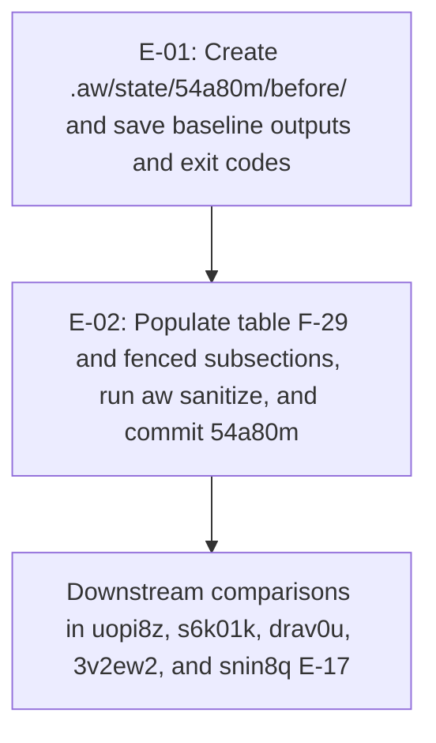

# IPD: Record the baseline for the INDEX writer deletion family

- Date: 2026-11-09
- Kind: child
- Concern: The finishing item of `snin8q` (E-17) compares the `aw check <type> --all` rule multisets and the `aw ipd board` output after the family's deletions against a baseline taken BEFORE any of them. `.aw/state/` is gitignored and does not travel between lane worktrees, so after the round-3 split the baseline must be committed in a plan file. This is the first part of the round-3 split of `snin8q` (Order 42), carrying `snin8q` E-01.
- Scope: run the read-only baseline commands, write their results into this plan's table F-29, and commit this plan file. EXCLUDES every code or test edit (Orders 231 to 237 of the split, and `snin8q`).
- Scope-Paths: .aw/records/plans/pending/20261109-metastore-230-54a80m-record-the-baseline-for-the-index-writer-deletion-family.ipd.md
- Item-Dependencies: executed:1ajqaa, executed:59aiyh, executed:dcerjg, executed:ffceq0, executed:g5hpbb, executed:q6epwc, executed:t4gl15
- Status: approved
- Readiness: go-pending-approval
- Review-Depth: complex
- From-Spec: 4sd62s
- Work-Kind: feature
- Priority: high
- Blocks-Release: next
- Set: metastore
- Order: 230
- Highest E allocated: 02
- Author: opencode its_direct/pt3-claude-opus-5.5-1m-us
- Id: 54a80m
- Approval: 2026-11-16, recorded via aw ipd set: status set to approved

> Reviewed and proofread per the technical writing standard, `.aw/system/workflows/technical-writing/technical-writing.md`, including requirement 12 (diagrams).

## Workflow history
- 2026-11-16 approved (aw set): status set to approved

- 2026-11-14 reviewed (aw set): APPROVE WITH REVISIONS APPLIED; PR-001, PR-002, PR-003, PR-004, PR-005
- 2026-11-09 to-review (opencode its_direct/pt3-claude-opus-5.5-1m-us): split from snin8q (round 3, research nj8zdp guidance).

## Goal

Commit, inside this plan, the pre-deletion outputs that `snin8q` E-17 and Order 236 compare against, so the comparison survives the lane worktrees of the other parts.

## Detailed Implementation Checklist (TODO)

Execution-state rule: mark an `E-*` item complete only after performing the action. That mark is not validation. Right-sizing rule: write for a modest executor that cannot hold much in its head. Each E-item is one step (one concern, about one file, executable in one focused pass) and its V-item names each unit it covers with its own check; a plan stays at about 5 E-items and 8 work Scope-Paths, else split it into more child plans (guidance, `IPD-Z603`). Accepted execution states: blocked, failed, pending, performed; terminal gate demands 'performed'.

The text of `snin8q` E-01 is split across E-01 and E-02 here; together they equal it. Every other part of the family depends on this plan.

### Task group 1: baseline

- [ ] E-01 Create `.aw/state/54a80m/before/` (`mkdir -p .aw/state/54a80m/before/`, never `/tmp`) on the unedited tree, then run each baseline command and save its stdout and exit code there: `aw check plans --all --agent` (`check-plans.jsonl`), `aw check research --all --agent` (`check-research.jsonl`), `aw check prompts --all --agent` (`check-prompts.jsonl`), their three rule-id multisets (`jq -r '(.diagnostics // [])[].rule' | sort | uniq -c` saved as `check-plans.multiset.txt`, `check-research.multiset.txt`, and `check-prompts.multiset.txt`), `aw find plans --agent` (`find-plans.jsonl`), `aw ipd board` (`board.txt`), the bare core gate summary line of `python3 -m pytest` (`pytest-core.txt`), and all six exit codes (`exit-codes.txt`).
  - Depends on: none
  - Expected outcome: all saved files exist under `.aw/state/54a80m/before/`, and no file outside `.aw/state/` is modified.
  - Execution state: pending

- [ ] E-02 Populate table `F-29` in `## Findings` with each command's exit code, the line count of `aw find plans --agent`, the line count and `sha256sum` of `board.txt`, and the core gate summary line; directly beneath table `F-29` under `### F-29 rule-id multisets` and `### F-29 board output`, insert the three full rule-id multisets and the verbatim `board.txt` inside fenced `text` code blocks (using Python `Path.read_text`/`write_text` from `.aw/state/54a80m/before/` so `board.txt` is copied byte-for-byte without truncation). Run bare `aw sanitize --agent` (repo-root scan; takes no file argument), then commit this plan file through `aw commit 54a80m -- .aw/records/plans/pending/20261109-metastore-230-54a80m-record-the-baseline-for-the-index-writer-deletion-family.ipd.md`; never `git add -A`, a bare `git add`, or `git commit -a`; never push.
  - Depends on: E-01
  - Expected outcome: table `F-29` and its `### F-29 rule-id multisets` and `### F-29 board output` fenced blocks hold every baseline value verbatim; `aw sanitize --agent` reports `"outcome":"clean"` and `"findings":0`; the commit lists only this plan file.
  - Execution state: pending

## Project conventions discovered (Step 0)

- `agent_workflows/check_engine.py::check_content` calls `agent_workflows/plans_index.py::check_drift`, `agent_workflows/research_index.py::check_drift`, and (after `q6epwc`) `agent_workflows/prompts_index.py::check_drift` on the `--all` path.
- When `aw check <type> --all --agent` reports zero findings, the JSON envelope omits `"diagnostics"`, so `jq -r '(.diagnostics // [])[].rule'` is required instead of `.diagnostics[].rule`.
- `board.txt` captures `aw ipd board` before `54a80m` finalizes, while `54a80m` itself is still in `.aw/records/plans/pending/`; downstream comparisons (`3v2ew2` V-02, `snin8q` E-17) account for plans that moved disposition between `54a80m` and the consumer run.
- Cite code by symbol (`path::Symbol`) or by a quoted content string, with a line number only appended as a hint (advisory `IPD-C801`).

## Findings

| Id | Evidence | Finding |
|---|---|---|
| F-29 | (written by E-02) per-command exit codes, `aw find plans --agent` line count, `board.txt` line count and `sha256sum`, and `python3 -m pytest` summary line in this table, with the three full rule-id multisets under `### F-29 rule-id multisets` and the full `aw ipd board` output fenced under `### F-29 board output`, recorded before any deletion of the family | Downstream plans (`uopi8z` V-02, `s6k01k` V-02, `drav0u` V-02, `3v2ew2` V-02, and `snin8q` E-17) compare against `F-29` and its subsections. |

## Proposed changes (ordered, validatable)

1. Run the read-only baseline commands and save their outputs and exit codes under `.aw/state/54a80m/before/` (E-01).
2. Populate table `F-29` and its `### F-29 rule-id multisets` and `### F-29 board output` fenced blocks, run `aw sanitize --agent`, and commit this plan file (E-02).

## Deferred / out of scope (with reason)

- Every code and test edit of the family: Orders 231 to 237 and `snin8q`.
  - Carrier: snin8q

## Scope check

- Over-scope: none.
- Under-scope: none known. Size: 2 E-items, 0 work Scope-Paths (this plan file only).

## Required tests / validation

No new test file is written. `E-01` runs the bare core gate `python3 -m pytest` and five read-only `aw` commands (`aw check plans --all --agent`, `aw check research --all --agent`, `aw check prompts --all --agent`, `aw find plans --agent`, and `aw ipd board`), and `E-02` runs bare `aw sanitize --agent`.

## Spec / documentation sync

No spec or documentation change; records the pre-deletion baseline supporting spec `4sd62s` section 4.5 and section 7 step 7.

## Open questions

### OQ-01: Why a separate baseline plan?

- Blocking: no
- Status: resolved
- Owner: plan author
- Resolution or deferral rationale: `.aw/state/` is gitignored and does not travel between isolated lane worktrees, and the family's retargets and deletions run across seven sibling plans (Orders 231 to 237) plus `snin8q`; committing `F-29` in this plan provides a single tracked baseline that every downstream lane can read. Recommendation strength: strong.

## Validation and cross-check (verify before reporting done)

Validation-state rule: inspect evidence in a separate pass. Do not mark a `V-*` item complete from memory or from the matching execution checkmark. Accepted validation results: blocked, failed, pass, pending; terminal gate demands 'pass'. Runtime-demonstration reachability rule: for each `V-*` item demanding the software be observed acting (such as a run, a dispatch, or a transition), as distinct from items demanding a diff, a file's content, or a test result, which are reachable by construction, name the code path that produces the observation or the sibling `E-*` that creates it, else the demand is UNDER-SCOPE.

- [ ] V-01 validates E-01
  - Required evidence: paste `ls -l .aw/state/54a80m/before/` showing `check-plans.jsonl`, `check-research.jsonl`, `check-prompts.jsonl`, `check-plans.multiset.txt`, `check-research.multiset.txt`, `check-prompts.multiset.txt`, `find-plans.jsonl`, `board.txt`, `pytest-core.txt`, and `exit-codes.txt`, plus `git status --porcelain` printing empty output (confirming no tracked or untracked change outside gitignored `.aw/state/`).
  - Observed evidence:
  - Result: pending

- [ ] V-02 validates E-02
  - Required evidence: paste table `F-29` as committed (with an exit code per command, `aw find plans --agent` line count, `board.txt` line count and `sha256sum`, and the `python3 -m pytest` summary line), paste the committed `### F-29 rule-id multisets` fenced block in full, paste a byte-identity check confirming the committed `### F-29 board output` fenced block equals `.aw/state/54a80m/before/board.txt` (`cmp -s` exit code `0`, `wc -l`, `sha256sum`, and first and last 3 lines), paste `aw sanitize --agent` showing `"outcome":"clean"` and `"findings":0`, and paste `git show --stat` of the `aw commit 54a80m` commit listing only this plan file.
  - Observed evidence:
  - Result: pending

## Approval and execution gate

- Size assessment: standard
- Cohesion rationale: not required

Execute only after human approval (`Status: approved`), after every plan in `- Item-Dependencies:` (`1ajqaa`, `59aiyh`, `dcerjg`, `ffceq0`, `g5hpbb`, `q6epwc`, `t4gl15`) is executed, and before Orders 231 to 237 and `snin8q`. `OQ-01` is resolved and non-blocking. Safety stop: if any prerequisite in `- Item-Dependencies:` is not executed or `aw check prompts --all --agent` lacks the `prompts_index.check_drift` wiring from `q6epwc`, stop and report rather than recording a premature baseline. Scope fence: `- Scope-Paths:` declares only this plan file; if an out-of-scope edit is genuinely needed, make it and justify it at finalize with `--scope-reason`, and acknowledge any declared path left unmodified with `--scope-ack`. Honesty rule: paste the ACTUAL command outputs and summary lines; never claim a result you did not run. Commits: commit only through `aw commit 54a80m -- <paths>` scoped to `- Scope-Paths:`; never run `git add -A`, a bare `git add`, or `git commit -a`; never push. Lifecycle: the plan moves to `.aw/records/plans/executed/` only through `aw ipd finalize`, never a hand `git mv`, after `aw ipd lint --phase pre-transition` conforms and every `V-*` reads `pass` with pasted evidence. When `aw oc run` or `aw agy run` executes the plan, the runner performs `aw ipd finalize`; a hand executor runs `aw ipd finalize 54a80m` itself.
