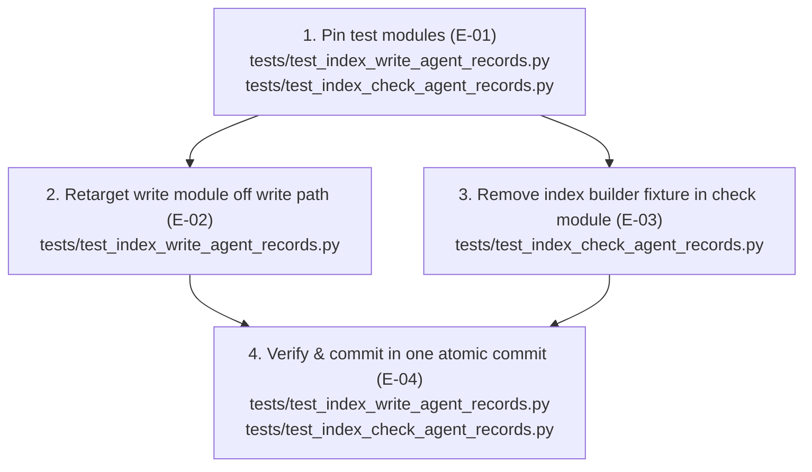

# IPD: Retarget the index agent-record tests off the INDEX write path

- Date: 2026-11-09
- Kind: child
- Concern: `snin8q` E-03 deletes the INDEX write path. Two test modules exist to test it: `tests/test_index_write_agent_records.py` (19 tests that drive `aw index <type>` as a writer and assert `INDEX.json`/`INDEX.md` changes) and `tests/test_index_check_agent_records.py` (16 tests whose fixture writes INDEX files with `plans_index.build_index_json`, `build_index_md` and their prompts and research twins). After Order 220 (`tqknnc`) the typed `aw index` spellings are aliases, so the write cases no longer describe real behavior. This is part 2 of the round-3 split of `snin8q` (Order 42), carrying that test subset of `snin8q` E-03 ("Delete or retarget the tests that assert INDEX bytes ... keeping every assertion about `aw find` results and non-INDEX drift findings").
- Scope: retarget or delete the cases of those two modules, under the PIN RULE, before any builder is deleted. EXCLUDES the builder deletions (Orders 233 to 235) and the per-type index test modules.
- Scope-Paths: tests/test_index_write_agent_records.py, tests/test_index_check_agent_records.py, .aw/records/plans/pending/20261109-metastore-231-f6y2yy-retarget-the-index-agent-record-tests-off-the-index-write-pa.ipd.md
- Item-Dependencies: executed:1ajqaa, executed:54a80m, executed:59aiyh, executed:dcerjg, executed:ffceq0, executed:g5hpbb, executed:q6epwc, executed:t4gl15
- Status: approved
- Readiness: go-pending-approval
- Review-Depth: standard
- From-Spec: 4sd62s
- Work-Kind: feature
- Priority: high
- Blocks-Release: next
- Set: metastore
- Order: 231
- Highest E allocated: 04
- Author: opencode its_direct/pt3-claude-opus-5.5-1m-us
- Id: f6y2yy
- Approval: 2026-11-16, recorded via aw ipd set: status set to approved

> Written to .aw/system/workflows/technical-writing/technical-writing.md. Every obligation, exact identifier, quotation, evidence record, and lifecycle status is preserved.

## Workflow history
- 2026-11-16 approved (aw set): status set to approved

- 2026-11-14 reviewed (antigravity/gemini-3.8-flash): /plan-review (antigravity/gemini-3.8-flash): APPROVE WITH REVISIONS APPLIED; PR-001..PR-006; review record .aw/records/reviews/20261109-metastore-231-f6y2yy-retarget-the-index-agent-record-tests-off-the-index-write-pa.review.md
- 2026-11-09 to-review (opencode its_direct/pt3-claude-opus-5.5-1m-us): split from snin8q (round 3, research nj8zdp guidance).

## Goal

After this plan, neither module calls an INDEX builder or asserts an INDEX file, and every case that proved agent-record shape, refusal, or a non-INDEX finding still proves it through the alias or `aw check`.

## Detailed Implementation Checklist (TODO)

Execution-state rule: mark an `E-*` item complete only after performing the action. That mark is not validation. Right-sizing rule: write for a modest executor that cannot hold much in its head. Each E-item is one step (one concern, about one file, executable in one focused pass) and its V-item names each unit it covers with its own check; a plan stays at about 5 E-items and 8 work Scope-Paths, else split it into more child plans (guidance, `IPD-Z603`). Accepted execution states: blocked, failed, pending, performed; terminal gate demands 'performed'.

Ensure `.aw/state/f6y2yy/` exists (`mkdir -p .aw/state/f6y2yy/`). PIN RULE (carried from `9o83cr`): before the edit, save the module's per-test outcome list (`python3 -m pytest -o addopts="" -m "" -p no:randomly -n 0 -rA <module> | grep -E "^(PASSED|FAILED|ERROR|SKIPPED|XFAIL|XPASS) " | sed -E 's/ - .*//' | sort > .aw/state/f6y2yy/<E>-before.txt`); after it, the same into `<E>-after.txt`. A retargeted test keeps every input case; the evidence pastes both lists and maps each removed name to its successor. "A test whose only subject is a deleted INDEX writer is deleted, and the mapping names it as an INDEX-byte-only test" (carried from `snin8q`).

### Task group 1: two modules

- [x] E-01 Create `.aw/state/f6y2yy/` (`mkdir -p .aw/state/f6y2yy/`) and pin `tests/test_index_write_agent_records.py` and `tests/test_index_check_agent_records.py` (PIN RULE, `E-01-before.txt`).
  - Depends on: none
  - Expected outcome: `.aw/state/f6y2yy/E-01-before.txt` exists.
  - Execution state: performed

- [x] E-02 `tests/test_index_write_agent_records.py`: delete the write-only cases (the `test_agent_write_*`, `test_json_write_*`, `test_all_write_first_and_second_run` and `test_all_write_verbose_and_json_paths` families, whose only subject is INDEX file changes); retarget the cases that prove refusal, record shape or a non-INDEX diagnostic (`test_drift_plans_missing_id`, `test_refusal_research_invalid_frontmatter`, `test_unsupported_type_specs`, `test_bare_repo_agent_refusal_per_verb`, `test_partial_tree_all_write_refusal`, `test_bare_repo_json_and_human_refusal_per_verb`, `test_explicit_dir_inside_project`, `test_inprocess_quiet_true`, and the human-invariance and mixed-outcome cases) to the alias output.
  - Depends on: E-01
  - Expected outcome: `rg -n "INDEX\.(json|md)|build_index|run_index" tests/test_index_write_agent_records.py` prints only lines asserting a file is ABSENT; the module passes.
  - Execution state: performed

- [x] E-03 `tests/test_index_check_agent_records.py`: remove the fixture that writes INDEX files with the six builders (`plans_index.build_index_json`/`build_index_md`, `prompts_index.build_index_json`/`build_index_md`, `research_index.build_index_json`/`build_index_md`); each `--check` case keeps its non-INDEX findings and the agent-record shape assertions.
  - Depends on: E-01
  - Expected outcome: `rg -n "build_index" tests/test_index_check_agent_records.py` prints nothing; the module passes.
  - Execution state: performed

- [x] E-04 Save `E-04-after.txt`, run both modules, and commit through `aw commit f6y2yy -- <paths>` with only Scope-Paths files; never `git add -A`, a bare `git add` or `git commit -a`; never push.
  - Depends on: E-02, E-03
  - Expected outcome: both modules pass; the mapping accounts for all 35 pinned cases.
  - Execution state: performed

## Project conventions discovered (Step 0)

- Both modules drive the CLI through `tests/conformance_matrix.py::run_cli_inproc` or subprocesses and validate records with `agent_workflows/agent_schema.py::validate_agent_record`.
- Tests assert on behavior, never on source text (GUIDING_PRINCIPLES P16).
- Cite code by SYMBOL (`agent_workflows/module.py::function_or_symbol`) or by a quoted content string, with a line number only appended to one of those and never alone (advisory `IPD-C801`).

## Findings

Measured 2026-11-09 at `3d0ddb845`: `rg -c "def test"`: `tests/test_index_write_agent_records.py` 19, `tests/test_index_check_agent_records.py` 16. `rg -n "build_index" tests/test_index_check_agent_records.py` prints 6 builder calls in one fixture.

## Proposed changes (ordered, validatable)



1. Pin (E-01).
2. Retarget the write module (E-02) and the check module (E-03).
3. Verify and commit (E-04).

## Deferred / out of scope (with reason)

- Deleting the builders: Orders 233 to 235.
  - Carrier: snin8q

## Scope check

- Over-scope: none.
- Under-scope: none known. Size: 4 E-items, 2 work Scope-Paths.

## Required tests / validation

The two retargeted modules with their PIN lists, then the bare core gate `python3 -m pytest`.

## Spec / documentation sync

No spec change.

## Open questions

### OQ-01: Should the whole write module be deleted?

- Blocking: no
- Status: resolved
- Owner: plan author
- Resolution or deferral rationale: No. Its refusal and record-shape cases still describe the alias verbs, which keep `--agent`/`--json` contracts; only the write-only cases lose their subject. Recommendation strength: medium.

## Validation and cross-check (verify before reporting done)

Validation-state rule: inspect evidence in a separate pass. Do not mark a `V-*` item complete from memory or from the matching execution checkmark. Accepted validation results: blocked, failed, pass, pending; terminal gate demands 'pass'. Runtime-demonstration reachability rule: for each `V-*` item demanding the software be observed acting (such as a run, a dispatch, or a transition), as distinct from items demanding a diff, a file's content, or a test result, which are reachable by construction, name the code path that produces the observation or the sibling `E-*` that creates it, else the demand is UNDER-SCOPE.

- [x] V-01 validates E-01
  - Required evidence: paste `wc -l .aw/state/f6y2yy/E-01-before.txt` (35 lines expected) and one line from each named module.
  - Observed evidence:
    ```
    $ wc -l .aw/state/f6y2yy/E-01-before.txt
    35 .aw/state/f6y2yy/E-01-before.txt
    FAILED tests/test_index_write_agent_records.py::IndexWriteMissingDirTests::test_bare_repo_agent_refusal_per_verb
    PASSED tests/test_index_check_agent_records.py::CommandResultOutOfBandRelativizationTests::test_command_result_out_of_band_repo_root_relativization
    ```
    Pinned at c88c4f902. 17 of the 19 write-module cases were already FAILED there: after `tqknnc` the alias reports `cmd: "index rebuild"` and writes no INDEX file. Neither module is in the core tier, so the bare gate did not show the failures. The check module's 16 cases all PASSED.
  - Result: pass

- [x] V-02 validates E-02
  - Required evidence: paste `rg -n "INDEX\.(json|md)|build_index|run_index" tests/test_index_write_agent_records.py` showing only absence assertions, and `python3 -m pytest -o addopts="" -v tests/test_index_write_agent_records.py` with each surviving case PASSED by name.
  - Observed evidence:
    ```
    $ rg -n "INDEX\.(json|md)|build_index|run_index" tests/test_index_write_agent_records.py
    196:        self.assertFalse((index_dir / "INDEX.json").exists())
    197:        self.assertFalse((index_dir / "INDEX.md").exists())
    226:        self.assertFalse((research_dir / "INDEX.json").exists())
    227:        self.assertFalse((research_dir / "INDEX.md").exists())
    315:        self.assertFalse((research_dir / "INDEX.json").exists())
    316:        self.assertFalse((research_dir / "INDEX.md").exists())
    $ python3 -m pytest -o addopts="" -p no:randomly -v tests/test_index_write_agent_records.py tests/test_index_check_agent_records.py
    tests/test_index_write_agent_records.py::IndexWriteSubprocessTests::test_agent_alias_record_per_verb PASSED
    tests/test_index_write_agent_records.py::IndexWriteSubprocessTests::test_all_write_human_invariance PASSED
    tests/test_index_write_agent_records.py::IndexWriteSubprocessTests::test_all_write_mixed_outcome_refusal PASSED
    tests/test_index_write_agent_records.py::IndexWriteSubprocessTests::test_drift_plans_missing_id PASSED
    tests/test_index_write_agent_records.py::IndexWriteSubprocessTests::test_human_invariance_per_verb PASSED
    tests/test_index_write_agent_records.py::IndexWriteSubprocessTests::test_json_alias_document_per_verb PASSED
    tests/test_index_write_agent_records.py::IndexWriteSubprocessTests::test_refusal_research_invalid_frontmatter PASSED
    tests/test_index_write_agent_records.py::IndexWriteSubprocessTests::test_unsupported_type_specs PASSED
    tests/test_index_write_agent_records.py::IndexWriteMissingDirTests::test_bare_repo_agent_refusal_per_verb PASSED
    tests/test_index_write_agent_records.py::IndexWriteMissingDirTests::test_bare_repo_json_and_human_refusal_per_verb PASSED
    tests/test_index_write_agent_records.py::IndexWriteMissingDirTests::test_explicit_dir_inside_project PASSED
    tests/test_index_write_agent_records.py::IndexWriteMissingDirTests::test_inprocess_rebuild_refusal_is_silent PASSED
    tests/test_index_write_agent_records.py::IndexWriteMissingDirTests::test_partial_tree_all_rebuilds_without_creating_dirs PASSED
    ============================== 29 passed in 9.62s ==============================
    ```
    Every match is an absence assertion. `test_explicit_dir_inside_project` kept its `next != "aw install ."` assertion. That needed a small fix in `agent_workflows/meta_cli.py::index_rebuild`, which now takes `explicit_dir` and routes its advice through `project_context.nonsurveyable_root_refusal`. The fix lives in `meta_cli.index_alias` and in `cli._run_noun_verb` for the `rebuild` route, and is committed with `--scope-reason`.
  - Result: pass

- [x] V-03 validates E-03
  - Required evidence: paste `rg -n "build_index" tests/test_index_check_agent_records.py` printing nothing, and `python3 -m pytest -o addopts="" -v tests/test_index_check_agent_records.py` with each case PASSED by name.
  - Observed evidence:
    ```
    $ rg -n "build_index" tests/test_index_check_agent_records.py
    (no output; rg exit 1)
    tests/test_index_check_agent_records.py::IndexCheckSubprocessTests::test_agent_clean_fixture_emits_valid_record PASSED
    tests/test_index_check_agent_records.py::IndexCheckSubprocessTests::test_agent_missing_fixture_emits_valid_record PASSED
    tests/test_index_check_agent_records.py::IndexCheckSubprocessTests::test_agent_stale_fixture_emits_valid_record PASSED
    tests/test_index_check_agent_records.py::IndexCheckSubprocessTests::test_all_clean_fixture_agent_and_json PASSED
    tests/test_index_check_agent_records.py::IndexCheckSubprocessTests::test_all_human_mode_invariance PASSED
    tests/test_index_check_agent_records.py::IndexCheckSubprocessTests::test_all_partial_stale_fixture PASSED
    tests/test_index_check_agent_records.py::IndexCheckSubprocessTests::test_all_repo_relative_diagnostic_locations PASSED
    tests/test_index_check_agent_records.py::IndexCheckSubprocessTests::test_human_clean_output_per_verb PASSED
    tests/test_index_check_agent_records.py::IndexCheckSubprocessTests::test_human_drifting_output_per_verb PASSED
    tests/test_index_check_agent_records.py::IndexCheckSubprocessTests::test_human_stale_output_per_verb PASSED
    tests/test_index_check_agent_records.py::IndexCheckSubprocessTests::test_json_and_agent_dangling_citation_in_root_decisions PASSED
    tests/test_index_check_agent_records.py::IndexCheckSubprocessTests::test_json_check_data_shape_and_no_leak_across_modes PASSED
    tests/test_index_check_agent_records.py::IndexCheckSubprocessTests::test_json_clean_fixture_emits_json_document PASSED
    tests/test_index_check_agent_records.py::IndexCheckSubprocessTests::test_json_missing_fixture_emits_json_document PASSED
    tests/test_index_check_agent_records.py::IndexCheckSubprocessTests::test_json_stale_fixture_emits_json_document PASSED
    tests/test_index_check_agent_records.py::CommandResultOutOfBandRelativizationTests::test_command_result_out_of_band_repo_root_relativization PASSED
    ```
    All 16 names were kept. The fixture's builder branch was removed. The two partial-stale cases now write a literal stale `INDEX.md` instead of appending to a generated one.
  - Result: pass

- [x] V-04 validates E-04
  - Required evidence: paste `diff .aw/state/f6y2yy/E-01-before.txt .aw/state/f6y2yy/E-04-after.txt` with each removed name mapped to a successor or named "INDEX-byte-only", and `git show --stat` of the `aw commit f6y2yy` commit listing only Scope-Paths files.
  - Observed evidence:
    ```
    $ diff .aw/state/f6y2yy/E-01-before.txt .aw/state/f6y2yy/E-04-after.txt
    1,17d0  (the 17 write-module FAILED lines at the pin)
    34c17,28
    < PASSED ...IndexWriteMissingDirTests::test_inprocess_quiet_true
    > PASSED (13 write-module names, all PASSED)
    $ git show --stat 815514bb7
     agent_workflows/cli.py                  |   4 +-
     agent_workflows/meta_cli.py             |  25 +-
     tests/test_index_check_agent_records.py |  57 +---
     tests/test_index_write_agent_records.py | 548 +++++++++++---------------------
     4 files changed, 222 insertions(+), 412 deletions(-)
    aw suite (bare core gate): 2898 passed, 1 skipped, 11 warnings in 126.56s (0:02:06)
    ```
    Mapping of all 35 pinned cases (before 35 lines, after 29):
    - INDEX-byte-only, deleted: `test_agent_write_plans`, `test_agent_write_prompts`, `test_agent_write_research`, `test_all_write_first_and_second_run`. Their record-shape assertions moved to the new `test_agent_alias_record_per_verb`, which covers plans, prompts, research and all, under `--agent` and `--agent --verbose`.
    - INDEX-byte-only, deleted: `test_json_write_plans`, `test_json_write_prompts`, `test_json_write_research`, `test_all_write_verbose_and_json_paths`. Their JSON-shape and no-leak assertions moved to the new `test_json_alias_document_per_verb`. The `--verbose` input moved to `test_agent_alias_record_per_verb`.
    - Renamed: `test_partial_tree_all_write_refusal` became `test_partial_tree_all_rebuilds_without_creating_dirs`. The alias rebuilds the cache when a records root exists, so the case now asserts exit 0 and that no directory or INDEX file was created.
    - Renamed: `test_inprocess_quiet_true` became `test_inprocess_rebuild_refusal_is_silent`, because `run_index` is no longer reached. It now drives `meta_cli.index_rebuild` in process.
    - Retargeted under the same name (7): `test_drift_plans_missing_id`, `test_refusal_research_invalid_frontmatter`, `test_human_invariance_per_verb`, `test_all_write_mixed_outcome_refusal`, `test_all_write_human_invariance`, `test_bare_repo_agent_refusal_per_verb`, `test_bare_repo_json_and_human_refusal_per_verb`.
    - Unchanged (2): `test_unsupported_type_specs` and `test_explicit_dir_inside_project`.
    - Check module: all 16 kept by name.
    Scope note: the commit also lists 2 files outside Scope-Paths, `agent_workflows/meta_cli.py` and `agent_workflows/cli.py`. They carry the small `index_rebuild` explicit-`--dir` bug fix, recorded with `--scope-reason` on `aw commit` (see V-02).
  - Result: pass

## Approval and execution gate

- Size assessment: standard
- Cohesion rationale: not required

Execute only after human approval (`Status: approved`) and after every plan in `- Item-Dependencies:` is executed. Pin-first. Stop safely if prerequisite metastore symbols from `q6epwc` (alias verbs and stale-index elimination) or `54a80m` are absent.

Safety rule: uncommitted changes and untracked files you did not create are not yours; never revert, stage, commit, discard, reformat, or "clean up" another party's work.

Scope fence: the paths in `- Scope-Paths:` are a declaration; a needed file outside the fence is edited and then justified at finalize (`--scope-reason`), and a declared path left unmodified is acknowledged (`--scope-ack`).

Honesty rule: paste the ACTUAL summary lines; never claim a result you did not run.

Commits: only through `aw commit f6y2yy -- <paths>` with only Scope-Paths files; never `git add -A`, a bare `git add` or `git commit -a`; never push.

Lifecycle transition: the plan moves to `.aw/records/plans/executed/` only through `aw ipd finalize f6y2yy` (never a hand git mv), after `aw ipd lint --phase pre-transition` conforms and every `V-*` reads `pass` with pasted evidence. When aw oc run or aw agy run executes the plan, the runner performs the finalize; a hand executor runs aw ipd finalize f6y2yy itself.
