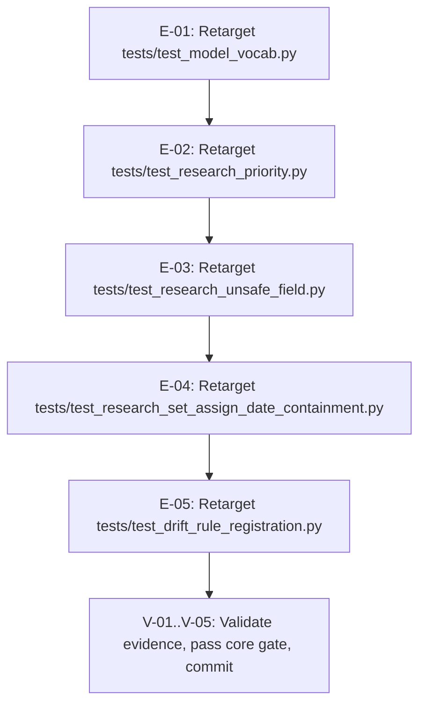

# IPD: Retarget five research and registry tests off the INDEX builders

- Date: 2026-11-09
- Kind: child
- Concern: `snin8q` E-03 deletes `research_index.build_index_json`, `research_index.build_index_md` and the write path of `research_index.run_index`. Five test modules outside the index test modules call one of them only as fixture setup or as an indirect check: `tests/test_model_vocab.py`, `tests/test_research_priority.py`, `tests/test_research_unsafe_field.py`, `tests/test_research_set_assign_date_containment.py` and `tests/test_drift_rule_registration.py`. If they are not retargeted first, the deletion commit fails the core gate (C10a of spec `4sd62s`). This is part 3 of the round-3 split of `snin8q` (Order 42), carrying that test subset of `snin8q` E-03.
- Scope: retarget the named call sites of those five modules to `research_index.check_drift`, `research_index.scan_research` (or the module's existing scan function) or `aw find research`, before any deletion. EXCLUDES the deletions themselves (Orders 233 to 235) and the index test modules (Orders 231, 233 to 235).
- Scope-Paths: tests/test_model_vocab.py, tests/test_research_priority.py, tests/test_research_unsafe_field.py, tests/test_research_set_assign_date_containment.py, tests/test_drift_rule_registration.py, .aw/records/plans/pending/20261109-metastore-232-6966zq-retarget-five-research-and-registry-tests-off-the-index-buil.ipd.md
- Item-Dependencies: executed:1ajqaa, executed:54a80m, executed:59aiyh, executed:dcerjg, executed:ffceq0, executed:g5hpbb, executed:q6epwc, executed:t4gl15
- Status: approved
- Review-Depth: standard
- Readiness: go-pending-approval
- From-Spec: 4sd62s
- Work-Kind: feature
- Priority: high
- Blocks-Release: next
- Set: metastore
- Order: 232
- Highest E allocated: 05
- Author: opencode its_direct/pt3-claude-opus-5.5-1m-us
- Id: 6966zq
- Approval: 2026-11-16, recorded via aw ipd set: status set to approved

> Reviewed and proofread per the technical writing standard, `.aw/system/workflows/technical-writing/technical-writing.md`, including requirement 12 (diagrams).

## Workflow history
- 2026-11-16 approved (aw set): status set to approved

- 2026-11-14 reviewed (antigravity/gemini-3.8-flash): /plan-review (antigravity/gemini-3.8-flash): APPROVE WITH REVISIONS APPLIED; PR-001, PR-002, PR-003, PR-004.
- 2026-11-09 to-review (opencode its_direct/pt3-claude-opus-5.5-1m-us): split from snin8q (round 3, research nj8zdp guidance).

## Goal

After this plan, none of the five modules calls `build_index_json`, `build_index_md` or `run_index`, and each keeps every input case, asserting the same behavior through a surviving surface.

## Detailed Implementation Checklist (TODO)

Execution-state rule: mark an `E-*` item complete only after performing the action. That mark is not validation. Right-sizing rule: write for a modest executor that cannot hold much in its head. Each E-item is one step (one concern, about one file, executable in one focused pass) and its V-item names each unit it covers with its own check; a plan stays at about 5 E-items and 8 work Scope-Paths, else split it into more child plans (guidance, `IPD-Z603`). Accepted execution states: blocked, failed, pending, performed; terminal gate demands 'performed'.

`snin8q` E-03's test list is split across Orders 231 to 235; this plan takes "the other test modules that call a deleted symbol (`tests/test_drift_rule_registration.py`, `tests/test_model_vocab.py`, `tests/test_research_priority.py`, `tests/test_research_unsafe_field.py`, `tests/test_research_set_assign_date_containment.py`) are retargeted to `check_drift` or `aw find`".

PIN RULE (carried from `9o83cr`), applied per item to that item's one module: before the edit, save its per-test outcome list (`mkdir -p .aw/state/6966zq && python3 -m pytest -o addopts="" -m "" -p no:randomly -n 0 -rA <module> | grep -E "^(PASSED|FAILED|ERROR|SKIPPED|XFAIL|XPASS) " | sed -E 's/ - .*//' | sort > .aw/state/6966zq/<E>-before.txt`); after it, the same into `<E>-after.txt`. A retargeted test keeps every input case; the evidence pastes both lists and maps each removed name to its successor.

### Task group 1: one module per item

- [x] E-01 `tests/test_model_vocab.py`: the four `_ri.run_index(` calls (a regenerate, a `--check`, a broken-vocab case) become `research_index.check_drift` calls or `aw check research --all --agent` runs asserting the same `unrecognized-model` findings and exit codes (PIN RULE, `mkdir -p .aw/state/6966zq && ` capture to `E-01-before.txt`).
  - Depends on: none
  - Expected outcome: `rg -n "run_index" tests/test_model_vocab.py` prints nothing; the module passes.
  - Execution state: performed

- [x] E-02 `tests/test_research_priority.py`: the one `ridx.build_index_json(entries)` assertion (`'"priority": "high"'`) becomes an assertion that `aw find research --agent` (or the scan entry) reports priority `high`.
  - Depends on: none
  - Expected outcome: `rg -n "build_index" tests/test_research_priority.py` prints nothing; the module passes.
  - Execution state: performed

- [x] E-03 `tests/test_research_unsafe_field.py`: the fixture that writes `I.build_index_json(entries)` and `I.build_index_md(entries)` to disk is removed, and the case asserts the unsafe-field finding through `research_index.check_drift` with no INDEX file present.
  - Depends on: none
  - Expected outcome: `rg -n "build_index" tests/test_research_unsafe_field.py` prints nothing; the module passes.
  - Execution state: performed

- [x] E-04 `tests/test_research_set_assign_date_containment.py`: the one `research_index.run_index(` call becomes an `aw find research` (or scan) check of the same paths.
  - Depends on: none
  - Expected outcome: `rg -n "run_index" tests/test_research_set_assign_date_containment.py` prints nothing; the module passes.
  - Execution state: performed

- [x] E-05 `tests/test_drift_rule_registration.py`: the fixture that writes `research_index.build_index_json(entries)` and `build_index_md(entries)` (in `test_property_4_emitter_stamp_reaches_gate_on_fixture`) is replaced by a fixture with no INDEX file, keeping the emitter-stamp assertion. Then commit E-01 to E-05 through `aw commit 6966zq -- <paths>` with only Scope-Paths files; never `git add -A`, a bare `git add` or `git commit -a`; never push.
  - Depends on: E-01, E-02, E-03, E-04
  - Expected outcome: `rg -n "build_index" tests/test_drift_rule_registration.py` prints nothing; the module passes; the commit lists only Scope-Paths files.
  - Execution state: performed

## Project conventions discovered (Step 0)

- Test data comes from ONE builder, `tests/record_builder.py` (`59aiyh`).
- Tests assert on behavior, never on source text (GUIDING_PRINCIPLES P16).
- Cite code by SYMBOL (`module.function`) or by a quoted content string, with a line number only appended to one of those and never alone (advisory `IPD-C801`).

## Findings

Measured 2026-11-09 at `3d0ddb845` with `rg -n "build_index|run_index|DEFAULT_INDEX" <module>`: `tests/test_model_vocab.py` 4 `run_index` calls; `tests/test_research_priority.py` 1 `build_index_json`; `tests/test_research_unsafe_field.py` 1 `build_index_json`, 1 `build_index_md`; `tests/test_research_set_assign_date_containment.py` 1 `run_index`; `tests/test_drift_rule_registration.py` 1 `build_index_json`, 1 `build_index_md`.

## Proposed changes (ordered, validatable)

1. Retarget each module in turn (E-01 to E-05) and commit (E-05).

## Deferred / out of scope (with reason)

- Deleting the builders and `run_index`'s write path: Orders 233 to 235.
  - Carrier: snin8q

## Scope check

- Over-scope: none.
- Under-scope: none known. Size: 5 E-items, 5 work Scope-Paths.

## Required tests / validation

The five retargeted modules, each with its PIN before/after list, then the bare core gate `python3 -m pytest`.

## Spec / documentation sync

No spec change.

## Open questions

### OQ-01: May a retargeted case go through the CLI instead of the function?

- Blocking: no
- Status: resolved
- Owner: plan author (carried from snin8q)
- Resolution or deferral rationale: Yes; either is behavioral. Prefer the surface the original case was proving (a finding, an exit code, a reported field). Recommendation strength: medium.

## Validation and cross-check (verify before reporting done)

Validation-state rule: inspect evidence in a separate pass. Do not mark a `V-*` item complete from memory or from the matching execution checkmark. Accepted validation results: blocked, failed, pass, pending; terminal gate demands 'pass'. Runtime-demonstration reachability rule: for each `V-*` item demanding the software be observed acting (such as a run, a dispatch, or a transition), as distinct from items demanding a diff, a file's content, or a test result, which are reachable by construction, name the code path that produces the observation or the sibling `E-*` that creates it, else the demand is UNDER-SCOPE.

- [x] V-01 validates E-01
  - Required evidence: paste `rg -n "run_index" tests/test_model_vocab.py` printing nothing, `diff` of `E-01-before.txt` and `E-01-after.txt` with each removed name mapped, and `python3 -m pytest -o addopts="" tests/test_model_vocab.py` passing.
  - Observed evidence: `rg -n "run_index" tests/test_model_vocab.py` printed nothing (rg rc=1). PIN: `diff .aw/state/6966zq/E-01-before.txt .aw/state/6966zq/E-01-after.txt` printed nothing, rc=0, 11 PASSED before and after, so no name was removed and none needs mapping. The four `_ri.run_index(` calls became `_ri._scan_docs` plus `_ri.check_drift` and `artifact_core.drift_exit_code` (same `unrecognized-model` info findings, exit 0 clean, exit 1 with `frontmatter-invalid`). `python3 -m pytest -o addopts="" tests/test_model_vocab.py`: `11 passed in 0.84s`. Commit d78b19858.
  - Result: pass

- [x] V-02 validates E-02
  - Required evidence: paste `rg -n "build_index" tests/test_research_priority.py` printing nothing, the PIN diff with names mapped, and `python3 -m pytest -o addopts="" tests/test_research_priority.py` passing.
  - Observed evidence: `rg -n "build_index" tests/test_research_priority.py` printed nothing. PIN diff of E-02 lists printed nothing, rc=0, 11 PASSED before and after; no name removed. The `build_index_json` assertion became `entries[0]._asdict()["priority"] == "high"` on the scan entry (`aw find research --agent --fields priority` was probed and does not emit `priority`, see D1). `python3 -m pytest -o addopts="" tests/test_research_priority.py`: `11 passed in 0.71s`.
  - Result: pass

- [x] V-03 validates E-03
  - Required evidence: paste `rg -n "build_index" tests/test_research_unsafe_field.py` printing nothing, the PIN diff with names mapped, and `python3 -m pytest -o addopts="" tests/test_research_unsafe_field.py` passing.
  - Observed evidence: `rg -n "build_index" tests/test_research_unsafe_field.py` printed nothing. PIN diff of E-03 lists printed nothing, rc=0, 11 PASSED before and after; no name removed. The `_regen` fixture and its 11 calls were removed; `test_summary_unsafe_shapes` now asserts `list(self.rroot.glob("INDEX*")) == []` before checking `attention.unsafe-field` through `I.check_drift`. `python3 -m pytest -o addopts="" tests/test_research_unsafe_field.py`: `11 passed in 41.19s`.
  - Result: pass

- [x] V-04 validates E-04
  - Required evidence: paste `rg -n "run_index" tests/test_research_set_assign_date_containment.py` printing nothing, the PIN diff with names mapped, and `python3 -m pytest -o addopts="" tests/test_research_set_assign_date_containment.py` passing.
  - Observed evidence: `rg -n "run_index" tests/test_research_set_assign_date_containment.py` printed nothing. PIN diff of E-04 lists printed nothing, rc=0, 21 PASSED before and after; no name removed. The `research_index.run_index(` call became `research_index._scan_docs(self.research_root, repo_root=self.repo_dir)` asserting no entries and no drift; the now-unused `import argparse` was dropped. `python3 -m pytest -o addopts="" tests/test_research_set_assign_date_containment.py`: `21 passed in 3.78s`.
  - Result: pass

- [x] V-05 validates E-05
  - Required evidence: paste `rg -n "build_index" tests/test_drift_rule_registration.py` printing nothing, the PIN diff with names mapped, `python3 -m pytest -o addopts="" -v tests/test_drift_rule_registration.py` with `test_property_4_emitter_stamp_reaches_gate_on_fixture` PASSED, and `git show --stat` of the `aw commit 6966zq` commit listing only Scope-Paths files.
  - Observed evidence: `rg -n "build_index" tests/test_drift_rule_registration.py` printed nothing. The module needed no edit: commit 419e01d67 (plan 6qh68x) already replaced the INDEX-writing fixture with a no-INDEX fixture (see D2). PIN diff of E-05 lists printed nothing, rc=0, 6 PASSED before and after. `python3 -m pytest -o addopts="" -v tests/test_drift_rule_registration.py`: `test_property_4_emitter_stamp_reaches_gate_on_fixture PASSED [ 50%]`, `6 passed in 2.81s`. Core gate `python3 -m pytest`: `2898 passed, 1 skipped, 11 warnings in 435.00s (0:07:14)`. `git show --stat HEAD` (d78b19858, `aw commit 6966zq`): `tests/test_model_vocab.py`, `tests/test_research_priority.py`, `tests/test_research_set_assign_date_containment.py`, `tests/test_research_unsafe_field.py`, `4 files changed, 27 insertions(+), 68 deletions(-)`; all four are Scope-Paths files.
  - Result: pass

## Approval and execution gate

- Size assessment: standard
- Cohesion rationale: not required

Execute only after human approval (`Status: approved`) and after every plan in `- Item-Dependencies:` is executed. Pin-first per item. A narrow safety stop applies if prerequisite metastore symbols from `1ajqaa`, `54a80m`, `59aiyh`, `dcerjg`, `ffceq0`, `g5hpbb`, `q6epwc`, or `t4gl15` are absent. Scope fence: the paths in `- Scope-Paths:` are a declaration; a needed file outside the fence is edited and then justified at finalize (`--scope-reason`), and a declared path left unmodified is acknowledged (`--scope-ack`). Honesty rule: run the named modules and `python3 -m pytest` (core gate), and paste the ACTUAL summary lines; never claim a result you did not run. Commits: only through `aw commit 6966zq -- <paths>`; never `git add -A`, a bare `git add` or `git commit -a`; never push. Lifecycle transition: the plan moves to `.aw/records/plans/executed/` only through `aw ipd finalize` (never a hand `git mv`), and only after `aw ipd lint --phase pre-transition` conforms and every `V-*` reads `pass` with pasted evidence. When `aw oc run` or `aw agy run` executes the plan, the runner performs the finalize; a hand executor runs `aw ipd finalize 6966zq` itself.
