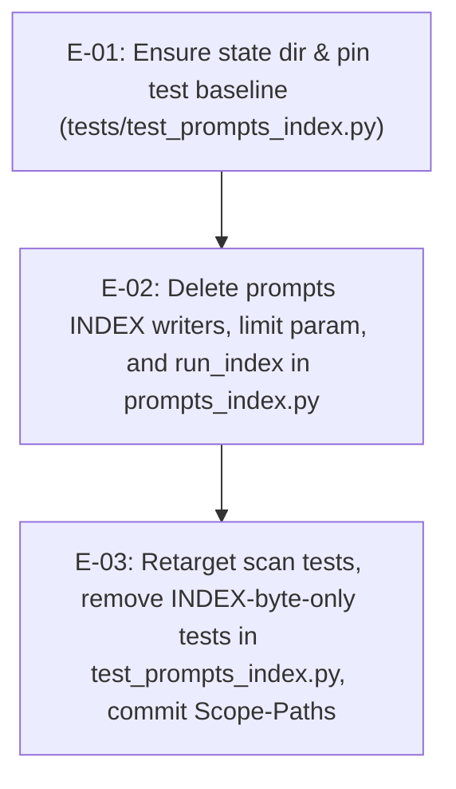

# IPD: Delete the prompts INDEX writers

- Date: 2026-11-09
- Kind: child
- Concern: Spec `4sd62s` 4.5 says the SQLite cache replaces the `INDEX.{json,md}` files. After Order 220 (`tqknnc`) the prompts `aw index` spelling is an alias and `prompts_index.check_drift` is wired into `check_engine.check_content`, yet `prompts_index.build_index_json`, `prompts_index.build_index_md`, `prompts_index._set_last_touched`, `prompts_index.DEFAULT_INDEX_LIMIT` and the write path of `prompts_index.run_index` remain. This is part 6 of the round-3 split of `snin8q` (Order 42), carrying the prompts subset of `snin8q` E-03.
- Scope: delete those prompts symbols and retarget the INDEX-byte cases of `tests/test_prompts_index.py`. "`prompts_index` has no `run_find` (it has `scan_prompts` and `check_drift`); keep those" (carried from `snin8q` E-03). EXCLUDES the plans and research writers (Orders 233 and 234) and the shared `artifact_core.emit_index_*` helpers (`snin8q`).
- Scope-Paths: agent_workflows/prompts_index.py, tests/test_prompts_index.py, .aw/records/plans/pending/20261109-metastore-235-drav0u-delete-the-prompts-index-writers.ipd.md
- Item-Dependencies: executed:1ajqaa, executed:54a80m, executed:59aiyh, executed:6966zq, executed:dcerjg, executed:f6y2yy, executed:ffceq0, executed:g5hpbb, executed:q6epwc, executed:t4gl15
- Status: approved
- Readiness: go-pending-approval
- Review-Depth: standard
- From-Spec: 4sd62s
- Work-Kind: feature
- Priority: high
- Blocks-Release: next
- Set: metastore
- Order: 235
- Highest E allocated: 03
- Author: opencode its_direct/pt3-claude-opus-5.5-1m-us
- Id: drav0u
- Approval: 2026-11-16, recorded via aw ipd set: status set to approved

> Write and proofread this plan per the technical writing standard, `.aw/system/workflows/technical-writing/technical-writing.md` (`.agents/workflows/technical-writing/technical-writing.md` in a legacy-layout install), including requirement 12 (diagrams).

## Workflow history
- 2026-11-16 approved (aw set): status set to approved

- 2026-11-14 reviewed (antigravity/gemini-3.8-flash): APPROVE WITH REVISIONS APPLIED; PR-001, PR-002, PR-003, PR-004, PR-005
- 2026-11-09 to-review (opencode its_direct/pt3-claude-opus-5.5-1m-us): split from snin8q (round 3, research nj8zdp guidance).

## Goal

After this plan, no prompts code can write an INDEX file, while `aw check prompts --all` reports the same rules as in the `54a80m` baseline.

## Detailed Implementation Checklist (TODO)

Execution-state rule: mark an `E-*` item complete only after performing the action. That mark is not validation. Right-sizing rule: write for a modest executor that cannot hold much in its head. Each E-item is one step (one concern, about one file, executable in one focused pass) and its V-item names each unit it covers with its own check; a plan stays at about 5 E-items and 8 work Scope-Paths, else split it into more child plans (guidance, `IPD-Z603`). Accepted execution states: blocked, failed, pending, performed; terminal gate demands 'performed'.

`snin8q` E-03's site list is split across Orders 231 to 235 and `snin8q`; this plan takes the prompts members (`build_index_json`, `build_index_md`, `_set_last_touched`, `DEFAULT_INDEX_LIMIT`, the write path of `run_index` in `prompts_index`) and `tests/test_prompts_index.py`. `prompts_index` has no `record_producers` entry (measured), so none is deleted.

PIN RULE (carried from `9o83cr`): before the edit, ensure the output directory exists (`mkdir -p .aw/state/drav0u`) and save the module's per-test outcome list (`python3 -m pytest -o addopts="" -m "" -p no:randomly -n 0 -rA tests/test_prompts_index.py | grep -E "^(PASSED|FAILED|ERROR|SKIPPED|XFAIL|XPASS) " | sed -E 's/ - .*//' | sort > .aw/state/drav0u/<E>-before.txt`); after it, the same into `<E>-after.txt`. A retargeted test keeps every input case; a test whose only subject is a deleted INDEX writer is deleted and named "INDEX-byte-only" in the mapping.

### Task group 1: pin, delete, retarget

- [x] E-01 Ensure `.aw/state/drav0u` exists (`mkdir -p .aw/state/drav0u`) and pin `tests/test_prompts_index.py` (PIN RULE, `E-01-before.txt`).
  - Depends on: none
  - Expected outcome: `.aw/state/drav0u/E-01-before.txt` exists.
  - Execution state: performed

- [x] E-02 In `agent_workflows/prompts_index.py`, delete `prompts_index.build_index_json`, `prompts_index.build_index_md`, `prompts_index._set_last_touched` and `prompts_index.DEFAULT_INDEX_LIMIT`; drop the `limit` parameter and the INDEX-comparison block of `prompts_index.check_drift`; delete `prompts_index.run_index` and its human render helper, with `INDEX_JSON`/`INDEX_MD` once no caller remains.
  - Depends on: E-01
  - Expected outcome: `rg -n "build_index_(json|md)|_set_last_touched|DEFAULT_INDEX_LIMIT|def run_index|INDEX_(JSON|MD)" agent_workflows/prompts_index.py` prints nothing.
  - Execution state: performed

- [x] E-03 In `tests/test_prompts_index.py`, delete the INDEX-byte-only cases (`test_build_index_md` and the `run_index` run-sequence cases `test_a_first_run_writes_both_indexes` to `test_g_machine_and_suppressed_modes_emit_no_ansi`), and retarget `test_scan_and_build_index_json` to assert on `prompts_index.scan_prompts` entries. Keep `test_check_drift_name_metadata_mismatch` and the `test_rule_prompt_*` cases. Save `E-03-after.txt`, run the module, and commit through `aw commit drav0u -- <paths>` with only Scope-Paths files; never `git add -A`, a bare `git add` or `git commit -a`; never push.
  - Depends on: E-02
  - Expected outcome: the module passes; the mapping names every removed case.
  - Execution state: performed

## Project conventions discovered (Step 0)

- `check_engine.check_content` calls `prompts_index.check_drift` after Order 220.
- Cite code by SYMBOL (`module.function`) or by a quoted content string, with a line number only appended to one of those and never alone (advisory `IPD-C801`).

## Findings

Measured 2026-11-09 at `3d0ddb845`: `rg -n "build_index_(json|md)|_set_last_touched|DEFAULT_INDEX_LIMIT|def run_index" agent_workflows/prompts_index.py` prints 12 lines; `tests/test_prompts_index.py` calls `build_index_*` 10 times and `run_index` 3 times. `rg -n "prompts_index" agent_workflows/record_producers.py` prints nothing.

## Proposed changes (ordered, validatable)



1. Pin (E-01).
2. Delete the prompts writers (E-02).
3. Retarget and commit (E-03).

## Deferred / out of scope (with reason)

- `artifact_core.emit_index_*`: deleted by `snin8q` once all three `run_index` functions are gone.
  - Carrier: snin8q

## Scope check

- Over-scope: none.
- Under-scope: none known. Size: 3 E-items, 2 work Scope-Paths.

## Required tests / validation

`tests/test_prompts_index.py` (pinned, retargeted), then the bare core gate `python3 -m pytest`.

## Spec / documentation sync

No spec change; implements part of `4sd62s` 4.5.

## Open questions

### OQ-01: Does any other module import a prompts symbol this plan deletes?

- Blocking: no
- Status: resolved
- Owner: plan author
- Resolution or deferral rationale: After Orders 220 (`artifact_types.TYPE_BACKENDS`) and 231 (`tests/test_index_check_agent_records.py`), no; the executor confirms with `rg -n "prompts_index\.(build_index|run_index|DEFAULT_INDEX)" agent_workflows tests`. Recommendation strength: strong.

## Validation and cross-check (verify before reporting done)

Validation-state rule: inspect evidence in a separate pass. Do not mark a `V-*` item complete from memory or from the matching execution checkmark. Accepted validation results: blocked, failed, pass, pending; terminal gate demands 'pass'. Runtime-demonstration reachability rule: for each `V-*` item demanding the software be observed acting (such as a run, a dispatch, or a transition), as distinct from items demanding a diff, a file's content, or a test result, which are reachable by construction, name the code path that produces the observation or the sibling `E-*` that creates it, else the demand is UNDER-SCOPE.

- [x] V-01 validates E-01
  - Required evidence: paste `wc -l .aw/state/drav0u/E-01-before.txt` and its first three lines.
  - Observed evidence:
    ```text
    $ wc -l .aw/state/drav0u/E-01-before.txt
    15 .aw/state/drav0u/E-01-before.txt
    $ head -3 .aw/state/drav0u/E-01-before.txt
    PASSED tests/test_prompts_index.py::IndexOutcomeWordsAreNotLifecycleStatusesTests::test_f_force_color_renders_generic_outcome_words_and_never_unknown_glyph
    PASSED tests/test_prompts_index.py::IndexOutcomeWordsAreNotLifecycleStatusesTests::test_g_machine_and_suppressed_modes_emit_no_ansi
    PASSED tests/test_prompts_index.py::PromptsContentValidatorTests::test_rule_prompt_id_mismatch
    ```
  - Result: pass

- [x] V-02 validates E-02
  - Required evidence: paste `rg -n "build_index_(json|md)|_set_last_touched|DEFAULT_INDEX_LIMIT|def run_index|INDEX_(JSON|MD)" agent_workflows/prompts_index.py` printing nothing, `rg -n "prompts_index\.(build_index|run_index|DEFAULT_INDEX)" agent_workflows tests` printing nothing, and `aw check prompts --all --agent` rule-id multiset beside the `54a80m` F-29 prompts multiset, equal.
  - Observed evidence:
    ```text
    $ rg -n "build_index_(json|md)|_set_last_touched|DEFAULT_INDEX_LIMIT|def run_index|INDEX_(JSON|MD)" agent_workflows/prompts_index.py; echo "rc=$?"
    rc=1
    $ rg -n "prompts_index\.(build_index|run_index|DEFAULT_INDEX)" agent_workflows tests; echo "rc=$?"
    rc=1
    $ aw check prompts --all --agent | jq -r '(.diagnostics // [])[].rule' | sort | uniq -c   (exit 1, as in the baseline)
          1 check.collisions-not-checked
          6 check.name-nonconformant
          6 check.prompt-metadata-missing
    54a80m F-29 prompts multiset (baseline):
          1 check.collisions-not-checked
          6 check.name-nonconformant
          6 check.prompt-metadata-missing
    ```
    Equal. Both `rg` commands print nothing (rc=1, no match).
  - Result: pass

- [x] V-03 validates E-03
  - Required evidence: paste `diff .aw/state/drav0u/E-01-before.txt .aw/state/drav0u/E-03-after.txt` with each removed name mapped or named "INDEX-byte-only", `python3 -m pytest -o addopts="" -v tests/test_prompts_index.py` with `test_check_drift_name_metadata_mismatch` PASSED, and `git show --stat` of the `aw commit drav0u` commit listing only Scope-Paths files.
  - Observed evidence:
    ```text
    $ diff .aw/state/drav0u/E-01-before.txt .aw/state/drav0u/E-03-after.txt
    1,2d0
    < PASSED tests/test_prompts_index.py::IndexOutcomeWordsAreNotLifecycleStatusesTests::test_f_force_color_renders_generic_outcome_words_and_never_unknown_glyph
    < PASSED tests/test_prompts_index.py::IndexOutcomeWordsAreNotLifecycleStatusesTests::test_g_machine_and_suppressed_modes_emit_no_ansi
    6d3
    < PASSED tests/test_prompts_index.py::PromptsIndexTests::test_build_index_md
    11,15d7
    < PASSED tests/test_prompts_index.py::RunIndexOutputTests::test_a_first_run_writes_both_indexes
    < PASSED tests/test_prompts_index.py::RunIndexOutputTests::test_b_second_run_reports_up_to_date
    < PASSED tests/test_prompts_index.py::RunIndexOutputTests::test_c_third_run_after_md_only_change_reports_updated
    < PASSED tests/test_prompts_index.py::RunIndexOutputTests::test_d_fourth_run_after_json_only_change_reports_updated
    < PASSED tests/test_prompts_index.py::RunIndexOutputTests::test_e_quiet_suppresses_output_and_restores_files
    ```
    Mapping: all 8 removed names are INDEX-byte-only (`test_build_index_md` rendered `build_index_md`; `test_a` to `test_g` drove the deleted `run_index` write path and its outcome-word renderer). `test_scan_and_build_index_json` was retarget-in-place onto `scan_prompts` entries (same name, same fixture, same per-field assertions); `test_check_drift_stale_index_is_not_drift` keeps its input case (a stale INDEX file present) with the file written literally instead of via `build_index_*`.
    ```text
    $ python3 -m pytest -o addopts="" -v tests/test_prompts_index.py
    tests/test_prompts_index.py::PromptsContentValidatorTests::test_rule_prompt_id_mismatch PASSED [ 14%]
    tests/test_prompts_index.py::PromptsContentValidatorTests::test_rule_prompt_status_mismatch PASSED [ 28%]
    tests/test_prompts_index.py::PromptsContentValidatorTests::test_rule_prompt_metadata_missing_post_cutover PASSED [ 42%]
    tests/test_prompts_index.py::PromptsIndexTests::test_check_drift_stale_index_is_not_drift PASSED [ 57%]
    tests/test_prompts_index.py::PromptsIndexTests::test_scan_and_build_index_json PASSED [ 71%]
    tests/test_prompts_index.py::PromptsIndexTests::test_check_drift_missing_index_is_not_drift PASSED [ 85%]
    tests/test_prompts_index.py::PromptsIndexTests::test_check_drift_name_metadata_mismatch PASSED [100%]
    ============================== 7 passed in 0.42s ===============================
    $ git show --stat efba0e22e
     agent_workflows/prompts_index.py     | 182 +-------------------------------
     tests/test_prompts_index.py          | 197 +++--------------------------------
     tests/test_readers_record_modules.py |   8 +-
     3 files changed, 19 insertions(+), 368 deletions(-)
    $ aw suite   (bare core gate)
    2898 passed, 1 skipped, 11 warnings in 192.78s (0:03:12)
    ```
    One path is outside Scope-Paths: `tests/test_readers_record_modules.py`. Its `test_prompts_index_scan_build_and_drift` called the deleted `build_index_json`/`build_index_md`; the five render-assertion lines were removed and its scan and `check_drift` assertions kept. Committed with `--scope-reason`; finalize needs the same reason.
  - Result: pass

## Approval and execution gate

- Size assessment: standard
- Cohesion rationale: not required

Execute only after human approval (`Status: approved`) and after every plan in `- Item-Dependencies:` is executed. Pin-first where an item deletes or retargets (PIN RULE above). Scope fence: the paths in `- Scope-Paths:` are a declaration; a needed file outside the fence is edited and then justified at finalize (`--scope-reason`), and a declared path left unmodified is acknowledged (`--scope-ack`). Safety stop: if prerequisite metastore symbols from `f6y2yy`, `54a80m`, or `q6epwc` are absent upon starting, stop and report rather than creating conflicting implementations. Honesty rule: paste the ACTUAL summary lines; never claim a result you did not run. Commits: only through `aw commit drav0u -- <paths>` with only Scope-Paths files; never `git add -A`, a bare `git add` or `git commit -a`; never push. Lifecycle: the plan moves to `.aw/records/plans/executed/` only through finalize; when `aw oc run` or `aw agy run` executes the plan, the runner performs the finalize; a hand executor runs `aw ipd finalize drav0u` itself after `aw ipd lint --phase pre-transition` conforms and every `V-*` reads `pass` with pasted evidence; never a hand `git mv` to `executed/`.
