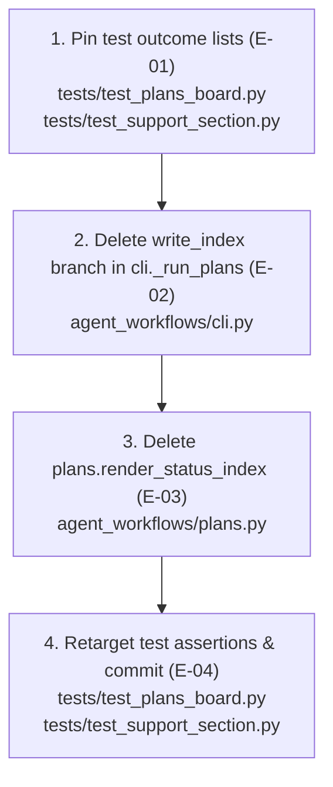

# IPD: Delete the unreachable STATUS renderer

- Date: 2026-11-09
- Kind: child
- Concern: Spec `4sd62s` 4.5 says the SQLite cache replaces `plans/STATUS.md`. `plans.render_status_index` writes that file's text, and it is reached only from the `if getattr(args, "write_index", False):` branch of `cli._run_plans`, which no parser can enable (no parser defines `--write-index`; `aw ipd board --help` lists no write option, `9o83cr` F-02). This is part 7 of the round-3 split of `snin8q` (Order 42), carrying `snin8q` E-06 verbatim.
- Scope: delete `plans.render_status_index` and the `write_index` branch, and retarget `tests/test_plans_board.py` and `tests/test_support_section.py`. EXCLUDES this repository's tracked `.aw/records/plans/STATUS.md` file and the skip names that protect scans from it (cutover, `cxxmyv`), and `run_cli.write_index` (the run ledger projection, unrelated).
- Scope-Paths: agent_workflows/plans.py, agent_workflows/cli.py, tests/test_plans_board.py, tests/test_support_section.py, .aw/records/plans/pending/20261109-metastore-236-3v2ew2-delete-the-unreachable-status-renderer.ipd.md
- Item-Dependencies: executed:1ajqaa, executed:54a80m, executed:59aiyh, executed:dcerjg, executed:ffceq0, executed:g5hpbb, executed:q6epwc, executed:t4gl15
- Status: approved
- Readiness: go-pending-approval
- Review-Depth: complex
- From-Spec: 4sd62s
- Work-Kind: feature
- Priority: high
- Blocks-Release: next
- Set: metastore
- Order: 236
- Highest E allocated: 04
- Author: opencode its_direct/pt3-claude-opus-5.5-1m-us
- Id: 3v2ew2
- Approval: 2026-11-16, recorded via aw ipd set: status set to approved

> Write and proofread this plan per the technical writing standard, `.aw/system/workflows/technical-writing/technical-writing.md` (`.agents/workflows/technical-writing/technical-writing.md` in a legacy-layout install), including requirement 12 (diagrams).

## Workflow history
- 2026-11-16 approved (aw set): status set to approved

- 2026-11-14 reviewed (antigravity): plan-review verified E/V bijection, Scope-Paths, renderer removal, and execution gate; marked reviewed and go-pending-approval.
- 2026-11-09 to-review (opencode its_direct/pt3-claude-opus-5.5-1m-us): split from snin8q (round 3, research nj8zdp guidance).

## Goal

After this plan, no code can render or write `STATUS.md`, and `aw ipd board` prints exactly what it printed in the `54a80m` baseline.

## Detailed Implementation Checklist (TODO)

Execution-state rule: mark an `E-*` item complete only after performing the action. That mark is not validation. Right-sizing rule: write for a modest executor that cannot hold much in its head. Each E-item is one step (one concern, about one file, executable in one focused pass) and its V-item names each unit it covers with its own check; a plan stays at about 5 E-items and 8 work Scope-Paths, else split it into more child plans (guidance, `IPD-Z603`). Accepted execution states: blocked, failed, pending, performed; terminal gate demands 'performed'.

`snin8q` E-06 ("Delete the STATUS code: `plans.render_status_index` and the unreachable `write_index` branch of `cli._run_plans` ... Retarget `tests/test_plans_board.py` and `tests/test_support_section.py` from `render_status_index` to the observable `aw ipd board` output. Measured units: 1 function, 1 branch, 2 test modules: 4") is split across E-01 to E-04 here. Measured at this split: `aw ipd board` (`cli._run_plans` human path) does not render the "## Sets" section that two of the retargeted tests assert, so those assertions retarget to the surviving `plans.group_sets` and `plans.set_warnings` functions that produced that section; each case keeps its inputs.

PIN RULE (carried from `9o83cr`): before the edit, save the modules' per-test outcome list (`python3 -m pytest -o addopts="" -m "" -p no:randomly -n 0 -rA tests/test_plans_board.py tests/test_support_section.py | grep -E "^(PASSED|FAILED|ERROR|SKIPPED|XFAIL|XPASS) " | sed -E 's/ - .*//' | sort > .aw/state/3v2ew2/<E>-before.txt`); after it, the same into `<E>-after.txt`. A retargeted test keeps every input case; the evidence maps each removed name to its successor.

### Task group 1: pin, delete, retarget

- [ ] E-01 Pin `tests/test_plans_board.py` and `tests/test_support_section.py` (PIN RULE, `E-01-before.txt`).
  - Depends on: none
  - Expected outcome: `.aw/state/3v2ew2/E-01-before.txt` exists.
  - Execution state: pending

- [ ] E-02 In `cli._run_plans`, delete the `if getattr(args, "write_index", False):` branch that writes `STATUS.md`.
  - Depends on: E-01
  - Expected outcome: `rg -n "write_index|STATUS\.md" agent_workflows/cli.py` prints no line in `_run_plans`.
  - Execution state: pending

- [ ] E-03 In `agent_workflows/plans.py`, delete `plans.render_status_index` and the module docstring clause "(``render_status_index`` returns text; the caller writes it)". Keep `plans.group_sets` and `plans.set_warnings`.
  - Depends on: E-02
  - Expected outcome: `rg -n "render_status_index|write_index" agent_workflows` prints only `run_cli.write_index`.
  - Execution state: pending

- [ ] E-04 Retarget `tests/test_plans_board.py` (`test_deterministic_index` to two `aw ipd board` runs with byte-identical output; `test_board_renders_sets_section_and_warnings` and `test_no_sets_section_when_no_set_declared` to `plans.group_sets` and `plans.set_warnings` on the same fixtures) and `tests/test_support_section.py` (`test_final_section_against_real_plans_render_status_index` to a `support.final_section` call on `aw ipd board` output, or on a fixed text if the board has no terminal section). Save `E-04-after.txt`, run both modules, and commit through `aw commit 3v2ew2 -- <paths>` with only Scope-Paths files; never `git add -A`, a bare `git add` or `git commit -a`; never push.
  - Depends on: E-03
  - Expected outcome: both modules pass; the mapping accounts for every case.
  - Execution state: pending

## Project conventions discovered (Step 0)

- `run_cli.write_index` writes the run ledger projection and is unrelated to INDEX manifests.
- Cite code by SYMBOL (`module.function`) or by a quoted content string, with a line number only appended to one of those and never alone (advisory `IPD-C801`).

## Findings

Measured 2026-11-09 at `3d0ddb845`: `rg -n "render_status_index|write_index" agent_workflows tests` prints `plans.render_status_index` (definition and docstring), the `cli._run_plans` branch, `run_cli.write_index` (unrelated), 4 calls in `tests/test_plans_board.py` (in `test_deterministic_index`, `test_board_renders_sets_section_and_warnings`, `test_no_sets_section_when_no_set_declared`) and 1 in `tests/test_support_section.py`. `rg -n "## Sets" agent_workflows/cli.py` prints nothing: the board does not render the Sets section.

## Proposed changes (ordered, validatable)

1. Pin (E-01).
2. Delete the branch (E-02) and the renderer (E-03).
3. Retarget and commit (E-04).

## Deferred / out of scope (with reason)

- The tracked `.aw/records/plans/STATUS.md` file and the scan skip names: until `m0001` deletes the file.
  - Carrier: cxxmyv

## Scope check

- Over-scope: none.
- Under-scope: none known. Size: 4 E-items, 4 work Scope-Paths.

## Required tests / validation

`tests/test_plans_board.py`, `tests/test_support_section.py` (pinned, retargeted), then the bare core gate `python3 -m pytest`.

## Spec / documentation sync

No spec change; implements part of `4sd62s` 4.5.

## Open questions

### OQ-01: Should `aw ipd board` gain the Sets section the deleted renderer had?

- Blocking: no
- Status: resolved
- Owner: plan author
- Resolution or deferral rationale: No. The renderer was unreachable, so no user ever saw that section through the board; adding it would be a feature, not a deletion. Recommendation strength: strong.

## Validation and cross-check (verify before reporting done)

Validation-state rule: inspect evidence in a separate pass. Do not mark a `V-*` item complete from memory or from the matching execution checkmark. Accepted validation results: blocked, failed, pass, pending; terminal gate demands 'pass'. Runtime-demonstration reachability rule: for each `V-*` item demanding the software be observed acting (such as a run, a dispatch, or a transition), as distinct from items demanding a diff, a file's content, or a test result, which are reachable by construction, name the code path that produces the observation or the sibling `E-*` that creates it, else the demand is UNDER-SCOPE.

- [ ] V-01 validates E-01
  - Required evidence: paste `wc -l .aw/state/3v2ew2/E-01-before.txt` and one line from each named module.
  - Observed evidence:
  - Result: pending

- [ ] V-02 validates E-02
  - Required evidence: paste the `git diff` hunk of `cli._run_plans` and `diff <(aw ipd board) <board block of 54a80m F-29>` empty. Code path: `cli._run_plans` (E-02).
  - Observed evidence:
  - Result: pending

- [ ] V-03 validates E-03
  - Required evidence: paste `rg -n "render_status_index|write_index" agent_workflows` showing only `run_cli.write_index`.
  - Observed evidence:
  - Result: pending

- [ ] V-04 validates E-04
  - Required evidence: paste `diff .aw/state/3v2ew2/E-01-before.txt .aw/state/3v2ew2/E-04-after.txt` with each removed name mapped, `python3 -m pytest -o addopts="" -v tests/test_plans_board.py tests/test_support_section.py` with the four named cases (or their successors) PASSED, and `git show --stat` of the `aw commit 3v2ew2` commit listing only Scope-Paths files.
  - Observed evidence:
  - Result: pending

## Approval and execution gate

- Size assessment: standard
- Cohesion rationale: not required

Execute only after human approval (`Status: approved`) and after every plan in `- Item-Dependencies:` is executed. Pin-first. Scope fence: a needed file outside `- Scope-Paths:` is edited and then justified at finalize (`--scope-reason`). Honesty rule: paste the ACTUAL summary lines; never claim a result you did not run. Commits: only through `aw commit 3v2ew2 -- <paths>`; never push. Lifecycle: the plan moves to `.aw/records/plans/executed/` only through `aw ipd finalize`, never a hand `git mv`, after `aw ipd lint --phase pre-transition` conforms and every `V-*` reads `pass` with pasted evidence. When `aw oc run` or `aw agy run` executes the plan, the runner performs the finalize; a hand executor runs `aw ipd finalize 3v2ew2` itself.
