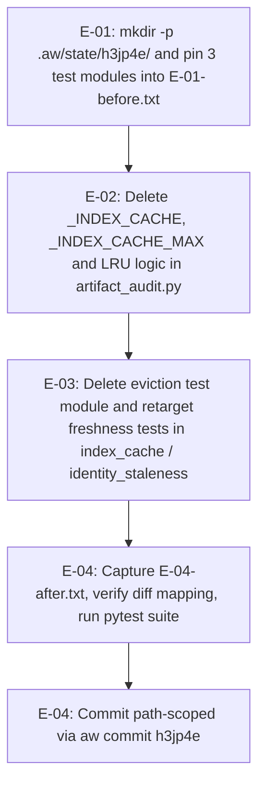

# IPD: Delete the artifact audit in-process index cache

- Date: 2026-11-09
- Kind: child
- Concern: Spec `4sd62s` 4.5 says the SQLite cache replaces `artifact_audit._INDEX_CACHE`. Today `artifact_audit.build_index` keeps an `OrderedDict` LRU (`_INDEX_CACHE`, bounded by `_INDEX_CACHE_MAX = 8`) keyed on a directory signature from `artifact_audit._dir_signature`, and `artifact_audit.find_artifact` pops a stale entry. This is part 8 of the round-3 split of `snin8q` (Order 42), carrying `snin8q` E-07 verbatim.
- Scope: delete the cache and its bound, make `artifact_audit.build_index` answer from `artifact_meta.query`/`resolve` on every call, delete `tests/test_artifact_audit_cache_eviction.py`, and retarget the two freshness test modules. EXCLUDES every other INDEX symbol (Orders 233 to 236).
- Scope-Paths: agent_workflows/artifact_audit.py, tests/test_artifact_audit_cache_eviction.py, tests/test_artifact_audit_index_cache.py, tests/test_artifact_audit_identity_staleness.py, .aw/records/plans/pending/20261109-metastore-237-h3jp4e-delete-the-artifact-audit-in-process-index-cache.ipd.md
- Item-Dependencies: executed:1ajqaa, executed:54a80m, executed:59aiyh, executed:dcerjg, executed:ffceq0, executed:g5hpbb, executed:q6epwc, executed:t4gl15
- Status: approved
- Readiness: go-pending-approval
- Review-Depth: standard
- From-Spec: 4sd62s
- Work-Kind: feature
- Priority: high
- Blocks-Release: next
- Set: metastore
- Order: 237
- Highest E allocated: 04
- Author: opencode its_direct/pt3-claude-opus-5.5-1m-us
- Id: h3jp4e
- Approval: 2026-11-16, recorded via aw ipd set: status set to approved

> Write and proofread this plan per the technical writing standard, `.aw/system/workflows/technical-writing/technical-writing.md` (`.agents/workflows/technical-writing/technical-writing.md` in a legacy-layout install), including requirement 12 (diagrams).

## Workflow history
- 2026-11-16 approved (aw set): status set to approved

- 2026-11-14 reviewed (antigravity/gemini-3.8-flash): /plan-review (antigravity/gemini-3.8-flash): APPROVE WITH REVISIONS APPLIED; PR-001, PR-002, PR-003, PR-004, PR-005
- 2026-11-09 to-review (opencode its_direct/pt3-claude-opus-5.5-1m-us): split from snin8q (round 3, research nj8zdp guidance).

## Goal

After this plan, `artifact_audit.build_index` holds no in-process cache: a record added, deleted or moved after a first call is reflected by the second call.

## Detailed Implementation Checklist (TODO)

Execution-state rule: mark an `E-*` item complete only after performing the action. That mark is not validation. Right-sizing rule: write for a modest executor that cannot hold much in its head. Each E-item is one step (one concern, about one file, executable in one focused pass) and its V-item names each unit it covers with its own check; a plan stays at about 5 E-items and 8 work Scope-Paths, else split it into more child plans (guidance, `IPD-Z603`). Accepted execution states: blocked, failed, pending, performed; terminal gate demands 'performed'.

`snin8q` E-07 ("Delete `artifact_audit._INDEX_CACHE` and `_INDEX_CACHE_MAX` ... `artifact_audit.build_index` answers from `artifact_meta.query`/`resolve` on every call. Delete `tests/test_artifact_audit_cache_eviction.py` (it tests the removed LRU) and retarget the freshness assertions of `tests/test_artifact_audit_index_cache.py` and `tests/test_artifact_audit_identity_staleness.py` to the behavior") is split across E-01 to E-04 here.

PIN RULE (carried from `9o83cr`): before the edit, save the modules' per-test outcome list (`mkdir -p .aw/state/h3jp4e/ && python3 -m pytest -o addopts="" -m "" -p no:randomly -n 0 -rA tests/test_artifact_audit_cache_eviction.py tests/test_artifact_audit_index_cache.py tests/test_artifact_audit_identity_staleness.py | grep -E "^(PASSED|FAILED|ERROR|SKIPPED|XFAIL|XPASS) " | sed -E 's/ - .*//' | sort > .aw/state/h3jp4e/<E>-before.txt`); after it, the same into `<E>-after.txt`. A retargeted test keeps every input case; each case of the deleted eviction module is named "subject removed (LRU deleted)" in the mapping.

### Task group 1: pin, delete, retarget

- [ ] E-01 Ensure directory `.aw/state/h3jp4e/` exists (`mkdir -p .aw/state/h3jp4e/`) and pin the three test modules (PIN RULE, `E-01-before.txt`).
  - Depends on: none
  - Expected outcome: `.aw/state/h3jp4e/E-01-before.txt` exists.
  - Execution state: pending

- [ ] E-02 In `agent_workflows/artifact_audit.py`, delete `_INDEX_CACHE`, `_INDEX_CACHE_MAX` and their comment block; in `artifact_audit.build_index` remove the cache lookup, insert and eviction so it builds from `artifact_meta.query`/`resolve` on every call; in `artifact_audit.find_artifact` remove the stale-entry pop. Delete `artifact_audit._dir_signature` if no caller remains.
  - Depends on: E-01
  - Expected outcome: `rg -n "_INDEX_CACHE" agent_workflows` prints nothing.
  - Execution state: pending

- [ ] E-03 Delete `tests/test_artifact_audit_cache_eviction.py`, and in `tests/test_artifact_audit_index_cache.py` and `tests/test_artifact_audit_identity_staleness.py` remove every `_audit._INDEX_CACHE` reference (the `.clear()` setup calls and the `_INDEX_CACHE[key][1]` reads), asserting instead that a record added, deleted or moved between two `build_index` calls is reflected by the second.
  - Depends on: E-02
  - Expected outcome: `rg -n "_INDEX_CACHE" tests` prints nothing.
  - Execution state: pending

- [ ] E-04 Save `E-04-after.txt`, run the two remaining modules, and commit through `aw commit h3jp4e -- <paths>` with only Scope-Paths files; never `git add -A`, a bare `git add` or `git commit -a`; never push.
  - Depends on: E-03
  - Expected outcome: both modules pass; the mapping accounts for every case.
  - Execution state: pending

## Project conventions discovered (Step 0)

- The `artifact_meta` interface (`tve77h`, `ffceq0`): `query(...)`, `resolve(path_or_id6)`; `t4gl15` already routes `artifact_audit.build_index` reads through the cache (AC-1a).
- Cite code by SYMBOL (`module.function`) or by a quoted content string, with a line number only appended to one of those and never alone (advisory `IPD-C801`).

## Findings

Measured 2026-11-09 at `3d0ddb845`: `rg -n "_INDEX_CACHE" agent_workflows` prints 10 lines in `artifact_audit.py` (in `build_index` and `find_artifact`); `rg -n "_INDEX_CACHE" tests` prints 7 lines in `tests/test_artifact_audit_cache_eviction.py`, 6 in `tests/test_artifact_audit_identity_staleness.py`, 6 in `tests/test_artifact_audit_index_cache.py` (`snin8q` F-10).

## Proposed changes (ordered, validatable)

1. Create baseline directory and pin the three test modules (E-01).
2. Delete `_INDEX_CACHE`, `_INDEX_CACHE_MAX`, and LRU handling in `artifact_audit.py` (E-02).
3. Delete `tests/test_artifact_audit_cache_eviction.py` and retarget freshness assertions in `test_artifact_audit_index_cache.py` and `test_artifact_audit_identity_staleness.py` (E-03).
4. Save `E-04-after.txt`, verify diff mapping, run remaining modules, and commit path-scoped (E-04).

## Deferred / out of scope (with reason)

- Every other INDEX writer, the STATUS renderer: Orders 233 to 236.
  - Carrier: snin8q

## Scope check

- Over-scope: none.
- Under-scope: none known. Size: 4 E-items, 4 work Scope-Paths.

## Required tests / validation

`tests/test_artifact_audit_index_cache.py`, `tests/test_artifact_audit_identity_staleness.py` (retargeted); `tests/test_artifact_audit_cache_eviction.py` deleted. Then the bare core gate `python3 -m pytest`.

## Spec / documentation sync

No spec change; implements part of `4sd62s` 4.5.

## Open questions

### OQ-01: Does removing the LRU make `aw find` noticeably slower?

- Blocking: no
- Status: resolved
- Owner: plan author
- Resolution or deferral rationale: The SQLite cache (`ffceq0`, `t4gl15`) is the replacement the spec names; a repeated call reads the cache rather than rescanning. If a measurement shows a user-perceptible regression, file it as a `bug` with the number (AGENTS.md perceptibility rule). Recommendation strength: medium.

## Validation and cross-check (verify before reporting done)

Validation-state rule: inspect evidence in a separate pass. Do not mark a `V-*` item complete from memory or from the matching execution checkmark. Accepted validation results: blocked, failed, pass, pending; terminal gate demands 'pass'. Runtime-demonstration reachability rule: for each `V-*` item demanding the software be observed acting (such as a run, a dispatch, or a transition), as distinct from items demanding a diff, a file's content, or a test result, which are reachable by construction, name the code path that produces the observation or the sibling `E-*` that creates it, else the demand is UNDER-SCOPE.

- [ ] V-01 validates E-01
  - Required evidence: paste `wc -l .aw/state/h3jp4e/E-01-before.txt` and one line from each of the three named modules.
  - Observed evidence:
  - Result: pending

- [ ] V-02 validates E-02
  - Required evidence: paste `rg -n "_INDEX_CACHE" agent_workflows` printing nothing, and the `git diff` hunks of `artifact_audit.build_index` and `artifact_audit.find_artifact`.
  - Observed evidence:
  - Result: pending

- [ ] V-03 validates E-03
  - Required evidence: paste `rg -n "_INDEX_CACHE" tests` printing nothing, and the `git diff --stat` line deleting `tests/test_artifact_audit_cache_eviction.py`.
  - Observed evidence:
  - Result: pending

- [ ] V-04 validates E-04
  - Required evidence: paste `diff .aw/state/h3jp4e/E-01-before.txt .aw/state/h3jp4e/E-04-after.txt` with each removed name mapped or marked "subject removed (LRU deleted)", `python3 -m pytest -o addopts="" -v tests/test_artifact_audit_index_cache.py tests/test_artifact_audit_identity_staleness.py` with the add, delete and move freshness cases PASSED, and `git show --stat` of the `aw commit h3jp4e` commit listing only Scope-Paths files.
  - Observed evidence:
  - Result: pending

## Approval and execution gate

- Size assessment: standard
- Cohesion rationale: not required

Execute only after human approval (`Status: approved`) and after every plan in `- Item-Dependencies:` is executed. OQ-01 is resolved and not blocking. Pin-first.

Scope fence: the paths in `- Scope-Paths:` are a declaration; a needed file outside the fence is edited and then justified at finalize (`--scope-reason`), and a declared path left unmodified is acknowledged (`--scope-ack`). Production code outside `agent_workflows/artifact_audit.py` is not modified.

Safety: if prerequisite `artifact_meta.query` / `resolve` implementations or SQLite cache mechanisms from `ffceq0` or `t4gl15` are absent, stop and report immediately: that is an unsafe condition, not a scope question.

Honesty rule: run the named test modules and `python3 -m pytest` (core gate), and paste the ACTUAL summary lines; never claim a result you did not run.

Commits: commit only through `aw commit h3jp4e -- <paths>`; never `git add -A`, a bare `git add` or `git commit -a`; never push.

Lifecycle transition: the plan moves to `.aw/records/plans/executed/` only through `aw ipd finalize`, never a hand `git mv`, and only after `aw ipd lint --phase pre-transition` conforms and every `V-*` reads `pass` with pasted evidence. When `aw oc run` or `aw agy run` executes the plan, the runner performs the finalize; a hand executor runs `aw ipd finalize h3jp4e` itself.
