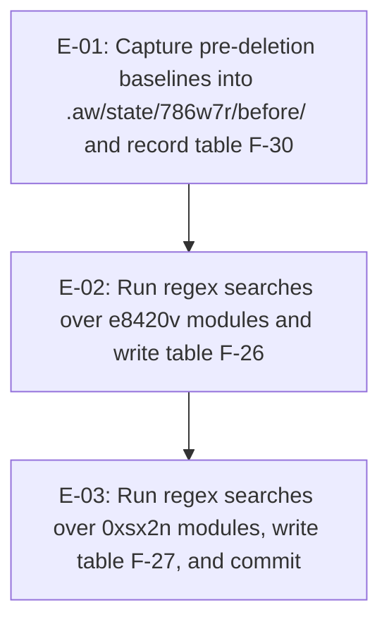

# IPD: Record the baseline for the remaining metadata regex deletions

- Date: 2026-11-09
- Kind: child
- Concern: Two families, `e8420v` (Order 45) and `0xsx2n` (Order 46), delete the remaining `^-` metadata regular expressions outside `artifact_meta` (spec `4sd62s` C5, 4.3). Each family's finishing item compares `aw check all`, `aw find plans` and `aw attention` against a baseline taken before any deletion, and its parts need a classified site table. `.aw/state/` does not travel between lane worktrees, so after the round-3 split both the baseline and the site tables must be committed in a plan file. This plan carries `e8420v` E-01 and `0xsx2n` E-01.
- Scope: run the read-only baseline commands and the `^-` site searches, and write tables F-26 (the `e8420v` modules) and F-27 (the `0xsx2n` modules) and baseline table F-30 into this plan; commit this plan file. EXCLUDES every code or test edit (Orders 239 to 249).
- Scope-Paths: .aw/records/plans/pending/20261109-metastore-238-786w7r-record-the-baseline-for-the-remaining-metadata-regex-deletio.ipd.md
- Item-Dependencies: executed:1ajqaa, executed:59aiyh, executed:dcerjg, executed:ffceq0, executed:g5hpbb, executed:k6jd6l, executed:t4gl15
- Status: reviewed
- Readiness: go-pending-approval
- Review-Depth: standard
- From-Spec: 4sd62s
- Work-Kind: feature
- Priority: high
- Blocks-Release: next
- Set: metastore
- Order: 238
- Highest E allocated: 03
- Author: opencode its_direct/pt3-claude-opus-5.5-1m-us
- Id: 786w7r

> Written to .aw/system/workflows/technical-writing/technical-writing.md. Every obligation, exact identifier, quotation, evidence record, and lifecycle status is preserved.

## Workflow history

- 2026-11-14 /plan-review (antigravity/gemini-3.8-flash): APPROVE WITH REVISIONS APPLIED; PR-001..PR-005 FIXED; review record .aw/records/reviews/20261109-metastore-238-786w7r-record-the-baseline-for-the-remaining-metadata-regex-deletio.review.md
- 2026-11-14 reviewed (aw set): APPROVE WITH REVISIONS APPLIED; PR-001..PR-005 FIXED
- 2026-11-09 to-review (opencode its_direct/pt3-claude-opus-5.5-1m-us): split from e8420v and 0xsx2n (round 3, research nj8zdp guidance).

## Goal

Commit, inside this plan, the pre-deletion baseline and the two classified site tables that every part of the `e8420v` and `0xsx2n` families reads.

## Detailed Implementation Checklist (TODO)

Execution-state rule: mark an `E-*` item complete only after performing the action. That mark is not validation. Right-sizing rule: write for a modest executor that cannot hold much in its head. Each E-item is one step (one concern, about one file, executable in one focused pass) and its V-item names each unit it covers with its own check; a plan stays at about 5 E-items and 8 work Scope-Paths, else split it into more child plans (guidance, `IPD-Z603`). Accepted execution states: blocked, failed, pending, performed; terminal gate demands 'performed'.

`e8420v` E-01 and `0xsx2n` E-01 are carried here: E-01 is their shared baseline, E-02 is `e8420v` E-01's search and table, E-03 is `0xsx2n` E-01's search and table. The regex used below is `LIT='re\.(compile|search|match|finditer|findall|sub|fullmatch)\(\s*r?["'"'"'](\(\?m\))?\^-'`.

### Task group 1: baseline and site tables

- [ ] E-01 On the unedited tree, ensure directory `.aw/state/786w7r/before/` exists (`mkdir -p .aw/state/786w7r/before/`) and save under it the stdout and exit code of `aw check all --agent` and `aw check all --all --agent` (rule-id multisets, `jq -r '.diagnostics[].rule' | sort | uniq -c`), `aw find plans --agent`, `aw attention --format json`, and the bare core gate summary line of `python3 -m pytest`; copy every value into table F-30 of this plan (the `aw find` and `aw attention` outputs as line counts plus `sha256sum`).
  - Depends on: none
  - Expected outcome: F-30 holds every value.
  - Execution state: pending

- [ ] E-02 Run `rg -n "$LIT"` over `agent_workflows/check_engine.py`, `agent_workflows/runner_shared.py`, `agent_workflows/status_set.py` and `agent_workflows/releases.py`, and `rg -n "_blob_text|_status_meta\b|_metadata_status\b|_front_matter_bullets" agent_workflows tools tests`; write table F-26: one row per hit, classed `delete (239)`, `delete (240)`, `delete (241)`, `delete (242)`, `delete (243)`, `body prose (N3)` or `already gone`, using the site lists in those plans.
  - Depends on: E-01
  - Expected outcome: F-26 has a class on every row.
  - Execution state: pending

- [ ] E-03 Run `rg -n "$LIT"` over each module named in Orders 244 to 249 (listed in each plan's Scope-Paths) and write table F-27: one row per hit, classed `delete (244)` to `delete (249)`, `body prose (N3)`, `non-metadata` or `already gone`. Commit this plan file through `aw commit 786w7r -- <this plan's path>`; never `git add -A`, a bare `git add` or `git commit -a`; never push.
  - Depends on: E-02
  - Expected outcome: F-27 has a class on every row; the commit lists only this plan file.
  - Execution state: pending

## Project conventions discovered (Step 0)

- N3 keeps Markdown body bullets (open-question rows, E/V checklist fields, prose targets) out of `artifact_meta`; their patterns are `body prose` and stay.
- Cite code by SYMBOL (`module.function`) or by a quoted content string, with a line number only appended to one of those and never alone (advisory `IPD-C801`).

## Findings

| Id | Evidence | Finding |
|---|---|---|
| F-26 | (written by E-02) `^-` sites and parser references in `check_engine`, `runner_shared`, `status_set`, `releases`, each classed | Read by Orders 239 to 243 and `e8420v`. |
| F-27 | (written by E-03) `^-` sites in the Order 244 to 249 modules, each classed | Read by Orders 244 to 249 and `0xsx2n`; `non-metadata` rows feed the `9o83cr` E-14 exclusion file. |
| F-30 | (written by E-01) baseline exit codes, rule-id multisets, `aw find`/`aw attention` hashes, core gate line | Compared by `e8420v` and `0xsx2n`. |

## Proposed changes (ordered, validatable)

1. Baseline capture (E-01): Create `.aw/state/786w7r/before/`, capture exit codes, multisets, counts, and SHA256 checksums from read-only baseline commands, and record them in table F-30.
2. Site tables and commit (E-02, E-03): Search and classify all remaining `^-` regex occurrences across `e8420v` modules into table F-26, search and classify occurrences across `0xsx2n` modules into table F-27, and commit this plan file alone using `aw commit 786w7r`.

## Deferred / out of scope (with reason)

- Every deletion: Orders 239 to 249.
  - Carrier: e8420v
- The final comparison of the `0xsx2n` family.
  - Carrier: 0xsx2n

## Scope check

- Over-scope: none.
- Under-scope: none known. Size: 3 E-items, 0 work Scope-Paths (this plan file only).

## Required tests / validation

No test is written. The commands are read-only.

## Spec / documentation sync

N/A: this plan records measurements only.

## Open questions

### OQ-01: Why one baseline for two families?

- Blocking: no
- Status: resolved
- Owner: plan author
- Resolution or deferral rationale: Both families run after `k6jd6l` and before `9o83cr` and compare the same commands; one committed baseline taken before either starts is the honest reference for both. Recommendation strength: strong. RESOLVED 2026-11-11 by the user via /askme: one shared baseline for both groups (e8420v and 0xsx2n). No reason was given.

## Validation and cross-check (verify before reporting done)

Validation-state rule: inspect evidence in a separate pass. Do not mark a `V-*` item complete from memory or from the matching execution checkmark. Accepted validation results: blocked, failed, pass, pending; terminal gate demands 'pass'. Runtime-demonstration reachability rule: for each `V-*` item demanding the software be observed acting (such as a run, a dispatch, or a transition), as distinct from items demanding a diff, a file's content, or a test result, which are reachable by construction, name the code path that produces the observation or the sibling `E-*` that creates it, else the demand is UNDER-SCOPE.

- [ ] V-01 validates E-01
  - Required evidence: paste `ls -l .aw/state/786w7r/before/` with one file per named command, and table F-30 as written.
  - Observed evidence:
  - Result: pending

- [ ] V-02 validates E-02
  - Required evidence: paste the two `rg` commands with their hit counts and table F-26 with a class on every row (`grep -c` of F-26 rows equal to the hit count).
  - Observed evidence:
  - Result: pending

- [ ] V-03 validates E-03
  - Required evidence: paste the per-module `rg` hit counts, table F-27 with a class on every row, and `git show --stat` of the `aw commit 786w7r` commit listing only this plan file.
  - Observed evidence:
  - Result: pending

## Approval and execution gate

- Size assessment: standard
- Cohesion rationale: not required

Execute only after human approval (`Status: approved`) and after every plan in `- Item-Dependencies:` is executed (`1ajqaa`, `59aiyh`, `dcerjg`, `ffceq0`, `g5hpbb`, `k6jd6l`, `t4gl15`), and before any of Orders 239 to 249. Stop condition: stop safely without modifying files if prerequisite metastore symbols from `59aiyh`, `ffceq0`, `k6jd6l`, or `t4gl15` are missing, or if an unresolvable concurrent-edit conflict occurs. Shared-checkout safety: this plan edits only itself; do not stage, edit, or commit any other file. Honesty rule: paste the ACTUAL outputs. Commits: only through `aw commit 786w7r -- .aw/records/plans/pending/20261109-metastore-238-786w7r-record-the-baseline-for-the-remaining-metadata-regex-deletio.ipd.md`; never push. Lifecycle: the plan moves to `.aw/records/plans/executed/` only through `aw ipd finalize 786w7r` (or runner-automated retirement upon validation; never a hand `git mv`), after `aw ipd lint --phase pre-transition` conforms and every `V-*` reads `pass` with pasted evidence.
