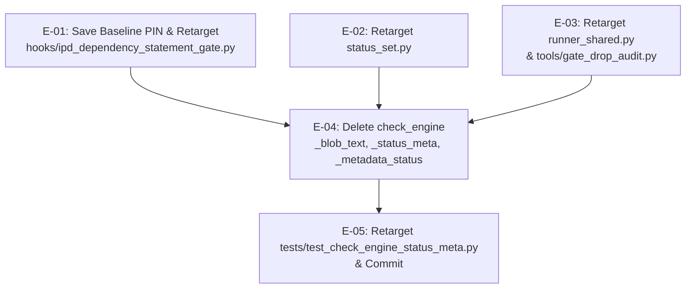

# IPD: Delete the check_engine blob and status parsers and retarget their callers

- Date: 2026-11-09
- Kind: child
- Concern: Spec `4sd62s` C5 allows one metadata reader (`artifact_meta`). `check_engine._blob_text`, `check_engine._status_meta` and `check_engine._metadata_status` read a git blob's text and parse its status bullet, and five modules outside `check_engine` call them. This is part 1 of the round-3 split of `e8420v` (Order 45), carrying the named-parser and external-caller subset of `e8420v` E-12 and the `tools/gate_drop_audit.py` `_status_meta` retarget of `e8420v` E-20.
- Scope: retarget the external callers to `artifact_meta.read_at(id6, rev)` or `artifact_meta.read_text(text)`, then delete the three parsers from `check_engine` with their internal callers, and update `tests/test_check_engine_status_meta.py`. EXCLUDES the named and inline `check_engine` regex patterns (Orders 240 and 241) and `tools/gate_drop_audit.py`'s `backlog.parse_item` call (owned by `k6jd6l` E-18).
- Scope-Paths: agent_workflows/check_engine.py, agent_workflows/hooks/ipd_dependency_statement_gate.py, agent_workflows/status_set.py, agent_workflows/runner_shared.py, tools/gate_drop_audit.py, tests/test_check_engine_status_meta.py, tests/test_gate_drop_audit.py, .aw/records/plans/pending/20261109-metastore-239-7uq6xg-delete-the-check-engine-blob-and-status-parsers-and-retarget.ipd.md
- Item-Dependencies: executed:1ajqaa, executed:59aiyh, executed:786w7r, executed:dcerjg, executed:ffceq0, executed:g5hpbb, executed:k6jd6l, executed:t4gl15
- Status: approved
- Readiness: go-pending-approval
- Review-Depth: standard
- From-Spec: 4sd62s
- Work-Kind: feature
- Priority: high
- Blocks-Release: next
- Set: metastore
- Order: 239
- Highest E allocated: 05
- Author: opencode its_direct/pt3-claude-opus-5.5-1m-us
- Id: 7uq6xg
- Approval: 2026-11-16, recorded via aw ipd set: status set to approved

> Write and proofread this plan per the technical writing standard, `.aw/system/workflows/technical-writing/technical-writing.md` (`.agents/workflows/technical-writing/technical-writing.md` in a legacy-layout install), including requirement 12 (diagrams).

## Workflow history
- 2026-11-16 approved (aw set): status set to approved

- 2026-11-14 reviewed (antigravity/gemini-3.8-flash): /plan-review (antigravity/gemini-3.8-flash): APPROVE WITH REVISIONS APPLIED; PR-001, PR-002, PR-003, PR-004.
- 2026-11-09 to-review (opencode its_direct/pt3-claude-opus-5.5-1m-us): split from e8420v (round 3, research nj8zdp guidance).

## Goal

After this plan, `rg -n "_blob_text|_status_meta\b|_metadata_status\b" agent_workflows tools tests` prints nothing, and every rule, hook and setter that used them gives the same answer through `artifact_meta`.

## Detailed Implementation Checklist (TODO)

Execution-state rule: mark an `E-*` item complete only after performing the action. That mark is not validation. Right-sizing rule: write for a modest executor that cannot hold much in its head. Each E-item is one step (one concern, about one file, executable in one focused pass) and its V-item names each unit it covers with its own check; a plan stays at about 5 E-items and 8 work Scope-Paths, else split it into more child plans (guidance, `IPD-Z603`). Accepted execution states: blocked, failed, pending, performed; terminal gate demands 'performed'.

`e8420v` E-12's list is split across Orders 239, 240 and 241; this plan takes "Delete `check_engine._blob_text`, `_status_meta` and `_metadata_status` ... Also retarget the `_status_meta`/`_blob_text` callers in `hooks/ipd_dependency_statement_gate.py` (2) and `status_set` (2), and `_metadata_status` in `runner_shared` (1) and `prompts` (if still present). Update `tests/test_check_engine_status_meta.py`." Measured at this split: `prompts` no longer calls `_metadata_status`. From `e8420v` E-20 it takes "Retarget `tools/gate_drop_audit.py` (`check_engine._status_meta` ...) to `artifact_meta.read`/`read_at`, keeping `tests/test_gate_drop_audit.py` green." Each site reads the value through `artifact_meta.read`, `read_text` or `read_at` at its caller.

PIN RULE (carried from `9o83cr`): before an item's edit, save its named test module's per-test outcome list (`python3 -m pytest -o addopts="" -m "" -p no:randomly -n 0 -rA <module> | grep -E "^(PASSED|FAILED|ERROR|SKIPPED|XFAIL|XPASS) " | sed -E 's/ - .*//' | sort > .aw/state/7uq6xg/<E>-before.txt`); after it, the same into `<E>-after.txt`. A retargeted test keeps every input case. Ensure `.aw/state/7uq6xg/` exists via `mkdir -p .aw/state/7uq6xg/`.

### Task group 1: callers first, then the parsers

- [x] E-01 Before the first edit, ensure `.aw/state/7uq6xg/` exists (`mkdir -p .aw/state/7uq6xg/`) and save baseline test PIN lists. In `agent_workflows/hooks/ipd_dependency_statement_gate.py`, replace `_ce._blob_text(repo_root, ":0:", ...)` and `_ce._status_meta(staged_text)` with `artifact_meta.read_text` on the staged blob (read with `git show :0:<path>` as today) and its `status` value.
  - Depends on: none
  - Expected outcome: `rg -n "_blob_text|_status_meta" agent_workflows/hooks/ipd_dependency_statement_gate.py` prints nothing.
  - Execution note: 2026-11-24: `.aw/state/7uq6xg/` created and before-PIN lists saved for the three named modules; the hook needed no edit, because `snh19k` (commit `d8b803558`) had already moved `hooks/ipd_dependency_statement_gate._staged_ipd_overlay` onto `artifact_meta.read_at`, and `786w7r` F-26 records 0 references; see decision 16-7uq6xg-D1
  - Execution state: performed

- [x] E-02 In `agent_workflows/status_set.py`, replace the `_ce._blob_text(repo_root, "HEAD", rel)` / `_ce._status_meta(head_text)` pair with `artifact_meta.read_at(id6, "HEAD")`'s `status`.
  - Depends on: none
  - Expected outcome: `rg -n "_blob_text|_status_meta" agent_workflows/status_set.py` prints nothing; `tests/test_status_set.py` passes.
  - Execution note: 2026-11-24: no edit needed; `iqhzse` (commit `8f18c3b29`) had already moved the `status_set` HEAD read onto `artifact_meta.read_at` / `check_engine._plan_status_from_state`; `786w7r` F-26 records 0 references
  - Execution state: performed

- [x] E-03 In `agent_workflows/runner_shared.py`, replace the one `check_engine._metadata_status(blob_txt)` call with `artifact_meta.read_text(blob_txt)`'s `status`; in `tools/gate_drop_audit.py`, replace `check_engine._status_meta(item_text)` with `artifact_meta.read_text(item_text)`'s `status`.
  - Depends on: none
  - Expected outcome: `rg -n "_metadata_status|_status_meta" agent_workflows/runner_shared.py tools/gate_drop_audit.py` prints nothing; `tests/test_gate_drop_audit.py` passes.
  - Execution note: 2026-11-24: `runner_shared` had no `_metadata_status` call (removed by `8f18c3b29`); `tools.gate_drop_audit.census` retargeted to `artifact_meta.read_text(item_text, record_type="backlog").status` in commit `6d7062c29`
  - Execution state: performed

- [x] E-04 In `agent_workflows/check_engine.py`, delete `check_engine._blob_text`, `check_engine._status_meta` and `check_engine._metadata_status`, changing each internal caller to `artifact_meta.read_at` or `read_text` (F-26 rows classed `delete (239)`).
  - Depends on: E-01, E-02, E-03
  - Expected outcome: `rg -n "_blob_text|_status_meta\b|_metadata_status\b" agent_workflows tools` prints nothing.
  - Execution note: 2026-11-24: deleted `check_engine._blob_text`, `_metadata_status` and `_status_meta` (F26-47 to F26-50); no internal caller remained (`_status_meta` was the only caller of `_metadata_status`); commit `6d7062c29`
  - Execution state: performed

- [x] E-05 Retarget `tests/test_check_engine_status_meta.py` from `check_engine._status_meta(text)` to `artifact_meta.read_text(text).status` (or the `is_retired`/`check_status_untooled` behavior it also covers), keeping cases a to c. Run `tests/test_check_engine_status_meta.py`, `tests/test_gate_drop_audit.py` and `tests/test_status_set.py`, and commit through `aw commit 7uq6xg -- <paths>` with only Scope-Paths files; never `git add -A`, a bare `git add` or `git commit -a`; never push.
  - Depends on: E-04
  - Expected outcome: the three modules pass; `rg -n "_status_meta" tests` prints nothing.
  - Execution note: 2026-11-24: three `check_engine._status_meta(text_X)` assertions became `artifact_meta.read_text(text_X).status` with identical inputs and expected values; the three test methods were renamed `test_status_meta_*` to `test_read_text_status_*`; commit `6d7062c29`
  - Execution state: performed

## Project conventions discovered (Step 0)

- `check_engine._status_meta` and `_blob_text` read a git blob's text and its status bullet; their callers reach `artifact_meta.read_at(id6, rev)` or `read_text(blob_text)` after phase B (carried from `e8420v`).
- Cite code by SYMBOL (`module.function`) or by a quoted content string, with a line number only appended to one of those and never alone (advisory `IPD-C801`).

## Findings

Measured 2026-11-09 at `3d0ddb845`: `rg -n "_blob_text|_status_meta\b|_metadata_status\b|_front_matter_bullets" agent_workflows tools tests` outside `check_engine.py`: `hooks/ipd_dependency_statement_gate.py` 2, `status_set.py` 2, `runner_shared.py` 1 (`_metadata_status`), `tools/gate_drop_audit.py` 1, `tests/test_check_engine_status_meta.py` 3 calls; `rg -c` in `check_engine.py`: 40 lines.

## Proposed changes (ordered, validatable)

1. Retarget the external callers (E-01 to E-03).
2. Delete the three parsers (E-04).
3. Retarget the test and commit (E-05).

## Deferred / out of scope (with reason)

- The named and inline `check_engine` regex patterns: Orders 240 and 241.
  - Carrier: e8420v
- `tools/gate_drop_audit.py`'s `backlog.parse_item` call.
  - Carrier: k6jd6l
  - Carrier-Evidence: .aw/records/plans/executed/20261108-metastore-43-k6jd6l-fold-the-value-writers-into-artifact-meta-delete-the-writer.ipd.md

## Scope check

- Over-scope: none.
- Under-scope: none known. Size: 5 E-items, 7 work Scope-Paths.

## Required tests / validation

`tests/test_check_engine_status_meta.py`, `tests/test_gate_drop_audit.py`, `tests/test_status_set.py`, then the bare core gate `python3 -m pytest`.

## Spec / documentation sync

No spec change; implements part of `4sd62s` 4.3.

## Open questions

### OQ-01: Must the callers change before the parsers are deleted?

- Blocking: no
- Status: resolved
- Owner: plan author
- Resolution or deferral rationale: Yes: deleting first leaves an import error in the hook and the setter, which fails the core gate (C10a). Recommendation strength: strong.

## Validation and cross-check (verify before reporting done)

Validation-state rule: inspect evidence in a separate pass. Do not mark a `V-*` item complete from memory or from the matching execution checkmark. Accepted validation results: blocked, failed, pass, pending; terminal gate demands 'pass'. Runtime-demonstration reachability rule: for each `V-*` item demanding the software be observed acting (such as a run, a dispatch, or a transition), as distinct from items demanding a diff, a file's content, or a test result, which are reachable by construction, name the code path that produces the observation or the sibling `E-*` that creates it, else the demand is UNDER-SCOPE.

- [x] V-01 validates E-01
  - Required evidence: paste `rg -n "_blob_text|_status_meta" agent_workflows/hooks/ipd_dependency_statement_gate.py` printing nothing and the `git diff` hunk of the hook.
  - Observed evidence: 2026-11-24, lane worktree 7uq6xg.
    `rg -n "_blob_text|_status_meta" agent_workflows/hooks/ipd_dependency_statement_gate.py` printed nothing (rc=1).
    No `git diff` hunk exists for the hook in this plan: the retarget was already done by `snh19k`, commit `d8b803558`, whose hook hunk replaced `staged_text = _ce._blob_text(repo_root, ":0:", new_path)` and `st = _ce._status_meta(staged_text)` with `artifact_meta` State reads (`overlay_states: Dict[str, object]`, "via ``artifact_meta.read_at``"). `786w7r` F-26 note: "`hooks/ipd_dependency_statement_gate.py` and `status_set.py` have 0 `_blob_text`/`_status_meta` references". Decision 16-7uq6xg-D1.
  - Result: pass

- [x] V-02 validates E-02
  - Required evidence: paste `rg -n "_blob_text|_status_meta" agent_workflows/status_set.py` printing nothing, the PIN before/after lists of `tests/test_status_set.py`, and its summary line passing.
  - Observed evidence: 2026-11-24. `rg -n "_blob_text|_status_meta" agent_workflows/status_set.py` printed nothing (rc=1); status_set.py was already retargeted by `iqhzse` commit `8f18c3b29`, so it is unedited here.
    PIN: `diff .aw/state/7uq6xg/test_status_set-before.txt .aw/state/7uq6xg/test_status_set-after.txt` printed nothing (110 PASSED lines before and after, identical names).
    Summary line of `python3 -m pytest -o addopts="" -v tests/test_check_engine_status_meta.py tests/test_gate_drop_audit.py tests/test_status_set.py`: `============================= 125 passed in 36.43s =============================`
  - Result: pass

- [x] V-03 validates E-03
  - Required evidence: paste `rg -n "_metadata_status|_status_meta" agent_workflows/runner_shared.py tools/gate_drop_audit.py` printing nothing and `python3 -m pytest -o addopts="" -v tests/test_gate_drop_audit.py` with every case PASSED.
  - Observed evidence: 2026-11-24. `rg -n "_metadata_status|_status_meta" agent_workflows/runner_shared.py tools/gate_drop_audit.py` printed nothing (rc=1).
    Diff (commit 6d7062c29): `-        if check_engine._status_meta(item_text) != "done":` / `+        if artifact_meta.read_text(item_text, record_type="backlog").status != "done":`
    `python3 -m pytest -o addopts="" -v tests/test_gate_drop_audit.py`: all 10 PASSED (test_gated_done_item_superseded_carrier_reported_carrier_not_executed, test_persisted_close_evidence_not_reported, test_gated_done_item_executed_carrier_handoff_not_reported, test_gated_done_item_no_carrier_reported, test_pre_boundary_close_partitioned_pre_predicate, test_custom_message_flag_spelling_close_dated, test_read_only_property_preserves_bytes_and_mtime, test_ungated_done_item_not_reported, test_graduated_then_done_dated_by_done_line, test_undated_item_partitioned_undated); `============================== 10 passed in 2.96s ==============================`. PIN before/after for test_gate_drop_audit identical.
  - Result: pass

- [x] V-04 validates E-04
  - Required evidence: paste `rg -n "_blob_text|_status_meta\b|_metadata_status\b" agent_workflows tools` printing nothing, and `aw check all --agent` rule-id multiset beside the `786w7r` F-30 baseline, equal.
  - Observed evidence: 2026-11-24. `rg -n "_blob_text|_status_meta\b|_metadata_status\b" agent_workflows tools` prints only `agent_workflows/prompts.py:323:def update_metadata_status`, `prompts.py:389:inject_metadata_status = update_metadata_status` and `artifact_meta._render_status` (`artifact_meta.py:7239`, `_prompts.update_metadata_status(text, status)`). Those are SUBSTRING matches of `update_metadata_status` (the plan's pattern has no leading `\b`), classed `already gone` by `786w7r` F26-45/46/51 and not `check_engine` parsers. With word boundaries on both sides, `rg -n "\b_metadata_status\b|\b_status_meta\b|\b_blob_text\b" agent_workflows tools tests` printed nothing (rc=1).
    `aw check all --agent`: exit 1, findings_by_severity `{"error":11,"warning":2,"info":80}`, rule-id multiset: 1 check.graduated-to-dangling, 1 check.identity-absent-from-name, 1 check.ipd-carrier-finished-unverified, 32 check.lifecycle-transition-unvalidated, 4 check.name-nonconformant, 1 check.plan-spec-link-missing, 6 check.prompt-metadata-missing, 42 check.source-test-citation-dangling, 2 check.spec-criteria-uncovered, 1 check.system-layout-missing, 2 spec.prose-dash. This is equal, line for line, to the `786w7r` F-30 `aw check all --agent` multiset (exit 1, 11/2/80).
    Core gate `aw suite`: `2889 passed, 1 skipped, 11 warnings in 121.65s (0:02:01)`, exit 0 (F-30 baseline `2889 passed, 1 skipped`).
  - Result: pass

- [x] V-05 validates E-05
  - Required evidence: paste the PIN diff of `tests/test_check_engine_status_meta.py` with each name mapped, `python3 -m pytest -o addopts="" -v tests/test_check_engine_status_meta.py tests/test_gate_drop_audit.py tests/test_status_set.py` passing, and `git show --stat` of the `aw commit 7uq6xg` commit listing only Scope-Paths files.
  - Observed evidence: 2026-11-24. PIN diff of tests/test_check_engine_status_meta.py (5 PASSED before, 5 PASSED after); name mapping:
    test_status_meta_front_matter_approved_with_fenced_quote -> test_read_text_status_front_matter_approved_with_fenced_quote (case b)
    test_status_meta_headingless_first_bullet_approved -> test_read_text_status_headingless_first_bullet_approved (case c)
    test_status_meta_no_front_matter_fenced_quote_is_none -> test_read_text_status_no_front_matter_fenced_quote_is_none (case a)
    test_check_status_untooled_fenced_quote_in_body_no_drift and test_is_retired_real_status_executed_signal unchanged (cases d, e).
    `python3 -m pytest -o addopts="" -v tests/test_check_engine_status_meta.py tests/test_gate_drop_audit.py tests/test_status_set.py`: `============================= 125 passed in 36.43s =============================`
    `rg -n "_status_meta" tests` printed nothing (rc=1).
    `git show --stat 6d7062c29` (aw commit 7uq6xg): `agent_workflows/check_engine.py | 20 --------------------`, `tests/test_check_engine_status_meta.py | 16 ++++++++--------`, `tools/gate_drop_audit.py | 2 +-`, `3 files changed, 9 insertions(+), 29 deletions(-)`; all three are Scope-Paths.
  - Result: pass

## Approval and execution gate

- Size assessment: standard
- Cohesion rationale: not required

Execute only after human approval (`Status: approved`) and after every plan in `- Item-Dependencies:` is executed. Pin-first. Scope fence: the paths in `- Scope-Paths:` are a declaration; a needed file outside the fence is edited and then justified at finalize (`--scope-reason`), and a declared path left unmodified is acknowledged (`--scope-ack`). Safety stop: if prerequisite metastore symbols from `59aiyh`, `786w7r`, `ffceq0`, `k6jd6l`, or `t4gl15` are absent upon starting, stop and report rather than creating conflicting implementations. Honesty rule: paste the ACTUAL summary lines. Commits: only through `aw commit 7uq6xg -- <paths>` with only Scope-Paths files; never `git add -A`, a bare `git add` or `git commit -a`; never push. Lifecycle: the plan moves to `.aw/records/plans/executed/` only through finalize; when `aw oc run` or `aw agy run` executes the plan, the runner performs the finalize; a hand executor runs `aw ipd finalize 7uq6xg` itself; never a hand `git mv` to `executed/`.
