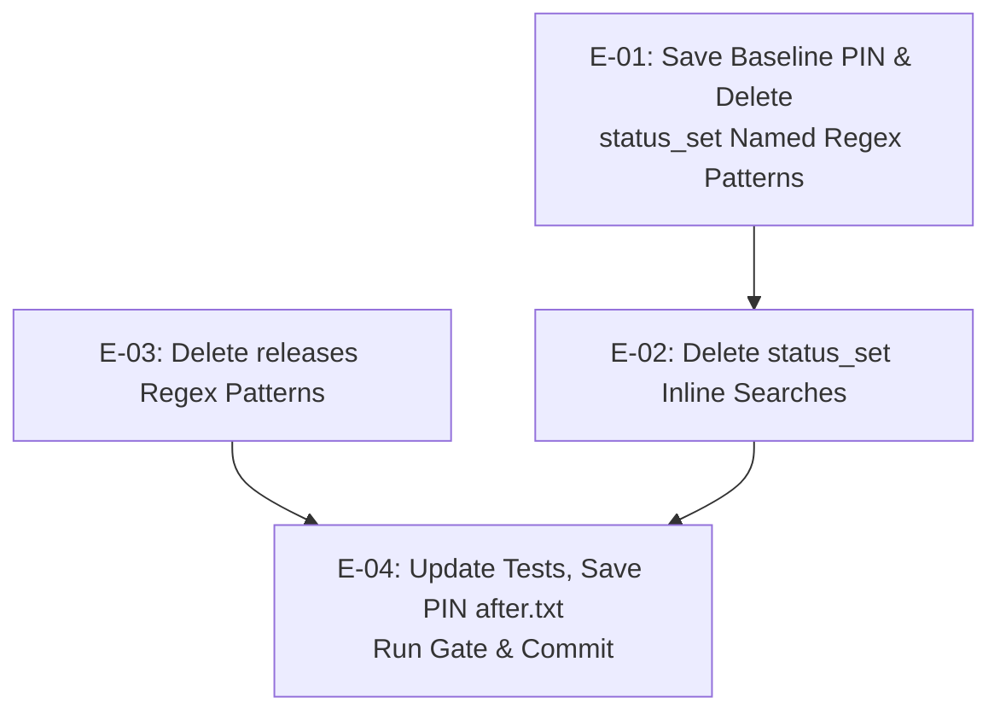

# IPD: Delete the status_set and releases metadata regex literals

- Date: 2026-11-09
- Kind: child
- Concern: Spec `4sd62s` C5 and 4.3 require deleting every `^-` metadata regex outside `artifact_meta`. `agent_workflows/status_set.py` has 10 and `agent_workflows/releases.py` has 6 (after `k6jd6l` moves the `releases` line writers). This is part 5 of the round-3 split of `e8420v` (Order 45), carrying `e8420v` E-20 minus its `tools/gate_drop_audit.py` retarget (moved to Order 239 for `_status_meta`; `backlog.parse_item` is owned by `k6jd6l` E-18).
- Scope: delete the 16 literals, each of their uses reading through `artifact_meta.read`, `read_text` or `read_at`; update `tests/test_status_set.py` and `tests/test_releases.py` only where a test names a deleted pattern. EXCLUDES every other module.
- Scope-Paths: agent_workflows/status_set.py, agent_workflows/releases.py, tests/test_status_set.py, tests/test_releases.py, .aw/records/plans/pending/20261109-metastore-243-kmf6w4-delete-the-status-set-and-releases-metadata-regex-literals.ipd.md
- Item-Dependencies: executed:1ajqaa, executed:59aiyh, executed:786w7r, executed:7uq6xg, executed:dcerjg, executed:ffceq0, executed:g5hpbb, executed:k6jd6l, executed:t4gl15
- Status: approved
- Readiness: go-pending-approval
- Review-Depth: standard
- From-Spec: 4sd62s
- Work-Kind: feature
- Priority: high
- Blocks-Release: next
- Set: metastore
- Order: 243
- Highest E allocated: 04
- Author: opencode its_direct/pt3-claude-opus-5.5-1m-us
- Id: kmf6w4
- Approval: 2026-11-16, recorded via aw ipd set: status set to approved

> Write and proofread this plan per the technical writing standard, `.aw/system/workflows/technical-writing/technical-writing.md` (`.agents/workflows/technical-writing/technical-writing.md` in a legacy-layout install), including requirement 12 (diagrams).

## Workflow history
- 2026-11-16 approved (aw set): status set to approved

- 2026-11-14 reviewed (antigravity/gemini-3.8-flash): /plan-review (antigravity/gemini-3.8-flash): APPROVE WITH REVISIONS APPLIED; PR-001, PR-002, PR-003, PR-004.
- 2026-11-09 to-review (opencode its_direct/pt3-claude-opus-5.5-1m-us): split from e8420v (round 3, research nj8zdp guidance).

## Goal

After this plan, the `^-` literal search over `status_set` and `releases` prints nothing (or only `body prose` rows), and the setters and release records behave unchanged.

## Detailed Implementation Checklist (TODO)

Execution-state rule: mark an `E-*` item complete only after performing the action. That mark is not validation. Right-sizing rule: write for a modest executor that cannot hold much in its head. Each E-item is one step (one concern, about one file, executable in one focused pass) and its V-item names each unit it covers with its own check; a plan stays at about 5 E-items and 8 work Scope-Paths, else split it into more child plans (guidance, `IPD-Z603`). Accepted execution states: blocked, failed, pending, performed; terminal gate demands 'performed'.

`e8420v` E-20 ("Delete `status_set._STATUS_RE` and its `finditer` loop and `releases._STATUS_RE`, and every other `^-` metadata regex literal in `status_set` and `releases`. Sites at the split: `status_set` (10) `_ID_RE`, `_STATUS_RE`, `_SET_RE`, `_GATE_KIND_RE`, `_GATE_REF_RE`, `_GATE_SUMMARY_RE`, the three inline searches in `_format_status_transition_line` and the `finditer` loop in `plan_priority_work_kind_problems`; `releases` (6) `_ID_RE`, `_STATUS_RE`, `_VERSION_RE`, `_SUMMARY_RE`, `_ITEM_FROM_BACKLOG_RE`, `_ITEM_GRADUATED_TO_RE` ... Update `tests/test_status_set.py` and `tests/test_releases.py` only where a test names a deleted pattern.") is split across E-01 to E-04 here. The search is `LIT` from `786w7r`.

PIN RULE (carried from `9o83cr`): before E-01, save the per-test outcome list of `tests/test_status_set.py` and `tests/test_releases.py` to `.aw/state/kmf6w4/before.txt` (ensure `.aw/state/kmf6w4/` exists via `mkdir -p .aw/state/kmf6w4/`); after E-03, the same into `after.txt`.

### Task group 1: two modules

- [ ] E-01 Before the first edit, ensure `.aw/state/kmf6w4/` exists (`mkdir -p .aw/state/kmf6w4/`) and save baseline test PIN list to `.aw/state/kmf6w4/before.txt`. In `agent_workflows/status_set.py`, delete the named patterns `status_set._ID_RE`, `_STATUS_RE` (and its `finditer` loop in `status_set.plan_priority_work_kind_problems`), `_SET_RE`, `_GATE_KIND_RE`, `_GATE_REF_RE`, `_GATE_SUMMARY_RE`.
  - Depends on: none
  - Expected outcome: `rg -n "\b(_ID_RE|_STATUS_RE|_SET_RE|_GATE_KIND_RE|_GATE_REF_RE|_GATE_SUMMARY_RE)\b" agent_workflows/status_set.py` prints nothing.
  - Execution state: pending

- [ ] E-02 In `status_set._format_status_transition_line`, delete the three inline `^-` searches.
  - Depends on: E-01
  - Expected outcome: the `LIT` search over `agent_workflows/status_set.py` prints nothing.
  - Execution state: pending

- [ ] E-03 In `agent_workflows/releases.py`, delete `releases._ID_RE`, `_STATUS_RE`, `_VERSION_RE`, `_SUMMARY_RE`, `_ITEM_FROM_BACKLOG_RE`, `_ITEM_GRADUATED_TO_RE`.
  - Depends on: none
  - Expected outcome: the `LIT` search over `agent_workflows/releases.py` prints nothing.
  - Execution state: pending

- [ ] E-04 Update `tests/test_status_set.py` and `tests/test_releases.py` only where a case names a deleted pattern, save `after.txt`, run both modules, and commit through `aw commit kmf6w4 -- <paths>` with only Scope-Paths files; never `git add -A`, a bare `git add` or `git commit -a`; never push.
  - Depends on: E-02, E-03
  - Expected outcome: both modules pass; the mapping accounts for every case.
  - Execution state: pending

## Project conventions discovered (Step 0)

- Every typed setter goes through `status_set.run_set_command`; release records are read by `releases` and resolved for `Blocks-Release: next`.
- Cite code by SYMBOL (`module.function`) or by a quoted content string, with a line number only appended to one of those and never alone (advisory `IPD-C801`).

## Findings

Measured at `ac76110f4` (`e8420v` F-26): `status_set` 10 literals with their internal uses, `releases` 6. `786w7r` F-26 re-derives them.

## Proposed changes (ordered, validatable)

1. `status_set` named patterns (E-01) and inline literals (E-02).
2. `releases` (E-03).
3. Tests and commit (E-04).

## Deferred / out of scope (with reason)

- `tools/gate_drop_audit.py` `_status_meta` retarget: Order 239.
  - Carrier: e8420v
- `tools/gate_drop_audit.py` `backlog.parse_item` retarget.
  - Carrier: k6jd6l
  - Carrier-Evidence: .aw/records/plans/executed/20261108-metastore-43-k6jd6l-fold-the-value-writers-into-artifact-meta-delete-the-writer.ipd.md

## Scope check

- Over-scope: none.
- Under-scope: none known. Size: 4 E-items, 4 work Scope-Paths.

## Required tests / validation

`tests/test_status_set.py`, `tests/test_releases.py` (PIN lists), then the bare core gate `python3 -m pytest`.

## Spec / documentation sync

No spec change; implements part of `4sd62s` 4.3.

## Open questions

### OQ-01: Are the `releases` line-writer patterns in scope?

- Blocking: no
- Status: resolved
- Owner: plan author
- Resolution or deferral rationale: No: "the `releases` line-writer patterns go with the writers in Order 43" (carried from `e8420v` E-20). Recommendation strength: strong.

## Validation and cross-check (verify before reporting done)

Validation-state rule: inspect evidence in a separate pass. Do not mark a `V-*` item complete from memory or from the matching execution checkmark. Accepted validation results: blocked, failed, pass, pending; terminal gate demands 'pass'. Runtime-demonstration reachability rule: for each `V-*` item demanding the software be observed acting (such as a run, a dispatch, or a transition), as distinct from items demanding a diff, a file's content, or a test result, which are reachable by construction, name the code path that produces the observation or the sibling `E-*` that creates it, else the demand is UNDER-SCOPE.

- [ ] V-01 validates E-01
  - Required evidence: paste the E-01 `rg` command printing nothing, and the `git diff` hunk of `status_set.plan_priority_work_kind_problems`.
  - Observed evidence:
  - Result: pending

- [ ] V-02 validates E-02
  - Required evidence: paste the `LIT` search over `agent_workflows/status_set.py` printing nothing, and the `git diff` hunk of `status_set._format_status_transition_line`.
  - Observed evidence:
  - Result: pending

- [ ] V-03 validates E-03
  - Required evidence: paste the `LIT` search over `agent_workflows/releases.py` printing nothing, and `aw attention --format json` release-blocker section unchanged against `786w7r` F-30 (hash equal or the difference traced).
  - Observed evidence:
  - Result: pending

- [ ] V-04 validates E-04
  - Required evidence: paste `diff .aw/state/kmf6w4/before.txt .aw/state/kmf6w4/after.txt` with each change mapped, the summary line of `python3 -m pytest -o addopts="" tests/test_status_set.py tests/test_releases.py` passing, and `git show --stat` of the `aw commit kmf6w4` commit listing only Scope-Paths files.
  - Observed evidence:
  - Result: pending

## Approval and execution gate

- Size assessment: standard
- Cohesion rationale: not required

Execute only after human approval (`Status: approved`) and after every plan in `- Item-Dependencies:` is executed (Order 239 first: it also edits `status_set`). Pin-first. Scope fence: the paths in `- Scope-Paths:` are a declaration; a needed file outside the fence is edited and then justified at finalize (`--scope-reason`), and a declared path left unmodified is acknowledged (`--scope-ack`). Safety stop: if prerequisite metastore symbols from `59aiyh`, `786w7r`, `7uq6xg`, `ffceq0`, `k6jd6l`, or `t4gl15` are absent upon starting, stop and report rather than creating conflicting implementations. Honesty rule: paste the ACTUAL summary lines. Commits: only through `aw commit kmf6w4 -- <paths>` with only Scope-Paths files; never `git add -A`, a bare `git add` or `git commit -a`; never push. Lifecycle: the plan moves to `.aw/records/plans/executed/` only through finalize; when `aw oc run` or `aw agy run` executes the plan, the runner performs the finalize; a hand executor runs `aw ipd finalize kmf6w4` itself; never a hand `git mv` to `executed/`.
