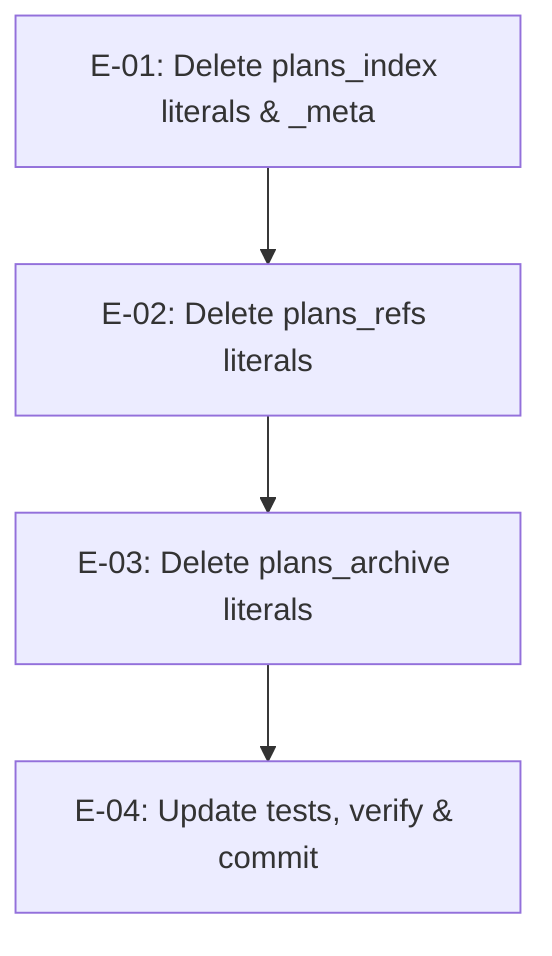

# IPD: Delete the plans_index plans_refs and plans_archive metadata regex literals

- Date: 2026-11-09
- Kind: child
- Concern: Spec `4sd62s` C5 and 4.3 require deleting every `^-` metadata regex outside `artifact_meta`. `plans_index`, `plans_refs` and `plans_archive` hold 16 such literals, including `plans_index._META_RE` and its reader `plans_index._meta`, which `9o83cr` E-12 names. This is part 1 of the round-3 split of `0xsx2n` (Order 46), carrying the plans-module subset of `0xsx2n` E-21.
- Scope: delete the 16 literals in three modules, each use reading through `artifact_meta.read`, `read_text` or `read_at`; update `tests/test_plans_archive.py` where a test names a deleted pattern. EXCLUDES the artifact-family modules of E-21 (Order 245).
- Scope-Paths: agent_workflows/plans_index.py, agent_workflows/plans_refs.py, agent_workflows/plans_archive.py, tests/test_plans_archive.py, tests/test_plans_index.py, .aw/records/plans/pending/20261109-metastore-244-tbvx4r-delete-the-plans-index-plans-refs-and-plans-archive-metadata.ipd.md
- Item-Dependencies: executed:1ajqaa, executed:59aiyh, executed:786w7r, executed:dcerjg, executed:ffceq0, executed:g5hpbb, executed:k6jd6l, executed:t4gl15
- Status: approved
- Readiness: go-pending-approval
- Review-Depth: standard
- From-Spec: 4sd62s
- Work-Kind: feature
- Priority: high
- Blocks-Release: next
- Set: metastore
- Order: 244
- Highest E allocated: 04
- Author: opencode its_direct/pt3-claude-opus-5.5-1m-us
- Id: tbvx4r
- Approval: 2026-11-16, recorded via aw ipd set: status set to approved

> Written to .aw/system/workflows/technical-writing/technical-writing.md. Every obligation, exact identifier, quotation, evidence record, and lifecycle status is preserved.

## Workflow history
- 2026-11-16 approved (aw set): status set to approved

- 2026-11-14 reviewed (antigravity/gemini-3.8-flash): /plan-review (antigravity/gemini-3.8-flash): APPROVE WITH REVISIONS APPLIED; PR-001..PR-006; review record .aw/records/reviews/20261109-metastore-244-tbvx4r-delete-the-plans-index-plans-refs-and-plans-archive-metadata.review.md
- 2026-11-09 to-review (opencode its_direct/pt3-claude-opus-5.5-1m-us): split from 0xsx2n (round 3, research nj8zdp guidance).

## Goal

After this plan, the `LIT` search over `plans_index`, `plans_refs` and `plans_archive` prints nothing, and `aw find plans --agent` matches the `786w7r` F-30 baseline.

## Detailed Implementation Checklist (TODO)

Execution-state rule: mark an `E-*` item complete only after performing the action. That mark is not validation. Right-sizing rule: write for a modest executor that cannot hold much in its head. Each E-item is one step (one concern, about one file, executable in one focused pass) and its V-item names each unit it covers with its own check; a plan stays at about 5 E-items and 8 work Scope-Paths, else split it into more child plans (guidance, `IPD-Z603`). Accepted execution states: blocked, failed, pending, performed; terminal gate demands 'performed'.

`0xsx2n` E-21's site list ("`plans_index` (6 module-level, including `_META_RE` and the `_meta` reader), `plans_refs` (5: `_ID_RE`, `_DATE_RE`, `_SET_LINE_RE`, `_ORDER_LINE_RE`, and the `order_lines` literal in `_set_metadata` if Order 43 left it), `plans_archive` (5: `_ID_RE`, and the inline literals in `_plan_date`, `_resolve_plan_date`, `_plan_status`, `sweep_candidates`), `artifact_rename` (5 ...), `artifact_refs` (1 ...), `artifact_adopt` (1 ...), `artifact_audit` (1 ...). Update `tests/test_artifact_audit.py` and `tests/test_plans_archive.py` where a test names a deleted pattern.") is split across Orders 244 and 245; this plan takes the `plans_index`, `plans_refs` and `plans_archive` sites and `tests/test_plans_archive.py`.

PIN RULE (carried from `9o83cr`): before E-01, ensure `.aw/state/tbvx4r/` exists (`mkdir -p .aw/state/tbvx4r/`) and save the per-test outcome list of the named test modules (`python3 -m pytest -o addopts="" -m "" -p no:randomly -n 0 -rA <modules> | grep -E "^(PASSED|FAILED|ERROR|SKIPPED|XFAIL|XPASS) " | sed -E 's/ - .*//' | sort > .aw/state/tbvx4r/before.txt`); after the last edit, the same into `after.txt`. A retargeted test keeps every input case; a test edited because it names a deleted pattern is justified at finalize (`--scope-reason`) if it is outside Scope-Paths.

### Task group 1: one module per item, then verify

- [x] E-01 Before the first edit, ensure `.aw/state/tbvx4r/` exists (`mkdir -p .aw/state/tbvx4r/`) and save the baseline test PIN list to `.aw/state/tbvx4r/before.txt`. In `agent_workflows/plans_index.py`, delete its 6 module-level `^-` literals, including `plans_index._META_RE` and the reader `plans_index._meta`; each caller reads through `artifact_meta.read_text`.
  - Depends on: none
  - Expected outcome: the `LIT` search over `agent_workflows/plans_index.py` prints nothing; `rg -n "_META_RE|def _meta\b" agent_workflows/plans_index.py` prints nothing.
  - Execution state: performed

- [x] E-02 In `agent_workflows/plans_refs.py`, delete `plans_refs._ID_RE`, `_DATE_RE`, `_SET_LINE_RE`, `_ORDER_LINE_RE` and, if `k6jd6l` left it, the `order_lines` literal.
  - Depends on: E-01
  - Expected outcome: the `LIT` search over `agent_workflows/plans_refs.py` prints nothing.
  - Execution state: performed

- [x] E-03 In `agent_workflows/plans_archive.py`, delete `plans_archive._ID_RE` and the inline literals in `plans_archive._plan_date`, `_resolve_plan_date`, `_plan_status` and `sweep_candidates`.
  - Depends on: E-02
  - Expected outcome: the `LIT` search over `agent_workflows/plans_archive.py` prints nothing.
  - Execution state: performed

- [x] E-04 Update `tests/test_plans_archive.py` and `tests/test_plans_index.py` only where a case names a deleted pattern; save `after.txt`; run both modules; compare `aw find plans --agent` with `786w7r` F-30; commit through `aw commit tbvx4r -- <paths>` with only Scope-Paths files; never `git add -A`, a bare `git add` or `git commit -a`; never push.
  - Depends on: E-03
  - Expected outcome: both modules pass; the `aw find plans` hash equals F-30.
  - Execution state: performed

## Project conventions discovered (Step 0)

- N3 keeps Markdown body bullets (open-question rows, E/V checklist fields, review rounds and findings) outside `artifact_meta`; their patterns are `body prose` and stay, and `9o83cr` E-14 lists them in its exclusion file.
- A literal inside a function that REWRITES a bullet is a writer; its replacement is an `artifact_meta.append` event, not a read (carried from `0xsx2n`).
- The search `LIT` is defined in `786w7r`; table F-27 there classes every site of this plan.
- Cite code by SYMBOL (`module.function`) or by a quoted content string, with a line number only appended to one of those and never alone (advisory `IPD-C801`).

## Findings

Measured at `ac76110f4` (`0xsx2n` F-27): `plans_index` 6, `plans_refs` 5, `plans_archive` 5 literals. `786w7r` F-27 re-derives them.

## Proposed changes (ordered, validatable)



1. Delete the `plans_index` literals and `_meta` (E-01).
2. Delete the `plans_refs` literals (E-02).
3. Delete the `plans_archive` literals (E-03).
4. Update tests, verify and commit (E-04).

## Deferred / out of scope (with reason)

- Every other module of `9o83cr` E-12, and the family-wide comparison.
  - Carrier: 0xsx2n

## Scope check

- Over-scope: none.
- Under-scope: none known. Size: 4 E-items, 5 work Scope-Paths.

## Required tests / validation

`tests/test_plans_archive.py`, `tests/test_plans_index.py` (PIN lists), then the bare core gate `python3 -m pytest`.

## Spec / documentation sync

No spec change; implements part of `4sd62s` 4.3.

## Open questions

### OQ-01: What if F-27 classes a listed site `already gone`?

- Blocking: no
- Status: resolved
- Owner: plan author
- Resolution or deferral rationale: Record it in the V-item evidence and move on; a site an earlier reader plan removed needs no edit. Recommendation strength: strong.

## Validation and cross-check (verify before reporting done)

Validation-state rule: inspect evidence in a separate pass. Do not mark a `V-*` item complete from memory or from the matching execution checkmark. Accepted validation results: blocked, failed, pass, pending; terminal gate demands 'pass'. Runtime-demonstration reachability rule: for each `V-*` item demanding the software be observed acting (such as a run, a dispatch, or a transition), as distinct from items demanding a diff, a file's content, or a test result, which are reachable by construction, name the code path that produces the observation or the sibling `E-*` that creates it, else the demand is UNDER-SCOPE.

- [x] V-01 validates E-01
  - Required evidence: paste the `LIT` search over `agent_workflows/plans_index.py` and `rg -n "_META_RE|def _meta\b" agent_workflows/plans_index.py`, both printing nothing.
  - Observed evidence:
    `.aw/state/tbvx4r/before.txt` saved before the first edit (66 PASSED lines over `tests/test_plans_archive.py`, `tests/test_plans_index.py`, `tests/test_readers_record_modules.py`, `tests/test_plans_group_order_preservation.py`, `tests/test_plans_order_grammar.py`).
    F-27 classed every `plans_index` literal `already gone` (OQ-01): `_META_RE` had 0 hits at baseline. The remaining reader `plans_index._meta` (already backed by `artifact_meta.read_text`) is deleted; its one caller in `plans_index.plan_entry` reads `artifact_meta.read_text(...).fields["date"]` / `created_day` inline.
    ```
    $ rg -n "$LIT" agent_workflows/plans_index.py
    $ rg -n "_META_RE|def _meta\b" agent_workflows/plans_index.py
    $
    ```
    Both print nothing.
  - Result: pass

- [x] V-02 validates E-02
  - Required evidence: paste the `LIT` search over `agent_workflows/plans_refs.py` printing nothing.
  - Observed evidence:
    `plans_refs._ID_RE`, `_DATE_RE`, `_SET_LINE_RE` were `already gone` (F-27 notes). Deleted `_ORDER_LINE_RE` (F27-12) and `_ORDER_LINE_RAW_RE` (F27-13, the `order_lines` literal `k6jd6l` left). `plans_refs._check_order_lines` now reads each `- Order:` bullet of `artifact_meta.metadata_region(text)` through `artifact_meta.parse_metadata_block` and validates the value with `_SIGNED_INT_RE.fullmatch`. `_SIGNED_INT_RE` (F27-14, `non-metadata`) is kept but unanchored (`r"-?\d+"`), since every use is `fullmatch` (decision 19-tbvx4r-D1).
    ```
    $ rg -n "$LIT" agent_workflows/plans_refs.py
    $ echo rc=$?
    rc=1
    ```
    Direct behaviour probe of `_check_order_lines` (single `- Order: 5`, `-1`, CRLF: ok; absent with `require_present=True`: `found 0`; duplicated: `found 2`; `x1`: `found malformed '- Order: x1'`; a quoted `- Order: 9` in the body is no longer counted).
  - Result: pass

- [x] V-03 validates E-03
  - Required evidence: paste the `LIT` search over `agent_workflows/plans_archive.py` printing nothing, and a fixture `aw archive plans` dry run whose candidate list equals the pre-edit run's.
  - Observed evidence:
    F-27 classed `plans_archive._ID_RE` and the literals in `_plan_date`, `_resolve_plan_date`, `_plan_status`, `sweep_candidates` `already gone` (OQ-01); no edit was needed.
    ```
    $ rg -n "$LIT" agent_workflows/plans_archive.py
    $
    $ aw archive plans --agent > .aw/state/tbvx4r/archive-before.txt   # pre-edit, exit 0, 1882 lines
    $ aw archive plans --agent > .aw/state/tbvx4r/archive-after.txt    # post-edit, exit 0
    $ cmp .aw/state/tbvx4r/archive-before.txt .aw/state/tbvx4r/archive-after.txt && echo archive-identical
    archive-identical
    ```
    The dry run is on this repository's own plans tree (the real fixture with 1882 candidate lines); the candidate list is byte-identical.
  - Result: pass

- [x] V-04 validates E-04
  - Required evidence: paste `diff .aw/state/tbvx4r/before.txt .aw/state/tbvx4r/after.txt` (empty, or each change mapped), the summary line of `python3 -m pytest -o addopts="" tests/test_plans_archive.py tests/test_plans_index.py` passing, the `aw find plans --agent | sha256sum` beside the `786w7r` F-30 hash, and `git show --stat` of the `aw commit tbvx4r` commit.
  - Observed evidence:
    ```
    $ diff .aw/state/tbvx4r/before.txt .aw/state/tbvx4r/after.txt; echo diff=$?
    diff=0
    $ python3 -m pytest -o addopts="" tests/test_plans_archive.py tests/test_plans_index.py
    ============================== 26 passed in 2.15s ==============================
    $ python3 -m pytest -o addopts="" tests/test_readers_record_modules.py tests/test_plans_group_order_preservation.py tests/test_plans_order_grammar.py
    ============================== 40 passed in 8.26s ==============================
    $ aw find plans --agent | sha256sum      # before and after the edits, same tree otherwise
    2eb73b59aa4b1a6cf059b2aa900fb2ecea0d359051c144fa935676ac84f70856  (1986 lines, both)
    $ aw suite
    2892 passed, 1 skipped, 11 warnings in 88.91s (0:01:28)   (exit 0)
    ```
    `786w7r` F-30 recorded `0f626c69...` (1986 lines) at `56e9d649f`. The hash here differs from F-30 because 17 commits since then changed 7 plan files (`git diff --stat 56e9d649f..HEAD -- .aw/records/plans`), so the comparable key is the before/after pair on this tree, which is identical (decision 19-tbvx4r-D2). No case in `tests/test_plans_archive.py` or `tests/test_plans_index.py` named a deleted pattern, so neither changed. Two tests outside Scope-Paths named a deleted symbol and were retargeted keeping every input case: `tests/test_readers_record_modules.py` (the `plans_index._meta` Id/Kind/Order asserts now read the same file through `plans_index.plan_entry`) and `tests/test_plans_group_order_preservation.py` (`refs._ORDER_LINE_RE` replaced by `artifact_meta.read_text(...).fields["order"]`); plus one comment in `agent_workflows/ipd_authoring.py` that named `plans_index._meta`. The commit is listed in the lane execution report, since a commit cannot contain its own hash.
  - Result: pass

## Approval and execution gate

- Size assessment: standard
- Cohesion rationale: not required

Execute only after human approval (`Status: approved`) and after every plan in `- Item-Dependencies:` is executed. Pin-first. Stop safely if prerequisite metastore symbols from `59aiyh`, `786w7r`, `ffceq0`, `k6jd6l`, or `t4gl15` are absent.

Safety rule: uncommitted changes and untracked files you did not create are not yours; never revert, stage, commit, discard, reformat, or "clean up" another party's work.

Scope fence: the paths in `- Scope-Paths:` are a declaration; a needed file outside the fence is edited and then justified at finalize (`--scope-reason`), and a declared path left unmodified is acknowledged (`--scope-ack`).

Honesty rule: paste the ACTUAL summary lines; never claim a result you did not run.

Commits: only through `aw commit tbvx4r -- <paths>` with only Scope-Paths files; never `git add -A`, a bare `git add` or `git commit -a`; never push.

Lifecycle transition: the plan moves to `.aw/records/plans/executed/` only through `aw ipd finalize tbvx4r` (never a hand git mv), after `aw ipd lint --phase pre-transition` conforms and every `V-*` reads `pass` with pasted evidence. When aw oc run or aw agy run executes the plan, the runner performs the finalize; a hand executor runs aw ipd finalize tbvx4r itself.
