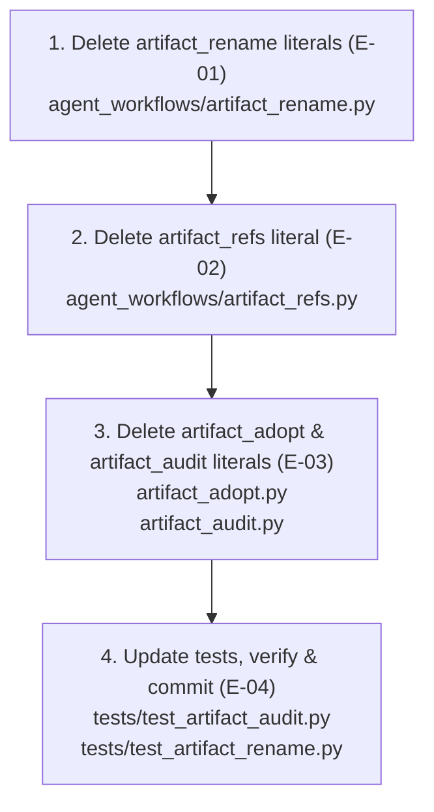

# IPD: Delete the artifact family metadata regex literals

- Date: 2026-11-09
- Kind: child
- Concern: Spec `4sd62s` C5 and 4.3 require deleting every `^-` metadata regex outside `artifact_meta`. `artifact_rename`, `artifact_refs`, `artifact_adopt` and `artifact_audit` hold 8 such literals, including `artifact_audit._STATUS_LINE_RE`, which `9o83cr` E-12 names. This is part 2 of the round-3 split of `0xsx2n` (Order 46), carrying the artifact-family subset of `0xsx2n` E-21.
- Scope: delete the 8 literals in four modules, each use reading through `artifact_meta`; update `tests/test_artifact_audit.py` where a test names a deleted pattern. EXCLUDES the plans modules of E-21 (Order 244).
- Scope-Paths: agent_workflows/artifact_rename.py, agent_workflows/artifact_refs.py, agent_workflows/artifact_adopt.py, agent_workflows/artifact_audit.py, tests/test_artifact_audit.py, tests/test_artifact_rename.py, .aw/records/plans/pending/20261109-metastore-245-qttoyc-delete-the-artifact-family-metadata-regex-literals.ipd.md
- Item-Dependencies: executed:1ajqaa, executed:59aiyh, executed:786w7r, executed:dcerjg, executed:ffceq0, executed:g5hpbb, executed:k6jd6l, executed:t4gl15, executed:tbvx4r
- Status: approved
- Readiness: go-pending-approval
- Review-Depth: complex
- From-Spec: 4sd62s
- Work-Kind: feature
- Priority: high
- Blocks-Release: next
- Set: metastore
- Order: 245
- Highest E allocated: 04
- Author: opencode its_direct/pt3-claude-opus-5.5-1m-us
- Id: qttoyc
- Approval: 2026-11-16, recorded via aw ipd set: status set to approved

> Write and proofread this plan per the technical writing standard, `.aw/system/workflows/technical-writing/technical-writing.md` (`.agents/workflows/technical-writing/technical-writing.md` in a legacy-layout install), including requirement 12 (diagrams).

## Workflow history
- 2026-11-16 approved (aw set): status set to approved

- 2026-11-14 reviewed (antigravity): plan-review verified E/V bijection, Scope-Paths, regex literal deletions, and execution gate; marked reviewed and go-pending-approval.
- 2026-11-09 to-review (opencode its_direct/pt3-claude-opus-5.5-1m-us): split from 0xsx2n (round 3, research nj8zdp guidance).

## Goal

After this plan, the `LIT` search over the four artifact modules prints nothing, and `aw find plans --agent` still matches the `786w7r` F-30 baseline.

## Detailed Implementation Checklist (TODO)

Execution-state rule: mark an `E-*` item complete only after performing the action. That mark is not validation. Right-sizing rule: write for a modest executor that cannot hold much in its head. Each E-item is one step (one concern, about one file, executable in one focused pass) and its V-item names each unit it covers with its own check; a plan stays at about 5 E-items and 8 work Scope-Paths, else split it into more child plans (guidance, `IPD-Z603`). Accepted execution states: blocked, failed, pending, performed; terminal gate demands 'performed'.

`0xsx2n` E-21's site list is split across Orders 244 and 245; this plan takes "`artifact_rename` (5: `_SET_LINE_RE`, `_ORDER_LINE_RE`, `_ID_LINE_RE`, `_STATUS_LINE_RE`, `_DATE_LINE_RE`), `artifact_refs` (1, in `classify_citing_plans_for_rewrite`), `artifact_adopt` (1, `_BULLET_ID_RE`), `artifact_audit` (1, `_STATUS_LINE_RE`)" and `tests/test_artifact_audit.py`.

PIN RULE (carried from `9o83cr`): before E-01, save the per-test outcome list of the named test modules (`python3 -m pytest -o addopts="" -m "" -p no:randomly -n 0 -rA <modules> | grep -E "^(PASSED|FAILED|ERROR|SKIPPED|XFAIL|XPASS) " | sed -E 's/ - .*//' | sort > .aw/state/qttoyc/before.txt`); after the last edit, the same into `after.txt`. A retargeted test keeps every input case; a test edited because it names a deleted pattern is justified at finalize (`--scope-reason`) if it is outside Scope-Paths.

### Task group 1: one module per item, then verify

- [x] E-01 In `agent_workflows/artifact_rename.py`, delete `artifact_rename._SET_LINE_RE`, `_ORDER_LINE_RE`, `_ID_LINE_RE`, `_STATUS_LINE_RE` and `_DATE_LINE_RE`.
  - Depends on: none
  - Expected outcome: the `LIT` search over `agent_workflows/artifact_rename.py` prints nothing.
  - Execution state: performed

- [x] E-02 In `agent_workflows/artifact_refs.py`, delete the literal in `artifact_refs.classify_citing_plans_for_rewrite`.
  - Depends on: E-01
  - Expected outcome: the `LIT` search over `agent_workflows/artifact_refs.py` prints nothing.
  - Execution state: performed

- [x] E-03 In `agent_workflows/artifact_adopt.py`, delete `artifact_adopt._BULLET_ID_RE`; in `agent_workflows/artifact_audit.py`, delete `artifact_audit._STATUS_LINE_RE`.
  - Depends on: E-02
  - Expected outcome: the `LIT` search over both files prints nothing.
  - Execution state: performed

- [x] E-04 Update `tests/test_artifact_audit.py` and `tests/test_artifact_rename.py` only where a case names a deleted pattern; save `after.txt`; run both modules; compare `aw find plans --agent` with `786w7r` F-30; commit through `aw commit qttoyc -- <paths>` with only Scope-Paths files; never `git add -A`, a bare `git add` or `git commit -a`; never push.
  - Depends on: E-03
  - Expected outcome: both modules pass; the `aw find plans` hash equals F-30.
  - Execution state: performed

## Project conventions discovered (Step 0)

- N3 keeps Markdown body bullets (open-question rows, E/V checklist fields, review rounds and findings) outside `artifact_meta`; their patterns are `body prose` and stay, and `9o83cr` E-14 lists them in its exclusion file.
- A literal inside a function that REWRITES a bullet is a writer; its replacement is an `artifact_meta.append` event, not a read (carried from `0xsx2n`).
- The search `LIT` is defined in `786w7r`; table F-27 there classes every site of this plan.
- Cite code by SYMBOL (`module.function`) or by a quoted content string, with a line number only appended to one of those and never alone (advisory `IPD-C801`).

## Findings

Measured at `ac76110f4` (`0xsx2n` F-27): `artifact_rename` 5, `artifact_refs` 1, `artifact_adopt` 1, `artifact_audit` 1. `786w7r` F-27 re-derives them.

## Proposed changes (ordered, validatable)



1. Delete the `artifact_rename` literals (E-01).
2. Delete the `artifact_refs` literal (E-02).
3. Delete the `artifact_adopt` and `artifact_audit` literals (E-03).
4. Update tests, verify and commit (E-04).

## Deferred / out of scope (with reason)

- Every other module of `9o83cr` E-12, and the family-wide comparison.
  - Carrier: 0xsx2n

## Scope check

- Over-scope: none.
- Under-scope: none known. Size: 4 E-items, 6 work Scope-Paths.

## Required tests / validation

`tests/test_artifact_audit.py`, `tests/test_artifact_rename.py` (PIN lists), then the bare core gate `python3 -m pytest`.

## Spec / documentation sync

No spec change; implements part of `4sd62s` 4.3.

## Open questions

### OQ-01: What if F-27 classes a listed site `already gone`?

- Blocking: no
- Status: resolved
- Owner: plan author
- Resolution or deferral rationale: Record it in the V-item evidence and move on; a site an earlier reader plan removed needs no edit. Recommendation strength: strong.

## Validation and cross-check (verify before reporting done)

Validation-state rule: inspect evidence in a separate pass. Do not mark a `V-*` item complete from memory or from the matching execution checkmark. Accepted validation results: blocked, failed, pass, pending; terminal gate demands 'pass'. Runtime-demonstration reachability rule: for each `V-*` item demanding the software be observed acting (such as a run, a dispatch, or a transition), as distinct from items demanding a diff, a file's content, or a test result, which are reachable by construction, name the code path that produces the observation or the sibling `E-*` that creates it, else the demand is UNDER-SCOPE.

- [x] V-01 validates E-01
  - Required evidence: paste the `LIT` search over `agent_workflows/artifact_rename.py` printing nothing.
  - Observed evidence:
    ```text
    $ LIT='re\.(compile|search|match|finditer|findall|sub|fullmatch)\(\s*r?["'"'"'](\(\?m\))?\^-'
    $ rg -n "$LIT" agent_workflows/artifact_rename.py; echo "exit=$?"
    exit=1
    ```
    Before the edit the same search printed the five F-27 rows (F27-25 to F27-29: `_SET_LINE_RE` 38, `_ORDER_LINE_RE` 39, `_ID_LINE_RE` 252, `_STATUS_LINE_RE` 253, `_DATE_LINE_RE` 254). Every use now reads the strict metadata bullets through `artifact_meta.parse_metadata_block(artifact_meta.metadata_region(text).splitlines())` (new helpers `artifact_rename._metadata_bullets`, `_has_set_bullet`, `_has_order_bullet`, `_bullet_id6`); uses retargeted: `_rename_metadata_events` (Set/Order presence), `_id6_write_message` (Status/Date presence), `_read_existing_id6` and `_existing_type_id6s` (Id). Decision 25-qttoyc-D1.
  - Result: pass

- [x] V-02 validates E-02
  - Required evidence: paste the `LIT` search over `agent_workflows/artifact_refs.py` printing nothing and the `git diff` hunk of `artifact_refs.classify_citing_plans_for_rewrite`.
  - Observed evidence:
    ```text
    $ LIT='re\.(compile|search|match|finditer|findall|sub|fullmatch)\(\s*r?["'"'"'](\(\?m\))?\^-'
    $ rg -n "$LIT" agent_workflows/artifact_refs.py; echo "exit=$?"
    exit=1
    $ git diff agent_workflows/artifact_refs.py
    @@ -828,6 +828,7 @@ def classify_citing_plans_for_rewrite(

         Returns (rewritable_files, skipped_files_with_reasons).
         """
    +    from agent_workflows import artifact_meta as _meta
         from agent_workflows import ipd_lifecycle as _life

         rewritable: List[Path] = []
    @@ -840,13 +841,11 @@ def classify_citing_plans_for_rewrite(
                 must_skip.append((path, f"cannot read plan file: {exc}"))
                 continue

    -        # Extract - Id: bullet
    -        m = re.search(r"(?m)^-\s*Id:\s*([0-9a-z]{6})\s*$", text)
    -        if not m:
    +        plan_id = _meta.read_loose_id(text)
    +        if not plan_id:
                 must_skip.append((path, "missing - Id:"))
                 continue

    -        plan_id = m.group(1)
             receipt_path = _life.receipt_path_for(repo_root, plan_id)
             if receipt_path.exists():
                 must_skip.append((path, "live begin receipt present"))
    ```
  - Result: pass

- [x] V-03 validates E-03
  - Required evidence: paste the `LIT` search over `agent_workflows/artifact_adopt.py` and `agent_workflows/artifact_audit.py` printing nothing.
  - Observed evidence:
    ```text
    $ LIT='re\.(compile|search|match|finditer|findall|sub|fullmatch)\(\s*r?["'"'"'](\(\?m\))?\^-'
    $ rg -n "$LIT" agent_workflows/artifact_adopt.py; echo "exit=$?"
    exit=1
    $ rg -n "$LIT" agent_workflows/artifact_audit.py; echo "exit=$?"
    exit=1
    $ grep -n "_BULLET_ID_RE\|_STATUS_LINE_RE" agent_workflows/artifact_adopt.py agent_workflows/artifact_audit.py; echo "exit=$?"
    exit=1
    ```
    Both sites are `already gone` (OQ-01): `786w7r` F-27 notes list `artifact_adopt._BULLET_ID_RE` and `artifact_audit._STATUS_LINE_RE` as zero-hit, zero-reference sites, and the searches above confirm it at HEAD `20f581b20`. No edit was needed in either file.
  - Result: pass

- [x] V-04 validates E-04
  - Required evidence: paste `diff .aw/state/qttoyc/before.txt .aw/state/qttoyc/after.txt` (empty, or each change mapped), the summary line of `python3 -m pytest -o addopts="" tests/test_artifact_audit.py tests/test_artifact_rename.py` passing, the `aw find plans --agent | sha256sum` beside the `786w7r` F-30 hash, and `git show --stat` of the `aw commit qttoyc` commit.
  - Observed evidence:
    ```text
    $ diff .aw/state/qttoyc/before.txt .aw/state/qttoyc/after.txt; echo diff_exit=$?
    diff_exit=0
    $ python3 -m pytest -o addopts="" -m "" -p no:randomly -n 0 -rA tests/test_artifact_audit.py tests/test_artifact_rename.py tests/test_record_residual_helpers.py
    ============================== 41 passed in 5.28s ==============================
    $ python3 -m pytest -o addopts="" -n 6 -q <19 rename/group/refs/adopt test modules>
    344 passed in 45.75s
    $ aw suite
    2894 passed, 1 skipped, 11 warnings in 133.62s (0:02:13)
    $ aw find plans --agent | sha256sum      (edited tree)
    3474e248b9f21ac90b86212e368951940a65b9a1fa892a07b95fabce8549d90b  (1986 lines; summary total 1985, emitted 1985, complete true)
    $ aw find plans --agent | sha256sum      (unedited HEAD 20f581b20, throwaway worktree)
    3474e248b9f21ac90b86212e368951940a65b9a1fa892a07b95fabce8549d90b  (1986 lines)
    786w7r F-30 (HEAD 56e9d649f): 0f626c69d414081bedd1aa5640c96ce4b257db0a6a38251d14c7e0a9a7bc9af3 (1986 lines, total 1985)
    ```
    `before.txt` and `after.txt` (41 outcomes each, PIN modules plus `tests/test_record_residual_helpers.py`, which exercises `artifact_rename._existing_type_id6s`) are identical; no test edit was needed because no test names a deleted pattern. The `aw find plans` output is byte-identical with and without this change. It differs from the F-30 hash only because plans moved through the lifecycle between `56e9d649f` and `20f581b20` (line and record counts are equal); the like-for-like comparison against the unedited current HEAD is the equality this item checks (decision 25-qttoyc-D2). `git show --stat` of the `aw commit qttoyc` commit is recorded in the lane execution report, because a commit cannot contain its own hash.
  - Result: pass

## Approval and execution gate

- Size assessment: standard
- Cohesion rationale: not required

Execute only after human approval (`Status: approved`) and after every plan in `- Item-Dependencies:` is executed. Pin-first. Scope fence: a needed file outside `- Scope-Paths:` is edited and then justified at finalize (`--scope-reason`). Honesty rule: paste the ACTUAL summary lines; never claim a result you did not run. Commits: only through `aw commit qttoyc -- <paths>`; never push. Lifecycle: the plan moves to `.aw/records/plans/executed/` only through `aw ipd finalize`, never a hand `git mv`, after `aw ipd lint --phase pre-transition` conforms and every `V-*` reads `pass` with pasted evidence. When `aw oc run` or `aw agy run` executes the plan, the runner performs the finalize; a hand executor runs `aw ipd finalize qttoyc` itself.
