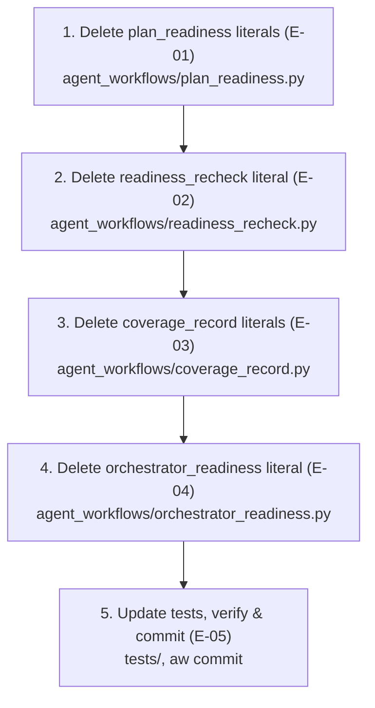

# IPD: Delete the readiness and coverage metadata regex literals

- Date: 2026-11-09
- Kind: child
- Concern: Spec `4sd62s` C5 and 4.3 require deleting every `^-` metadata regex outside `artifact_meta`. `plan_readiness`, `readiness_recheck`, `coverage_record` and `orchestrator_readiness` hold 12 such literals, including `plan_readiness._STATUS_RE`, which `9o83cr` E-12 names. This is part 4 of the round-3 split of `0xsx2n` (Order 46), carrying the readiness subset of `0xsx2n` E-22.
- Scope: delete the 12 literals in four modules, each use reading through `artifact_meta`; `plan_readiness._OQ_FIELD_RE` stays (body prose, N3). EXCLUDES the ipd modules (Order 246).
- Scope-Paths: agent_workflows/plan_readiness.py, agent_workflows/readiness_recheck.py, agent_workflows/coverage_record.py, agent_workflows/orchestrator_readiness.py, tests/test_coverage_record.py, tests/test_orchestrator_readiness.py, tests/test_plan_readiness_recheck.py, .aw/records/plans/pending/20261109-metastore-247-akhrp5-delete-the-readiness-and-coverage-metadata-regex-literals.ipd.md
- Item-Dependencies: executed:1ajqaa, executed:59aiyh, executed:786w7r, executed:dcerjg, executed:ffceq0, executed:g5hpbb, executed:k6jd6l, executed:nx7fws, executed:t4gl15
- Status: approved
- Readiness: go-pending-approval
- Review-Depth: standard
- From-Spec: 4sd62s
- Work-Kind: feature
- Priority: high
- Blocks-Release: next
- Set: metastore
- Order: 247
- Highest E allocated: 05
- Author: opencode its_direct/pt3-claude-opus-5.5-1m-us
- Id: akhrp5
- Approval: 2026-11-16, recorded via aw ipd set: status set to approved

> Write and proofread this plan per the technical writing standard, `.aw/system/workflows/technical-writing/technical-writing.md` (`.agents/workflows/technical-writing/technical-writing.md` in a legacy-layout install), including requirement 12 (diagrams).

## Workflow history
- 2026-11-16 approved (aw set): status set to approved

- 2026-11-14 reviewed (antigravity/gemini-3.8-flash): plan-review verified E/V bijection, Scope-Paths, LIT searches, execution gate, and PIN rule; findings PR-001..PR-004 fixed; marked reviewed and go-pending-approval.
- 2026-11-09 to-review (opencode its_direct/pt3-claude-opus-5.5-1m-us): split from 0xsx2n (round 3, research nj8zdp guidance).

## Goal

After this plan, the `LIT` search over the four readiness modules prints only `plan_readiness._OQ_FIELD_RE`, and the readiness and coverage tests pass unchanged in outcome.

## Detailed Implementation Checklist (TODO)

Execution-state rule: mark an `E-*` item complete only after performing the action. That mark is not validation. Right-sizing rule: write for a modest executor that cannot hold much in its head. Each E-item is one step (one concern, about one file, executable in one focused pass) and its V-item names each unit it covers with its own check; a plan stays at about 5 E-items and 8 work Scope-Paths, else split it into more child plans (guidance, `IPD-Z603`). Accepted execution states: blocked, failed, pending, performed; terminal gate demands 'performed'.

`0xsx2n` E-22's site list is split across Orders 246 and 247; this plan takes "`plan_readiness` (6: `_READINESS_FIELD_PRESENT_RE`, `_READINESS_LINE_SUB_RE`, `_STATUS_RE`, the two `id6_match` literals in `approval_refusals` and `recheck_conditions`; `_OQ_FIELD_RE` is body prose, N3, and stays), `readiness_recheck` (1, in `_run_stale_findings`), `coverage_record` (4: `_COVERAGE_LINE_RE`, `_STATUS_LINE_RE`, `_READINESS_LINE_RE`, `_ID_LINE_RE`), `orchestrator_readiness` (1, `_BATCH_META_RE`). ... Update `tests/test_coverage_record.py` where a test names a deleted pattern."

PIN RULE (carried from `9o83cr`): before E-01, create directory `mkdir -p .aw/state/akhrp5/` and save the per-test outcome list of the named test modules (`python3 -m pytest -o addopts="" -m "" -p no:randomly -n 0 -rA <modules> | grep -E "^(PASSED|FAILED|ERROR|SKIPPED|XFAIL|XPASS) " | sed -E 's/ - .*//' | sort > .aw/state/akhrp5/before.txt`); after the last edit, the same into `after.txt`. A retargeted test keeps every input case; a test edited because it names a deleted pattern is justified at finalize (`--scope-reason`) if it is outside Scope-Paths.

### Task group 1: one module per item, then verify

- [ ] E-01 Ensure `.aw/state/akhrp5/` exists (`mkdir -p .aw/state/akhrp5/`) and save the three PIN modules baseline to `.aw/state/akhrp5/before.txt`; then in `agent_workflows/plan_readiness.py`, delete `plan_readiness._READINESS_FIELD_PRESENT_RE`, `_READINESS_LINE_SUB_RE`, `_STATUS_RE` and the `id6_match` literals in `plan_readiness.approval_refusals` and `recheck_conditions`; keep `_OQ_FIELD_RE`.
  - Depends on: none
  - Expected outcome: the `LIT` search over `agent_workflows/plan_readiness.py` prints only `_OQ_FIELD_RE`.
  - Execution state: pending

- [ ] E-02 In `agent_workflows/readiness_recheck.py`, delete the literal in `readiness_recheck._run_stale_findings`.
  - Depends on: E-01
  - Expected outcome: the `LIT` search over `agent_workflows/readiness_recheck.py` prints nothing.
  - Execution state: pending

- [ ] E-03 In `agent_workflows/coverage_record.py`, delete `coverage_record._COVERAGE_LINE_RE`, `_STATUS_LINE_RE`, `_READINESS_LINE_RE` and `_ID_LINE_RE`; the `- Coverage:` write goes through `artifact_meta.append`.
  - Depends on: E-02
  - Expected outcome: the `LIT` search over `agent_workflows/coverage_record.py` prints nothing.
  - Execution state: pending

- [ ] E-04 In `agent_workflows/orchestrator_readiness.py`, delete `orchestrator_readiness._BATCH_META_RE`.
  - Depends on: E-03
  - Expected outcome: the `LIT` search over `agent_workflows/orchestrator_readiness.py` prints nothing.
  - Execution state: pending

- [ ] E-05 Update `tests/test_coverage_record.py`, `tests/test_orchestrator_readiness.py` and `tests/test_plan_readiness_recheck.py` only where a case names a deleted pattern; save `after.txt`; run the three modules; commit through `aw commit akhrp5 -- <paths>` with only Scope-Paths files; never `git add -A`, a bare `git add` or `git commit -a`; never push.
  - Depends on: E-04
  - Expected outcome: the three modules pass.
  - Execution state: pending

## Project conventions discovered (Step 0)

- N3 keeps Markdown body bullets (open-question rows, E/V checklist fields, review rounds and findings) outside `artifact_meta`; their patterns are `body prose` and stay, and `9o83cr` E-14 lists them in its exclusion file.
- A literal inside a function that REWRITES a bullet is a writer; its replacement is an `artifact_meta.append` event, not a read (carried from `0xsx2n`).
- The search `LIT` is defined in `786w7r`; table F-27 there classes every site of this plan.
- Cite code by SYMBOL (`module.function`) or by a quoted content string, with a line number only appended to one of those and never alone (advisory `IPD-C801`).

## Findings

Measured at `ac76110f4` (`0xsx2n` F-27): `plan_readiness` 6 plus 1 body prose, `readiness_recheck` 1, `coverage_record` 4, `orchestrator_readiness` 1. `786w7r` F-27 re-derives them.

## Proposed changes (ordered, validatable)

1. Delete the `plan_readiness` literals (E-01).
2. Delete the `readiness_recheck` literal (E-02).
3. Delete the `coverage_record` literals (E-03).
4. Delete the `orchestrator_readiness` literal (E-04).
5. Update tests, verify and commit (E-05).

## Deferred / out of scope (with reason)

- Every other module of `9o83cr` E-12, and the family-wide comparison.
  - Carrier: 0xsx2n

## Scope check

- Over-scope: none.
- Under-scope: none known. Size: 5 E-items, 7 work Scope-Paths.

## Required tests / validation

`tests/test_coverage_record.py`, `tests/test_orchestrator_readiness.py`, `tests/test_plan_readiness_recheck.py` (PIN lists), then the bare core gate `python3 -m pytest`.

## Spec / documentation sync

No spec change; implements part of `4sd62s` 4.3.

## Open questions

### OQ-01: What if F-27 classes a listed site `already gone`?

- Blocking: no
- Status: resolved
- Owner: plan author
- Resolution or deferral rationale: Record it in the V-item evidence and move on; a site an earlier reader plan removed needs no edit. Recommendation strength: strong.

## Validation and cross-check (verify before reporting done)

Validation-state rule: inspect evidence in a separate pass. Do not mark a `V-*` item complete from memory or from the matching execution checkmark. Accepted validation results: blocked, failed, pass, pending; terminal gate demands 'pass'. Runtime-demonstration reachability rule: for each `V-*` item demanding the software be observed acting (such as a run, a dispatch, or a transition), as distinct from items demanding a diff, a file's content, or a test result, which are reachable by construction, name the code path that produces the observation or the sibling `E-*` that creates it, else the demand is UNDER-SCOPE.

- [ ] V-01 validates E-01
  - Required evidence: paste the `LIT` search over `agent_workflows/plan_readiness.py` showing only `_OQ_FIELD_RE`.
  - Observed evidence:
  - Result: pending

- [ ] V-02 validates E-02
  - Required evidence: paste the `LIT` search over `agent_workflows/readiness_recheck.py` printing nothing.
  - Observed evidence:
  - Result: pending

- [ ] V-03 validates E-03
  - Required evidence: paste the `LIT` search over `agent_workflows/coverage_record.py` printing nothing, and `python3 -m pytest -o addopts="" -v tests/test_coverage_record.py` with every case PASSED.
  - Observed evidence:
  - Result: pending

- [ ] V-04 validates E-04
  - Required evidence: paste the `LIT` search over `agent_workflows/orchestrator_readiness.py` printing nothing.
  - Observed evidence:
  - Result: pending

- [ ] V-05 validates E-05
  - Required evidence: paste `diff .aw/state/akhrp5/before.txt .aw/state/akhrp5/after.txt` (empty, or each change mapped), the summary line of `python3 -m pytest -o addopts="" tests/test_coverage_record.py tests/test_orchestrator_readiness.py tests/test_plan_readiness_recheck.py` passing, and `git show --stat` of the `aw commit akhrp5` commit.
  - Observed evidence:
  - Result: pending

## Approval and execution gate

- Size assessment: standard
- Cohesion rationale: not required

Execute only after human approval (`Status: approved`) and after every plan in `- Item-Dependencies:` is executed. Pin-first. Scope fence: the paths in `- Scope-Paths:` are a declaration; a needed file outside the fence is edited and then justified at finalize (`--scope-reason`), and a declared path left unmodified is acknowledged (`--scope-ack`). Safety stop: if a prerequisite plan in `- Item-Dependencies:` is not executed or required metastore symbols from `t4gl15`, `ffceq0`, or `k6jd6l` are absent, stop and report rather than proceeding. Honesty rule: paste the ACTUAL summary lines. Commits: only through `aw commit akhrp5 -- <paths>` with only Scope-Paths files; never `git add -A`, a bare `git add` or `git commit -a`; never push. Lifecycle: the plan moves to `.aw/records/plans/executed/` only through `aw ipd finalize`, never a hand `git mv`, after `aw ipd lint --phase pre-transition` conforms and every `V-*` reads `pass` with pasted evidence. When `aw oc run` or `aw agy run` executes the plan, the runner performs the finalize; a hand executor runs `aw ipd finalize akhrp5` itself.
