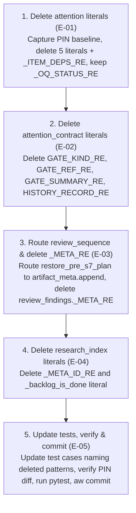

# IPD: Delete the attention review and research metadata regex literals

- Date: 2026-11-09
- Kind: child
- Concern: Spec `4sd62s` C5 and 4.3 require deleting every `^-` metadata regex outside `artifact_meta`. `attention`, `attention_contract`, `review_sequence`, `review_findings` and `research_index` hold 17 such literals, including `review_findings._META_RE`, which `9o83cr` E-12 names; the two in `review_sequence.restore_pre_s7_plan` are a WRITER. This is part 5 of the round-3 split of `0xsx2n` (Order 46), carrying `0xsx2n` E-23 verbatim.
- Scope: delete the 17 literals in five modules; `attention._OQ_STATUS_RE` and the `review_findings` round and finding grammar stay (N3). EXCLUDES every other module.
- Scope-Paths: agent_workflows/attention.py, agent_workflows/attention_contract.py, agent_workflows/review_sequence.py, agent_workflows/review_findings.py, agent_workflows/research_index.py, tests/test_review_findings_gate.py, tests/test_attention.py, tests/test_review_sequence.py, .aw/records/plans/pending/20261109-metastore-248-tdhav3-delete-the-attention-review-and-research-metadata-regex-lite.ipd.md
- Item-Dependencies: executed:1ajqaa, executed:59aiyh, executed:786w7r, executed:dcerjg, executed:ffceq0, executed:g5hpbb, executed:k6jd6l, executed:t4gl15
- Status: reviewed
- Readiness: go-pending-approval
- Review-Depth: standard
- From-Spec: 4sd62s
- Work-Kind: feature
- Priority: high
- Blocks-Release: next
- Set: metastore
- Order: 248
- Highest E allocated: 05
- Author: opencode its_direct/pt3-claude-opus-5.5-1m-us
- Id: tdhav3

> Written to .aw/system/workflows/technical-writing/technical-writing.md. Every obligation, exact identifier, quotation, evidence record, and lifecycle status is preserved.

## Workflow history

- 2026-11-14 reviewed (antigravity/gemini-3.8-flash): /plan-review APPROVE WITH REVISIONS APPLIED; PR-001..PR-005 FIXED; review record .aw/records/reviews/20261109-metastore-248-tdhav3-delete-the-attention-review-and-research-metadata-regex-lite.review.md
- 2026-11-09 to-review (opencode its_direct/pt3-claude-opus-5.5-1m-us): split from 0xsx2n (round 3, research nj8zdp guidance).

## Goal

After this plan, the `LIT` search over the five modules prints only `body prose` rows, and `aw attention --format json` matches the `786w7r` F-30 baseline.

## Detailed Implementation Checklist (TODO)

Execution-state rule: mark an `E-*` item complete only after performing the action. That mark is not validation. Right-sizing rule: write for a modest executor that cannot hold much in its head. Each E-item is one step (one concern, about one file, executable in one focused pass) and its V-item names each unit it covers with its own check; a plan stays at about 5 E-items and 8 work Scope-Paths, else split it into more child plans (guidance, `IPD-Z603`). Accepted execution states: blocked, failed, pending, performed; terminal gate demands 'performed'.

`0xsx2n` E-23 ("Sites at the split (17 literals): `attention` (8: `_ITEM_DEPS_RE` and the literals in `_plans_id`, `_release_record` (2), `_spec_record`, `_plans_record` (2); `_OQ_STATUS_RE` is an open-question row, body prose, N3, and stays), `attention_contract` (4: `GATE_KIND_RE`, `GATE_REF_RE`, `GATE_SUMMARY_RE`, `HISTORY_RECORD_RE`), `review_sequence` (2, in `restore_pre_s7_plan`, a WRITER that moves to `artifact_meta.append`), `review_findings` (1, `_META_RE`; the round and finding grammar stays, N3), `research_index` (2: `_META_ID_RE` and the literal in `_backlog_is_done`). Update `tests/test_review_findings_gate.py` where a test names a deleted pattern.") is split across E-01 to E-05 here.

PIN RULE (carried from `9o83cr`): before E-01, ensure directory `.aw/state/tdhav3/` exists (`mkdir -p .aw/state/tdhav3/`) and save the per-test outcome list of the named test modules (`python3 -m pytest -o addopts="" -m "" -p no:randomly -n 0 -rA <modules> | grep -E "^(PASSED|FAILED|ERROR|SKIPPED|XFAIL|XPASS) " | sed -E 's/ - .*//' | sort > .aw/state/tdhav3/before.txt`); after the last edit, the same into `after.txt`. A retargeted test keeps every input case; a test edited because it names a deleted pattern is justified at finalize (`--scope-reason`) if it is outside Scope-Paths.

### Task group 1: one module per item, then verify

- [ ] E-01 Capture the baseline PIN list (`mkdir -p .aw/state/tdhav3/` and save `.aw/state/tdhav3/before.txt`); then in `agent_workflows/attention.py`, delete `attention._ITEM_DEPS_RE` and the literals in `attention._plans_id`, `_release_record` (2), `_spec_record` and `_plans_record` (2); keep `_OQ_STATUS_RE`.
  - Depends on: none
  - Expected outcome: the `LIT` search over `agent_workflows/attention.py` prints only `_OQ_STATUS_RE`.
  - Execution state: pending

- [ ] E-02 In `agent_workflows/attention_contract.py`, delete `attention_contract.GATE_KIND_RE`, `GATE_REF_RE`, `GATE_SUMMARY_RE` and `HISTORY_RECORD_RE`.
  - Depends on: E-01
  - Expected outcome: the `LIT` search over `agent_workflows/attention_contract.py` prints nothing.
  - Execution state: pending

- [ ] E-03 In `review_sequence.restore_pre_s7_plan`, replace the two `^-` literals (a WRITER) with an `artifact_meta.append` event; in `agent_workflows/review_findings.py`, delete `review_findings._META_RE` and keep the round and finding grammar.
  - Depends on: E-02
  - Expected outcome: the `LIT` search over both files prints only `body prose` rows.
  - Execution state: pending

- [ ] E-04 In `agent_workflows/research_index.py`, delete `research_index._META_ID_RE` and the literal in `research_index._backlog_is_done`.
  - Depends on: E-03
  - Expected outcome: the `LIT` search over `agent_workflows/research_index.py` prints nothing.
  - Execution state: pending

- [ ] E-05 Update `tests/test_review_findings_gate.py`, `tests/test_attention.py` and `tests/test_review_sequence.py` only where a case names a deleted pattern; save `after.txt`; run the three modules; compare `aw attention --format json` with `786w7r` F-30; commit through `aw commit tdhav3 -- <paths>` with only Scope-Paths files; never `git add -A`, a bare `git add` or `git commit -a`; never push.
  - Depends on: E-04
  - Expected outcome: the three modules pass; the attention hash equals F-30.
  - Execution state: pending

## Project conventions discovered (Step 0)

- N3 keeps Markdown body bullets (open-question rows, E/V checklist fields, review rounds and findings) outside `artifact_meta`; their patterns are `body prose` and stay, and `9o83cr` E-14 lists them in its exclusion file.
- A literal inside a function that REWRITES a bullet is a writer; its replacement is an `artifact_meta.append` event, not a read (carried from `0xsx2n`).
- The search `LIT` is defined in `786w7r`; table F-27 there classes every site of this plan.
- Cite code by SYMBOL (`module.function`) or by a quoted content string, with a line number only appended to one of those and never alone (advisory `IPD-C801`).

## Findings

Measured at `ac76110f4` (`0xsx2n` F-27): `attention` 8 plus 1 body prose, `attention_contract` 4, `review_sequence` 2, `review_findings` 1, `research_index` 2. `786w7r` F-27 re-derives them.

## Proposed changes (ordered, validatable)

1. Delete `attention` literals (E-01): Capture the baseline PIN list (`mkdir -p .aw/state/tdhav3/` and save `.aw/state/tdhav3/before.txt`), then delete `attention._ITEM_DEPS_RE` and the literals in `attention._plans_id`, `_release_record` (2), `_spec_record`, and `_plans_record` (2) while keeping `_OQ_STATUS_RE`.
2. Delete `attention_contract` literals (E-02): In `agent_workflows/attention_contract.py`, delete `GATE_KIND_RE`, `GATE_REF_RE`, `GATE_SUMMARY_RE`, and `HISTORY_RECORD_RE`.
3. Route `review_sequence` writer and delete `review_findings._META_RE` (E-03): In `agent_workflows/review_sequence.py`, route `restore_pre_s7_plan` to `artifact_meta.append`; in `agent_workflows/review_findings.py`, delete `_META_RE` while preserving round and finding grammar.
4. Delete `research_index` literals (E-04): In `agent_workflows/research_index.py`, delete `_META_ID_RE` and the literal in `_backlog_is_done`.
5. Update tests, verify, and commit (E-05): Update `tests/test_review_findings_gate.py`, `tests/test_attention.py`, and `tests/test_review_sequence.py` where a case names a deleted pattern, save `after.txt`, run all three test modules, compare `aw attention --format json` against `786w7r` F-30, and commit via `aw commit tdhav3 -- <paths>`.

## Deferred / out of scope (with reason)

- Every other module of `9o83cr` E-12, and the family-wide comparison.
  - Carrier: 0xsx2n

## Scope check

- Over-scope: none.
- Under-scope: none known. Size: 5 E-items, 8 work Scope-Paths.

## Required tests / validation

`tests/test_review_findings_gate.py`, `tests/test_attention.py`, `tests/test_review_sequence.py` (PIN lists), `aw attention --format json`, then the bare core gate `python3 -m pytest`.

## Spec / documentation sync

No spec change; implements part of `4sd62s` 4.3.

## Open questions

### OQ-01: What if F-27 classes a listed site `already gone`?

- Blocking: no
- Status: resolved
- Owner: plan author
- Resolution or deferral rationale: Record it in the V-item evidence and move on; a site an earlier reader plan removed needs no edit. Recommendation strength: strong.

## Validation and cross-check (verify before reporting done)

Validation-state rule: inspect evidence in a separate pass. Do not mark a `V-*` item complete from memory or from the matching execution checkmark. Accepted validation results: blocked, failed, pass, pending; terminal gate demands 'pass'. Runtime-demonstration reachability rule: for each `V-*` item demanding the software be observed acting (such as a run, a dispatch, or a transition), as distinct from items demanding a diff, a file's content, or a test result, which are reachable by construction, name the code path that produces the observation or the sibling `E-*` that creates it, else the demand is UNDER-SCOPE.

- [ ] V-01 validates E-01
  - Required evidence: paste the `LIT` search over `agent_workflows/attention.py` showing only `_OQ_STATUS_RE`.
  - Observed evidence:
  - Result: pending

- [ ] V-02 validates E-02
  - Required evidence: paste the `LIT` search over `agent_workflows/attention_contract.py` printing nothing.
  - Observed evidence:
  - Result: pending

- [ ] V-03 validates E-03
  - Required evidence: paste the `git diff` hunk of `review_sequence.restore_pre_s7_plan` showing the `artifact_meta.append` call, and the `LIT` search over `agent_workflows/review_sequence.py` and `agent_workflows/review_findings.py` showing only `body prose` rows. Code path: `review_sequence.restore_pre_s7_plan` (E-03).
  - Observed evidence:
  - Result: pending

- [ ] V-04 validates E-04
  - Required evidence: paste the `LIT` search over `agent_workflows/research_index.py` printing nothing.
  - Observed evidence:
  - Result: pending

- [ ] V-05 validates E-05
  - Required evidence: paste `diff .aw/state/tdhav3/before.txt .aw/state/tdhav3/after.txt` (empty, or each change mapped), the summary line of `python3 -m pytest -o addopts="" tests/test_review_findings_gate.py tests/test_attention.py tests/test_review_sequence.py` passing, `aw attention --format json | sha256sum` beside the `786w7r` F-30 hash, and `git show --stat` of the `aw commit tdhav3` commit.
  - Observed evidence:
  - Result: pending

## Approval and execution gate

- Size assessment: standard
- Cohesion rationale: not required

Execute only after human approval (`Status: approved`) and after every plan in `- Item-Dependencies:` is executed. Safety stop: if prerequisite metastore reader or writer symbols from dependencies are missing or if regression tests fail, stop and report rather than proceeding. Shared-checkout safety: this plan edits only its Scope-Paths; do not stage, edit, or commit any other file.

Pin-first. Scope fence: the paths in `- Scope-Paths:` are a declaration; a needed file outside `- Scope-Paths:` is edited and then justified at finalize (`--scope-reason`), and a declared path left unmodified is acknowledged (`--scope-ack`). Honesty rule: paste the ACTUAL summary lines and command output; never claim success you did not run. Commits: only through `aw commit tdhav3 -- <paths>` with only Scope-Paths files; never `git add -A`, a bare `git add` or `git commit -a`; never push.

Lifecycle transition: the plan moves to `.aw/records/plans/executed/` only through `aw ipd finalize`, never a hand `git mv`, and only after `aw ipd lint --phase pre-transition` conforms and every `V-*` reads `pass` with pasted evidence. When `aw oc run` or `aw agy run` executes the plan, the runner performs the finalize; a hand executor runs `aw ipd finalize tdhav3` itself.
