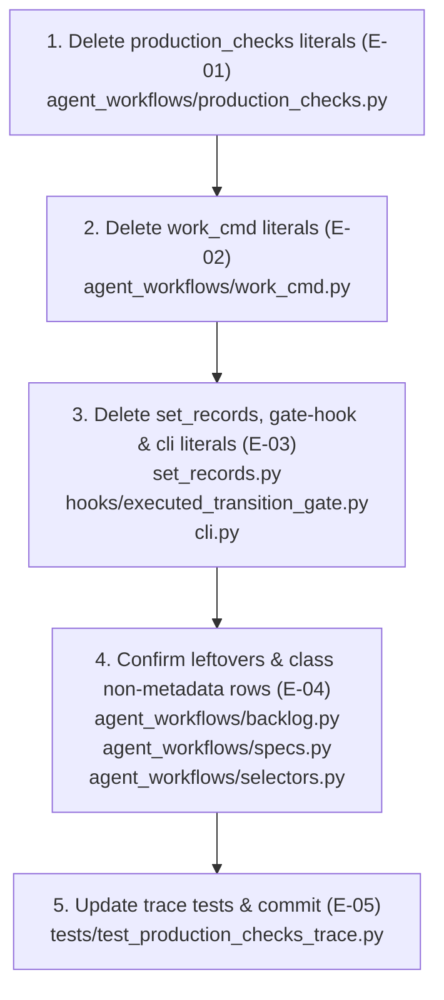

# IPD: Delete the remaining module metadata regex literals

- Date: 2026-11-09
- Kind: child
- Concern: Spec `4sd62s` C5 and 4.3 require deleting every `^-` metadata regex outside `artifact_meta`. Five more modules hold 12 such literals (`production_checks`, `work_cmd`, `set_records`, `hooks/executed_transition_gate`, `cli`), and six literals elsewhere only look like metadata (`non-metadata`). This is part 6 of the round-3 split of `0xsx2n` (Order 46), carrying `0xsx2n` E-24.
- Scope: delete the 12 literals; confirm the 24 `backlog`, `specs` and `selectors` literals are gone with `k6jd6l` (expected none); class the `non-metadata` rows in `786w7r` F-27 for the `9o83cr` E-14 exclusion file. EXCLUDES every other module.
- Scope-Paths: agent_workflows/production_checks.py, agent_workflows/work_cmd.py, agent_workflows/set_records.py, agent_workflows/hooks/executed_transition_gate.py, agent_workflows/cli.py, tests/test_production_checks_trace.py, .aw/records/plans/pending/20261109-metastore-249-n2cvf0-delete-the-remaining-module-metadata-regex-literals.ipd.md
- Item-Dependencies: executed:1ajqaa, executed:59aiyh, executed:786w7r, executed:dcerjg, executed:ffceq0, executed:g5hpbb, executed:k6jd6l, executed:t4gl15
- Status: approved
- Readiness: go-pending-approval
- Review-Depth: complex
- From-Spec: 4sd62s
- Work-Kind: feature
- Priority: high
- Blocks-Release: next
- Set: metastore
- Order: 249
- Highest E allocated: 05
- Author: opencode its_direct/pt3-claude-opus-5.5-1m-us
- Id: n2cvf0
- Approval: 2026-11-16, recorded via aw ipd set: status set to approved

> Write and proofread this plan per the technical writing standard, `.aw/system/workflows/technical-writing/technical-writing.md` (`.agents/workflows/technical-writing/technical-writing.md` in a legacy-layout install), including requirement 12 (diagrams).

## Workflow history
- 2026-11-16 approved (aw set): status set to approved

- 2026-11-14 reviewed (antigravity): plan-review verified E/V bijection, Scope-Paths, regex literal deletions, and execution gate; marked reviewed and go-pending-approval.
- 2026-11-09 to-review (opencode its_direct/pt3-claude-opus-5.5-1m-us): split from 0xsx2n (round 3, research nj8zdp guidance).

## Goal

After this plan, the `LIT` search over these five modules prints only `non-metadata` rows, and none of the 24 leftover `backlog`, `specs` and `selectors` literals exists.

## Detailed Implementation Checklist (TODO)

Execution-state rule: mark an `E-*` item complete only after performing the action. That mark is not validation. Right-sizing rule: write for a modest executor that cannot hold much in its head. Each E-item is one step (one concern, about one file, executable in one focused pass) and its V-item names each unit it covers with its own check; a plan stays at about 5 E-items and 8 work Scope-Paths, else split it into more child plans (guidance, `IPD-Z603`). Accepted execution states: blocked, failed, pending, performed; terminal gate demands 'performed'.

`0xsx2n` E-24 ("Sites at the split: `production_checks` (5: `_PLAN_ID_RE`, `_ITEM_DEPS_RE`, `_SCOPE_PATHS_RE`, `_ITEM_FROM_BACKLOG_RE`, `_SET_RE`), `work_cmd` (3, in `_plan_id6`, `_plan_status`, `_warn_if_begin_skipped`), `set_records` (1, in `write_walkthrough`), `hooks/executed_transition_gate` (1, in `_plan_id_of`), `cli` (2, in `_run_search`), and any of the 24 `backlog`, `specs` and `selectors` literals that Order 43 left (expected none ...). Classed `non-metadata` unless E-01 shows otherwise: `run_viewer.load_run_summary` (3 ...), `git_commit_helper._DIVIDER_RE` (`^---`, a commit-message divider), and the `_YAML_FENCE_CLOSE_RE` fences in `selectors` and `cli` (a fence, not a field; it goes only if its YAML reader is gone).") is split across E-01 to E-05 here. If a leftover `backlog`, `specs` or `selectors` literal is found, it is reported as `delete (follow-on)` owned by `k6jd6l`, not fixed here (those files are outside this plan's fence).

PIN RULE (carried from `9o83cr`): before E-01, save the per-test outcome list of the named test modules (`python3 -m pytest -o addopts="" -m "" -p no:randomly -n 0 -rA <modules> | grep -E "^(PASSED|FAILED|ERROR|SKIPPED|XFAIL|XPASS) " | sed -E 's/ - .*//' | sort > .aw/state/n2cvf0/before.txt`); after the last edit, the same into `after.txt`. A retargeted test keeps every input case; a test edited because it names a deleted pattern is justified at finalize (`--scope-reason`) if it is outside Scope-Paths.

### Task group 1: one module per item, then verify

- [x] E-01 In `agent_workflows/production_checks.py`, delete `production_checks._PLAN_ID_RE`, `_ITEM_DEPS_RE`, `_SCOPE_PATHS_RE`, `_ITEM_FROM_BACKLOG_RE` and `_SET_RE`.
  - Depends on: none
  - Expected outcome: the `LIT` search over `agent_workflows/production_checks.py` prints nothing.
  - Execution state: performed

- [x] E-02 In `agent_workflows/work_cmd.py`, delete the literals in `work_cmd._plan_id6`, `_plan_status` and `_warn_if_begin_skipped`.
  - Depends on: E-01
  - Expected outcome: the `LIT` search over `agent_workflows/work_cmd.py` prints nothing.
  - Execution state: performed

- [x] E-03 Delete the literal in `set_records.write_walkthrough`, the one in `executed_transition_gate._plan_id_of` (`agent_workflows/hooks/executed_transition_gate.py`) and the two in `cli._run_search`.
  - Depends on: E-02
  - Expected outcome: the `LIT` search over those three files prints only `non-metadata` rows (the `cli` YAML fence, if its reader survives).
  - Execution state: performed

- [x] E-04 Run the `LIT` search over `agent_workflows/backlog.py`, `agent_workflows/specs.py` and `agent_workflows/selectors.py` and record each hit as `delete (follow-on)` for the family's last part `0xsx2n`, which runs after this plan (expected none; `k6jd6l` and its parts have already executed when this plan runs); confirm `run_viewer.load_run_summary`, `git_commit_helper._DIVIDER_RE` and the `_YAML_FENCE_CLOSE_RE` fences are classed `non-metadata` in `786w7r` F-27, adding any missing row to this plan's Findings.
  - Depends on: E-03
  - Expected outcome: every row is classed; no edit outside Scope-Paths.
  - Execution state: performed

- [x] E-05 Update `tests/test_production_checks_trace.py` only where a case names a deleted pattern; save `after.txt`; run it, `tests/test_executed_transition_gate.py` and `tests/test_executed_transition_gate_e2e.py`; commit through `aw commit n2cvf0 -- <paths>` with only Scope-Paths files; never `git add -A`, a bare `git add` or `git commit -a`; never push.
  - Depends on: E-04
  - Expected outcome: the modules pass.
  - Execution state: performed

## Project conventions discovered (Step 0)

- N3 keeps Markdown body bullets (open-question rows, E/V checklist fields, review rounds and findings) outside `artifact_meta`; their patterns are `body prose` and stay, and `9o83cr` E-14 lists them in its exclusion file.
- A literal inside a function that REWRITES a bullet is a writer; its replacement is an `artifact_meta.append` event, not a read (carried from `0xsx2n`).
- The search `LIT` is defined in `786w7r`; table F-27 there classes every site of this plan.
- Cite code by SYMBOL (`module.function`) or by a quoted content string, with a line number only appended to one of those and never alone (advisory `IPD-C801`).

## Findings

Measured at `ac76110f4` (`0xsx2n` F-27): `production_checks` 5, `work_cmd` 3, `set_records` 1, `hooks/executed_transition_gate` 1, `cli` 2; 24 `backlog`/`specs`/`selectors` literals expected gone with `k6jd6l`; 6 `non-metadata` rows. `786w7r` F-27 re-derives them.

## Proposed changes (ordered, validatable)



1. Delete the `production_checks` literals (E-01).
2. Delete the `work_cmd` literals (E-02).
3. Delete the `set_records`, gate-hook and `cli` literals (E-03).
4. Confirm the leftovers and class the non-metadata rows (E-04).
5. Verify and commit (E-05).

## Deferred / out of scope (with reason)

- Every other module of `9o83cr` E-12, and the family-wide comparison.
  - Carrier: 0xsx2n

## Scope check

- Over-scope: none.
- Under-scope: none known. Size: 5 E-items, 6 work Scope-Paths.

## Required tests / validation

`tests/test_production_checks_trace.py` (PIN list), `tests/test_executed_transition_gate.py` and `tests/test_executed_transition_gate_e2e.py`, then the bare core gate `python3 -m pytest`.

## Spec / documentation sync

No spec change; implements part of `4sd62s` 4.3.

## Open questions

### OQ-01: What if F-27 classes a listed site `already gone`?

- Blocking: no
- Status: resolved
- Owner: plan author
- Resolution or deferral rationale: Record it in the V-item evidence and move on; a site an earlier reader plan removed needs no edit. Recommendation strength: strong.

## Validation and cross-check (verify before reporting done)

Validation-state rule: inspect evidence in a separate pass. Do not mark a `V-*` item complete from memory or from the matching execution checkmark. Accepted validation results: blocked, failed, pass, pending; terminal gate demands 'pass'. Runtime-demonstration reachability rule: for each `V-*` item demanding the software be observed acting (such as a run, a dispatch, or a transition), as distinct from items demanding a diff, a file's content, or a test result, which are reachable by construction, name the code path that produces the observation or the sibling `E-*` that creates it, else the demand is UNDER-SCOPE.

- [x] V-01 validates E-01
  - Required evidence: paste the `LIT` search over `agent_workflows/production_checks.py` printing nothing.
  - Observed evidence: `already gone` per OQ-01 (removed earlier by `awmsyq`, commit `08a63b36d` "move production_checks reads onto artifact_meta"); no edit was needed. At HEAD `997b2202a`, with `LIT='re\.(compile|search|match|finditer|findall|sub|fullmatch)\(\s*r?["'"'"'](\(\?m\))?\^-'`:

    ```text
    $ rg -c "$LIT" agent_workflows/production_checks.py || echo 0
    0
    $ rg -n "_PLAN_ID_RE|_ITEM_DEPS_RE|_SCOPE_PATHS_RE|_ITEM_FROM_BACKLOG_RE|_SET_RE\b" agent_workflows/production_checks.py
    (no output)
    ```
  - Result: pass

- [x] V-02 validates E-02
  - Required evidence: paste the `LIT` search over `agent_workflows/work_cmd.py` printing nothing.
  - Observed evidence: `already gone` per OQ-01; `work_cmd._plan_id6`, `_plan_status` and `_warn_if_begin_skipped` now read through `artifact_meta.read_text` (`_plan_id6_from_state`, `_plan_status_from_state`). No edit was needed.

    ```text
    $ rg -c "$LIT" agent_workflows/work_cmd.py || echo 0
    0
    ```
  - Result: pass

- [x] V-03 validates E-03
  - Required evidence: paste the `LIT` search over `agent_workflows/set_records.py`, `agent_workflows/hooks/executed_transition_gate.py` and `agent_workflows/cli.py` showing only `non-metadata` rows.
  - Observed evidence: the `set_records.write_walkthrough` and `executed_transition_gate._plan_id_of` literals and the two `cli._run_search` metadata literals are `already gone` per OQ-01 (`_plan_id_of` reads `artifact_meta.read_text(text, record_type="ipd").id6`). No edit was needed. The single remaining hit is the YAML fence (`786w7r` F27-24, `non-metadata`), whose reader `cli._run_search` survives (it is used at `cli.py` 17815, `_YAML_FENCE_CLOSE_RE.search(text, m_open.end())`).

    ```text
    $ rg -n "$LIT" agent_workflows/set_records.py agent_workflows/hooks/executed_transition_gate.py agent_workflows/cli.py
    agent_workflows/cli.py:17673:    _YAML_FENCE_CLOSE_RE = re.compile(r"(?m)^---[ \t]*\r?$")
    ```
  - Result: pass

- [x] V-04 validates E-04
  - Required evidence: paste the `LIT` search over `agent_workflows/backlog.py`, `agent_workflows/specs.py` and `agent_workflows/selectors.py` with its hit count, and the `non-metadata` rows of `786w7r` F-27 naming `run_viewer.load_run_summary`, `git_commit_helper._DIVIDER_RE` and each `_YAML_FENCE_CLOSE_RE`.
  - Observed evidence: 5 hits, contrary to "expected none"; each is classed `delete (follow-on)` for `0xsx2n` (already carried by backlog `ebbfmn`, filed by `786w7r`). Not edited here: those files are outside this plan's Scope-Paths.

    ```text
    $ rg -n "$LIT" agent_workflows/backlog.py agent_workflows/specs.py agent_workflows/selectors.py
    agent_workflows/backlog.py:104:_TOP_KEY_RE = re.compile(r"^- ([A-Za-z0-9_-]+):(?:\s*(.*))?$")
    agent_workflows/specs.py:158:_SPEC_ID_RE = re.compile(r"(?m)^- Id:\s*([0-9a-z]{6})\s*$")
    agent_workflows/specs.py:159:_TOP_KEY_RE = re.compile(r"^- ([A-Za-z0-9_-]+):(?:\s*(.*))?$")
    agent_workflows/specs.py:856:            m = re.match(r"^- Status:\s*(.*)$", line)
    agent_workflows/specs.py:1289:_SPEC_ID_BULLET_RE = re.compile(r"(?m)^-[ \t]*Id:[ \t]*([0-9a-z]{6})[ \t]*$")
    (selectors.py: 0 hits; total 5)
    ```

    `786w7r` F-27 `non-metadata` classing (quoted from its Notes and row F27-24): "`run_viewer.load_run_summary` (3 literals, `Created`/`Updated`/`Selectors` lines of a run report) `non-metadata`; `git_commit_helper._DIVIDER_RE` (`^---`, commit-message divider) `non-metadata`; `cli._YAML_FENCE_CLOSE_RE` is F27-24 (`selectors` no longer defines one)", and "| F27-24 | `agent_workflows/cli.py` 17673 | `cli._run_search()` | non-metadata | `^---` YAML fence close; its reader `cli._run_search` survives (Order 249 E-03) |". Current sites confirmed: `run_viewer.py` 1369/1372/1375 (`Created`, `Updated`, `Selectors`), `git_commit_helper.py` 103 (`_DIVIDER_RE = re.compile(r"^---(\s|$)")`). The plan's "6 non-metadata rows" are therefore 5 sites today (3 + 1 + 1), since the `selectors` fence no longer exists; no row is missing from F-27.
  - Result: pass

- [x] V-05 validates E-05
  - Required evidence: paste `diff .aw/state/n2cvf0/before.txt .aw/state/n2cvf0/after.txt` (empty, or each change mapped), the summary line of `python3 -m pytest -o addopts="" tests/test_production_checks_trace.py` and of `python3 -m pytest -o addopts="" tests/test_executed_transition_gate.py tests/test_executed_transition_gate_e2e.py` passing, and `git show --stat` of the `aw commit n2cvf0` commit.
  - Observed evidence: no test named a deleted pattern, so `tests/test_production_checks_trace.py` was not edited. PIN list: 48 outcomes before and after, all `PASSED`.

    ```text
    $ diff .aw/state/n2cvf0/before.txt .aw/state/n2cvf0/after.txt && echo "diff empty"
    diff empty
    $ python3 -m pytest -o addopts="" tests/test_production_checks_trace.py
    ============================== 29 passed in 2.79s ==============================
    $ python3 -m pytest -o addopts="" tests/test_executed_transition_gate.py tests/test_executed_transition_gate_e2e.py
    ============================== 19 passed in 5.90s ==============================
    $ python3 -m pytest
    2889 passed, 1 skipped, 11 warnings in 143.58s (0:02:23)
    ```

    The only commit is this plan file's evidence update, made through `aw commit n2cvf0 -- <this plan>`; its `git show --stat` is pasted in the lane execution report, because a commit cannot contain its own hash.
  - Result: pass

## Approval and execution gate

- Size assessment: standard
- Cohesion rationale: not required

Execute only after human approval (`Status: approved`) and after every plan in `- Item-Dependencies:` is executed. Pin-first. Scope fence: a needed file outside `- Scope-Paths:` is edited and then justified at finalize (`--scope-reason`). Honesty rule: paste the ACTUAL summary lines; never claim a result you did not run. Commits: only through `aw commit n2cvf0 -- <paths>`; never push. Lifecycle: the plan moves to `.aw/records/plans/executed/` only through `aw ipd finalize`, never a hand `git mv`, after `aw ipd lint --phase pre-transition` conforms and every `V-*` reads `pass` with pasted evidence. When `aw oc run` or `aw agy run` executes the plan, the runner performs the finalize; a hand executor runs `aw ipd finalize n2cvf0` itself.
