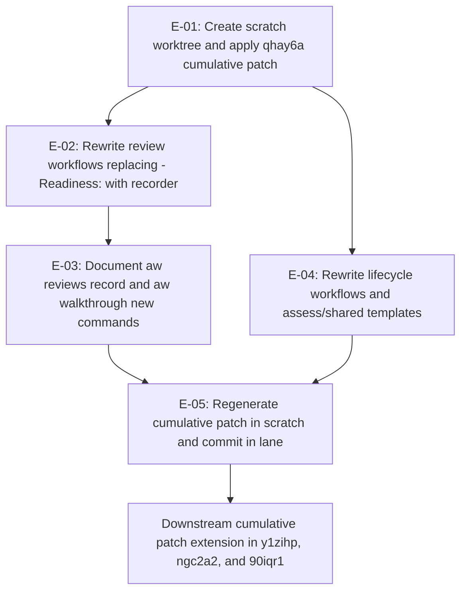

# IPD: Add review workflow, recorder command and template rewrites to the cutover docs patch

- Date: 2026-11-09
- Kind: child
- Concern: Spec `4sd62s` section 5.4 requires the review workflows, lifecycle workflows and templates to describe metadata commands instead of field syntax, and C10a keeps that text off `main` until the cutover commit. This is the second of four parts that build the cumulative cutover documentation patch (split from `90iqr1`, round 3, research `nj8zdp`).
- Scope: In a scratch worktree with the committed patch applied, rewrite the review workflows (replacing hand-written `- Readiness:` with the review-round recorder), document the two commands handed by `xexn45`, and rewrite the lifecycle workflows and templates; regenerate `.aw/system/cutover/metastore-docs.cutover.patch`. No live document changes.
- Scope-Paths: .aw/records/plans/pending/20261109-metastore-251-a49djh-add-review-workflow-recorder-command-and-template-rewrites-t.ipd.md, .aw/system/cutover/metastore-docs.cutover.patch
- Item-Dependencies: executed:9o83cr, executed:qhay6a
- Status: approved
- Readiness: go-pending-approval
- Review-Depth: standard
- From-Spec: 4sd62s
- Work-Kind: feature
- Priority: high
- Blocks-Release: next
- Set: metastore
- Order: 251
- Highest E allocated: 05
- Author: opencode its_direct/pt3-claude-opus-5.5-1m-us
- Id: a49djh
- Approval: 2026-11-16, recorded via aw ipd set: status set to approved

> Reviewed and proofread per the technical writing standard, `.aw/system/workflows/technical-writing/technical-writing.md`, including requirement 12 (diagrams).

## Workflow history
- 2026-11-16 approved (aw set): status set to approved

- 2026-11-14 reviewed (aw set): APPROVE WITH REVISIONS APPLIED; PR-001..PR-005 FIXED
- 2026-11-14 /plan-review (antigravity/gemini-3.8-flash): APPROVE WITH REVISIONS APPLIED; PR-001..PR-005 FIXED; review record .aw/records/reviews/20261109-metastore-251-a49djh-add-review-workflow-recorder-command-and-template-rewrites-t.review.md
- 2026-11-09 to-review (opencode its_direct/pt3-claude-opus-5.5-1m-us): split from 90iqr1 (round 3, research nj8zdp guidance).

## Goal

Extend the cumulative cutover documentation patch so that no review workflow, lifecycle workflow or template instructs an agent to hand-write a metadata bullet or a history line after the cutover.

## Detailed Implementation Checklist (TODO)

Execution-state rule: mark an `E-*` item complete only after performing the action. That mark is not validation. Right-sizing rule: write for a modest executor that cannot hold much in its head. Each E-item is one step (one concern, about one file, executable in one focused pass) and its V-item names each unit it covers with its own check; a plan stays at about 5 E-items and 8 work Scope-Paths, else split it into more child plans (guidance, `IPD-Z603`). Accepted execution states: blocked, failed, pending, performed; terminal gate demands 'performed'.

### Task group 1: scratch worktree

- [ ] E-01 Create a scratch git worktree (`mkdir -p .aw/state/a49djh && git worktree add --detach .aw/state/a49djh/scratch HEAD`) and apply the committed cumulative patch in it (`git apply --index` of `.aw/system/cutover/metastore-docs.cutover.patch`, as written by `qhay6a`). If it does not apply, stop and report.
  - Depends on: none
  - Expected outcome: the scratch worktree shows the `qhay6a` changes staged; the executing checkout is unchanged.
  - Execution state: pending

### Task group 2: rewrites (scratch worktree only)

- [ ] E-02 (was `90iqr1` E-03.) In the scratch worktree, rewrite the review workflows: `.aw/system/workflows/plan-review/steps/s7-finalize.md` and `s5-questions.md`, `s6-rereview.md`, `r2-executability.md`, `.aw/system/workflows/spec-review/spec-review.md` and its `README.md`, and every file under the `plan-review-long` workflow directory, replacing "write `- Readiness:` into the plan" with the review-round recorder command that `xexn45` hands here (aw reviews record, documented in E-03), and replacing every hand edit of status or history with the setter.
  - Depends on: E-01
  - Expected outcome: no review workflow instructs an agent to hand-write a metadata bullet or a history line.
  - Execution state: pending

- [ ] E-03 (was `90iqr1` E-07.) In the scratch worktree, document the two commands handed by `xexn45`: the review-round recorder (aw reviews record <subject-id6> --round <n> --kind gate|refinement --verdict <v> [--readiness ...] [--review-depth ...], which appends one `review` event per spec 4.1a and replaces hand-written `- Readiness:`) and aw walkthrough new --set <set> --order <nn> --target <id6> --slug <slug> [--summary ...], in the review workflows of E-02 and in the walkthroughs README. Document them as Order 13 deliverables in the reference text; Order 13 builds them (Carrier `cxxmyv`).
  - Depends on: E-02
  - Expected outcome: the review workflows and the walkthroughs README name both commands with their arguments.
  - Execution state: pending

- [ ] E-04 (was `90iqr1` E-04.) In the scratch worktree, rewrite the remaining workflow and template files from the `qhay6a` F-03 table owned by this part (`.aw/system/workflows/ipd-lifecycle/ipd-lifecycle.md`, `.aw/system/workflows/askme/askme.md`, the assess templates `.aw/system/workflows/assess/templates/ipd.md` and `.aw/system/workflows/assess/templates/orchestrator-ipd.md`, and every `*README.md` template under `.aw/system/workflows/templates/`) so templates carry the two-key front matter (`id`, `status`) and the banner of spec 4.1 instead of bullet blocks, and instructions name commands.
  - Depends on: E-01
  - Expected outcome: `aw ipd scaffold --apply` run after the Order 13 code change produces a file whose head matches the 4.1 shape (verified in Order 13; here the template text is reviewed).
  - Execution state: pending

### Task group 3: package

- [ ] E-05 In the scratch worktree run `git add -A`, write `git diff --cached --binary HEAD` over the patch file in the executing checkout (the new patch contains `qhay6a`'s changes plus this plan's), remove the scratch worktree with `git worktree remove --force .aw/state/a49djh/scratch`, and commit through `aw commit a49djh -- .aw/records/plans/pending/20261109-metastore-251-a49djh-add-review-workflow-recorder-command-and-template-rewrites-t.ipd.md .aw/system/cutover/metastore-docs.cutover.patch`. Never `git add -A`, a bare `git add`, or `git commit -a` in the executing checkout; never push.
  - Depends on: E-02, E-03, E-04
  - Expected outcome: the regenerated patch lists the `qhay6a` files plus every file edited by E-02 to E-04; one path-scoped commit.
  - Execution state: pending

## Project conventions discovered (Step 0)

- The cumulative patch design and the scratch-worktree location are defined in `qhay6a` (OQ-01, Step 0) and `90iqr1` (OQ-01, OQ-03).
- User-facing prose (READMEs, docs) carries no em or en dashes (AGENTS.md execution contract).

## Findings

| Id | Evidence | Finding |
|---|---|---|
| F-01 | `90iqr1` F-01 | Every review, lifecycle and template workflow describes field syntax today (22 workflow files measured 2026-11-02). |
| F-02 | `90iqr1` F-04 (`xexn45` Deferred rows) | The review-round recorder and `aw walkthrough new` are documented here and built by `cxxmyv`. |

## Proposed changes (ordered, validatable)

1. E-01: scratch worktree with the patch applied.
2. E-02 to E-04: rewrite review workflows, document the two commands, rewrite templates.
3. E-05: regenerate the patch and commit.

## Deferred / out of scope (with reason)

- Building the two documented commands and applying the patch to live documents: cutover commit (C10a).
  - Carrier: cxxmyv
- READMEs other than walkthroughs, docs and reference documents.
  - Carrier: y1zihp
- `Kind` renames and quickstarts.
  - Carrier: ngc2a2

## Scope check

- Over-scope: none.
- Under-scope: none. Spec 5.4 workflow and template bullets map to E-02 and E-04; `xexn45` handoffs map to E-03.

## Required tests / validation

- V-01 to V-05 below; the patch guard test is owned by `90iqr1`.

## Spec / documentation sync

No spec change; cutover documentation patch implements spec `4sd62s` section 5.4 requirements for review workflows, lifecycle workflows, and template rewrites, applied to live documents in `cxxmyv` cutover commit (C10a).

## Open questions

### OQ-01: Why build documentation changes in a cumulative patch rather than editing live documents?

- Blocking: no
- Status: resolved
- Owner: plan author
- Resolution or deferral rationale: Spec `4sd62s` invariant C10a requires that documentation describing post-cutover metadata commands and the log format must not reach `main` before the atomic cutover commit (`cxxmyv`). Committing live document changes across intermediate plans would expose unreleased command syntax on `main` before the commands exist and break existing text-asserting tests. Packaging rewrites into `.aw/system/cutover/metastore-docs.cutover.patch` preserves C10a and allows downstream plans (`y1zihp`, `ngc2a2`, `90iqr1`) to extend and guard the patch. Recommendation strength: strong.

## Validation and cross-check (verify before reporting done)

Validation-state rule: inspect evidence in a separate pass. Do not mark a `V-*` item complete from memory or from the matching execution checkmark. Accepted validation results: blocked, failed, pass, pending; terminal gate demands 'pass'. Runtime-demonstration reachability rule: for each `V-*` item demanding the software be observed acting (such as a run, a dispatch, or a transition; as distinct from items demanding a diff, a file's content, or a test result, which are reachable by construction), name the code path that produces the observation or the sibling `E-*` that creates it, else the demand is UNDER-SCOPE.

- [ ] V-01 validates E-01
  - Required evidence: paste the `git apply --index` command and its exit status, and `git -C .aw/state/a49djh/scratch diff --cached --stat` listing the `qhay6a` files.
  - Observed evidence:
  - Result: pending
- [ ] V-02 validates E-02
  - Required evidence: paste `rg -n -e 'Readiness:' -e '## Workflow history' .aw/system/workflows/plan-review .aw/system/workflows/spec-review .aw/system/workflows/plan-review-long` in the scratch worktree with each remaining hit shown to be a quoted legacy example, and one diff hunk per named file (`s7-finalize.md`, `s5-questions.md`, `s6-rereview.md`, `r2-executability.md`, `spec-review.md`, the spec-review `README.md`, each `plan-review-long` file) or a line stating that file needed no change and why.
  - Observed evidence:
  - Result: pending
- [ ] V-03 validates E-03
  - Required evidence: paste the diff hunks in `s7-finalize.md` and the walkthroughs README that name `aw reviews record` and `aw walkthrough new` with their arguments, each marked as delivered by Order 13.
  - Observed evidence:
  - Result: pending
- [ ] V-04 validates E-04
  - Required evidence: paste the diff hunks of `ipd-lifecycle.md`, `askme.md`, `assess/templates/ipd.md` and `orchestrator-ipd.md` showing the two-key front matter, banner and command wording, and `rg -c '^- (Status|Kind|Set):' .aw/system/workflows/assess/templates .aw/system/workflows/templates` in the scratch worktree returning 0 for every template file.
  - Observed evidence:
  - Result: pending
- [ ] V-05 validates E-05
  - Required evidence: paste `git apply --stat .aw/system/cutover/metastore-docs.cutover.patch` (the `qhay6a` files plus each file from V-02 to V-04), `git worktree list` showing the scratch worktree removed, and the `aw commit` output naming the commit hash.
  - Observed evidence:
  - Result: pending

## Approval and execution gate

- Size assessment: standard
- Cohesion rationale: not required

Execute only after human approval (`Status: approved`), after `qhay6a` and `9o83cr` are `executed`, and before `y1zihp`, `ngc2a2`, `90iqr1`, and `cxxmyv`. Documents are edited ONLY in the scratch worktree; the executing checkout changes only by this plan and the patch file. `OQ-01` is resolved and non-blocking. Safety stop: if prerequisite `qhay6a` or `9o83cr` is not executed, or if `.aw/system/cutover/metastore-docs.cutover.patch` is missing or fails to apply in E-01, stop and report rather than recording a broken cumulative patch. Scope fence: `- Scope-Paths:` declares only this plan file and `.aw/system/cutover/metastore-docs.cutover.patch`; if an out-of-scope edit is genuinely needed, make it and justify it at finalize with `--scope-reason`, and acknowledge any declared path left unmodified with `--scope-ack`. Honesty rule: paste the ACTUAL output of every command named above; never claim a result you did not run. Commits: commit only through `aw commit a49djh -- <paths>`; never run `git add -A`, a bare `git add`, or `git commit -a` in the executing checkout; never push. Lifecycle transition: the plan moves to `.aw/records/plans/executed/` only through `aw ipd finalize`, never a hand `git mv`, after `aw ipd lint --phase pre-transition` conforms and every `V-*` reads `pass` with pasted evidence. When `aw oc run` or `aw agy run` executes the plan, the runner performs `aw ipd finalize`; a hand executor runs `aw ipd finalize a49djh` itself.
