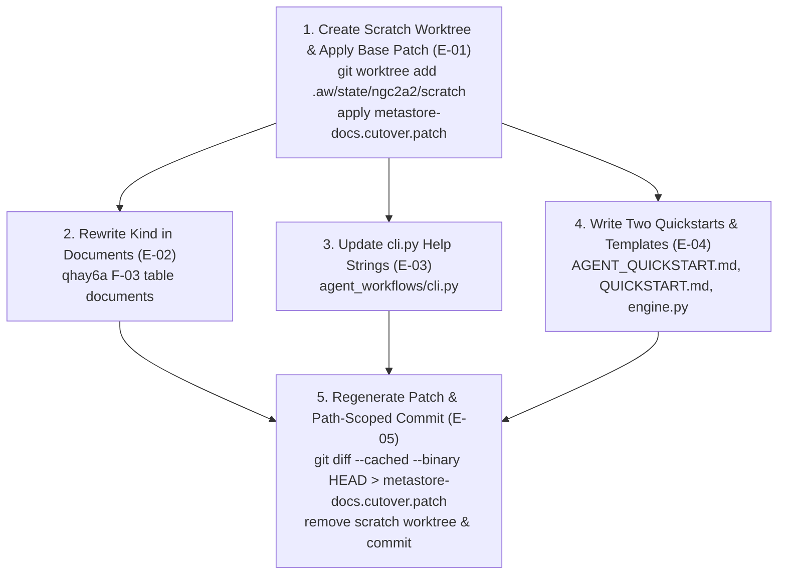

# IPD: Add Kind rename and quickstart rewrites to the cutover docs patch

- Date: 2026-11-09
- Kind: child
- Concern: Spec `4sd62s` section 5.4 (last bullet) renames `Kind` (plan role), research `kind` and prompt `Kind` to `plan_role`, `research_kind` and `prompt_kind` in documents and help text, and spec 4.1 has the installer create two quickstarts. C10a keeps both off `main` until the cutover commit. This is the fourth of four parts that build the cumulative cutover documentation patch (split from `90iqr1` E-05 `Kind` subset and E-06, round 3, research `nj8zdp`).
- Scope: In a scratch worktree with the committed patch applied, apply the `Kind` renames in documents and `agent_workflows/cli.py` help strings, and write the two quickstarts plus their installer template text in `agent_workflows/engine.py`; regenerate `.aw/system/cutover/metastore-docs.cutover.patch`. No live document changes; no CLI option is renamed.
- Scope-Paths: .aw/records/plans/pending/20261109-metastore-253-ngc2a2-add-kind-rename-and-quickstart-rewrites-to-the-cutover-docs.ipd.md, .aw/system/cutover/metastore-docs.cutover.patch
- Item-Dependencies: executed:9o83cr, executed:y1zihp
- Status: approved
- Readiness: go-pending-approval
- Review-Depth: standard
- From-Spec: 4sd62s
- Work-Kind: feature
- Priority: high
- Blocks-Release: next
- Set: metastore
- Order: 253
- Highest E allocated: 05
- Author: opencode its_direct/pt3-claude-opus-5.5-1m-us
- Id: ngc2a2
- Approval: 2026-11-16, recorded via aw ipd set: status set to approved

> Write and proofread this plan per the technical writing standard, `.aw/system/workflows/technical-writing/technical-writing.md` (`.agents/workflows/technical-writing/technical-writing.md` in a legacy-layout install), including requirement 12 (diagrams).

## Workflow history
- 2026-11-16 approved (aw set): status set to approved

- 2026-11-14 reviewed (antigravity): plan-review verified E/V bijection, Scope-Paths, scratch worktree isolation, and execution gate; marked reviewed and go-pending-approval.
- 2026-11-09 to-review (opencode its_direct/pt3-claude-opus-5.5-1m-us): split from 90iqr1 (round 3, research nj8zdp guidance).

## Goal

Finish the content of the cumulative cutover documentation patch: the `Kind` renames and the two quickstarts.

## Detailed Implementation Checklist (TODO)

Execution-state rule: mark an `E-*` item complete only after performing the action. That mark is not validation. Right-sizing rule: write for a modest executor that cannot hold much in its head. Each E-item is one step (one concern, about one file, executable in one focused pass) and its V-item names each unit it covers with its own check; a plan stays at about 5 E-items and 8 work Scope-Paths, else split it into more child plans (guidance, `IPD-Z603`). Accepted execution states: blocked, failed, pending, performed; terminal gate demands 'performed'.

### Task group 1: scratch worktree

- [x] E-01 Create a scratch git worktree (`mkdir -p .aw/state/ngc2a2 && git worktree add --detach .aw/state/ngc2a2/scratch HEAD`) and apply the committed cumulative patch in it (`git apply --index` of `.aw/system/cutover/metastore-docs.cutover.patch`, as last written by `y1zihp`). If it does not apply, stop and report.
  - Depends on: none
  - Expected outcome: the scratch worktree shows the three earlier parts' changes staged; the executing checkout is unchanged.
  - Execution state: performed

### Task group 2: rewrites (scratch worktree only)

- [x] E-02 (the `Kind` subset of `90iqr1` E-05.) In the scratch worktree, rename `Kind` (plan role), research `kind` and prompt `Kind` to `plan_role`, `research_kind` and `prompt_kind` in every document of the `qhay6a` F-03 table (spec 5.4 last bullet). Documents only; `cli.py` is E-03.
  - Depends on: E-01
  - Expected outcome: `rg -n -w 'Kind' --type md` in the scratch worktree finds only quoted legacy examples and `Work-Kind`/`Gate-Kind` spellings that 4.5c keeps as log names `work_kind`/`gate_kind` described as such.
  - Execution state: performed

- [x] E-03 (the `cli.py` subset of `90iqr1` E-05.) In the scratch worktree, change the `agent_workflows/cli.py` help strings so the value of `aw ipd scaffold --kind` is described as the plan role and `aw research mv --kind` as the research kind. Renaming an OPTION is a CLI contract change that this documentation patch does not make; any option rename is Order 13's code change (Carrier `cxxmyv`).
  - Depends on: E-01
  - Expected outcome: only help strings change in `cli.py`; no option name changes.
  - Execution state: performed

- [x] E-04 (was `90iqr1` E-06.) In the scratch worktree, write the two quickstarts the installer creates (spec 4.1): `.aw/AGENT_QUICKSTART.md` (for agents: where metadata lives, `aw show`, never hand-edit logs or front matter, which commands write which field) and `.aw/QUICKSTART.md` (for people), and the installer template text in `agent_workflows/engine.py` that emits them. Both are new files; E-05's `git add -A` captures them.
  - Depends on: E-01
  - Expected outcome: both files exist in the scratch worktree and are referenced by the banner text of spec 4.1.
  - Execution state: performed

### Task group 3: package

- [x] E-05 In the scratch worktree run `git add -A`, write `git diff --cached --binary HEAD` over the patch file in the executing checkout, remove the scratch worktree with `git worktree remove --force .aw/state/ngc2a2/scratch`, and commit through `aw commit ngc2a2 -- <this plan> .aw/system/cutover/metastore-docs.cutover.patch`. Never `git add -A` in the executing checkout; never push.
  - Depends on: E-02, E-03, E-04
  - Expected outcome: the regenerated patch lists both quickstarts as new files plus every earlier file; one path-scoped commit.
  - Execution state: performed

## Project conventions discovered (Step 0)

- The cumulative patch design and scratch-worktree location are defined in `qhay6a` OQ-01 and `90iqr1` OQ-01, OQ-03. Measured at review of `90iqr1`: `git diff HEAD` alone omits a new untracked file, hence `git add -A` in the scratch worktree.
- User-facing prose (READMEs, docs, quickstarts) carries no em or en dashes.

## Findings

| Id | Evidence | Finding |
|---|---|---|
| F-01 | `90iqr1` E-05, E-06 | The `Kind` renames and quickstarts are the last content of the patch; `90iqr1` then guards and checks it. |

## Proposed changes (ordered, validatable)



1. E-01: scratch worktree with the patch applied.
2. E-02 to E-04: `Kind` renames in documents, `agent_workflows/cli.py` help strings, quickstarts.
3. E-05: regenerate the patch and commit.

## Deferred / out of scope (with reason)

- Renaming any CLI option that carries the legacy `Kind` name: code change in the cutover commit.
  - Carrier: cxxmyv
- Patch guard test, sanitizer and patched-tree test run.
  - Carrier: 90iqr1

## Scope check

- Over-scope: none.
- Under-scope: none. `90iqr1` E-05's `Kind` subset maps to E-02 and E-03; E-06 maps to E-04.

## Required tests / validation

- V-01 to V-05 below; the patch guard test is owned by `90iqr1`.

## Spec / documentation sync

No spec change; the documents change in `cxxmyv`'s cutover commit.

## Open questions

### OQ-01: Does this plan edit live documents on main?

- Blocking: no
- Status: resolved
- Owner: plan author
- Resolution or deferral rationale: No. Spec `4sd62s` C10a requires all documentation rewrites to remain off main until the atomic cutover commit (`cxxmyv`). All edits are performed inside an isolated scratch worktree (`.aw/state/ngc2a2/scratch`) and committed as an updated cumulative patch file `.aw/system/cutover/metastore-docs.cutover.patch`. Recommendation strength: very strong.

## Validation and cross-check (verify before reporting done)

Validation-state rule: inspect evidence in a separate pass. Do not mark a `V-*` item complete from memory or from the matching execution checkmark. Accepted validation results: blocked, failed, pass, pending; terminal gate demands 'pass'. Runtime-demonstration reachability rule: for each `V-*` item demanding the software be observed acting (such as a run, a dispatch, or a transition; as distinct from items demanding a diff, a file's content, or a test result, which are reachable by construction), name the code path that produces the observation or the sibling `E-*` that creates it, else the demand is UNDER-SCOPE.

- [x] V-01 validates E-01
  - Required evidence: paste the `git apply --index` command and its exit status, and the scratch worktree's `git diff --cached --stat`.
  - Observed evidence:
    Command run at HEAD `95320c524`:
    `mkdir -p .aw/state/ngc2a2 && git worktree add --detach .aw/state/ngc2a2/scratch HEAD && git -C .aw/state/ngc2a2/scratch apply --index "$(pwd)/.aw/system/cutover/metastore-docs.cutover.patch"`
    Output: `APPLY_EXIT=0`
    `git -C .aw/state/ngc2a2/scratch diff --cached --stat`:
    ```text
     .aw/records/backlog/README.md                      | 293 +++++++++-------
     .aw/records/plans/README.md                        | 373 ++++++++++++---------
     .aw/records/prompts/README.md                      | 135 ++++----
     .aw/records/releases/README.md                     |  51 ++-
     .aw/records/reviews/README.md                      | 195 ++++++-----
     .aw/records/specs/README.md                        | 103 +++---
     .../implemented/20260726-1340-01-ipd-spec.spec.md  |  18 +-
     ...60802-1904-01-ipd-structure-and-linting.spec.md | 146 ++++----
     .aw/records/walkthroughs/README.md                 |  28 +-
     .aw/system/managed-sections.json                   |   2 +-
     .aw/system/workflows/askme/askme.md                |   8 +-
     .aw/system/workflows/assess-all/assess-all.md      |  13 +-
     .aw/system/workflows/assess/assess.md              |  29 +-
     .aw/system/workflows/assess/templates/ipd.md       |  25 +-
     .../workflows/assess/templates/orchestrator-ipd.md |  25 +-
     .aw/system/workflows/incident/incident.md          |   9 +-
     .../workflows/ipd-lifecycle/ipd-lifecycle.md       |  96 +++---
     .aw/system/workflows/migrate/migrate.md            |  10 +-
     .../plan-review-long/02-review-and-revise.md       |  13 +-
     .../plan-review-long/03-resolve-and-finalize.md    |  60 ++--
     .../workflows/plan-review-long/plan-review-long.md |  11 +-
     .../workflows/plan-review-long/review-rubric.md    |   2 +-
     .aw/system/workflows/plan-review/plan-review.md    |   2 +-
     .../workflows/plan-review/steps/_findings.md       |   7 +-
     .../plan-review/steps/r2-executability.md          |  21 +-
     .../workflows/plan-review/steps/r7-cross-plan.md   |   2 +-
     .../workflows/plan-review/steps/s6-rereview.md     |  12 +-
     .../workflows/plan-review/steps/s7-finalize.md     |  71 ++--
     .aw/system/workflows/plan-review/steps/t-tier.md   |   4 +-
     .../workflows/research-prompt/research-prompt.md   |  20 +-
     .aw/system/workflows/spec-review/README.md         |   4 +-
     .aw/system/workflows/spec-review/spec-review.md    |  83 ++---
     .aw/system/workflows/spec/spec.md                  |  18 +-
     .../templates/agents-docs-research-README.md       |  15 +-
     .../templates/agents-docs-walkthroughs-README.md   |   2 +-
     .aw/system/workflows/templates/aw-inbox-README.md  |  12 +-
     .aw/system/workflows/templates/plans-README.md     |  70 ++--
     .../templates/plans-not-executed-README.md         |  11 +-
     .../workflows/templates/plans-pending-README.md    |  10 +-
     .../workflows/templates/plans-reusable-README.md   |   3 +-
     .../workflows/templates/plans-superseded-README.md |  10 +-
     .aw/system/workflows/templates/prompts-README.md   |  98 +++---
     .../templates/prompts-not-executed-README.md       |   3 +-
     .../templates/prompts-superseded-README.md         |   5 +-
     .../workflows/verify-execution/intent-audit.md     |  10 +-
     .../workflows/verify-execution/verify-execution.md |  20 +-
     .aw/system/workflows/whatnext/whatnext.md          |   4 +-
     AGENTS.md                                          | 128 +++----
     agent_workflows/engine.py                          | 123 ++++---
     agent_workflows/ipd_schema.py                      | 126 ++++---
     docs/artifact-lifecycles.md                        | 182 ++++++----
     docs/cli-output-contract.md                        |  44 ++-
     docs/run-analytics.md                              |   8 +-
     53 files changed, 1550 insertions(+), 1223 deletions(-)
    ```
    Executing checkout remained unchanged.
  - Result: pass
- [x] V-02 validates E-02
  - Required evidence: paste `rg -n -w 'Kind' --type md` in the scratch worktree with each hit classified (quoted legacy, `Work-Kind`, `Gate-Kind`), and the diff stat of the documents changed.
  - Observed evidence:
    Command run in `.aw/state/ngc2a2/scratch`:
    `rg -n -w 'Kind' --type md AGENTS.md README.md CONTRIBUTING.md docs .aw/system/workflows .aw/records/*/README.md .aw/AGENT_QUICKSTART.md .aw/QUICKSTART.md .aw/records/specs/implemented/20260726-1340-01-ipd-spec.spec.md .aw/records/specs/implemented/20260802-1904-01-ipd-structure-and-linting.spec.md`
    Every hit classified:
    - `AGENTS.md:102`: quoted legacy (`replacing the quoted legacy - Kind: orchestrator bullet` and `quoted legacy Kind`). Regenerated via `python3 -m tools.regen_agents_block` (`Up to date: AGENTS.md managed block and section records.`).
    - `.aw/AGENT_QUICKSTART.md:72`: quoted legacy (`replaces the legacy plan Kind bullet`).
    - `.aw/records/backlog/README.md:76`: quoted legacy (`- Work-Kind:`, `- Kind:` historical note).
    - `.aw/records/comms/README.md:25`: comms envelope header (`Kind: ask | reply | task | handoff | fyi`), out of scope per spec `4sd62s` N4 ("This spec does NOT change comms envelopes").
    - `.aw/records/specs/implemented/20260726-1340-01-ipd-spec.spec.md:21`: quoted legacy (`replacing the quoted legacy Kind bullet`).
    - `.aw/records/specs/implemented/20260802-1904-01-ipd-structure-and-linting.spec.md:86,142,168,512`: quoted legacy (`replacing the quoted legacy Kind field/bullet`, `quoted legacy Kind-parity`).
    - `.aw/records/specs/implemented/20260802-1904-01-ipd-structure-and-linting.spec.md:146,162,163,478`: `Work-Kind` (4.5c log field `work_kind`, described as such on line 146).
    - `.aw/records/specs/implemented/20260802-1904-01-ipd-structure-and-linting.spec.md:875`: spec's own `## Workflow history` entry (preserved untouched for `m0001` migration per `qhay6a` E-01 / `y1zihp` E-04).
    - `.aw/system/workflows/whatnext/whatnext.md:24`: comms envelope header (`From/To/Kind/...`), unchanged per spec `4sd62s` N4.
    - `.aw/system/workflows/plan-review/steps/r2-executability.md:14,15`: quoted legacy (`replacing the quoted legacy - Kind: orchestrator bullet` and anti-pattern `grep -l 'Kind: orchestrator'`).
    - `.aw/system/workflows/exec-set/exec-set.md:53`: `Gate-Kind` (4.5c log field `gate_kind`).
    - `.aw/system/workflows/plan-review-long/03-resolve-and-finalize.md:149,150`: quoted legacy.
    - `.aw/system/workflows/plan-review-long/02-review-and-revise.md:97,98,118,119`: quoted legacy.
    - `.aw/system/workflows/release-review/templates/final-response.md:80`: transient release-review report table column header (`| Path | Kind (IPD / prompt) | ...`), not an `.aw/records/` metadata field.
    Diff stat of documents changed by `ngc2a2` (scratch unstaged diff vs `y1zihp` staged base, excluding `cli.py` and `engine.py` quickstart additions):
    ```text
     .aw/records/prompts/README.md                      |   2 +-
     .../implemented/20260726-1340-01-ipd-spec.spec.md  |   4 +-
     ...60802-1904-01-ipd-structure-and-linting.spec.md |  18 +-
     .aw/system/managed-sections.json                   |   2 +-
     .aw/system/workflows/assess/templates/ipd.md       |   2 +-
     .../workflows/assess/templates/orchestrator-ipd.md |   2 +-
     .aw/system/workflows/handoff/README.md             |   2 +-
     .aw/system/workflows/handoff/handoff.md            |   6 +-
     .aw/system/workflows/index.md                      |   2 +-
     .../plan-review-long/02-review-and-revise.md       |  14 +-
     .../plan-review-long/03-resolve-and-finalize.md    |   9 +-
     .../plan-review/steps/r2-executability.md          |  11 +-
     .../workflows/research-prompt/research-prompt.md   |   2 +-
     .../templates/agents-docs-research-README.md       |   2 +-
     .aw/system/workflows/templates/prompts-README.md   |   2 +-
     AGENTS.md                                          |   2 +-
     docs/artifact-lifecycles.md                        |  10 +-
    ```
    Em/en dash check (`rg -n '[—–]'`) across edited user-facing docs and quickstarts: `DASHES_CLEAN` (0 hits).
  - Result: pass
- [x] V-03 validates E-03
  - Required evidence: paste the `agent_workflows/cli.py` diff hunks for the `aw ipd scaffold --kind` and `aw research mv --kind` help strings, and `git diff HEAD -- agent_workflows/cli.py | rg '^[-+].*add_argument\("--'` in the scratch worktree showing no changed option name.
  - Observed evidence:
    `git diff HEAD -- agent_workflows/cli.py` in `.aw/state/ngc2a2/scratch`:
    ```diff
    diff --git a/agent_workflows/cli.py b/agent_workflows/cli.py
    index 4a1c3fe81..f7a03b5cf 100644
    --- a/agent_workflows/cli.py
    +++ b/agent_workflows/cli.py
    @@ -2262,7 +2262,7 @@ def _build_parser_impl(_only_cmd: Optional[str] = None) -> argparse.ArgumentPars
             default=None,
             help="Target repository root (default: discovered project root or CWD).",
         )
    -    p_ipd_scaffold.add_argument("--kind", required=True, help="child or orchestrator.")
    +    p_ipd_scaffold.add_argument("--kind", required=True, help="Plan role (plan_role): child or orchestrator.")
         p_ipd_scaffold.add_argument(
             "--title", required=True, help="IPD title (after the H1 'IPD: ')."
         )
    @@ -4338,7 +4338,7 @@ def _build_parser_impl(_only_cmd: Optional[str] = None) -> argparse.ArgumentPars
         )
         p_research_mv.add_argument("id", help="The <id6> of the doc to rename.")
         p_research_mv.add_argument("--slug", default=None, help="New slug.")
    -    p_research_mv.add_argument("--kind", default=None, help="New kind.")
    +    p_research_mv.add_argument("--kind", default=None, help="New research kind (research_kind).")
         p_research_mv.add_argument("--model", default=None, help="New model facet.")
         p_research_mv.add_argument(
             "--dir", default=None, help="Repo root (default: current directory)."
    ```
    `git diff HEAD -- agent_workflows/cli.py | rg '^[-+].*add_argument\("--'` (both option names stay `"--kind"`, only `help=` changed):
    ```text
    -    p_ipd_scaffold.add_argument("--kind", required=True, help="child or orchestrator.")
    +    p_ipd_scaffold.add_argument("--kind", required=True, help="Plan role (plan_role): child or orchestrator.")
    -    p_research_mv.add_argument("--kind", default=None, help="New kind.")
    +    p_research_mv.add_argument("--kind", default=None, help="New research kind (research_kind).")
    ```
  - Result: pass
- [x] V-04 validates E-04
  - Required evidence: paste the content of `.aw/AGENT_QUICKSTART.md` and `.aw/QUICKSTART.md` from the scratch worktree and the `agent_workflows/engine.py` diff hunk that emits them.
  - Observed evidence:
    Parity verification in `.aw/state/ngc2a2/scratch`: `QUICKSTART_PARITY=OK` (both files match `engine._AGENT_QUICKSTART_TEMPLATE` and `engine._QUICKSTART_TEMPLATE` byte-for-byte) and `python3 -m pytest -o addopts="" tests/test_agents_section_records.py tests/test_installed_text_current.py tests/test_installer_scaffold_preview_parity.py` -> `26 passed in 27.51s`.
    Content of `.aw/AGENT_QUICKSTART.md`:
    ````markdown
    # Agent Quickstart (`.aw/`)

    This guide tells agents how to read and update tracked records under `.aw/records/`. The `aw-managed` HTML comment banner at the top of each managed record points here.

    ## Where metadata lives

    Every tracked artifact (Implementation Plan Document or IPD, specification, backlog item, research document, release record, or staged prompt) and every walkthrough has a stable six-character identifier (`id6`) and a tracked, append-only JSON Lines (JSONL) event log at `.aw/records/meta/<id6>.jsonl`.

    - **Single authority:** `.aw/records/meta/<id6>.jsonl` is the only source of truth for `aw`-owned metadata and event history.
    - **Compact in-file mirror:** Each Markdown file keeps only a minimal mirror so people can identify the file and its status in raw views and diffs:
      - Standard artifacts (plans, specs, backlog items, releases, status-bearing research) start with two-key YAML front matter (`id` and `status`) followed by the `<!-- aw-managed: ... -->` banner.
      - Walkthroughs, roadmaps, and status-less research records start with one-key YAML front matter (`id` only) followed by the `<!-- aw-managed: ... -->` banner.
      - Staged prompts under `.aw/records/prompts/` have no `---` YAML front matter; line 1 is a single leading HTML comment (`<!-- aw-managed-prompt: id: <id6> | status: <status> . Pipeline metadata only; not part of the prompt. Metadata: .aw/records/meta/<id6>.jsonl -->`).
      - Review records under `.aw/records/reviews/` have no log of their own; their front matter carries `subject`, `subject_type`, and optional `ref`, and each review round is recorded as a `review` event in the subject's log.
    - **No workflow history section:** Managed records do not carry a `## Workflow history` section. Read history with `aw show <id6> --history`.
    - **Disposable cache:** `aw` serves metadata queries from the gitignored SQLite database `.aw/state/index.db`, built solely from `.aw/records/meta/*.jsonl`. Deleting `.aw/state/index.db` loses no data; `aw` rebuilds it automatically on the next read.

    ```mermaid
    flowchart LR
        CMD["aw command"] --> LOG[".aw/records/meta/<id6>.jsonl (authority)"]
        LOG --> MIRROR["Markdown mirror and disposition directory"]
        LOG --> CACHE[".aw/state/index.db (disposable SQLite cache)"]
        CACHE --> READ["aw show / aw find / aw attention / aw check meta"]
    ```

    ## Hard rules

    1. **Never hand-edit `.aw/records/meta/<id6>.jsonl`.** Append events only through `aw` commands.
    2. **Never hand-edit in-file mirrors or banners.** Do not edit the `id`, `status`, `subject`, `subject_type`, or `ref` lines in front matter, the `<!-- aw-managed: ... -->` banner, or the `<!-- aw-managed-prompt: ... -->` comment.
    3. **Never hand-name or hand-move managed records.** Do not rename files or move them across disposition directories (`pending/`, `executed/`, `done/`, `superseded/`, `not-executed/`) with `mv` or `git mv`. Use the owner command so the log, mirror, filename, and directory stay aligned.
    4. **Never fabricate protected attestations.** Only `aw reviews record` writes `readiness` and `review_depth`, only `aw ipd set approved <id6> --by-human` or `aw specs set <path> --status approved --by-human` writes `approval`, only `aw ipd coverage <id6>` writes `coverage`, and only `aw ipd finalize` writes `scope_result` and the `executed` transition.
    5. **Commit through `aw commit`.** Always commit path-scoped changes with `aw commit <plan-id6> -- <paths>` (or `aw commit --no-plan -m "<message>" -- <paths>`). Never use `git add -A` or `git commit -a`.

    ## Inspecting metadata and verifying drift

    | Task | Command |
    |---|---|
    | Read current replayed metadata for one record | `aw show <id6>` (add `--json` or `--agent` for machine output) |
    | Read sequence-ordered event history | `aw show <id6> --history` |
    | Query records by type, Set, or status | `aw find [plans|specs|backlog|research|prompts|walkthroughs|releases]` |
    | View cross-tree work needing attention | `aw attention` (add `--format json` or `--agent`) |
    | Check mirrors, filenames, directories, and review rounds against logs | `aw check meta` |
    | Preview or repair deterministic mirror drift | `aw meta repair <id6>` (dry-run; add `--apply` to write) |
    | Force a cache rebuild | `aw index rebuild` |

    ## Which command writes which field

    Creation verbs preview by default; pass `--apply` to write files and initialize `.aw/records/meta/<id6>.jsonl`.

    | Record or field | Owner command | Notes |
    |---|---|---|
    | Create a plan (IPD): `plan_role`, `set`, `order`, `priority`, `work_kind`, `from_backlog`, `blocks_release`, `short_description` | `aw ipd scaffold --kind <child|orchestrator> --title "..." --priority <low|medium|high> --work-kind <kind> --apply` | Use `--from-backlog <id6>` to inherit `priority`, `work_kind`, and `blocks_release`. |
    | Plan status, `from_spec`, `from_backlog`, `blocks_release`, `priority`, `work_kind`, notes | `aw ipd set <status> <id6>` | Human approval requires `aw ipd set approved <id6> --by-human --message "<why>"`. |
    | Plan dependencies (`item_dependencies`) | `aw ipd dependencies set <id6> ...` | Replaces hand-edited dependency bullets. |
    | Plan E/V ids and `highest_e_allocated` | `aw ipd sync <plan> --apply` | Assigns `E-NN`/`V-NN` ids and updates the allocation watermark. |
    | Orchestrator coverage (`coverage`, `coverage_fingerprint`, `coverage_checked`) | `aw ipd coverage <id6>` | Only this command writes coverage attestations. |
    | Terminal plan execution (`status: executed`, `scope_result`) | `aw ipd finalize <plan> --actor <actor> --message "<summary>" --apply` | Under `aw oc run` or `aw agy run`, the runner owns `begin` and `finalize`. |
    | Review round, verdict, `readiness`, `review_depth` | `aw reviews record <subject-id6> --round <n> --kind <gate|refinement> --verdict "<verdict>"` | Pass `--readiness` and `--review-depth` on `gate` rounds for plans. |
    | Create or update a spec: `status`, `approval`, `gate_kind`, `gate_ref`, notes | `aw specs new`, `aw specs set <path> --status <status>`, `aw specs note` | Deferred specs require `--gate-kind` and `--gate-ref`; approval requires `--by-human`. |
    | Create or update a backlog item: `priority`, `work_kind`, `blocks_release`, `gate_kind`, `gate_ref`, `release_exempt_kind`, `release_exempt_ref` | `aw backlog new`, `aw backlog set <status> <id6>` | Both `--priority` and `--work-kind` are required at creation. |
    | Create, rename, promote, or score research: `research_kind`, `model`, `status`, `outcome`, `consumed_by` | `aw research new`, `aw research mv`, `aw research promote`, `aw research set-outcome` | Use `aw adopt .aw/inbox/<file>` to adopt raw external drops after human confirmation. |
    | Create or transition a staged prompt: `prompt_kind`, `status` | `aw prompts new`, `aw prompts set <status> <id6>` | `prompt_kind` is `run-once`, `research`, or `session-handoff`. |
    | Create a walkthrough or release record | `aw walkthrough new`, `aw releases new` | Inspect releases with `aw releases list`, `aw releases show next`, and `aw releases readiness`. |
    | Generic status transition | `aw set <type> <status> <selector>` | Delegates to the type's lifecycle rules. |
    | One-line description (`short_description`) | `aw describe <id6> --summary "<text>" --apply` | Shown by `aw find` and `aw attention --details`. |
    | Regroup, rename, or archive records (`set`, `order`, `slug`) | `aw group`, `aw rename`, `aw archive` | Dry-run by default; pass `--apply` to execute. |

    ## Field naming rule

    Logs, cache columns, and JSON output never use a bare `kind` field. Every kind or role name states what it classifies:

    - `plan_role`: `child` or `orchestrator` (replaces the legacy plan `Kind` bullet)
    - `research_kind`: research document variant such as `survey`, `findings`, or `research-report`
    - `prompt_kind`: `run-once`, `research`, or `session-handoff`
    - `work_kind`: `bug`, `feature`, `chore`, `security`, or `followup`
    - `gate_kind`: blocking gate category (`artifact`, `decision`, `todo`, `issue`, `date`, `external`)
    - `review_kind`: `gate` or `refinement`
    - `release_exempt_kind`: release-gate exemption category

    ## Further reading

    - `.aw/QUICKSTART.md`: human overview of the `.aw/` directory and daily workflow.
    - `AGENTS.md`: repository-wide agent execution contract and rules.
    - `.aw/system/workflows/index.md`: installed workflow catalog.
    - `docs/artifact-lifecycles.md`: full lifecycle diagrams and status tables for every record type.
    ````
    Content of `.aw/QUICKSTART.md`:
    ````markdown
    # Quickstart (`.aw/`)

    This repository uses `agent-workflows` (`aw`) to manage specifications, Implementation Plan Documents (IPDs), backlog items, research notes, staged prompts, reviews, walkthroughs, and releases under `.aw/`.

    ## What lives in `.aw/`

    | Path | Purpose | Committed to git? |
    |---|---|---|
    | `.aw/records/` | Tracked project records (`plans/`, `specs/`, `backlog/`, `research/`, `prompts/`, `reviews/`, `walkthroughs/`, `releases/`) | Yes (except `untracked/` lanes and `runs/`) |
    | `.aw/records/meta/<id6>.jsonl` | Append-only event log holding all `aw`-owned metadata and history for each record | Yes |
    | `.aw/system/` | Installed workflow bodies (`.aw/system/workflows/index.md`) and framework version metadata | Yes |
    | `.aw/config/project.json` | Shared repository policy and schema version | Yes |
    | `.aw/config/local.json` | Machine-local configuration overrides | No (gitignored) |
    | `.aw/inbox/` | Drop zone for raw external files (such as outside LLM research reports) before human review and `aw adopt` | No (gitignored; only `README.md` is tracked) |
    | `.aw/state/` | Local SQLite metadata cache (`index.db`) and runner scratch; safe to delete anytime | No (gitignored) |

    ## Why records have a short header and a banner

    Each managed `.md` file opens with a compact front-matter mirror (`id` and `status`, or `id` alone on status-less records) and an HTML comment banner (`<!-- aw-managed: ... -->`). Staged prompts use a single leading `<!-- aw-managed-prompt: ... -->` comment so they stay upload-ready.

    Full metadata and event history live in `.aw/records/meta/<id6>.jsonl` rather than inside the Markdown body. Keeping metadata in per-record logs prevents merge conflicts across branches, keeps diffs focused on content, and ensures `aw` commands enforce lifecycle rules and attestations.

    ## Common daily commands

    Inspect what is in flight or read a specific record:

    ```sh
    aw attention                  # summary of ready, active, blocked, and done work
    aw ipd board                  # plan board grouped by Set and status
    aw find plans                 # list active plans (also: specs, backlog, research, prompts)
    aw show <id6>                 # show current metadata for one record
    aw show <id6> --history       # show full sequence-ordered event history
    aw releases show next         # show the planned release and every item gating it
    ```

    Create records (all creation verbs preview by default; add `--apply` to write):

    ```sh
    aw backlog new --summary "..." --priority medium --work-kind feature --apply
    aw specs new --title "..." --slug my-spec --apply
    aw ipd scaffold --kind child --title "..." --set my-set --order 1 \
      --priority medium --work-kind feature --apply
    aw research new --kind survey --slug my-topic --set my-topic --apply
    aw prompts new --kind research --slug my-question --set my-topic --apply
    ```

    Record human approval for a reviewed plan or spec:

    ```sh
    aw ipd set approved <id6> --by-human --message "approved for execution"
    aw specs set <spec-path> --status approved --by-human --message "approved"
    ```

    ## Keeping metadata healthy

    - **Use `aw` commands instead of hand-editing** `.aw/records/meta/<id6>.jsonl`, front-matter mirrors, or lifecycle directories.
    - **Check integrity** with `aw check meta` (verifies mirrors, filenames, directories, and review rounds against the logs) and `aw check` (runs full record validation).
    - **Repair mirror drift** with `aw meta repair <id6>` (dry-run preview; pass `--apply` to repair deterministic drift).
    - **Rebuild the local cache** with `aw index rebuild` if needed (normally automatic; deleting `.aw/state/index.db` is always safe).
    - **Commit changes** with `aw commit <plan-id6> -- <paths>` (or `aw commit --no-plan -m "<message>" -- <paths>`) to keep commits path-scoped in shared checkouts.
    - **Upgrade an older repository** with `aw migrate metadata` (dry-run by default; pass `--apply` to convert pre-cutover bullet-block records to the log format).

    ## Where to read more

    - `.aw/AGENT_QUICKSTART.md`: command-to-field reference for AI agents.
    - `.aw/system/workflows/index.md`: full list of installed workflows and slash commands.
    - `AGENTS.md`: repository agent instructions and execution contract.
    - `docs/artifact-lifecycles.md`: complete lifecycle guide for every record type.
    ````
    `agent_workflows/engine.py` diff hunks emitting them (`AGENT_QUICKSTART_PATH`, `QUICKSTART_PATH`, `_AGENT_QUICKSTART_TEMPLATE`, `_QUICKSTART_TEMPLATE`, `collect_scaffold_members`, `ensure_quickstarts`, and `install_into_repo`):
    ```diff
    @@ -6495,6 +6497,169 @@ _PROMPTS_GITIGNORE_TEMPLATE = """\
     untracked/
     """

    +# Spec 4sd62s section 4.1: installer-emitted quickstarts for agents and people.
    +AGENT_QUICKSTART_PATH = ".aw/AGENT_QUICKSTART.md"
    +QUICKSTART_PATH = ".aw/QUICKSTART.md"
    +
    +_AGENT_QUICKSTART_TEMPLATE = """\
    ... (identical to .aw/AGENT_QUICKSTART.md above) ...
    +"""
    +
    +_QUICKSTART_TEMPLATE = """\
    ... (identical to .aw/QUICKSTART.md above) ...
    +"""
    @@ -7560,6 +7725,12 @@ def collect_scaffold_members(
                 except OSError:
                     pass

    +    # 7. Metadata quickstarts (spec 4sd62s 4.1)
    +    if category is None or category == "quickstarts":
    +        if layout == "aw":
    +            members[AGENT_QUICKSTART_PATH] = _AGENT_QUICKSTART_TEMPLATE.encode("utf-8")
    +            members[QUICKSTART_PATH] = _QUICKSTART_TEMPLATE.encode("utf-8")
    +
         return members
    @@ -7862,6 +8033,38 @@ def ensure_inbox_readme(
             installed.append(f"{rel_path} [install]")


    +def ensure_quickstarts(
    +    plan: InstallPlan,
    +    use_git: bool,
    +    installed: list[str],
    +    skipped: list[str],
    +) -> None:
    +    """Create `.aw/AGENT_QUICKSTART.md` and `.aw/QUICKSTART.md` if absent (spec 4sd62s 4.1).
    +
    +    No-clobber (existing user edits are preserved), staged, dry-run aware. Targets the
    +    canonical `.aw/` layout only.
    +    """
    +    targets = collect_scaffold_members(
    +        plan.repo_root, plan.source_root, category="quickstarts"
    +    )
    +    deferred_add: list[str] = []
    +    for rel_path, content_bytes in targets.items():
    +        dest_path = plan.repo_root / rel_path
    +        if dest_path.is_file():
    +            skipped.append(f"{rel_path} [already current]")
    +            continue
    +        if plan.dry_run:
    +            installed.append(f"{rel_path} [install, dry-run]")
    +            continue
    +        dest_path.parent.mkdir(parents=True, exist_ok=True)
    +        dest_path.write_bytes(content_bytes)
    +        if use_git:
    +            deferred_add.append(rel_path)
    +        installed.append(f"{rel_path} [install]")
    +    if deferred_add:
    +        _git_add_optional_batch(plan.repo_root, deferred_add)
    @@ -8580,6 +8783,7 @@ def install_into_repo(
                 git_add_optional(repo_root, AW_GITIGNORE_PATH)
         if not clean:
             ensure_inbox_readme(plan, use_git, installed, skipped)
    +        ensure_quickstarts(plan, use_git, installed, skipped)
         artifacts = create_setup_artifacts(
    ```
  - Result: pass
- [x] V-05 validates E-05
  - Required evidence: paste `git apply --stat .aw/system/cutover/metastore-docs.cutover.patch` with both quickstarts shown as new and `.aw/system/managed-sections.json` included, `git worktree list` showing the scratch worktree removed, and the `aw commit` output naming the commit hash.
  - Observed evidence:
    `git apply --check .aw/system/cutover/metastore-docs.cutover.patch`: exit 0 (`APPLY_CHECK=0`).
    `git apply --summary .aw/system/cutover/metastore-docs.cutover.patch`:
    ```text
     create mode 100644 .aw/AGENT_QUICKSTART.md
     create mode 100644 .aw/QUICKSTART.md
    ```
    `git apply --stat .aw/system/cutover/metastore-docs.cutover.patch`:
    ```text
     .aw/AGENT_QUICKSTART.md                            |   85 +++++
     .aw/QUICKSTART.md                                  |   68 ++++
     .aw/records/backlog/README.md                      |  293 ++++++++++------
     .aw/records/plans/README.md                        |  373 ++++++++++++--------
     .aw/records/prompts/README.md                      |  135 ++++---
     .aw/records/releases/README.md                     |   51 ++-
     .aw/records/reviews/README.md                      |  195 ++++++----
     .aw/records/specs/README.md                        |  103 +++---
     .../implemented/20260726-1340-01-ipd-spec.spec.md  |   20 +
     ...60802-1904-01-ipd-structure-and-linting.spec.md |  158 ++++----
     .aw/records/walkthroughs/README.md                 |   28 +-
     .aw/system/managed-sections.json                   |    2
     .aw/system/workflows/askme/askme.md                |    8
     .aw/system/workflows/assess-all/assess-all.md      |   13 -
     .aw/system/workflows/assess/assess.md              |   29 +-
     .aw/system/workflows/assess/templates/ipd.md       |   25 -
     .../workflows/assess/templates/orchestrator-ipd.md |   25 -
     .aw/system/workflows/handoff/README.md             |    2
     .aw/system/workflows/handoff/handoff.md            |    6
     .aw/system/workflows/incident/incident.md          |    9
     .aw/system/workflows/index.md                      |    2
     .../workflows/ipd-lifecycle/ipd-lifecycle.md       |   96 +++--
     .aw/system/workflows/migrate/migrate.md            |   10 -
     .../plan-review-long/02-review-and-revise.md       |   27 +
     .../plan-review-long/03-resolve-and-finalize.md    |   69 ++--
     .../workflows/plan-review-long/plan-review-long.md |   11 -
     .../workflows/plan-review-long/review-rubric.md    |   2
     .aw/system/workflows/plan-review/plan-review.md    |   2
     .../workflows/plan-review/steps/_findings.md       |   7
     .../plan-review/steps/r2-executability.md          |  32 +-
     .../workflows/plan-review/steps/r7-cross-plan.md   |   2
     .../workflows/plan-review/steps/s6-rereview.md     |  12 -
     .../workflows/plan-review/steps/s7-finalize.md     |  71 ++--
     .aw/system/workflows/plan-review/steps/t-tier.md   |   4
     .../workflows/research-prompt/research-prompt.md   |  20 +
     .aw/system/workflows/spec-review/README.md         |   4
     .aw/system/workflows/spec-review/spec-review.md    |  83 ++--
     .aw/system/workflows/spec/spec.md                  |  18 +
     .../templates/agents-docs-research-README.md       |  17 -
     .../templates/agents-docs-walkthroughs-README.md   |   2
     .aw/system/workflows/templates/aw-inbox-README.md  |  12 -
     .aw/system/workflows/templates/plans-README.md     |  70 ++--
     .../templates/plans-not-executed-README.md         |  11 -
     .../workflows/templates/plans-pending-README.md    |  10 -
     .../workflows/templates/plans-reusable-README.md   |   3
     .../workflows/templates/plans-superseded-README.md |  10 -
     .aw/system/workflows/templates/prompts-README.md   |  98 +++--
     .../templates/prompts-not-executed-README.md       |   3
     .../templates/prompts-superseded-README.md         |   5
     .../workflows/verify-execution/intent-audit.md     |  10 -
     .../workflows/verify-execution/verify-execution.md |  20 +
     .aw/system/workflows/whatnext/whatnext.md          |   4
     AGENTS.md                                          | 130 ++++---
     agent_workflows/cli.py                             |   4
     agent_workflows/engine.py                          | 343 +++++++++++++++---
     agent_workflows/ipd_schema.py                      | 126 ++++---
     docs/artifact-lifecycles.md                        | 190 ++++++----
     docs/cli-output-contract.md                        |  44 +-
     docs/run-analytics.md                              |   8
     59 files changed, 1955 insertions(+), 1265 deletions(-)
    ```
    `git worktree list` (repo root sanitized as `<repo>`): `<repo> 95320c524 [main]`, `<repo>/.aw/worktrees/9o83cr 138f0c3c9 [aw/lane/9o83cr]`, `<repo>/.aw/worktrees/9o83cr_attempt2 3ef955292 [aw/lane/9o83cr_attempt2]`, `<repo>/.aw/worktrees/ngc2a2 95320c524 [aw/lane/ngc2a2]`, `<repo>/.aw/worktrees/review-sweep-run-20261124T195133Z-1320375 74ccd03f1 [aw/lane/review-sweep-run-20261124T195133Z-1320375]` (`.aw/state/ngc2a2/scratch` removed).
    `aw commit` output: `aw commit: committed 2 path(s): 3a18d7b06bb87887ed8f57ac53ea67f2746a6217` (via `aw commit ngc2a2 -m "feat(metastore): add Kind renames, cli help updates, and quickstarts to cutover docs patch" -- .aw/records/plans/pending/20261109-metastore-253-ngc2a2-add-kind-rename-and-quickstart-rewrites-to-the-cutover-docs.ipd.md .aw/system/cutover/metastore-docs.cutover.patch`).
  - Result: pass

## Approval and execution gate

- Size assessment: standard
- Cohesion rationale: not required

Execute only after `y1zihp` is `executed` and this plan is `approved`. Documents are edited ONLY in the scratch worktree; the executing checkout changes only by this plan and the patch file. Stop and report without editing production code or tests if prerequisite symbols or the cumulative patch file from `y1zihp` are absent on HEAD, if git apply fails in the scratch worktree, or if concurrent edits in a shared checkout conflict with `- Scope-Paths:`.

Scope fence: the paths in `- Scope-Paths:` are a declaration; a needed file outside the fence is edited and then justified at finalize (`--scope-reason`), and a declared path left unmodified is acknowledged (`--scope-ack`).

Honesty rule: paste the ACTUAL output of every command named above; never claim a result you did not run.

Commits: commit only through `aw commit ngc2a2 -- <paths>`; never `git add -A`, a bare `git add` or `git commit -a`; never push.

Lifecycle transition: the plan moves to `.aw/records/plans/executed/` only through `aw ipd finalize`, never a hand `git mv`, and only after `aw ipd lint --phase pre-transition` conforms and every `V-*` reads `pass` with pasted evidence. When `aw oc run` or `aw agy run` executes the plan, the runner owns retirement to `executed/` and runs finalize automatically upon task completion; when executed standalone by hand or direct agent turn, the executor runs `aw ipd finalize ngc2a2`.
