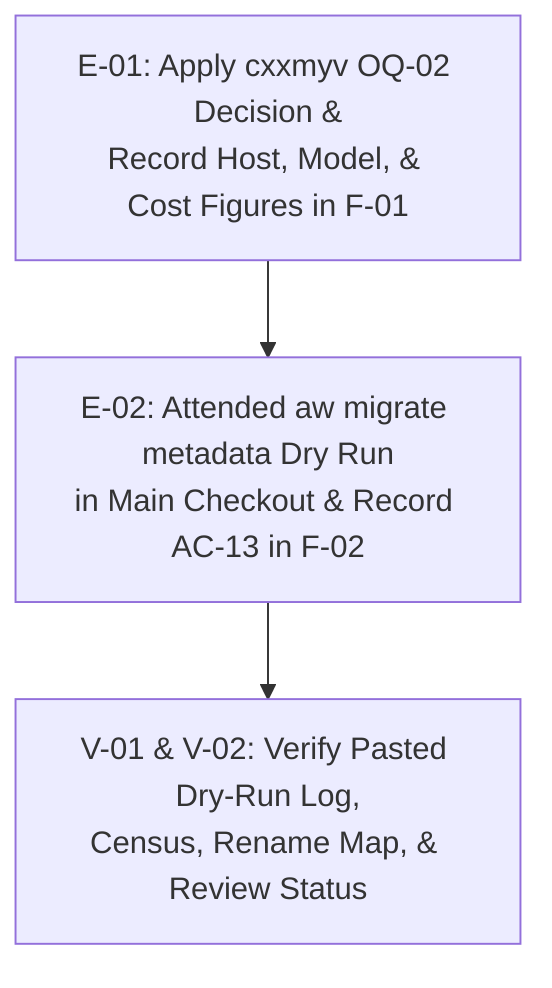

# IPD: Record the description model and run the attended pre-cutover migration dry run

- Date: 2026-11-09
- Kind: child
- Concern: The attended cutover `cxxmyv` began with two preparation steps that change nothing on disk: choosing the description-generation model (its OQ-02) and a full `aw migrate metadata` dry run on the unswitched tree, which also records the AC-13 "before" values. Neither changes `main`'s on-disk format, so spec `4sd62s` 5.2 and C10a allow them before the cutover commit. Moving them here (round-3 split, research `nj8zdp`) shortens the attended cutover turn; `cxxmyv` E-09 still repeats the dry run on the exact tree it migrates.
- Scope: Record the host and model choice with the `ya4ee4` trial figures; in the maintainer's main checkout, run the dry run, paste its report, and record the AC-13 before values. Edits only this plan.
- Scope-Paths: .aw/records/plans/pending/20261109-metastore-254-tub3ir-record-the-description-model-and-run-the-attended-pre-cutove.ipd.md
- Item-Dependencies: executed:1ajqaa, executed:87rvs2, executed:90iqr1, executed:aqc3m6, executed:clors0, executed:dcerjg, executed:g5hpbb, executed:iog3cw, executed:rdg0qv, executed:w13bkp, executed:ya4ee4, executed:zgyna1
- Status: approved
- Readiness: go-pending-approval
- Review-Depth: standard
- From-Spec: 4sd62s
- Work-Kind: feature
- Priority: high
- Blocks-Release: next
- Attended: required
- Set: metastore
- Order: 254
- Highest E allocated: 02
- Author: opencode its_direct/pt3-claude-opus-5.5-1m-us
- Id: tub3ir
- Approval: 2026-11-16, recorded via aw ipd set: status set to approved

> Write and proofread this plan per the technical writing standard, `.aw/system/workflows/technical-writing/technical-writing.md` (`.agents/workflows/technical-writing/technical-writing.md` in a legacy-layout install), including requirement 12 (diagrams).

## Workflow history
- 2026-11-16 approved (aw set): status set to approved

- 2026-11-14 reviewed (antigravity/gemini-3.8-flash): /plan-review (antigravity/gemini-3.8-flash): APPROVE WITH REVISIONS APPLIED; PR-001, PR-002, PR-003, PR-004.
- 2026-11-09 to-review (opencode its_direct/pt3-claude-opus-5.5-1m-us): split from cxxmyv (round 3, research nj8zdp guidance).

## Goal

Before the attended cutover, fix the description model and prove on the real, unswitched repository that the migration's dry run is clean, recording the AC-13 before values that `cxxmyv` compares against.

## Detailed Implementation Checklist (TODO)

Execution-state rule: mark an `E-*` item complete only after performing the action. That mark is not validation. Right-sizing rule: write for a modest executor that cannot hold much in its head. Each E-item is one step (one concern, about one file, executable in one focused pass) and its V-item names each unit it covers with its own check; a plan stays at about 5 E-items and 8 work Scope-Paths, else split it into more child plans (guidance, `IPD-Z603`). Accepted execution states: blocked, failed, pending, performed; terminal gate demands 'performed'.

### Task group 1: decision

- [ ] E-01 (was `cxxmyv` E-01, verbatim.) Apply the `cxxmyv` OQ-02 decision before the code switch: from `ya4ee4`'s 40-record trial result (its E-10 table), pick the cheapest model whose output the maintainer judges accurate, and record here the chosen host, the model, the per-record mean cost and the extrapolated full-run cost and duration. This item writes no code; the OQ-01 code is `clors0` E-14.
  - Depends on: none
  - Expected outcome: the chosen host and model are recorded in this plan's `## Findings` (F-01) with the trial figures they rest on and the maintainer's confirmation.
  - Execution state: pending

### Task group 2: dry run

- [ ] E-02 (was `cxxmyv` E-02.) In the maintainer's main checkout (never a runner lane), with the maintainer present, run `aw migrate metadata` (dry run, with the E-01 host and model) on the current, unswitched tree and paste: the preflight lines (uncommitted record changes, integration lock, unmerged lanes, linked-worktree check, sidecar present with its record count, AC-22 case 2), the field census (AC-20) including the orphan `id6` lines of the sidecar (AC-30 case 3), the rename map (34 records at authoring; the bar is that every legacy-timestamp artifact and walkthrough is mapped) with `wvlk84` as `awphysical-17` (AC-41 case 1), the citation-rewrite report per location (OQ-27, AC-41 case 5), the description-journal status (records with and without a description, OQ-22), and the round-trip result. On the same tree, record the AC-13 "before" values that `cxxmyv` E-11 compares against (bytes an agent reads for one named plan; end-to-end wall time of `aw find` and `aw attention`, warm and cold, with the cold-cache method stated) in F-02. The maintainer reviews the generated descriptions in the journal; the journal stays in the gitignored state root for `5qyba0` and `cxxmyv` (no second model run).
  - Depends on: E-01
  - Expected outcome: a clean dry run whose census has no `unknown-field` or unparseable value and whose description journal is complete or lists each deliberate absence; the AC-13 before values are recorded.
  - Execution state: pending

## Project conventions discovered (Step 0)

- The migration runs in the checkout that holds `.aw/records/history.jsonl` (spec 5.2 step 1, 3c); a runner lane has no sidecar, so this plan is `Attended: required`.
- A dry run writes no tracked file; only the gitignored description journal and state change.

## Findings

| Id | Evidence | Finding |
|---|---|---|
| F-01 | (written by E-01) | Chosen host, model, per-record mean cost, extrapolated cost and duration, maintainer confirmation. |
| F-02 | (written by E-02) | AC-13 before values: plan id6 used, bytes read, `aw find` and `aw attention` warm and cold times, cold-cache method. |

## Proposed changes (ordered, validatable)

1. E-01: record the model decision.
2. E-02: dry run and AC-13 before values.

## Deferred / out of scope (with reason)

- The code switch, the final dry run on the switched tree, the migration and the cutover commit (spec 5.2, C10a).
  - Carrier: cxxmyv

## Scope check

- Over-scope: none.
- Under-scope: none. `cxxmyv` E-01 and E-02 map to E-01 and E-02.

## Required tests / validation

- V-01, V-02 below. No test is added.

## Spec / documentation sync

No spec change.

## Open questions

### OQ-01: How is the description-generation model selection decided and recorded?

- Blocking: no
- Status: resolved
- Owner: plan author
- Resolution or deferral rationale: `cxxmyv` OQ-02 was resolved 2026-11-02 by the maintainer via /askme: the cutover uses the cheapest model whose `ya4ee4` 40-record trial output the maintainer judges accurate (default candidate `google/gemini-3.1-flash-lite` on opencode). E-01 records the chosen host, model, per-record mean cost, and extrapolated full-run figures in F-01 with maintainer confirmation. Recommendation strength: very strong.

### OQ-02: Why does this dry run execute in the main checkout rather than an isolated runner lane worktree?

- Blocking: no
- Status: resolved
- Owner: plan author
- Resolution or deferral rationale: Spec `4sd62s` section 5.2 steps 1 and 3c requires `.aw/records/history.jsonl` to verify the sidecar census and record count (AC-22 case 2). A runner lane worktree does not contain the history sidecar. Executing with `- Attended: required` in the maintainer's main checkout ensures pre-cutover verification without modifying tracked files. Recommendation strength: very strong.

## Validation and cross-check (verify before reporting done)

Validation-state rule: inspect evidence in a separate pass. Do not mark a `V-*` item complete from memory or from the matching execution checkmark. Accepted validation results: blocked, failed, pass, pending; terminal gate demands 'pass'. Runtime-demonstration reachability rule: for each `V-*` item demanding the software be observed acting (such as a run, a dispatch, or a transition), as distinct from items demanding a diff, a file's content, or a test result (which are reachable by construction), name the code path that produces the observation or the sibling `E-*` that creates it, else the demand is UNDER-SCOPE.

- [ ] V-01 validates E-01
  - Required evidence: quote F-01 (host, model, per-record mean cost, extrapolated full-run cost and duration) with the `ya4ee4` E-10 trial row it rests on and the maintainer's confirmation.
  - Observed evidence:
  - Result: pending
- [ ] V-02 validates E-02
  - Required evidence: paste the full dry-run output of `aw migrate metadata` from the main checkout, with `git rev-parse --git-dir` and `git rev-parse --git-common-dir` printed beside it to show it is not a linked worktree: preflight lines including the sidecar record count (AC-22 case 2), the census with zero `unknown-field` and its orphan `id6` lines (AC-30 case 3), the rename map with one row per legacy-timestamp record (count re-derived at execution) showing `wvlk84` as `awphysical-17`, the citation report per location with its ambiguity-warning count and the list of deliberately unchanged citations, the description-journal counts, and the round-trip result; F-02 with each exact command; plus the maintainer's statement that the descriptions were reviewed.
  - Observed evidence:
  - Result: pending

## Approval and execution gate

- Size assessment: standard
- Cohesion rationale: not required

Execute only with the maintainer present, in the main checkout that holds the history sidecar, after human approval (`Status: approved`) and after every plan in `- Item-Dependencies:` is `executed`. The runner must not dispatch this plan unattended (`- Attended: required`). Safety stop: stop and report without editing files or executing commands if prerequisite metastore symbols from dependencies are absent on HEAD, if `.aw/records/history.jsonl` is absent or corrupt, or if concurrent edits in a shared checkout conflict with `- Scope-Paths:`.

Scope fence: the paths in `- Scope-Paths:` are a declaration; a needed file outside the fence is edited and then justified at finalize (`--scope-reason`), and a declared path left unmodified is acknowledged (`--scope-ack`).

Honesty rule: paste the ACTUAL dry-run output and summary metrics; never claim a result you did not run.

Commits: commit only through `aw commit tub3ir -- <paths>` with only Scope-Paths files; never `git add -A`, a bare `git add` or `git commit -a`; never push.

Lifecycle transition: the plan moves to `.aw/records/plans/executed/` only through finalize, never a hand `git mv` to `executed/`, and only after `aw ipd lint --phase pre-transition` conforms and every `V-*` reads `pass` with pasted evidence. When `aw oc run` or `aw agy run` executes the plan, the runner owns retirement to `executed/` and runs finalize automatically upon task completion; when executed standalone by hand or direct agent turn, the attending executor runs `aw ipd finalize tub3ir`.
