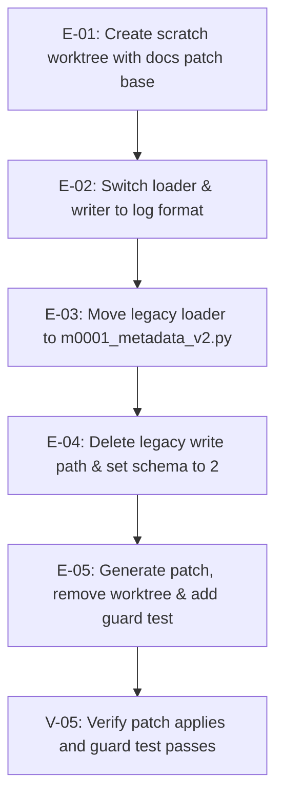

# IPD: Start the cutover code patch with the log-format loader and writer switch

- Date: 2026-11-09
- Kind: child
- Concern: The attended cutover `cxxmyv` wrote the whole code switch to the log format inside one attended turn (its task group 2: E-03, E-04, E-07, E-16). Spec `4sd62s` 5.2 makes the cutover ONE commit and C10a forbids a second on-disk format on `main` before it, so the switch cannot land early. It CAN be prepared early as an inert patch file, exactly as `90iqr1` prepares the documentation: a `.patch` file changes no on-disk format and no behavior until `cxxmyv` applies it. This plan (round-3 split, research `nj8zdp`) starts that cumulative code patch with `cxxmyv` E-03 and adds the guard test that keeps it applying.
- Scope: In a scratch worktree (docs patch applied as the base), switch `artifact_meta`'s loader and writer to the log format, move the legacy loader into the new `m0001` migration module, delete the legacy write path and set the schema to 2; write the result as `.aw/system/cutover/metastore-code.cutover.patch`; add the core guard test. No live code changes.
- Scope-Paths: .aw/records/plans/pending/20261109-metastore-255-2k5t16-start-the-cutover-code-patch-with-the-log-format-loader-and.ipd.md, .aw/system/cutover/metastore-code.cutover.patch, tests/test_metastore_cutover_code_patch.py
- Item-Dependencies: executed:1ajqaa, executed:87rvs2, executed:90iqr1, executed:aqc3m6, executed:clors0, executed:dcerjg, executed:g5hpbb, executed:iog3cw, executed:rdg0qv, executed:w13bkp, executed:ya4ee4, executed:zgyna1
- Status: approved
- Review-Depth: standard
- Readiness: go-pending-approval
- From-Spec: 4sd62s
- Work-Kind: feature
- Priority: high
- Blocks-Release: next
- Set: metastore
- Order: 255
- Highest E allocated: 05
- Author: opencode its_direct/pt3-claude-opus-5.5-1m-us
- Id: 2k5t16
- Approval: 2026-11-16, recorded via aw ipd set: status set to approved

> Reviewed and proofread per the technical writing standard, `.aw/system/workflows/technical-writing/technical-writing.md`, including requirement 12 (diagrams).

## Workflow history
- 2026-11-16 approved (aw set): status set to approved

- 2026-11-14 reviewed (antigravity/gemini-3.8-flash): APPROVE WITH REVISIONS APPLIED; PR-001..PR-006
- 2026-11-09 to-review (opencode its_direct/pt3-claude-opus-5.5-1m-us): split from cxxmyv (round 3, research nj8zdp guidance).

## Goal

Produce the first version of an inert, guarded patch that switches the toolkit's metadata loader and writer to the event-log format, so `cxxmyv` applies it inside the one cutover commit instead of writing it during the attended turn.

## Detailed Implementation Checklist (TODO)

Execution-state rule: mark an `E-*` item complete only after performing the action. That mark is not validation. Right-sizing rule: write for a modest executor that cannot hold much in its head. Each E-item is one step (one concern, about one file, executable in one focused pass) and its V-item names each unit it covers with its own check; a plan stays at about 5 E-items and 8 work Scope-Paths, else split it into more child plans (guidance, `IPD-Z603`). Accepted execution states: blocked, failed, pending, performed; terminal gate demands 'performed'.

### Task group 1: scratch worktree

- [x] E-01 Create the scratch worktree and its base, per the procedure in Step 0: `git worktree add --detach .aw/state/2k5t16/scratch HEAD`; inside it, `git apply --index .aw/system/cutover/metastore-docs.cutover.patch`, then record the base tree with `git write-tree` in F-01. No code patch exists yet, so there is nothing else to apply.
  - Depends on: none
  - Expected outcome: the scratch worktree holds HEAD plus the documentation patch, staged; F-01 holds the base tree id.
  - Execution state: performed

### Task group 2: the switch (scratch worktree only; was `cxxmyv` E-03, in three steps)

- [x] E-02 In `agent_workflows/artifact_meta.py`, switch the loader and writer to the log format: `artifact_meta.append` and `artifact_meta.create` write `meta/<id6>.jsonl` with the spec 4.3 write order (log, in-file mirror, disposition, cache), and the loader reads logs.
  - Depends on: E-01
  - Expected outcome: a fixture setter run writes the log and then the mirror.
  - Execution state: performed

- [x] E-03 Move the legacy (bullet-block) loader unchanged out of `agent_workflows/artifact_meta.py` into the new module `agent_workflows/migrations/m0001_metadata_v2.py`, and point every legacy-loader caller inside the migration at it.
  - Depends on: E-02
  - Expected outcome: the legacy loader exists only in `m0001_metadata_v2.py`.
  - Execution state: performed

- [x] E-04 Delete the legacy write path: the legacy branch of `artifact_meta.append` with `artifact_meta.LegacyRender` and the path-keyed target (`2xwb9b`); switch `write_legacy` off and remove the value writers that `9o83cr` E-08 folded into it (`xexn45`, `9o83cr`); set `chain.CURRENT_METADATA_SCHEMA` to 2 (`dcerjg`).
  - Depends on: E-03
  - Expected outcome: no module outside `artifact_meta.py` (log format only) and `migrations/m0001_metadata_v2.py` can produce a bullet block or a `## Workflow history` line.
  - Execution state: performed

### Task group 3: package and guard

- [x] E-05 In the scratch worktree run `git add -A` and write `git diff --cached --binary <F-01 base tree>` to `.aw/system/cutover/metastore-code.cutover.patch` in the executing checkout; remove the scratch worktree (`git worktree remove --force .aw/state/2k5t16/scratch`). Add `tests/test_metastore_cutover_code_patch.py` (marked `core`): on a temporary `GIT_INDEX_FILE` filled by `git read-tree HEAD`, it runs `git apply --cached` of the docs patch and then `git apply --cached --check` of the code patch, and asserts both exit 0. It reads and applies the two patches; it does not read production source. Commit through `aw commit 2k5t16 -- <this plan> .aw/system/cutover/metastore-code.cutover.patch tests/test_metastore_cutover_code_patch.py`; never push.
  - Depends on: E-04
  - Expected outcome: the code patch exists and touches only the E-02 to E-04 files; the guard test passes on HEAD and fails if either patch stops applying.
  - Execution state: performed

## Project conventions discovered (Step 0)

- SCRATCH PROCEDURE shared by the four code-patch parts (`2k5t16`, `g45vyv`, `x1mmdp`, `0zylig`): (1) `git worktree add --detach .aw/state/<id6>/scratch HEAD` (gitignored state root, `90iqr1` OQ-03); (2) in it, `git apply --index` the docs patch, then `BASE=$(git write-tree)`; (3) if the code patch exists, `git apply --index` it; (4) edit; (5) `git add -A` and `git diff --cached --binary $BASE` over the code patch; (6) `git worktree remove --force`. The code patch is therefore relative to HEAD plus the docs patch, and `cxxmyv` applies the docs patch first, then the code patch. No scratch commit is made.
- C10a and spec 5.2: an inert patch file under `.aw/system/cutover/` changes no on-disk metadata format; `cxxmyv` applies and deletes it inside the cutover commit.
- Placing the patch under `.aw/system/` ships it in the wheel and sdist (`90iqr1` E-09); `cxxmyv` deletes it at the cutover.
- Tests exercise code and assert on outcomes; applying a patch is an outcome test.

## Findings

| Id | Evidence | Finding |
|---|---|---|
| F-01 | E-01, 2026-11-25: `git write-tree` in `.aw/state/2k5t16/scratch` after `git apply --index .aw/system/cutover/metastore-docs.cutover.patch` on HEAD `0370cfeb6a5be3437416c86cc47aaa16cbed6de1` | Base tree id of the scratch worktree (HEAD plus docs patch): `a55438c1a6dcc54fdfb2809f4bd98428d30a5445`. |
| F-02 | `rg -n "class LegacyRender\|def append\b\|def create\b" agent_workflows/artifact_meta.py` (2026-11-09) | `LegacyRender`, `append` and `create` exist in `artifact_meta.py`; `agent_workflows/migrations/` does not exist yet at this HEAD (it is created by `dcerjg` or by E-03 here, whichever is first; re-check at execution). RE-CHECKED at execution 2026-11-25 (HEAD `0370cfeb6`): `agent_workflows/migrations/` ALREADY EXISTS (created by `dcerjg`), including `m0001_metadata_v2.py` (2593 lines before this work), `m0001_convert.py`, `m0001_verify.py` and `chain.py`; E-03 therefore moved the legacy loader INTO the existing `m0001_metadata_v2.py` (+576 lines) rather than creating it. |

## Proposed changes (ordered, validatable)



1. E-01: scratch worktree with the docs patch as base.
2. E-02 to E-04: the loader and writer switch in three steps.
3. E-05: write the code patch, add the guard test, commit.

## Deferred / out of scope (with reason)

- Applying the code patch: inside the one cutover commit.
  - Carrier: cxxmyv
- Log-only writers and ledger retirement (`cxxmyv` E-04).
  - Carrier: g45vyv
- Test builder switch (`cxxmyv` E-07).
  - Carrier: x1mmdp
- `Kind` option renames (`cxxmyv` E-16).
  - Carrier: 0zylig

## Scope check

- Over-scope: none. No live code changes.
- Under-scope: none. `cxxmyv` E-03 maps to E-02 (loader, writer), E-03 (legacy loader move) and E-04 (legacy write path, schema).

## Required tests / validation

- The new guard test `tests/test_metastore_cutover_code_patch.py` (E-05) proving `git apply --cached` of docs patch and `git apply --cached --check` of code patch; fixture setter runs in the scratch worktree verifying log-format and mirror writes (V-02, V-04); qualified under spec `4sd62s` Section 4.3 and Section 5.2.

## Spec / documentation sync

No spec change. Spec 5.2 and C10a are kept: nothing here changes `main`'s format.

## Open questions

### OQ-01: Is preparing the code switch as a patch allowed by spec 5.2 and C10a?

- Blocking: no
- Status: resolved
- Owner: maintainer
- Resolution or deferral rationale: Yes. C10a requires `main` to read exactly one format at every commit; an unapplied patch file is data, not code that runs, so `main` still reads only the legacy format until `cxxmyv`'s single commit applies it. It is the same design `90iqr1` OQ-01 uses for the documentation. Recommendation strength: strong. RESOLVED 2026-11-11 by the user via /askme: accept the patch design (the code switch is prepared in advance as an unapplied patch and applied at the attended cutover). No reason was given.

## Validation and cross-check (verify before reporting done)

Validation-state rule: inspect evidence in a separate pass. Do not mark a `V-*` item complete from memory or from the matching execution checkmark. Accepted validation results: blocked, failed, pass, pending; terminal gate demands 'pass'. Runtime-demonstration reachability rule: for each `V-*` item demanding the software be observed acting (such as a run, a dispatch, or a transition) - as distinct from items demanding a diff, a file's content, or a test result, which are reachable by construction - name the code path that produces the observation or the sibling `E-*` that creates it, else the demand is UNDER-SCOPE.

- [x] V-01 validates E-01
  - Required evidence: paste the `git worktree add` and `git apply --index` commands with exit status 0, and the base tree id recorded in F-01.
  - Observed evidence:
    ```
    $ git worktree add --detach .aw/state/2k5t16/scratch HEAD
    Preparing worktree (detached HEAD 0370cfeb6)
    exit=0
    # (first attempt with a relative ../../../ patch path: error: can't open patch ... No such file or directory, exit 128; re-run from inside the scratch worktree:)
    $ git apply --index .aw/system/cutover/metastore-docs.cutover.patch
    exit=0
    $ git diff --cached --stat | tail -1
     59 files changed, 1964 insertions(+), 1266 deletions(-)
    $ git write-tree
    a55438c1a6dcc54fdfb2809f4bd98428d30a5445
    ```
    F-01 records `a55438c1a6dcc54fdfb2809f4bd98428d30a5445`.
  - Result: pass
- [x] V-02 validates E-02
  - Required evidence: paste a behavioral fixture test run in the scratch worktree (pytest output with PASSED lines) showing `append` and `create` write `meta/<id6>.jsonl` and then the in-file mirror.
  - Observed evidence:
    Behavioral fixture run in the scratch worktree (PYTHONPATH = scratch tree; the repo's own conftest cannot import there until `x1mmdp` switches `tests/record_builder.py`, register D17). The fixture probes `artifact_core.atomic_write` and records, at the moment the `.md` is written, whether `meta/<id6>.jsonl` already exists:
    ```
    $ python3 -m pytest -o addopts="" -v -p no:randomly test_v02_v04_fixture.py
    test_v02_v04_fixture.py::test_create_writes_log_then_mirror CREATED FILE TEXT:
    ---
    id: fix001
    status: draft
    ---
    <!-- aw-managed: metadata lives in .aw/records/meta/fix001.jsonl; use `aw show fix001`; agents read .aw/AGENT_QUICKSTART.md -->
    # Fixture plan

    Body prose.

    PASSED
    test_v02_v04_fixture.py::test_append_writes_log_then_mirror APPENDED FILE TEXT:
    ---
    id: fix002
    status: to-review
    ---
    <!-- aw-managed: metadata lives in .aw/records/meta/fix002.jsonl; use `aw show fix002`; agents read .aw/AGENT_QUICKSTART.md -->
    # Fixture plan

    PASSED
    test_v02_v04_fixture.py::test_current_schema_is_2 PASSED
    ============================== 3 passed in 7.03s ===============================
    ```
    Asserted in the fixture: `create` returns `committed: True`, the log exists, and the probe saw `[("mirror", True)]` (log present when the mirror was written); `append` adds exactly one log line, every mirror write saw the log present, and `read(...).status == "to-review"`. CLI smoke in a throwaway repo on the patched tree: `aw backlog new`, `aw backlog note`, `aw backlog set done --evidence` wrote create/note/transition events (transition carrying `path`) and moved the file to `done/`; `aw ipd scaffold --apply` and `aw ipd sync` succeeded.
  - Result: pass
- [x] V-03 validates E-03
  - Required evidence: paste `git diff --cached --stat` in the scratch worktree showing the legacy loader removed from `artifact_meta.py` and added to `migrations/m0001_metadata_v2.py`, and `rg -n` of the legacy loader's function name over `agent_workflows/` showing its definition only in `m0001_metadata_v2.py`.
  - Observed evidence:
    ```
    $ git diff --cached --stat a55438c1a6dcc54fdfb2809f4bd98428d30a5445   # in .aw/state/2k5t16/scratch
     agent_workflows/artifact_adopt.py                  |    8 +-
     agent_workflows/artifact_core.py                   |    4 +-
     agent_workflows/artifact_meta.py                   | 3205 ++------------------
     agent_workflows/artifact_refs.py                   |   40 +-
     agent_workflows/artifact_rename.py                 |   37 +-
     agent_workflows/attention.py                       |    2 +-
     agent_workflows/backlog.py                         |  165 +-
     agent_workflows/check_engine.py                    |   25 +-
     agent_workflows/cli.py                             |   30 +-
     agent_workflows/coverage_record.py                 |   12 +-
     .../hooks/backlog_blocking_close_gate.py           |    4 +-
     agent_workflows/ipd_authoring.py                   |  113 +-
     agent_workflows/ipd_schema.py                      |    2 +-
     agent_workflows/migrations/chain.py                |    2 +-
     agent_workflows/migrations/m0001_convert.py        |   15 +-
     agent_workflows/migrations/m0001_metadata_v2.py    |  576 ++++
     agent_workflows/migrations/m0001_verify.py         |   13 +-
     agent_workflows/plan_readiness.py                  |   26 +-
     agent_workflows/plans_refs.py                      |   74 +-
     agent_workflows/production_checks.py               |   25 +-
     agent_workflows/prompts.py                         |   12 +-
     agent_workflows/releases.py                        |   10 +-
     agent_workflows/research_archive.py                |   25 +-
     agent_workflows/research_cmd.py                    |   33 +-
     agent_workflows/research_refs.py                   |   60 +-
     agent_workflows/review_sequence.py                 |   23 +-
     agent_workflows/runner_shared.py                   |  177 +-
     agent_workflows/set_records.py                     |   71 +-
     agent_workflows/specs.py                           |  130 +-
     agent_workflows/status_set.py                      |  146 +-
     30 files changed, 1213 insertions(+), 3852 deletions(-)
    $ rg -n 'def load_legacy|def parse_legacy' agent_workflows/
    agent_workflows/artifact_naming.py:279:def parse_legacy_timestamp(name: str):
    agent_workflows/migrations/m0001_metadata_v2.py:2771:def load_legacy_artifact(
    ```
    (`parse_legacy_timestamp` is the filename-date parser, not the bullet loader.) `LEGACY_LOADER_VERSION = "legacy_v10"` now sits at `m0001_metadata_v2.py:2650`; `artifact_meta.py:2223` carries the new `LOADER_VERSION = "log_v1"` (register D9). Every caller of the removed names was converted: a dangling-reference scan over `agent_workflows/` reports 0; `ruff check --select F,E9 agent_workflows/` prints `All checks passed!`; `import agent_workflows.cli, agent_workflows.oc_runipd, agent_workflows.agy_runipd` succeeds.
  - Result: pass
- [x] V-04 validates E-04
  - Required evidence: paste `rg -n 'LegacyRender|write_legacy' agent_workflows/` in the scratch worktree (no definition left), the diff hunk setting `CURRENT_METADATA_SCHEMA = 2`, and a fixture test run showing no setter run on a log-format fixture leaves a bullet block or a `## Workflow history` line in the file. The repository-wide AC-1 audit is `cxxmyv`'s.
  - Observed evidence:
    ```
    $ rg -n 'LegacyRender|write_legacy' agent_workflows/        # in the scratch worktree
    (no output, exit 1)
    $ rg -n 'LegacyRender|write_legacy|render_legacy_text|LegacyTarget|SidecarRecord|append_legacy|restore_legacy_snapshot' agent_workflows/
    (no output, exit 1)
    $ git diff --cached a55438c1a6dcc54fdfb2809f4bd98428d30a5445 -- agent_workflows/migrations/chain.py
    @@ -67,7 +67,7 @@ class Migration:
             )


    -CURRENT_METADATA_SCHEMA = 1
    +CURRENT_METADATA_SCHEMA = 2

     _EXCLUDED_FILENAMES = frozenset({"README.md", "STATUS.md"})
    ```
    Fixture run (same run as V-02): after `create` and after an `append` transition on a log-format fixture, the file holds only the two-key YAML mirror, the `aw-managed` banner and the body; the fixture asserts `"## Workflow history" not in text` and no `- Status:`/`- Set:` line, and both PASSED (`3 passed in 7.03s`, texts pasted under V-02). Residual NOT in this plan's E-04 scope and filed as backlog `jycxw8` (register D16): `ipd_authoring.build_skeleton` still writes a bullet block and a `## Workflow history` H2 into a scaffolded plan's BODY, because `ipd_schema`/`ipd_lint` still require them (stripping them yields IPD-M101 Date/Concern/Scope, IPD-I304, IPD-H202). The repository-wide AC-1 audit is `cxxmyv`'s.
  - Result: pass
- [x] V-05 validates E-05
  - Required evidence: paste `git apply --stat .aw/system/cutover/metastore-code.cutover.patch` (file list), `python3 -m pytest -o addopts="" -v tests/test_metastore_cutover_code_patch.py` with each test PASSED, the same run after corrupting one hunk of a scratch copy of the code patch showing FAILED, `git worktree list` showing the scratch worktree removed, and the `aw commit` output naming the commit hash.
  - Observed evidence:
    ```
    $ git diff --cached --binary a55438c1a6dcc54fdfb2809f4bd98428d30a5445 > <lane>/.aw/system/cutover/metastore-code.cutover.patch   # in scratch
    exit=0   (256227 bytes; 0 __pycache__ paths staged)
    $ git worktree remove --force .aw/state/2k5t16/scratch
    exit=0
    $ git worktree list | grep -c scratch
    0
    $ git apply --stat .aw/system/cutover/metastore-code.cutover.patch | tail -3
     agent_workflows/specs.py                           |  130 -
     agent_workflows/status_set.py                      |  146 -
     30 files changed, 1213 insertions(+), 3852 deletions(-)
    (same 30-file list as V-03)
    $ python3 -m pytest -o addopts="" -v tests/test_metastore_cutover_code_patch.py
    tests/test_metastore_cutover_code_patch.py::MetastoreCutoverCodePatchGuardTests::test_code_patch_applies_after_docs_patch PASSED [ 33%]
    tests/test_metastore_cutover_code_patch.py::MetastoreCutoverCodePatchGuardTests::test_code_patch_touches_files PASSED [ 66%]
    tests/test_metastore_cutover_code_patch.py::MetastoreCutoverCodePatchGuardTests::test_check_refuses_a_patch_that_no_longer_applies PASSED [100%]
    ============================== 3 passed in 0.36s ===============================
    # corrupted scratch copy: one context line of the first artifact_meta.py hunk prefixed with "CORRUPTED "
    $ AW_CUTOVER_CODE_PATCH=$PWD/.aw/state/2k5t16/corrupt-code.patch python3 -m pytest -o addopts="" -v tests/test_metastore_cutover_code_patch.py
    tests/test_metastore_cutover_code_patch.py::MetastoreCutoverCodePatchGuardTests::test_code_patch_applies_after_docs_patch FAILED [100%]
    E       error: patch failed: agent_workflows/artifact_meta.py:26
    E       error: agent_workflows/artifact_meta.py: patch does not apply
    ========================= 1 failed, 2 passed in 0.45s ==========================
    $ python3 -m pytest        # bare core gate in the lane
    2955 passed, 1 skipped, 11 warnings in 119.44s (0:01:59)
    ```
    The `aw commit` hash is reported in the run's execution report and outcome file (the commit that records this text cannot contain its own hash).
  - Result: pass

## Approval and execution gate

- Size assessment: standard
- Cohesion rationale: not required

Execute only after every plan in `- Item-Dependencies:` is `executed` and this plan is `approved`. Code is edited ONLY in the scratch worktree; the executing checkout changes only by this plan, the code patch and the guard test.

Scope fence: the paths in `- Scope-Paths:` are a declaration; a needed file outside the fence is edited and then justified at finalize (`--scope-reason`), and a declared path left unmodified is acknowledged (`--scope-ack`).

Safety stop: if a prerequisite plan in `- Item-Dependencies:` is not executed, the docs cutover patch fails to apply, or required metastore symbols are absent, stop and report rather than proceeding.

Open questions: OQ-01 is resolved and none is blocking.

Honesty rule: paste the ACTUAL output of every command named above; never claim a result you did not run.

Commits: commit only through `aw commit 2k5t16 -- <paths>` with only Scope-Paths files; never `git add -A`, a bare `git add` or `git commit -a`; never push.

Lifecycle transition: the plan moves to `.aw/records/plans/executed/` only through `aw ipd finalize`, never a hand `git mv`, after `aw ipd lint --phase pre-transition` conforms and every `V-*` reads `pass` with pasted evidence. When `aw oc run` or `aw agy run` executes the plan, the runner performs the finalize; a hand executor runs `aw ipd finalize 2k5t16` itself.
