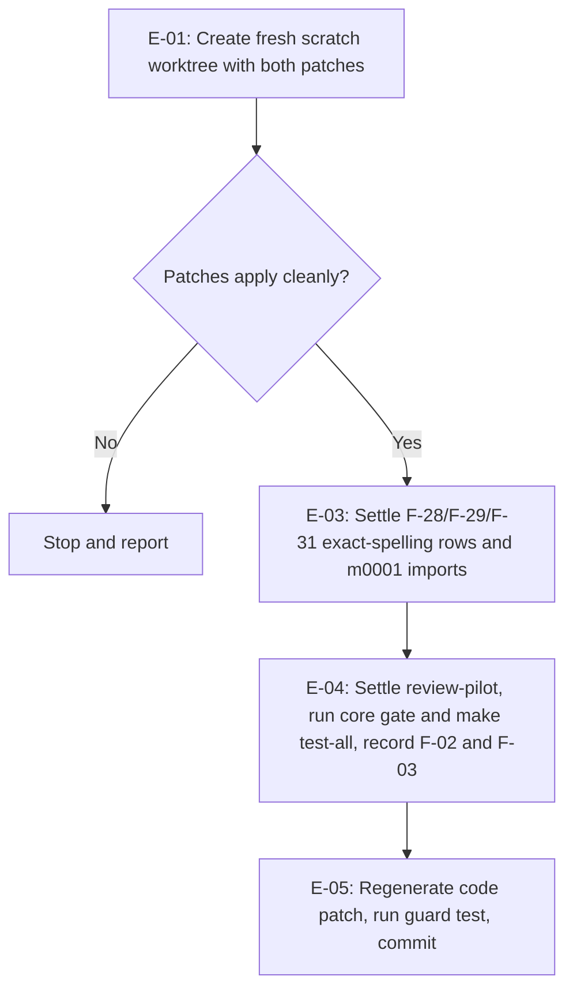

# IPD: Add the log-format test builder switch to the cutover code patch

- Date: 2026-11-09
- Kind: child
- Concern: `cxxmyv` E-07 switched the shared test record builder and the field assertion helper to the log format inside the attended cutover turn. On `main` before the cutover that switch would make the suite test a format `main` does not use, so it belongs in the one cutover commit (spec `4sd62s` 5.2, C10a); it can be prepared as part of the inert cumulative code patch (round-3 split, research `nj8zdp`).
- Scope: In an isolated scratch worktree `.aw/state/x1mmdp/scratch` with both cutover patches applied (after the split children `hdwqex`, `89mtbl`, the prerequisite production-fix children `fljn9b`, `szykgd`, `otin36`, `p109wy`, `q6fiws`, `j1f454`, `lec341`, `3e0vfy`, `6cltab`, and the test-conversion batch children `nv3upa`, `cugg3w`, `psm9ac`, `x8id25`, `e0g2gt`, `qi0kl6`, `x3mig6` have switched the builder, fixed production log-awareness gaps, and converted the failing test modules), verify and settle every `setter-byte, exact spelling` row across `iog3cw` F-28, `rdg0qv` F-29, and `w13bkp` F-31, verify the literal-input legacy tests point at `m0001`, settle the `tests/fixtures/review-pilot/plans/` corpus and `tests/test_review_pilot.py`, pass the deferred slow integration suite `tests/test_record_builder_slow.py` (deferred from `89mtbl` OQ-01), run both the bare core gate and `make test-all` to assemble the authoritative final refusal list in F-03, and regenerate `.aw/system/cutover/metastore-code.cutover.patch`. The builder switch (former E-02) moved to `89mtbl`. Make no live code or test changes outside `- Scope-Paths:`.
- Scope-Paths: .aw/records/plans/pending/20261109-metastore-257-x1mmdp-add-the-log-format-test-builder-switch-to-the-cutover-code-p.ipd.md, .aw/system/cutover/metastore-code.cutover.patch
- Item-Dependencies: executed:1ajqaa, executed:3e0vfy, executed:639g02, executed:6cltab, executed:87rvs2, executed:89mtbl, executed:90iqr1, executed:aqc3m6, executed:clors0, executed:cugg3w, executed:dcerjg, executed:e0g2gt, executed:fljn9b, executed:g45vyv, executed:g5hpbb, executed:hdwqex, executed:iog3cw, executed:j1f454, executed:lec341, executed:nv3upa, executed:otin36, executed:p109wy, executed:psm9ac, executed:q6fiws, executed:qi0kl6, executed:rdg0qv, executed:szykgd, executed:w13bkp, executed:x3mig6, executed:x8id25, executed:ya4ee4, executed:zgyna1, executed:ztvubn
- Status: approved
- Review-Depth: standard
- Readiness: go-pending-approval
- From-Spec: 4sd62s
- Work-Kind: feature
- Priority: high
- Blocks-Release: next
- Set: metastore
- Order: 257
- Highest E allocated: 05
- Author: opencode its_direct/pt3-claude-opus-5.5-1m-us
- Id: x1mmdp
- Approval: 2026-11-26, recorded via aw ipd set: status set to approved

## Workflow history
- 2026-11-27 same-status (aw set): Add prerequisite Orders 323 (ztvubn) and 324 (639g02) ahead of x1mmdp
- 2026-11-27 note (antigravity/gemini): added Order 322 prerequisite 6cltab (CLI creator log fields 0b3ynm and aw find bare-repo context 2etrjf) and adopted deferred slow integration test tests/test_record_builder_slow.py in E-04/V-04 per maintainer answer to run-20261127T045218Z-1963184 question 219-89mtbl-a1-89mtbl-slow-tests-circular-dep.
- 2026-11-26 approved (aw set): status set to approved
- 2026-11-26 /plan-review (antigravity/gemini): APPROVE WITH REVISIONS APPLIED; PR-001..PR-005 FIXED; review record .aw/records/reviews/20261109-metastore-257-x1mmdp-add-the-log-format-test-builder-switch-to-the-cutover-code-p.review.md
- 2026-11-26 to-review (aw set): demoted approved -> to-review: APPROVAL WITHDRAWN: re-review requested via agy review
- 2026-11-26 note (antigravity/gemini): added Order 321 prerequisite 3e0vfy (plan_readiness, readiness_recheck, status_set, artifact_refs, and artifact_adopt log-awareness fix) ahead of x3mig6 per maintainer answer to run-20261126T055808Z-863961 question 06-x3mig6-a1-batch-f-production-log-aware-gaps.
- 2026-11-26 note (antigravity/gemini): added Order 319 prerequisite j1f454 (selectors status matching, typed-subject ownership, and artifact_rename --to-id6 log-awareness fix) and Order 320 prerequisite lec341 (research_cmd create, research_refs renames, and research_archive moves log-awareness fix) ahead of qi0kl6 per maintainer answer to run-20261126T055808Z-863961 question 05-qi0kl6-a1-batch-e-production-log-aware-gaps.
- 2026-11-26 note (antigravity/gemini): added Order 317 prerequisite p109wy (review mirrors, prompt metadata, and check_engine priority log-awareness fix) and Order 318 prerequisite q6fiws (coverage_record, readiness, runner, and review-sequence log-awareness fix) ahead of e0g2gt per maintainer answer to run-20261126T055808Z-863961 question 04-e0g2gt-a1-batch-d-production-log-aware-gaps.
- 2026-11-26 note (antigravity/gemini): added Order 316 prerequisite otin36 (ipd_lifecycle, partition, plans, untooled-range, hooks, and meta_repair log-awareness fix) ahead of x8id25 per recovery of run-20261126T020242Z-3080634 parked x8id25 OQ-01 Option 1.
- 2026-11-26 note (antigravity/gemini): added Order 315 prerequisite szykgd (specs, releases, spec-link, search, and dep-gate log-awareness fix) ahead of psm9ac per maintainer answer to run-20261126T020242Z-3080634 question 05-psm9ac-a1-batch-b-production-log-aware-gaps.
- 2026-11-26 note (antigravity/gemini): added Order 314 prerequisite fljn9b (backlog log-awareness fix) ahead of cugg3w per maintainer answer to run-20261126T020242Z-3080634 question 04-cugg3w-a1-backlog-log-aware-gap.
- 2026-11-26 note (opencode its_direct/pt3-claude-opus-5.5-1m-us): run run-20261125T162650Z-1337442 attempt 2: split per the maintainer answer to 06-x1mmdp-a1-Q-01 ("Split into new children; fix jycxw8 first"); E-02 moved to 89mtbl, test conversion to nv3upa..x3mig6, jycxw8 fix to hdwqex; this plan narrowed to E-03..E-05 and now depends on all nine; OQ-01 resolved.
- 2026-11-25 note (opencode its_direct/pt3-claude-opus-5.5-1m-us): run run-20261125T162650Z-1337442 attempt 1 performed E-01 (V-01 pass) and blocked at E-02: the switch is a suite-wide conversion (F-05 to F-07, OQ-01, backlog ldfefd); code patch unchanged.
- 2026-11-16 approved (aw set): status set to approved
- 2026-11-14 reviewed (aw set): APPROVE WITH REVISIONS APPLIED; PR-001..PR-005 FIXED
- 2026-11-14 /plan-review (antigravity/gemini): APPROVE WITH REVISIONS APPLIED; PR-001..PR-005 FIXED; review record .aw/records/reviews/20261109-metastore-257-x1mmdp-add-the-log-format-test-builder-switch-to-the-cutover-code-p.review.md
- 2026-11-09 to-review (opencode its_direct/pt3-claude-opus-5.5-1m-us): split from cxxmyv (round 3, research nj8zdp guidance).

## Goal

Extend the cutover code patch so every test across both tiers (bare core gate and `make test-all`) that builds its own fixture passes on the switched tree, and record in F-03 the complete, authoritative list of tests refused only because they read this repository's own unmigrated records.

## Detailed Implementation Checklist (TODO)

Execution-state rule: mark an `E-*` item complete only after performing the action. That mark is not validation. Right-sizing rule: write for a modest executor that cannot hold much in its head. Each E-item is one step (one concern, about one file, executable in one focused pass) and its V-item names each unit it covers with its own check; a plan stays at about 5 E-items and 8 work Scope-Paths, else split it into more child plans (guidance, `IPD-Z603`). Accepted execution states: blocked, failed, pending, performed; terminal gate demands 'performed'.

### Task group 1: scratch worktree

- [ ] E-01 Create a fresh scratch worktree from the current post-`x3mig6` HEAD following the SCRATCH PROCEDURE of executed plan `2k5t16` (Step 0): run `git worktree add --detach .aw/state/x1mmdp/scratch HEAD`; inside `.aw/state/x1mmdp/scratch`, run `git apply --index .aw/system/cutover/metastore-docs.cutover.patch`, record `BASE=$(git write-tree)` in F-01 (replacing the historical attempt-1 base tree id), and then run `git apply --index .aw/system/cutover/metastore-code.cutover.patch`. If either patch rejects, stop and report.
  - Depends on: none
  - Expected outcome: `.aw/state/x1mmdp/scratch` holds the current HEAD plus both cutover patches staged, and F-01 records the fresh base tree id.
  - Execution state: pending
  - Execution note: Attempt 1 (2026-11-25, HEAD `c7eed9a50`) previously verified this procedure before the worktree was removed and the 17 split children (`hdwqex`..`x3mig6`) regenerated the code patch; reset to `pending` so post-split execution builds a fresh scratch worktree and fresh `$BASE`.

### Task group 2: test switch (scratch worktree only; was `cxxmyv` E-07; the builder switch moved to `89mtbl`)

- [ ] E-03 Audit and update every `setter-byte, exact spelling` row across all executed F-28/F-29/F-31 tables (`iog3cw` F-28: 2 rows in `tests/test_backlog.py::BacklogPreservationTests::test_duplicate_work_kind_deduped`, `rdg0qv` F-29: 4 rows in `tests/test_plan_priority_required.py::ScaffoldEmissionTests::test_scaffold_emits_unresolved_sentinels_after_status` and `SetterPositionStabilityTests::test_setter_leaves_fields_adjacent_after_status`, and `w13bkp` F-31: 1 row in `tests/test_spec_id6_filenames.py::TestToId6DatedLegacyNames::test_a_spec_still_gets_its_bullet`; `87rvs2`, `aqc3m6`, and `zgyna1` recorded 0 exact-spelling rows, and `psm9ac` covers `tests/test_gradcover_end_to_end.py`). For any row already converted or retired by earlier batch children (`cugg3w`, `qi0kl6`), verify it passes on the switched tree; for the remaining rows (notably the 4 rows in `tests/test_plan_priority_required.py` which no batch child owns), update to assert post-cutover log-format behavior or retire inline bullet-position pins under conversion rule 4 citing spec `4sd62s` Sections 4.1, 4.2, and 4.3. Verify every literal-input legacy test module (legacy loader, migration round-trip, and conversion tests) points at `m0001` (`agent_workflows.migrations.m0001_metadata_v2`).
  - Depends on: E-01
  - Expected outcome: every listed exact-spelling row passes on the switched tree (or is retired with its spec `4sd62s` clause cited), and every literal-input legacy test imports from `m0001`.
  - Execution state: pending

- [ ] E-04 Settle the `tests/fixtures/review-pilot/plans/` legacy corpus (`59aiyh` Deferred row) and `tests/test_review_pilot.py` in `.aw/state/x1mmdp/scratch`: either convert the 9 fixture plans to log format with `m0001` AND update `tools/review_pilot.py::build_cell` to copy each fixture's companion `meta/<fixture_id6>.jsonl` alongside its `.ipd.md`, or keep the 9 fixture plans as literal historical inputs and route `tools/review_pilot.py` / `tests/test_review_pilot.py` through `m0001` when cells run on the switched tree; in either case, verify `tests/test_review_pilot.py::ReviewPilotTests::test_f_redaction_replaces_agent_model_host_runid` still exercises reviewer and history redaction (not vacuously under log-format `text_only=True`), and record the choice in F-02. Run `python3 -m pytest -o addopts="" -m '' tests/test_record_builder_slow.py` in `.aw/state/x1mmdp/scratch` (deferred from `89mtbl` OQ-01 per maintainer answer to `219-89mtbl-a1-89mtbl-slow-tests-circular-dep`) and confirm all 7 tests PASS once `fljn9b`, `szykgd`, `lec341`, and `6cltab` have landed. Then run BOTH the bare core gate (`python3 -m pytest`) AND the thorough suite (`make test-all`, i.e. `python3 -m pytest tests/ -m ''`, covering `slow` and `livecorpus`) in `.aw/state/x1mmdp/scratch`, and assemble F-03 starting from the F-03 lists of the batch children `nv3upa` through `x3mig6`: every failing node id across both tiers MUST be a "run `aw migrate metadata`" refusal of a test that reads this repository's own unmigrated records (`livecorpus` tests and tests over `REPO_ROOT`, such as `tests/test_attention.py`). Fix any other failure (including any unconverted `slow`-tier fixture) in the scratch worktree before E-05.
  - Depends on: E-03
  - Expected outcome: `tests/test_review_pilot.py` passes with F-02 recorded; `tests/test_record_builder_slow.py` passes all 7 tests; every test across both the bare core gate and `make test-all` that builds its own fixture passes on the switched tree; F-03 lists the complete, authoritative set of allowed live-repo refusals across both tiers for `5qyba0` E-02 and `cxxmyv` E-09.
  - Execution state: pending

### Task group 3: package

- [ ] E-05 In `.aw/state/x1mmdp/scratch`, run `git add -A` and write `git diff --cached --binary $BASE` over `.aw/system/cutover/metastore-code.cutover.patch` in the executing checkout; remove the scratch worktree (`git worktree remove --force .aw/state/x1mmdp/scratch`); run `python3 -m pytest -o addopts="" tests/test_metastore_cutover_code_patch.py` in the executing checkout; verify `git status --short` shows only `- Scope-Paths:` modified (no live code or test edits); and commit through `aw commit x1mmdp -- .aw/records/plans/pending/20261109-metastore-257-x1mmdp-add-the-log-format-test-builder-switch-to-the-cutover-code-p.ipd.md .aw/system/cutover/metastore-code.cutover.patch`; never push.
  - Depends on: E-04
  - Expected outcome: `.aw/system/cutover/metastore-code.cutover.patch` holds all earlier split-child changes plus this plan's changes; `tests/test_metastore_cutover_code_patch.py` passes; scratch worktree is removed; no live files outside `- Scope-Paths:` are modified; one path-scoped commit is created.
  - Execution state: pending

## Project conventions discovered (Step 0)

- The scratch procedure and cumulative code patch are defined in executed plan `2k5t16` (Step 0, OQ-01). The serial chain regenerating `.aw/system/cutover/metastore-code.cutover.patch` runs: `hdwqex` -> `89mtbl` -> `nv3upa` -> `fljn9b` -> `cugg3w` -> `szykgd` -> `otin36` -> `p109wy` -> `q6fiws` -> `j1f454` -> `lec341` -> `3e0vfy` -> `psm9ac` -> `x8id25` -> `e0g2gt` -> `qi0kl6` -> `x3mig6` -> `6cltab` -> `x1mmdp` -> `0zylig`.
- `pyproject.toml` (`addopts = "-q -n auto --dist=worksteal -m 'not slow and not livecorpus'"`) excludes `slow` and `livecorpus` tests from bare `python3 -m pytest`; `Makefile` `test-all` (`python3 -m pytest tests/ -m ''`) runs both tiers including `slow` and `livecorpus`. Both `5qyba0` E-02 and `cxxmyv` E-09 compare BOTH bare core gate and `make test-all` failures against `x1mmdp` F-03.
- Executed `90iqr1` F-07 confirmed 0 failing node ids on the docs-patched tree across the 5 documentation-text test modules, so `0zylig` (which runs after `x1mmdp`) does not leave pre-existing docs-patch failures blocking `x1mmdp` E-04.
- Tests exercise code and assert on outcomes (AGENTS.md "TEST OUTCOMES, NOT CODE STRUCTURE").
- Cite code by symbol (`path::Symbol`) or quoted content string, with a line number only appended as a hint and never alone (advisory `IPD-C801`).

## Findings

| Id | Evidence | Finding |
|---|---|---|
| F-01 | (written by E-01; historical attempt-1 provenance 2026-11-25 at HEAD `c7eed9a50`: `f88e0ca4f3803675d342959fdc081db8dfb41d6b`) | Fresh base tree id after applying `.aw/system/cutover/metastore-docs.cutover.patch` on the post-`x3mig6` HEAD. |
| F-02 | (written by E-04) | The `review-pilot` decision: converted corpus (with `tools/review_pilot.py::build_cell` copying `meta/<fixture_id6>.jsonl`), or routed through `m0001`, plus confirmation that `test_f_redaction_replaces_agent_model_host_runid` exercises reviewer/history redaction. |
| F-03 | (written by E-04) | Complete table of node ids still refused on the switched, unmigrated tree across BOTH bare core gate (`python3 -m pytest`) and thorough tier (`make test-all`), each with its `"run aw migrate metadata"` refusal text; `cxxmyv` E-09 and `5qyba0` E-02 compare against this list. |
| F-04 | `cxxmyv` F-07: `tests/test_attention.py` `REPO_ROOT`; `pyproject.toml` `livecorpus` marker | Some tests read this repository's own records and are refused until the migration. |
| F-05 | Historical attempt-1 scratch tree (HEAD `c7eed9a50` + both patches), 2026-11-25: `python3 -m pytest -q tests/test_record_builder.py` failed at import with `AttributeError: module 'agent_workflows.artifact_meta' has no attribute '_LEGACY_BULLET_LABEL'` (`tests/record_builder.py:103`, via `tests/support.py:34`); same error from `tools/fixture_codemod.py::_registry_field_map`. Grep for removed legacy symbols found 31 test modules plus `tools/fixture_codemod.py`. | The code patch removes the legacy API that the builder, the codemod, and 31 test modules call. Assigned to `89mtbl` and batch children `nv3upa` through `x3mig6` (backlog `ldfefd`). |
| F-06 | Historical attempt-1 scratch tree with temporary helper shims, 2026-11-25 (run `run-20261125T162650Z-1337442`; gitignored attempt-1 lane artifact `evidence/failing-modules.txt` is not present in fresh lanes; authoritative post-builder census is recorded in `89mtbl` F-04): core gate `567 failed, 2348 passed, 1 skipped, 11 warnings, 66 errors in 47.83s` across 71 modules, including 385 `MetadataSchemaError` refusals on test-built fixture repos. | Triggered the split of `ldfefd` into prerequisite production-fix children (`hdwqex`, `fljn9b`, `szykgd`, `otin36`, `p109wy`, `q6fiws`, `j1f454`, `lec341`, `3e0vfy`), `89mtbl`, and batch children `nv3upa` through `x3mig6` ahead of `x1mmdp`. |
| F-07 | Historical attempt-1 census (2026-11-25): `text_only=True` 1692 calls in 311 files (about 700 written to disk by the caller afterwards); `raw_fields=` 442; `history=` 796; probe on `ipd_authoring.build_skeleton` failed `ipd_lint.lint_file` with IPD-M101, I304, H202, S404, M106, M110 (`jycxw8`). | Resolved by splitting `hdwqex` (`jycxw8`) and `89mtbl` (`text_only` contract and builder switch) ahead of batches `nv3upa` through `x3mig6`. |

## Proposed changes (ordered, validatable)

1. E-01: Create fresh scratch worktree `.aw/state/x1mmdp/scratch` with both cutover patches staged and record `$BASE` in F-01.
2. E-03: Verify and update the 7 `setter-byte, exact spelling` rows across `iog3cw` F-28, `rdg0qv` F-29, and `w13bkp` F-31, and confirm literal-input legacy tests point at `m0001`.
3. E-04: Settle `tests/fixtures/review-pilot/plans/` and `tests/test_review_pilot.py` (F-02), run both the bare core gate and `make test-all`, fix any non-live-repo failure, and record the final refusal table in F-03.
4. E-05: Regenerate `.aw/system/cutover/metastore-code.cutover.patch`, remove the scratch worktree, pass `tests/test_metastore_cutover_code_patch.py`, verify clean live tree outside `- Scope-Paths:`, and commit path-scoped.

## Deferred / out of scope (with reason)

- Former E-02 (switch the builder to `RECORD_FORMAT = "log"`, add the log branch of `assert_field`/`assert_no_field`, the `text_only` contract, the codemod): moved per the maintainer answer to 06-x1mmdp-a1-Q-01.
  - Carrier: 89mtbl
  - Carrier-Evidence: .aw/records/plans/executed/20261125-metastore-306-89mtbl-switch-the-shared-test-record-builder-and-codemod-to-the-log.ipd.md
- Making `ipd_lint` and `ipd_authoring.build_skeleton` log-aware (`jycxw8`), which every log-format plan fixture needs first.
  - Carrier: hdwqex
  - Carrier-Evidence: .aw/records/plans/executed/20261125-metastore-305-hdwqex-make-ipd-lint-and-ipd-scaffold-log-aware-in-the-cutover-code.ipd.md
- Making `agent_workflows/backlog.py` validation and readers and their production callers log-aware in the cutover code patch (`cugg3w` OQ-01, maintainer answer 2026-11-26).
  - Carrier: fljn9b
  - Carrier-Evidence: .aw/records/plans/executed/20261125-metastore-314-fljn9b-make-backlog-validation-and-readers-log-aware-in-the-cutover.ipd.md
- Making `specs.py`, `releases.py`, `check_engine.py` spec-link checks, `cli._run_search`, and `hooks/ipd_dependency_statement_gate.py` log-aware in the cutover code patch (`psm9ac` OQ-01, maintainer answer 2026-11-26).
  - Carrier: szykgd
  - Carrier-Evidence: .aw/records/plans/executed/20261125-metastore-315-szykgd-make-specs-releases-spec-link-search-and-dep-gate-log-aware.ipd.md
- Making `ipd_lifecycle.py`, `partition.py`/`plans.py`, `check_engine.py::check_status_untooled_range`, `executed_transition_gate.py`/`backlog_blocking_close_gate.py` marker ordering, and `meta_cli.py::meta_repair` log-aware in the cutover code patch (`x8id25` OQ-01, recovered 2026-11-26).
  - Carrier: otin36
  - Carrier-Evidence: .aw/records/plans/executed/20261126-metastore-316-otin36-make-ipd-lifecycle-partition-plans-untooled-range-hooks-and.ipd.md
- Making spec `4sd62s` Section 4.1a review mirrors, `has_prompt_metadata_comment`/`validate_prompt_content`, and `check_engine.py::check_plan_priority_required` log-aware in the cutover code patch (`e0g2gt` OQ-01, maintainer answer 2026-11-26).
  - Carrier: p109wy
  - Carrier-Evidence: .aw/records/plans/executed/20261126-metastore-317-p109wy-make-review-mirrors-prompt-metadata-and-check-engine-priorit.ipd.md
- Making `coverage_record.py`, `orchestrator_readiness.py::review_readiness`, `plan_readiness.py`, `runner_shared.py`, and `review_tier.py`/`review_sequence.py`/`review_rereview.py` log-aware in the cutover code patch (`e0g2gt` OQ-01, maintainer answer 2026-11-26).
  - Carrier: q6fiws
  - Carrier-Evidence: .aw/records/plans/executed/20261126-metastore-318-q6fiws-make-coverage-record-readiness-runner-and-review-sequence-ev.ipd.md
- Making `selectors.py` status matching and typed-subject ownership and `artifact_rename.py` `--to-id6` log-aware in the cutover code patch (`qi0kl6` OQ-01, maintainer answer 2026-11-26).
  - Carrier: j1f454
  - Carrier-Evidence: .aw/records/plans/executed/20261126-metastore-319-j1f454-make-selectors-status-matching-typed-subject-ownership-and-a.ipd.md
- Making `research_cmd.py` create, `research_refs.py` renames, and `research_archive.py` moves log-aware in the cutover code patch (`qi0kl6` OQ-01, maintainer answer 2026-11-26).
  - Carrier: lec341
  - Carrier-Evidence: .aw/records/plans/executed/20261126-metastore-320-lec341-make-research-cmd-create-research-refs-renames-and-research.ipd.md
- Making `plan_readiness.py`/`readiness_recheck.py`, `status_set.py`, `artifact_refs.py`, and `artifact_adopt.py` log-aware in the cutover code patch (`x3mig6` OQ-01, maintainer answer 2026-11-26).
  - Carrier: 3e0vfy
  - Carrier-Evidence: .aw/records/plans/executed/20261126-metastore-321-3e0vfy-make-plan-readiness-status-set-artifact-refs-and-artifact-ad.ipd.md
- Populating missing CLI creator log fields (`ipd_authoring.py::run_scaffold`, `specs.py::run_new`, `releases.py::_create_release_via_meta`, `prompts.py::run_new`, backlog `0b3ynm`) and aligning `cli.py::_find_type_records` with `artifact_meta.legacy_context` on bare repos (backlog `2etrjf`) in the cutover code patch (`89mtbl` OQ-01, maintainer answer 2026-11-27).
  - Carrier: 6cltab
  - Carrier-Evidence: .aw/records/plans/executed/20261127-metastore-322-6cltab-populate-cli-creator-log-fields-and-align-aw-find-bare-repo.ipd.md
- Converting the test modules that call the removed legacy API or fail on the switched tree (F-05, F-06; backlog `ldfefd`), in a chain of batches.
  - Carrier: nv3upa
  - Carrier: cugg3w
  - Carrier: psm9ac
  - Carrier: x8id25
  - Carrier: e0g2gt
  - Carrier: qi0kl6
  - Carrier: x3mig6
  - Carrier-Evidence: .aw/records/plans/executed/20261125-metastore-313-x3mig6-convert-test-batch-f-spec-review-gate-kind-through-writers-s.ipd.md
- Renaming legacy `Kind`-named CLI options with backward-compatible aliases and updating any F-07 documentation text tests: follows `x1mmdp`.
  - Carrier: 0zylig
- Applying the patch and running both tiers on the real, switched tree: the cutover.
  - Carrier: cxxmyv

## Scope check

- Over-scope: none. No live code or test files are modified outside `.aw/system/cutover/metastore-code.cutover.patch`.
- Under-scope: none. `cxxmyv` E-07 maps to `89mtbl` (builder, helper branch; former E-02), E-03 (all 7 exact-spelling rows across `iog3cw` F-28, `rdg0qv` F-29, `w13bkp` F-31, plus `m0001` legacy-test verification), and E-04 (`review-pilot` settlement and full both-tier refusal list F-03); the suite-wide conversion and production log-awareness gaps uncovered in F-05 to F-07 map to `hdwqex`, `fljn9b`, `szykgd`, `otin36`, `p109wy`, `q6fiws`, `j1f454`, `lec341`, `3e0vfy`, and batches `nv3upa` through `x3mig6`.

## Required tests / validation

- Per-row pytest runs for the 7 exact-spelling rows (`iog3cw` F-28, `rdg0qv` F-29, `w13bkp` F-31) and `rg -n m0001` across literal-input legacy test modules in `.aw/state/x1mmdp/scratch` (V-03).
- `tests/test_review_pilot.py`, deferred `tests/test_record_builder_slow.py`, bare core gate (`python3 -m pytest`), and thorough tier (`make test-all` / `python3 -m pytest tests/ -m ''`) in `.aw/state/x1mmdp/scratch` (V-04).
- Cumulative patch guard test `python3 -m pytest -o addopts="" tests/test_metastore_cutover_code_patch.py` and `git status --short` clean-tree check in the executing checkout (V-05).

## Spec / documentation sync

No spec or documentation change is needed in this plan. Spec `4sd62s` Sections 4.1 through 4.7, 5.2, and C10a already define the log format, review-event model, and one-commit cutover, and `.aw/system/cutover/metastore-docs.cutover.patch` already updates the repository documentation. This plan finalizes the test-suite portion of `.aw/system/cutover/metastore-code.cutover.patch` and records the authoritative F-03 refusal list for `5qyba0` and `cxxmyv`.

## Open questions

### OQ-01: How is the log-format test switch split and sequenced?

- Blocking: yes
- Status: resolved
- Owner: maintainer
- Question: E-02 as written cannot be one step (F-05 to F-07): the code patch removes the legacy API that the builder, `tools/fixture_codemod.py` and 31 test modules call, 71 modules fail on the switched tree, the `text_only=True` form has no log-format meaning yet, and `jycxw8` makes every log-format plan fail `ipd_lint`. Should the work be split into new metastore children (fix `jycxw8`; decide the text form; convert the builder and codemod; convert the failing modules in batches), with this plan narrowed or retired?
- Recommendation: split it, fix `jycxw8` first, and keep this plan only for the final packaging (E-05) once the children have added their hunks to the code patch. Backlog `ldfefd` records the proposal.
- Closes when: the maintainer chooses the split and the children exist, or narrows this plan's scope.
- Carrier: ldfefd
- Resolution or deferral rationale: 2026-11-26. The maintainer answered run run-20261125T162650Z-1337442 question 06-x1mmdp-a1-Q-01 with "Split into new children; fix jycxw8 first". Authored Orders 305 to 313 (`hdwqex`, `89mtbl`, `nv3upa`, `cugg3w`, `psm9ac`, `x8id25`, `e0g2gt`, `qi0kl6`, `x3mig6`), followed by prerequisite production-fix Orders 314 to 321 (`fljn9b`, `szykgd`, `otin36`, `p109wy`, `q6fiws`, `j1f454`, `lec341`, `3e0vfy`) split during batch reviews. This plan keeps E-01 (fresh scratch worktree) and E-03 to E-05 and depends on all 17 split children.

## Validation and cross-check (verify before reporting done)

Validation-state rule: inspect evidence in a separate pass. Do not mark a `V-*` item complete from memory or from the matching execution checkmark. Accepted validation results: blocked, failed, pass, pending; terminal gate demands 'pass'. Runtime-demonstration reachability rule: for each `V-*` item demanding the software be observed acting (such as a run, a dispatch, or a transition) - as distinct from items demanding a diff, a file's content, or a test result, which are reachable by construction - name the code path that produces the observation or the sibling `E-*` that creates it, else the demand is UNDER-SCOPE.

- [ ] V-01 validates E-01
  - Required evidence: paste the `git worktree add --detach .aw/state/x1mmdp/scratch HEAD` command on the post-`x3mig6` HEAD, both `git apply --index` commands (for `.aw/system/cutover/metastore-docs.cutover.patch` and `.aw/system/cutover/metastore-code.cutover.patch`) with exit status 0, and the fresh base tree id recorded in F-01.
  - Observed evidence:
  - Result: pending
- [ ] V-03 validates E-03
  - Required evidence: paste the per-row audit of all 7 `setter-byte, exact spelling` rows from `iog3cw` F-28 (2 rows), `rdg0qv` F-29 (4 rows), and `w13bkp` F-31 (1 row), showing each surviving node id PASSED in `.aw/state/x1mmdp/scratch` (or its rule-4 retirement clause from spec `4sd62s`), plus `rg -n m0001` over the literal-input legacy test modules showing each import.
  - Observed evidence:
  - Result: pending
- [ ] V-04 validates E-04
  - Required evidence: paste F-02 with the passing `python3 -m pytest -o addopts="" -m '' tests/test_review_pilot.py` run in `.aw/state/x1mmdp/scratch`, the passing `python3 -m pytest -o addopts="" -m '' tests/test_record_builder_slow.py` run (all 7 tests PASSED, deferred from `89mtbl` OQ-01), BOTH the bare core gate (`python3 -m pytest`) summary line AND the `make test-all` (`python3 -m pytest tests/ -m ''`) summary line in `.aw/state/x1mmdp/scratch`, and F-03 as a complete table of every failing node id across both tiers, each shown with its `"run aw migrate metadata"` refusal text.
  - Observed evidence:
  - Result: pending
- [ ] V-05 validates E-05
  - Required evidence: paste `git apply --stat .aw/system/cutover/metastore-code.cutover.patch`, the `python3 -m pytest -o addopts="" tests/test_metastore_cutover_code_patch.py` run with all 3 tests PASSED, `git worktree list` showing `.aw/state/x1mmdp/scratch` removed, `git status --short` confirming no live edits outside `- Scope-Paths:`, and the `aw commit x1mmdp` output naming the commit hash.
  - Observed evidence:
  - Result: pending

## Approval and execution gate

- Size assessment: standard
- Cohesion rationale: not required

Execute only after human approval (`Status: approved`) and after every plan in `- Item-Dependencies:` (including the split chain ending in `3e0vfy`, `x3mig6`, and `6cltab`) is executed; open questions: none open (`OQ-01` resolved). Code and tests are edited ONLY in `.aw/state/x1mmdp/scratch`. Scope fence: the paths in `- Scope-Paths:` are a declaration; a needed file outside the fence is edited and then justified at finalize (`--scope-reason`), and a declared path left unmodified is acknowledged (`--scope-ack`). Stop and report rather than editing production code outside the scratch worktree or weakening test assertions if an unexpected failure occurs on unmodified code, if a patch hunk rejects, or if an unresolvable concurrent-edit conflict occurs. Honesty rule: you MUST paste the ACTUAL output of every command named in V-01, V-03, V-04, and V-05; never claim a result you did not run. Commits: commit only through `aw commit x1mmdp -- <paths>`; never push. Lifecycle transition: after `aw ipd lint --phase pre-transition` conforms and every `V-*` reads `pass` with pasted evidence, in a managed runner lane stop after committing the updated plan and let the runner run `aw ipd finalize`; in a hand-run session run `aw ipd finalize` to move the plan to `.aw/records/plans/executed/` (never use a raw `git mv` to `executed/`).
