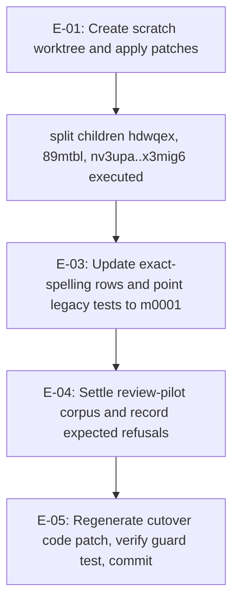

# IPD: Add the log-format test builder switch to the cutover code patch

- Date: 2026-11-09
- Kind: child
- Concern: `cxxmyv` E-07 switched the shared test record builder and the field assertion helper to the log format inside the attended cutover turn. On `main` before the cutover that switch would make the suite test a format `main` does not use, so it belongs in the one cutover commit (spec `4sd62s` 5.2, C10a); it can be prepared as part of the inert cumulative code patch (round-3 split, research `nj8zdp`).
- Scope: In a scratch worktree with both cutover patches applied (after the split children `hdwqex`, `89mtbl` and the batch children `nv3upa` to `x3mig6` have switched the builder and converted the test modules), update the exact-spelling rows, keep the literal-input legacy tests pointing at `m0001`, settle the `review-pilot` corpus, assemble the final refusal list, and regenerate `.aw/system/cutover/metastore-code.cutover.patch`. The builder switch (former E-02) moved to `89mtbl`. No live code changes.
- Scope-Paths: .aw/records/plans/pending/20261109-metastore-257-x1mmdp-add-the-log-format-test-builder-switch-to-the-cutover-code-p.ipd.md, .aw/system/cutover/metastore-code.cutover.patch
- Item-Dependencies: executed:1ajqaa, executed:87rvs2, executed:90iqr1, executed:aqc3m6, executed:clors0, executed:dcerjg, executed:g5hpbb, executed:iog3cw, executed:rdg0qv, executed:w13bkp, executed:ya4ee4, executed:zgyna1, executed:g45vyv, executed:hdwqex, executed:89mtbl, executed:nv3upa, executed:fljn9b, executed:cugg3w, executed:psm9ac, executed:x8id25, executed:e0g2gt, executed:qi0kl6, executed:x3mig6
- Status: approved
- From-Spec: 4sd62s
- Work-Kind: feature
- Priority: high
- Blocks-Release: next
- Set: metastore
- Order: 257
- Highest E allocated: 05
- Author: opencode its_direct/pt3-claude-opus-5.5-1m-us
- Id: x1mmdp
- Approval: 2026-11-16, recorded via aw ipd set: status set to approved
- Readiness: go-pending-approval
- Review-Depth: standard

## Workflow history
- 2026-11-26 note (antigravity/gemini): added Order 314 prerequisite fljn9b (backlog log-awareness fix) ahead of cugg3w per maintainer answer to run-20261126T020242Z-3080634 question 04-cugg3w-a1-backlog-log-aware-gap.
- 2026-11-26 note (opencode its_direct/pt3-claude-opus-5.5-1m-us): run run-20261125T162650Z-1337442 attempt 2: split per the maintainer answer to 06-x1mmdp-a1-Q-01 ("Split into new children; fix jycxw8 first"); E-02 moved to 89mtbl, test conversion to nv3upa..x3mig6, jycxw8 fix to hdwqex; this plan narrowed to E-03..E-05 and now depends on all nine; OQ-01 resolved.
- 2026-11-25 note (opencode its_direct/pt3-claude-opus-5.5-1m-us): run run-20261125T162650Z-1337442 attempt 1 performed E-01 (V-01 pass) and blocked at E-02: the switch is a suite-wide conversion (F-05 to F-07, OQ-01, backlog ldfefd); code patch unchanged.
- 2026-11-16 approved (aw set): status set to approved
- 2026-11-14 reviewed (aw set): APPROVE WITH REVISIONS APPLIED; PR-001..PR-005 FIXED

- 2026-11-14 /plan-review (antigravity/gemini): APPROVE WITH REVISIONS APPLIED; PR-001..PR-005 FIXED; review record .aw/records/reviews/20261109-metastore-257-x1mmdp-add-the-log-format-test-builder-switch-to-the-cutover-code-p.review.md
- 2026-11-09 to-review (opencode its_direct/pt3-claude-opus-5.5-1m-us): split from cxxmyv (round 3, research nj8zdp guidance).

## Goal

Extend the cutover code patch so every test that builds its own fixture passes on the switched tree, and record which tests are refused until the migration.

## Detailed Implementation Checklist (TODO)

Execution-state rule: mark an `E-*` item complete only after performing the action. That mark is not validation. Right-sizing rule: write for a modest executor that cannot hold much in its head. Each E-item is one step (one concern, about one file, executable in one focused pass) and its V-item names each unit it covers with its own check; a plan stays at about 5 E-items and 8 work Scope-Paths, else split it into more child plans (guidance, `IPD-Z603`). Accepted execution states: blocked, failed, pending, performed; terminal gate demands 'performed'.

### Task group 1: scratch worktree

- [x] E-01 Create the scratch worktree with the SCRATCH PROCEDURE of `2k5t16` (Step 0): `git worktree add --detach .aw/state/x1mmdp/scratch HEAD`, apply the docs patch, record `BASE=$(git write-tree)` in F-01, then apply the code patch. If either patch does not apply, stop and report.
  - Depends on: none
  - Expected outcome: the scratch worktree holds HEAD plus both patches, staged.
  - Execution state: performed
  - Execution note: 2026-11-26 (run run-20261125T162650Z-1337442, attempt 2). Performed in attempt 1 (V-01), but that scratch worktree was removed, and the split children `hdwqex` to `x3mig6` will regenerate the code patch. Re-run this step from the then-current HEAD before E-03, and overwrite F-01 if the base tree differs.

### Task group 2: test switch (scratch worktree only; was `cxxmyv` E-07; the builder switch moved to `89mtbl`)

- [ ] E-03 Change only the rows that the F-28 tables of `iog3cw` and `w13bkp` list as `setter-byte, exact spelling` (`59aiyh`); the other setter-byte assertions were already moved onto the helper by `iog3cw`, `w13bkp` and their batch parts. Keep the legacy-format tests that must keep literal input (the legacy loader, migration round-trip and conversion tests) pointing at `m0001`.
  - Depends on: E-01
  - Expected outcome: each listed exact-spelling row passes on the switched tree; the literal-input legacy tests import from `m0001`.
  - Execution state: pending

- [ ] E-04 Settle the `tests/fixtures/review-pilot/plans/` legacy corpus (`59aiyh` Deferred row): convert it to the log format with `m0001`'s conversion, or route `tests/test_review_pilot.py` through `m0001`, and record which in F-02. Then run the bare core gate in the scratch worktree and list in F-03 every failing test with its node id, starting from the F-03 lists of the batch children `nv3upa` to `x3mig6`; each must be a "run `aw migrate metadata`" refusal of a test that reads this repository's own unmigrated records (`livecorpus` tests and tests over `REPO_ROOT`, such as `tests/test_attention.py`). Any other failure is fixed here before E-05.
  - Depends on: E-03
  - Expected outcome: every test that builds its own fixture passes on the switched tree; F-03 lists the expected refusals only.
  - Execution state: pending

### Task group 3: package

- [ ] E-05 In the scratch worktree run `git add -A`, write `git diff --cached --binary $BASE` over `.aw/system/cutover/metastore-code.cutover.patch`, remove the scratch worktree (`git worktree remove --force .aw/state/x1mmdp/scratch`), run `python3 -m pytest -o addopts="" tests/test_metastore_cutover_code_patch.py` in the executing checkout, and commit through `aw commit x1mmdp -- <this plan> .aw/system/cutover/metastore-code.cutover.patch`; never push.
  - Depends on: E-04
  - Expected outcome: the regenerated code patch holds the earlier changes plus this plan's; the guard test passes; one path-scoped commit.
  - Execution state: pending

## Project conventions discovered (Step 0)

- The scratch procedure and the cumulative code patch are defined in `2k5t16`.
- Tests exercise code and assert on outcomes (AGENTS.md "TEST OUTCOMES, NOT CODE STRUCTURE").

## Findings

| Id | Evidence | Finding |
|---|---|---|
| F-01 | E-01, 2026-11-25: `git write-tree` after the docs patch printed `f88e0ca4f3803675d342959fdc081db8dfb41d6b` (HEAD `c7eed9a50`) | Base tree id: `f88e0ca4f3803675d342959fdc081db8dfb41d6b`. |
| F-02 | (written by E-04) | The `review-pilot` decision: converted corpus, or routed through `m0001`. |
| F-03 | (written by E-04) | Node ids of tests refused on the switched, unmigrated tree; `cxxmyv` E-09 and `5qyba0` compare against this list. |
| F-04 | `cxxmyv` F-07: `tests/test_attention.py` `REPO_ROOT`; `pyproject.toml` `livecorpus` marker | Some tests read this repository's own records and are refused until the migration. |
| F-05 | Scratch tree (HEAD + both patches), 2026-11-25: `python3 -m pytest -q tests/test_record_builder.py` fails at import with `AttributeError: module 'agent_workflows.artifact_meta' has no attribute '_LEGACY_BULLET_LABEL'` (`tests/record_builder.py:103`, via `tests/support.py:34`); the same error from `tools.fixture_codemod._registry_field_map` (line 1094). A grep for `LegacyRender`, `LegacyTarget`, `render_legacy_text`, `set_legacy_bullet_line`, `_LEGACY_BULLET_LABEL`, `_format_legacy_value`, `_RESEARCH_YAML_KEY`, `_PROMPT_COMMENT_KEY` and `write_legacy` finds 31 test modules plus `tools/fixture_codemod.py` | The code patch removes the legacy API that the builder, the codemod and 31 test modules call. No metastore child owns converting them (backlog `ldfefd`). |
| F-06 | Scratch tree with the builder kept on the legacy format via copies of the removed helpers: core gate `567 failed, 2348 passed, 1 skipped, 11 warnings, 66 errors in 47.83s` across 71 modules; 385 are `MetadataSchemaError: Repository metadata schema is 1 (current is 2); run aw migrate metadata`, raised from fixture repos the tests build themselves, not from `REPO_ROOT` | Far more than the "livecorpus and REPO_ROOT only" refusal list E-04 expects; the per-module counts are in the lane submission `evidence/failing-modules.txt`. |
| F-07 | Census in the scratch tree: `text_only=True` 1692 calls in 311 files (about 700 written to disk by the caller afterwards); `raw_fields=` 442; `history=` 796. Probe: a plan from `ipd_authoring.build_skeleton` behind the log mirror fails `ipd_lint.lint_file` with IPD-M101, I304, H202, S404, M106, M110 (`jycxw8`) | In the log format a record needs a `meta/<id6>.jsonl`, so a caller that writes the builder's text to disk produces an orphan; the text form needs a design decision, and `jycxw8` must be fixed before a log plan can lint as conforming. |

## Proposed changes (ordered, validatable)

1. E-01: scratch worktree with both patches.
2. E-03 and E-04: exact-spelling rows and legacy tests; review-pilot and refusal list (the builder and helper, former E-02, moved to `89mtbl`).
3. E-05: regenerate the code patch and commit.



## Deferred / out of scope (with reason)

- Former E-02 (switch the builder to `RECORD_FORMAT = "log"`, add the log branch of `assert_field`/`assert_no_field`, the `text_only` contract, the codemod): moved per the maintainer answer to 06-x1mmdp-a1-Q-01.
  - Carrier: 89mtbl
- Making `ipd_lint` and `ipd_authoring.build_skeleton` log-aware (`jycxw8`), which every log-format plan fixture needs first.
  - Carrier: hdwqex
- Making `agent_workflows/backlog.py` validation and readers and their production callers log-aware in the cutover code patch (`cugg3w` OQ-01, maintainer answer 2026-11-26).
  - Carrier: fljn9b
- Converting the test modules that call the removed legacy API or fail on the switched tree (F-05, F-06; backlog `ldfefd`), in a chain of batches.
  - Carrier: nv3upa
  - Carrier: cugg3w
  - Carrier: psm9ac
  - Carrier: x8id25
  - Carrier: e0g2gt
  - Carrier: qi0kl6
  - Carrier: x3mig6
- Applying the patch and running both tiers on the real, switched tree: the cutover.
  - Carrier: cxxmyv

## Scope check

- Over-scope: none.
- Under-scope: none. `cxxmyv` E-07 maps to `89mtbl` (builder, helper branch; former E-02), E-03 (exact-spelling rows, legacy tests) and E-04 (review-pilot, refusal list); the conversion F-05 to F-07 uncovered maps to `hdwqex` and `nv3upa` to `x3mig6`.

## Required tests / validation

- Named runs in the scratch worktree (V-03, V-04); the guard test (V-05).

## Spec / documentation sync

No spec change.

## Open questions

### OQ-01: How is the log-format test switch split and sequenced?

- Blocking: yes
- Status: resolved
- Owner: maintainer
- Question: E-02 as written cannot be one step (F-05 to F-07): the code patch removes the legacy API that the builder, `tools/fixture_codemod.py` and 31 test modules call, 71 modules fail on the switched tree, the `text_only=True` form has no log-format meaning yet, and `jycxw8` makes every log-format plan fail `ipd_lint`. Should the work be split into new metastore children (fix `jycxw8`; decide the text form; convert the builder and codemod; convert the failing modules in batches), with this plan narrowed or retired?
- Recommendation: split it, fix `jycxw8` first, and keep this plan only for the final packaging (E-05) once the children have added their hunks to the code patch. Backlog `ldfefd` records the proposal.
- Closes when: the maintainer chooses the split and the children exist, or narrows this plan's scope.
- Carrier: ldfefd
- Resolution or deferral rationale: 2026-11-26. The maintainer answered run run-20261125T162650Z-1337442 question 06-x1mmdp-a1-Q-01 with "Split into new children; fix jycxw8 first". Authored Orders 305 to 313: `hdwqex` (fix `jycxw8`), `89mtbl` (builder, field helper, `text_only` contract, codemod), `nv3upa` (legacy loader and writer unit tests) and the chained batches `cugg3w`, `psm9ac`, `x8id25`, `e0g2gt`, `qi0kl6`, `x3mig6`. This plan keeps E-03 to E-05 and depends on all nine.

## Validation and cross-check (verify before reporting done)

Validation-state rule: inspect evidence in a separate pass. Do not mark a `V-*` item complete from memory or from the matching execution checkmark. Accepted validation results: blocked, failed, pass, pending; terminal gate demands 'pass'. Runtime-demonstration reachability rule: for each `V-*` item demanding the software be observed acting (such as a run, a dispatch, or a transition) - as distinct from items demanding a diff, a file's content, or a test result, which are reachable by construction - name the code path that produces the observation or the sibling `E-*` that creates it, else the demand is UNDER-SCOPE.

- [x] V-01 validates E-01
  - Required evidence: paste the worktree and both `git apply --index` commands with exit status 0, and F-01.
  - Observed evidence: 2026-11-25, executing checkout HEAD `c7eed9a50698fd68c506210f931276f2130ba581`. Scratch worktree: `git worktree add --detach .aw/state/x1mmdp/scratch HEAD` printed `Preparing worktree (detached HEAD c7eed9a50)`, exit 0. The two applies, re-run verbatim in a second throwaway worktree `.aw/state/x1mmdp/v01` (since removed) to capture the output:
    ```
    $ git apply --index ../../../system/cutover/metastore-docs.cutover.patch; echo "docs exit=$?"
    docs exit=0
    $ git write-tree
    f88e0ca4f3803675d342959fdc081db8dfb41d6b
    $ git apply --index ../../../system/cutover/metastore-code.cutover.patch; echo "code exit=$?"
    code exit=0
    $ git diff --cached --stat | tail -1
     112 files changed, 3307 insertions(+), 6236 deletions(-)
    ```
    F-01 = `f88e0ca4f3803675d342959fdc081db8dfb41d6b`, the same tree the scratch worktree gave.
  - Result: pass
- [ ] V-03 validates E-03
  - Required evidence: paste the per-row list of the exact-spelling rows from the `iog3cw` and `w13bkp` F-28 tables, each with its node id PASSED in the scratch worktree, and `rg -n m0001` over the literal-input legacy test modules showing each import.
  - Observed evidence:
  - Result: pending
- [ ] V-04 validates E-04
  - Required evidence: paste F-02 with the passing `tests/test_review_pilot.py` run, and F-03 as a table of node ids each shown with its "run `aw migrate metadata`" refusal text, beside the core gate summary line in the scratch worktree.
  - Observed evidence:
  - Result: pending
- [ ] V-05 validates E-05
  - Required evidence: paste `git apply --stat .aw/system/cutover/metastore-code.cutover.patch`, the `tests/test_metastore_cutover_code_patch.py` run with each test PASSED, `git worktree list` showing the scratch worktree removed, and the `aw commit` output naming the commit hash.
  - Observed evidence:
  - Result: pending

## Approval and execution gate

- Size assessment: standard
- Cohesion rationale: not required

Execute only after human approval (`Status: approved`) and after every plan in `- Item-Dependencies:` is executed (specifically prerequisite `g45vyv`). Code and tests are edited ONLY in the scratch worktree. Scope fence: the paths in `- Scope-Paths:` are a declaration; a needed file outside the fence is edited and then justified at finalize (`--scope-reason`), and a declared path left unmodified is acknowledged (`--scope-ack`). Stop and report rather than editing production code outside the scratch worktree or weakening test assertions if an unexpected failure occurs on unmodified code, if a patch hunk rejects, or if an unresolvable concurrent-edit conflict occurs. Honesty rule: paste the ACTUAL output of every command named above; never claim a result you did not run. Commits: commit only through `aw commit x1mmdp -- <paths>`; never push. Lifecycle transition: the plan moves to `.aw/records/plans/executed/` only through `aw ipd finalize`, after `aw ipd lint --phase pre-transition` conforms and every `V-*` reads `pass` with pasted evidence.
