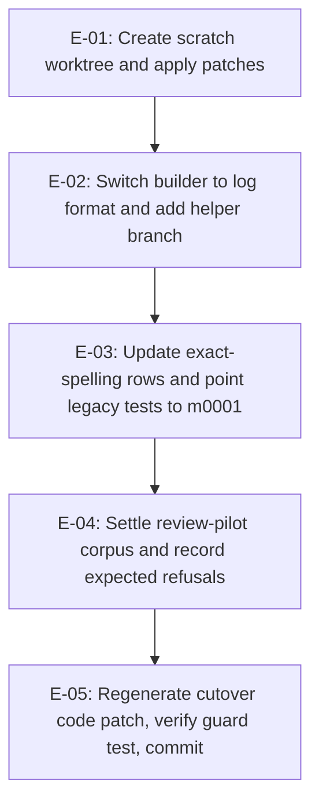

# IPD: Add the log-format test builder switch to the cutover code patch

- Date: 2026-11-09
- Kind: child
- Concern: `cxxmyv` E-07 switched the shared test record builder and the field assertion helper to the log format inside the attended cutover turn. On `main` before the cutover that switch would make the suite test a format `main` does not use, so it belongs in the one cutover commit (spec `4sd62s` 5.2, C10a); it can be prepared as part of the inert cumulative code patch (round-3 split, research `nj8zdp`).
- Scope: In a scratch worktree with both cutover patches applied, set the builder's `RECORD_FORMAT = "log"`, add the log-format branch of `assert_field`/`assert_no_field`, update the exact-spelling rows, keep the literal-input legacy tests pointing at `m0001`, and settle the `review-pilot` corpus; list the tests that are refused until the migration; regenerate `.aw/system/cutover/metastore-code.cutover.patch`.
- Scope-Paths: .aw/records/plans/pending/20261109-metastore-257-x1mmdp-add-the-log-format-test-builder-switch-to-the-cutover-code-p.ipd.md, .aw/system/cutover/metastore-code.cutover.patch
- Item-Dependencies: executed:1ajqaa, executed:87rvs2, executed:90iqr1, executed:aqc3m6, executed:clors0, executed:dcerjg, executed:g5hpbb, executed:iog3cw, executed:rdg0qv, executed:w13bkp, executed:ya4ee4, executed:zgyna1, executed:g45vyv
- Status: approved
- From-Spec: 4sd62s
- Work-Kind: feature
- Priority: high
- Blocks-Release: next
- Set: metastore
- Order: 257
- Highest E allocated: 05
- Author: opencode its_direct/pt3-claude-opus-5.5-1m-us
- Id: x1mmdp
- Approval: 2026-11-16, recorded via aw ipd set: status set to approved
- Readiness: go-pending-approval
- Review-Depth: standard

## Workflow history
- 2026-11-16 approved (aw set): status set to approved
- 2026-11-14 reviewed (aw set): APPROVE WITH REVISIONS APPLIED; PR-001..PR-005 FIXED

- 2026-11-14 /plan-review (antigravity/gemini): APPROVE WITH REVISIONS APPLIED; PR-001..PR-005 FIXED; review record .aw/records/reviews/20261109-metastore-257-x1mmdp-add-the-log-format-test-builder-switch-to-the-cutover-code-p.review.md
- 2026-11-09 to-review (opencode its_direct/pt3-claude-opus-5.5-1m-us): split from cxxmyv (round 3, research nj8zdp guidance).

## Goal

Extend the cutover code patch so every test that builds its own fixture passes on the switched tree, and record which tests are refused until the migration.

## Detailed Implementation Checklist (TODO)

Execution-state rule: mark an `E-*` item complete only after performing the action. That mark is not validation. Right-sizing rule: write for a modest executor that cannot hold much in its head. Each E-item is one step (one concern, about one file, executable in one focused pass) and its V-item names each unit it covers with its own check; a plan stays at about 5 E-items and 8 work Scope-Paths, else split it into more child plans (guidance, `IPD-Z603`). Accepted execution states: blocked, failed, pending, performed; terminal gate demands 'performed'.

### Task group 1: scratch worktree

- [ ] E-01 Create the scratch worktree with the SCRATCH PROCEDURE of `2k5t16` (Step 0): `git worktree add --detach .aw/state/x1mmdp/scratch HEAD`, apply the docs patch, record `BASE=$(git write-tree)` in F-01, then apply the code patch. If either patch does not apply, stop and report.
  - Depends on: none
  - Expected outcome: the scratch worktree holds HEAD plus both patches, staged.
  - Execution state: pending

### Task group 2: test switch (scratch worktree only; was `cxxmyv` E-07, in three steps)

- [ ] E-02 Switch the shared test record builder to `RECORD_FORMAT = "log"` and add the log-format branch of the field assertion helper (`assert_field`/`assert_no_field`, added by `iog3cw` E-01: in the log format it reads `artifact_meta.read` plus the in-file mirror).
  - Depends on: E-01
  - Expected outcome: a test that builds a record and asserts a field passes on the switched tree.
  - Execution state: pending

- [ ] E-03 Change only the rows that the F-28 tables of `iog3cw` and `w13bkp` list as `setter-byte, exact spelling` (`59aiyh`); the other setter-byte assertions were already moved onto the helper by `iog3cw`, `w13bkp` and their batch parts. Keep the legacy-format tests that must keep literal input (the legacy loader, migration round-trip and conversion tests) pointing at `m0001`.
  - Depends on: E-02
  - Expected outcome: each listed exact-spelling row passes on the switched tree; the literal-input legacy tests import from `m0001`.
  - Execution state: pending

- [ ] E-04 Settle the `tests/fixtures/review-pilot/plans/` legacy corpus (`59aiyh` Deferred row): convert it to the log format with `m0001`'s conversion, or route `tests/test_review_pilot.py` through `m0001`, and record which in F-02. Then run the bare core gate in the scratch worktree and list in F-03 every failing test with its node id; each must be a "run `aw migrate metadata`" refusal of a test that reads this repository's own unmigrated records (`livecorpus` tests and tests over `REPO_ROOT`, such as `tests/test_attention.py`). Any other failure is fixed here before E-05.
  - Depends on: E-03
  - Expected outcome: every test that builds its own fixture passes on the switched tree; F-03 lists the expected refusals only.
  - Execution state: pending

### Task group 3: package

- [ ] E-05 In the scratch worktree run `git add -A`, write `git diff --cached --binary $BASE` over `.aw/system/cutover/metastore-code.cutover.patch`, remove the scratch worktree (`git worktree remove --force .aw/state/x1mmdp/scratch`), run `python3 -m pytest -o addopts="" tests/test_metastore_cutover_code_patch.py` in the executing checkout, and commit through `aw commit x1mmdp -- <this plan> .aw/system/cutover/metastore-code.cutover.patch`; never push.
  - Depends on: E-04
  - Expected outcome: the regenerated code patch holds the earlier changes plus this plan's; the guard test passes; one path-scoped commit.
  - Execution state: pending

## Project conventions discovered (Step 0)

- The scratch procedure and the cumulative code patch are defined in `2k5t16`.
- Tests exercise code and assert on outcomes (AGENTS.md "TEST OUTCOMES, NOT CODE STRUCTURE").

## Findings

| Id | Evidence | Finding |
|---|---|---|
| F-01 | (written by E-01) | Base tree id. |
| F-02 | (written by E-04) | The `review-pilot` decision: converted corpus, or routed through `m0001`. |
| F-03 | (written by E-04) | Node ids of tests refused on the switched, unmigrated tree; `cxxmyv` E-09 and `5qyba0` compare against this list. |
| F-04 | `cxxmyv` F-07: `tests/test_attention.py` `REPO_ROOT`; `pyproject.toml` `livecorpus` marker | Some tests read this repository's own records and are refused until the migration. |

## Proposed changes (ordered, validatable)

1. E-01: scratch worktree with both patches.
2. E-02 to E-04: builder and helper; exact-spelling rows and legacy tests; review-pilot and refusal list.
3. E-05: regenerate the code patch and commit.

## Deferred / out of scope (with reason)

- Applying the patch and running both tiers on the real, switched tree: the cutover.
  - Carrier: cxxmyv

## Scope check

- Over-scope: none.
- Under-scope: none. `cxxmyv` E-07 maps to E-02 (builder, helper branch), E-03 (exact-spelling rows, legacy tests) and E-04 (review-pilot, refusal list).

## Required tests / validation

- Named runs in the scratch worktree (V-02 to V-04); the guard test (V-05).

## Spec / documentation sync

No spec change.

## Open questions

None open.

## Validation and cross-check (verify before reporting done)

Validation-state rule: inspect evidence in a separate pass. Do not mark a `V-*` item complete from memory or from the matching execution checkmark. Accepted validation results: blocked, failed, pass, pending; terminal gate demands 'pass'. Runtime-demonstration reachability rule: for each `V-*` item demanding the software be observed acting (such as a run, a dispatch, or a transition) - as distinct from items demanding a diff, a file's content, or a test result, which are reachable by construction - name the code path that produces the observation or the sibling `E-*` that creates it, else the demand is UNDER-SCOPE.

- [ ] V-01 validates E-01
  - Required evidence: paste the worktree and both `git apply --index` commands with exit status 0, and F-01.
  - Observed evidence:
  - Result: pending
- [ ] V-02 validates E-02
  - Required evidence: paste the diff hunk setting `RECORD_FORMAT = "log"`, the diff hunk adding the log branch of `assert_field`/`assert_no_field`, and a run of one named test module that uses the helper, with its PASSED lines.
  - Observed evidence:
  - Result: pending
- [ ] V-03 validates E-03
  - Required evidence: paste the per-row list of the exact-spelling rows from the `iog3cw` and `w13bkp` F-28 tables, each with its node id PASSED in the scratch worktree, and `rg -n m0001` over the literal-input legacy test modules showing each import.
  - Observed evidence:
  - Result: pending
- [ ] V-04 validates E-04
  - Required evidence: paste F-02 with the passing `tests/test_review_pilot.py` run, and F-03 as a table of node ids each shown with its "run `aw migrate metadata`" refusal text, beside the core gate summary line in the scratch worktree.
  - Observed evidence:
  - Result: pending
- [ ] V-05 validates E-05
  - Required evidence: paste `git apply --stat .aw/system/cutover/metastore-code.cutover.patch`, the `tests/test_metastore_cutover_code_patch.py` run with each test PASSED, `git worktree list` showing the scratch worktree removed, and the `aw commit` output naming the commit hash.
  - Observed evidence:
  - Result: pending

## Approval and execution gate

- Size assessment: standard
- Cohesion rationale: not required

Execute only after human approval (`Status: approved`) and after every plan in `- Item-Dependencies:` is executed (specifically prerequisite `g45vyv`). Code and tests are edited ONLY in the scratch worktree. Scope fence: the paths in `- Scope-Paths:` are a declaration; a needed file outside the fence is edited and then justified at finalize (`--scope-reason`), and a declared path left unmodified is acknowledged (`--scope-ack`). Stop and report rather than editing production code outside the scratch worktree or weakening test assertions if an unexpected failure occurs on unmodified code, if a patch hunk rejects, or if an unresolvable concurrent-edit conflict occurs. Honesty rule: paste the ACTUAL output of every command named above; never claim a result you did not run. Commits: commit only through `aw commit x1mmdp -- <paths>`; never push. Lifecycle transition: the plan moves to `.aw/records/plans/executed/` only through `aw ipd finalize`, after `aw ipd lint --phase pre-transition` conforms and every `V-*` reads `pass` with pasted evidence.
