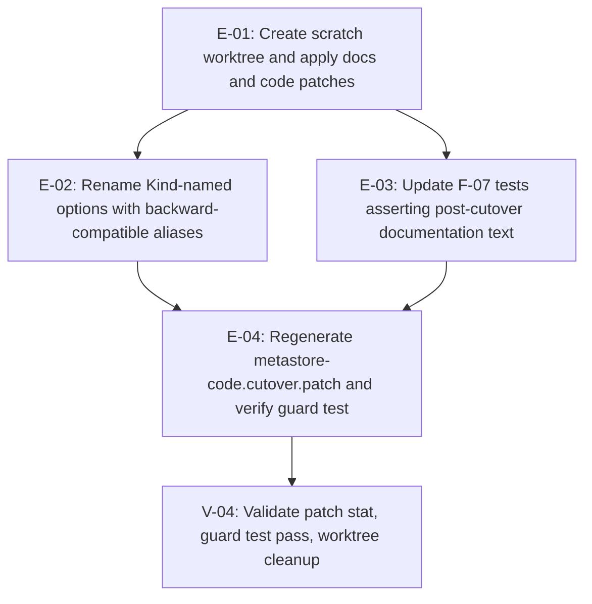

# IPD: Add the Kind option renames and text-test updates to the cutover code patch

- Date: 2026-11-09
- Kind: child
- Concern: `cxxmyv` E-16 renamed the `aw` options that name the legacy `Kind` field (spec `4sd62s` 5.4) and updated the tests that `90iqr1` F-07 lists as failing on the docs-patched tree, inside the attended cutover turn. Those tests assert the post-cutover documentation text, which reaches `main` only in the cutover commit (C10a), so their updates must land in that commit too; both can be prepared in the inert cumulative code patch, whose scratch base already has the docs patch applied (round-3 split, research `nj8zdp`).
- Scope: In a scratch worktree with both cutover patches applied, rename the plan-role, research-kind and prompt-kind options keeping each old spelling as an alias, and update every `90iqr1` F-07 test; regenerate `.aw/system/cutover/metastore-code.cutover.patch`. No live code changes.
- Scope-Paths: .aw/records/plans/pending/20261109-metastore-258-0zylig-add-the-kind-option-renames-and-text-test-updates-to-the-cut.ipd.md, .aw/system/cutover/metastore-code.cutover.patch
- Item-Dependencies: executed:1ajqaa, executed:87rvs2, executed:90iqr1, executed:aqc3m6, executed:clors0, executed:dcerjg, executed:g5hpbb, executed:iog3cw, executed:rdg0qv, executed:w13bkp, executed:ya4ee4, executed:zgyna1, executed:x1mmdp
- Status: approved
- Readiness: go-pending-approval
- Review-Depth: standard
- From-Spec: 4sd62s
- Work-Kind: feature
- Priority: high
- Blocks-Release: next
- Set: metastore
- Order: 258
- Highest E allocated: 04
- Author: opencode its_direct/pt3-claude-opus-5.5-1m-us
- Id: 0zylig
- Approval: 2026-11-16, recorded via aw ipd set: status set to approved

> Written to .aw/system/workflows/technical-writing/technical-writing.md. Every obligation, exact identifier, quotation, evidence record, and lifecycle status is preserved.

## Workflow history
- 2026-11-16 approved (aw set): status set to approved

- 2026-11-14 reviewed (antigravity/gemini-3.8-flash): APPROVE WITH REVISIONS APPLIED; PR-001..PR-006 FIXED.
- 2026-11-09 to-review (opencode its_direct/pt3-claude-opus-5.5-1m-us): split from cxxmyv (round 3, research nj8zdp guidance).

## Goal

Finish the content of the cutover code patch: the `Kind` option renames with aliases, and the text-asserting tests updated for the post-cutover documentation.

## Detailed Implementation Checklist (TODO)

Execution-state rule: mark an `E-*` item complete only after performing the action. That mark is not validation. Right-sizing rule: write for a modest executor that cannot hold much in its head. Each E-item is one step (one concern, about one file, executable in one focused pass) and its V-item names each unit it covers with its own check; a plan stays at about 5 E-items and 8 work Scope-Paths, else split it into more child plans (guidance, `IPD-Z603`). Accepted execution states: blocked, failed, pending, performed; terminal gate demands 'performed'.

### Task group 1: scratch worktree

- [ ] E-01 Create the scratch worktree with the SCRATCH PROCEDURE of `2k5t16` (Step 0): `git worktree add --detach .aw/state/0zylig/scratch HEAD`, apply the docs patch, record `BASE=$(git write-tree)` in F-01, then apply the code patch. If either patch does not apply, stop and report.
  - Depends on: none
  - Expected outcome: the scratch worktree holds HEAD plus both patches, staged.
  - Execution state: pending

### Task group 2: renames and test updates (scratch worktree only; was `cxxmyv` E-16, in two steps)

- [ ] E-02 Rename every `aw` option that names the legacy `Kind` field (spec 5.4; `90iqr1` Deferred row): the plan-role option of `aw ipd scaffold`, the research-kind options of `aw research new` and `aw research mv`, and the prompt-kind option of `aw prompts new`, to `plan_role`, `research_kind` and `prompt_kind` spellings, keeping each old spelling as an alias, as `aw backlog new --kind` already does for `--work-kind`. Re-derive the option list at execution time and record it in F-02.
  - Depends on: E-01
  - Expected outcome: each renamed option and its alias produce the same result.
  - Execution state: pending

- [ ] E-03 Update the tests that `90iqr1` F-07 lists as failing on the patched tree only because they assert pre-cutover text. Re-derive the list at execution time (run the F-07 modules in the scratch worktree) and record it in F-03.
  - Depends on: E-01
  - Expected outcome: every F-07 test passes on the switched, patched tree.
  - Execution state: pending

### Task group 3: package

- [ ] E-04 In the scratch worktree run `git add -A`, write `git diff --cached --binary $BASE` over `.aw/system/cutover/metastore-code.cutover.patch`, remove the scratch worktree (`git worktree remove --force .aw/state/0zylig/scratch`), run `python3 -m pytest -o addopts="" tests/test_metastore_cutover_code_patch.py` in the executing checkout, and commit through `aw commit 0zylig -- <this plan> .aw/system/cutover/metastore-code.cutover.patch`; never push.
  - Depends on: E-02, E-03
  - Expected outcome: the final code patch holds every task group 2 change of `cxxmyv`; the guard test passes; one path-scoped commit.
  - Execution state: pending

## Project conventions discovered (Step 0)

- The scratch procedure and the cumulative code patch are defined in `2k5t16`.
- `cxxmyv` F-06: `cli.py` has `--kind` on `aw ipd scaffold`, `aw research new`, `aw research mv` and `aw prompts new`.

## Findings

| Id | Evidence | Finding |
|---|---|---|
| F-01 | (written by E-01) | Base tree id. |
| F-02 | (written by E-02) | Re-derived list of `Kind`-named options with old and new spellings. |
| F-03 | (written by E-03) | Re-derived list of F-07 tests updated, by node id. |

## Proposed changes (ordered, validatable)

1. E-01: scratch worktree with both patches.
2. E-02, E-03: option renames; text-test updates.
3. E-04: regenerate the code patch and commit.

## Deferred / out of scope (with reason)

- Applying the patch: the cutover.
  - Carrier: cxxmyv

## Scope check

- Over-scope: none.
- Under-scope: none. `cxxmyv` E-16 maps to E-02 and E-03.

## Required tests / validation

- Behavioral tests of each renamed option and its alias (V-02); the F-07 test run (V-03); the guard test `tests/test_metastore_cutover_code_patch.py` (V-04). Implements spec `4sd62s` Section 5.4 and contributes to cutover step 9.

## Spec / documentation sync

No spec change; spec 5.4 already names the renames.

## Open questions

None open.

## Validation and cross-check (verify before reporting done)

Validation-state rule: inspect evidence in a separate pass. Do not mark a `V-*` item complete from memory or from the matching execution checkmark. Accepted validation results: blocked, failed, pass, pending; terminal gate demands 'pass'. Runtime-demonstration reachability rule: for each `V-*` item demanding the software be observed acting (such as a run, a dispatch, or a transition) - as distinct from items demanding a diff, a file's content, or a test result, which are reachable by construction - name the code path that produces the observation or the sibling `E-*` that creates it, else the demand is UNDER-SCOPE.

- [ ] V-01 validates E-01
  - Required evidence: paste the worktree and both `git apply --index` commands with exit status 0, and F-01.
  - Observed evidence:
  - Result: pending
- [ ] V-02 validates E-02
  - Required evidence: paste F-02; `--help` of each renamed command (`aw ipd scaffold`, `aw research new`, `aw research mv`, `aw prompts new`) showing the new spelling; and a test run with one PASSED node id per command showing the old spelling as an alias gives the same result.
  - Observed evidence:
  - Result: pending
- [ ] V-03 validates E-03
  - Required evidence: paste F-03 and the pytest run of every F-07 test in the scratch worktree with one PASSED line per node id.
  - Observed evidence:
  - Result: pending
- [ ] V-04 validates E-04
  - Required evidence: paste `git apply --stat .aw/system/cutover/metastore-code.cutover.patch`, the `tests/test_metastore_cutover_code_patch.py` run with each test PASSED, `git worktree list` showing the scratch worktree removed, and the `aw commit` output naming the commit hash.
  - Observed evidence:
  - Result: pending

## Approval and execution gate

- Size assessment: standard
- Cohesion rationale: not required

Execute only after `x1mmdp` is `executed` and this plan is `approved`. Code and tests are edited ONLY in the scratch worktree.

Scope fence: the paths in `- Scope-Paths:` are a declaration; a needed file outside the fence is edited and then justified at finalize (`--scope-reason`), and a declared path left unmodified is acknowledged (`--scope-ack`).

Safety: if either cutover patch rejects, if prerequisite `tests/test_metastore_cutover_code_patch.py` from `g45vyv` is missing, or if an unexpected failure occurs on unmodified code, stop and report immediately: that is an unsafe condition, not a scope question.

Honesty rule: paste the ACTUAL output of every command named above; never claim a result you did not run.

Commits: commit only through `aw commit 0zylig -- <paths>`; never push.

Lifecycle transition: the plan moves to `.aw/records/plans/executed/` only through `aw ipd finalize`, never a hand `git mv`, and only after `aw ipd lint --phase pre-transition` conforms and every `V-*` reads `pass` with pasted evidence. When `aw oc run` or `aw agy run` executes the plan, the runner performs the finalize; a hand executor runs `aw ipd finalize 0zylig` itself.
