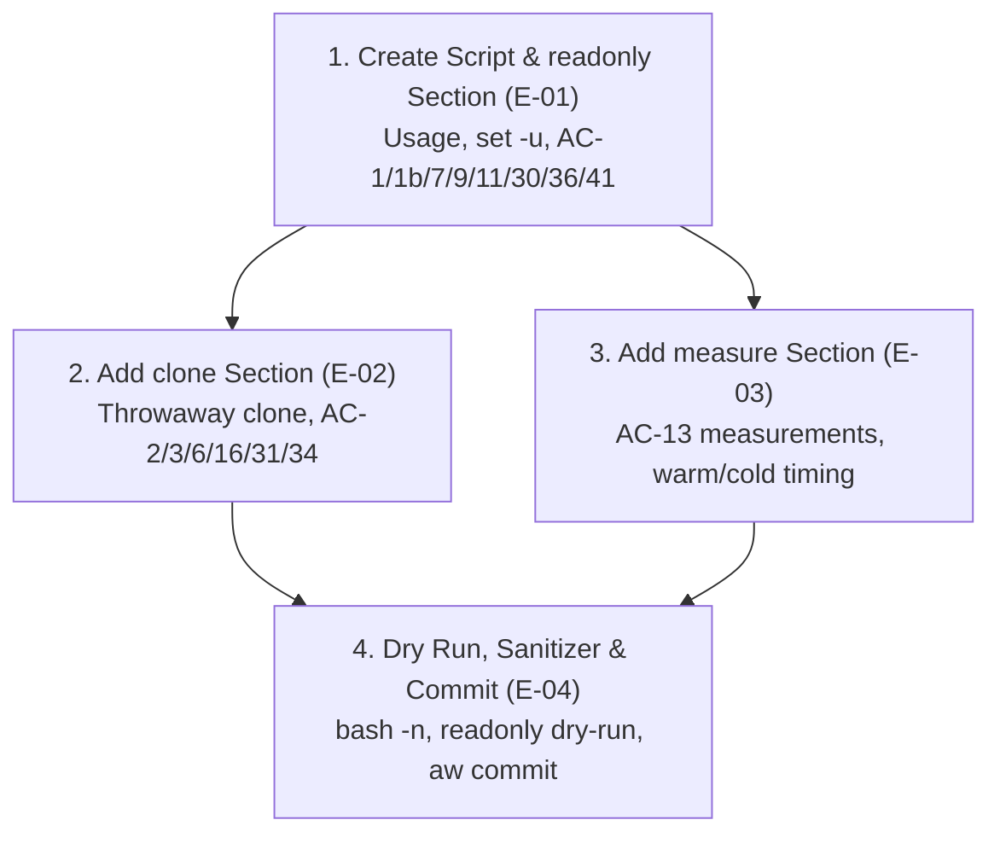

# IPD: Write the post-cutover acceptance demonstration script

- Date: 2026-11-09
- Kind: child
- Concern: After the cutover commit, `cxxmyv` must demonstrate about fifteen acceptance criteria of spec `4sd62s` on the real migrated repository (its E-11) and measure AC-13 (its E-12). Writing and debugging those probes during the attended turn is the largest remaining load on it. The probes can be WRITTEN before the cutover as an inert script, and REHEARSED on the migrated rehearsal clone by `5qyba0`, without changing `main`'s on-disk format (C10a). Round-3 split, research `nj8zdp`.
- Scope: Write `.aw/system/cutover/metastore-acceptance-demo.sh`, a script that prints one labelled block per criterion: read-only checks on the checkout it is pointed at, probes that commit or edit inside a throwaway `git clone --no-hardlinks`, and the AC-13 after-measurements. `cxxmyv` runs it after the cutover and deletes it in its last commit. Nothing runs it on `main` before the cutover except its syntax check.
- Scope-Paths: .aw/records/plans/pending/20261109-metastore-259-33vxoi-write-the-post-cutover-acceptance-demonstration-script.ipd.md, .aw/system/cutover/metastore-acceptance-demo.sh
- Item-Dependencies: executed:1ajqaa, executed:87rvs2, executed:90iqr1, executed:aqc3m6, executed:clors0, executed:dcerjg, executed:g5hpbb, executed:iog3cw, executed:rdg0qv, executed:w13bkp, executed:ya4ee4, executed:zgyna1, executed:tub3ir
- Status: reviewed
- Readiness: go-pending-approval
- Review-Depth: standard
- From-Spec: 4sd62s
- Work-Kind: feature
- Priority: high
- Blocks-Release: next
- Set: metastore
- Order: 259
- Highest E allocated: 04
- Author: opencode its_direct/pt3-claude-opus-5.5-1m-us
- Id: 33vxoi

> Write and proofread this plan per the technical writing standard, `.aw/system/workflows/technical-writing/technical-writing.md` (`.agents/workflows/technical-writing/technical-writing.md` in a legacy-layout install), including requirement 12 (diagrams).

## Workflow history

- 2026-11-14 reviewed (antigravity): plan-review verified E/V bijection, Scope-Paths, script structure and dry-run safety, and execution gate; marked reviewed and go-pending-approval.
- 2026-11-09 to-review (opencode its_direct/pt3-claude-opus-5.5-1m-us): split from cxxmyv (round 3, research nj8zdp guidance).

## Goal

Turn `cxxmyv`'s post-cutover demonstrations and measurements into one prepared script, so the attended turn runs one command and pastes its labelled output.

## Detailed Implementation Checklist (TODO)

Execution-state rule: mark an `E-*` item complete only after performing the action. That mark is not validation. Right-sizing rule: write for a modest executor that cannot hold much in its head. Each E-item is one step (one concern, about one file, executable in one focused pass) and its V-item names each unit it covers with its own check; a plan stays at about 5 E-items and 8 work Scope-Paths, else split it into more child plans (guidance, `IPD-Z603`). Accepted execution states: blocked, failed, pending, performed; terminal gate demands 'performed'.

### Task group 1: the script (one section per item; the criteria text is `cxxmyv` E-11 and E-12, verbatim in meaning)

- [ ] E-01 Create the script with a usage line (`metastore-acceptance-demo.sh <checkout> <section>`, sections `readonly`, `clone`, `measure`, `all`), `set -u`, and the `readonly` section. Each block prints `== AC-<id> ==`, the command, and its output. The read-only criteria: AC-1 (re-run the `9o83cr` E-14 audit with its exclusion list from `9o83cr` F-21: hits only in `artifact_meta.py` and `migrations/m0001_metadata_v2.py`); AC-1b (no migrated record has a bullet block; `git ls-tree` of the parent commit shows no `meta/` directory; the thorough-tier summary is pasted by `cxxmyv` from its own run); AC-7 (zero `aw check meta` findings); AC-9 (`git ls-files` and the file system show no INDEX or STATUS file; `rg` for `INDEX.json` and `STATUS.md` in the package finds only the migration's cleanup code); AC-11 (the `dcerjg` AC-11 tests pass with `CURRENT_METADATA_SCHEMA` unpatched); AC-30 case 2 (`git status --porcelain --ignored` shows no `records/history.jsonl`; `rg` finds no `history.jsonl` ignore line in `.aw/.gitignore`, the `engine.py` template or `placement_switch.py`); AC-36 case 6 (the real census of descriptions); AC-41 cases 3 and 4 (no legacy-timestamp artifact or walkthrough filename; no two plans share Set and order; a history line that cited an old name displays with the current name in `aw show --history`).
  - Depends on: none
  - Expected outcome: `bash -n` passes; the `readonly` section prints one labelled block per criterion above.
  - Execution state: pending

- [ ] E-02 Add the `clone` section: every probe that commits, merges or edits runs in `git clone --no-hardlinks <checkout> tmp/cxxmyv-demo` (gitignored), deleted at the end, and the section prints `git status --porcelain` of the checkout before and after. Criteria: AC-2 (`git clone --depth 1 file://<checkout> tmp/cxxmyv-ac2`, because a plain local path ignores `--depth`, with `git rev-list --count HEAD` printing 1, then `aw show <id6> --history` on a migrated plan with several events); AC-3 (two branches change the status of different artifacts and merge without conflict); AC-6 (the `git diff` of one `aw set` transition and of one finalize transition with its `unset` and scope fields); AC-16 (`python3 -m agent_workflows attention --check --agent` exits 0, without pushing; a raw transition into `executed` and a non-append edit of an executed plan's log are refused; the hook output of the cutover commit is pasted by `cxxmyv`); AC-31 (rename and group events; no sidecar created); AC-34 (path history of a renamed legacy record shows the old path then the new one).
  - Depends on: E-01
  - Expected outcome: `bash -n` passes; the section prints one labelled block per criterion and the equal before and after status lines.
  - Execution state: pending

- [ ] E-03 Add the `measure` section (was `cxxmyv` E-12): by the AGENTS.md end-to-end rule, warm and cold, the bytes an agent reads for one plan and the end-to-end time of `aw find` and `aw attention`, using the plan id6 and cold-cache method recorded in `tub3ir` F-02 (passed as arguments); the size of a typical executed plan's log and the time of one append to it (in a throwaway clone); and the short-description generation cost from the journal. Print a before and after table with the before values taken from `tub3ir` F-02 as arguments and the commands used; assert no target value (the spec sets none).
  - Depends on: E-01
  - Expected outcome: `bash -n` passes; the section prints the AC-13 table rows, the log size, append time and generation cost lines.
  - Execution state: pending

### Task group 2: check and commit

- [ ] E-04 Run `bash -n .aw/system/cutover/metastore-acceptance-demo.sh` and the `readonly` section against this unmigrated checkout to confirm it runs to completion (failures of the criteria themselves are expected before the cutover and are recorded, not fixed, in F-01); run `aw sanitize --agent` and confirm the script adds no `fail`; commit through `aw commit 33vxoi -- <this plan> .aw/system/cutover/metastore-acceptance-demo.sh`; never push. The real rehearsal on a migrated tree is `5qyba0`.
  - Depends on: E-02, E-03
  - Expected outcome: the script parses, runs to completion on an unmigrated tree, adds no sanitizer `fail`; one path-scoped commit.
  - Execution state: pending

## Project conventions discovered (Step 0)

- `git clone --depth 1 <local path>` ignores `--depth`; a `file://` URL is needed (`cxxmyv` Step 0, measured at its review).
- `.aw/system/cutover/` ships in the wheel and sdist but is not copied by the installer (`90iqr1` E-09); `cxxmyv` deletes the script in its final commit.
- The script must write no absolute local path, username or hostname into its output defaults; checkout paths are arguments.

## Findings

| Id | Evidence | Finding |
|---|---|---|
| F-01 | (written by E-04) | Which `readonly` blocks fail on the unmigrated tree (expected: all criteria that need the log format). |
| F-02 | `cxxmyv` E-11, E-12 | The criteria list and measurements that the script covers; `cxxmyv` keeps the obligation to run it on the real repository and paste the output. |

## Proposed changes (ordered, validatable)

1. E-01 to E-03: the three script sections.
2. E-04: syntax and dry check, sanitizer, commit.

## Deferred / out of scope (with reason)

- Running the script on the migrated rehearsal clone.
  - Carrier: 5qyba0
- Running it on the real migrated repository and pasting the evidence; deleting the script.
  - Carrier: cxxmyv

## Scope check

- Over-scope: none.
- Under-scope: none. Every criterion of `cxxmyv` E-11 is in E-01 or E-02 (AC-1b's thorough-tier summary and AC-16's hook output stay with `cxxmyv`, which produces them); `cxxmyv` E-12 is E-03.

## Required tests / validation

- `bash -n` and a dry `readonly` run (V-04); the real rehearsal is `5qyba0`.

## Spec / documentation sync

No spec change.

## Open questions

### OQ-01: Shell script or a pytest module?

- Blocking: no
- Status: resolved
- Owner: plan author
- Resolution or deferral rationale: Shell script. The demonstrations run once, against one real repository, and their output is pasted as evidence; a pytest module in the suite would run them on every commit, where the criteria are false before the cutover and the clone probes are too slow for the core tier. Recommendation strength: medium.

## Validation and cross-check (verify before reporting done)

Validation-state rule: inspect evidence in a separate pass. Do not mark a `V-*` item complete from memory or from the matching execution checkmark. Accepted validation results: blocked, failed, pass, pending; terminal gate demands 'pass'. Runtime-demonstration reachability rule: for each `V-*` item demanding the software be observed acting (such as a run, a dispatch, or a transition; as distinct from items demanding a diff, a file's content, or a test result, which are reachable by construction), name the code path that produces the observation or the sibling `E-*` that creates it, else the demand is UNDER-SCOPE.

- [ ] V-01 validates E-01
  - Required evidence: paste the `readonly` section of the script and `rg -n '== AC-' .aw/system/cutover/metastore-acceptance-demo.sh` listing one label each for AC-1, AC-1b, AC-7, AC-9, AC-11, AC-30, AC-36 and AC-41.
  - Observed evidence:
  - Result: pending
- [ ] V-02 validates E-02
  - Required evidence: paste the `clone` section and the `rg -n '== AC-'` lines for AC-2, AC-3, AC-6, AC-16, AC-31 and AC-34, and the lines that print the before and after `git status --porcelain`.
  - Observed evidence:
  - Result: pending
- [ ] V-03 validates E-03
  - Required evidence: paste the `measure` section, naming the line that prints each table row (bytes read, `aw find` warm and cold, `aw attention` warm and cold, log size, append time, generation cost).
  - Observed evidence:
  - Result: pending
- [ ] V-04 validates E-04
  - Required evidence: paste `bash -n` with exit 0, the `readonly` dry run output with F-01, the `aw sanitize --agent` result line, and the `aw commit` output naming the commit hash.
  - Observed evidence:
  - Result: pending

## Approval and execution gate

- Size assessment: standard
- Cohesion rationale: not required

Execute only after `tub3ir` is `executed` (its F-02 supplies the measurement arguments) and this plan is `approved`.

Scope fence: the paths in `- Scope-Paths:` are a declaration; a needed file outside the fence is edited and then justified at finalize (`--scope-reason`), and a declared path left unmodified is acknowledged (`--scope-ack`).

Honesty rule: paste the ACTUAL output of every command named above; never claim a result you did not run.

Commits: commit only through `aw commit 33vxoi -- <paths>`; never `git add -A`, a bare `git add` or `git commit -a`; never push.

Lifecycle transition: the plan moves to `.aw/records/plans/executed/` only through `aw ipd finalize`, never a hand `git mv`, and only after `aw ipd lint --phase pre-transition` conforms and every `V-*` reads `pass` with pasted evidence. When `aw oc run` or `aw agy run` executes the plan, the runner owns retirement to `executed/` and runs finalize automatically upon task completion; when executed standalone by hand or direct agent turn, the executor runs `aw ipd finalize 33vxoi`.
