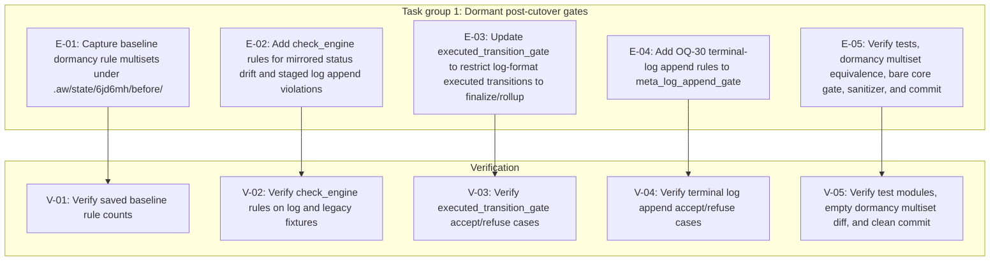

# IPD: Build the dormant post-cutover gates for log-format records

- Date: 2026-11-09
- Kind: child
- Concern: `clors0` E-05 put the post-cutover gates in `check_engine` and two hooks in one item (about 18 measured units). Spec `4sd62s` C10a keeps `main` on one format, and these gates are dormant there because they apply only to records with a log or to staged `meta/*.jsonl` paths. Round-3 split (research `nj8zdp`): the item is split into its three surfaces.
- Scope: `clors0` E-05, split by surface: the two `check_engine` rules, the `executed_transition_gate` branch, and the OQ-30 terminal-log rules of `meta_log_append_gate`, each with its cases in the new `tests/test_cutover_log_gates.py`. The SR-601 `->reviewed` rule is NOT here (`2xwb9b` E-12).
- Scope-Paths: agent_workflows/check_engine.py, agent_workflows/hooks/executed_transition_gate.py, agent_workflows/hooks/meta_log_append_gate.py, tests/test_cutover_log_gates.py, .aw/records/plans/pending/20261109-metastore-266-6jd6mh-build-the-dormant-post-cutover-gates-for-log-format-records.ipd.md
- Item-Dependencies: executed:1ajqaa, executed:dcerjg, executed:ffceq0, executed:g5hpbb, executed:t4gl15, executed:xexn45, executed:ya4ee4
- Status: approved
- Readiness: go-pending-approval
- Review-Depth: standard
- From-Spec: 4sd62s
- Work-Kind: feature
- Priority: high
- Blocks-Release: next
- Set: metastore
- Order: 266
- Highest E allocated: 05
- Author: opencode its_direct/pt3-claude-opus-5.5-1m-us
- Id: 6jd6mh
- Approval: 2026-11-16, recorded via aw ipd set: status set to approved

> Written to `.aw/system/workflows/technical-writing/technical-writing.md`. Every obligation, exact identifier, quotation, evidence record, and lifecycle status is preserved.

## Workflow history
- 2026-11-16 approved (aw set): status set to approved

- 2026-11-14 reviewed (antigravity/gemini-3.8-flash): /plan-review (antigravity/gemini-3.8-flash): APPROVE WITH REVISIONS APPLIED; PR-001, PR-002, PR-003, PR-004.
- 2026-11-09 to-review (opencode its_direct/pt3-claude-opus-5.5-1m-us): split from clors0 (round 3, research nj8zdp guidance).

## Goal

The post-cutover gates exist, refuse their violations on log-format fixtures, and leave every legacy-format verdict unchanged on `main`.

## Detailed Implementation Checklist (TODO)

Execution-state rule: mark an `E-*` item complete only after performing the action. That mark is not validation. Right-sizing rule: write for a modest executor that cannot hold much in its head. Each E-item is one step (one concern, about one file, executable in one focused pass) and its V-item names each unit it covers with its own check; a plan stays at about 5 E-items and 8 work Scope-Paths, else split it into more child plans (guidance, `IPD-Z603`). Accepted execution states: blocked, failed, pending, performed; terminal gate demands 'performed'.

DORMANCY RULE, applied to every item of this plan (added at the split so the move keeps C10a): the new behavior is reached ONLY for a record whose storage format is `log` (`artifact_meta._storage_format`), for a staged `meta/*.jsonl` path, or when the resolved `metadata_schema` stamp is 2 or more. On `main` before the cutover none of these holds, so every existing command, rule and hook produces the same output as before. Each item proves both halves: its new behavior on a log-format fixture (a `tmp_path` repository whose records have `meta/<id6>.jsonl` logs and whose `project.json` carries `metadata_schema: 2`, built as `tve77h`'s synthetic-log tests and `dcerjg`'s migrated fixtures build them), and its absence on a legacy-format fixture.

### Task group 1: work

- [ ] E-01 Before the first edit, save the dormancy baseline: run `mkdir -p .aw/state/6jd6mh/before/ && aw check all --agent` and `aw check all --all --agent` on this repository and store each rule multiset under `.aw/state/6jd6mh/before/` (this is this plan's share of `clors0` E-20's baseline).
  - Depends on: none
  - Expected outcome: two baseline files exist under `.aw/state/6jd6mh/before/`.
  - Execution state: pending

- [ ] E-02 (part of `clors0` E-05.) In `agent_workflows/check_engine.py`, add the two post-cutover rules "mirrored status differs from replayed state" and "staged log violates append rules", applied only to a record with a log or a staged `meta/*.jsonl`; add their log-format and legacy-format cases to `tests/test_cutover_log_gates.py`.
  - Depends on: E-01
  - Expected outcome: each rule reports its planted violation on a log-format fixture and nothing on a legacy-format fixture.
  - Execution state: pending

- [ ] E-03 (part of `clors0` E-05.) In `agent_workflows/hooks/executed_transition_gate.py`, accept the executed transition on a log-format record only as a finalize append or an orchestrator rollup-retirement append (`t4gl15`, AC-16 case 2); a legacy-format executed transition keeps today's rule. Add the cases to `tests/test_cutover_log_gates.py`.
  - Depends on: E-01
  - Expected outcome: a raw transition into `executed` on a log-format fixture is refused; a finalize append and a rollup-retirement append are accepted; the legacy case is unchanged.
  - Execution state: pending

- [ ] E-04 (part of `clors0` E-05.) In `agent_workflows/hooks/meta_log_append_gate.py` (added by `t4gl15` E-05), add the terminal-log rules of the `meta/*.jsonl` append-only hook, accepting only the appends that spec OQ-30 allows (`9o83cr`; about 8 cases). Add one case per accepted append and the refusals to `tests/test_cutover_log_gates.py`.
  - Depends on: E-01
  - Expected outcome: a non-append log edit and a `set` of `readiness` on a terminal log are refused; each OQ-30 append is accepted.
  - Execution state: pending

- [ ] E-05 Finish this part (its share of `clors0` E-20): run `tests/test_cutover_log_gates.py`, the bare core gate `python3 -m pytest`, `aw check all --agent` and `aw check all --all --agent` (rule multisets must equal the E-01 baseline: dormancy on `main`), and `aw sanitize --agent`; commit through `aw commit 6jd6mh -- <paths>` with only Scope-Paths files; never push.
  - Depends on: E-02, E-03, E-04
  - Expected outcome: the named modules pass; both `aw check all` multisets are unchanged; every commit's `git show --stat` lists only Scope-Paths files.
  - Execution state: pending

## Project conventions discovered (Step 0)

- `artifact_meta.append` dispatches on the TARGET's storage format (`artifact_meta._storage_format`): a record with `meta/<id6>.jsonl` takes the log branch (the `tve77h` path, exercised today only by synthetic-log tests), a record without one takes the phase-B legacy branch (`append_legacy`). This is what makes log-only code dormant on `main`.
- `artifact_meta` already accepts an `overrides` envelope key (`validate_event`: "overrides must be a non-empty list when present") and the legacy branch copies it (`_prepare_legacy_events`), so E-14 changes only the callers.
- `hooks/meta_log_append_gate.py` and `artifact_meta.check_staged_log_append` are added by `t4gl15` E-05 (phase-B form); E-05 here adds the terminal-log rules.
- `aw meta repair` and `aw check meta` live in `meta_cli` (`ffceq0` E-11, `1ajqaa`).
- `set_records.write_walkthrough` writes a walkthrough today; E-06 wraps it.
- Cite code by SYMBOL (`module.function`) or by a quoted content string, with a line number only appended to one of those and never alone (advisory `IPD-C801`).

## Findings

| Id | Evidence | Finding |
|---|---|---|
| F-01 | `clors0` E-05 measurement | 2 `check_engine` rules, 1 `executed_transition_gate` branch, about 8 OQ-30 cases, 1 test module: about 18 units, now one surface per item. |

## Proposed changes (ordered, validatable)

1. E-01: baseline.
2. E-02 to E-04: one gate surface each.
3. E-05: dormancy check, commit.

## Deferred / out of scope (with reason)

- Readers, overrides, commands, rename events, extra-path mechanism and the final whole-family dormancy check.
  - Carrier: clors0

## Scope check

- Over-scope: none.
- Under-scope: none. `clors0` E-05 maps to E-02 (check_engine rules), E-03 (executed transition) and E-04 (terminal-log rules); `clors0` E-20's share maps to E-01 and E-05.

## Required tests / validation

New behavioral module `tests/test_cutover_log_gates.py` with log-format and legacy-format cases; per-item `-k` runs; the dormancy multiset diff.

## Spec / documentation sync

No spec change.

## Open questions

### OQ-01: Why does this plan not depend on `90iqr1` like `cxxmyv` does?

- Blocking: no
- Status: resolved
- Owner: plan author (carried from clors0)
- Resolution or deferral rationale: `90iqr1` writes a documentation patch whose hunks include `agent_workflows/cli.py` help strings and guards it with a core test that the patch still applies to HEAD. This plan edits `cli.py` (E-06, E-14); running it AFTER the patch exists would make the patch stop applying and fail the core gate at this plan's merge. So this plan omits the `90iqr1` edge, and `9o83cr` (which `90iqr1` depends on) carries `executed:clors0`, which orders this plan before the patch is generated. Every other `cxxmyv` dependency is kept, plus `ffceq0`, `t4gl15` and `xexn45`, whose code these items extend. Recommendation strength: strong.

## Validation and cross-check (verify before reporting done)

Validation-state rule: inspect evidence in a separate pass. Do not mark a `V-*` item complete from memory or from the matching execution checkmark. Accepted validation results: blocked, failed, pass, pending; terminal gate demands 'pass'. Runtime-demonstration reachability rule: for each `V-*` item demanding the software be observed acting (such as a run, a dispatch, or a transition), as distinct from items demanding a diff, a file's content, or a test result, which are reachable by construction, name the code path that produces the observation or the sibling `E-*` that creates it, else the demand is UNDER-SCOPE.

- [ ] V-01 validates E-01
  - Required evidence: paste `ls -l .aw/state/6jd6mh/before/` and the rule-count line of each saved multiset.
  - Observed evidence:
  - Result: pending

- [ ] V-02 validates E-02
  - Required evidence: paste `python3 -m pytest -o addopts="" -v tests/test_cutover_log_gates.py -k check_engine` showing the mirror-differs case reported, the append-violation case reported, and the legacy-format cases unchanged, each as its own PASSED node id.
  - Observed evidence:
  - Result: pending

- [ ] V-03 validates E-03
  - Required evidence: paste the `tests/test_cutover_log_gates.py -k executed` run with one PASSED node id each for the raw-transition refusal, the finalize append, the rollup-retirement append and the legacy case.
  - Observed evidence:
  - Result: pending

- [ ] V-04 validates E-04
  - Required evidence: paste the `tests/test_cutover_log_gates.py -k terminal` run with one PASSED node id per OQ-30 accepted append, plus the non-append refusal and the `readiness` refusal.
  - Observed evidence:
  - Result: pending

- [ ] V-05 validates E-05
  - Required evidence: paste one result line per named test module (`tests/test_cutover_log_gates.py`), the two `aw check all` multiset diffs against `.aw/state/6jd6mh/before/` (empty), the bare core gate summary line beside them, `aw sanitize --agent` with zero `fail`, and `git show --stat` of every `aw commit 6jd6mh` commit.
  - Observed evidence:
  - Result: pending

## Approval and execution gate

- Size assessment: standard
- Cohesion rationale: not required

Execute only after human approval (`Status: approved`) and after every plan in `- Item-Dependencies:` is executed. A narrow safety stop applies if prerequisite metastore symbols from `t4gl15`, `ffceq0`, or `xexn45` are absent. Scope fence: the paths in `- Scope-Paths:` are a declaration; a needed file outside the fence is edited and then justified at finalize (`--scope-reason`), and a declared path left unmodified is acknowledged (`--scope-ack`). Honesty rule: paste the ACTUAL output; never claim a result you did not run. Commits: only through `aw commit 6jd6mh -- <paths>`; never `git add -A`, a bare `git add` or `git commit -a`; never push. Lifecycle transition: the plan moves to `.aw/records/plans/executed/` only through `aw ipd finalize` (never a hand `git mv`), and only after `aw ipd lint --phase pre-transition` conforms and every `V-*` reads `pass` with pasted evidence. When `aw oc run` or `aw agy run` executes the plan, the runner performs the finalize; a hand executor runs `aw ipd finalize 6jd6mh` itself.
