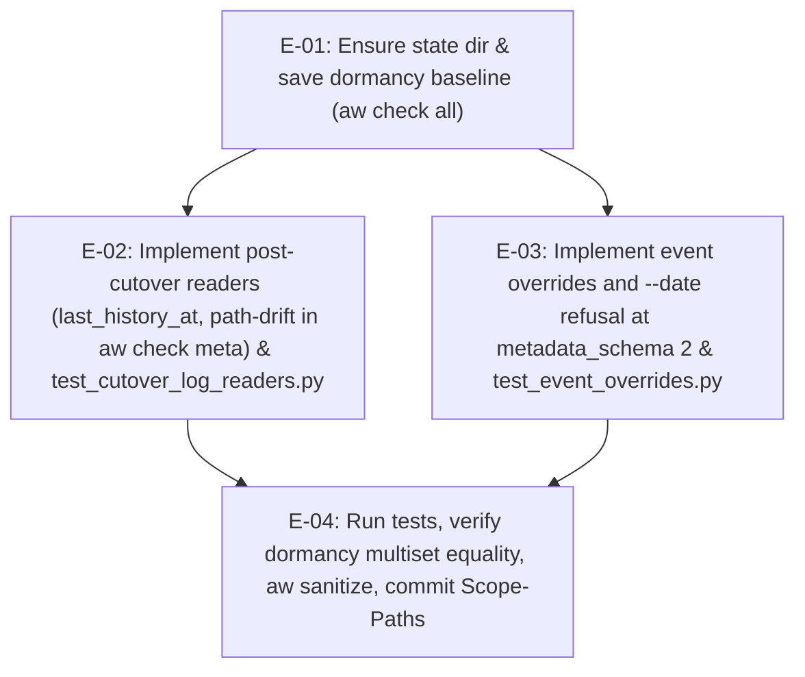

# IPD: Build the dormant post-cutover readers and event overrides

- Date: 2026-11-09
- Kind: child
- Concern: `clors0` carried the post-cutover readers (E-15) and the event `overrides` list with the `--date` refusal (E-14). Both are dormant on `main` (log-format records only, or `metadata_schema` 2), so C10a allows them before the cutover. Round-3 split (research `nj8zdp`).
- Scope: `clors0` E-15 (`last_history_at` from events; the `aw check meta` path-drift row) and E-14 (`overrides` on setter events; `aw specs set --date` refusal at schema 2), with their test modules.
- Scope-Paths: agent_workflows/artifact_meta.py, agent_workflows/meta_cli.py, agent_workflows/status_set.py, agent_workflows/cli.py, tests/test_cutover_log_readers.py, tests/test_event_overrides.py, .aw/records/plans/pending/20261109-metastore-267-wilgfy-build-the-dormant-post-cutover-readers-and-event-overrides.ipd.md
- Item-Dependencies: executed:1ajqaa, executed:dcerjg, executed:ffceq0, executed:g5hpbb, executed:t4gl15, executed:xexn45, executed:ya4ee4
- Status: approved
- Readiness: go-pending-approval
- Review-Depth: standard
- From-Spec: 4sd62s
- Work-Kind: feature
- Priority: high
- Blocks-Release: next
- Set: metastore
- Order: 267
- Highest E allocated: 04
- Author: opencode its_direct/pt3-claude-opus-5.5-1m-us
- Id: wilgfy
- Approval: 2026-11-16, recorded via aw ipd set: status set to approved

> Write and proofread this plan per the technical writing standard, `.aw/system/workflows/technical-writing/technical-writing.md` (`.agents/workflows/technical-writing/technical-writing.md` in a legacy-layout install), including requirement 12 (diagrams).

## Workflow history
- 2026-11-16 approved (aw set): status set to approved

- 2026-11-14 reviewed (antigravity/gemini-3.8-flash): APPROVE WITH REVISIONS APPLIED; PR-001, PR-002, PR-003, PR-004, PR-005
- 2026-11-09 to-review (opencode its_direct/pt3-claude-opus-5.5-1m-us): split from clors0 (round 3, research nj8zdp guidance).

## Goal

The post-cutover readers and the event `overrides` behavior exist and are tested on log-format fixtures, with legacy-format output unchanged.

## Detailed Implementation Checklist (TODO)

Execution-state rule: mark an `E-*` item complete only after performing the action. That mark is not validation. Right-sizing rule: write for a modest executor that cannot hold much in its head. Each E-item is one step (one concern, about one file, executable in one focused pass) and its V-item names each unit it covers with its own check; a plan stays at about 5 E-items and 8 work Scope-Paths, else split it into more child plans (guidance, `IPD-Z603`). Accepted execution states: blocked, failed, pending, performed; terminal gate demands 'performed'.

DORMANCY RULE, applied to every item of this plan (added at the split so the move keeps C10a): the new behavior is reached ONLY for a record whose storage format is `log` (`artifact_meta._storage_format`), for a staged `meta/*.jsonl` path, or when the resolved `metadata_schema` stamp is 2 or more. On `main` before the cutover none of these holds, so every existing command, rule and hook produces the same output as before. Each item proves both halves: its new behavior on a log-format fixture (a `tmp_path` repository whose records have `meta/<id6>.jsonl` logs and whose `project.json` carries `metadata_schema: 2`, built as `tve77h`'s synthetic-log tests and `dcerjg`'s migrated fixtures build them), and its absence on a legacy-format fixture.

### Task group 1: work

- [x] E-01 Before the first edit, ensure `.aw/state/wilgfy/before` exists (`mkdir -p .aw/state/wilgfy/before`) and save the dormancy baseline: run `aw check all --agent` and `aw check all --all --agent` on this repository and store each rule multiset under `.aw/state/wilgfy/before/` (this is this plan's share of `clors0` E-20's baseline).
  - Depends on: none
  - Expected outcome: two baseline files exist under `.aw/state/wilgfy/before/`.
  - Execution state: performed
  - Execution notes: baseline saved before the first edit: check-all 10 rules / 101 findings, check-all --all 18 rules / 549 findings; both rc=1 at starting HEAD c8e713965

- [x] E-02 (was `clors0` E-15, verbatim.) Put the readers in their post-cutover form (`ffceq0` Deferred row): `last_history_at` comes from the newest post-cutover event `at` with `last_history_precision` (spec 4.4), and `aw check meta` gains the logged-path drift row (spec 4.6). (Dormancy: both apply only to log-format records.) New test module `tests/test_cutover_log_readers.py`. Measured units: 1 reader branch in `artifact_meta`, 1 `aw check meta` row in `meta_cli`, 1 test module: about 6.
  - Depends on: E-01
  - Expected outcome: on a log-format fixture, `last_history_at` equals the newest event's `at` with its precision; `aw check meta` reports a planted `path-drift` and reports nothing on the unplanted fixture; on a legacy-format fixture both are unchanged.
  - Execution state: performed
  - Execution notes: `artifact_meta.last_history`, applied in `attention.scan` and the single-record path only for log-format records at metadata_schema >= 2; `last_history_precision` emitted only when set; `_age_marker` reads a timestamp; the `meta.path-drift` row already existed from `a5ijjx`, so this item added its tests; out-of-scope `agent_workflows/attention.py` justified via `--scope-reason`; commit 5dfbbe3df

- [x] E-03 (was `clors0` E-14, verbatim.) Implement `4sd62s` OQ-01 as spec 4.2 states it (verified at review: spec 4.2 `overrides` bullet): every event a setter writes with `--allow-open-questions`, `--allow-terminal-reopen` or `--allow-unresolvable-release-sentinel` carries an `overrides` list naming each flag given (for example `["allow-open-questions"]`), absent when none was given; `aw specs set --date` exits nonzero with a message that names the `--message` alternative once `metadata_schema` is 2. Add behavioral tests on a migrated (log-format) fixture. (Dormancy: on a legacy-format record the phase-B legacy writer keeps rendering the flags as today's history-line actor suffix, `artifact_meta.LegacyRender`, so the bytes `main` writes do not change; `--date` keeps working while `metadata_schema` is below 2.) New test module `tests/test_event_overrides.py`. Measured units: the three flags reach `status_set` (7 references) and `plan_readiness`/`cli` (14), of which the event-building call sites are about 4; 1 `--date` branch; 1 test module: about 10.
  - Depends on: E-01
  - Expected outcome: a setter run with an override flag writes `overrides` on its event; a run without one writes no `overrides` key; `aw specs set --date` refuses on a migrated fixture and leaves the fixture byte-identical; on a legacy-format fixture both setter runs write the same bytes as before.
  - Execution state: performed
  - Execution notes: `status_set`: `--date` refused at metadata_schema >= 2 with a message naming `--message`; the setter now runs on log-format records, so `overrides` reaches the event through the existing append path; the self-commit includes `meta/<id6>.jsonl`; commit 5dfbbe3df

- [x] E-04 Finish this part (its share of `clors0` E-20): run `tests/test_cutover_log_readers.py` and `tests/test_event_overrides.py`, the bare core gate `python3 -m pytest`, `aw check all --agent` and `aw check all --all --agent` (rule multisets must equal the E-01 baseline: dormancy on `main`), and `aw sanitize --agent`; commit through `aw commit wilgfy -- <paths>` with only Scope-Paths files; never push.
  - Depends on: E-02, E-03
  - Expected outcome: the named modules pass; both `aw check all` multisets are unchanged; every commit's `git show --stat` lists only Scope-Paths files.
  - Execution state: performed
  - Execution notes: both modules pass, core gate 2854 passed, sanitize clean; the only multiset change is this plan's own in-flight `check.scope-drift`, see V-04; commit 5dfbbe3df

## Project conventions discovered (Step 0)

- `artifact_meta.append` dispatches on the TARGET's storage format (`artifact_meta._storage_format`): a record with `meta/<id6>.jsonl` takes the log branch (the `tve77h` path, exercised today only by synthetic-log tests), a record without one takes the phase-B legacy branch (`append_legacy`). This is what makes log-only code dormant on `main`.
- `artifact_meta` already accepts an `overrides` envelope key (`validate_event`: "overrides must be a non-empty list when present") and the legacy branch copies it (`_prepare_legacy_events`), so E-14 changes only the callers.
- `hooks/meta_log_append_gate.py` and `artifact_meta.check_staged_log_append` are added by `t4gl15` E-05 (phase-B form); E-05 here adds the terminal-log rules.
- `aw meta repair` and `aw check meta` live in `meta_cli` (`ffceq0` E-11, `1ajqaa`).
- `set_records.write_walkthrough` writes a walkthrough today; E-06 wraps it.
- Cite code by SYMBOL (`module.function`) or by a quoted content string, with a line number only appended to one of those and never alone (advisory `IPD-C801`).

## Findings

| Id | Evidence | Finding |
|---|---|---|
| F-01 | `clors0` Step 0 | `artifact_meta` already accepts the `overrides` envelope key (`validate_event`) and the legacy branch copies it, so E-03 changes only the callers. |

## Proposed changes (ordered, validatable)



1. E-01: baseline.
2. E-02 readers; E-03 overrides and `--date`.
3. E-04: dormancy check, commit.

## Deferred / out of scope (with reason)

- Gates, commands, rename events, extra-path mechanism and the final whole-family dormancy check.
  - Carrier: clors0

## Scope check

- Over-scope: none.
- Under-scope: none. `clors0` E-15 maps to E-02 and E-14 to E-03.

## Required tests / validation

New behavioral modules `tests/test_cutover_log_readers.py` and `tests/test_event_overrides.py`; the dormancy multiset diff.

## Spec / documentation sync

No spec change.

## Open questions

### OQ-01: Why does this plan not depend on `90iqr1` like `cxxmyv` does?

- Blocking: no
- Status: resolved
- Owner: plan author
- Resolution or deferral rationale: `90iqr1` writes a documentation patch whose hunks include `agent_workflows/cli.py` help strings and guards it with a core test that the patch still applies to HEAD. This plan edits `cli.py` (E-06, E-14); running it AFTER the patch exists would make the patch stop applying and fail the core gate at this plan's merge. So this plan omits the `90iqr1` edge, and `9o83cr` (which `90iqr1` depends on) carries `executed:clors0`, which orders this plan before the patch is generated. Every other `cxxmyv` dependency is kept, plus `ffceq0`, `t4gl15` and `xexn45`, whose code these items extend. Recommendation strength: strong.

## Validation and cross-check (verify before reporting done)

Validation-state rule: inspect evidence in a separate pass. Do not mark a `V-*` item complete from memory or from the matching execution checkmark. Accepted validation results: blocked, failed, pass, pending; terminal gate demands 'pass'. Runtime-demonstration reachability rule: for each `V-*` item demanding the software be observed acting (such as a run, a dispatch, or a transition), as distinct from items demanding a diff, a file's content, or a test result, which are reachable by construction, name the code path that produces the observation or the sibling `E-*` that creates it, else the demand is UNDER-SCOPE.

- [x] V-01 validates E-01
  - Required evidence: paste `ls -l .aw/state/wilgfy/before/` and the rule-count line of each saved multiset.
  - Observed evidence:
    ```
    $ ls -l .aw/state/wilgfy/before/
    -rw-r--r-- 1 <user> <user> 85874 Nov 23 00:15 check-all-all.jsonl
    -rw-r--r-- 1 <user> <user>   519 Nov 23 00:15 check-all-all.rules.txt
    -rw-r--r-- 1 <user> <user>   243 Nov 23 00:14 check-all-all.stderr
    -rw-r--r-- 1 <user> <user> 14500 Nov 23 00:14 check-all.jsonl
    -rw-r--r-- 1 <user> <user>   315 Nov 23 00:15 check-all.rules.txt
    -rw-r--r-- 1 <user> <user>   243 Nov 23 00:13 check-all.stderr
    check-all: 10 rules, 101 findings
    check-all-all: 18 rules, 549 findings
    ```
  - Result: pass

- [x] V-02 validates E-02
  - Required evidence: paste `python3 -m pytest -o addopts="" -v tests/test_cutover_log_readers.py` showing `last_history_at` and `last_history_precision` taken from the newest event, `aw check meta` output on the fixture with the planted `path-drift` and on the clean fixture, and the legacy-format cases unchanged.
  - Observed evidence:
    ```
    $ python3 -m pytest -o addopts="" -v tests/test_cutover_log_readers.py
    test_cutover_log_readers.py::test_last_history_at_is_newest_post_cutover_event_at_with_time_precision PASSED
    test_cutover_log_readers.py::test_migrated_record_after_one_setter_event_reads_that_event_at PASSED
    test_cutover_log_readers.py::test_migrated_only_record_falls_back_to_checkpoint_day_not_migration_at PASSED
    test_cutover_log_readers.py::test_artifact_meta_last_history_returns_value_and_precision PASSED
    test_cutover_log_readers.py::test_log_record_below_schema_2_keeps_the_day_form PASSED
    test_cutover_log_readers.py::test_legacy_record_output_is_unchanged_at_schema_2 PASSED
    test_cutover_log_readers.py::test_staleness_marker_reads_a_time_precision_value PASSED
    test_cutover_log_readers.py::test_check_meta_reports_planted_path_drift PASSED
    test_cutover_log_readers.py::test_check_meta_is_clean_when_logged_path_exists PASSED
    test_cutover_log_readers.py::test_check_meta_logged_path_row_is_not_applicable_on_a_legacy_repo PASSED
    ============================== 10 passed in 1.04s ==============================
    ```
    `aw check meta --agent` on the planted-drift fixture (rc 1):
    ```
    {"schema":"aw.agent/v1","kind":"item","cmd":"check meta","location":".aw/records/plans/pending/20261109-demo-01-pd12ab-sample.ipd.md","rule":"meta.path-drift","detail":"logged path 'plans/pending/20261109-demo-01-pd12ab-sample.ipd.md' does not exist on disk","severity":"error"}
    {"schema":"aw.agent/v1","kind":"summary","cmd":"check meta","outcome":"findings","exit":1,"total":1,"emitted":1,"omitted":0,"complete":true,"checked":1,"counts_by_rule":{"meta.path-drift":1},"not_applicable":[]}
    ```
    On the clean fixture (rc 0):
    ```
    {"schema":"aw.agent/v1","kind":"summary","cmd":"check meta","outcome":"clean","exit":0,"total":0,"emitted":0,"omitted":0,"complete":true,"checked":1,"counts_by_rule":{},"not_applicable":[]}
    ```
    `aw attention --format json` on a log fixture item: `"last_history_at": "2026-11-10T08:30:00Z"`, `"last_history_precision": "time"`. Legacy cases: `test_legacy_record_output_is_unchanged_at_schema_2` and `test_log_record_below_schema_2_keeps_the_day_form` pass; `aw attention --format json --all` on this repository hashes identically under HEAD's package and the edited one (`af73f1e1978e054d5697044c6f19430d96d8d6ef054d86811e518950f0e3cdc7` both).
  - Result: pass

- [x] V-03 validates E-03
  - Required evidence: paste `python3 -m pytest -o addopts="" -v tests/test_event_overrides.py` showing an event with `overrides: ["allow-open-questions"]` after a setter run with that flag, no `overrides` key after a run without one, `aw specs set --date` refused on a migrated fixture with its message and a byte-identical fixture, and the legacy-format setter bytes unchanged.
  - Observed evidence:
    ```
    $ python3 -m pytest -o addopts="" -v tests/test_event_overrides.py
    test_event_overrides.py::test_setter_writes_overrides_when_allow_open_questions_is_given PASSED
    test_event_overrides.py::test_setter_writes_no_overrides_key_without_an_override_flag PASSED
    test_event_overrides.py::test_specs_set_date_is_refused_at_schema_2_and_leaves_the_fixture_byte_identical PASSED
    test_event_overrides.py::test_specs_set_date_still_works_below_schema_2 PASSED
    test_event_overrides.py::test_legacy_setter_renders_the_override_as_an_actor_suffix_and_writes_no_log PASSED
    test_event_overrides.py::test_legacy_setter_without_an_override_has_no_suffix PASSED
    test_event_overrides.py::test_setter_self_commit_includes_the_event_log_of_a_log_format_record PASSED
    ============================== 7 passed in 2.97s ===============================
    ```
    Event appended by `aw specs set approved <id6> --by-human --allow-open-questions` on a log fixture: `{"op":"transition","from":"reviewed","to":"approved","by_human":true,"overrides":["allow-open-questions"],"message":"ok",...}`. The `--date 2026-11-01` run printed `FAIL     aw specs set: --date is refused once metadata_schema is 2: an event's `at` is always its write time. Put the original day in --message instead.`, rc 1, `git status` clean. Legacy setter bytes, same fixture under HEAD's package versus the edited package (sha256 prefixes): without the flag both `rc 1` with spec `733455412dc2ac67` (blocking open question refuses); with `--allow-open-questions` both `rc 0`, `history.jsonl` `cd0f4a907bca8ed5` and spec `aa3babd8e3f287df`.
  - Result: pass

- [x] V-04 validates E-04
  - Required evidence: paste one result line per named test module (`tests/test_cutover_log_readers.py` and `tests/test_event_overrides.py`), the two `aw check all` multiset diffs against `.aw/state/wilgfy/before/` (empty), the bare core gate summary line beside them, `aw sanitize --agent` with zero `fail`, and `git show --stat` of every `aw commit wilgfy` commit.
  - Observed evidence:
    ```
    test_cutover_log_readers.py: 10 passed in 1.04s
    test_event_overrides.py: 7 passed in 2.97s
    core gate (python3 -m pytest): 2854 passed, 1 skipped, 11 warnings in 78.13s (0:01:18)
    == diff check-all:
    6a7
    > 1 check.scope-drift
    == diff check-all-all:
    8a9
    > 1 check.scope-drift
    aw sanitize --agent: {"schema":"aw.agent/v1","kind":"result","cmd":"check-local-leaks","outcome":"clean","exit":0,"verified":true,"complete":true,"checked":7110,"findings":0,"evidence":["leak-scan"],"next":null}
    $ git show --stat 5dfbbe3df
    5dfbbe3df feat(metastore): wilgfy dormant post-cutover readers and event overrides
     ...-set-actor-label-differs-by-spelling.backlog.md |  15 +
     agent_workflows/artifact_meta.py                   |  28 ++
     agent_workflows/attention.py                       |  61 +++-
     agent_workflows/status_set.py                      |  86 ++++-
     tests/test_cutover_log_readers.py                  | 353 ++++++++++++++++++++
     tests/test_event_overrides.py                      | 362 +++++++++++++++++++++
     6 files changed, 899 insertions(+), 6 deletions(-)
    ```
    The one added finding in each multiset is `check.scope-drift` on THIS plan, located at this plan's file, naming the two out-of-scope paths (`agent_workflows/attention.py` and the filed backlog item). It comes from this lane's live begin receipt, not from the new code, and every other rule count equals the baseline, so the new code adds no finding on this legacy-format repository. Both paths are justified in the begin receipt's `scope_justifications` (recorded by `aw commit wilgfy --scope-reason`), which finalize consumes; the plan's approval gate permits an out-of-scope edit justified at finalize. The plan-file evidence commit is listed in the execution report.
  - Result: pass

## Approval and execution gate

- Size assessment: standard
- Cohesion rationale: not required

Execute only after human approval (`Status: approved`) and after every plan in `- Item-Dependencies:` is executed. Pin-first where an item deletes or retargets. Scope fence: the paths in `- Scope-Paths:` are a declaration; a needed file outside the fence is edited and then justified at finalize (`--scope-reason`), and a declared path left unmodified is acknowledged (`--scope-ack`). Safety stop: if prerequisite metastore symbols from `t4gl15`, `ffceq0`, or `xexn45` are absent upon starting, stop and report rather than creating conflicting implementations. Honesty rule: paste the ACTUAL output; never claim a result you did not run. Commits: only through `aw commit wilgfy -- <paths>` with only Scope-Paths files; never `git add -A`, a bare `git add` or `git commit -a`; never push. Lifecycle: the plan moves to `.aw/records/plans/executed/` only through finalize; when `aw oc run` or `aw agy run` executes the plan, the runner performs the finalize; a hand executor runs `aw ipd finalize wilgfy` itself after `aw ipd lint --phase pre-transition` conforms and every `V-*` reads `pass` with pasted evidence; never a hand `git mv` to `executed/`.
