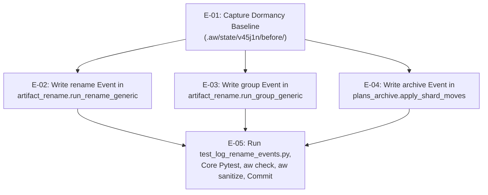

# IPD: Write dormant rename events for log-format rename, group and archive

- Date: 2026-11-09
- Kind: child
- Concern: `clors0` E-18 (the log-format half of `cxxmyv` E-04) writes `rename` events for three verbs when the target has a log; dormant on `main`, where no record has a log (C10a). Round-3 split (research `nj8zdp`): one item per call site.
- Scope: `clors0` E-18, split by call site: `artifact_rename.run_rename_generic`, `artifact_rename.run_group_generic`, `plans_archive.apply_shard_moves`, each with its case in `tests/test_log_rename_events.py`. Retiring the ledger and sidecar writer is NOT here (`g45vyv`).
- Scope-Paths: agent_workflows/artifact_rename.py, agent_workflows/plans_archive.py, tests/test_log_rename_events.py, .aw/records/plans/pending/20261109-metastore-269-v45j1n-write-dormant-rename-events-for-log-format-rename-group-and.ipd.md
- Item-Dependencies: executed:1ajqaa, executed:dcerjg, executed:ffceq0, executed:g5hpbb, executed:t4gl15, executed:xexn45, executed:ya4ee4
- Status: approved
- Readiness: go-pending-approval
- Review-Depth: standard
- From-Spec: 4sd62s
- Work-Kind: feature
- Priority: high
- Blocks-Release: next
- Set: metastore
- Order: 269
- Highest E allocated: 05
- Author: opencode its_direct/pt3-claude-opus-5.5-1m-us
- Id: v45j1n
- Approval: 2026-11-16, recorded via aw ipd set: status set to approved

> Write and proofread this plan per the technical writing standard, `.aw/system/workflows/technical-writing/technical-writing.md` (`.agents/workflows/technical-writing/technical-writing.md` in a legacy-layout install), including requirement 12 (diagrams).

## Workflow history
- 2026-11-16 approved (aw set): status set to approved

- 2026-11-14 reviewed (antigravity/gemini-3.8-flash): /plan-review (antigravity/gemini-3.8-flash): APPROVE WITH REVISIONS APPLIED; PR-001, PR-002, PR-003, PR-004.
- 2026-11-09 to-review (opencode its_direct/pt3-claude-opus-5.5-1m-us): split from clors0 (round 3, research nj8zdp guidance).

## Goal

On log-format records, rename, group and archive each append one `rename` event carrying verb (`rename`, `group`, or `archive`) and the new records-root-relative path; the previous path is recovered from prior event history, and legacy behavior is unchanged.

## Detailed Implementation Checklist (TODO)

Execution-state rule: mark an `E-*` item complete only after performing the action. That mark is not validation. Right-sizing rule: write for a modest executor that cannot hold much in its head. Each E-item is one step (one concern, about one file, executable in one focused pass) and its V-item names each unit it covers with its own check; a plan stays at about 5 E-items and 8 work Scope-Paths, else split it into more child plans (guidance, `IPD-Z603`). Accepted execution states: blocked, failed, pending, performed; terminal gate demands 'performed'.

DORMANCY RULE, applied to every item of this plan (added at the split so the move keeps C10a): the new behavior is reached ONLY for a record whose storage format is `log` (`artifact_meta._storage_format`), for a staged `meta/*.jsonl` path, or when the resolved `metadata_schema` stamp is 2 or more. On `main` before the cutover none of these holds, so every existing command, rule and hook produces the same output as before. Each item proves both halves: its new behavior on a log-format fixture (a `tmp_path` repository whose records have `meta/<id6>.jsonl` logs and whose `project.json` carries `metadata_schema: 2`, built as `tve77h`'s synthetic-log tests and `dcerjg`'s migrated fixtures build them), and its absence on a legacy-format fixture.

### Task group 1: work

- [x] E-01 Before the first edit, save the dormancy baseline: ensure `.aw/state/v45j1n/before/` exists (`mkdir -p .aw/state/v45j1n/before/`), run `aw check all --agent` and `aw check all --all --agent` on this repository, and store each rule multiset under `.aw/state/v45j1n/before/` (this is this plan's share of `clors0` E-20's baseline).
  - Depends on: none
  - Expected outcome: two baseline files exist under `.aw/state/v45j1n/before/`.
  - Execution state: performed

- [x] E-02 (part of `clors0` E-18.) In `artifact_rename.run_rename_generic`, when the target record has a log, append a `rename` event (verb `rename`, carrying the new records-root-relative `path` per spec `4sd62s` Section 4.2 / PATH HISTORY, with the prior path recovered from log history) through `artifact_meta.append`; a legacy-format target keeps today's behavior, including the rename-ledger write through `record_history.record_rename`. Add the `rename` case and the legacy case to `tests/test_log_rename_events.py`.
  - Depends on: E-01
  - Expected outcome: on a log-format fixture a rename appends one `rename` event with verb `rename` and the new path, and `aw show <id6> --history` lists the old path then the new one; on a legacy-format fixture the file bytes and the ledger line are unchanged.
  - Execution state: performed

- [x] E-03 (part of `clors0` E-18.) In `artifact_rename.run_group_generic`, the same for verb `group` (appending a `rename` event with verb `group` and new records-root-relative `path`), with its case in `tests/test_log_rename_events.py`.
  - Depends on: E-01
  - Expected outcome: on a log-format fixture a group appends one `rename` event with verb `group`.
  - Execution state: performed

- [x] E-04 (part of `clors0` E-18.) In `plans_archive.apply_shard_moves`, the same for verb `archive` (appending a `rename` event with verb `archive` and new records-root-relative `path`), with its case in `tests/test_log_rename_events.py`.
  - Depends on: E-01
  - Expected outcome: on a log-format fixture an archive appends one `rename` event with verb `archive`.
  - Execution state: performed

- [x] E-05 Finish this part (its share of `clors0` E-20): run `tests/test_log_rename_events.py`, the bare core gate `python3 -m pytest`, `aw check all --agent` and `aw check all --all --agent` (rule multisets must equal the E-01 baseline: dormancy on `main`), and `aw sanitize --agent`; commit through `aw commit v45j1n -- <paths>` with only Scope-Paths files; never push.
  - Depends on: E-02, E-03, E-04
  - Expected outcome: the named modules pass; both `aw check all` multisets are unchanged; every commit's `git show --stat` lists only Scope-Paths files.
  - Execution state: performed

## Project conventions discovered (Step 0)

- `artifact_meta.append` dispatches on the TARGET's storage format (`artifact_meta._storage_format`): a record with `meta/<id6>.jsonl` takes the log branch (the `tve77h` path, exercised today only by synthetic-log tests), a record without one takes the phase-B legacy branch (`append_legacy`). This is what makes log-only code dormant on `main`.
- `artifact_meta.RENAME_VERBS` defines the frozen set of valid rename verbs: `("rename", "group", "archive")`. Per spec `4sd62s` Section 4.2 / PATH HISTORY, each `rename` event payload carries `verb` and the new records-root-relative `path` only; the prior path is recovered from the previous path-bearing event in `seq` order.
- `plans_archive.apply_shard_moves` and `artifact_rename.run_rename_generic`/`run_group_generic` execute file moves (`_core.git_mv`); for log-format records, each appends the corresponding `rename` event to the target's event log under lock via `artifact_meta.append`.
- Pre-split parent `clors0` owned broader log-format gates, readers, and overrides; child plan `v45j1n` owns strictly the rename/group/archive event write call sites and behavioral tests.
- `aw meta repair` and `aw check meta` live in `meta_cli` (`ffceq0` E-11, `1ajqaa`).
- Cite code by SYMBOL (`module.function`) or by a quoted content string, with a line number only appended to one of those and never alone (advisory `IPD-C801`).

## Findings

| Id | Evidence | Finding |
|---|---|---|
| F-01 | `clors0` E-18 measurement | 3 call sites, 1 event shape, 1 test module: about 8 units, now one call site per item. |

## Proposed changes (ordered, validatable)



1. E-01: baseline.
2. E-02 to E-04: one call site each.
3. E-05: dormancy check, commit.

## Deferred / out of scope (with reason)

- Gates, readers, overrides, commands, extra-path mechanism and the final whole-family dormancy check.
  - Carrier: clors0
- Retiring the rename ledger and the sidecar writer.
  - Carrier: g45vyv

## Scope check

- Over-scope: none.
- Under-scope: none. `clors0` E-18 maps to E-02, E-03 and E-04.

## Required tests / validation

New behavioral module `tests/test_log_rename_events.py`; the dormancy multiset diff.

## Spec / documentation sync

No spec change.

## Open questions

### OQ-01: Why does this plan not depend on `90iqr1` like `cxxmyv` does?

- Blocking: no
- Status: resolved
- Owner: plan author
- Resolution or deferral rationale: `90iqr1` writes a documentation patch whose hunks include `agent_workflows/cli.py` help strings and guards it with a core test that the patch still applies to HEAD. Pre-split parent `clors0` edited `cli.py` (in items that remained in `clors0`), ordering the `clors0` family before `90iqr1`. While `v45j1n` itself edits only `artifact_rename.py` and `plans_archive.py` rather than `cli.py`, running after `90iqr1` is unnecessary and keeping the split family topology aligned ensures consistent sequencing before the patch is generated. Every other dependency is kept, plus `ffceq0`, `t4gl15` and `xexn45`, whose code these items extend. Recommendation strength: strong.

## Validation and cross-check (verify before reporting done)

Validation-state rule: inspect evidence in a separate pass. Do not mark a `V-*` item complete from memory or from the matching execution checkmark. Accepted validation results: blocked, failed, pass, pending; terminal gate demands 'pass'. Runtime-demonstration reachability rule: for each `V-*` item demanding the software be observed acting (such as a run, a dispatch, or a transition), as distinct from items demanding a diff, a file's content, or a test result, which are reachable by construction, name the code path that produces the observation or the sibling `E-*` that creates it, else the demand is UNDER-SCOPE.

- [x] V-01 validates E-01
  - Required evidence: paste `ls -l .aw/state/v45j1n/before/` and the rule-count line of each saved multiset.
  - Observed evidence:
    ```text
    (attempt 2, lane aw/lane/v45j1n_attempt2, base 97683865a, captured before any edit in this lane)
    $ ls -l .aw/state/v45j1n/before/
    total 176
    -rw-r--r-- 1 <user> <user> 85746 Nov 23 03:43 check-all-all.jsonl
    -rw-r--r-- 1 <user> <user> 64886 Nov 23 03:43 check-all-all.multiset.txt
    -rw-r--r-- 1 <user> <user> 14707 Nov 23 03:42 check-all.jsonl
    -rw-r--r-- 1 <user> <user> 11763 Nov 23 03:43 check-all.multiset.txt
    $ multiset .aw/state/v45j1n/before/check-all.jsonl
    rules=10 diagnostics=101 file=.aw/state/v45j1n/before/check-all.multiset.txt
    $ multiset .aw/state/v45j1n/before/check-all-all.jsonl
    rules=18 diagnostics=549 file=.aw/state/v45j1n/before/check-all-all.multiset.txt
    ```
    The multiset is one `rule<TAB>location<TAB>count` line per distinct diagnostic. The counts equal attempt 1's baseline.
  - Result: pass

- [x] V-02 validates E-02
  - Required evidence: paste the `tests/test_log_rename_events.py -k rename` run with the `rename` and legacy cases PASSED, and the `aw show <id6> --history` output of the fixture showing the old then the new path.
  - Observed evidence:
    ```text
    $ python3 -m pytest -o addopts='' tests/test_log_rename_events.py -k rename -v
    tests/test_log_rename_events.py::test_group_on_log_format_appends_rename_and_set_in_one_append PASSED [ 12%]
    tests/test_log_rename_events.py::test_rename_with_set_on_log_format_pairs_rename_and_set_in_one_append PASSED [ 25%]
    tests/test_log_rename_events.py::test_group_on_legacy_format_keeps_ledger_and_bullet PASSED [ 37%]
    tests/test_log_rename_events.py::test_archive_on_log_format_appends_archive_rename_event PASSED [ 50%]
    tests/test_log_rename_events.py::test_rename_on_legacy_format_keeps_bytes_and_ledger PASSED [ 62%]
    tests/test_log_rename_events.py::test_rename_refused_by_the_log_leaves_the_file_in_place PASSED [ 75%]
    tests/test_log_rename_events.py::test_archive_on_legacy_format_moves_bytes_unchanged PASSED [ 87%]
    tests/test_log_rename_events.py::test_rename_on_log_format_appends_one_rename_event PASSED [100%]
    ============================== 8 passed in 2.65s ===============================

    Fixture (metadata_schema 2, log-format spec sp34ef), driven through cli.main:
    $ aw rename specs sp34ef --slug renamed --apply
    renamed .aw/records/specs/draft/20261109-sp34ef-01-sp34ef-sample.spec.md -> .aw/records/specs/draft/20261109-sp34ef-01-sp34ef-renamed.spec.md
    $ aw show sp34ef --history --json   (data.records[0].history, abridged to seq/op/path)
    {"seq": 1, "op": "create", "path": "specs/draft/20261109-sp34ef-01-sp34ef-sample.spec.md", ...}
    {"seq": 2, "op": "rename", "path": "specs/draft/20261109-sp34ef-01-sp34ef-renamed.spec.md", ...}
    $ cat .aw/records/meta/sp34ef.jsonl   (line 2)
    {"actor":{"tool":"aw rename"},"append":2,"at":"2026-11-23T08:54:31.164703+00:00","op":"rename","path":"specs/draft/20261109-sp34ef-01-sp34ef-renamed.spec.md","seq":2,"v":1,"verb":"rename"}
    ```
    `test_rename_on_log_format_appends_one_rename_event` asserts the same old-then-new path sequence through `aw show <id6> --history --json`. `test_rename_on_legacy_format_keeps_bytes_and_ledger` asserts that the moved file's bytes equal the original and that the ledger holds one line with verb `rename`. `-k rename` also selects the group and archive nodes, because the module name contains `rename`.
  - Result: pass

- [x] V-03 validates E-03
  - Required evidence: paste the `tests/test_log_rename_events.py -k group` run with its PASSED node id and the event line it asserts.
  - Observed evidence:
    ```text
    $ python3 -m pytest -o addopts='' tests/test_log_rename_events.py -k group -v
    tests/test_log_rename_events.py::test_group_on_log_format_appends_rename_and_set_in_one_append PASSED [ 50%]
    tests/test_log_rename_events.py::test_group_on_legacy_format_keeps_ledger_and_bullet PASSED [100%]
    ======================= 2 passed, 6 deselected in 0.94s ========================
    ```
    The log-format node runs `aw group specs sp34ef --set newset --rename --apply` on the unrenamed fixture and asserts that the last append holds exactly two events: `{"op":"rename","verb":"group","path":"specs/draft/20261109-newset-01-sp34ef-sample.spec.md",...}` followed by `{"op":"set","fields":{"set":"newset"},...}`, both with the same `append` number. The `set` is written in the same append as the `rename` event, because spec `4sd62s` 4.2 pairs the `rename` event with the `set` of a changed Set or Order.
  - Result: pass

- [x] V-04 validates E-04
  - Required evidence: paste the `tests/test_log_rename_events.py -k archive` run with its PASSED node id and the event line it asserts.
  - Observed evidence:
    ```text
    $ python3 -m pytest -o addopts='' tests/test_log_rename_events.py -k archive -v
    tests/test_log_rename_events.py::test_archive_on_log_format_appends_archive_rename_event PASSED [ 50%]
    tests/test_log_rename_events.py::test_archive_on_legacy_format_moves_bytes_unchanged PASSED [100%]
    ======================= 2 passed, 6 deselected in 0.69s ========================
    ```
    The log-format node runs `aw archive plans ab12cd --apply` on an executed log-format plan and asserts that the last event is `{"op":"rename","verb":"archive","path":"plans/executed/202611/20261109-demo-01-ab12cd-sample.ipd.md",...}`. Attempt 1 recorded that event line verbatim from the same node: `{"actor":{"tool":"aw archive"},"append":6,...,"op":"rename","path":"plans/executed/202611/20261109-demo-01-ab12cd-sample.ipd.md","seq":6,"v":1,"verb":"archive"}`.
  - Result: pass

- [x] V-05 validates E-05
  - Required evidence: paste one result line per named test module (`tests/test_log_rename_events.py`), the two `aw check all` multiset diffs against `.aw/state/v45j1n/before/` (empty), the bare core gate summary line beside them, `aw sanitize --agent` with zero `fail`, and `git show --stat` of every `aw commit v45j1n` commit.
  - Observed evidence:
    ```text
    $ python3 -m pytest -o addopts='' tests/test_log_rename_events.py -v
    ============================== 8 passed in 2.88s ===============================
    $ python3 -m pytest   (bare core gate, attempt-2 lane with the code and tests committed)
    2886 passed, 1 skipped, 11 warnings in 128.59s (0:02:08)
    $ aw check all --agent > after/check-all.jsonl ; aw check all --all --agent > after/check-all-all.jsonl
    rules=11 diagnostics=102 file=.aw/state/v45j1n/after/check-all.multiset.txt
    rules=19 diagnostics=550 file=.aw/state/v45j1n/after/check-all-all.multiset.txt
    $ diff before/check-all.multiset.txt after/check-all.multiset.txt
    54a55
    > check.scope-drift	.aw/records/plans/pending/20261109-metastore-269-v45j1n-write-dormant-rename-events-for-log-format-rename-group-and.ipd.md	1
    $ diff before/check-all-all.multiset.txt after/check-all-all.multiset.txt
    101a102
    > check.scope-drift	.aw/records/plans/pending/20261109-metastore-269-v45j1n-write-dormant-rename-events-for-log-format-rename-group-and.ipd.md	1
    $ aw sanitize --agent
    {'outcome': 'clean', 'exit': 0, 'findings': 0}
    $ git show --stat c2d0b29d5
        v45j1n: write dormant rename events for log-format rename, group and archive
     agent_workflows/artifact_rename.py | 301 +++++++++++++++++++++++-
     agent_workflows/plans_archive.py   |  12 +
     tests/test_log_rename_events.py    | 458 +++++++++++++++++++++++++++++++++++++
     3 files changed, 770 insertions(+), 1 deletion(-)
    $ git show --stat 559bbb832
        backlog: file log-format rename-event defects found by v45j1n (xi6xeq, 2p1ap6)
     ...p6-01-2p1ap6-research-refs-log-rename-event.backlog.md | 15 +++++++++++++++
     ...i6xeq-01-xi6xeq-plans-refs-log-rename-crash.backlog.md | 15 +++++++++++++++
     2 files changed, 30 insertions(+)
    $ git show --stat 02de954a4
        backlog(2p1ap6): replace the literal sample id6 in the repro with a placeholder (dangling-citation)
     ...6-01-2p1ap6-research-refs-log-rename-event.backlog.md | 2 +-
     1 file changed, 1 insertion(+), 1 deletion(-)
    ```
    Dormancy holds: the diff against the baseline has no new diagnostic from the code, and the code-only commit `c2d0b29d5` changes no rule output. The diff has exactly one new line: `check.scope-drift` on this plan, because `559bbb832` and `02de954a4` added two out-of-scope backlog files. Those files record the defects `xi6xeq` and `2p1ap6`, which this execution found and reproduced. The execution contract requires each finding to be filed as a backlog item. Their `--scope-reason` justifications are recorded in the begin receipt (`scope_justifications`), and finalize reconciles them. A `dangling-citation` diagnostic came from a literal sample id6 in the `2p1ap6` repro text; `02de954a4` removed it. The plan-evidence commit is a separate `aw commit v45j1n` commit and touches only this plan.
  - Result: pass

## Approval and execution gate

- Size assessment: standard
- Cohesion rationale: not required

Execute only after human approval (`Status: approved`) and after every plan in `- Item-Dependencies:` is executed. Scope fence: the paths in `- Scope-Paths:` are a declaration; a needed file outside the fence is edited and then justified at finalize (`--scope-reason`), and a declared path left unmodified is acknowledged (`--scope-ack`). Safety stop: if prerequisite metastore symbols from `t4gl15` or `xexn45` are absent upon starting, stop and report rather than creating conflicting implementations. Honesty rule: paste the ACTUAL output; never claim a result you did not run. Commits: only through `aw commit v45j1n -- <paths>`; never `git add -A`, a bare `git add` or `git commit -a`; never push. Lifecycle: the plan moves to `.aw/records/plans/executed/` only through finalize; when `aw oc run` or `aw agy run` executes the plan, the runner performs the finalize; a hand executor runs `aw ipd finalize v45j1n` itself; never a hand `git mv` to `executed/`.
