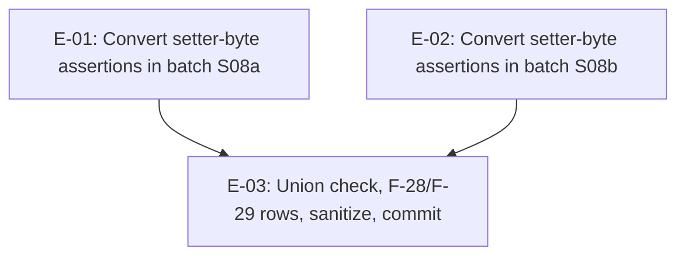

# IPD: Move setter-byte assertions of batch S08 onto the format-aware helper

- Date: 2026-11-09
- Kind: child
- Concern: Spec `4sd62s` C10a requires `main` to read and write exactly one metadata format at every commit, so the cutover commit (Order 13, `cxxmyv`) must switch the format and every test that asserts on it at once. `cxxmyv` E-07 carried, as one item, "convert the setter-byte assertions to `artifact_meta.read` plus the in-file mirror" (`59aiyh` Deferred row). Measured 2026-11-07 at `ac76110f4`: `rg -n "assert.*['\"]- (Status|Priority|Blocks-Release|Work-Kind|From-Backlog|From-Spec|Readiness|Approval|Set|Order|Kind|Id|Gate-Kind|Gate-Ref|Item-Dependencies|Graduated-To|Close-Evidence|Release-Exempt-(Kind|Ref)):" tests`, minus lines over command output and minus the legacy-grammar test modules, prints 518 candidate lines in 81 test modules; the 7 modules that `k6jd6l` E-08 already retargets hold 51 of them, leaving 467 in 74 modules. Converting them inside the attended cutover would hide several hundred steps in one item of a plan that cannot be retried cheaply. This work CAN move earlier without changing `main`'s on-disk format: the helper asserts through the ACTIVE format, which is the legacy format until the cutover, so every converted test still checks the same bytes today and needs no edit when the cutover flips the builder. Round-3 split of `rdg0qv` (research `nj8zdp`): this part converts batch S08 (`rdg0qv` E-01) as two halves of three modules; the helper is `j5fqax` E-01 (formerly `iog3cw` E-01).
- Scope: Batch S08 (`rdg0qv` E-01): 6 modules, 24 candidate lines at `ac76110f4`, as S08a and S08b. EXCLUDES the `rdg0qv` exclusions: switching `RECORD_FORMAT` to `log`, the log branch of the helper, displayed-output assertions, legacy-format subject tests, the `review-pilot` corpus, production code.
- Scope-Paths: tests/test_handoff_ready_gate.py, tests/test_implementing_spec_replan.py, tests/test_ipd_lifecycle_cli.py, tests/test_oc_runipd.py, tests/test_orchestrator_retirement.py, tests/test_orchestrator_status_gate.py, .aw/records/plans/pending/20261109-metastore-270-wdz2l9-move-setter-byte-assertions-of-batch-s08-onto-the-format-awa.ipd.md
- Item-Dependencies: executed:1ajqaa, executed:59aiyh, executed:90iqr1, executed:dcerjg, executed:g5hpbb, executed:iog3cw, executed:ya4ee4
- Status: approved
- From-Spec: 4sd62s
- Work-Kind: feature
- Priority: high
- Blocks-Release: next
- Set: metastore
- Order: 270
- Highest E allocated: 03
- Author: opencode its_direct/pt3-claude-opus-5.5-1m-us
- Id: wdz2l9
- Approval: 2026-11-16, recorded via aw ipd set: status set to approved
- Readiness: go-pending-approval
- Review-Depth: standard

## Workflow history
- 2026-11-16 approved (aw set): status set to approved
- 2026-11-14 reviewed (aw set): APPROVE WITH REVISIONS APPLIED; PR-001..PR-004 FIXED

- 2026-11-14 /plan-review (antigravity/gemini): APPROVE WITH REVISIONS APPLIED; PR-001..PR-004 FIXED; review record .aw/records/reviews/20261109-metastore-270-wdz2l9-move-setter-byte-assertions-of-batch-s08-onto-the-format-awa.review.md
- 2026-11-09 to-review (opencode its_direct/pt3-claude-opus-5.5-1m-us): split from rdg0qv (round 3, research nj8zdp guidance).

## Goal

Every setter-byte assertion in the six S08 modules goes through the format-aware field helper, with identical per-test outcomes before and after.

## Detailed Implementation Checklist (TODO)

Execution-state rule: mark an `E-*` item complete only after performing the action. That mark is not validation. Right-sizing rule: write for a modest executor that cannot hold much in its head. Each E-item is one step (one concern, about one file, executable in one focused pass) and its V-item names each unit it covers with its own check; a plan stays at about 5 E-items and 8 work Scope-Paths, else split it into more child plans (guidance, `IPD-Z603`). Accepted execution states: blocked, failed, pending, performed; terminal gate demands 'performed'.

Batch rule, applied to every batch E-item of this plan:
1. Record the unmodified per-test outcome list of the batch's modules: `mkdir -p .aw/state/wdz2l9 && python3 -m pytest -o addopts="" -m "" -p no:randomly -n 0 -rA <modules> | grep -E "^(PASSED|FAILED|ERROR|SKIPPED|XFAIL|XPASS) " | sed -E 's/ - .*//' | sort > .aw/state/wdz2l9/<batch>-before.txt`. For a batch restricted to named test classes, pass the `<module>::<Class>` node ids.
2. In each named module (or class), replace every SETTER-BYTE assertion with a call to the helper of `tests/record_builder.py` added by `j5fqax` E-01, formerly `iog3cw` E-01 (`assert_field(path, field, value)` and `assert_no_field(path, field)`). A setter-byte assertion is an `assertIn`/`assertNotIn`/`assert ... in` over the text of a RECORD FILE that names a front-matter bullet (`- Status:`, `- Priority:`, `- Blocks-Release:` and the other F-28 fields). An assertion over command OUTPUT (stdout, stderr, a rendered message) is a `displayed-output assertion` and is NOT converted; an assertion whose subject is the legacy grammar itself (a legacy-loader, migration or quoted-example test) is `legacy-format subject` and is NOT converted.
3. Re-run the same command into `<batch>-after.txt` and require `diff` to print nothing. A conversion that would change what a test checks (for example a test that asserts the exact bullet spelling, such as whitespace after the colon) stops and is reported with its node id; it is listed as `setter-byte, exact spelling` in F-28 for `cxxmyv`, not weakened.
4. Count the remaining matches of the F-28 pattern in the batch's modules and give each remaining line one class: `converted` (none should remain), `displayed-output assertion`, `legacy-format subject` or `setter-byte, exact spelling`.
5. The helper never reads production source, and no test gains a source-reading assertion.

### Task group 1: work

- [x] E-01 (first half of `rdg0qv` E-01 (S08)) Batch S08a: convert the setter-byte assertions of `tests/test_handoff_ready_gate.py`, `tests/test_implementing_spec_replan.py`, `tests/test_ipd_lifecycle_cli.py` (F-28). Apply the batch rule with `<batch>` = `S08a`.
  - Depends on: none
  - Expected outcome: an empty before/after `diff` for the S08a outcome lists; the remaining F-28 matches in these modules pasted with a class on each and no `setter-byte` row left unconverted except `setter-byte, exact spelling` rows with their node ids.
  - Execution state: performed

- [x] E-02 (second half of `rdg0qv` E-01 (S08)) Batch S08b: convert the setter-byte assertions of `tests/test_oc_runipd.py`, `tests/test_orchestrator_retirement.py`, `tests/test_orchestrator_status_gate.py` (F-28). Apply the batch rule with `<batch>` = `S08b`.
  - Depends on: none
  - Expected outcome: an empty before/after `diff` for the S08b outcome lists; the remaining F-28 matches in these modules pasted with a class on each and no `setter-byte` row left unconverted except `setter-byte, exact spelling` rows with their node ids.
  - Execution state: performed

- [x] E-03 Finish this part: run the batch rule's command over the 6 modules of this plan once more and confirm the outcome multiset equals the union of the `-before.txt` lists of S08a, S08b; write this plan's F-28 rows (one row per remaining match with its class) and F-29 (per-module PASSED, FAILED, SKIPPED and XFAIL counts of the after run) so `rdg0qv` can assemble the part table; run `aw sanitize --agent`; commit through `aw commit wdz2l9 -- <each changed path>`, never `git add -A`, a bare `git add` or `git commit -a`. Never push.
  - Depends on: E-01, E-02
  - Expected outcome: the union comparison is empty; F-28 and F-29 for this part are written; every commit is path-scoped to Scope-Paths.
  - Execution state: performed

## Project conventions discovered (Step 0)

- Test data comes from ONE builder, `tests/record_builder.py` (`9rgn2w`/`59aiyh`), which writes through `artifact_meta`; `cxxmyv` E-07 switches it to `RECORD_FORMAT = "log"` in the cutover commit.
- Tests are behavioral (AGENTS.md "TEST OUTCOMES, NOT CODE STRUCTURE"); core modules set `pytestmark = pytest.mark.core`; `pyproject.toml` `addopts` deselects `slow` and `livecorpus`, so a complete comparison passes `-m ""`, and `pytest-randomly` is installed, so a deterministic order needs `-p no:randomly`.
- `artifact_meta.read_text(text, *, record_type=None) -> State` parses a record's text in either format (phase-B legacy loader), so the helper's legacy branch needs no new parser.
- Cite code by SYMBOL (`module.function`) or by a quoted content string, with a line number only appended to one of those and never alone (advisory `IPD-C801`).

## Findings

| Id | Evidence | Finding |
|---|---|---|
| F-28 | `rdg0qv` F-28 (measurement at `ac76110f4`); post-conversion scan with the F-28 pattern at `e7427ece2` (`rg -c` before -> after: `tests/test_handoff_ready_gate.py` 4 -> 0, `tests/test_implementing_spec_replan.py` 2 -> 0, `tests/test_ipd_lifecycle_cli.py` 4 -> 0, `tests/test_oc_runipd.py` 3 -> 0, `tests/test_orchestrator_retirement.py` 2 -> 0, `tests/test_orchestrator_status_gate.py` 10 -> 1) | This part: S08, 6 modules, 25 candidate lines at `ac211e7c5` (24 at `ac76110f4`); 24 converted, 1 remaining, 0 `setter-byte, exact spelling`, 0 `legacy-format subject`. (1) `tests/test_orchestrator_status_gate.py::TestOrchestratorStatusGate::test_scaffold_orchestrator_dry_run_emits_draft` (`self.assertIn("- Status: draft", proc.stdout)`) - `displayed-output assertion` (stdout of `aw ipd scaffold --dry-run`, not a record file). One negative byte check was subsumed rather than kept: `self.assertNotIn("- Status: implemented", spec_text)` (`tests/test_implementing_spec_replan.py`), because `assert_field` requires exactly one `- Status:` bullet in the metadata region with the expected value (decision `07-wdz2l9-D1`, same reasoning as `05-cxylsu-D1`). `tests/test_oc_runipd.py` `_refusal_run` now asserts the plan's status inside its temporary directory instead of returning the raw bullet line (decision `07-wdz2l9-D2`). `self.assertNotIn("- Readiness:", text)` in `tests/test_orchestrator_status_gate.py` became `assert_no_field(orch, "readiness")` (decision `07-wdz2l9-D3`). |
| F-29 | `.aw/state/wdz2l9/union-after.txt` (batch-rule command over all 6 modules, after conversion) | Per-module after-run counts (PASSED / FAILED / SKIPPED / XFAIL): `tests/test_handoff_ready_gate.py` 16/0/0/0; `tests/test_implementing_spec_replan.py` 7/0/0/0; `tests/test_ipd_lifecycle_cli.py` 72/0/0/0; `tests/test_oc_runipd.py` 177/0/0/0; `tests/test_orchestrator_retirement.py` 43/0/0/0; `tests/test_orchestrator_status_gate.py` 13/0/0/0. Total 328 PASSED. |

## Proposed changes (ordered, validatable)

1. E-01, E-02: the two halves of S08 (independent).
2. E-03: union check, F-28 rows, commit.

## Deferred / out of scope (with reason)

- Batches S09, S10 and the assembly of the S08 to S10 F-28 table.
  - Carrier: rdg0qv
- Switching the builder to `RECORD_FORMAT = "log"`, the helper's log-format branch, and the `setter-byte, exact spelling` rows: cutover commit (C10a).
  - Carrier: x1mmdp

## Scope check

- Over-scope: none. No production module changes.
- Under-scope: none. `rdg0qv` E-01's module list equals the union of E-01's and E-02's lists here; this part's share of `rdg0qv` E-04 maps to E-03.

## Required tests / validation

Each batch is validated by an identical per-test result list before and after (the batch rule), which is behavioral by construction. Commands: the batch rule's command per batch, the per-module F-28 `rg -c` counts, the bare core gate `python3 -m pytest` beside them, `aw sanitize --agent`. CONTRIBUTES to AC-1b (owned by `cxxmyv`).

## Spec / documentation sync

No spec change; prepares part of `4sd62s` section 6 and section 7 step 9 (the test-data half of the cutover) without changing the on-disk format.

## Open questions

### OQ-01: Can this run before the cutover without breaking C10a?

- Blocking: no
- Status: resolved
- Owner: none
- Resolution or deferral rationale: Yes. The helper reads through the ACTIVE format and, in the legacy format, also asserts the exact bullet line, so each converted test checks at least what it checked before on the same legacy bytes; `main` keeps one on-disk format. Only the format switch, the log branch of the helper and the exact-spelling rows wait for the cutover commit. Recommendation strength: strong.

## Validation and cross-check (verify before reporting done)

Validation-state rule: inspect evidence in a separate pass. Do not mark a `V-*` item complete from memory or from the matching execution checkmark. Accepted validation results: blocked, failed, pass, pending; terminal gate demands 'pass'. Runtime-demonstration reachability rule: for each `V-*` item demanding the software be observed acting (such as a run, a dispatch, or a transition), as distinct from items demanding a diff, a file's content, or a test result, which are reachable by construction, name the code path that produces the observation or the sibling `E-*` that creates it, else the demand is UNDER-SCOPE.

- [x] V-01 validates E-01
  - Required evidence: paste the empty `diff .aw/state/wdz2l9/S08a-before.txt .aw/state/wdz2l9/S08a-after.txt`, the before and after F-28 `rg -c` count for each of `tests/test_handoff_ready_gate.py`, `tests/test_implementing_spec_replan.py`, `tests/test_ipd_lifecycle_cli.py`, and the class of every remaining match.
  - Observed evidence:
    - `diff .aw/state/wdz2l9/S08a-before.txt .aw/state/wdz2l9/S08a-after.txt`: empty (printed `EMPTY-DIFF` from `diff ... && echo EMPTY-DIFF`; 95 lines in both files, all `PASSED`).
    - F-28 `rg -c` counts (before at `ac211e7c5` -> after): `tests/test_handoff_ready_gate.py` 4 -> 0; `tests/test_implementing_spec_replan.py` 2 -> 0; `tests/test_ipd_lifecycle_cli.py` 4 -> 0.
    - Remaining matches: none, so no class to assign. The negative `assertNotIn("- Status: implemented", spec_text)` is subsumed by `assert_field`'s exactly-one-bullet check (decision `07-wdz2l9-D1`).
  - Result: pass

- [x] V-02 validates E-02
  - Required evidence: paste the empty `diff .aw/state/wdz2l9/S08b-before.txt .aw/state/wdz2l9/S08b-after.txt`, the before and after F-28 `rg -c` count for each of `tests/test_oc_runipd.py`, `tests/test_orchestrator_retirement.py`, `tests/test_orchestrator_status_gate.py`, and the class of every remaining match.
  - Observed evidence:
    - `diff .aw/state/wdz2l9/S08b-before.txt .aw/state/wdz2l9/S08b-after.txt`: empty (printed `EMPTY-DIFF`; 233 lines in both files, all `PASSED`).
    - F-28 `rg -c` counts (before at `ac211e7c5` -> after): `tests/test_oc_runipd.py` 3 -> 0; `tests/test_orchestrator_retirement.py` 2 -> 0; `tests/test_orchestrator_status_gate.py` 10 -> 1.
    - Remaining match: `tests/test_orchestrator_status_gate.py:593` `self.assertIn("- Status: draft", proc.stdout)` (`test_scaffold_orchestrator_dry_run_emits_draft`) - `displayed-output assertion` (stdout of `aw ipd scaffold --dry-run`).
  - Result: pass

- [x] V-03 validates E-03
  - Required evidence: paste the empty union `diff`, this plan's F-28 rows, the F-29 table with one row per module of this plan, the `aw sanitize --agent` result with zero `fail`, and every `aw commit wdz2l9` output listing only Scope-Paths.
  - Observed evidence:
    - `diff .aw/state/wdz2l9/union-before.txt .aw/state/wdz2l9/union-after.txt` (union-before is `sort S08a-before.txt S08b-before.txt`; union-after is one batch-rule run over all 6 modules): empty (printed `EMPTY-UNION-DIFF`; 328 lines each).
    - F-28 rows and F-29 table for this part written in `## Findings` (1 remaining row, `displayed-output assertion`; F-29 328 PASSED, 0 FAILED/SKIPPED/XFAIL).
    - Bare core gate `python3 -m pytest`: `2952 passed, 1 skipped, 11 warnings in 103.19s (0:01:43)`.
    - `aw sanitize --agent`: `{"schema":"aw.agent/v1","kind":"result","cmd":"check-local-leaks","outcome":"clean","exit":0,"verified":true,"complete":true,"checked":7230,"findings":0,"evidence":["leak-scan"],"next":null}`.
    - `aw commit wdz2l9 -m "test(wdz2l9): move S08a setter-byte assertions onto assert_field" -- tests/test_handoff_ready_gate.py tests/test_implementing_spec_replan.py tests/test_ipd_lifecycle_cli.py`: `aw commit: committed 3 path(s): 4ac35f0f7557dca012a7b6cf0331b371a4bb7226`.
    - `aw commit wdz2l9 -m "test(wdz2l9): move S08b setter-byte assertions onto assert_field/assert_no_field" -- tests/test_oc_runipd.py tests/test_orchestrator_retirement.py tests/test_orchestrator_status_gate.py`: `aw commit: committed 3 path(s): e7427ece2b322a70a3221f3933cc4d10cf1c6ec9`.
    - This plan update is committed in a follow-up `aw commit wdz2l9` naming only this IPD path. All 7 Scope-Paths are modified.
  - Result: pass

## Approval and execution gate

- Size assessment: standard
- Cohesion rationale: not required

Execute only after human approval (`Status: approved`) and after every plan in `- Item-Dependencies:` is executed. Scope fence: the paths in `- Scope-Paths:` are a declaration; a needed file outside the fence is edited and then justified at finalize (`--scope-reason`), and a declared path left unmodified is acknowledged (`--scope-ack`). Stop and report rather than editing production code or weakening test assertions if an unexpected failure occurs on unmodified code, if an assertion pins exact legacy syntax that cannot be cleanly expressed via `assert_field`, or if an unresolvable concurrent-edit conflict occurs. Honesty rule: paste the ACTUAL output; never claim a result you did not run. Commits: only through `aw commit wdz2l9 -- <paths>`; never push. Lifecycle: the plan moves to `.aw/records/plans/executed/` only through `aw ipd finalize`, after `aw ipd lint --phase pre-transition` conforms and every `V-*` reads `pass` with pasted evidence.
